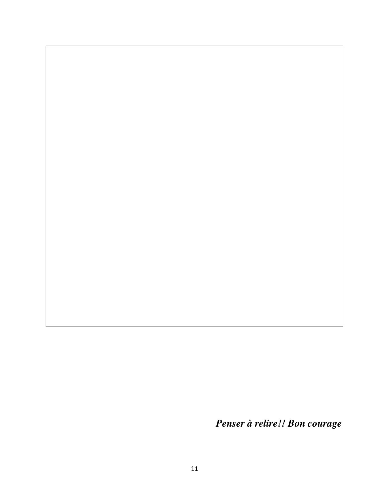
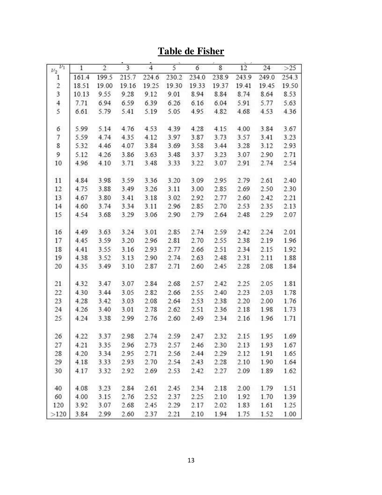

# Modele Lineaire-ING2-GM.Apprentis(1).pdf

[Ouvrir l’original](https://drive.google.com/open?id=1_F4vAzVLM5hor_tTmDpC6m6Q5-t5VDUk) · Les pages signalées comprennent du texte reconnu automatiquement ou des éléments graphiques. Le fac-similé permet de vérifier chaque lecture.

**Pages avec fac-similé ou lecture OCR** — 11, 13.

## Page 1

~~~text
                                                            ING2-GMA
                                                      EXAMEN DE MODELE LINEAIRE
                                                            2023-2024
                         2 feuilles R/V (manuscrites ou non) autorisées
 2h
                         Calculatrice autorisée

Exercice 1 : Régression Linéaire

« Les rêves ne sont pas ce que vous voyez dans votre sommeil, les rêves sont des choses qui ne
vous permettent pas de dormir. » Cristiano Ronaldo

La Coupe du monde de football (FIFA), est le championnat du monde des équipes nationales
masculines de football. Décidée le 28 mai 1928 par la Fédération internationale de football
association (FIFA) sous l'impulsion de son président Jules Rimet, elle a été ouverte à toutes les
équipes des fédérations reconnues par la FIFA, professionnelles y compris, se distinguant en cela
du tournoi olympique de football, à l'époque réservé aux amateurs. Elle a lieu pour la première
fois en 1930, en Uruguay, et tous les quatre ans depuis (sauf en 1942 et 1946 en raison de la
Seconde Guerre mondiale).

Le jeu de données de l’Annexe « FIFA» contient les informations sur chaque tournoi de la Coupe
du monde de 1930 à 2022. Les variables étudiées sont :

 1. Année : L’année du tournoi.
 2. Pays : Le pays hôte du tournoi.
 3. Vainqueur : L’équipe qui a remporté le tournoi.
 4. GoalsScored : Le nombre total de buts marqués dans le tournoi.
 5. QualifiedTeams : Le nombre total d’équipes qualifiées pour le tournoi.
 6. MatchesPlayed : Le nombre des matchs joués.
 7. Attendance : Le nombre tota de spectateurs qui ont assisté aux matches.

A- Analyse Univariée
1.    Quelle est la population étudiée ?

2.    Quelle est la taille de l’échantillon ?

                                                        1
~~~

## Page 2

~~~text
B- Régression Linéaire Simple
Notre objectif est de prédire le nombre des matchs joués Y (MatchesPlayed) en fonction des
équipes qualifiées X1 (QualifiedTeams). Ci-dessous les résultats fournis par le logiciel R.

 > summary(ModelSimple)

 Coefficients:
                             Estimate Std. Error t value Pr(>|t|)
 (Intercept)                  -5.4555     3.5721 -1.527     0.142
 QualifiedTeams                2.2168     0.1524 14.544 4.25e-12 ***
 ---
 Signif. codes:    0 ‘***’ 0.001 ‘**’ 0.01 ‘*’ 0.05 ‘.’ 0.1 ‘ ’ 1

    Residual standard error: 5.311 on 20 degrees of freedom
 Multiple R-squared: 0.9136,       Adjusted R-squared: 0.9093
 F-statistic: 211.5 on 1 and 20 DF, p-value: 4.248e-12

   1. Préciser la variable explicative et la variable à expliquer.

   2. Déterminer la droite de régression de Y en X1.

   3. Déterminer le coefficient de détermination. Interpréter.

   4. Déterminer le coefficient de corrélation. Interpréter.

   5. Donne la variance de l’erreur.

                                                 2
~~~

## Page 3

~~~text
   6. Etudier avec un seuil de 5% la significativité du modèle Y= β0 + β1 X1 , en déterminant les
      hypothèses.

   7. Etudier avec un seuil de 5% la nullité du paramètre β1 .

C - Régression Linéaire Multiple
Maintenant on s’intéresse à la relation liant la variable Attendance Y aux variables X1 =
QualifiedTeams, X2= GoalsScored et X3 = MatchesPlayed. Les résultats obtenus par le logiciel R
sont les suivants :

 > Model1 <- lm (Attendance ~QualifiedTeams+GoalsScored+MatchesPlayed)
 > summary(Model1)
 Call:
 lm(formula = Attendance ~ QualifiedTeams + GoalsScored + MatchesPlayed)

 Residuals:
      Min      1Q      Median        3Q       Max
 -1207499 -258558       51242    268518   1326714

 Coefficients:
                  Estimate Std. Error t value Pr(>|t|)
 (Intercept)       -704992     513088 -1.374    0.00363
 QualifiedTeams      70098      57672   1.215   0.002399
 GoalsScored         -7510       8251 -0.910    0.003747
 MatchesPlayed       45045      25274   1.782   0.00916 .
 ---
 Signif. codes:   0 ‘***’ 0.001 ‘**’ 0.01 ‘*’ 0.05 ‘.’ 0.1 ‘ ’ 1

 Residual standard error: 568400 on 18 degrees of freedom
 Multiple R-squared: 0.809,        Adjusted R-squared: 0.7771
 F-statistic: 25.41 on 3 and 18 DF, p-value: 1.086e-06

                                               3
~~~

## Page 4

~~~text
1. Indiquer les dimensions des matrices et vecteurs dans la représentation matricielle Y= Xβ + ϵ
   du modèle.

2. Donner le modèle de la régression pour prédire Y en fonction de X1 , X2 et X3.

3.   Pouvons-nous conclure que dans l’ensemble les trois variables explicatives ont un effet
     significatif sur Y dans le modèle Y = β0 + β 1 X1 + β2 X2 + β3 X3? Utiliser un seuil de
     signification α = 5%.

4.   Tester la nullité de chacun des paramètres à part en indiquant bien les hypothèses étudiées.

                                                  4
~~~

## Page 5

~~~text
5.   Donner le coefficient de détermination. Interpréter.

6.   Donner le coefficient de détermination ajusté, en précisant comment on peut calculer ce
     coefficient et a pour quel intérêt.

                                                  5
~~~

## Page 6

~~~text
7.   On donne le tableau d’analyse de la variance qui indique l’apport de chaque variable
     introduite dans le modèle.
             Source de variation                     Somme des carrés     d.d.l

             Regression due à QualifiedTeams         2356.1               1

             Regression due à GoalsScored            4.1019               1

             Regression due à MatchesPlayed          102.62               1

             Résiduelle                              581.54               ……

             Totale                                  ……                   ……

a ) Compléter les valeurs manquantes dans ce tableau en détaillant les calculs.

b) Quelle est la somme des carrés due à la régression pour l’ensemble des trois variables
explicatives?

c) Tester les hypothèses nulles suivantes, au seuil de signification α = 5%, en utilisant un
rapport F approprié :
1. H0 : β1 = 0 dans le modèle Y = β0 + β1 X1 + ϵ.

                                                 6
~~~

## Page 7

~~~text
2. H0 : β2 = 0 dans le modèle Y = β0 + β1 X1 + β2 X2 + ϵ.

3. H0 : β3 = 0 dans le modèle Y = β0 + β1 X1 + β2 X2 + β3 X3 + ϵ.

d) Quelle est la valeur du coefficient de détermination R 2 associée à l’estimation de chaque
modèle de la question précédente ?

e) Lequel des trois modèles vous semble le mieux approprié pour expliquer Y?

                                                  7
~~~

## Page 8

~~~text
Exercice 2 : Régression Logistique

« Trois consonnes, quatre voyelles et un seul sens : je t'aime ! », Jack à Rose, film Titanic
1997
Le Titanic est un géant paquebot britannique, sa construction débute en 1909 à Belfast en
Royaume Uni et se termine en 1912. Il devait relier Southampton (Royaume-Uni) à New York.
Le naufrage du Titanic a commencé le dimanche 14 avril 1912 à 23 h 40 quand il a heurté un
iceberg sur tribord dans l'océan Atlantique Nord au large de Terre-Neuve. Entre 1490 et
1520 personnes périssent, ce qui fait de ce naufrage l'une des plus grandes catastrophes
maritimes en temps de paix et la plus meurtrière pour l'époque.
Le jeu des données « Titanic » offre des informations sur les 2021 passagers qui étaient à bord.
OPour notre étude, on choisit 80 personnes par hasard pour réaliser une régression logistique. On
s’intéresse à quelques variables :

 1.   Survécu : Indique si le passager a survécu ou non (0 = Non, 1 = Oui).
 2.   Âge : L'âge d'un passager.
 3.   Tarif : Le tarif payé pour le billet.
 4.   Genre : Le sexe d'un passager.

L’objectif est d’expliquer la variable « survécu » en fonction des autres caractéristiques. Le
logiciel R a fourni les résultats suivants :

                                                 8
~~~

## Page 9

~~~text
 > Modele1 <- glm (Survécu ~ Age + Tarif, family=binomial)
 > summary(Modele1)

 Call:
 glm(formula = Survécu ~ Age + Tarif, family = binomial)

 Deviance Residuals:
     Min       1Q    Median          3Q        Max
 -2.0127 -0.9102 -0.4357         1.1661     1.4926

 Coefficients:
              Estimate Std. Error z value Pr(>|z|)
 (Intercept) -0.977757   0.642976 -1.521 0.12834
 Age         -0.001858   0.019892 -0.093 0.92558
 Tarif        0.039465   0.012828   3.076 0.00209 **
 ---
 Signif. codes: 0 ‘***’ 0.001 ‘**’ 0.01 ‘*’ 0.05 ‘.’ 0.1 ‘ ’ 1

 (Dispersion parameter for binomial family taken to be 1)

     Null deviance: 110.904      on 79    degrees of freedom
 Residual deviance: 91.936       on 77    degrees of freedom
 AIC: 97.936

1. La probabilité p(x) donne la probabilité de survivre en fonction des variables explicatives
   Age et Tarif. Déterminer une estimation de la fonction C(X) = logit(p(x)).

2. Tester la nullité simultanée des tous les coefficients avec un risque α = 0.05, en précisant tous
   les éléments du test (les hypothèses, la statistique du test, le seuil, le d.dl).

                                                 9
~~~

## Page 10

~~~text
3. En utilisant les sorties de logiciel R ci-dessous, tester la significativité de chacune de deux
   variables « tarif » et «Age » avec un risque α de 5%,

 > Modele2 <- glm (Survécu ~       Tarif, family=binomial)
 > summary(Modele2)

 Call:
 glm(formula = Survécu ~ Tarif, family = binomial)

 Deviance Residuals:
     Min       1Q    Median           3Q        Max
 -2.0053 -0.9075 -0.4344          1.1698     1.4955

 Coefficients:
             Estimate Std. Error z value Pr(>|z|)
 (Intercept) -1.02763    0.35925   -2.86 0.00423 **
 Tarif         0.03938   0.01279    3.08 0.00207 **
 ---
 Signif. codes: 0 ‘***’ 0.001 ‘**’ 0.01 ‘*’ 0.05 ‘.’ 0.1 ‘ ’ 1

 (Dispersion parameter for binomial family taken to be 1)

     Null deviance: 110.904 on 79 degrees of freedom
 Residual deviance: 110.79 on 78 degrees of freedom
 AIC: 95.945

 > Modele3 <- glm (Survécu ~ Age , family=binomial)
 > summary(Modele3)

 Call:
 glm(formula = Survécu ~ Age, family = binomial)

 Deviance Residuals:
      Min        1Q  Median               3Q          Max
 -1.25788 -1.16771 -0.00492          1.18071      1.24233

 Coefficients:
              Estimate Std. Error z value Pr(>|z|)
 (Intercept) -0.169496   0.554668 -0.306     0.760
 Age          0.006046   0.018107   0.334    0.738

 (Dispersion parameter for binomial family taken to be 1)

     Null deviance: 110.90       on 79     degrees of freedom
 Residual deviance: 91.945       on 78     degrees of freedom
 AIC: 114.79

                                                  10
~~~

## Page 11

~~~text
     Penser à relire!! Bon courage

11
~~~

**Lecture OCR à contrôler**

~~~text
11

Penser à relire!! Bon courage
~~~

## Page 12

~~~text
                                    ANNEXE

       Country        Winner      GoalsScored QualifiedTeams MatchesPlayed Attendance
1930   Uruguay        Uruguay              70             13            18     590549
1934   Italy          Italy                70             16            17     363000
1938   France         Italy                84             15            18     376000
1950   Brazil         Uruguay              88             13            22    1045246
1954   Switzerland    Germany             140             16            26     768607
1958   Sweden         Brazil              126             16            35      81981
1962   Chile          Brazil               89             16            32     893172
1966   England        England              89             16            32    1563135
1970   Mexico         Brazil               95             16            32    1603975
1974   Germany        FR                   97             16            38    1865753
1978   Argentina      Argentina           102             16            38     154791
1982   Spain          Italy               146             24            52    2109723
1986   Mexico         Argentina           132             24            52    2394031
1990   Italy          FR                  115             24            52    2516215
1994   USA            Brazil              141             24            52    3587538
1998   France         France              171             32            64    2785100
2002   Korea/Japan    Brazil              161             32            64    2705197
2006   Germany        Italy               147             32            64    3359439
2010   South Africa   Spain               145             32            64    3178856
2014   Brazil         Germany             171             32            64    3386810
2018   Russie         France              169             32            64    3031768
2022   Qatar          Argentine           172             32            64    3404052

                                           12
~~~

## Page 13

~~~text
Table de Fisher

      13
~~~

**Lecture OCR à contrôler**

~~~text
Table de Fisher

16

18
19
20

21
22
23

25

26
27

29
30

60
120
>120

1
1614
18.51
10.13
7.71
6.61

5.99
5.59
5327
5.12
4.96

484
475
4.67
4.60
454

449
445
441
438
435

432
430
428
426
424

4.22
4.21
4.20
4.18
417

4.08
4.00
3.92
3.84

2

199.5
19.00
9.55
6.94
5.79

5.14
474
446
426
410

3.98
3.88
3.80
3.74
3.68

3.63
3.59
3.55
3.52
3.49

3.47
3.44
3.42
3.40
3.38

337
3.35
3.34
3.33
3.32

3.23
3.15
3.07
2.99

3
215.7
19.16
9.28
6.59
541

4.76
435
4.07
3.86
Ei

3.59
3.49
S41
3.34
329

3.24
3.20
3.16
3.13
3.10

3.07
3.05
3.03
3.01
2.99

2.98
2.96
2.95
2.93
2.92

2.84
2.76
2.68
2.60

4

224.6
19.25
9.12
6.39
5.19

4.53
4.12
3.84
3.63
3.48

3.36
3.26
3.18
3.11
3.06

3.01
2.96
2.93
2.90
2.87

2.84
2.82
2.08
2.78
2.76

2.74
2.73
2.71
2.70
2.69

2.61
2.52
2.45
2.37

5
2302
19.30
9.01
6.26
5.05

439
3.97
3.69
3.48
3.33

3.20
3.11
3.02
2.96
2.90

2.85
2.81
2.77
2.74
2.71

2.68
2.66
2.64
2.62
2.60

2.59
257
2.56
2.54
2.53

2.45
2.37
2.29
2.21

6
234.0
19.33

8.94
6.16
4.95

4.28
3.87
3.58
337
3.22

3.09
3.00
2.92
2.85
279

2.74
2.70
2.66
2.63
2.60

2.57
2.55
2.53
2.51
2.49

247
2.46
2.44
2.43
2.42
2.34
2.25
2.17
2.10

8
238.9
19.37
8.84
6.04
4.82

415
3.73

3.23
3.07

2.95
2.85
2.77
2.70
2.64

2.59
2.55
2.51
248
2.45

2.42
2.40
2.38
2.36
234

2.32
2.30
2.29
2.28
2.27

2.18
2.10
2.02
194

12
235
1941
8.74
591
4.68

4.00
351
3.28
3.07
2.91

2:79
2.69
2.60
2.53
248
2.42
238
2.34
231
2.28

2.25
2.23
2.20
2.18
2.16

2.15
2:13
2.12
2.10
2.09

2.00
1.92
1.83
175

24
249.0
19.45
8.64
SAF
4.53

3.84
3.41
312
2.90
2.74

2.61

2.24
2.19
2.15
2.11
2.08

2.05
2.03
2.00
198
1.96

1.95
1.93
191
1.90
189

1.79
1.70
161
1.52

>25
254.3
19.50
8.53
5.63
4.36

3.67
3.23
2.93
271
2.54

2.40
2.30
2.21
2.13
2.07

2.01
1.96
1.92
1.88
1.84

181
1.78
1.76
1.73
171

1.69
1.67
1.65

1.62

151
139
125
1.00

13
~~~

## Page 14

~~~text
                                               1 : Fractiles de la loi du ²

           Cette table donne les fractiles FP de la loi de khi-deux

                    à     degrés de liberté : P = P(        ² ≤ FP )

      P     0.010        0.020    0.025    0.050    0.100    0.150    0.200    0.800    0.900    0.950    0.975    0.980    0.990
  1         0.000        0.001    0.001    0.004    0.016    0.036    0.064    1.642    2.706    3.841    5.024    5.412     6.64
  2         0.020        0.040    0.051    0.103    0.211    0.325    0.446    3.219    4.605    5.991    7.378    7.824     9.21
  3         0.115        0.185    0.216    0.352    0.584    0.798    1.005    4.642    6.251    7.815    9.348    9.837    11.35
  4         0.297        0.429    0.484    0.711    1.064    1.366    1.649    5.989    7.779    9.488   11.143   11.668    13.28
  5         0.554        0.752    0.831    1.145    1.610    1.994    2.343    7.289    9.236   11.070   12.833   13.388    15.09
  6         0.872        1.134    1.237    1.635    2.204    2.661    3.070    8.558   10.645   12.592   14.449   15.033    16.81
  7         1.239        1.564    1.690    2.167    2.833    3.358    3.822    9.803   12.017   14.067   16.013   16.622    18.48
  8         1.646        2.032    2.180    2.733    3.490    4.078    4.594   11.030   13.362   15.507   17.535   18.168    20.09
  9         2.088        2.532    2.700    3.325    4.168    4.817    5.380   12.242   14.684   16.919   19.023   19.679    21.67
 10         2.558        3.059    3.247    3.940    4.865    5.570    6.179   13.442   15.987   18.307   20.483   21.161    23.21
 11         3.053        3.609    3.816    4.575    5.578    6.336    6.989   14.631   17.275   19.675   21.920   22.618    24.73
 12         3.571        4.178    4.404    5.226    6.304    7.114    7.807   15.812   18.549   21.026   23.337   24.054    26.22
 13         4.107        4.765    5.009    5.892    7.042    7.901    8.634   16.985   19.812   22.362   24.736   25.472    27.69
 14         4.660        5.368    5.629    6.571    7.790    8.696    9.467   18.151   21.064   23.685   26.119   26.873    29.14
 15         5.229        5.985    6.262    7.261    8.547    9.499   10.307   19.311   22.307   24.996   27.488   28.259    30.58
 16         5.812        6.614    6.908    7.962    9.312   10.309   11.152   20.465   23.542   26.296   28.845   29.633    32.00
 17         6.408        7.255    7.564    8.672   10.085   11.125   12.002   21.615   24.769   27.587   30.191   30.995    33.41
 18         7.015        7.906    8.231    9.390   10.865   11.946   12.857   22.760   25.989   28.869   31.526   32.346    34.81
 19         7.633        8.567    8.907   10.117   11.651   12.773   13.716   23.900   27.204   30.144   32.852   33.687    36.19
 20         8.260        9.237    9.591   10.851   12.443   13.604   14.578   25.038   28.412   31.410   34.170   35.020    37.57
 21         8.897        9.915   10.283   11.591   13.240   14.439   15.445   26.171   29.615   32.671   35.479   36.343    38.93
 22         9.542       10.600   10.982   12.338   14.041   15.279   16.314   27.301   30.813   33.924   36.781   37.659    40.29
 23        10.196       11.293   11.689   13.091   14.848   16.122   17.187   28.429   32.007   35.172   38.076   38.968    41.64
 24        10.856       11.992   12.401   13.848   15.659   16.969   18.062   29.553   33.196   36.415   39.364   40.270    42.98
 25        11.524       12.697   13.120   14.611   16.473   17.818   18.940   30.675   34.382   37.652   40.646   41.566    44.31
 26        12.198       13.409   13.844   15.379   17.292   18.671   19.820   31.795   35.563   38.885   41.923   42.856    45.64
 27        12.879       14.125   14.573   16.151   18.114   19.527   20.703   32.912   36.741   40.113   43.195   44.140    46.96
 28        13.565       14.847   15.308   16.928   18.939   20.386   21.588   34.027   37.916   41.337   44.461   45.419    48.28
 29        14.256       15.574   16.047   17.708   19.768   21.247   22.475   35.139   39.087   42.557   45.722   46.693    49.59
 30        14.953       16.306   16.791   18.493   20.599   22.110   23.364   36.250   40.256   43.773   46.979   47.962    50.89
 40        22.164       23.838   24.433   26.509   29.051   30.856   32.345   47.269   51.805   55.758   59.342   60.436    63.69
 50        29.707       31.664   32.357   34.764   37.689   39.754   41.449   58.164   63.167   67.505   71.420   72.613    76.15
 60        37.485       39.699   40.482   43.188   46.459   48.759   50.641   68.972   74.397   79.082   83.298   84.580    88.38
 70        45.442       47.893   48.758   51.739   55.329   57.844   59.898   79.715   85.527   90.531   95.023   96.388   100.42
 80        53.540       56.213   57.153   60.391   64.278   66.994   69.207   90.405   96.578   101.88   106.63   108.07   112.33

          Exemple :        = 10 d.d.l.     P = P( ²10 ≤ FP ) = 0.95           FP = 18.307

      Approximation : Pour         > 100 d.l.l.

Annexes : tables statistiques                                                                                                Page 4
~~~
