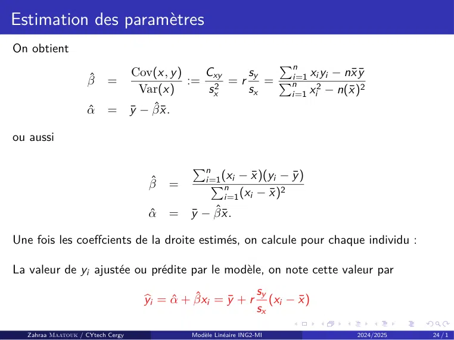

# Regression Linéaire simple-CM.pdf

[Ouvrir l’original](https://drive.google.com/open?id=1FwwPQk9HgPmYxWMa1M6WvSG6qr9x_gqN) · Les deux lectures automatiques du PDF divergent sur les pages indiquées. Leur fac-similé accompagne le texte.

**Pages présentant un écart entre les deux extractions** — 24.

## Page 1

~~~text
               Régression Linéaire Simple (ING2-GMA)

                                  Nom : Zahraa Maatouk
                                Département de Mathématiques
                                 ING2-Génie Mathématiques

                                CYtech Cergy Paris Université

Zahraa Maatouk / CYtech Cergy           Modèle Linéaire ING2-MI   2024/2025   1/1
~~~

## Page 2

~~~text
Plan I

  Zahraa Maatouk / CYtech Cergy   Modèle Linéaire ING2-MI   2024/2025   2/1
~~~

## Page 3

~~~text
Plan

  Zahraa Maatouk / CYtech Cergy   Modèle Linéaire ING2-MI   2024/2025   3/1
~~~

## Page 4

~~~text
Introduction

 ▶ La régression linéaire est une méthode statistique utilisée pour établir un lien
   et expliquer une variable Y à l’aide d’une variable X (régression simple) ou
   de plusiers variables X1 , X2 , . . . , Xp (régression multiple).
 ▶ La variable X est appelée : explicative, exogène ou indépendante.
 ▶ La variable Y est appelée : réponse, à expliquer, à prédire, endogène.

  Zahraa Maatouk / CYtech Cergy   Modèle Linéaire ING2-MI          2024/2025      4/1
~~~

## Page 5

~~~text
Coefficient de corrélation

    Le Coefficient de Corrélation Linéaire : permet de quantifier l’allure plus ou
    moins linéaire d’un nuage.
    Il est défini comme la moyenne des produits des données centrées réduites :
                          n                                                 Pn
                     1X               xi − x̄        yi − ȳ                        i=1 (xi − x̄ )(yi − ȳ )
         r    =                                                    = qP                          qP
                     n i=1               sx             sy                     n
                                                                                       −       2    n             2
                                                                               i=1 (xi    x̄ )      i=1 (yi − ȳ )

                     Cov(x , y )
              =                  .
                       sx sy

             Si |r | est proche de 1 alors X et Y sont liées par une droite affine.
             Si r < 0 globalement X et Y varient en sens inverse.
             Si r > 0 globalement X et Y varient dans le même sens.
             Si r ≃ 0 on ne peut rien dire sur un lien éventuel entre X et Y .

  Zahraa Maatouk / CYtech Cergy                      Modèle Linéaire ING2-MI                      2024/2025           5/1
~~~

## Page 6

~~~text
Plan

  Zahraa Maatouk / CYtech Cergy   Modèle Linéaire ING2-MI   2024/2025   6/1
~~~

## Page 7

~~~text
Représentation graphique

On dispose de n couples (xi , yi ), i = 1, ..., n représentant les valeurs de x et y sur
un échantillon de taille n. Nous cherchons à savoir comment y varie en fonction
de x .

Le but de la régression simple est de chercher une fonction f telle que

                                       yi = f (xi )

Ainsi une étude de régression simple débute toujours par représenter les
observations (xi , yi ), i = 1, ..., n graphiquement par un nuage de points. Cette
première représentation permet de savoir si le modèle linéaire est pertinent.

   Zahraa Maatouk / CYtech Cergy    Modèle Linéaire ING2-MI           2024/2025       7/1
~~~

## Page 8

~~~text
Représentation graphique

Le graphique suivant représente trois nuages de points différents.

  Zahraa Maatouk / CYtech Cergy   Modèle Linéaire ING2-MI            2024/2025   8/1
~~~

## Page 9

~~~text
Représentation graphique

Au vue du graphique, il semble inadéquat de proposer une régression linéaire pour
les 2 premiers graphiques, le tracé présentant une forme sinusoidale ou sigmoidale.

Par contre, la modélisation par une droite de la relation entre X et Y pour le
dernier graphique semble correspondre à une bonne approxiamation de la liaison.

Dans la suite de ce chapitre, nous étudierons le cas

                                  f (x ) = α + βx

  Zahraa Maatouk / CYtech Cergy   Modèle Linéaire ING2-MI         2024/2025       9/1
~~~

## Page 10

~~~text
Exemple introductif

 ▶ Un grand constructeur automobile veut déterminer l’effet de la promotion sur
   la compétitivité.
 ▶ Les données ont été obtenues dans 12 pays sur :
            les dépenses promotionnelles par rapport à un concurrent majeur (dépenses du
            concurrent=100).
            Sur les ventes par rapport à ce concurrent (ventes du concurrent=100).

  Zahraa Maatouk / CYtech Cergy       Modèle Linéaire ING2-MI          2024/2025      10 / 1
~~~

## Page 11

~~~text
Exemple introductif

          Pays       D.P.R-dépenses proportionnelles relatives-x     V.R-Ventes relatives-y
           1                            97                                   105
           2                            91                                    95
           3                           103                                   112
           4                            79                                    83
           5                            81                                    86
           6                           105                                   110
           7                            94                                    99
           8                            85                                    94
           9                           101                                   107
           10                          106                                   114
           11                           75                                    80
           12                           99                                   108

       Table 1 – Evolution des ventes relatives en fonction des dépenses relatives.

Par exemple, dans le pays 3,
 ▶ les dépenses promotionnelles sont supérieures de 3 points à celles du
     concurrent,
 ▶ alors que les ventes sont supérieurs de 12 points.

  Zahraa Maatouk / CYtech Cergy            Modèle Linéaire ING2-MI                2024/2025   11 / 1
~~~

## Page 12

~~~text
Exemple introductif

On souhaite savoir si, de façon générale, les dépenses proportionnelles ont une
influence sur les ventes et sous quelle forme cette influence peut être exprimée. Le
but est d’expliquer au mieux comment les ventes varient en fonction des dépenses
proportionnelles et éventuellement de prédire les ventes à partir ces dépenses.

La variable Y répresente alors la variable Ventes ; c’est la variable à expliquer.
La variable X est la variable Dépenses proportionnelles c’est la variable explicative.

Pour l’étude, on doit faire des mesures sur n individus tirés au sort dans la
population. Données numériques : on observe deux échantillons X et Y de taille n,
(x1 , y1 ), ..., (xi , yi ), ...(xn , yn ) où xi et yi sont les valeurs de X et Y observées sur le
iéme individu tiré au sort.

   Zahraa Maatouk / CYtech Cergy         Modèle Linéaire ING2-MI              2024/2025         12 / 1
~~~

## Page 13

~~~text
Exemple introductif

On cherche à exprimer la relation entre la variable Depenses proportionnelles et la
variable Ventes à l’aide d’une fonction mathématique du type y = f (x ).

Pour choisir le modèle de relation, on doit faire des observations sur un échantillon
d’individus. Les données recueillies sur ces individus sont représentées
graphiquement à l’aide d’un nuage de points.

Si le nuage a une forme particulière s’apparentant à une courbe mathématique, on
choisira la fonction mathématique correspondant à cette courbe.

  Zahraa Maatouk / CYtech Cergy    Modèle Linéaire ING2-MI          2024/2025      13 / 1
~~~

## Page 14

~~~text
Exemple introductif

La forme étirée et croissante du nuage suggère une relation positive de type
linéaire entre les dépenses proportionnelles et les ventes, alors on parle d’un
modèle de régression linéaire, qui est le modèle le plus simple qui exprime la
relation entre Y et X à l’aide une fonction linéaire.

Graphiquement, la relation est représentée par une droite d’équation
f (x ) = α + βx . Ce modèle particulier comporte deux paramètres (coefficients).

  Zahraa Maatouk / CYtech Cergy    Modèle Linéaire ING2-MI          2024/2025      14 / 1
~~~

## Page 15

~~~text
Modèle

On va modéliser la relation entre les dépenses proportionnelles et les ventes à
l’aide d’une droite.

Si la relation était parfaitement linéaire : sur l’échantillon, cela se traduirait par
des points alignés et l’on pourrait écrire la relation entre Y et X sous la forme :

                                     Y = α + βX

Connaissant le dépense proportionnelle x d’un pays, l’équation permettrait de
déterminer exactement la vente y. La relation observée sur l’échantillon n’est pas
exacte. Le nuage est étiré mais les points ne sont pas alignés.

De plus, on voit que les pays du même dépenses proportionnelles ont des valeurs
de ventes différentes. Ces différences peuvent être expliquées par d’autres variables
ayant une influence sur la variable ventes et qui ne sont pas prises en compte dans
le modèle, ou encore par des erreurs de mesures.

   Zahraa Maatouk / CYtech Cergy     Modèle Linéaire ING2-MI           2024/2025         15 / 1
~~~

## Page 16

~~~text
Modèle

Alors, pour rendre compte de cette situation, on écrit la relation entre les
dépenses proportionnelleset les ventes sous la forme générale suivante :

                                  Y = α + βX + ϵ

En vérité les Y et les X n’étant pas exactement liées de façon affine, on suppose
alors qu’elles le sont "en moyenne", c’est à dire que

                                   E[Y ] = α + βX

On introduit donc le modèle

                                  Y = α + βX + ϵ

Pour chaque individu i, le modéle s’écrit :

                                  Yi = α + βXi + ϵi

  Zahraa Maatouk / CYtech Cergy     Modèle Linéaire ING2-MI         2024/2025   16 / 1
~~~

## Page 17

~~~text
Modèle

   Xi est une v.a observée
   Yi est une v.a observée
   Les α et les β sont les paramètres réels inconnus appelés paramètres de
   régression ou coefficients de régression.
   Les ϵi sont appelées erreurs ou bruits, ce sont des v.a. indépendantes de
   même loi, centrées et de même variance, et ils sont indépendantes des Xi .

 Zahraa Maatouk / CYtech Cergy   Modèle Linéaire ING2-MI        2024/2025       17 / 1
~~~

## Page 18

~~~text
Modèle

On suppose que Xi = xi et on considère dans toute la suite du cours le modèle :

                            Yi = α + βxi + ϵi ,      pour tout i = 1, . . . , n,

où
 ▶ xi est déterministe, et il existe au moins un couple (i; j) tel que xi ̸= xj ,
 ▶ Yi est une v.a. observée,
             α + βxi est la partie déterministe du modèle.
             ϵi est la partie aléatoire.
             E(Yi ) = βxi + α := µi est la moyenne théorique de chaque distribution de Y .
 ▶ La partie aléatoire s’explique par le fait que tous les points ne se trouvent pas
   sur la droite.
 ▶ Si la droite explique bien la variable Y , alors on considère qu’il n’y a plus
   d’information dans la partie aléatoire.

   Zahraa Maatouk / CYtech Cergy           Modèle Linéaire ING2-MI                 2024/2025   18 / 1
~~~

## Page 19

~~~text
Les hypothèses du modèle

 ▶ Conditions standards imposées aux ϵi .
            (C1) : E[ϵi ] = 0 pour tout i = 1, . . . , n (espérance nulle),
            (C2) : Cov(ϵi ; ϵj ) = 0 pour tout i ̸= j,
            (C3) : Var(ϵi ) = σ 2 (inconnue) pour tout i = 1, . . . , n (homoscédasticité).
 ▶ Dans le cas où les ϵi suivent une loi gaussien de moyenne 0 et de variance
   constante, les conditions (C1)-(C3) s’écrivent :
            les ϵi suivent une loi : N (0, σ 2 ).
            Les ϵi sont indépendantes.
    Conséquence
            Var(Yi ) = σ 2 pour tout i = 1, . . . , n.
            Cov(Yi , Yj ) = 0 pour tout i ̸= j.

  Zahraa Maatouk / CYtech Cergy            Modèle Linéaire ING2-MI           2024/2025        19 / 1
~~~

## Page 20

~~~text
Plan

  Zahraa Maatouk / CYtech Cergy   Modèle Linéaire ING2-MI   2024/2025   20 / 1
~~~

## Page 21

~~~text
Objectifs de la statistique inférentielle

    Estimation ponctuelle de (α; β) sur la base des observations y1 ; . . . ; yn de
    Y1 ; . . . ; Yn de façon à expliquer "au mieux" les variables Yi en fonction des xi .

    Prédire “au mieux” une valeur de Yn+1 à partir d’une nouvelle valeur xn+1 .

    Estimation ponctuelle de la variance σ 2 .

    Construction des :
       ▶ intervalles de confiance,
       ▶ tests d’hypothèses,
       ▶ critères permettant de juger de la qualité de l’explication ou de la prédiction.

  Zahraa Maatouk / CYtech Cergy      Modèle Linéaire ING2-MI            2024/2025           21 / 1
~~~

## Page 22

~~~text
Objectifs de la statistique inférentielle

On note que les coefficients α et β sont calculés sur toute la population, on les
estime alors respectivement par α̂ et β̂ calculés sur un échantillon, donc la droite
d’équation
                                    ŷ = α̂ + β̂x
s’appelle la droite des moindres carrés et qui passe le mieux possible au milieu du
nuage de points {(xi , yi ), i = 1, . . . , n}.

Cette équation est utilisé alors pour estimer les valeurs de Y et on note ces valeurs
estimés par Ŷ

  Zahraa Maatouk / CYtech Cergy    Modèle Linéaire ING2-MI          2024/2025      22 / 1
~~~

## Page 23

~~~text
Estimation des paramètres

Pour estimer les paramétres α̂ et β̂, on utilise la méthode des moindres carrés,
cette méthode cherche à rendre minimale la somme des carrés des écarts entre les
valeurs observées yi (vrais valeurs) et les valeurs ajustées ŷi (valeurs estimés par le
modéle).
                                                          n
                                                          X
                         min f (α, β) où f (α, β) =         (yi − (α + βxi ))2
                          α,β
                                                          i=1

   Zahraa Maatouk / CYtech Cergy         Modèle Linéaire ING2-MI                 2024/2025   23 / 1
~~~

## Page 24

~~~text
Estimation des paramètres
On obtient
                                                         Pn
                                  Cov(x , y )   Cxy   sy      xi yi − nx̄ ȳ
                   β̂     =                   := 2 = r = Pni=1 2           2
                                   Var(x )       sx   sx  i=1 i − n(x̄ )
                                                              x
                   α̂     =       ȳ − β̂x̄ .

ou aussi

                                                Pn
                                                        (x − x̄ )(yi − ȳ )
                                       β̂   =        Pn i
                                                    i=1
                                                                        2
                                                         i=1 (xi − x̄ )
                                       α̂   = ȳ − β̂x̄ .

Une fois les coeffcients de la droite estimés, on calcule pour chaque individu :

La valeur de yi ajustée ou prédite par le modèle, on note cette valeur par
                                                                     sy
                                     ybi = α̂ + β̂xi = ȳ + r           (xi − x̄ )
                                                                     sx

  Zahraa Maatouk / CYtech Cergy                 Modèle Linéaire ING2-MI              2024/2025   24 / 1
~~~

## Page 25

~~~text
Estimation des paramètres

Le résidu de l’observation i, qui représente l’écart entre la valeur de yi observée
sur l’individu i et la valeur prédite par le modéle ŷi , on note ce résidu par

                                     ei = yi − ybi

Le résidu ei est une approximation du terme d’erreur ϵi .

Propriété 1
Pour i = 1, . . . , n, on note :
     La somme des erreurs ei est nulle.
     La somme des xi ei est nulle.
     La somme des ybi ei est nulle.
     La droite des moindres carrés passe par le point moyen du nuage (x̄ , ȳ ).

   Zahraa Maatouk / CYtech Cergy   Modèle Linéaire ING2-MI           2024/2025        25 / 1
~~~

## Page 26

~~~text
Application à l’exemple introductif

 1     On a :
                                            1116                          1188
                                     x̄ =        = 93        et ȳ =           = 99.
                                             12                            12
 2     La pente b = 1349
                    1262 = 1.0689.
 3     l’intercepte (ou l’ordonnée à l’origine) : a = 99 − 1349
                                                           1292 × 93 = −0.4113.
 4     L’équation de la droite des moindres carrés :

            yb = 1.0689x − 0.4113              ⇔      V.R estimées = 1.0689 × D.P.R − 0.4113
 5     L’équation précédente permet d’estimer les ventes relatives pour des dépenses
       relatives données. Pour le pays 1 :
               ces dépenses sont de 97
               des ventes relatives estimées sont V.R estimées =1.0689×97-0.4113=103.272
               (alors que les ventes relatives réelles sont de 100).

     Zahraa Maatouk / CYtech Cergy              Modèle Linéaire ING2-MI                2024/2025   26 / 1
~~~

## Page 27

~~~text
Plan

  Zahraa Maatouk / CYtech Cergy   Modèle Linéaire ING2-MI   2024/2025   27 / 1
~~~

## Page 28

~~~text
Aspects inférentiels

    Les résultats obtenus dans les paragraphes précédents sont relatifs à
    l’échantillon considéré.

    Si on tire un autre échantillon de même taille n, toutes les resumés
    numériques calculées ainsi que les estimations des paramètres vont changer.
    Alors α̂, β̂, ŷ et ei sont des variables aléatoires, on suppose qu’ils suivent des
    lois normales puisqu’elles sont des combinaisons linéaires de variables
    aléatoires normales.

    Si on souhaite utiliser les résultats obtenus à partir de l’échantillon, pour
    inférer sur la population totale, il faut postuler un modèle et faire appel à des
    notions de probabilité et de statistique

  Zahraa Maatouk / CYtech Cergy    Modèle Linéaire ING2-MI           2024/2025       28 / 1
~~~

## Page 29

~~~text
Propriétés des estimateurs

Objectif

Déterminer l’espérance, variance et covariance des estimateurs du modèle.

Théorème 1 (Espérance, variance et covariance des paramètres)

                                                       2
                                        b = Pn σ                       σ2
            E[β]
              b       = β,          Var(β)                         =
                                                 i=1 (xi − x̄ )
                                                                2      nsx2
                                                                  x̄ 2            σ2       x̄ 2
                                                                                             
                                                   1
              α]
            E[b       = α,              α) = σ 2
                                    Var(b             + Pn                      =      1 +
                                                   n        i=1 (xi − x̄ )
                                                                            2     n        sx2
                                    −x̄ σ 2
       α; β)
   Cov(b  b           =       Pn                 2
                                                   .
                                  i=1 (xi − x̄ )

  Zahraa Maatouk / CYtech Cergy                  Modèle Linéaire ING2-MI           2024/2025        29 / 1
~~~

## Page 30

~~~text
Propriétés des estimateurs : Commentaire sur le Théorème

De ces relations, on peut déduire que :
 ▶ αb et βb sont respectivement des estimateurs sans biais de α et β.
 ▶ La variance Var(β) b exprime l’incertitude dans l’estimation de β. Cette
    incertitude croît avec la variation résiduelle et décroît avec le nombre
    d’observation n et aussi avec la dispersion des x (i.e. sx2 ).

  Zahraa Maatouk / CYtech Cergy   Modèle Linéaire ING2-MI          2024/2025   30 / 1
~~~

## Page 31

~~~text
Variance résiduelle
Les variances et covariance des estimateurs α et β établies en Théorème précédent
ne sont pas pratiques car elles font intervenir la variance σ 2 des erreurs, laquelle
est en inconnue.
Le théorème suivant donne un estimateur sans biais de σ 2 grâce aux résidus.

Théorème 2
                                            n
                                            X
                                       E[         ϵ2i ] = (n − 2)σ 2
                                                  b
                                            i=1
                                                                     n
                                                                1 X 2
                                   la quantité      sσ2 =              ϵ
                                                              n − 2 i=1 i
                                                                       b

est un estimateur sans biais de σ 2 .

                                     n
                                1 X 2      SCR
                     sσ2 =             e =     est une réalisation de Sσ2 .
                              n − 2 i=1 i  n−2
La racine carrée sσ est appelée par le logiciel R "Residual Standard error".
   Zahraa Maatouk / CYtech Cergy             Modèle Linéaire ING2-MI        2024/2025   31 / 1
~~~

## Page 32

~~~text
Plan

  Zahraa Maatouk / CYtech Cergy   Modèle Linéaire ING2-MI   2024/2025   32 / 1
~~~

## Page 33

~~~text
Analyse de la variance

 ▶ Analyse de la variance : Ce que le modèle explique et ce qu’il n’explique pas.
            La liaison entre x et y signifie qu’une variation de x entraîne une variation de
            y.
            Comment quantifier la part de la variabilité des données expliquée par le
            modèle ?
            La formule de décomposition de la variance permet de préciser : la part de la
            variation de y expliquée par la variation de x .
 ▶ Décomposition de l’écart entre Yi et la moyenne de Y .
   Cette procédure fait apparaître une somme de deux écarts :

                                  (Yi − Y ) = (Yi − Y       bi − Y ).
                                                    bi ) + (Y

    Ainsi l’écart total (Yi − Y ) peut être vu comme la somme de deux écarts :
         un écart entre Yi observé et Y bi la valeur estimée par le modèle.
         un écart entre Ybi la valeur estimée par le modèle et la moyenne Y .

  Zahraa Maatouk / CYtech Cergy           Modèle Linéaire ING2-MI         2024/2025        33 / 1
~~~

## Page 34

~~~text
Formule de décomposition de la variance

Proposition 1
                  n
                  X                            n
                                               X              n
                                                              X
                         (yi − y )2      =        yi − y )2 +
                                                 (b             ei2
                   i=1                         i=1                     i=1
                              SCT        =     SCE + SCR
                                   Sy2   =      2 2
                                               Sb Se
                                                Y
              Variance totale            =     Variance expliquée + Variance résiduelle

Démonstration.
Comme yi − y = (b
                yi − y ) + (yi − ybi ) = (b
                                          yi − y ) + ei . D’où
                  n
                  X             n
                                X             n
                                              X        n
                                                       X
                             2             2     2
                    (yi − y ) =    yi − y ) +
                                  (b            ei + 2       yi − y ) 2 .
                                                         ei (b
                   i=1                   i=1                     i=1         i=1
                               Pn                      Pn
On peut vérifier que               i=1 ei y
                                          bi = 0 et        i=1 ei y = 0. D’où le résultat.

   Zahraa Maatouk / CYtech Cergy                 Modèle Linéaire ING2-MI              2024/2025   34 / 1
~~~

## Page 35

~~~text
Interprétation des différents termes de la formule
 1     Somme des carrés totale
        n
        X
               (yi − y )2      = SCT (somme des carrés totale)
        i=1
                               = mesure la variation globale des yi autour de la moyenne y

 2     Somme des carrés expliquée
       n
       X
               yi − y ) 2
              (b               = SCE (somme des carrés expliquée par la variable x )
        i=1
                               = C’est la part de la variation de y expliquée par la variable x

 3     Somme des carrés résiduels
        n
        X
               ei2   =      SCR (somme des carrés résiduelle)
         i=1
                     =      C’est la part de la variation de y non expliquée par la variable x

     Zahraa Maatouk / CYtech Cergy           Modèle Linéaire ING2-MI         2024/2025      35 / 1
~~~

## Page 36

~~~text
Tableau d’analyse de la variance : ANOVA

        Source           Df            Sum
                                       Pn of squares                     PMean        square
                                                                             n
        Model            p                    yi − y ) 2
                                       Pni=1 (b                      Pn      i=1 (b
                                                                                  y i − y )2 /p
         Error         n−p−1           Pi=1 (yi − ybi )2              i=1 (yi − y
                                                                                      2
                                                                                 bi ) /(n − p − 1)
                                         n             2
         Total          n−1              i=1 (yi − y )

                                  Table 2 – Dftotal = DfModel + DfError

Dans le cas de régression linéaire simple, on suppose que p = 1, donc ANOVA sera

   Variabilité               SCE      d.d.l.               Carré moyen                       Test
    Totale                  SCET      n−1
 Due au modèle              SCEM        1            CMM = SCEM /1                  Fobs = CMM /CMR
   Résiduelle               SCER      n−2          CMR = SCER /(n − 2)

  Zahraa Maatouk / CYtech Cergy                Modèle Linéaire ING2-MI                  2024/2025    36 / 1
~~~

## Page 37

~~~text
Coefficient de détermination

Coefficient de détermination :
                                         Pn
                                  SCEM         yi − y ) 2
                                              (b              SCER
                          R2 =         = Pi=1
                                          n             2
                                                          =1−       .
                                  SCET        (y
                                          i=1 i   − y )       SCE T

R 2 exprime le pourcentage de la variation de y expliquée par la variation de x .
    R 2 → 1 : le modèle est excellent (c’est-à-dire : tous les points sont alignés).
    R 2 → 0 : le modèle ne sert à rien : Situation où la droite des moindres carrés
    est horizontale.

  Zahraa Maatouk / CYtech Cergy           Modèle Linéaire ING2-MI       2024/2025   37 / 1
~~~

## Page 38

~~~text
Test de Fisher : F
    Pour tester si le modèle est globalement significatif, on applique le test de
    Fisher. La statistique de test est :
                                                 Fobs = CMM /CMR
    Ce test trouve toute son importance dans le cas d’une régression multiple.
    Dans le cas de la régression simple. Ce test équivalent au test de signification
    du coefficient β. En effet :
       ▶ Étant donné que :
                                               sy
                                      β̂ = r      ,    où β̂ est une estimation de β.
                                               sx
                              H0 : β = 0 ⇔ H0 : r = rxy = 0.
       ▶ La statistique de test est construite à partir du coefficient de détermination
         R 2 . On a sous H0 :
                                     
                               R2
            L (n − 2)                     = Fα0 (1; n−2)           une loi de Fisher à ν1 = 1, ν2 = n − 2 d.l.l.
                             1 − R2
    Règle de décision :
       ▶ Si Fobs > Fα0 (1; n − 2) alors on accepte H1 : r ̸= 0 avec un risque α0 .
       ▶ Sinon, on garde H0 .
  Zahraa Maatouk / CYtech Cergy                   Modèle Linéaire ING2-MI                  2024/2025       38 / 1
~~~

## Page 39

~~~text
Exemple : test de Fisher

D’après l’exemple du cours :
                                         1441.9976
                                  R2 =             = 0.969.
                                           1488

    La variation des ventes relatives est expliquée à 96.9% par la variation des
    dépenses promotionnelles.
    Au risque α0 = 5%, on a F0.05 (1, 10) = 4.96.
    Comme Fobs = 313.5 (données par l’exemple) est très largement supérieur à
    4.96 on rejette très fortement l’hypothèse d’indépendance.
    Remarque : d’après le logiciel R studio, la p-value est égale à 7.041 × 10−9 .
    Conclusion : le modèle linéaire est donc accepté.

  Zahraa Maatouk / CYtech Cergy          Modèle Linéaire ING2-MI   2024/2025       39 / 1
~~~

## Page 40

~~~text
Plan

  Zahraa Maatouk / CYtech Cergy   Modèle Linéaire ING2-MI   2024/2025   40 / 1
~~~

## Page 41

~~~text
Intervalle de confiance de la pente β

    Puisque la variable aléatoire

                                                                          σ2
                                                                                       
                                            βb ∼ N      β, Pn                       2
                                                                                            .
                                                                     i=1 (xi − x̄ )

    On peut déduire que la variable aléatoire définie par :

                                                        βb − β
                                           Zn = q                              ∼ N (0, 1).
                                                        Pn σ
                                                                  (xi −x̄ )2
                                                            i=1

    σ est inconnu, on la remplace par son estimateur sσ défini précédemment et
    on montre que la variable aléatoire :

                   βb − β
      Tn = q                              ∼ Tn−2 ,       loi de Student à ν = n − 2 degrés de liberté.
                   Pn sσ
                             (xi −x̄ )2
                       i=1

  Zahraa Maatouk / CYtech Cergy                      Modèle Linéaire ING2-MI                    2024/2025   41 / 1
~~~

## Page 42

~~~text
Intervalle de confiance de la pente β

Proposition 2
Au risque α0 , l’intervalle de confiance du paramètre β est donnée par :

                                     IC (β) = [β̂ − u; β̂ + u],

β̂ est une réalisation de β et u = tα0 (n − 2) pPnsσ                                   .
                                                                          (xi −x̄ )2
                                                                    i=1

tα0 (n − 2) noté aussi tν (α0 ) est la valeur critique d’une loi de Student.

Remarque
Si
                                            0 ∈ IC (β),
alors l’introduction de la variable X dans le modèle n’apporte aucun pouvoir
explicatif sur Y .

     Zahraa Maatouk / CYtech Cergy        Modèle Linéaire ING2-MI                          2024/2025   42 / 1
~~~

## Page 43

~~~text
Exemple : intervalle de confiance de la pente β

Retour à l’exemple introduit précédemment :
    α = 0.05 et n = 12, on a :
                                                       sσ                    2.145
       t0.05 (10) = 2.23 u = tα (n − 2) qP                            = 2.23 √      = 0.134.
                                                   n              2            1262
                                                   i=1 (xi − x̄ )

    Donc, IDC95% (β) = [1.069 − u, 1.069 + u] = [0.935; 1.203].
    Si on tire une infinité d’échantillons de taille n = 12, alors 95% des intervalles
    de confiance contiendront la vraie valeur inconnue β.
    En pratique, il est plus rapide de dire que β est compris entre 0.935 et 1.203
    à un niveau de confiance de 95%.

  Zahraa Maatouk / CYtech Cergy    Modèle Linéaire ING2-MI                    2024/2025        43 / 1
~~~

## Page 44

~~~text
Intervalle de confiance de l’intercept α

Proposition 3
 1     La variable aléatoire
                                     b−α
                                     α
              Tn =          r                             ∼ Tn−2          loi de Student à ν = n − 2 d.d.l.
                       sσ       1   Pn x̄ 2
                                n +     (xi −x̄ )2
                                          i=1

 2     Au risque α0 , l’intervalle de confiance du paramètre α est donnée par :

                                                IC (α) = [α̂ − v ; α̂ + v ],

       et α est une réalisation de α̂,
                         r
                                       2
       v = tα0 (n − 2)sσ 1 + Pn x̄    n               (xi −x̄ )2
                                                                   . tα0 (n − 2) noté aussi tν (α0 ) est la valeur
                                                i=1

       critique d’une loi de Student.

     Zahraa Maatouk / CYtech Cergy                     Modèle Linéaire ING2-MI                  2024/2025       44 / 1
~~~

## Page 45

~~~text
Remarque : Si
                                      0 ∈ IC (α),
alors la droite de régression passe par l’origine.

   Zahraa Maatouk / CYtech Cergy    Modèle Linéaire ING2-MI   2024/2025   45 / 1
~~~

## Page 46

~~~text
Exemple : intervalle de confiance de la pente β

Retour à l’exemple introduit précédemment :
    α0 = 0.05 et n = 12, on a :
                                                        sσ                    2.145
       t0.05 (10) = 2.23 u = tα0 (n − 2) qP                            = 2.23 √      = 0.134.
                                                    n              2            1262
                                                    i=1 (xi − x̄ )

    Donc, IDC95% (β) = [1.069 − u, 1.069 + u] = [0.935; 1.203].
    Si on tire une infinité d’échantillons de taille n = 12, alors 95% des intervalles
    de confiance contiendront la vraie valeur inconnue β.
    En pratique, il est plus rapide de dire que β est compris entre 0.935 et 1.203
    à un niveau de confiance de 95%.

  Zahraa Maatouk / CYtech Cergy    Modèle Linéaire ING2-MI                     2024/2025    46 / 1
~~~

## Page 47

~~~text
Exemple : intervalle de confiance de l’intercept α

En utilisant les données de l’exemple précédent :
    L’intervalle de confiance de l’intercept est donné par :
                                       r
                                           1     932
                     v = 2.33 × 2.145        +       = 12.598
                                          12 1262
    IC95% (α) = [−0.4113 − v ; −0.4113 + v ] = [−13; 12.18].

  Zahraa Maatouk / CYtech Cergy   Modèle Linéaire ING2-MI       2024/2025   47 / 1
~~~

## Page 48

~~~text
Tests sur les paramètres : paramètre β

    Objectif : tester la signification des coefficients de régression α et β.
    L’estimation de β obtenue est-elle significative ?
    La réponse à cette question se fait à l’aide d’un test de signification (ou test
    de conformité de β à 0).
    On doit choisir entre :

                                  H0 : β = 0       contre β ̸= 0.

  Zahraa Maatouk / CYtech Cergy       Modèle Linéaire ING2-MI       2024/2025      48 / 1
~~~

## Page 49

~~~text
Construction de test pour β : Étapes du test
 1   D’après les théorèmes précédents, on a :
                                                                      2     σ2
                                          E[βb] = β          et     σβb =        .
                                                                            nsX2
 2   σ 2 est inconnu, donc on estime σ 2 par :
                                                 β
                                                 b
                                                        2          sσ2
                                                      σ   =            .
                                                                  nsX2
                                                      bβb

 3   La statistique de test
                                    βb                                b
                              T =       (v.a.)       et     tobs =        réalisation de T .
                                    σ
                                    bβb                               σ
                                                                      bβb
 4   L’hypothèse de la normalité des résidus ϵi ⇒ la loi de βb est une loi normale et :
                                                             !
                                                  βb − β
                                           L                      = Tν=n−2 .
                                                    σ
                                                    bβb
 5   Sous H0 : β = 0                                        !
                                                      βb
                                             L                  = Tν=n−2 .
                                                      σ
                                                      bβb
  Zahraa Maatouk / CYtech Cergy                Modèle Linéaire ING2-MI                         2024/2025   49 / 1
~~~

## Page 50

~~~text
Construction de test pour β : Règle de décision

Si
                                     tobs > tthéorique;ν=n−2 ,
alors on accepte H1 : β ̸= 0 avec risque α0 . Sinon on garde H0 .

Ou bien : calculer la probabilité critique pc associée à tobs .

       Si pc < α0 on rejette H0 . Cette valeur est toujours donnée par le logiciel.
                                      pc = P(|T | ≥ tobs ).

     Zahraa Maatouk / CYtech Cergy       Modèle Linéaire ING2-MI      2024/2025       50 / 1
~~~

## Page 51

~~~text
Remarque : Test d’hypothèse pour β et intervalle de
confiance

 ▶ Remarque : le teste d’hypothèse :

                                  H0 : β = 0       contre H1 : β ̸= 0

    peut être obtenu directement à partir de l’intervalle de confiance de β.
    Si 0 ∈
         / IC (β) alors on rejette H0 .
            Avec les données de notre exemple précédent l’hypothèse H0 est rejetée
            puisque 0 ∈/ [0.935; 1.203].
            Dépenses promotionnelles relatives joue un rôle significatif dans l’explication
            de la variable ventes relatives.
 ▶ On peut aussi construire un test analogue pour α.
   On calcule α
              b qui sous H : α = 0, suit une loi de Student à n − 2 d.d.l.
                            0
              σ
              bbα

  Zahraa Maatouk / CYtech Cergy          Modèle Linéaire ING2-MI           2024/2025          51 / 1
~~~

## Page 52

~~~text
Détection des points atypiques

Un modèle peut s’avérer très précis pour ajuster les valeurs observées mais très
mauvais en ce qui concerne la prévision de nouvelles valeurs.

Définition 1
Une observation est atypique (influente) si son résidu en valeur absolue est bien
plus élevé que les autres.

La plupart des méthodes de détection des valeurs atypiques font appel à la notion
de points levier et résidus studentisés.

Définition 2 (Levier)
Un point levier est une observation i qui influence les estimateurs. Pour la
détecter on utilise les quantités hii :

                    1    (xi − x )2       1   1 (xi − x )2
           hii =      + Pn              =   +              ,    i = 1, . . . , n.
                    n    i=1 (xi − x )
                                      2   n n−1     Sx2

  Zahraa Maatouk / CYtech Cergy       Modèle Linéaire ING2-MI         2024/2025     52 / 1
~~~

## Page 53

~~~text
Détection des points atypiques

    Un levier n1 ≤ hii ≤ 1 proche de 1 indique une observation influente.
    On considère qu’une observation i est un point levier si son levier est
    supérieur à 2 fois la moyenne des leviers.
                  Pn
    Exemple : si i=1 hii = 6 et n=20 observations, alors la moyenne des leviers
    est 0.3, i est considéré comme observation influente si son levier hii > 0.6.
    Dans le cas où le modèle est correct, 95% des résidus studentisés doivent être
    compris entre -2 et +2.

  Zahraa Maatouk / CYtech Cergy   Modèle Linéaire ING2-MI          2024/2025    53 / 1
~~~

## Page 54

~~~text
Détection des points atypiques : Méthode de validation
croisée

    On retire la i eme observation de l’ensemble des données.
    On ajuste un nouveau modèle sans la i eme observation.
    On calcule y(−i) la prévision de yi avec le nouveau modèle.
    On calcule le résidu e(−i) = yi − y(−i) .
    Un résidu important signal une observation importante.
    Le PRESS (predicted residual sum of squares) donne une indication sur les
    qualités prédictives du modèle
                                               n           n
                                            1X 2          X   1    ei2
                                  PRESS =         e(−i) =                  ,
                                            n i=1         i=1
                                                              n (1 − hi )2
                    ei
    avec e(−i) = 1−h   i
                         .
    Le PRESS est une estimation sans biais de la qualité de prévision d’un modèle
    et est très utile pour comparer les qualités prédictives de plusieurs modèles.

  Zahraa Maatouk / CYtech Cergy             Modèle Linéaire ING2-MI            2024/2025   54 / 1
~~~
