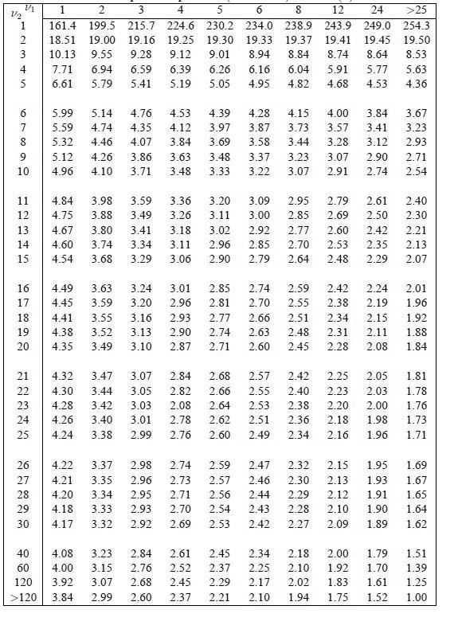

# Table-de-la-loi-de-Fisher-Snedecor5.jpg

[Ouvrir l’original](https://drive.google.com/open?id=1KakBCGlforzHY2TQJANx0E7OslZVM6TT) · Les pages signalées comprennent du texte reconnu automatiquement ou des éléments graphiques. Le fac-similé permet de vérifier chaque lecture.

**Pages avec fac-similé ou lecture OCR** — 1.

~~~text
26
27
28
29
30

40
60
120
>120

T 2 3 4 5 6 S12 24 >»
1614 1995 215.7 2246 2302 2340 2389 2439 249.0 2543
18.51 1900 19.16 19.25 1930 1933 1937 1941 19.45 19.50
1013 955 928 912 901 894 884 874 864 853
711 694 659 639 626 616 604 S91 577 5.63
661 5.79 S41 519 5.05 495 482 468 453 436
599 514 476 453 439 428 415 400 384 3.67
559 474 435 412 397 387 373 357 341 323
532 446 407 384 369 358 344 328 312 293
512 426 386 363 348 337 323 307 290 271
496 410 3.71 348 333 322 307 291 274 254
484 398 359 336 320 309 295 279 261 240
475 388 349 326 3.11 300 285 269 250 230
467 380 341 318 302 292 277 260 242 2

460 3.74 334 311 296 285 270 253 235 2

454 368 329 306 290 279 264 248 229 2

449 363 324 301 285 274 259 242 224 201
445 359 320 296 281 270 255 238 219 196
441 355 316 293 277 266 251 234 215 192
438 352 313 290 274 263 248 231 211 188
435 349 310 287 271 260 245 228 208 184
432 347 307 284 268 257 242 225 205 181
430 344 305 282 266 255 240 223 203 1.78
428 342 303 208 264 253 238 220 200 176
426 340 301 278 262 251 236 218 198 173
424 338 299 276 260 249 234 216 196 171
422 337 298 274 259 247 232 215 195 169
421 335 296 273 257 246 230 213 193 167
420 334 295 271 256 244 212 191 1.65
418 333 293 270 254 243 10 190 164
417 332 292 269 253 242 227 209 189 162
408 323 284 261 245 234 218 200 179 151
400 315 276 252 237 225 210 192 170 139
392 307 268 245 229 217 202 183 161 125
384 299 260 237 221 210 194 175 152 1.00
~~~
