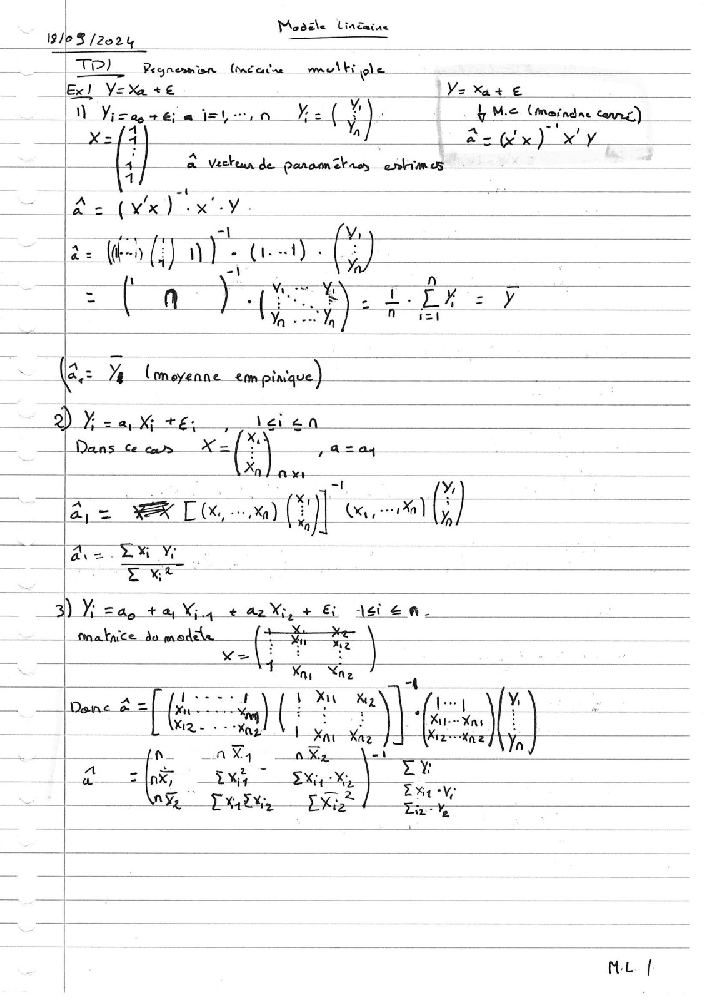
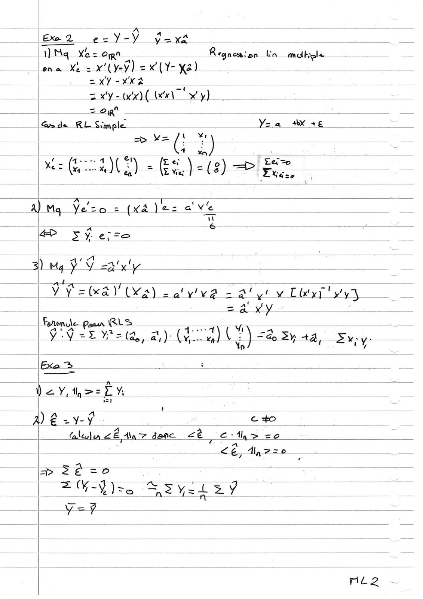
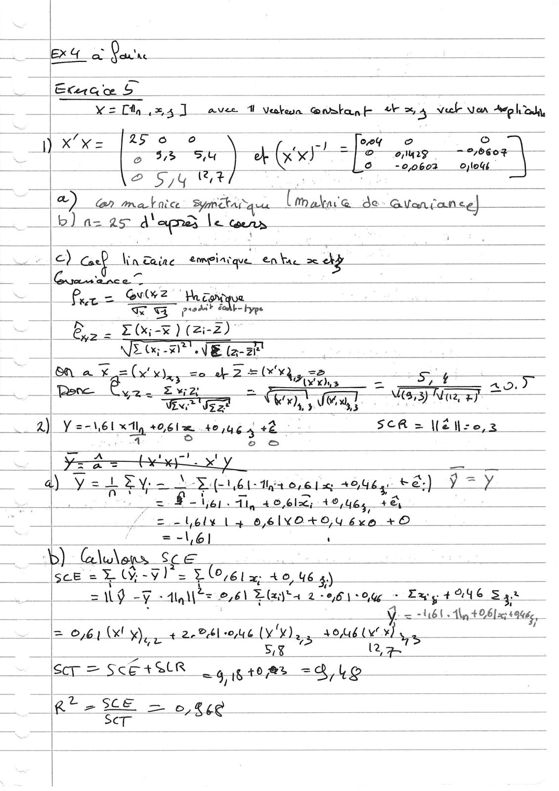
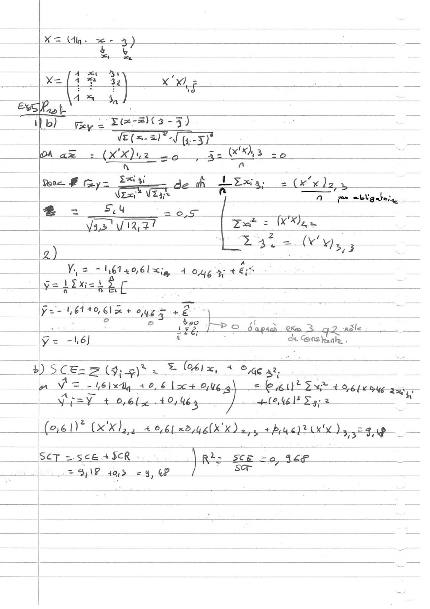
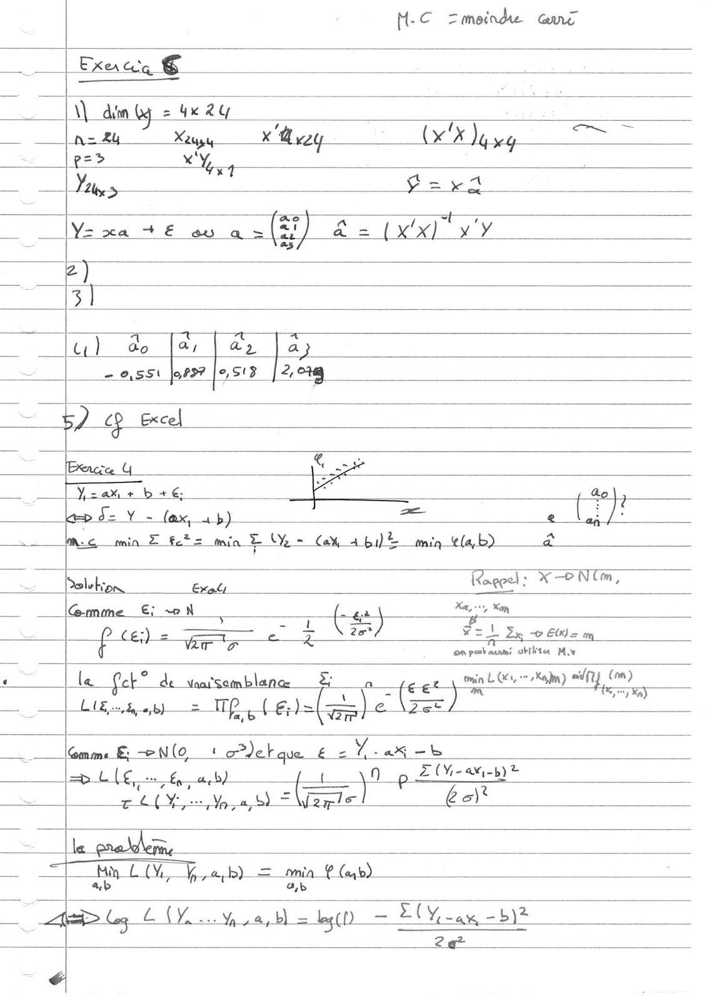
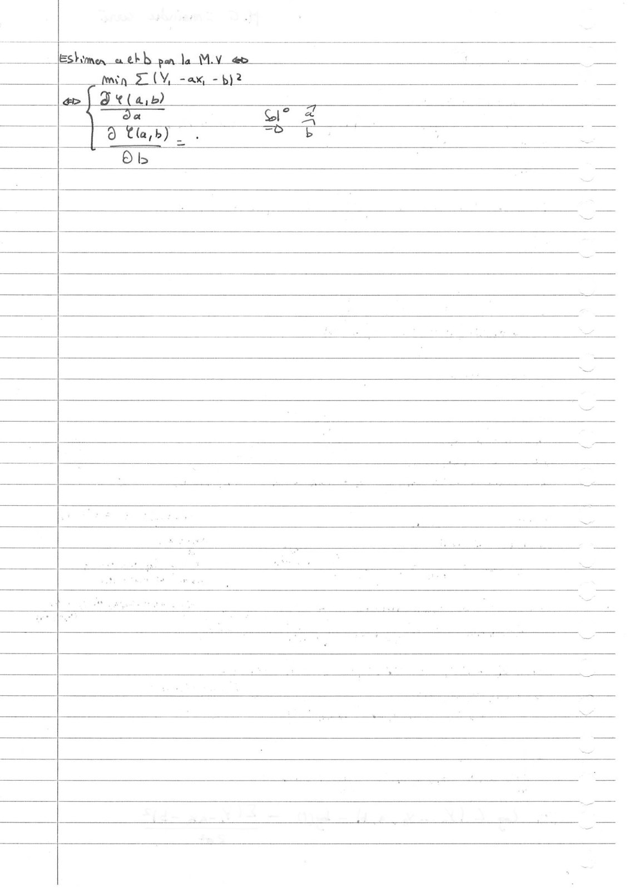
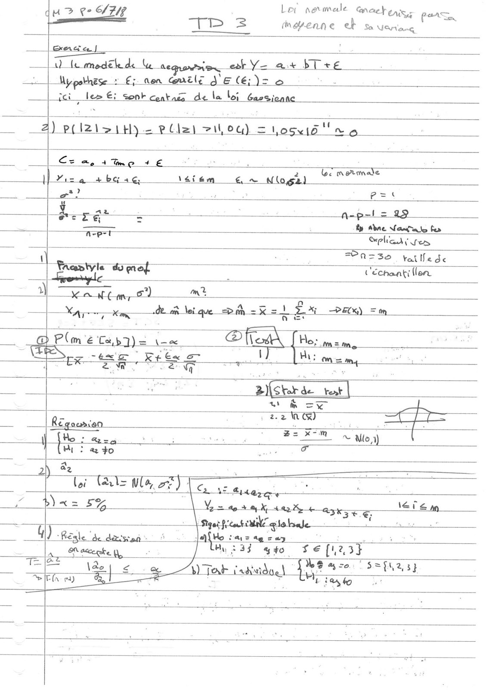
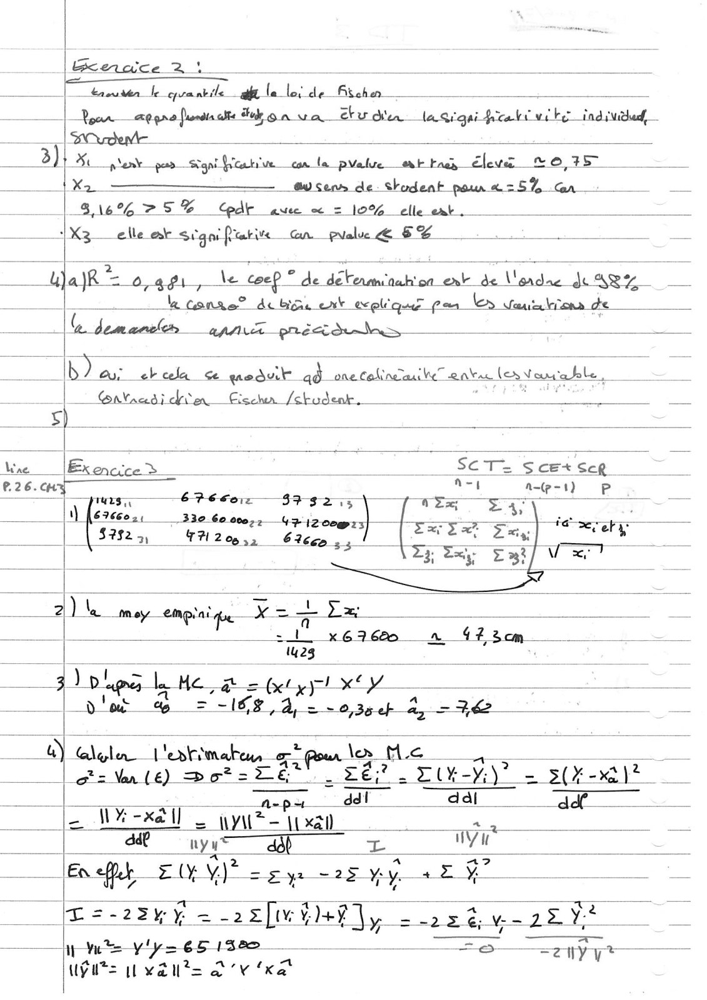
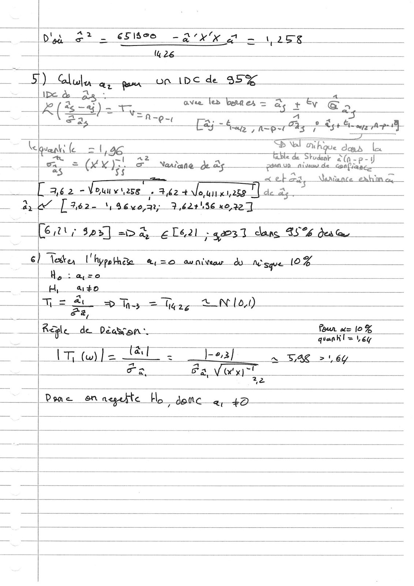

# VITEL TD corrigé Mod Lin.PDF

[Ouvrir l’original](https://drive.google.com/open?id=12FzlfZ3TE-zxfzp3eBDU5_TWbltlai9i) · Les pages signalées comprennent du texte reconnu automatiquement ou des éléments graphiques. Le fac-similé permet de vérifier chaque lecture.

**Pages avec fac-similé ou lecture OCR** — 1–9.

## Page 1

**Lecture OCR à contrôler**

~~~text
Moadle lindaine
13/03/2624 a

TR) Regnermisn (mé cane mit ga À _

Ex) Vik+e a Ve Kat €

canes erie ©, te alaherun half) f Me Ltmevadne fanng)
tu a= ¢/x) xy _

= | — — a Veckeun de param ass enrm es SEE
4

scsi 1 ass

= — x a ae oe

a - —
i

_~__Na,= %. Ines a = — ——

Dyke aX te, | ag on
= | Dans Ce cs X=}: 7, Asay. =

Fa 4 — ——

oe “eC fi = | as

Le | Be EW _ ne ——

= =o Vice, aka ae ë Asien.
| tna taice da modele Len ee eee
K=

Lira

t ci Naz

7 Re 1e. y 24 Ka

og onu fus) i ae Bo
— Rs bal (; 9 Xe. en
ft a Ky et re
| =r bk ve hee ee  ——_

= a Vs
NY Late, LG - Ps LA
~~~

## Page 2

**Lecture OCR à contrôler**

~~~text
Exe 2

e = Y a] yexXh =
Na Xb= Ope : Regnerinn ba aide © LD

lens Xt = xl) = x (Y- ya)

XY KA

ENTER on —

= OR"

Gm de RL Simple _ _
ae we | he at

en PE oe = ee
— ES le = = +. _ ou
___à] Ma Vero = (xa )e= a vie
un

1M _ ax

ee .
YY aE we, 2) (4

cz fz(ka) (Ka) caly va - = el v Lltyy! PT
= 4 xy

MINE “ès Sy ta, Eve _

_|Exe 3

Dey thee EY yt _ he
a
— D£2v-f edo :
- Cala ZEA 2 done cè ve: Aly > =o
_ — — — "EE, Alpe soo
2e a =
| =CRe ire EVIL
| vee —
~~~

## Page 3

**Lecture OCR à contrôler**

~~~text
| DT ise Pit Symittaig qu lial de Guaian)

os ee Yen, raed ———

we Se oi
o 37> FU] ok een RE GE sis So
7 | a -0,0603 oylogé

2 SY At]

= __ |b) a= LS À eye} le GS

€) Cos Lane _ampiaiqu € nue. =} a

=

RAR Rs — _ — _
Pur = oie? Va zat oe al
ra KG prod} éañt- “be

_ Eas = EGi-k)(zi-2) on
EG Hi NERF

[en à x = (x! Oxy se A7 nn = :
xls + 0.)
bs ” 219 =
a. 4) Yancy te art Py a SCR a Hélre,z
x we is iin aera” Yoo es
= == pe = —
_ à) Y=LEv- 4 LE ei: tht 0161 roues ee) Puy.
= #-i él: dig 40,61; 4046s Pe 4 98
! Sol bly | à 6,6IXO+0,4 6x0 +O
_ =-\,61 _ a _
+) Gide LE ME _

sce = % (Y- -y)" = Lex - 40,46 4) ne
_—. Wg - -¥ “Aly WO= = £26) Blaha Be 6\2Oy = Fay + 14 4946 Sa.

J libs atts,
= 0,6 (Hy), +24leuc (Yes SOAK yg

DS LR

+ Meer = sc +ecR “ae 9% = Bio : _

Re > rie = ES se D —
~~~

## Page 4

**Lecture OCR à contrôler**

~~~text
ec Prob

ar 41 =
x= [1 # 4 XX), 2 wail ha _
Ax 4, ‘ |

“E(#-2)(3-9)

Lo) Wey =
EE

DA am - (X'X)42. PE ess =o Z ne _
.

Pore F y= EH den — 2 (xx )2 a
ts ES A per abligaben

Dl=

a. 2, = 5: G u =

2,5 +
vas Vaal Dats Mae

Batata,

a

7614061 cig 4 Og à + E:S =

Y,
slixis

3-
à

<i

—— BESET ES ne *y

if fee Éñct 2 q2-nile

ly= -hé] a | de Grade

4 2CE= ACER L € (oé1x, + © . =

pp WH -hélxtg 40,6 loc+ oué el = e61)* Ext 4 6b ag;
| vfpsy + 0,61 40,46 OM Eye va

(a6 1)* cody 46 xd/4E(X'K) 2,4 + buc)t inn ds. CEA)

SET = sce + $CR 0 ) Rizr SE Lo, 46
Sor

SOAP 405 = 4, OP
~~~

## Page 5

**Lecture OCR à contrôler**

~~~text
M-C Zmeinde Gare

Exeaag ©

\\ din by = 4K 2y

nan Ka X us tS Neg

pe? +

> 7
Yexa +6 ov a (7) 22 (xxl vy

2)

3]

Ga 4 553
u) do [ar | ae Jap
= 0,551 |oP9? |e,S13 2, 01g

- 52 op Excel

Exncre 4 - RE

Yzak + b +6, £ a
is =
Inc min Z fetz min FY = Ce 4 bi) min ab) a
Dolebion eal Feet “POE,
Gmme €: +» N { Pre Nu

= aw) Ed
pce Se a \ ae Fz! 2x © Elis om

on pæbaumi utilitea My

le Cob? de waisemblanc à À min LG an) y (om)

LE,5,4,b) = mp. 6)=(es) Fi ie 7 Kay

7 æN(o Let que é eee

=> L{¢,. ue fab) sn L(V-ai-b)e
ell Va frise Es

le probe,

Hi Lo Fes aria € Cab)

As Leg LV ua = © Lt) at DY ae a BIZ

2
~~~

## Page 6

**Lecture OCR à contrôler**

~~~text
lEshimen ox eb b pa la M.v_æb

nina FY, ax, -b)2

a> | O¢ (arb)

à Cla,b) =

8b
~~~

## Page 7

**Lecture OCR à contrôler**

~~~text
ee SAR Ler narmale Gates pars,
qu > ç-
_——

Tr = moyenne ek so Ueneng
fel _ ——

- enr en-dmiclr Ae te )= 2

|_ici__lem €: sonk contaca de la loi Gavsienne_

2) pt IZ\ >it) 2 P (let zou) = oguid'! ng

Ce a, + me + € ne

NE 4 bG 4€ \éiem € = Nloga)

a? : P=t
æ = _
yan : E a-p-l= 19
rie = By Abne Van to fer
net | Sphares

PASS, taille de

a : Te Tor.
Trantyle do me ; L'échaatt
remyle

ant 2 M
IE: ° he at let sh =x=1 EX PEK) =m
Ty eam a=
Pme Cab) = \ee EAU iT os
: Ses ne we \ =m

"eal - Gus teat |
; \s

moe
a ~ > 2.2 WO) ; . :
Re = Le J B= oi ~ Mor)
He — id

[El ca)

Sag
| Hi: a to
=
2) i Tale Wl oT) Ta
! £ig
2 Le - ee ee sone a
y. un jae We sept
be ty, S20. S=flag}
T= ès ae £ A) ous: ae à ——
~~~

## Page 8

**Lecture OCR à contrôler**

~~~text
ages 2 _
éneusen le quantile aft la loi de ho

Re an PR Na grqai fra ti ui ke indswithed

py ran ses poo Sani Wautiue con la pale ont Fais Cleves %O,F57
Ka a Sens de: Shadent er a

S6 475% Cdr aue x = 10% elle ent

_1X3 elle ar stgor frire Gn pale Æ FB _ eo en _

a) 0,491, le coeP © de PNEU ext de Vande Ae AVY

Ware.
8.26. HY

anse” de be ent welque pen L ke

Ge mms nes

ai ba: me LE da Se pile ad “one caline te Lanta (en Vale. us

7 Galaadi chien Cischa /ctudenk _

Execute ® _ ___ SECTE SceEx sce
at A-@-) P

1 us éPésorr 37 $255- TE Ss 4, ARE]
[M f6r6co2, 330 60 00077 42 i200@7 = - fé > =

| 57825, FP? 205,, 6266 M DE DE Zag _ Qi =
ay EVE

- 3) bla L Me, a 2 bely pl et
| tod dg = -16#,24, eo ag ep 2, = BL _
4 lala. ee æ pou de A
| gts Van (6) Do? ES wei’ . DU SAS PTE
_ dt dal _ dd
— W%-xal) | DE = Ten «

ade ny Cr: L nV a

A

En et ZE ME = ZE y -2ÿ. ¥ey. 4 à va _ _—

fi

pi ont *
=-23y-y. _ y è
T=-23KY% = asf ye] jy = = +25 uv RENE

He v'y=e5132 >: ——=S- = y
Pits yds ov ‘xe
~~~

## Page 9

**Lecture OCR à contrôler**

~~~text
lib à as, =
4 i ee le = &
A(S=S) = =a ave les > bete = à + fv Ea,
= 4s Ca ee TIER Fg Php mete
| ee ee  —
Kelgvents le = 1,96 — Rue = ous le
i 1 ae dear &(n-p-1
— hy = OLX. i= Naniana—de ads psun un aie de Config —

axeboga \annre exhn ox

[ ae2 -Vounvijzse . Perr x 1,209

a, eo [362-4 y 62086 £0,227]
= CG, Î © px] mis a, ele. 2l ; 3 clang FS Se it
él Tres U hypothe = avntveour do | Nage [2x4
ee Ay: _&a so a — a zt
HA, AO a
T= À => Ts = hy 26 aN (0,0)
= EL EL / iy: =
a Re de Deadron oo ee ee
IT (w) | 2280S pean] ~ BAR 21 6y
card Fa, CET _
2
~~~
