# 1Examen_enonce+corrige-dec17.pdf

[Ouvrir l’original](https://drive.google.com/open?id=1dJqPr8wm5vS1Scgc3cmJWWjw7b8Wul-a) · Les pages signalées comprennent du texte reconnu automatiquement ou des éléments graphiques. Le fac-similé permet de vérifier chaque lecture.

**Pages avec fac-similé ou lecture OCR** — 1–13.

## Page 1

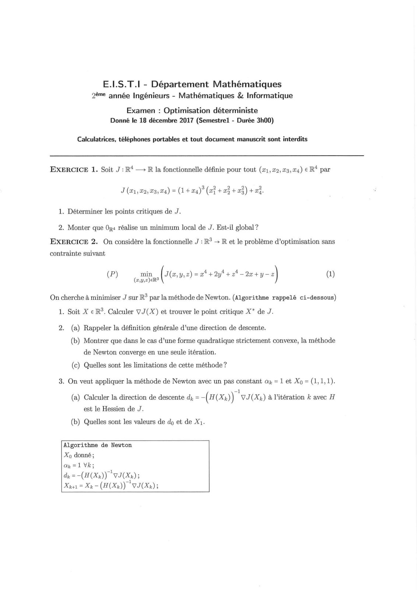

**Lecture OCR à contrôler**

~~~text
E.LS.T.I - Département Mathématiques
2ème année Ingénieurs - Mathématiques & Informatique

Examen : Optimisation déterministe
Donné le 18 décembre 2017 (Semestrel - Durée 3h00)

Calculatrices, téléphones portables et tout document manuscrit sont interdits

EXERCICE 1. Soit J: R¢ —> R la fonctionnelle définie pour tout (a1, 22, 73,24) € R‘ par
J (#1, @2,03,24) = (1+04)° (2? +23 +08) +23.

1. Déterminer les points critiques de J.

2. Monter que Ogs réalise un minimum local de J. Est-il global?

EXERCICE 2. On considère la fonctionnelle J :IR° > R et le problème d’optimisation sans

contrainte suivant

(P) min | J(a,y,z) =a +2y4+424-IWw+y-z (a)
(a,y,z)eR3

On cherche à minimiser J sur R° par la méthode de Newton. (Algorithme rappelé ci-dessous)

1. Soit X € RS. Calculer VJ(X) et trouver le point critique X* de J.

2. (a) Rappeler la définition générale d’une direction de descente.

(b) Montrer que dans le cas d’une forme quadratique strictement convexe, la méthode

de Newton converge en une seule itération.

(c) Quelles sont les limitations de cette méthode?
3. On veut appliquer la méthode de Newton avec un pas constant a = 1 et Xo = (1,1,1).

-1
(a) Calculer la direction de descente dh, =-(H(Xz)) VJ(Xz) à l'itération & avec H
est le Hessien de J.

(b) Quelles sont les valeurs de do et de X1.

Algorithme de Newton
Xp donné;

dy =-(H(Xx)) VIH);
Xwu = Xe (H(Xx)) VI(Xx);
~~~

## Page 2

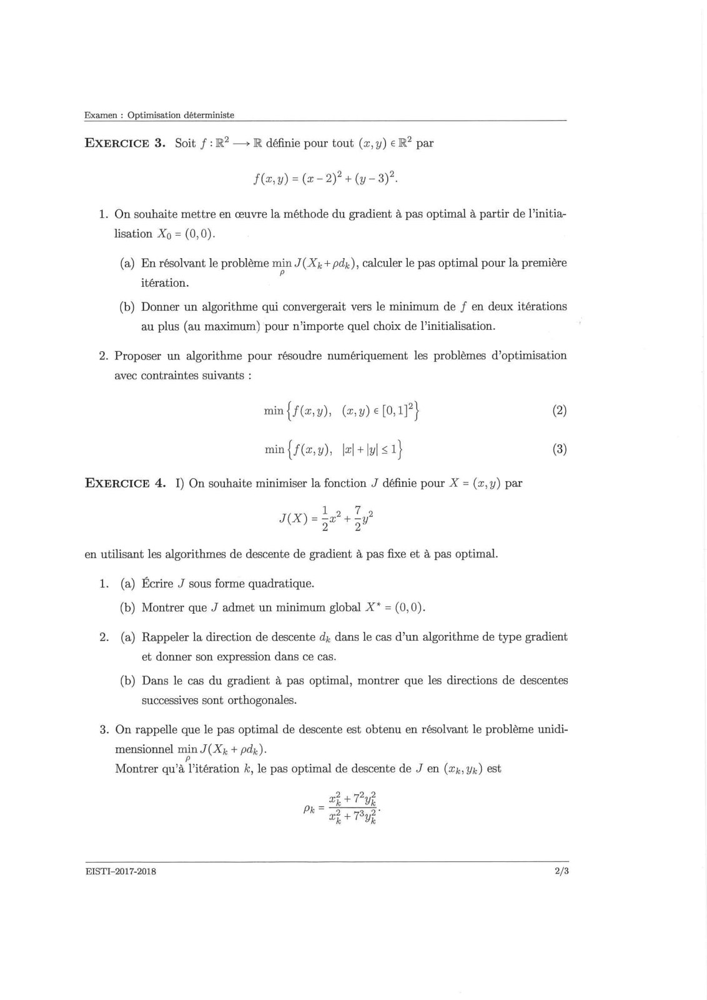

**Lecture OCR à contrôler**

~~~text
Examen : Optimisation déterministe

EXERCICE 3. Soit f :R? —> R définie pour tout (x,y) € R? par
F(ey) = (@-2)? + (3).
1. On souhaite mettre en œuvre la méthode du gradient à pas optimal à partir de l’initia-
lisation Xo = (0,0).
(a) En résolvant le problème min J(X3+ dx), calculer le pas optimal pour la première
n
itération.
(b) Donner un algorithme qui convergerait vers le minimum de f en deux itérations
au plus (au maximum) pour n’importe quel choix de l’initialisation.

2. Proposer un algorithme pour résoudre numériquement les problémes d’optimisation

avec contraintes suivants :
min{#(x,y), (ey) €[0,1P} (0)

min {f(2,y), lal+lul<1} @)
EXERCICE 4. I) On souhaite minimiser la fonction J définie pour X = (x,y) par

Lia 7
J(X)= get 5

en utilisant les algorithmes de descente de gradient à pas fixe et à pas optimal.

1. (a) Écrire J sous forme quadratique.
(b) Montrer que J admet un minimum global X* = (0,0).

2. (a) Rappeler la direction de descente dy dans le cas d’un algorithme de type gradient
et donner son expression dans ce cas.

(b) Dans le cas du gradient à pas optimal, montrer que les directions de descentes
successives sont orthogonales.

3. On rappelle que le pas optimal de descente est obtenu en résolvant le problème unidi-
mensionnel min J(Xx + pdx).
Montrer qu’à l’itération k, le pas optimal de descente de J en (xp, yx) est

2 22
= tt Tu

PETER

EISTI-2017-2018 2/3
~~~

## Page 3

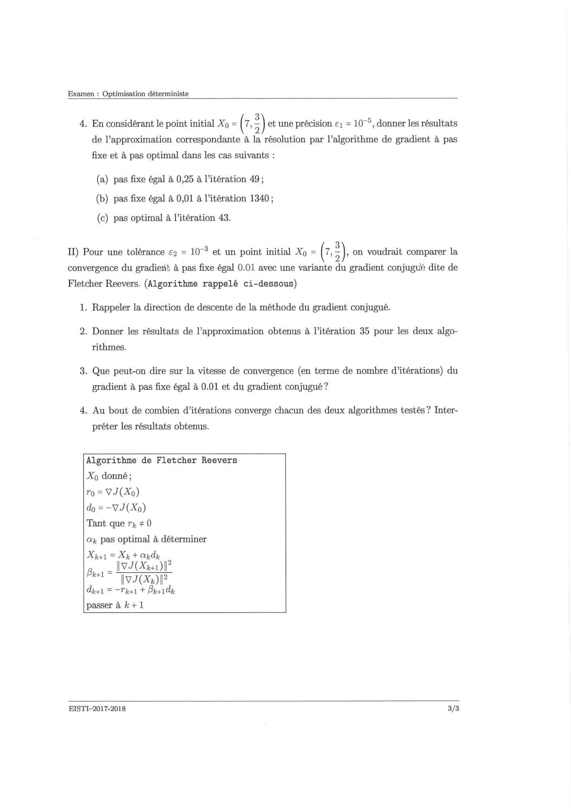

**Lecture OCR à contrôler**

~~~text
Examen : Optimisation déterministe

4. En considérant le point initial Xo = (7, 3) et une précision €1 = 10°, donner les résultats
de l’approximation correspondante à la résolution par l’algorithme de gradient à pas
fixe et à pas optimal dans les cas suivants :

(a) pas fixe égal à 0,25 à l’itération 49;
(b) pas fixe égal à 0,01 à l'itération 1340;
(c) pas optimal à l’itération 43.

Il) Pour une tolérance £2 = 107 et un point initial Xo = (7, 3), on voudrait comparer la
convergence du gradient à pas fixe égal 0.01 avec une variante du gradient conjugué dite de
Fletcher Reevers. (Algorithme rappelé ci-dessous)

1. Rappeler la direction de descente de la méthode du gradient conjugué.

2. Donner les résultats de l’approximation obtenus à l’itération 35 pour les deux algo-
rithmes.

3. Que peut-on dire sur la vitesse de convergence (en terme de nombre d’itérations) du
gradient à pas fixe égal à 0.01 et du gradient conjugué ?

4. Au bout de combien d’itérations converge chacun des deux algorithmes testés ? Inter-
préter les résultats obtenus.

Algorithme de Fletcher Reevers
Xo donné;

ro = VI(Xo)

do = -VJ(Xo)

Tant que rx # 0

ax pas optimal à déterminer

Xie = Xe + andy

— IV I(Xies) I?
ae
IV 7(Xe)|?
eet = The + Bes de
passer à k+1

EISTI-2017-2018 3/3
~~~

## Page 4

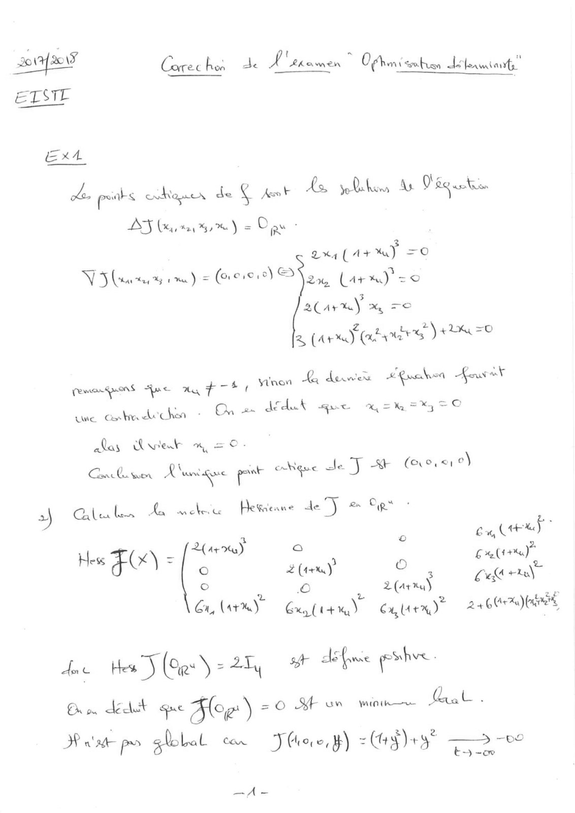

**Lecture OCR à contrôler**

~~~text
2017 OT + | ' =
Care c hoa de £ PKaWen Ofnn i ssubrsn latent,

EXA

ea poats cohamex de ‘a Asso
BY Gay um) = Das :
3
wa (44%) =O
NS ome) = (ace) 2% (arm) = ©
aC arm) 4 TO
ater ) HD =O

As sea hes Ns Pégase

à (Army tt

pemenguens ue ny Hoh non La dewen Area Aus it
une entmdrehsn - On dduf que =m =%y =e

alas web a = 0.

Baia Vies À ani suse ‘aa eKçse HT KH (ice: o)

5) Caller ta mette Hegneane 47 an Ope :
j a ACER
Hee T(x) = frs) : .
fi Es co
© © 2 (arma) Fe
2a ltr%a) (ake

Ga (He) Gate) Gta)

dae Hes) (Oe = 2414 xf défie phys.
On où dest = i Ace) =O KE UN Mitku Beale 5
I «at ps global can FJ Groce, #) 2 CE —- —

A
~~~

## Page 5

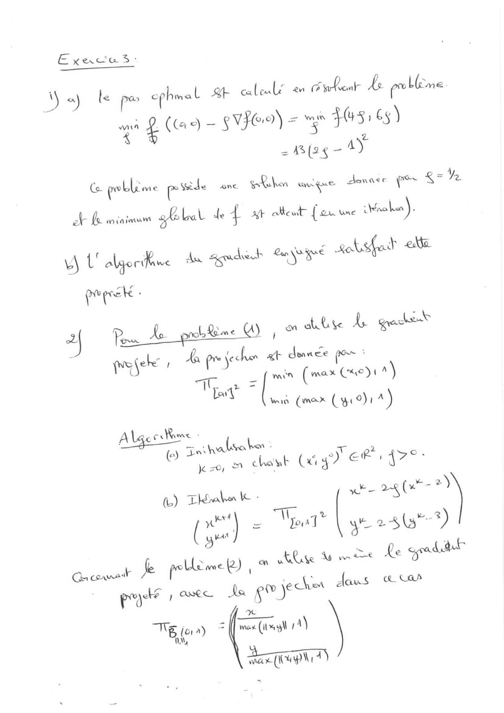

**Lecture OCR à contrôler**

~~~text
E geste Be:
Wa) le por ephmal Bt alelé er wheat Le probleme
“3 & (cas) — §VFO9) = oy Os: cy)

= (2<- AY
RTL

= ( Lame sede ane § nm ie
= Rke une Gre

ef Le minimum gba de À Bt atteat” {cu une

Yt algorifine An Seradvinh Sangre PAC AE
ail
2 Pen L probe O , dits A gectst
| poele ' la pe jecher xb deance pes :
TT min (ax Grey a)

La à i! .
Wa (max Cao) a)

Algerie :
= tyaditva ken :

(e) in .
m chant (xi yo ef 47°:

k =0, ©

fb) Tkraba le - whe BR (x >)
<A Sc, i
( on = You] | je. 2 43")
at

EN Ke Lo es Re sad

chet daus ce Cah

Gacomal ke pole we 2) i
poet rere de go Je

a
AD = mes (img 1)

+ or ET LE)
~~~

## Page 6

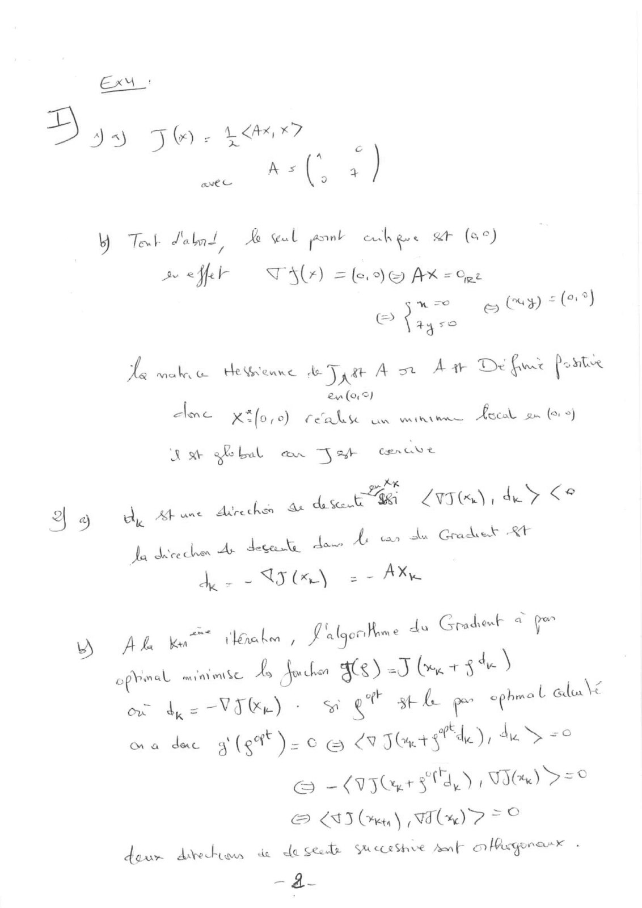

**Lecture OCR à contrôler**

~~~text
Ex:

=

= 33 J: i <a x7
avec As (, 4 )
Yo Tek Salat, wal pont echee ah (9°)

Be «ff TAY) = (e.°)@ AK =e
pase howell
à Cage ©

i make He Geane de T gat An Aw D fur fortes
| eu (are)
ele Xifose) Fea un minime His on tors)

Jott af bol on Sab navet
SEX ye
| é A, 7
4 3) a, Atue Avrechsn + desert wi Lvs), de
da dice che Ar degeKe ds
dy = = US (x) = + AX

Ay car he Grahet Xt

D Ah ka ik, Pialgortome 4s Gradet + qu

opinsl minis À de 40) Jburst) |
où de VIR) & ee shh pe eghnol ala\
Oa duc 3 (<t*) - oe € Slt ke), die Le
Gy LT PTS à TI) 750
© L853 Cree) (VIC%) 2 =~ ©
dour direction da cla sted Suecrihue pute que

- à-
~~~

## Page 7

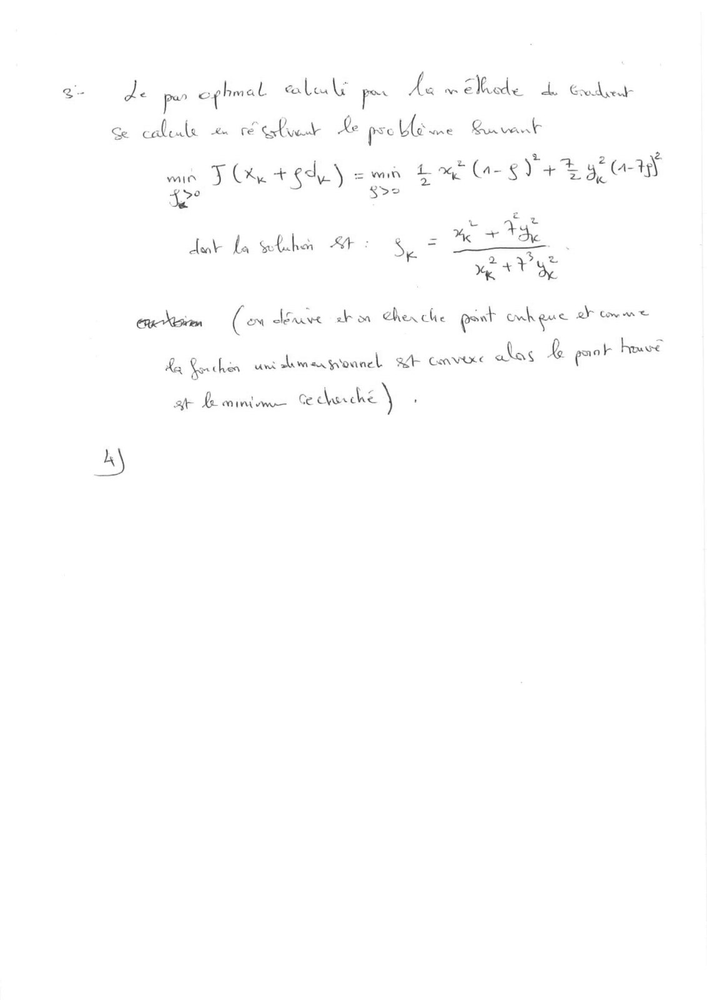

**Lecture OCR à contrôler**

~~~text
de pe ephmal el po a an Else L Eodset
Se calole he FE tne Re pee ses Cuve
me, TOA GLY mé EEC STE BLOM
2 nr
—_———$ +
eue
eNom (ex dlomve akon Cherche gost exh ene YP Come ane
‘ & paek howe

dot La MAS AY: Sy

Ke La che uni Las gone RE Conn ale

at Be mmime due 5
~~~

## Page 8

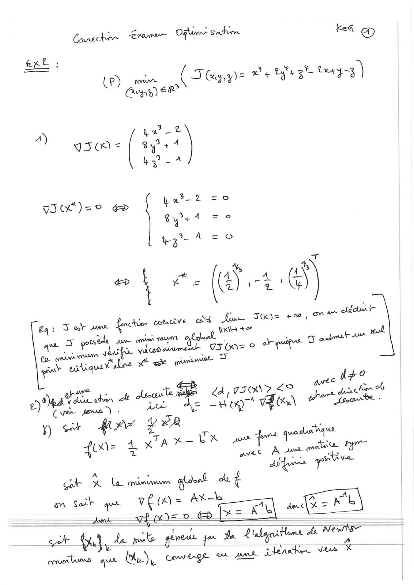

**Lecture OCR à contrôler**

~~~text
Conacher rame Ogi sachin ke @
ext ;
ui eas Tapas +13" ty)
A) i at
9H: ay? & À
by? =A”
Wot)=° @& pr-2 =e
By A = ©
37° A =o

y

Ah, 4. QT
æ in (EN 1-4 a
‘ 1 thy
Ra : TS ek ame fenchion coucve cod Ju THE £0, owe chica tr
cede June came meurt laa eal
à pete A rer aus

que fay pe :
Co curs years viubaunmenhk IT OO= © el

yon eatiqu tales 20 er gourmet >

we es
Deal aban cl cltecile me <A PID SE The
4 Le As Hog” 400 what te.

(ven pews) :
y ct far 428

Lee L XTA X — Es jus ft quete

ans. mate FAT

À ae
A du n tive
Sr X Le mnumm qui de € r

om Soit que veu = At TS
aa A \ CA
lx= AK \. Amr

Sa en

avec

ex Lomo ae (i), Co gk Ur Ak pea

. A
whe vus X
~~~

## Page 9

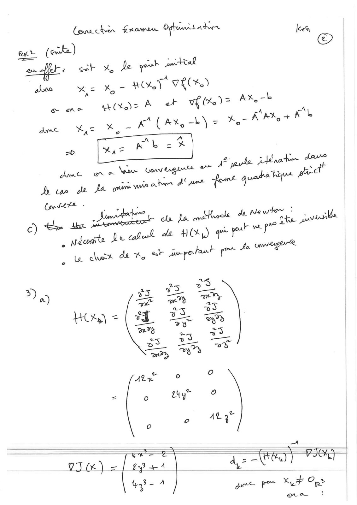

**Lecture OCR à contrôler**

~~~text
Conecher Frame Opfrs ab
er (ewke) kes

ere tx Je youk tal
À
aka KE X 7 HOT VE%)
ge me  wCkez A ar vf (0) = AX, -&
ye Xe KA (ax -b\ = er A’ pK, + Kb

ume
“
A> pule Add aohe dave

Ame owe ve Usav ORLA es fi
de ae ott Ja anion mia oboe Aturs fort guada bins ptet

c) th. bn _ omscstab ole La mitele Apr Ue
& Javan
Deo cul ae H(%,) qe per ere pe

Conver +

4, Ndcaite
, & chs da Ker aegohant re Ja vnveperR
3) 2 a)
G “x. ?
a) . 25 ec EC
Cu = | 7 > os
Se LT “à
2 ay 9
ss Le +
aD Ty
Ate © o
= o AT o
o 2 LES
= SoS = A
VI) =} types dy = es) 7360
qas- A
> gee PT KT Op?

nw
~~~

## Page 10

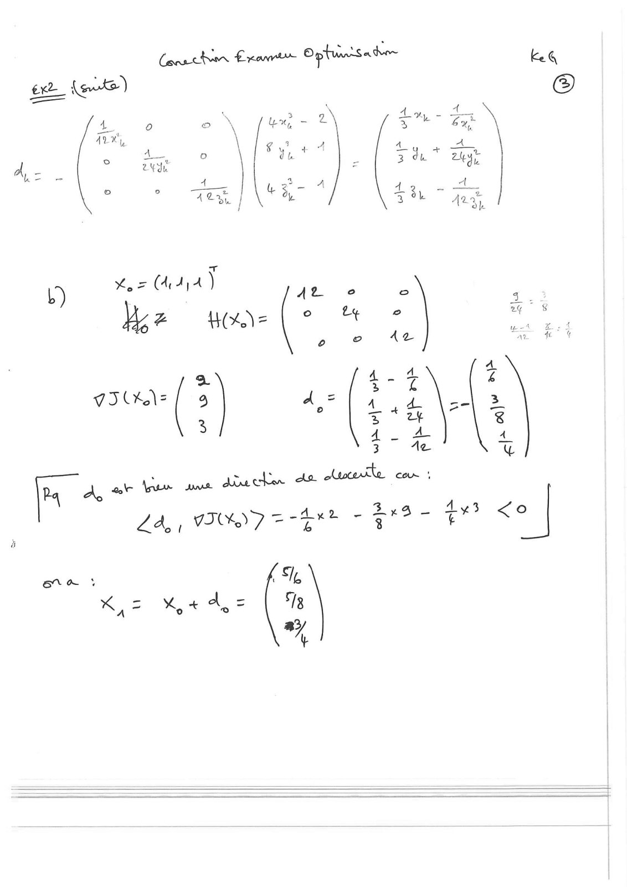

**Lecture OCR à contrôler**

~~~text
b)

=
Lez (idi4)

Wow Hz | © & 2?

: 4-4

iad à. Asa a
3 5 tz

4 - 4

3 Ac

3
Zà, ; UN rss - Bed -

LE)
er
~~~

## Page 11

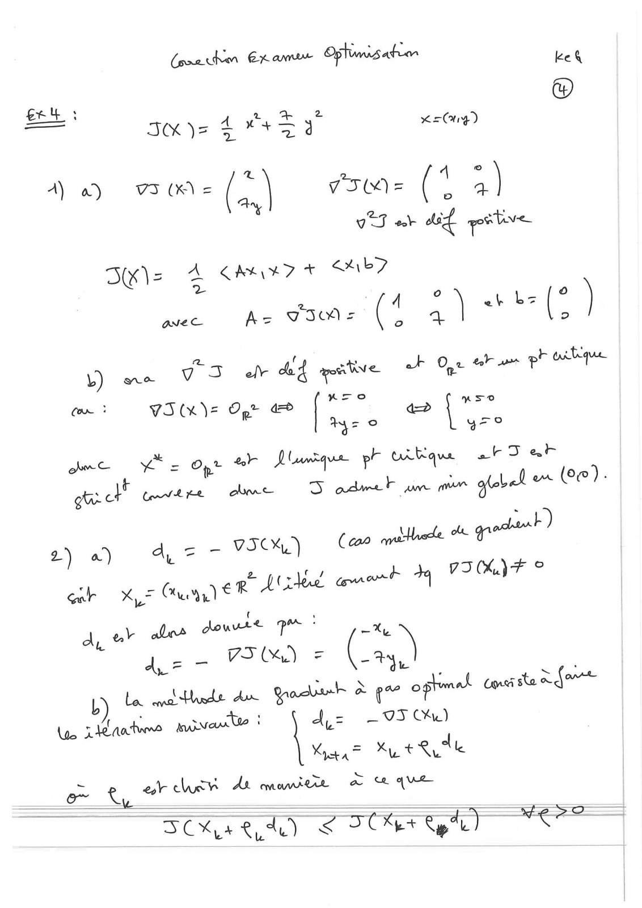

**Lecture OCR à contrôler**

~~~text
(poahen Ex ame Opus ation BA

(©)
£e4 3

° 2
zo

IM j= 4 AT y x=Ony)
2, 4 ©
A) a) VI (KW = (2..\ Vom = (4 2)
* VTT eb aug pate
L
DK): à CALE + SA 7

avec Ac TIO = (4 2) et Lz (° )

+ at
b) F el dad paie ak One toh ar pl Lge
ne V pa

ue ARE OR a Pre a> LT
Ay ° yee
fet Pe ee #7 Jusque pr vdtique ah Dah

get crt me D admet am in gfebel om Ce).

adant )
eke ou 9
2) a) A, Z — VICK) (can we

le bh da VIK)F ©
gr XL Giyy ee bales, aoe +
doute pe: 7
du av alos (
A7 — VI) = PA

La eva the Aw Gracin a r” optimal don sta à fat
L me
Le rates moveate | = — 95 Cu)
Kia = x + lle

= M A mit À que
cd t, oe om

SOK ee) SSO pe) CT
~~~

## Page 12

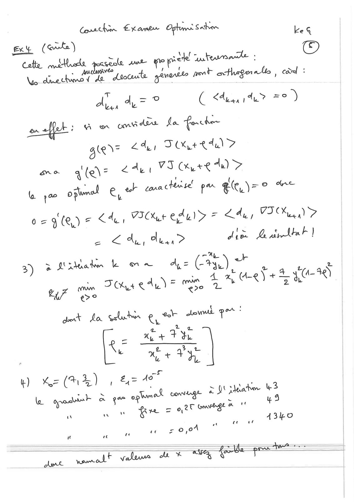

**Lecture OCR à contrôler**

~~~text
aes en keg
gee (284)
Sel utente :

Lo damerhiondy da doute geverits pent oxthagerntio, cid :

Pa
Aves Ay = ° ( dés re =)

effet: A mm on des {a “forchen

gie\= 24a, T+ edu’ 7
< ay l v3 CX, +e A>

now 4 (e\ = .
den sel po ar oe.

fo 1" oplumal ew Corat
0 = 9 (8) ~ <4, VTC edul> = 24,, VIX
oe € dur Mia? dice Baril]
aXe
A= ( r

AJ

3 L'xkadm le a
3) pi on 3 ” : , saad
ae a + => Gy R

ee Tie eta) "SS.
get La Sert er Jovi ?

a ze
R= Me Fe
Ds xt + Pye

#) “= (4 2) » 24> 49

Wo open à qe opmal CS a À JE eater se
“ woe Gu = 0,20 bw a 16 #
4340

ee
ee 7 0,01

fig e te

“LF veluna “hk % ave ga ?

LR
mt Yow
~~~

## Page 13

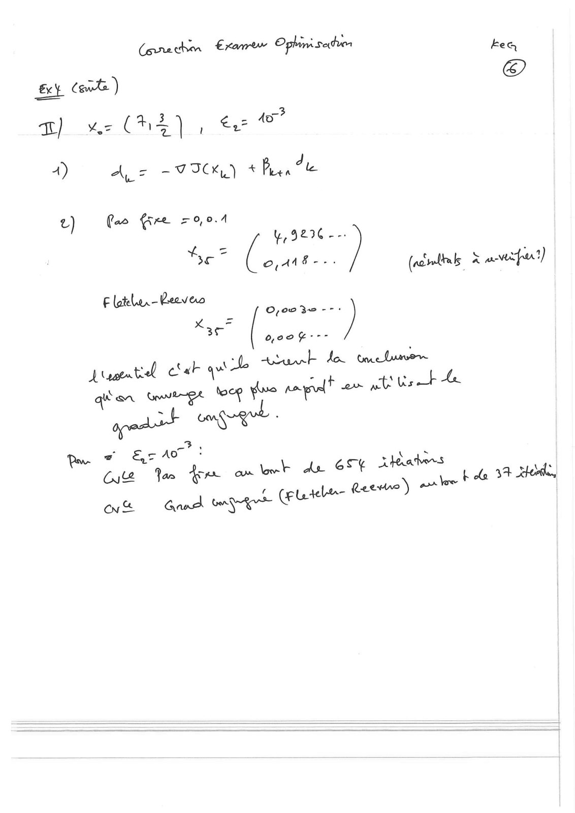

**Lecture OCR à contrôler**

~~~text
Gorachon Exar Ophin. sation kea

@
Ext cet)
3
T) ‘Me C14) _ te ©
D Ar FICK) he
las € =0,0.4
UL) Cae Gre 9296 =
re” nt (actus x a-wfut)
F latelunr—Reevers Bsa
4307 a

quant etat que et i pe te

given ange too fee papell ee ele BS

= à

2 Er A :
= Qu Ve Ye om
ov Gand ET

luk ade 6S¢ tthe bole 34 Hé
Guabe- Reese) er
~~~
