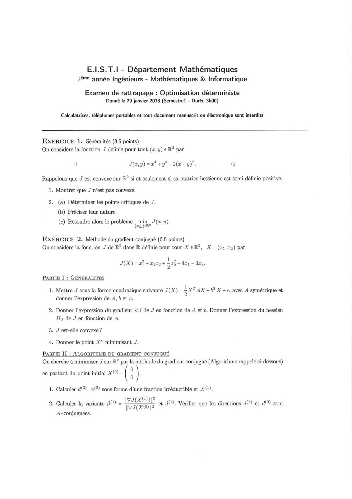
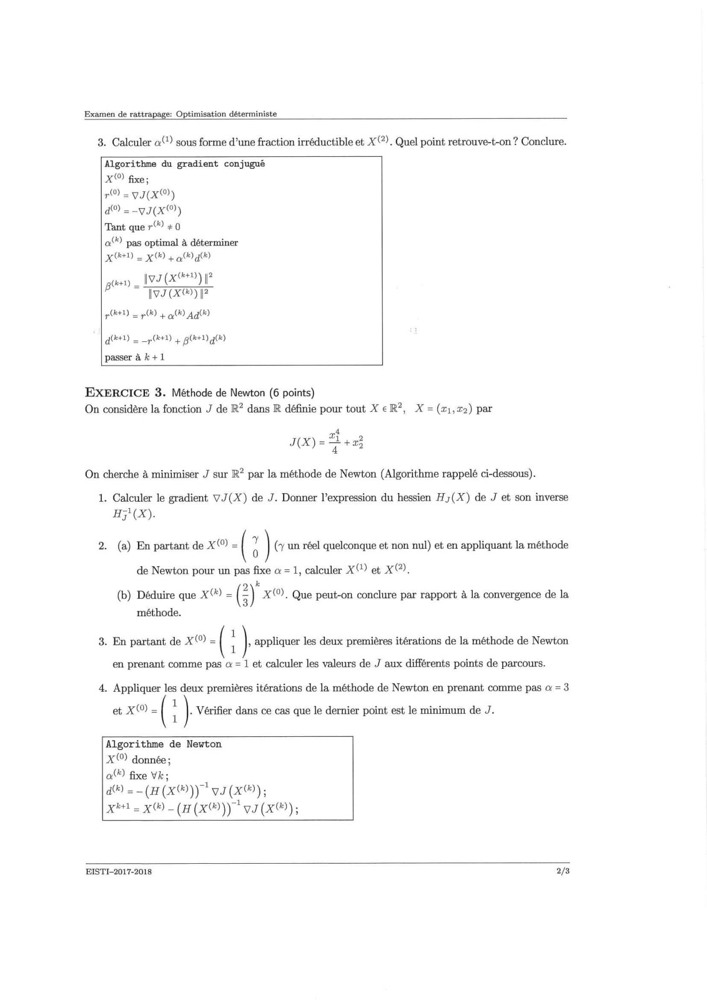
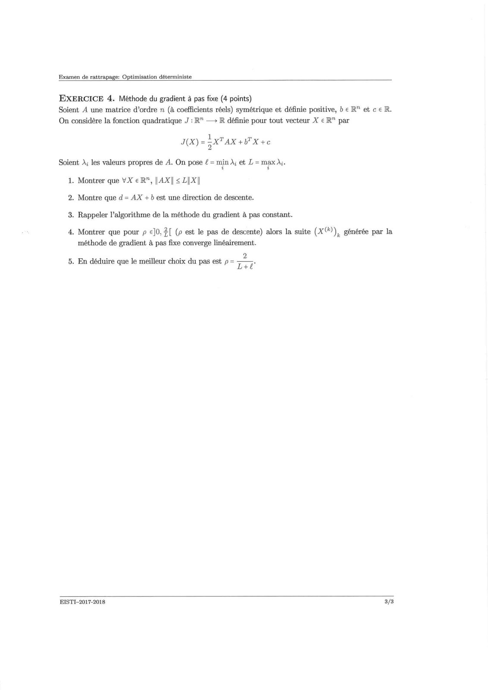
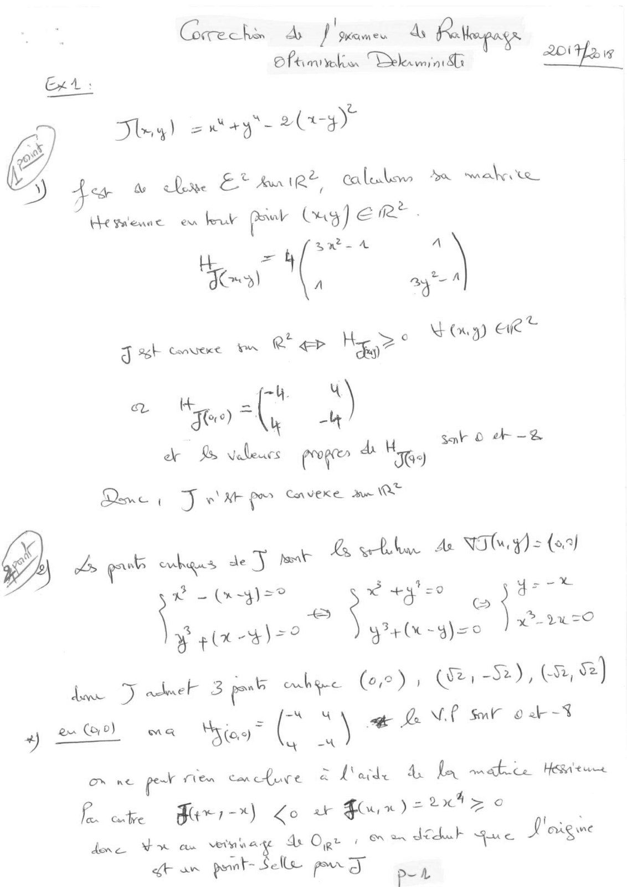
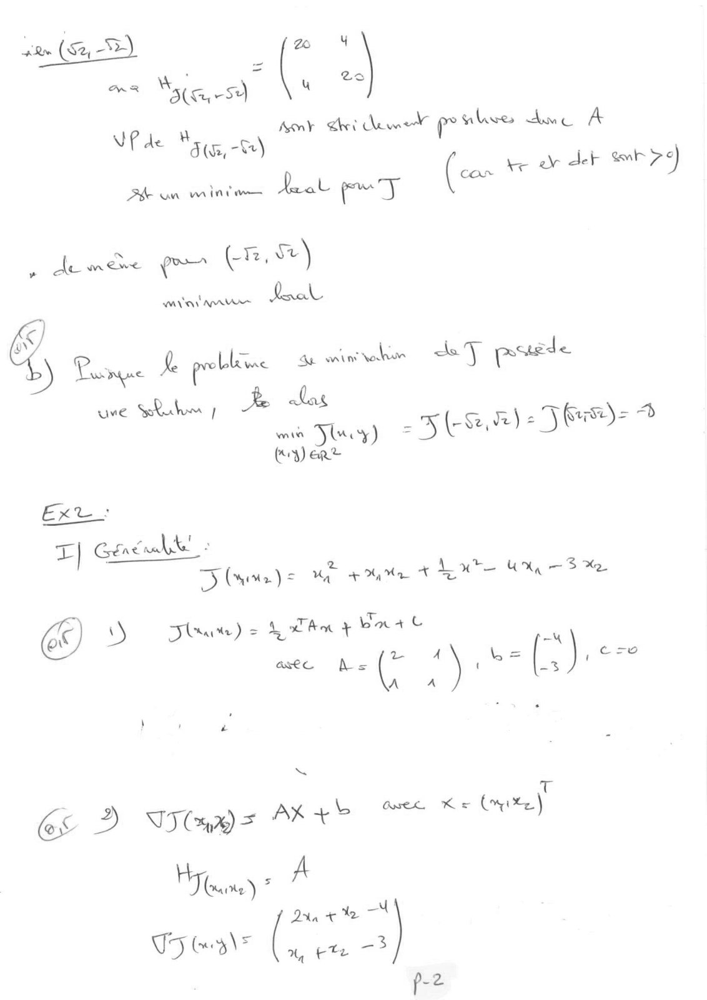
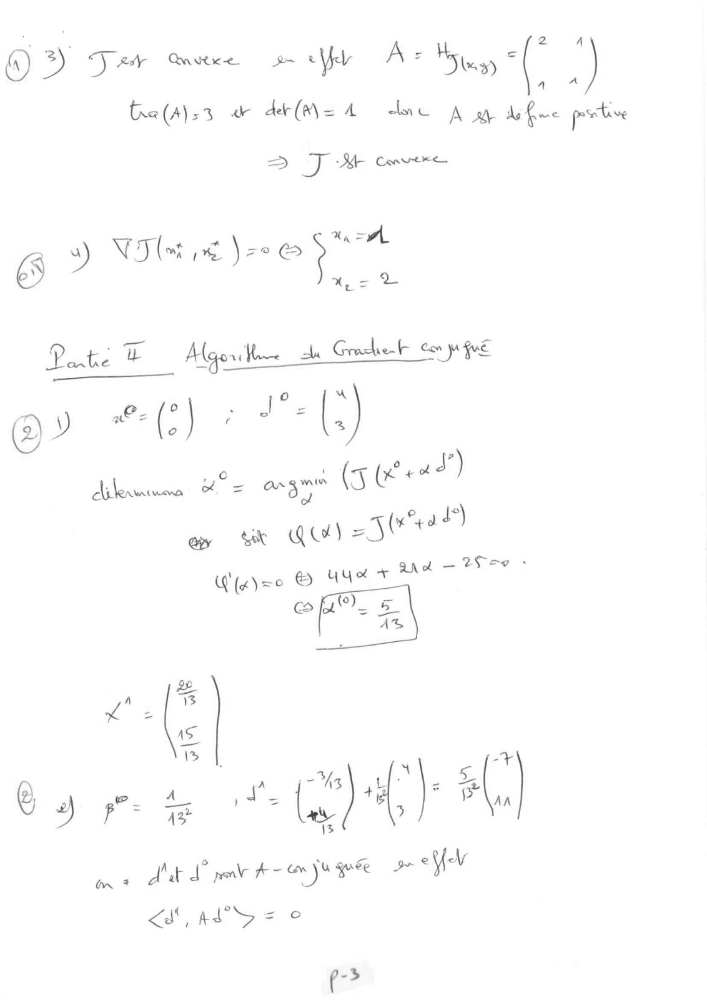
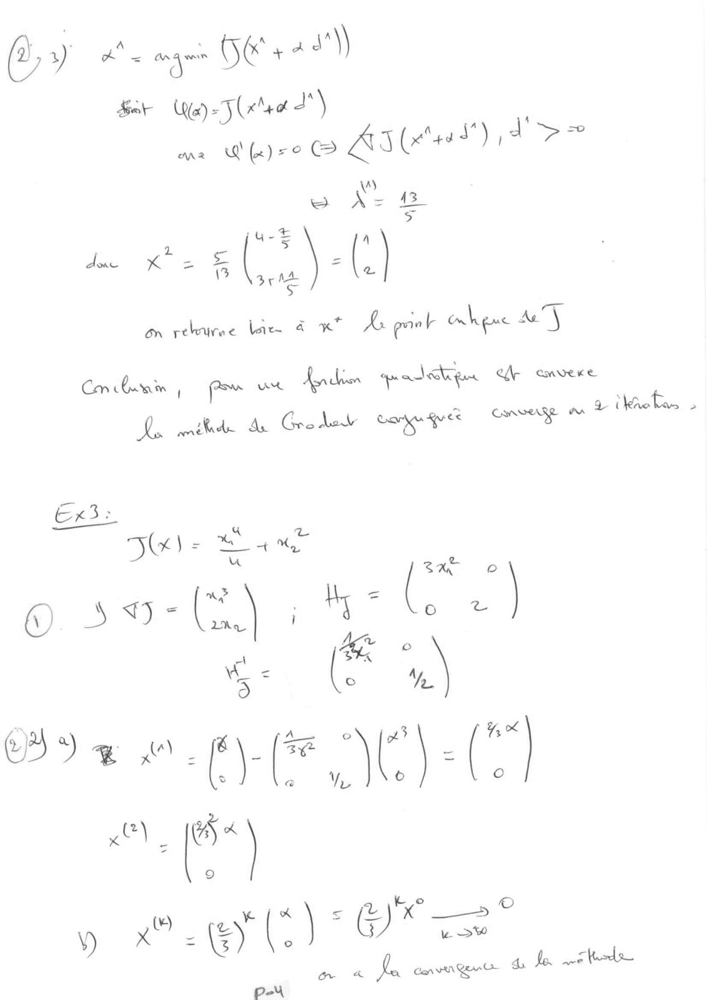
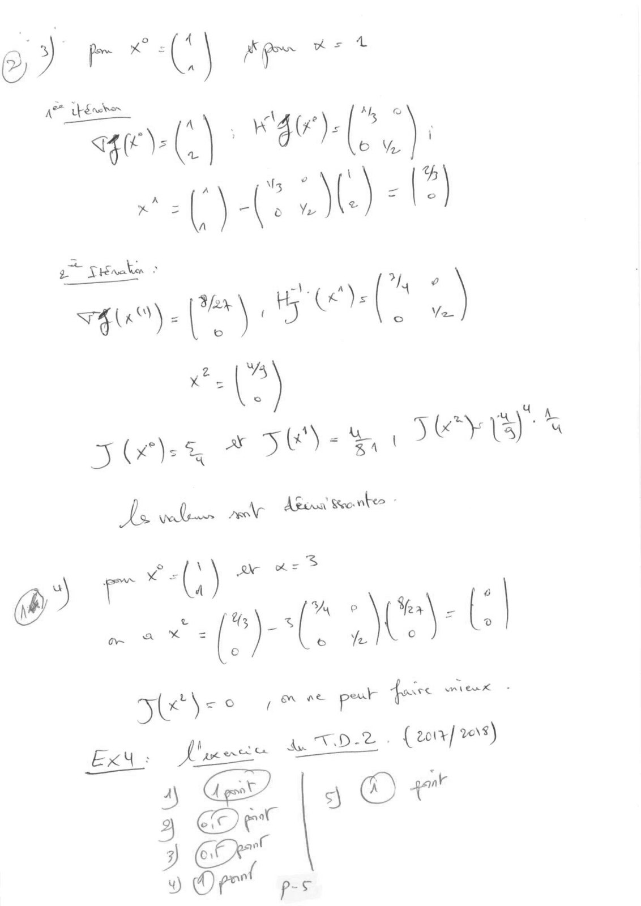

# 2Examen_enonce+corrigé_janv18.pdf

[Ouvrir l’original](https://drive.google.com/open?id=1m9eqqT5wUUNNNE7ehWc0Aprnq2uUveC7) · Les pages signalées comprennent du texte reconnu automatiquement ou des éléments graphiques. Le fac-similé permet de vérifier chaque lecture.

**Pages avec fac-similé ou lecture OCR** — 1–8.

## Page 1

**Lecture OCR à contrôler**

~~~text
E.LS.T.I - Département Mathématiques
2ème année Ingénieurs - Mathématiques & Informatique

Examen de rattrapage : Optimisation déterministe
Donné le 29 janvier 2018 (Semestre1 - Durée 3h00)

Calculatrices, téléphones portables et tout document manuscrit ou éléctronique sont interdits

EXERCICE 1. Généralités (3.5 points)
On considère la fonction J définie pour tout (x, y) € R? par

fi J(a,y)=at+yt-2(x-y)°. a
Rappelons que J est convexe sur R? si et seulement si sa matrice hessienne est semi-définie positive.

1. Montrer que J n’est pas convexe.

2. (a) Déterminer les points critiques de J.
(b) Préciser leur nature.

(c) Résoudre alors le problème min, J(x,y).
(ey) eR?

EXERCICE 2. Méthode du gradient conjugué (6.5 points)
On considère la fonction J de R? dans R définie pour tout X eR?, X =(z1,72) par
a lia
J(X) = af + wi, + 503 dei 82.
PARTIE I : GÉNÉRALITÉS

1 ÿ
1. Mettre J sous la forme quadratique suivante J(X) = gx Ax +b" X +c, avec A symétrique et
donner l'expression de À, b et c.

2. Donner l'expression du gradient VJ de J en fonction de A et b. Donner l’expression du hessien
Hy de J en fonction de A.

3. J est-elle convexe ?
4. Donner le point X* minimisant J.

PARTIE IT : ALGORITHME DU GRADIENT CONJUGUÉ
On cherche à minimiser J sur R? par la méthode du gradient conjugué (Algorithme rappelé ci-dessous)

en partant du point initial X( = ( û }

1. Calculer d(°), a(°) sous forme d’une fraction irréductible et X(1).

2. Calculer la variante pO) = IVXAOP

CL (A), Véri irecti a) (0)
TosCemye ot 4. Verifier que les directions d( et a sont

A-conjuguées.
~~~

## Page 2

**Lecture OCR à contrôler**

~~~text
Examen de rattrapage: Optimisation déterministe

3. Calculer a“) sous forme d’une fraction irréductible et X(). Quel point retrouve-t-on ? Conclure.

Algorithme du gradient conjugué
X fixe;
7 = 9 (XO)
d =-yJ(X)
Tant que r) +0
a pas optimal à déterminer
x) 2 XO) à ag)
Iva (xO) À
Iva (x) 9?

0 2 9) 4 hd 440

pee) =

a) 2 p02) à 80040

passer à k +1

EXERCICE 3. Méthode de Newton (6 points)

On considère la fonction J de R? dans R définie pour tout X eR?, X=(x1,72) par

af
J(X) = + +

On cherche à minimiser J sur R? par la méthode de Newton (Algorithme rappelé ci-dessous).
1. Calculer le gradient vJ(X) de J. Donner expression du hessien HJ(X) de J et son inverse
Hj} (X).
2. (a) En partant de x) = ( 7 (7 un réel quelconque et non nul) et en appliquant la méthode
de Newton pour un pas fixe a = 1, calculer X et X),
(b) Déduire que x) = @) X), Que peut-on conclure par rapport à la convergence de la
méthode.
3. En partant de X( = : |, appliquer les deux premières itérations de la méthode de Newton
en prenant comme pas a = 1 et calculer les valeurs de J aux différents points de parcours.
4. Appliquer les deux premières itérations de la méthode de Newton en prenant comme pas a = 3

et X) = ( : } Vérifier dans ce cas que le dernier point est le minimum de J.

Algorithme de Newton

X() donnée;

a) fixe Vk;

a) = (H(X®))" v(x);

xh 2 x(k) -(a(x®))* vs (x);

EISTI-2017-2018 2/3
~~~

## Page 3

**Lecture OCR à contrôler**

~~~text
Examen de rattrapage: Optimisation déterministe

EXERCICE 4. Méthode du gradient à pas fixe (4 points)

Soient A une matrice d'ordre n (à coefficients réels) symétrique et définie positive, b € R" et c € R.

On considère la fonction quadratique J: R" —> R définie pour tout vecteur X € R” par
J(X)= ATAX +WX+c
Soient À; les valeurs propres de A. On pose £ = min À et L = max M.
1. Montrer que VX eR", | AX| < LIX|

2. Montre que d= AX + b est une direction de descente.

3. Rappeler l'algorithme de la méthode du gradient à pas constant.

4. Montrer que pour p €]0, 2[ (p est le pas de descente) alors la suite (X()), générée par la

méthode de gradient à pas fixe converge linéairement.

2
5. En déduire que le meilleur choix du pas est p= 7—-

EISTI-2017-2018

3/3
~~~

## Page 4

**Lecture OCR à contrôler**

~~~text
Crete fr 4 otage
Oftimrvelion GES aye nies 22e

Ty) = nt +4" = 2 (+3)

a) 4m we du EX Anie®, Callow > sales
the gu'eune eu leu per Cag] er? |

a = awa A
Lis uf wy

J Bb vec mn RQ > Hea 3 toy Ee

“4M
a Kt, =
Je) =(, a)
dr 4% Velleucs prog” A Hi
Dene 1 Jj Pa pre Cavexe ue OO

Ç
oh Ls gor ovhqus ae J at DA sur As NIM. y) = (8.9)
sn Nu ds et
Le) @

yretu-glzo J-270

Sat © dr -2&

y ele -4)=°

haw “Jadnel 3 put obec Ge), (We, St), ER &)

4 Bo me Miss” (
mue po ten cmefuce à Merde À La mate Heu

A ere dr -*) KG ar Foun) = tt > a
done YX cam vernvage de Ogr | cn on dodab que J'aigwe

ft aw poml= Selle pe oy p- 7

“A aA Ja NP su 0 2-4
x 4
~~~

## Page 5

**Lecture OCR à contrôler**

~~~text
«(an »
= Ne ‘ =

~ ste ( u |
mk ri dune prion Ane A

UP de à
Pde M5 ¢5,-%)
(com ke oe der aah 7¢)

Me an mint Jeol pay

» de move eo (nm)
Saal

avin ur

4
& Lune le probleme Se ening tom LT puede

uve Ruth ! LL las
min Jury) = (en) 2 Jus): hy

(y) eRe

EXT:
T| Gene nulle +

D (wee) = ue +4

€ D) haute) = LT AM + buat

Ma + AL MH Wy 3 MD

Ge 2 taps Mer ee tre
H
Toe’) * A

Dan ete
T5 &a\¥ (;. otk a
p-2
~~~

## Page 6

**Lecture OCR à contrôler**

~~~text
o 3) T ar Quetce 2 \eb Ae Hs ea { ‘

Éa(alss a défis A duc À ay deme postive

=> J Conte

és s) Vs re )- Li =.

Wade ua Algor on 4 Grohe con po gut

ve fee ead)
Arlenmuee ae a fi (x

ow ve QU) AUTO

An of = 2 ee -
pose © AAXT

ley fy ()_
2.
sf" 13
Le
5

+
© i fst" a) # |
+) p”= 15 ' = Le 5 #1

8 any € e Ay
#- € ge
On * dé d per eee € ÿ
<A, ALS = ©

cs
=

AS

e->
~~~

## Page 7

**Lecture OCR à contrôler**

~~~text
OPEN »)
Sar Wa) = . na d'\ z
MAR ue ATT) ye

i)
we Az 415
>

Te :)
es
= Si :
aloxes X TT 13 on (°

On rele lan à Lu Ae got crhene A)

Yi

A

Con barr | ‘oan ut Ads pe tp er cnvere mnt
DA mit As Graded Rap qué CN SAR a ae &

Ex3: .

= % od
Blea Set ae

©. d- (A) : Hy = Le ‘]

(3 : Æ AY. [\- ia 5) : (**|
- a

y MSE) Ors

ne fe Can van Ge Ci & Je tds
PA
~~~

## Page 8

**Lecture OCR à contrôler**

~~~text
a" |?
sh FU Tey)
Laval tr Bena toasts
we vy (C4
~~ cf) Aes ®
Ve o,f ee peak fore eee. à

beneter de TD-2 : { corr] 4)

| |‘ © +*

An
uy
~~~
