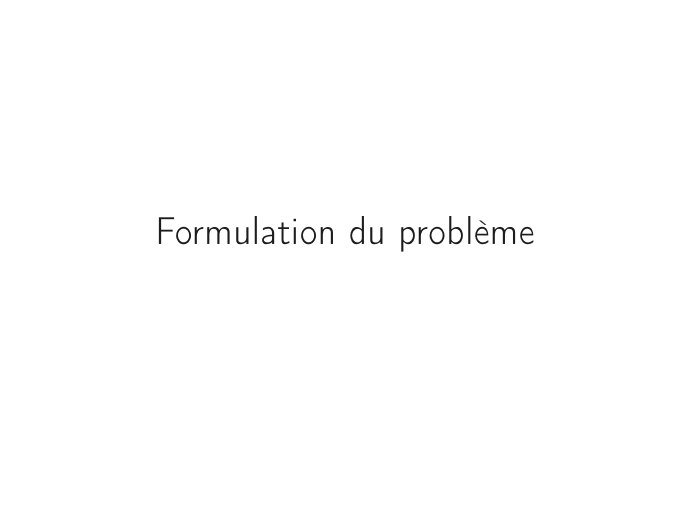
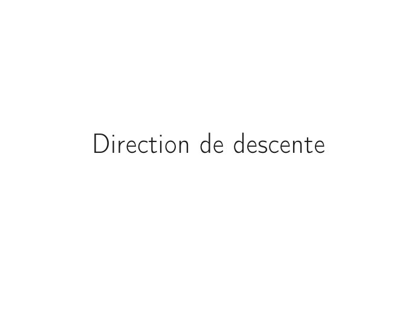
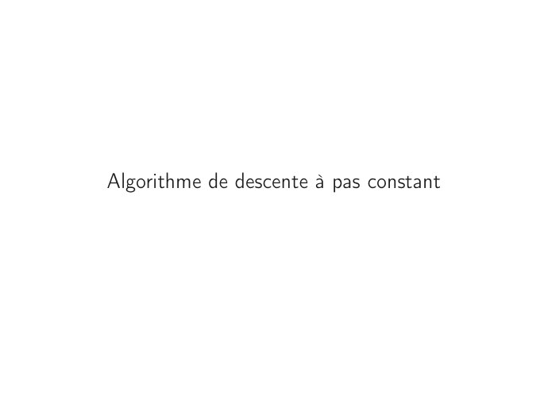

# CM3 -- Algorithme de descente.pdf

[Ouvrir l’original](https://drive.google.com/open?id=1a_xIKYpFkvQAsTIrEm3yRpCGo3QJa9sI) · Les pages signalées comprennent du texte reconnu automatiquement ou des éléments graphiques. Le fac-similé permet de vérifier chaque lecture.

**Pages avec fac-similé ou lecture OCR** — 3, 12, 16, 20.

## Page 1

~~~text
Ingénieurs 2ème année : Mathématiques et Informatique

   Méthodes itératives d’optimisation déterministe

CM3 – Algorithme des méthodes itératives de descente
             Nisrine FORTIN CAMDAVANT
~~~

## Page 2

~~~text
1   Formulation du problème

2   Principe général d’un algorithme de descente

3   Direction de descente

4   Pas de descente

5   Algorithme de descente à pas constant

6   Algorithme de descente à pas variable – Pas optimal de Cauchy

7   Algorithme de descente à pas variable – Pas d’Armijo
~~~

## Page 3

~~~text
Formulation du problème
~~~

## Page 4

~~~text
  Formulation du problème Principe général d’un algorithme de descente Direction de descente Pas de descente Algorithme de desc

  Optimisation sans contraintes

        Étudier le problème d’optimisation sans contraintes où on effectue la
        minimisation de la fonction f ∶ Rn → R ∪ {+∞} sur tout l’espace.

        Formulation du problème

                                                          ⎧
                                                          ⎪ min f (x)
                                                          ⎪
                                                          ⎪
                                                 (P)      ⎨
                                                          ⎪
                                                          ⎪
                                                          ⎪
                                                          ⎩ x∈R
                                                                 n

        f une fonction de Rn dans R ∪ {+∞}.

        Objectif
        Présenter quelques algorithmes permettant de calculer (de manière approchée)
        la ou les solution(s) du problème (P) sans contraintes.

4/29
~~~

## Page 5

~~~text
  Formulation du problème Principe général d’un algorithme de descente Direction de descente Pas de descente Algorithme de desc

  Algorithme

        Les principaux algorithmes d’optimisation sont définis par une application A de
        Rn dans Rn permettant la génération d’une suite d’éléments de Rn par la
        formule
                         ⎧
                         ⎪ x ∈ Rn donné, k = 0                       Etape d’initialisation
                         ⎪
                         ⎪ 0
                         ⎨
                         ⎪
                         ⎪
                         ⎪
                         ⎩ xk+1 = A(xk ), k ∶= k + 1                 Itération k

        Écrire un algorithme n’est ni plus ni moins que se donner une suite (xk )k∈N de
        Rn ; étudier la convergence de l’algorithme, c’est étudier la convergence de la
        suite (xk )k∈N .

5/29
~~~

## Page 6

~~~text
  Formulation du problème Principe général d’un algorithme de descente Direction de descente Pas de descente Algorithme de desc

  Convergence d’un algorithme

               On dit que l’algorithme A converge si la suite (xk )k∈N engendrée par
               l’algorithme converge vers une limite x∗ .

               La vitesse de convergence et la complexité sont des facteurs à prendre en
               compte lors de l’utilisation (ou de la génération) d’un algorithme :

                       il faut que la méthode soit la plus rapide possible tout en restant
                       précise et stable,

                       le critère de mesure de la vitesse (ou taux) de convergence est
                       l’évolution de l’erreur commise (ek = ∥xk − x∗ ∥).

6/29
~~~

## Page 7

~~~text
  Formulation du problème Principe général d’un algorithme de descente Direction de descente Pas de descente Algorithme de desc

  Taux de convergence d’un algorithme

        Soit (xk )k∈N une suite de limite x∗ définie par la donnée d’un algorithme A qui
        converge. On dit que la convergence de A est
               linéaire si l’erreur (ek = ∥xk − x∗ ∥) décroit linéairement

                                    ∃C ∈ [0, 1[, ∃k0 ∈ N, ∀k ≥ k0                ek+1 ≤ Cek

               super-linéaire si l’erreur ek décroit de la manière suivante :
                                                          ek+1 ≤ αk ek ,

               où (αk )k∈N est une suite positive convergente vers 0.

               d’ordre p si l’erreur ek décroit de la manière suivante :

                                    ∃C ≥ 0, ∃k0 ∈ N, ∀k ≥ k0                ek+1 ≤ C (ek )p

               Si p = 2, la convergence de l’algorithme est dite quadratique.

7/29
~~~

## Page 8

~~~text
  Formulation du problème Principe général d’un algorithme de descente Direction de descente Pas de descente Algorithme de desc

                 Principe général d’un algorithme de descente

8/29
~~~

## Page 9

~~~text
  Formulation du problème Principe général d’un algorithme de descente Direction de descente Pas de descente Algorithme de desc

  Méthodes de descente

                            Principe général des méthodes de descente
        Diminuer la fonction f en effectuant un déplacement dans la direction d,
        d ∈ Rn , en construisant une suite d’itérés (xk )k≥1 approchant la solution x ∗ du
        problème (P) de la façon suivante :

                                                   xk+1 = xk + ρk dk .

        Le paramètre ρk est le pas à effectuer le long de la direction de descente dk au
        point courant xk .

9/29
~~~

## Page 10

~~~text
  Formulation du problème Principe général d’un algorithme de descente Direction de descente Pas de descente Algorithme de desc

  Algorithmes de descente

            ∎ Principe général :
                   1   point initial x0
                   2   pour k ≥ 1 croissant
                        2.1 choisir une direction de descente dk ≠ 0
                        2.2 choisir un pas de descente ρk > 0
                        2.3 poser xk+1 = xk + ρk dk
                        2.4 tester la convergence

            ∎ Démarche :
               On doit pouvoir trouver ρk > 0 et dk ∈ Rn /{0n } tel que f (xk+1 ) < f (xk ),
               autrement dit
                                                   f (xk + ρk dk ) < f (xk )

10/29
~~~

## Page 11

~~~text
  Formulation du problème Principe général d’un algorithme de descente Direction de descente Pas de descente Algorithme de desc

  Algorithmes de descente

               Le paramètre ρk est le pas à effectuer le long de la direction de descente
               dk au point courant xk .

               Un algorithme à directions de descente est donc déterminé par les
               paramètres d et ρ :

                       la façon dont la direction de descente d est calculée donne son nom
                       à l’algorithme,

                       la façon dont le pas ρ est déterminé est appelée recherche linéaire et
                       peut se déterminer de différentes façons.

11/29
~~~

## Page 12

~~~text
Direction de descente
~~~

## Page 13

~~~text
  Formulation du problème Principe général d’un algorithme de descente Direction de descente Pas de descente Algorithme de desc

  Direction de descente – Définition

        Soit f ∶ Rn → R une fonction continûment différentiable et x un vecteur de Rn .
        Le vecteur non nul d ∈ Rn est appelé direction de descente de f en x si et
        seulement si
                                        ⟨∇f (x), d⟩ < 0.
        On note Dx l’ensemble des directions de descente de f en x,

                                          Dx = {d ∈ Rn , ⟨∇f (x), d⟩ < 0} .

13/29
~~~

## Page 14

~~~text
  Formulation du problème Principe général d’un algorithme de descente Direction de descente Pas de descente Algorithme de desc

  Direction de descente

        ⟨∇f (x), d⟩ = ∥∇f (x)∥∥d∥ cos(θ) où θ est l’angle entre ∇f (x) et d. Si d ∈ Dx
                                                                      π     3π
        alors cos(θ) < 0, l’angle entre ∇f (x) et d est compris entre   et     .
                                                                      2      2

                                     Figure 1 – Illustration de la définition
14/29
~~~

## Page 15

~~~text
  Formulation du problème Principe général d’un algorithme de descente Direction de descente Pas de descente Algorithme de desc

  Direction de descente – Propriété

        Soient f ∶ Rn → R une fonction continûment différentiable, x un vecteur de Rn
        et d ∈ Rn . Si d est une direction de descente en x alors il existe η > 0 tel que

                                          ∀α ∈]0; η], f (x + αd) < f (x).

        Démonstration.
        ::::::::::::

15/29
~~~

## Page 16

~~~text
Pas de descente
~~~

## Page 17

~~~text
  Formulation du problème Principe général d’un algorithme de descente Direction de descente Pas de descente Algorithme de desc

  Pas de descente

        Le paramètre ρk > 0 est le pas à effectuer le long de la direction de descente dk
        au point courant xk . Des valeurs de ce pas peuvent être obtenues par :

               Une valeur constante : fixer une valeur constante pour les différentes
               ::::::::::::::::::
               directions de descente. Si ρ est trop grand, l’algorithme peut diverger ; si ρ
               est trop petit la convergence peut être très lente.

               Une recherche linéaire exacte : déterminer le pas optimal, c’est à dire le
               ::::::::::::::::::::::::
               pas qui minimise la fonction f le long de la direction de descente dk . Le
               pas ρk est donc solution du problème :

                                                  ρk = arg min f (xk + ρdk )
                                                              ρ>0

               Une   recherche linéaire approchée : choisir un pas qui diminue
               :::::::::::::::::::::::::::
               suffisamment la valeur de la fonction f . c’est une méthode plus simple qui
               consiste à délimiter un intervalle convenable pour ρ et choisir le plus
               grand ρk possible sur cet intervalle.

17/29
~~~

## Page 18

~~~text
  Formulation du problème Principe général d’un algorithme de descente Direction de descente Pas de descente Algorithme de desc

  Test de convergence et test d’arrêt

        Soit x∗ un point minimum local du critère f à minimiser. Un test d’arrêt devra
        être choisi pour garantir que

            1   l’algorithme s’arrête toujours après un nombre fini d’itérations,
            2   le dernier point calculé soit suffisamment proche de x∗ .

        Soit ϵ > 0 la précision demandée, on peut utiliser plusieurs critères :
                Test d’optimalité : ∥∇f (xk )∥ < ϵ.

                Stagnantion de la solution : ∥xk+1 − xk ∥ < ϵ∥xk ∥.

                Stagnantion de la valeur courante : ∣f (xk+1 ) − f (xk )∣ < ϵ∣f (xk )∣.

                Nombre d’itérations : on ne souhaite pas dépasser un seuil maximal fixé ;
                k < SeuilMax.

18/29
~~~

## Page 19

~~~text
  Formulation du problème Principe général d’un algorithme de descente Direction de descente Pas de descente Algorithme de desc

  Test de convergence et test d’arrêt - Remarque

        On utilisera comme critère d’arrêt une combinaison des ces quatre crtitères :

                                  ⎧
                                  ⎪ Test d’optimalité
                                  ⎪
                                  ⎪
                                  ⎪
                                  ⎪
                                  ⎪
                                  ⎪
                                  ⎪
                                  ⎪
                                  ⎪
                                  ⎪
                                  ⎪
                                  ⎪
                                  ⎪
                                  ⎪     ⎧
                                        ⎪  Stagnation de la valeur courante ⎫
                                                                            ⎪
                                  ⎪
                                  ⎪     ⎪
                                        ⎪                                   ⎪
                                                                            ⎪
                Critère d’arrêt = ⎨ OU ⎨              &                     ⎬
                                  ⎪
                                  ⎪
                                  ⎪     ⎪
                                        ⎪ Stagnation de la solution
                                        ⎪                                   ⎪
                                                                            ⎪
                                                                            ⎪
                                  ⎪
                                  ⎪
                                  ⎪     ⎩                                   ⎭
                                  ⎪
                                  ⎪
                                  ⎪
                                  ⎪
                                  ⎪
                                  ⎪
                                  ⎪
                                  ⎪
                                  ⎪
                                  ⎪
                                  ⎪
                                  ⎩ OU Nombre d’itérations maximal fixé dépassé.

19/29
~~~

## Page 20

~~~text
Algorithme de descente à pas constant
~~~

## Page 21

~~~text
  Formulation du problème Principe général d’un algorithme de descente Direction de descente Pas de descente Algorithme de desc

  Algorithme de descente à pas constant

        Fixer une valeur constante pour les différentes directions. Si ρ est trop grand,
        l’algorithme peut diverger ; si ρ est trop petit la convergence peut être très
        lente.

                                   Algorithme de descente à pas fixe

            1   Initialisation
                k = 0 : choix de x0 , de ρ > 0 et de ϵ > 0
            2   Itération         k
                trouver une direction de descente dk ≠ 0 : ⟨dk , ∇f (xk )⟩ < 0;
                xk+1 = xk +ρdk ;
            3   Critère d’arrêt
                Si ∥xk+1 − xk ∥ < ϵ∥xk ∥ , STOP
                Sinon, on pose k = k + 1 et on retourne à 2.

21/29
~~~

## Page 22

~~~text
Algorithme de descente à pas variable
        Pas optimal de Cauchy
~~~

## Page 23

~~~text
  Formulation du problème Principe général d’un algorithme de descente Direction de descente Pas de descente Algorithme de desc

  Algorithme de descente à pas variable : pas optimal

        Déterminer le pas qui minimise la fonction f le long de la direction de descente
        dk . Le pas ρk est donc solution du problème :

                                              ρk = arg min f (xk + ρdk )
                                                          ρ>0

                                 Algorithme de descente à pas optimal

            1   Initialisation
                k = 0 : choix de x0 et de ϵ > 0
            2   Itération         k
                trouver une direction de descente dk ≠ 0n : ⟨dk , ∇f (xk )⟩ < 0;
                ρk = arg min f (xk +ρdk );
                           ρ>0

                xk+1 = xk +ρk dk ;
            3   Critère d’arrêt
                Si ∥xk+1 − xk ∥ < ϵ∥xk ∥ , STOP
                Sinon, on pose k = k + 1 et on retourne à 2.
23/29
~~~

## Page 24

~~~text
  Formulation du problème Principe général d’un algorithme de descente Direction de descente Pas de descente Algorithme de desc

  Propriété

        Propriété
        Si ρk est un pas optimal, alors ∇f (xk+1 ) et dk sont orthogonaux.

                Remarques :
            1    Pour déterminer le pas optimal, on doit minimiser la fonction
                 gk ∶ ρ ↦ f (xk +ρdk ). Ce pas est appelé pas de Cauchy. En pratique
                       nous ne savons pas calculer de façon exacte un minimum ρopt k de gk ,
                       ce pas peut ne pas exister,
                       calculer une approximation numérique de gk (ρ) et de gk′ (ρ)pour
                       chaque ρ peut être couteux.
            2    On peut préférer le plus petit point stationnaire de gk qui fait décroitre
                 cette fonction :
                                                            ′
                                   ρopt
                                    k   = inf {ρ ≥ 0, gk (ρ) = 0 et g (ρ) < g (0)} .

                 On parle de la règle de Curry et le pas est appelé pas de Curry.

24/29
~~~

## Page 25

~~~text
Algorithme de descente à pas variable
         Pas optimal d’Armijo
~~~

## Page 26

~~~text
  Formulation du problème Principe général d’un algorithme de descente Direction de descente Pas de descente Algorithme de desc

  Algorithme de descente à pas variable – pas d’Armijo

        Choisir un pas qui diminue suffisamment la valeur de la fonction : délimiter un
        intervalle convenable pour ρ et choisir le plus grand ρk possible sur cet
        intervalle. Conditions d’Armijo-Goldstein

                          f (xk + ρk dk ) ≤ f (xk ) + ρk β1 ⟨∇f (xk ), dk ⟩,          β1 ∈]0, 1[

                                Algorithme de descente à pas d’Armijo

            1   Initialisation
                k = 0 : choix de x0 et de ϵ > 0
            2   Itération         k
                trouver une direction de descente dk ≠ 0n : ⟨dk , ∇f (xk )⟩ < 0;
                ρk = Armijo(xk , dk );
                xk+1 = xk +ρk dk ;
            3   Critère d’arrêt
                Si ∥xk+1 − xk ∥ < ϵ∥xk ∥ , STOP
                Sinon, on pose k = k + 1 et on retourne à 2.
26/29
~~~

## Page 27

~~~text
  Formulation du problème Principe général d’un algorithme de descente Direction de descente Pas de descente Algorithme de desc

  Algorithme d’Armijo - Calcul d’un pas ρk

                                               Algorithme d’Armijo

        Initialisation: choix d’un pas ρ1k > 0 et d’un paramètre
        τ ∈]0, 1[, i = 1.
            1   Test: le pas ρik est accepté s’il vérifie

                                      f (xk + ρik dk ) ≤ f (xk ) + ω1 ρik ⟨∇f (xk ), dk ⟩,

                Sinon:
            2   On choisit ρi+1
                            k   ∈ [τ ρik , (1 − τ )ρik ]
            3   On pose i = i + 1 et ρk = ρik , puis on retourne à l’étape 1.

        Le paramètre τ est habituellement choisi égal à 10−2 . Le pas obtenu par cet
        algorithme est appelé pas d’Armijo. La constante ω1 est choisie arbitrairement
        et est habituellement prise très petite (de l’ordre de 10−4 ) afin que la condition
        d’Armijo soit plus aisément satisfaite. Mais il est souvent préférable de choisir
        ω1 < 0, 5.

27/29
~~~

## Page 28

~~~text
  Formulation du problème Principe général d’un algorithme de descente Direction de descente Pas de descente Algorithme de desc

                      Figure 2 – Illustration du pas de Cauchy et du pas de Curry

28/29
~~~

## Page 29

~~~text
  Formulation du problème Principe général d’un algorithme de descente Direction de descente Pas de descente Algorithme de desc

        Bibliographie :
               Méthodes numériques et optimisation, Jean Pierre Corriou, LAVOISIER
               2010
               Linear and Nonlinear Programming, David G.LUENBERGER, Second
               Edition Springer 2005
               Introduction à l’optimisation, Jean Christophe Culioli, ellipses,1994.
               Introduction à l’analyse numérique matricielle et à l’optimisation PG.
               CIARLET MASSON 1990
               Inverse Problem Theory and Methods for Model Parameter Estimation
               Albert Tarantola SIAM 2005.
               Convexité et optimisation Guy Cohen Ecole Nationale des Ponts et
               Chaussées et INRIA 2000.
               Optimisation sans contraintes M. Bergounioux http ://www.univ-
               orleans.fr/mapmo/membres/maitine/MASTER2/FAP/optimFAP.pdf
               Introduction à l’analyse numérique
               http ://www.math.uvsq.fr/jaisson/ENSAE cours45.pdf
               Algorithmes d’optimisation non-linéaire sans contrainte
               http ://www.math.u-bordeaux1.fr/ bergmann/PDF/These/annexeC.pdf

29/29
~~~
