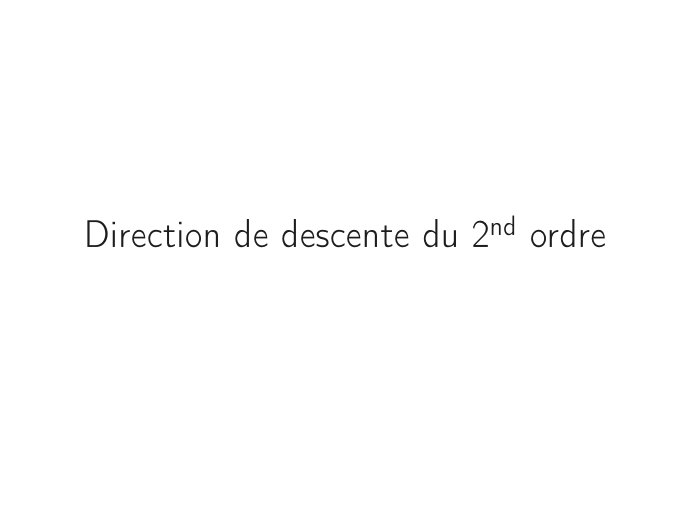

# CM4 -- Directions de descente.pdf

[Ouvrir l’original](https://drive.google.com/open?id=1aUliLRiiXBBMdgtMRYtbB46L7t2lwSXY) · Les pages signalées comprennent du texte reconnu automatiquement ou des éléments graphiques. Le fac-similé permet de vérifier chaque lecture.

**Pages avec fac-similé ou lecture OCR** — 19.

## Page 1

~~~text
Ingénieurs 2ème année : Mathématiques et Informatique

   Méthodes itératives d’optimisation déterministe

            CM4 – Directions de descente
             Nisrine FORTIN CAMDAVANT
~~~

## Page 2

~~~text
1   Direction de descente du 1er ordre
      Méthode du gradient
      Méthode du gradient conjugué
        Gradient conjugué pour les fonctions quadratiques
        Gradient conjugué pour les fonctions non quadratiques

2   Méthodes de Newton

3   Méthodes quasi-Newton
~~~

## Page 3

~~~text
                    Articulation du cours
Ce cours est scindé en deux parties :

  I. Les méthodes de descente à direction du premier ordre :
       ↝ Méthodes qui exploitent le gradient (les dérivées du premier ordre) pour exprimer
           la direction de descente.

 II. Les méthodes de descente à direction du second ordre :
       ↝ Méthodes utilisant le gradient et la matrice hessienne de la fonction critère pour
           exprimer la direction de descente.
~~~

## Page 4

~~~text
                               Rappel

2 Les méthodes de descente procèdent
       dans l’objectif de diminuer la fonction f ,
       en effectuant un déplacement dans une direction d, d ∈ Rn ,
       en construisant une suite d’itérés (xk )k≥1 approchant la solution x ∗
       du problème (PSC).

2 Un algorithme à directions de descente
       est déterminé par la direction d,
       la façon dont la direction de descente d est calculée donne son nom
       à l’algorithme.
~~~

## Page 5

~~~text
Direction de descente du 1er ordre
         Méthode du gradient
~~~

## Page 6

~~~text
  Direction de descente du 1er ordre                     Méthodes de Newton                          Méthodes quasi-Newton

  Méthode du gradient

         La méthode (ou algorithme) du Gradient fait partie de la classe des méthodes
         de descente. Elle consiste à choisir une direction de descente en fonction du
         gradient de la fonction à optimiser. La direction de descente d vérifie
         ⟨∇f (x), d⟩ < 0, un choix classique pour cette méthode est donné par

                                                      dk = −∇f (xk )

         Géométriquement, cela représente que −∇f (x) est une direction de descente en
         x (si ∇f (x) ≠ 0Rn ) qui est de plus forte pente.

         À l’itération k ≥ 0, la direction dk = −∇f (xk ) et on distinguera trois variantes :

            Gradient à pas fixe        Gradient à pas de Cauchy                 Gradient à pas d’Armijo
            ::::::::::::               :::::::::::::::::                       ::::::::::::::::

           ρk = ρ une constante        ρk = arg min f (xk + ρdk )      f (xk + ρk dk ) ≤ f (xk ) + ρk ω⟨∇f (xk ), dk ⟩,
                                                ρ>0
                                                                                         ω ∈]0, 1[

6/27
~~~

## Page 7

~~~text
  Direction de descente du 1er ordre                    Méthodes de Newton                         Méthodes quasi-Newton

  Méthode du gradient – Propriété

         Propriété
         Dans la méthode du gradient à pas de Cauchy, les directions de descentes
         successives sont orthogonales.

         Preuve : Soit k ≥ 0, ⟨dk , dk+1 ⟩ = ⟨dk , −∇f (xk+1 )⟩ = ⟨dk , −∇f (xk + ρk dk )⟩. Comme
                                            ′
         ρk = arg min f (xk + ρdk ) alors g (ρk ) = 0, soit ⟨dk , ∇f (xk + ρk dk )⟩ = 0 donc ⟨dk , dk+1 ⟩ = 0.
                  ρ>0
                      ´¹¹ ¹ ¹ ¹ ¹ ¹ ¹ ¹ ¹ ¹ ¹ ¹ ¹ ¸¹ ¹ ¹ ¹ ¹ ¹ ¹ ¹ ¹ ¹ ¹ ¹ ¹ ¹ ¶
                           =g (ρ)

         Remarques :
            ∎ La convergence de l’algorithme du gradient n’est pas toujours assurée
              donc une règle de base est de fixer un nombre maximum d’itérations kmax .
            ∎ Méthodes conceptuellement très simples et peuvent être programmées
              directement, mais elles sont souvent lentes dans la pratique.
            ∎ Elles convergent mais sous des conditions de convergence souvent
              complexes.

7/27
~~~

## Page 8

~~~text
Direction de descente du 1er ordre
      Méthode du gradient conjugué
~~~

## Page 9

~~~text
  Direction de descente du 1er ordre           Méthodes de Newton               Méthodes quasi-Newton

  Méthode du gradient conjugué

                Descendre le long de la plus grande pente n’est pas toujours optimal.

                En considérant la direction de descente égale à l’opposé du gradient au
                point courant peut nous diriger en arrière et de prendre des directions déjà
                explorées et qui sont "mauvaises".

                Le principe de la méthode du gradient conjugué repose sur une
                minimisation de la fonction f selon une première direction dk .

9/27
~~~

## Page 10

~~~text
  Direction de descente du 1er ordre            Méthodes de Newton               Méthodes quasi-Newton

  Méthode du gradient conjugué

                dk+1 ⊥ dk n’est pas suffisante pour déterminer dk+1 en fonction de dk en n
                dimensions puisqu’à 3 dimensions ou plus il y a une infinité de vecteurs
                perpendiculaires.

                Donc il nous faut une condition supplémentaire pour déterminer dk+1 .

                La méthode du gradient conjugué est une méthode de directions
                conjuguées qui possède la propriété particulière de n’utiliser que le vecteur
                ∇f (xk ) et le vecteur dk−1 pour générer le vecteur dk :

                                          dk = −∇f (xk ) + βk dk−1 .                       (1)

10/27
~~~

## Page 11

~~~text
  Direction de descente du 1er ordre                Méthodes de Newton                            Méthodes quasi-Newton

  Méthode du gradient conjugué – Choix du paramètre βk

         Les méthodes du gradient conjugué ne sont pas uniques, mais se déclinent sous
         plusieurs formes. En général, on distingue la formulation selon le choix du
         paramètre βk qui donne son nom à l’algorithme.

                k = 0,         d0 = −∇f (x0 )                     Ð→       x 1 = x 0 + ρ0 d 0 .

                k ≥ 1,         dk = −∇f (xk ) + βk dk−1           Ð→       xk+1 = xk + ρk dk .

                                                  Choix de βk

              Cas d’une fonction quadratique                 Cas d’une fonction non quadratique
                :::::::::::::::::::::                       :::::::::::: ::::::::::
                                     1 T
                  f (x) = c + b T x + x Ax                           (On n’a pas de matrice A)
                                     2
           ∎ On cherche βk tel que ⟨dk , Adk−1 ⟩ = 0      ∎ Flechter Reevs            ∎ Polack Ribière
                                   ⇓                                  ⇓                         ⇓
                           ⟨Adk−1 , ∇f (xk )⟩                     ∥∇f (xk )∥2         ⟨∇f (xk ), ∇f (xk ) − ∇f (xk−1 )⟩
                      βk =                                βk =                   βk =
                            ⟨Adk−1 , dk−1 ⟩                      ∥∇f (xk−1 )∥2                 ∥∇f (xk−1 )∥2

              .................................................................>
                  Exprimer βk sans l’expression de A afin de généraliser dans le cas non quadratique.

11/27
~~~

## Page 12

~~~text
   Direction de descente du 1er ordre
Méthode du gradient conjugué pour les fonctions quadratiques
~~~

## Page 13

~~~text
  Direction de descente du 1er ordre                    Méthodes de Newton                        Méthodes quasi-Newton

  Gradient conjugué pour les fonctions quadratiques
                                 1
         Soit f ∶ x ↦ c + b T x + xT Ax une fonction quadratique sur Rn avec A une
                                 2
         matrice symétrique et définie positive.

         Pour k ≥ 1, on suppose connue la direction dk−1 . Si l’itéré courant

                                                xk = xk−1 + ρk−1 dk−1

         n’est pas le minimum recherché, on souhaite calculer l’itéré

                                          xk+1 = xk + ρk dk ;
            1   dk une direction du gradient conjugué : dk = −∇f (xk ) + βk dk−1 .
                βk est choisi tel que dk−1 et dk soient A-conjuguées : ⟨dk , Adk−1 ⟩ = 0.
                ⟨dk , Adk−1 ⟩ = ⟨−∇f (xk ) + βk dk−1 , Adk−1 ⟩ = ⟨−∇f (xk ), Adk−1 ⟩ + βk ⟨dk−1 , Adk−1 ⟩ = 0 et
                ⟨dk−1 , Adk−1 ⟩ > 0 pour dk−1 non nul car A est définie positive, on trouve facilement que

                                                           ⟨Adk−1 , ∇f (xk )⟩
                                                    βk =                                                     (2)
                                                            ⟨Adk−1 , dk−1 ⟩

                                                                     ⟨dk , ∇f (xk )⟩
            2   ρk est le pas optimal de Cauchy : ρk = −                             .
                                                                         dTk Adk

13/27
~~~

## Page 14

~~~text
  Direction de descente du 1er ordre          Méthodes de Newton        Méthodes quasi-Newton

  L’expression du pas optimal de Cauchy pour le GC – Fonction quadratique

         Le pas de Cauchy pour une fonction quadratique est donné par

                                              ∥∇f (xk )∥2
                                       ρk =               .                       (3)
                                               dTk Adk

14/27
~~~

## Page 15

~~~text
  Direction de descente du 1er ordre                     Méthodes de Newton          Méthodes quasi-Newton

  L’exression de βk sans l’expression de la matrice de la fonction quadratique

         Afin d’adapter ces calculs et les généraliser aux fonctions non quadratiques de
         classe C 1 , on va exprimer le paramètre βk sans utiliser la matrice A.

                                              ⟨Adk−1 , ∇f (xk )⟩    ∥∇f (xk )∥2
                                       βk =                      =               .
                                               ⟨Adk−1 , dk−1 ⟩     ∥∇f (xk−1 )∥2

                   La matrice A n’intervient pas dans le calcul du paramètre βk .,

15/27
~~~

## Page 16

~~~text
  Direction de descente du 1er ordre           Méthodes de Newton                Méthodes quasi-Newton

  Convergence de l’algorithme du GC pour les fonctions quadratiques

         Supposons que la matrice A est symétrique et définie positive. Soit
         (dk )k=0,...,n−1 une suite de vecteurs non nuls et A-conjugués deux à deux. Etant
         donné un point initial x0 ∈ Rn alors la suite (xk )k=0,...,n−1 générée par

                                           xk+1 = xk + ρk dk

         converge vers l’unique minimum x ∗ de la fonction quadratique
                                                          1
                                       f ∶ x ↦ c + b T x + xT Ax
                                                          2
         après n itérations.

16/27
~~~

## Page 17

~~~text
Direction de descente du 1er ordre
Méthode du gradient conjugué pour les fonctions non
                  quadratiques
~~~

## Page 18

~~~text
  Direction de descente du 1er ordre               Méthodes de Newton                  Méthodes quasi-Newton

  Gradient conjugué pour les fonctions non quadratiques

         La notion de vecteurs conjugués n’a alors plus de sens.

            2 La méthode de Flechter-Reeves et de Polak-Ribière sont des extensions de
              la méthode du gradient conjugué à une fonction f quelconque de classe
              C1.
            2 xk+1 = xk + ρk dk où
                       k = 0,     d0 = −∇f (x0 )                 Ð→       x1 = x0 + ρ0 d0 .
                       k ≥ 1,     dk = −∇f (xk ) + βk dk−1       Ð→        xk+1 = xk + ρk dk .
                       On distingue les variantes selon le choix du paramètre βk .
                                Flechter Reevs                  Polack Ribière
                                    ∥∇f (xk )∥2            ⟨∇f (xk ), ∇f (xk ) − ∇f (xk−1 )⟩
                              βk =                  βk =
                                   ∥∇f (xk−1 )∥2                    ∥∇f (xk−1 )∥2
            2 Le calcul du pas optimal peut se faire par une méthode de recherche
              linéaire d’Armijo.

         On ne peut espérer une convergence en au plus n itérations, c’est pour cela, on
          relance l’algorithme au bout de n itérations en réinitialisant les directions de
                                           descente.
18/27
~~~

## Page 19

~~~text
Direction de descente du 2nd ordre
~~~

**Lecture OCR à contrôler**

~~~text
Direction de descente du 2" ordre
~~~

## Page 20

~~~text
Cette classe de méthodes utilise le gradient et la matrice hessienne de la
fonction critère. Elles supposent donc que f soit deux fois continûment
différentiable.

  2 La méthode de Newton est une méthode de descente à pas fixe égal à 1,
    pour k ≥ 0 et xk un point courant, on cherche une direction d telle que
    xk + d soit un point critique de f .
  2 L’algorithme de Newton consiste à chercher une racine de la fonction ∇f
    en identifiant un vecteur d ∈ Rn tel que ∇f (xk + d) = 0Rn . Comme

                          ∇f (xk + d) = ∇f (xk ) + Hf (xk ) d + o (∥d∥)

      alors l’approximation de ∇f (xk + d) nous permet de choisir le vecteur d tel
      que
                               ∇f (xk ) + Hf (xk ) d = 0Rn .
      Ainsi d est choisi tel que Hf (xk ) d = −∇f (xk ) .

Si la matrice hessienne Hf (xk ) au point courant xk est définie positive (et donc inversible) alors

                                                     −1
                                     d = −Hf (xk )        ∇f (xk ) .
~~~

## Page 21

~~~text
Direction de descente du 2nd ordre
         Méthodes de Newton
~~~

## Page 22

~~~text
  Direction de descente du 1er ordre           Méthodes de Newton             Méthodes quasi-Newton

  Méthode de descente de Newton

         Soit f une fonction deux fois continûment différentiable. Si la matrice hessienne
         Hf (xk ) de f en xk est définie positive alors

                                       dk = −Hf (xk )−1 ∇f (xk )

         est une direction de descente.

22/27
~~~

## Page 23

~~~text
  Direction de descente du 1er ordre                  Méthodes de Newton                      Méthodes quasi-Newton

  Algorithme de descente de Newton

                                       Algorithme de descente de Newton
            1   Initialisation: choix d’un point initial x0 .
            2   Pour k ≥ 1 croissant
                 2.1 calculer dk = −∇2 f (xk )−1 ∇f (xk )
                 2.2 tester la convergence par
                                              ⟨∇f (xk ), ∇2 f (xk )−1 ∇f (xk )⟩ < ϵ
                 2.3 poser xk+1 = xk + dk
            ∎ Inconvénients majeurs :
                       Sensibilité au choix du point de départ : la convergence est locale.
                       Choisir le point de départ x0 "assez près" de x ∗ . Puisqu’on ne connait pas x∗ , en
                       pratique on essaie de s’approcher de x∗ par une méthode de type gradient par
                       exemple, puis on applique la méthode de Newton.
            ∎ Avantages :
                       Grande rapidité.
                       La convergence est quadratique, c’est à dire que l’erreur
                                                         ek = ∥xk+1 − xk ∥

                       est élevée au carré à chaque itération. Concrètement, si elle vaut 10−2 à l’étape k
                       elle vaudra 10−4 à l’étape k + 1 et 10−8 à l’étape k + 2.
23/27
~~~

## Page 24

~~~text
Direction de descente du 2nd ordre
        Méthodes quasi-Newton
~~~

## Page 25

~~~text
  Direction de descente du 1er ordre           Méthodes de Newton               Méthodes quasi-Newton

  Méthodes quasi-Newton

         Les méthodes du Quasi Newton consistent à imiter l’algorithme de Newton,
         mais sans calculer le Hessien de f ni son inverse. Au lieu de calculer
         xk+1 = xk − Hf (xk )−1 ∇f (xk ), on calcule

                                       xk+1 = xk − ρk Sk ∇f (xk )

                Sk est une approximation symétrique de Hf (xk )−1
                ρk un paramètre positif fourni par une recherche linéaire le long de la
                direction
                                             dk = −Sk ∇f (xk ).

25/27
~~~

## Page 26

~~~text
  Direction de descente du 1er ordre                  Méthodes de Newton                      Méthodes quasi-Newton

  Méthode quasi-Newton BFGS

         Une variante des méthodes quasi-Newton est La méthode BFGS (pour
         Broyden-Fletcher-Goldfarb-Shanno).

            2 Cette méthode propose un calcul de l’approximation Sk+1 de Hf (xk+1 )−1
              en fonction de Sk grâce à des formules algébriques et itératives :

                                                     ytk Sk yk δk δkt δk ytk Sk + Sk yk δkt
                                  Sk+1 = Sk + (1 +            ) t −
                                                       δkt yk  δk yk          δkt yk

            2 où δk = xk+1 − xk , yk = ∇f (xk+1 ) − ∇f (xk ).

            2 L’initialisation se fait par une matrice S0 , symétrique définie positive.

         Les méthodes dites quasi-Newton gardent la rapidité de la méthode de Newton,
          evitent le calcul (coûteux) de la matrice Hf (Xk )−1 à chaque itération et sont
                           plus robustes par rapport au point de départ.

26/27
~~~

## Page 27

~~~text
  Direction de descente du 1er ordre                  Méthodes de Newton                      Méthodes quasi-Newton

  Algorithme quasi-Newton BFGS

                                           Algorithme de B.F.G.C

                On choisit une matrice S0 , symétrique définie positive, et
                un point x0
                à l’étape k, la recherche linéaire se fait dans la direction
                dk = −Sk ∇f (xk ) et produit βk . D’où

                                       xk+1 = xk + βk dk , δk = xk+1 − xk = βk dk ,

                avec yk = ∇f (xk+1 ) − ∇f (xk ), on remet à jour la matrice Sk par

                                                     ykt Sk yk δk δkt δk ykt Sk + Sk yk δkt
                                  Sk+1 = Sk + (1 +            ) t −
                                                       δkt yk  δk yk          δkt yk

27/27
~~~
