# Scala_01 (3).pdf

[Ouvrir l’original](https://drive.google.com/open?id=1C7RAt5pE_Eeo_4VVyOAPR7xnyVE_sjBQ) · Les pages signalées comprennent du texte reconnu automatiquement ou des éléments graphiques. Le fac-similé permet de vérifier chaque lecture.

**Pages avec fac-similé ou lecture OCR** — 2, 18, 27, 37–38, 41, 57, 101–104.

**Pages présentant un écart entre les deux extractions** — 19, 40.

## Page 1

~~~text
Functional programming with Scala
                   Basics

   Djaouida Z AOUCHE, Romain D UJOL

              CY T ECH – ING2

                2020 – 2021

       Djaouida Z AOUCHE, Romain D UJOL   1
~~~

## Page 2

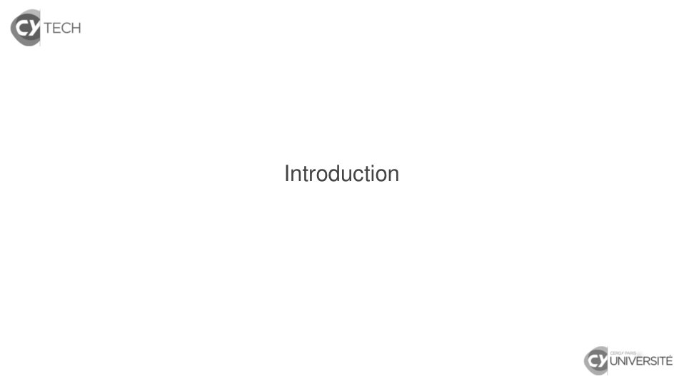

~~~text
Introduction
~~~

**Lecture OCR à contrôler**

~~~text
& TECH

Introduction

& UNIVERSITÉ
~~~

## Page 3

~~~text
In the beginning. . .
           [...] Functional code is characterised by one thing: the
       absence of side-effects. It doesn’t rely on data outside
       the current function, and it doesn’t change data that ex-
       ists outside the current function. Every other “ functional ”
       thing can be derived from this property. Use it as a guide
       rope as you learn.
           [...] La programmation fonctionnelle se caractérise par
       une chose : l’absence d’effet de bord. Elle ne s’appuie
       pas sur des données hors de la fonction courante et elle ne
       change pas de donnée existant hors de la fonction courante.
       Toute autre caractéristique «fonctionnelle » peut être déduite
       de cette propriété. Utilisez cela comme fil conducteur lors de
       votre apprentissage.
          Mary Rose C OOK, A practical introduction to functional
       programming

                       Djaouida Z AOUCHE, Romain D UJOL                 3
~~~

## Page 4

~~~text
Functional paradigm ≡ no side-effect

                Djaouida Z AOUCHE, Romain D UJOL   4
~~~

## Page 5

~~~text
Functional paradigm ≡ no side-effect
      Variable

                 Djaouida Z AOUCHE, Romain D UJOL   4
~~~

## Page 6

~~~text
Functional paradigm ≡ no side-effect
      Variable        −→               Constant

                 Djaouida Z AOUCHE, Romain D UJOL   4
~~~

## Page 7

~~~text
Functional paradigm ≡ no side-effect
      Variable         −→               Constant
             Variable modification IS a side-effect

                  Djaouida Z AOUCHE, Romain D UJOL    4
~~~

## Page 8

~~~text
Functional paradigm ≡ no side-effect
      Variable          −→               Constant
              Variable modification IS a side-effect

    Instruction

                   Djaouida Z AOUCHE, Romain D UJOL    4
~~~

## Page 9

~~~text
Functional paradigm ≡ no side-effect
      Variable          −→               Constant
              Variable modification IS a side-effect

    Instruction         −→               (Typed) expression

                   Djaouida Z AOUCHE, Romain D UJOL           4
~~~

## Page 10

~~~text
Functional paradigm ≡ no side-effect
      Variable             −→               Constant
                Variable modification IS a side-effect

    Instruction            −→               (Typed) expression
     Only interest of an instruction : the side-effect it produces !

                      Djaouida Z AOUCHE, Romain D UJOL                 4
~~~

## Page 11

~~~text
Functional paradigm ≡ no side-effect
      Variable             −→               Constant
                Variable modification IS a side-effect

    Instruction            −→               (Typed) expression
     Only interest of an instruction : the side-effect it produces !

    Procedure

                      Djaouida Z AOUCHE, Romain D UJOL                 4
~~~

## Page 12

~~~text
Functional paradigm ≡ no side-effect
      Variable             −→               Constant
                Variable modification IS a side-effect

    Instruction            −→               (Typed) expression
     Only interest of an instruction : the side-effect it produces !

    Procedure              −→               Pure function

                      Djaouida Z AOUCHE, Romain D UJOL                 4
~~~

## Page 13

~~~text
Functional paradigm ≡ no side-effect
      Variable             −→               Constant
                Variable modification IS a side-effect

    Instruction            −→               (Typed) expression
     Only interest of an instruction : the side-effect it produces !

    Procedure              −→               Pure function
      Only interest of a procedure : the side-effect it produces !

                      Djaouida Z AOUCHE, Romain D UJOL                 4
~~~

## Page 14

~~~text
Functional paradigm ≡ no side-effect
      Variable             −→               Constant
                Variable modification IS a side-effect

    Instruction            −→               (Typed) expression
     Only interest of an instruction : the side-effect it produces !

    Procedure              −→               Pure function
      Only interest of a procedure : the side-effect it produces !

          Loop

                      Djaouida Z AOUCHE, Romain D UJOL                 4
~~~

## Page 15

~~~text
Functional paradigm ≡ no side-effect
      Variable             −→               Constant
                Variable modification IS a side-effect

    Instruction            −→               (Typed) expression
     Only interest of an instruction : the side-effect it produces !

    Procedure              −→               Pure function
      Only interest of a procedure : the side-effect it produces !

          Loop             −→               Recursivity

                      Djaouida Z AOUCHE, Romain D UJOL                 4
~~~

## Page 16

~~~text
Functional paradigm ≡ no side-effect
      Variable             −→               Constant
                Variable modification IS a side-effect

    Instruction            −→               (Typed) expression
     Only interest of an instruction : the side-effect it produces !

    Procedure              −→               Pure function
      Only interest of a procedure : the side-effect it produces !

          Loop             −→               Recursivity
        Loop ≡ Instructions with some variable modification

                      Djaouida Z AOUCHE, Romain D UJOL                 4
~~~

## Page 17

~~~text
Functional paradigm ≡ no side-effect
      Variable             −→               Constant
                Variable modification IS a side-effect

    Instruction            −→               (Typed) expression
     Only interest of an instruction : the side-effect it produces !

    Procedure              −→               Pure function
      Only interest of a procedure : the side-effect it produces !

          Loop             −→               Recursivity
        Loop ≡ Instructions with some variable modification

       + Any function is a (typed) expression.
                      Djaouida Z AOUCHE, Romain D UJOL                 4
~~~

## Page 18

~~~text
Introduction
   History
~~~

**Lecture OCR à contrôler**

~~~text
& TECH

Introduction

History

& UNIVERSITÉ
~~~

## Page 19

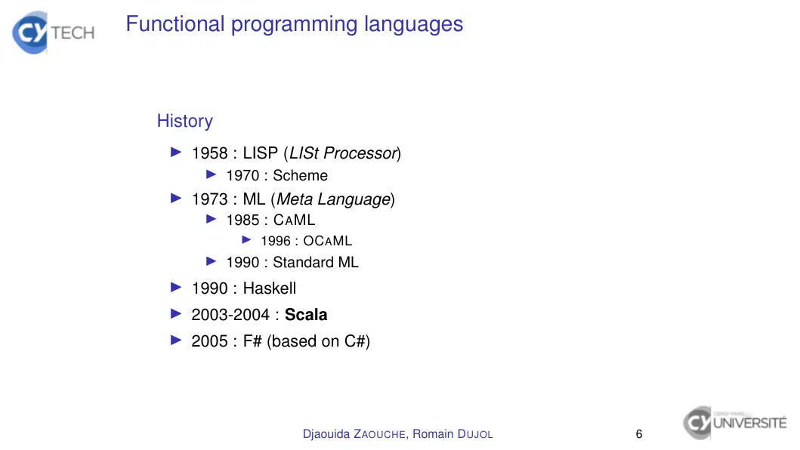

~~~text
Functional programming languages

  History
    I 1958 : LISP (LISt Processor)
        I 1970 : Scheme
    I 1973 : ML (Meta Language)
        I 1985 : C A ML
             I 1996 : OC A ML
        I 1990 : Standard ML
    I 1990 : Haskell
    I 2003-2004 : Scala
    I 2005 : F# (based on C#)

                       Djaouida Z AOUCHE, Romain D UJOL   6
~~~

## Page 20

~~~text
Imperative programming languages

  Historique
    I 1972 : C
    I 1983 : Turbo Pascal
    I 1985 : C++ (object oriented)
        I 2011 : C++ includes anonymous functions
    I 1995 : Java (object oriented)
        I 2014 : Java 8 includes anonymous functions
    I 2000 : C# (object oriented)
    I 2011 : Kotlin (object oriented with functional elements)

  Other languages start to give it in functional features
    I Anmonymous functions ≡ functions defined on-the-fly
    I Functions as parameters ⇐⇒ Processings as parameters
      ⇒ Code factorization improved
                      Djaouida Z AOUCHE, Romain D UJOL           7
~~~

## Page 21

~~~text
Less elements so less expressive. . . isn’t it ?

                   Djaouida Z AOUCHE, Romain D UJOL   8
~~~

## Page 22

~~~text
Less elements so less expressive. . . isn’t it ?
   Well, not at all !
    I 1930-1936, Alonzo C HURCH : λ -calculus
        Representation of functional programming languages
    I 1936-1937, Alan T URING : machines de T URING
        Representation of current computers
    I 1936-1937, Alan T URING :
                 Both representations are equivalent.

                        Djaouida Z AOUCHE, Romain D UJOL     8
~~~

## Page 23

~~~text
Less elements so less expressive. . . isn’t it ?
   Well, not at all !
    I 1930-1936, Alonzo C HURCH : λ -calculus
        Representation of functional programming languages
    I 1936-1937, Alan T URING : machines de T URING
        Representation of current computers
    I 1936-1937, Alan T URING :
                 Both representations are equivalent.

   Advantages
    I less elements ⇒ simpler, more intuitive
    I easier to analyse, simpler unit tests
    I closer to mathematical description

                        Djaouida Z AOUCHE, Romain D UJOL     8
~~~

## Page 24

~~~text
Less elements so less expressive. . . isn’t it ?
   Well, not at all !
    I 1930-1936, Alonzo C HURCH : λ -calculus
        Representation of functional programming languages
    I 1936-1937, Alan T URING : machines de T URING
        Representation of current computers
    I 1936-1937, Alan T URING :
                 Both representations are equivalent.

   Advantages
    I less elements ⇒ simpler, more intuitive
    I easier to analyse, simpler unit tests
    I closer to mathematical description
   Drawbacks
    I needs more resources (in progress)
    I limit of applicability (I/O)
                        Djaouida Z AOUCHE, Romain D UJOL     8
~~~

## Page 25

~~~text
And you can make big money !

  What languages are associated with the highest salaries
  worldwide?
    1. Scala : 76 000 $ (Global), 150 000 $ (USA)
    2. . . .

  Source : StackOverflow 2020 Developer Survey
  (Global median over all respondants)

                     Djaouida Z AOUCHE, Romain D UJOL       9
~~~

## Page 26

~~~text
And you can make big money !

  What languages are associated with the highest salaries
  worldwide?
    1. Scala : 76 000 $ (Global), 150 000 $ (USA)
    2. . . .

  Source : StackOverflow 2020 Developer Survey
  (Global median over all respondants)

  Why such a renewed interest ?
  Classical progamming languages (C++, Java, C#) make it hard to
  address new needs in applications (cf. Reactive Manifesto) :
    I highly availability and scalability ;
    I concurrent and distributed applications ;
    I interfaces for both end-users and other applications.

                       Djaouida Z AOUCHE, Romain D UJOL            9
~~~

## Page 27

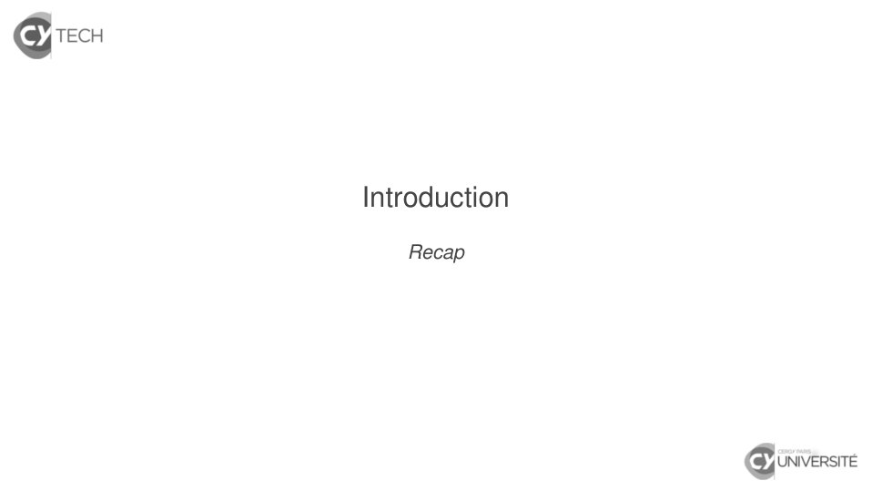

~~~text
Introduction
   Recap
~~~

**Lecture OCR à contrôler**

~~~text
& TECH

Introduction

Recap

& UNIVERSITÉ
~~~

## Page 28

~~~text
Pure function

   Pure function ≡ function with no side-effect
    ⇒ input only parameters
    ⇒ result depending only on function parameters
       Similar to a function in the mathematical sense
   (if a type is associated to its set of values)

                       Djaouida Z AOUCHE, Romain D UJOL   11
~~~

## Page 29

~~~text
Pure function

   Pure function ≡ function with no side-effect
    ⇒ input only parameters
    ⇒ result depending only on function parameters
       Similar to a function in the mathematical sense
   (if a type is associated to its set of values)

   Such a function is a typed constant
   The function type is given by :
    I the types of its parameters ;
    I and the type of its result.

                       Djaouida Z AOUCHE, Romain D UJOL   11
~~~

## Page 30

~~~text
Recursive function

   Recursive function
   Function calling itself

   Base case
   To terminate, a recursive function must contain at least one base
   case, i.e. a non-recursive evaluation.

   Tail-recursive function
   Recursive function such that any recursive call is a direct call of the
   function itself

         A tail-recursive function needs less memory than a non
                             tail-recursive one.

                        Djaouida Z AOUCHE, Romain D UJOL                12
~~~

## Page 31

~~~text
Recursive function
   Factorial (non tail-recursive)
    Function factorial(n : integer) : integer
      If n ≤ 0 then
          Return 1
      Else
          Return n × factorial(n − 1)
      EndIf
    EndFunction

                          Djaouida Z AOUCHE, Romain D UJOL   13
~~~

## Page 32

~~~text
Recursive function
   Factorial (non tail-recursive)
    Function factorial(n : integer) : integer
      If n ≤ 0 then
          Return 1
      Else
          Return n × factorial(n − 1)
      EndIf
    EndFunction

   Factorial (tail-recursive)
    Function factorialTR(n : integer, a : integer) : integer
      If n = 0 then
          Return a
      Else
          Return factorialTR(n − 1, n × a)
      EndIf
    EndFunction
    Function factorial(n : integer) : integer
      Return factorialTR(n, 1)
    EndFunction
                          Djaouida Z AOUCHE, Romain D UJOL     13
~~~

## Page 33

~~~text
Static VS dynamic type checking

   Définition (Static type checking)
   Types are bound to variables.

                     Djaouida Z AOUCHE, Romain D UJOL   14
~~~

## Page 34

~~~text
Static VS dynamic type checking

   Définition (Static type checking)
   Types are bound to variables.

   Exemples
   Java, C++, Scala

                      Djaouida Z AOUCHE, Romain D UJOL   14
~~~

## Page 35

~~~text
Static VS dynamic type checking

   Définition (Static type checking)
   Types are bound to variables.

   Exemples
   Java, C++, Scala

   Définition (Dynamic type checking)
   Types are bound to values of variables.

                      Djaouida Z AOUCHE, Romain D UJOL   14
~~~

## Page 36

~~~text
Static VS dynamic type checking

   Définition (Static type checking)
   Types are bound to variables.

   Exemples
   Java, C++, Scala

   Définition (Dynamic type checking)
   Types are bound to values of variables.

   Exemples
   Javascript, Python, Ruby, Groovy

                      Djaouida Z AOUCHE, Romain D UJOL   14
~~~

## Page 37

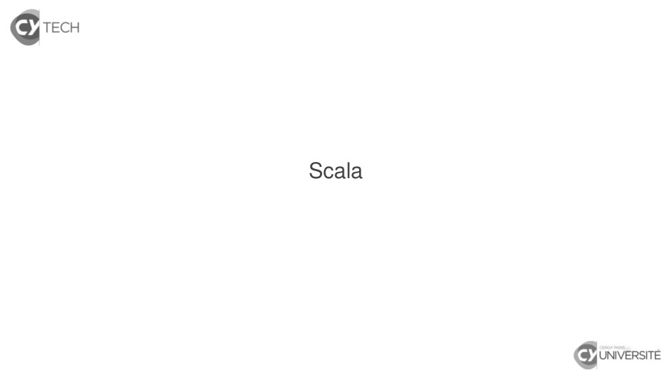

~~~text
Scala
~~~

**Lecture OCR à contrôler**

~~~text
& TECH

Scala

& UNIVERSITÉ
~~~

## Page 38

~~~text
 Scala
Description
~~~

**Lecture OCR à contrôler**

~~~text
& TECH

Scala

Description

& UNIVERSITÉ
~~~

## Page 39

~~~text
Identity sheet
   Created in 2003 by Martin O DERSKY
    I Professor at École Polytechnique Fédérale de Lausanne
    I Co-designed Java Generics (for Java 5)
    I Original author of current javac reference compiler

   Apache 2.0 license
    I Current version : 2.13.3 (June 25, 2020)
    I Version 3 expected for end of 2020 : available for test under
       “Dotty” code name

   Features
    I Functional AND object-oriented language
    I Strong static type checking
    I UTF-8 encoding by default
    I JVM language (hence generates Java bytecode)
                     Djaouida Z AOUCHE, Romain D UJOL                 17
~~~

## Page 40

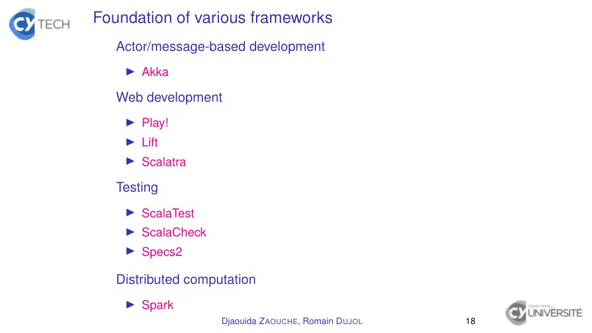

~~~text
Foundation of various frameworks
   Actor/message-based development
    I Akka

   Web development
    I Play!
    I Lift
    I Scalatra

   Testing
    I ScalaTest
    I ScalaCheck
    I Specs2

   Distributed computation
    I Spark
                    Djaouida Z AOUCHE, Romain D UJOL   18
~~~

## Page 41

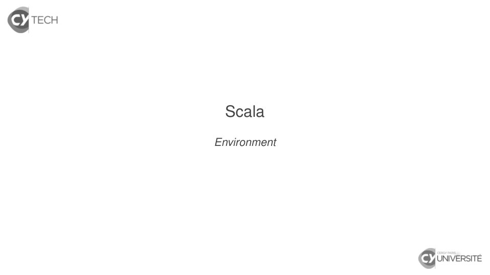

~~~text
 Scala
Environment
~~~

**Lecture OCR à contrôler**

~~~text
& TECH

Scala

Environment

& UNIVERSITÉ
~~~

## Page 42

~~~text
Console

  Call : scala (with no parameter)
  $ scala
  Welcome to Scala 2.11.12 (OpenJDK 64-Bit Server VM, Java 11.0.8).
  Type in expressions for evaluation. Or try :help.

  scala> 1 + 1
  res0: Int = 2

  scala> "42"
  res1: String = 42

  Option -Dscala.color enables syntax highlighting on results.

  Special commands
   I :help
   I :load file load contents of file as Scala code
   I :quit (ou Ctrl + D ) : quits console

                      Djaouida Z AOUCHE, Romain D UJOL           20
~~~

## Page 43

~~~text
sbt (Simple Build Tool)

   Features
    I Minimal configuration for simple projects
    I Support for Scala (and tests)
    I Tasks written in Scala DSL
    I Dependency support via Ivy
    I Interactive mode (console) is available

                     Djaouida Z AOUCHE, Romain D UJOL   21
~~~

## Page 44

~~~text
sbt (Simple Build Tool)

   Create a sbt project
    1. Create following directories :
          } Working directory
            q build.sbt (Configuration)
            } lib (JARs)
            } src
               } main
                  } java (Java source files)
                  } scala (Scala sources files)
                  } resources (Data files)
               } test
                  } java (Java test source files)
                  } scala (Scala test source files)
                  } resources (Data files)
    2. Create file build.sbt.

                      Djaouida Z AOUCHE, Romain D UJOL   22
~~~

## Page 45

~~~text
sbt (Simple Build Tool)

   Example for build.sbt file
   organization := "fr.cyu"
   name         := "HelloWorld"
   version      := "1.0-SNAPSHOT"

   // Add one dependency for tests (with '% "test"')
   libraryDependencies += "junit" % "junit" % "4.8" % "test"

   // Add various dependencies
   libraryDependencies ++= Seq("org.scala-lang" % "scala-xml" % "2.11.0-M4",
                               "joda-time"      % "joda-time" % "2.9.5")

                     Djaouida Z AOUCHE, Romain D UJOL           23
~~~

## Page 46

~~~text
sbt (Simple Build Tool)

   Subcommands
   Any subcommand may be invoked :

                    Djaouida Z AOUCHE, Romain D UJOL   24
~~~

## Page 47

~~~text
sbt (Simple Build Tool)

   Subcommands
   Any subcommand may be invoked :
    I as a parameter when calling sbt from terminal ;

                     Djaouida Z AOUCHE, Romain D UJOL   24
~~~

## Page 48

~~~text
sbt (Simple Build Tool)

   Subcommands
   Any subcommand may be invoked :
    I as a parameter when calling sbt from terminal ;
    I directy in sbt console.

                     Djaouida Z AOUCHE, Romain D UJOL   24
~~~

## Page 49

~~~text
sbt (Simple Build Tool)

   Subcommands
   Any subcommand may be invoked :
    I as a parameter when calling sbt from terminal ;
    I directy in sbt console.

   Some useful subcommands

                     Djaouida Z AOUCHE, Romain D UJOL   24
~~~

## Page 50

~~~text
sbt (Simple Build Tool)

   Subcommands
   Any subcommand may be invoked :
    I as a parameter when calling sbt from terminal ;
    I directy in sbt console.

   Some useful subcommands
    I clean deletes all files generated by build in target directory

                     Djaouida Z AOUCHE, Romain D UJOL              24
~~~

## Page 51

~~~text
sbt (Simple Build Tool)

   Subcommands
   Any subcommand may be invoked :
    I as a parameter when calling sbt from terminal ;
    I directy in sbt console.

   Some useful subcommands
    I clean deletes all files generated by build in target directory
    I compile compiles all source files from main directory

                     Djaouida Z AOUCHE, Romain D UJOL              24
~~~

## Page 52

~~~text
sbt (Simple Build Tool)

   Subcommands
   Any subcommand may be invoked :
    I as a parameter when calling sbt from terminal ;
    I directy in sbt console.

   Some useful subcommands
    I clean deletes all files generated by build in target directory
    I compile compiles all source files from main directory
    I test compiles all source files from test directory and launch
       tests

                     Djaouida Z AOUCHE, Romain D UJOL             24
~~~

## Page 53

~~~text
sbt (Simple Build Tool)

   Subcommands
   Any subcommand may be invoked :
    I as a parameter when calling sbt from terminal ;
    I directy in sbt console.

   Some useful subcommands
    I clean deletes all files generated by build in target directory
    I compile compiles all source files from main directory
    I test compiles all source files from test directory and launch
       tests
    I package builds a JAR archive

                     Djaouida Z AOUCHE, Romain D UJOL             24
~~~

## Page 54

~~~text
sbt (Simple Build Tool)

   Subcommands
   Any subcommand may be invoked :
    I as a parameter when calling sbt from terminal ;
    I directy in sbt console.

   Some useful subcommands
    I clean deletes all files generated by build in target directory
    I compile compiles all source files from main directory
    I test compiles all source files from test directory and launch
       tests
    I package builds a JAR archive
    I run arguments executes main class with arguments as
       parameters

                     Djaouida Z AOUCHE, Romain D UJOL             24
~~~

## Page 55

~~~text
sbt (Simple Build Tool)

   Subcommands
   Any subcommand may be invoked :
    I as a parameter when calling sbt from terminal ;
    I directy in sbt console.

   Some useful subcommands
    I clean deletes all files generated by build in target directory
    I compile compiles all source files from main directory
    I test compiles all source files from test directory and launch
       tests
    I package builds a JAR archive
    I run arguments executes main class with arguments as
       parameters
    I help prints the list of available subcommands

                     Djaouida Z AOUCHE, Romain D UJOL             24
~~~

## Page 56

~~~text
sbt (Simple Build Tool)

   Subcommands
   Any subcommand may be invoked :
    I as a parameter when calling sbt from terminal ;
    I directy in sbt console.

   Some useful subcommands
    I clean deletes all files generated by build in target directory
    I compile compiles all source files from main directory
    I test compiles all source files from test directory and launch
       tests
    I package builds a JAR archive
    I run arguments executes main class with arguments as
       parameters
    I help prints the list of available subcommands
    I help command prints the help of command

                     Djaouida Z AOUCHE, Romain D UJOL             24
~~~

## Page 57

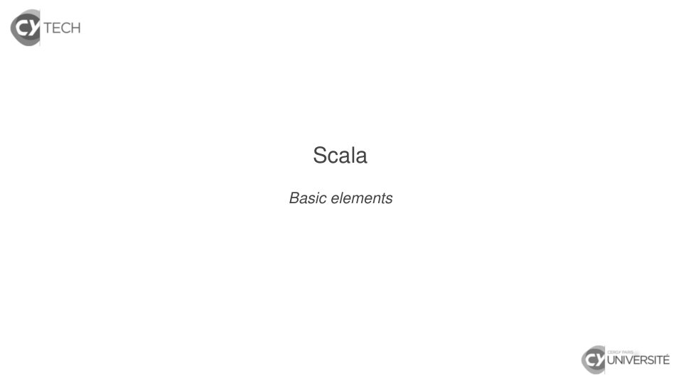

~~~text
   Scala
Basic elements
~~~

**Lecture OCR à contrôler**

~~~text
& TECH

Scala

Basic elements

& UNIVERSITÉ
~~~

## Page 58

~~~text
Main class. . . rather main object

   Same purpose as Java. . .
    I Entry point for program with main method
    I Arguments from call in console captured in a string array

                     Djaouida Z AOUCHE, Romain D UJOL             26
~~~

## Page 59

~~~text
Main class. . . rather main object

   Same purpose as Java. . .
    I Entry point for program with main method
    I Arguments from call in console captured in a string array

   . . . but some differences in defining it
    I One instance =⇒ object declaration (instead of class)
    I App trait defines main method :
         I no need to declare method if object extends App ;
         I the whole object body becomes the main method body.

   (Some of these concepts will be addressed later.)

                      Djaouida Z AOUCHE, Romain D UJOL            26
~~~

## Page 60

~~~text
Main class. . . rather main object

   Hello World
   object HelloWorld
     {
       def main(args : Array[String])
         {
           println("Hello World !")
         }
     }

                   Djaouida Z AOUCHE, Romain D UJOL   27
~~~

## Page 61

~~~text
Main class. . . rather main object

   Hello World
   object HelloWorld
     {
       def main(args : Array[String])
         {
           println("Hello World !")
         }
     }

   Hello World (extending App)
   object HelloWorld extends App
     {
       println("Hello, world!")
     }
   (Not recommended in Scala 3 for performance reasons)
                     Djaouida Z AOUCHE, Romain D UJOL     27
~~~

## Page 62

~~~text
Basic types

   In Scala, any basic type is a class.

                    Djaouida Z AOUCHE, Romain D UJOL   28
~~~

## Page 63

~~~text
Basic types

   In Scala, any basic type is a class.
   Any basic type is a subclass of AnyVal.

                      Djaouida Z AOUCHE, Romain D UJOL   28
~~~

## Page 64

~~~text
Basic types

   In Scala, any basic type is a class.
   Any basic type is a subclass of AnyVal.
    I Integer types : Byte, Short, Int, Long

                      Djaouida Z AOUCHE, Romain D UJOL   28
~~~

## Page 65

~~~text
Basic types

   In Scala, any basic type is a class.
   Any basic type is a subclass of AnyVal.
    I Integer types : Byte, Short, Int, Long
    I Floating types : Float, Double

                      Djaouida Z AOUCHE, Romain D UJOL   28
~~~

## Page 66

~~~text
Basic types

   In Scala, any basic type is a class.
   Any basic type is a subclass of AnyVal.
    I Integer types : Byte, Short, Int, Long
    I Floating types : Float, Double
    I Other types : Boolean, Char

                      Djaouida Z AOUCHE, Romain D UJOL   28
~~~

## Page 67

~~~text
Basic types

   In Scala, any basic type is a class.
   Any basic type is a subclass of AnyVal.
    I Integer types : Byte, Short, Int, Long
    I Floating types : Float, Double
    I Other types : Boolean, Char
    I Unit ≡ void in Java

                      Djaouida Z AOUCHE, Romain D UJOL   28
~~~

## Page 68

~~~text
Basic types

   In Scala, any basic type is a class.
   Any basic type is a subclass of AnyVal.
    I Integer types : Byte, Short, Int, Long
    I Floating types : Float, Double
    I Other types : Boolean, Char
    I Unit ≡ void in Java
    I Nothing : type with no value

                      Djaouida Z AOUCHE, Romain D UJOL   28
~~~

## Page 69

~~~text
Basic types

   In Scala, any basic type is a class.
   Any basic type is a subclass of AnyVal.
    I Integer types : Byte, Short, Int, Long
    I Floating types : Float, Double
    I Other types : Boolean, Char
    I Unit ≡ void in Java
    I Nothing : type with no value
    I . . . (46 basic types)

                       Djaouida Z AOUCHE, Romain D UJOL   28
~~~

## Page 70

~~~text
Basic types

   In Scala, any basic type is a class.
   Any basic type is a subclass of AnyVal.
    I Integer types : Byte, Short, Int, Long
    I Floating types : Float, Double
    I Other types : Boolean, Char
    I Unit ≡ void in Java
    I Nothing : type with no value
    I . . . (46 basic types)

   Encapsulation of Java counterparts for namesakes
    I Concerns integer, floating and other types
  =⇒ All Java operations are available with some subtleties
       (in particular implicit conversions, becoming less implicit in
       Scala 3)
                       Djaouida Z AOUCHE, Romain D UJOL                 28
~~~

## Page 71

~~~text
Basic types

   Divide integers
   scala> 1 / 2
   res0: Int = 0

                     Djaouida Z AOUCHE, Romain D UJOL   29
~~~

## Page 72

~~~text
Basic types

   Divide integers
   scala> 1 / 2
   res0: Int = 0

   scala> (1 / 2).toDouble
   res1: Double = 0.0

                     Djaouida Z AOUCHE, Romain D UJOL   29
~~~

## Page 73

~~~text
Basic types

   Divide integers
   scala> 1 / 2
   res0: Int = 0

   scala> (1 / 2).toDouble
   res1: Double = 0.0

   scala> 1.toDouble / 2
   res2: Double = 0.5

                     Djaouida Z AOUCHE, Romain D UJOL   29
~~~

## Page 74

~~~text
Declaration of values and variables

   Value versus variable

                    Djaouida Z AOUCHE, Romain D UJOL   30
~~~

## Page 75

~~~text
Declaration of values and variables

   Value versus variable
    I Value : immutable content, declared with val

                    Djaouida Z AOUCHE, Romain D UJOL   30
~~~

## Page 76

~~~text
Declaration of values and variables

   Value versus variable
    I Value : immutable content, declared with val
    I Variable : mutable content, declared with var

                     Djaouida Z AOUCHE, Romain D UJOL   30
~~~

## Page 77

~~~text
Declaration of values and variables

   Value versus variable
    I Value : immutable content, declared with val
    I Variable : mutable content, declared with var
   Of course, functional programming favors values.

                     Djaouida Z AOUCHE, Romain D UJOL   30
~~~

## Page 78

~~~text
Declaration of values and variables

    Value versus variable
     I Value : immutable content, declared with val
     I Variable : mutable content, declared with var
    Of course, functional programming favors values.

Variable declaration in Scala            Variable declaration in Java
var i   : Int    = 7                     int    i   = 7 ;
var msg : String = "Hello world !"       String msg = "Hello world !"

Value declaration in Scala               Value declaration in Java
val i   : Int    = 7                     final int    i   = 7 ;
val msg : String = "Hello world !"       final String msg = "Hello world !"

                      Djaouida Z AOUCHE, Romain D UJOL               30
~~~

## Page 79

~~~text
Declaration of values and variables

   Type may be infered (unlike Java)

                    Djaouida Z AOUCHE, Romain D UJOL   31
~~~

## Page 80

~~~text
Declaration of values and variables

   Type may be infered (unlike Java)
    I So type is not always required (although recommended) in a
       declaration.
       scala> val answer : String = "42"
       answer: String = 42
       scala> val answer = "42"
       answer: String = 42

                      Djaouida Z AOUCHE, Romain D UJOL         31
~~~

## Page 81

~~~text
Declaration of values and variables

   Type may be infered (unlike Java)
    I So type is not always required (although recommended) in a
       declaration.
       scala> val answer : String = "42"
       answer: String = 42
       scala> val answer = "42"
       answer: String = 42

    I Static type checking prevents from assigning non-coherent
       type to value or variable.
       scala> val answer : Int = "42"
       <console>:11: error: type mismatch;
        found   : String("42")
        required: Int
              val answer : Int = "42"
                                 ^
                      Djaouida Z AOUCHE, Romain D UJOL            31
~~~

## Page 82

~~~text
Standard evaluation

   Block
    I Sequence of instructions/expressions
    I Result of block : result of last expression in block

                      Djaouida Z AOUCHE, Romain D UJOL       32
~~~

## Page 83

~~~text
Standard evaluation

   Block
    I Sequence of instructions/expressions
    I Result of block : result of last expression in block

   Declarations are done immediately
    I Evaluation is performed as soon as it is declared
    I Expression are evaluated when defined.

                      Djaouida Z AOUCHE, Romain D UJOL       32
~~~

## Page 84

~~~text
Standard evaluation
   Fichier Test.scala
   object Test extends App
     {
       var y = 90 ;
       val x =
         {
           println("Step 1 (x)") ; y = y + 1 ;
           println("Step 2 (x)") ; "#####" + y
         }
       println(x)
       println(x)

         val z =
           {
             println("Step 1 (z)") ; y = y + 1 ;
             println("Step 2 (z)") ; "#####" + y
           }
         println(z)
         println(z)
     }
                       Djaouida Z AOUCHE, Romain D UJOL   33
~~~

## Page 85

~~~text
Standard evaluation

   Result of execution of Test.scala

   scala> :load Test.scala
   Loading Test.scala...
   defined object Test
   Step 1 (x)
   Step 2 (x)
   #####91
   #####91
   Step 1 (z)
   Step 2 (z)
   #####92
   #####92

                   Djaouida Z AOUCHE, Romain D UJOL   34
~~~

## Page 86

~~~text
Lazy evaluation : lazy val
   How lazy evaluation works

                   Djaouida Z AOUCHE, Romain D UJOL   35
~~~

## Page 87

~~~text
Lazy evaluation : lazy val
   How lazy evaluation works
    I Evaluation at first actual use outside declaration

                     Djaouida Z AOUCHE, Romain D UJOL      35
~~~

## Page 88

~~~text
Lazy evaluation : lazy val
   How lazy evaluation works
    I Evaluation at first actual use outside declaration
    I Afterwards, stays unchanged (hey, it’s still a val !)

                      Djaouida Z AOUCHE, Romain D UJOL        35
~~~

## Page 89

~~~text
Lazy evaluation : lazy val
   How lazy evaluation works
    I Evaluation at first actual use outside declaration
    I Afterwards, stays unchanged (hey, it’s still a val !)

   val versus lazy val

                      Djaouida Z AOUCHE, Romain D UJOL        35
~~~

## Page 90

~~~text
Lazy evaluation : lazy val
   How lazy evaluation works
    I Evaluation at first actual use outside declaration
    I Afterwards, stays unchanged (hey, it’s still a val !)

   val versus lazy val

   scala> val x = {println("x is set") ; 3 + 3}
   x is set
   x: Int = 6

                      Djaouida Z AOUCHE, Romain D UJOL        35
~~~

## Page 91

~~~text
Lazy evaluation : lazy val
   How lazy evaluation works
    I Evaluation at first actual use outside declaration
    I Afterwards, stays unchanged (hey, it’s still a val !)

   val versus lazy val

   scala> val x = {println("x is set") ; 3 + 3}
   x is set
   x: Int = 6

   scala> lazy val x = {println("x is set") ; 3 + 3}
   x: Int = <lazy>

                      Djaouida Z AOUCHE, Romain D UJOL        35
~~~

## Page 92

~~~text
Lazy evaluation : lazy val
   How lazy evaluation works
    I Evaluation at first actual use outside declaration
    I Afterwards, stays unchanged (hey, it’s still a val !)

   val versus lazy val

   scala> val x = {println("x is set") ; 3 + 3}
   x is set
   x: Int = 6

   scala> lazy val x = {println("x is set") ; 3 + 3}
   x: Int = <lazy>

   scala> x + 3
   x is set
   res0: Int = 9

                      Djaouida Z AOUCHE, Romain D UJOL        35
~~~

## Page 93

~~~text
Lazy evaluation : lazy val
   How lazy evaluation works
    I Evaluation at first actual use outside declaration
    I Afterwards, stays unchanged (hey, it’s still a val !)

   val versus lazy val

   scala> val x = {println("x is set") ; 3 + 3}
   x is set
   x: Int = 6

   scala> lazy val x = {println("x is set") ; 3 + 3}
   x: Int = <lazy>

   scala> x + 3
   x is set
   res0: Int = 9

   scala> x
   res1: Int = 6
                      Djaouida Z AOUCHE, Romain D UJOL        35
~~~

## Page 94

~~~text
Lazy evaluation : lazy val

   Evaluation at first actual use
   scala> lazy val x = {println("x is set") ; 3 + 3}
   x: Int = <lazy>

                      Djaouida Z AOUCHE, Romain D UJOL   36
~~~

## Page 95

~~~text
Lazy evaluation : lazy val

   Evaluation at first actual use
   scala> lazy val x = {println("x is set") ; 3 + 3}
   x: Int = <lazy>

   scala> if (false) x else 0
   res0: Int = 0

                      Djaouida Z AOUCHE, Romain D UJOL   36
~~~

## Page 96

~~~text
Lazy evaluation : lazy val

   Evaluation at first actual use
   scala> lazy val x = {println("x is set") ; 3 + 3}
   x: Int = <lazy>

   scala> if (false) x else 0
   res0: Int = 0

   scala> if (true) x else 0
   x is set
   res1: Int = 6

   =⇒ Dynamic evaluation (although type checking remain static)

                      Djaouida Z AOUCHE, Romain D UJOL            36
~~~

## Page 97

~~~text
Everything is an expression. . . hence is typed

   Some basic examples
   scala> val e1 = 1
   e1: Int = 1

   scala> val e2 = 2
   e2: Int = 2

   scala> e1 + e2
   res0: Int = 3

   scala> e1 == e2
   res1: Boolean = false

   scala> val e0 = println(e1)
   1
   e0: Unit = ()
                    Djaouida Z AOUCHE, Romain D UJOL   37
~~~

## Page 98

~~~text
Everything is an expression. . . hence is typed
   Expression if (cond) expr1 else expr2
    I Condition cond must be within parentheses
    I Type of result : least common supertype of expr1 and expr2
   scala> if (e1 == e2) e1 else e2
   res2: Int = 2

                    Djaouida Z AOUCHE, Romain D UJOL           38
~~~

## Page 99

~~~text
Everything is an expression. . . hence is typed
   Expression if (cond) expr1 else expr2
    I Condition cond must be within parentheses
    I Type of result : least common supertype of expr1 and expr2
   scala> if (e1 == e2) e1 else e2
   res2: Int = 2

   Advanced example
   scala> val e =
           {
             val cmPerInch = 2.54
             15 * cmPerInch
           }
   e: Double = 38.1

   scala> cmPerInch
   <console>:12: error: not found: value cmPerInch
          cmPerInch
          ^
                     Djaouida Z AOUCHE, Romain D UJOL          38
~~~

## Page 100

~~~text
Scala class/type hierarchy

                                                     Source : scala-lang.org

                  Djaouida Z AOUCHE, Romain D UJOL                       39
~~~

## Page 101

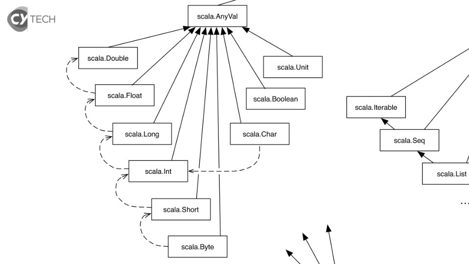

**Lecture OCR à contrôler**

~~~text
scala.AnyVal

scala.Double
scala.Unit
scala.Float scala.Boolean
il scala.lterable
\
A A
scala.Long scala.Char
scala.Seq
T
/ X
ee
scala.Int pes né T scala.List

scala.Short

scala.Byte
~~~

## Page 102

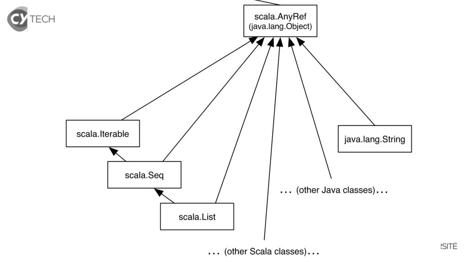

**Lecture OCR à contrôler**

~~~text
[CAES

scala.lterable

=,

scala.Seq

a

scala.AnyRef
(java.lang.Object)

java.lang.String

«++ (other Java classes)...

scala. List

. (other Scala classes)...

‘SITE
~~~

## Page 103

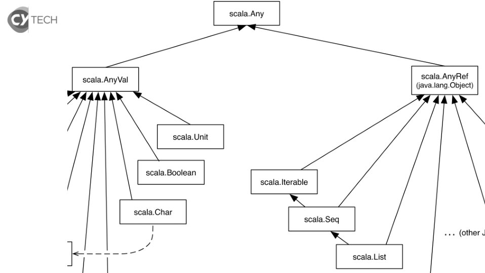

**Lecture OCR à contrôler**

~~~text
[CAES

scala.AnyVal

scala.Any

scala.AnyRet
(java.lang.Object)

scala.Unit

scala.Boolean

scala.lterable

scala.Char

LS

scala.Seq

LS

+. (other J

scala.List
~~~

## Page 104

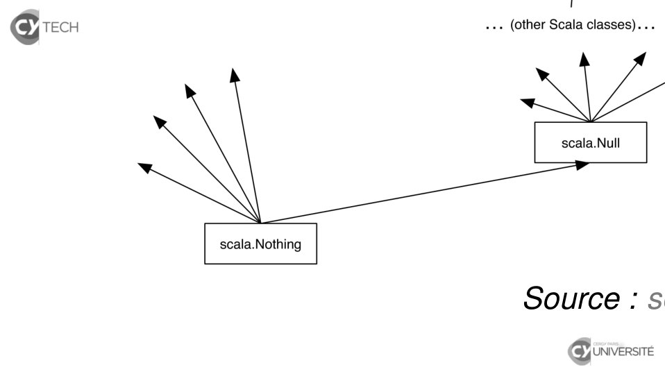

~~~text
Source : sc
~~~

**Lecture OCR à contrôler**

~~~text
[CAES

scala.Nothing

l

. (other Scala classes)...

scala.Null

Source : 5
Fy iniversire
~~~

## Page 105

~~~text
Scala class hierarchy

   Supertypes
    I AnyVal : supertype of all basic types
    I AnyRef : supertype of all other classes, including Java
       classes
       Default supertype of any user-defined class
    I Any : supertype of any class (hence of AnyVal and AnyRef)

   Subtypes
    I Nothing : subtype of any class
    I Null : subtype of any non-basic class

   Class String
   Alias to Java class java.lang.String

                     Djaouida Z AOUCHE, Romain D UJOL           41
~~~

## Page 106

~~~text
Scala class hierarchy

   Example
   scala> val x : Any = "abc"
   x: Any = abc

                  Djaouida Z AOUCHE, Romain D UJOL   42
~~~

## Page 107

~~~text
Scala class hierarchy

   Example
   scala> val x : Any = "abc"
   x: Any = abc

   scala> val y : String = x
   x: Any = abc
   <console>:12: error: type mismatch;
    found   : Any
    required: String
          val y : String = x
                           ^

                  Djaouida Z AOUCHE, Romain D UJOL   42
~~~

## Page 108

~~~text
Scala class hierarchy

   Example
   scala> val x : Any = "abc"
   x: Any = abc

   scala> val y : String = x
   x: Any = abc
   <console>:12: error: type mismatch;
    found   : Any
    required: String
          val y : String = x
                           ^
   (Reverse way by switching types works, of course.)

                      Djaouida Z AOUCHE, Romain D UJOL   42
~~~

## Page 109

~~~text
Scala class hierarchy

   Example
   scala> val x : Any = "abc"
   x: Any = abc

   scala> val y : String = x
   x: Any = abc
   <console>:12: error: type mismatch;
    found   : Any
    required: String
          val y : String = x
                           ^
   (Reverse way by switching types works, of course.)

   scala> if (true) 42 else "42"
   res0: Any = 42 (Type checking is static)

                      Djaouida Z AOUCHE, Romain D UJOL   42
~~~

## Page 110

~~~text
Tuples
   Tuple ≡ immutable record with numbered fields
    I Syntax taken from mathematics
    I Fixed number of components (maximum 22)
         (limitation removed in Scala 3)
    I Types of components may be different
   Comes in handy for making function return multiple values

                        Djaouida Z AOUCHE, Romain D UJOL       43
~~~

## Page 111

~~~text
Tuples
   Tuple ≡ immutable record with numbered fields
    I Syntax taken from mathematics
    I Fixed number of components (maximum 22)
         (limitation removed in Scala 3)
    I Types of components may be different
   Comes in handy for making function return multiple values

   Examples
   scala> val t = ("The answer", 42, "Douglas Adams")
   t: (String, Int, String) = (The answer,42,Douglas Adams)

   scala> t._2
   res0: Int = 42

   scala> t._4
   <console>:13: error: value _4 is not a member of (String, Int, Double)
          t._4
            ^
                        Djaouida Z AOUCHE, Romain D UJOL        43
~~~

## Page 112

~~~text
Option[T]

  Aim of Option[T]
  Provides a way to add a “no value” value to type T

                     Djaouida Z AOUCHE, Romain D UJOL   44
~~~

## Page 113

~~~text
Option[T]

  Aim of Option[T]
  Provides a way to add a “no value” value to type T

  Two kinds of expressions

                     Djaouida Z AOUCHE, Romain D UJOL   44
~~~

## Page 114

~~~text
Option[T]

  Aim of Option[T]
  Provides a way to add a “no value” value to type T

  Two kinds of expressions
   I Some(x) where x has type T (mere encapsulation of value x)

                     Djaouida Z AOUCHE, Romain D UJOL         44
~~~

## Page 115

~~~text
Option[T]

  Aim of Option[T]
  Provides a way to add a “no value” value to type T

  Two kinds of expressions
   I Some(x) where x has type T (mere encapsulation of value x)
   I None for the “no value” case

                     Djaouida Z AOUCHE, Romain D UJOL         44
~~~

## Page 116

~~~text
Option[T]

  Aim of Option[T]
  Provides a way to add a “no value” value to type T

  Two kinds of expressions
   I Some(x) where x has type T (mere encapsulation of value x)
   I None for the “no value” case

  Designed to replace exceptions
  ⇒ Lack of result becomes a normal behaviour (with None)

                     Djaouida Z AOUCHE, Romain D UJOL         44
~~~

## Page 117

~~~text
Option[T]

  Aim of Option[T]
  Provides a way to add a “no value” value to type T

  Two kinds of expressions
   I Some(x) where x has type T (mere encapsulation of value x)
   I None for the “no value” case

  Designed to replace exceptions
  ⇒ Lack of result becomes a normal behaviour (with None)
   I Error handling made easier (e.g. for generic functions)

                     Djaouida Z AOUCHE, Romain D UJOL          44
~~~

## Page 118

~~~text
Option[T]

  Aim of Option[T]
  Provides a way to add a “no value” value to type T

  Two kinds of expressions
   I Some(x) where x has type T (mere encapsulation of value x)
   I None for the “no value” case

  Designed to replace exceptions
  ⇒ Lack of result becomes a normal behaviour (with None)
   I Error handling made easier (e.g. for generic functions)
   I Error may be transmitted to calling function

                     Djaouida Z AOUCHE, Romain D UJOL          44
~~~

## Page 119

~~~text
Option[T]

  Aim of Option[T]
  Provides a way to add a “no value” value to type T

  Two kinds of expressions
   I Some(x) where x has type T (mere encapsulation of value x)
   I None for the “no value” case

  Designed to replace exceptions
  ⇒ Lack of result becomes a normal behaviour (with None)
   I Error handling made easier (e.g. for generic functions)
   I Error may be transmitted to calling function
   I May be not enough to differentiate multiple errors

                     Djaouida Z AOUCHE, Romain D UJOL          44
~~~

## Page 120

~~~text
Option[T]

  Example : conversion String → Int
  scala> def toInt(s : String) : Option[Int] =
           {
             try
               {
                 Some(Integer.parseInt(s.trim))
               }
             catch
               {
                 case e : Exception => None
               }
           }
  toInt: (s: String)Option[Int]

                    Djaouida Z AOUCHE, Romain D UJOL   45
~~~

## Page 121

~~~text
Option[T]

  Example : conversion String → Int
  scala> def toInt(s : String) : Option[Int] =
           {
             try
               {
                 Some(Integer.parseInt(s.trim))
               }
             catch
               {
                 case e : Exception => None
               }
           }
  toInt: (s: String)Option[Int]

  scala> toInt("42")
  res0: Option[Int] = Some(42)

                    Djaouida Z AOUCHE, Romain D UJOL   45
~~~

## Page 122

~~~text
Option[T]

  Example : conversion String → Int
  scala> def toInt(s : String) : Option[Int] =
           {
             try
               {
                 Some(Integer.parseInt(s.trim))
               }
             catch
               {
                 case e : Exception => None
               }
           }
  toInt: (s: String)Option[Int]

  scala> toInt("42")
  res0: Option[Int] = Some(42)

  scala> toInt("The answer")
  res1: Option[Int] = None

                    Djaouida Z AOUCHE, Romain D UJOL   45
~~~
