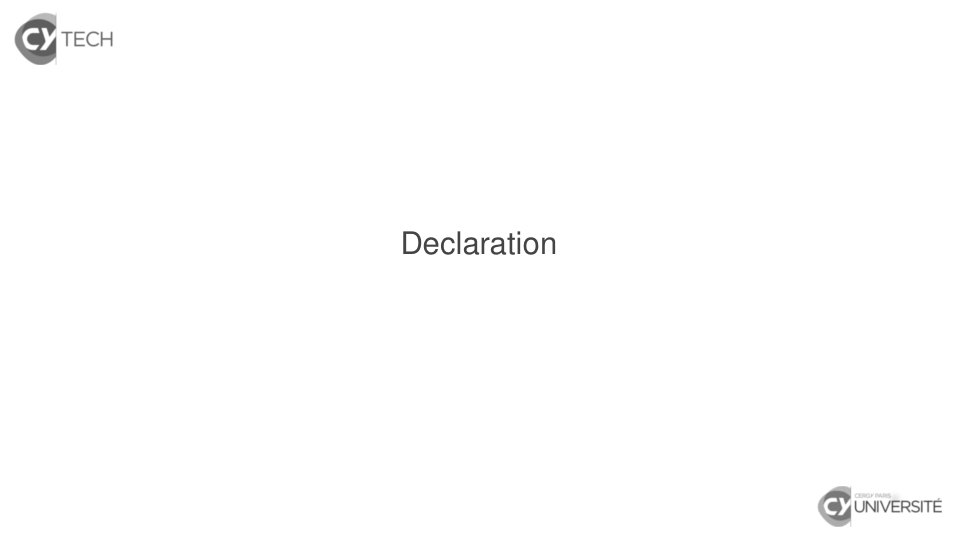
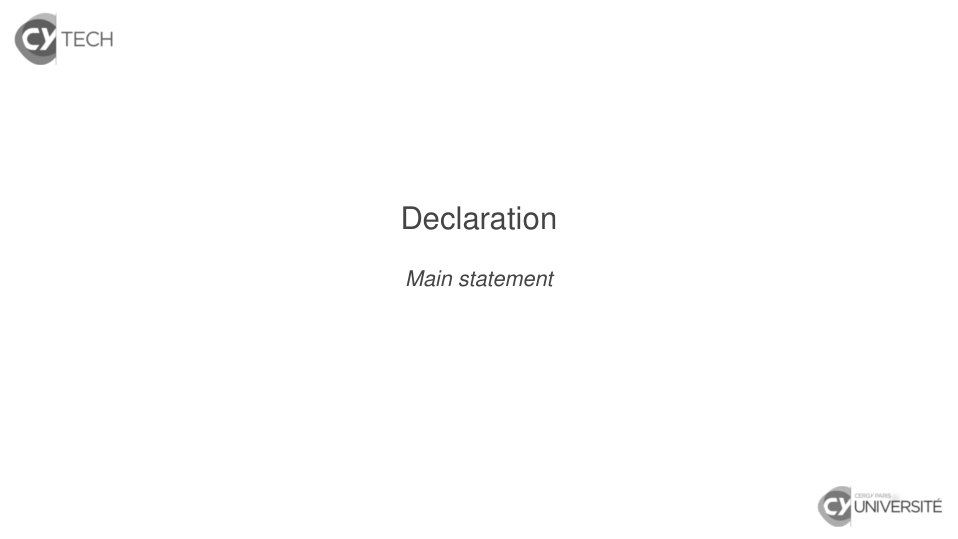
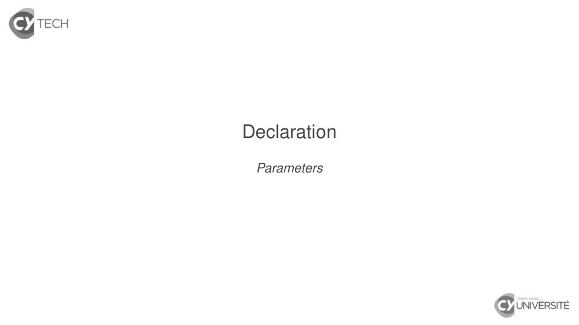
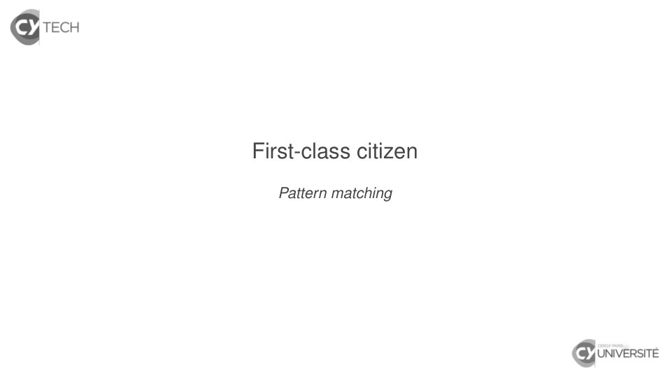

# Scala_02.pdf

[Ouvrir l’original](https://drive.google.com/open?id=1W0q_dNR2cXfBb9BCpm7i_RXLBLixpHZh) · Les pages signalées comprennent du texte reconnu automatiquement ou des éléments graphiques. Le fac-similé permet de vérifier chaque lecture.

**Pages avec fac-similé ou lecture OCR** — 2–3, 9, 29, 31, 49, 72.

## Page 1

~~~text
Functional programming with Scala
                 Functions

   Djaouida Z AOUCHE, Romain D UJOL

              CY T ECH – ING2

                2020 – 2021

       Djaouida Z AOUCHE, Romain D UJOL   1
~~~

## Page 2

~~~text
Declaration
~~~

**Lecture OCR à contrôler**

~~~text
& TECH

Declaration

& UNIVERSITÉ
~~~

## Page 3

~~~text
Declaration
Main statement
~~~

**Lecture OCR à contrôler**

~~~text
& TECH

Declaration

Main statement

& UNIVERSITÉ
~~~

## Page 4

~~~text
Declaration : def

   Syntax
   def functionName(typedParameter∗ )[:returnType] =
     {
         functionBody
     }

    I functionName must start with a lowercase letter.
    I Type is required for each input parameter.
    I Return type may be infered so it may not be required.
    I The body is a block so its type is the type of last statement.

                        Djaouida Z AOUCHE, Romain D UJOL               4
~~~

## Page 5

~~~text
Declaration

   Examples
   scala> def sum2(a : Int, b : Int) : Int = a + b
   sum2: (a: Int, b: Int)Int

                     Djaouida Z AOUCHE, Romain D UJOL   5
~~~

## Page 6

~~~text
Declaration

   Examples
   scala> def sum2(a : Int, b : Int) : Int = a + b
   sum2: (a: Int, b: Int)Int

   scala> def sum2(a : Int, b : Int) = a + b
   sum2: (a: Int, b: Int)Int

                     Djaouida Z AOUCHE, Romain D UJOL   5
~~~

## Page 7

~~~text
Declaration

   Examples
   scala> def sum2(a : Int, b : Int) : Int = a + b
   sum2: (a: Int, b: Int)Int

   scala> def sum2(a : Int, b : Int) = a + b
   sum2: (a: Int, b: Int)Int

   scala> def sayHello(name : String) = println(s"Hello $name !")
   sayHello: (name: String)Unit

   scala> sayHello("world")
   Hello world !

                     Djaouida Z AOUCHE, Romain D UJOL               5
~~~

## Page 8

~~~text
Declaration

   Examples
   scala> def sum2(a : Int, b : Int) : Int = a + b
   sum2: (a: Int, b: Int)Int

   scala> def sum2(a : Int, b : Int) = a + b
   sum2: (a: Int, b: Int)Int

   scala> def sayHello(name : String) = println(s"Hello $name !")
   sayHello: (name: String)Unit

   scala> sayHello("world")
   Hello world !

   String interpolator s"..."
   Replaces any $-prefixed expression with its toString evaluation
   scala> println(s"1 + 1 is ${1 + 1}.")
   1 + 1 is 2.

                      Djaouida Z AOUCHE, Romain D UJOL               5
~~~

## Page 9

~~~text
Declaration
 Parameters
~~~

**Lecture OCR à contrôler**

~~~text
& TECH

Declaration

Parameters

& UNIVERSITÉ
~~~

## Page 10

~~~text
Default value for parameter

   Example : sayHello
   scala> def sayHello(name : String = "world") = println(s"Hello $name !")
   sayHello: (name: String)Unit

                     Djaouida Z AOUCHE, Romain D UJOL            7
~~~

## Page 11

~~~text
Default value for parameter

   Example : sayHello
   scala> def sayHello(name : String = "world") = println(s"Hello $name !")
   sayHello: (name: String)Unit

   scala> sayHello()
   Hello world !

                       Djaouida Z AOUCHE, Romain D UJOL          7
~~~

## Page 12

~~~text
Default value for parameter

   Example : sayHello
   scala> def sayHello(name : String = "world") = println(s"Hello $name !")
   sayHello: (name: String)Unit

   scala> sayHello()
   Hello world !

   scala> sayHello("everybody")
   Hello everybody !

                       Djaouida Z AOUCHE, Romain D UJOL          7
~~~

## Page 13

~~~text
Default value for parameter(s) ?

  Default value for more than one parameter is NOT recommended.
   Example
   scala> def greet(fr : Boolean = false, name : String = "world") =
            {
              val greeter = if (fr) "Bonjour" else "Hello"
              println(s"$greeter $name !")
            }
   greet: (fr: Boolean, name: String)Unit

                     Djaouida Z AOUCHE, Romain D UJOL           8
~~~

## Page 14

~~~text
Default value for parameter(s) ?

  Default value for more than one parameter is NOT recommended.
   Example
   scala> def greet(fr : Boolean = false, name : String = "world") =
            {
              val greeter = if (fr) "Bonjour" else "Hello"
              println(s"$greeter $name !")
            }
   greet: (fr: Boolean, name: String)Unit

   scala> greet()
   Hello world !

                     Djaouida Z AOUCHE, Romain D UJOL           8
~~~

## Page 15

~~~text
Default value for parameter(s) ?

  Default value for more than one parameter is NOT recommended.
   Example
   scala> def greet(fr : Boolean = false, name : String = "world") =
            {
              val greeter = if (fr) "Bonjour" else "Hello"
              println(s"$greeter $name !")
            }
   greet: (fr: Boolean, name: String)Unit

   scala> greet()
   Hello world !

   scala> greet("everybody")
   <console>:13: error: type mismatch;
    found   : String("everybody")
    required: Boolean
          greet("everybody")
                ^

                     Djaouida Z AOUCHE, Romain D UJOL           8
~~~

## Page 16

~~~text
Parameter evaluation : by value vs by name

   Evaluation by value (default behaviour)
    I Parameter is always evaluated at function call.
    I Parameter is evaluated once.

                      Djaouida Z AOUCHE, Romain D UJOL   9
~~~

## Page 17

~~~text
Parameter evaluation : by value vs by name

   Evaluation by value (default behaviour)
    I Parameter is always evaluated at function call.
    I Parameter is evaluated once.

   Evaluation by name (add => before type)
    I Parameter is evaluated at each actual use.
    I Parameter may be evaluated more than once.

                      Djaouida Z AOUCHE, Romain D UJOL   9
~~~

## Page 18

~~~text
Parameter evaluation : by value vs by name

   Evaluation by value (default behaviour)
    I Parameter is always evaluated at function call.
    I Parameter is evaluated once.

   Evaluation by name (add => before type)
    I Parameter is evaluated at each actual use.
    I Parameter may be evaluated more than once.

   Why should we consider an evaluation by name ?
   Particularly useful for lengthy or throwable evaluations

                       Djaouida Z AOUCHE, Romain D UJOL       9
~~~

## Page 19

~~~text
Parameter evaluation : by value vs by name

   Example (throwable evaluation)
   scala> 1/0 == 0
   java.lang.ArithmeticException: / by zero
     ... 32 elided

                       Djaouida Z AOUCHE, Romain D UJOL   10
~~~

## Page 20

~~~text
Parameter evaluation : by value vs by name

   Example (throwable evaluation)
   scala> 1/0 == 0
   java.lang.ArithmeticException: / by zero
     ... 32 elided

   scala> def and2(x : Boolean, y : Boolean) = if (x) y else false
   and2: (x: Boolean, y: Boolean)Boolean

   scala> and2(false, 1/0 == 0)
   java.lang.ArithmeticException: / by zero
     ... 32 elided

                       Djaouida Z AOUCHE, Romain D UJOL              10
~~~

## Page 21

~~~text
Parameter evaluation : by value vs by name

   Example (throwable evaluation)
   scala> 1/0 == 0
   java.lang.ArithmeticException: / by zero
     ... 32 elided

   scala> def and2(x : Boolean, y : Boolean) = if (x) y else false
   and2: (x: Boolean, y: Boolean)Boolean

   scala> and2(false, 1/0 == 0)
   java.lang.ArithmeticException: / by zero
     ... 32 elided

   scala> def and2(x : Boolean, y : => Boolean) = if (x) y else false
   and2: (x: Boolean, y: => Boolean)Boolean

   scala> and2(false, 1/0 == 0)
   res3: Boolean = false

                       Djaouida Z AOUCHE, Romain D UJOL                 10
~~~

## Page 22

~~~text
Parameter evaluation : by value vs by name

   Example (throwable evaluation)
   scala> 1/0 == 0
   java.lang.ArithmeticException: / by zero
     ... 32 elided

   scala> def and2(x : Boolean, y : Boolean) = if (x) y else false
   and2: (x: Boolean, y: Boolean)Boolean

   scala> and2(false, 1/0 == 0)
   java.lang.ArithmeticException: / by zero
     ... 32 elided

   scala> def and2(x : Boolean, y : => Boolean) = if (x) y else false
   and2: (x: Boolean, y: => Boolean)Boolean

   scala> and2(false, 1/0 == 0)
   res3: Boolean = false

   Logical operators are designed that way
   scala> false && (1/0 == 0)
   res4: Boolean = false

                       Djaouida Z AOUCHE, Romain D UJOL                 10
~~~

## Page 23

~~~text
Parameter evaluation : by value vs by name

   Example (lengthy evaluation)
   scala> def slow(x : Boolean) = { Thread.sleep(9000) ; x }
   slow: (x: Boolean)Boolean

                     Djaouida Z AOUCHE, Romain D UJOL          11
~~~

## Page 24

~~~text
Parameter evaluation : by value vs by name

   Example (lengthy evaluation)
   scala> def slow(x : Boolean) = { Thread.sleep(9000) ; x }
   slow: (x: Boolean)Boolean

   scala> def and2(x : Boolean, y : Boolean) = if (x) y else false
   and2: (x: Boolean, y: Boolean)Boolean

   scala> and2(false, slow(true))
   res0: Boolean = false (At least nine seconds later)

                        Djaouida Z AOUCHE, Romain D UJOL        11
~~~

## Page 25

~~~text
Parameter evaluation : by value vs by name

   Example (lengthy evaluation)
   scala> def slow(x : Boolean) = { Thread.sleep(9000) ; x }
   slow: (x: Boolean)Boolean

   scala> def and2(x : Boolean, y : Boolean) = if (x) y else false
   and2: (x: Boolean, y: Boolean)Boolean

   scala> and2(false, slow(true))
   res0: Boolean = false (At least nine seconds later)

   scala> def and2(x : Boolean, y : => Boolean) = if (x) y else false
   and2: (x: Boolean, y: => Boolean)Boolean

   scala> and2(false, slow(true))
   res1: Boolean = false (Immediately)

                        Djaouida Z AOUCHE, Romain D UJOL        11
~~~

## Page 26

~~~text
Parameter evaluation : by value vs by name

   Example (lengthy evaluation)
   scala> def slow(x : Boolean) = { Thread.sleep(9000) ; x }
   slow: (x: Boolean)Boolean

   scala> def and2(x : Boolean, y : Boolean) = if (x) y else false
   and2: (x: Boolean, y: Boolean)Boolean

   scala> and2(false, slow(true))
   res0: Boolean = false (At least nine seconds later)

   scala> def and2(x : Boolean, y : => Boolean) = if (x) y else false
   and2: (x: Boolean, y: => Boolean)Boolean

   scala> and2(false, slow(true))
   res1: Boolean = false (Immediately)

   Logical operators are designed that way
   scala> false && slow(true)
   res2: Boolean = false (Immediately)

                        Djaouida Z AOUCHE, Romain D UJOL        11
~~~

## Page 27

~~~text
Other features

   require (for preconditions, not functional-compliant)
    I Syntax : require(condition, message)
    I If condition is not met, throws IllegalArgumentException
       with message as message.

                    Djaouida Z AOUCHE, Romain D UJOL         12
~~~

## Page 28

~~~text
Other features

   require (for preconditions, not functional-compliant)
    I Syntax : require(condition, message)
    I If condition is not met, throws IllegalArgumentException
       with message as message.

   @tailrec annotation for functions
    I Needs import : import scala.annotation.tailrec
    I Indicates that annoted function is tail-recursive
    I Allows compiler to optimize execution

                      Djaouida Z AOUCHE, Romain D UJOL       12
~~~

## Page 29

~~~text
First-class citizen
~~~

**Lecture OCR à contrôler**

~~~text
& TECH

First-class citizen

& UNIVERSITÉ
~~~

## Page 30

~~~text
Every function is a “first-class citizen”

   One of keystones of functional programming paradigm

   What does that mean ?
   A function has the same rank (“citizenship”) as any other object,
   so it can be used as :
     I a value ;
     I a variable ;
     I a parameter in another function ;
     I a result of another function ;
     I ...

                       Djaouida Z AOUCHE, Romain D UJOL                14
~~~

## Page 31

~~~text
First-class citizen
  Function as a value
~~~

**Lecture OCR à contrôler**

~~~text
& TECH

First-class citizen

Function as a value

& UNIVERSITÉ
~~~

## Page 32

~~~text
Function as a value

   Examples
   scala> val nextInt = (x : Int) => x + 1
   nextInt: Int => Int = <function1>

   scala> nextInt(2)
   res0: Int = 3

                       Djaouida Z AOUCHE, Romain D UJOL   16
~~~

## Page 33

~~~text
Function as a value

   Examples
   scala> val nextInt = (x : Int) => x + 1
   nextInt: Int => Int = <function1>

   scala> nextInt(2)
   res0: Int = 3

   scala> val nextInt : Int => Int = x => x + 1
   nextInt: Int => Int = <function1>

   scala> nextInt(2)
   res1: Int = 3

                       Djaouida Z AOUCHE, Romain D UJOL   16
~~~

## Page 34

~~~text
Function as a value

   Examples
   scala> val nextInt = (x : Int) => x + 1
   nextInt: Int => Int = <function1>

   scala> nextInt(2)
   res0: Int = 3

   scala> val nextInt : Int => Int = x => x + 1
   nextInt: Int => Int = <function1>

   scala> nextInt(2)
   res1: Int = 3

   scala> val nextInt : Int => Int = _ + 1
   nextInt: Int => Int = <function1>

   scala> nextInt(2)
   res2: Int = 3

                       Djaouida Z AOUCHE, Romain D UJOL   16
~~~

## Page 35

~~~text
Function as a value

   Recursive val-declared function needs explicit return type
   scala> val fact : Int => Int =
              x => if (x <= 0) 1 else x * fact(x - 1)
   fact: Int => Int = <function1>

                    Djaouida Z AOUCHE, Romain D UJOL            17
~~~

## Page 36

~~~text
Function as a value

   Recursive val-declared function needs explicit return type
   scala> val fact : Int => Int =
              x => if (x <= 0) 1 else x * fact(x - 1)
   fact: Int => Int = <function1>

   scala> fact(5)
   res0: Int = 120

                     Djaouida Z AOUCHE, Romain D UJOL           17
~~~

## Page 37

~~~text
Function as a value

   Recursive val-declared function needs explicit return type
   scala> val fact : Int => Int =
              x => if (x <= 0) 1 else x * fact(x - 1)
   fact: Int => Int = <function1>

   scala> fact(5)
   res0: Int = 120

   Wildcard _ is a placeholder for each new parameter
    =⇒ As much parameters as _ wildcards
   scala> val add2 : (Int, Int) => Int = _ + _
   add2: (Int, Int) => Int = <function2>

                     Djaouida Z AOUCHE, Romain D UJOL           17
~~~

## Page 38

~~~text
Function as a value

   Recursive val-declared function needs explicit return type
   scala> val fact : Int => Int =
              x => if (x <= 0) 1 else x * fact(x - 1)
   fact: Int => Int = <function1>

   scala> fact(5)
   res0: Int = 120

   Wildcard _ is a placeholder for each new parameter
    =⇒ As much parameters as _ wildcards
   scala> val add2 : (Int, Int) => Int = _ + _
   add2: (Int, Int) => Int = <function2>

   scala> add2(2, 3)
   res0: Int = 5

                     Djaouida Z AOUCHE, Romain D UJOL           17
~~~

## Page 39

~~~text
How does it work ?

   Let’s get ahead a litte bit
   Any val-declared function is an object with an apply method with
   same signature so that
         function(parameters) ≡ function.apply(parameters)

                      Djaouida Z AOUCHE, Romain D UJOL           18
~~~

## Page 40

~~~text
How does it work ?

   Let’s get ahead a litte bit
   Any val-declared function is an object with an apply method with
   same signature so that
         function(parameters) ≡ function.apply(parameters)

   scala> val nextInt : Int => Int = x => x + 1
   nextInt: Int => Int = <function1>

   scala> nextInt(2)
   res0: Int = 3

   scala> nextInt.apply(2)
   res1: Int = 3

                      Djaouida Z AOUCHE, Romain D UJOL           18
~~~

## Page 41

~~~text
Differences with def-declared. . . methods
   Example
   scala> def nextInt(x : Int) = x + 1
   nextInt: (x: Int)Int

                       Djaouida Z AOUCHE, Romain D UJOL   19
~~~

## Page 42

~~~text
Differences with def-declared. . . methods
   Example
   scala> def nextInt(x : Int) = x + 1
   nextInt: (x: Int)Int

   scala> nextInt.apply(2)
   <console>:13: error: missing argument list for method nextInt
   Unapplied methods are only converted to functions when a function type is expected.
   You can make this conversion explicit by writing `nextInt _` or `nextInt(_)` instead of `nextI
          nextInt
          ^

                       Djaouida Z AOUCHE, Romain D UJOL                19
~~~

## Page 43

~~~text
Differences with def-declared. . . methods
   Example
   scala> def nextInt(x : Int) = x + 1
   nextInt: (x: Int)Int

   scala> nextInt.apply(2)
   <console>:13: error: missing argument list for method nextInt
   Unapplied methods are only converted to functions when a function type is expected.
   You can make this conversion explicit by writing `nextInt _` or `nextInt(_)` instead of `nextI
          nextInt
          ^

   scala> nextInt
   <console>:13: error: missing argument list for method nextInt
   Unapplied methods are only converted to functions when a function type is expected.
   You can make this conversion explicit by writing `nextInt _` or `nextInt(_)` instead of `nextI
          nextInt
          ^

                       Djaouida Z AOUCHE, Romain D UJOL                19
~~~

## Page 44

~~~text
Differences with def-declared. . . methods
   Example
   scala> def nextInt(x : Int) = x + 1
   nextInt: (x: Int)Int

   scala> nextInt.apply(2)
   <console>:13: error: missing argument list for method nextInt
   Unapplied methods are only converted to functions when a function type is expected.
   You can make this conversion explicit by writing `nextInt _` or `nextInt(_)` instead of `nextI
          nextInt
          ^

   scala> nextInt
   <console>:13: error: missing argument list for method nextInt
   Unapplied methods are only converted to functions when a function type is expected.
   You can make this conversion explicit by writing `nextInt _` or `nextInt(_)` instead of `nextI
          nextInt
          ^

   Conversion to a value : f(_)
   scala> val nextInt_val = nextInt(_)
   nextInt_val : Int => Int = <function1>

                       Djaouida Z AOUCHE, Romain D UJOL                19
~~~

## Page 45

~~~text
Differences with def-declared. . . methods
   Example
   scala> def nextInt(x : Int) = x + 1
   nextInt: (x: Int)Int

   scala> nextInt.apply(2)
   <console>:13: error: missing argument list for method nextInt
   Unapplied methods are only converted to functions when a function type is expected.
   You can make this conversion explicit by writing `nextInt _` or `nextInt(_)` instead of `nextI
          nextInt
          ^

   scala> nextInt
   <console>:13: error: missing argument list for method nextInt
   Unapplied methods are only converted to functions when a function type is expected.
   You can make this conversion explicit by writing `nextInt _` or `nextInt(_)` instead of `nextI
          nextInt
          ^

   Conversion to a value : f(_)
   scala> val nextInt_val = nextInt(_)
   nextInt_val : Int => Int = <function1>

   scala> nextInt_val.apply(2)
   res0: Int = 3
                       Djaouida Z AOUCHE, Romain D UJOL                19
~~~

## Page 46

~~~text
Nesting functions

   Nesting functions are allowed
    I One can declare a function with def or val with another
       function.
    I Scope of nested function is limited to defining function.

                      Djaouida Z AOUCHE, Romain D UJOL            20
~~~

## Page 47

~~~text
Nesting functions

   Nesting functions are allowed
    I One can declare a function with def or val with another
       function.
    I Scope of nested function is limited to defining function.

   Classic example : tail-recursion encapsulation
   scala> def factorial(n : Int)
            {
              def factorialTR(n : Int, acc : Int) =
                if (n <= 0) acc else factorialTR(n - 1, acc * n)
              factorialTR(n, 1)
            }
   factorial: (n: Int)Int

                      Djaouida Z AOUCHE, Romain D UJOL             20
~~~

## Page 48

~~~text
Nesting functions

   Nesting functions are allowed
    I One can declare a function with def or val with another
       function.
    I Scope of nested function is limited to defining function.

   Classic example : tail-recursion encapsulation
   scala> def factorial(n : Int)
            {
              def factorialTR(n : Int, acc : Int) =
                if (n <= 0) acc else factorialTR(n - 1, acc * n)
              factorialTR(n, 1)
            }
   factorial: (n: Int)Int

   scala> factorialTR
   <console>:13: error: not found: value factorialTR
          factorialTR
          ^
                      Djaouida Z AOUCHE, Romain D UJOL             20
~~~

## Page 49

~~~text
  First-class citizen
Function as a parameter/result
~~~

**Lecture OCR à contrôler**

~~~text
& TECH

First-class citizen

Function as a parameter/result

& UNIVERSITÉ
~~~

## Page 50

~~~text
Function as a parameter

   Example
   scala> def applyTwice(f : Int => Int, x : Int) = f(f(x))
   applyTwice: (Int => Int)Int

                       Djaouida Z AOUCHE, Romain D UJOL       22
~~~

## Page 51

~~~text
Function as a parameter

   Example
   scala> def applyTwice(f : Int => Int, x : Int) = f(f(x))
   applyTwice: (Int => Int)Int

   Passing anonymous function value
   scala> applyTwice(_ + 1, 2)
   res0: Int = 4

                           Djaouida Z AOUCHE, Romain D UJOL   22
~~~

## Page 52

~~~text
Function as a parameter

   Example
   scala> def applyTwice(f : Int => Int, x : Int) = f(f(x))
   applyTwice: (Int => Int)Int

   Passing anonymous function value
   scala> applyTwice(_ + 1, 2)
   res0: Int = 4

   Passing val-declared function
   scala> val nextInt = (x : Int) => x + 1
   nextInt: Int => Int = <function1>

   scala> applyTwice(nextInt, 2)
   res1: Int = 4

                            Djaouida Z AOUCHE, Romain D UJOL   22
~~~

## Page 53

~~~text
Function as a parameter

   Example
   scala> def applyTwice(f : Int => Int, x : Int) = f(f(x))
   applyTwice: (Int => Int)Int

   Passing anonymous function value
   scala> applyTwice(_ + 1, 2)
   res0: Int = 4

   Passing val-declared function
   scala> val nextInt = (x : Int) => x + 1
   nextInt: Int => Int = <function1>

   scala> applyTwice(nextInt, 2)
   res1: Int = 4

   Passing def-declared function
   scala> def nextInt(x : Int) = x + 1
   nextInt: (x: Int)Int

   scala> applyTwice(nextInt, 2)
   res2: Int = 4

                            Djaouida Z AOUCHE, Romain D UJOL   22
~~~

## Page 54

~~~text
Function as a result and curryfication

   Example
   scala> def twice(f : Int => Int) : Int => Int = x => f(f(x))
   twice: (f: Int => Int)Int => Int

   scala> val plusTwo = twice(_ + 1)
   plusTwo: Int => Int = <function1>

                       Djaouida Z AOUCHE, Romain D UJOL           23
~~~

## Page 55

~~~text
Function as a result and curryfication

   Example
   scala> def twice(f : Int => Int) : Int => Int = x => f(f(x))
   twice: (f: Int => Int)Int => Int

   scala> val plusTwo = twice(_ + 1)
   plusTwo: Int => Int = <function1>

   scala> plusTwo(2)
   res0: Int = 4

                       Djaouida Z AOUCHE, Romain D UJOL           23
~~~

## Page 56

~~~text
Function as a result and curryfication

   Example
   scala> def twice(f : Int => Int) : Int => Int = x => f(f(x))
   twice: (f: Int => Int)Int => Int

   scala> val plusTwo = twice(_ + 1)
   plusTwo: Int => Int = <function1>

   scala> plusTwo(2)
   res0: Int = 4

   scala> twice(_ + 1)(2)
   res1: Int = 4

                       Djaouida Z AOUCHE, Romain D UJOL           23
~~~

## Page 57

~~~text
Function as a result and curryfication

   Example
   scala> def twice(f : Int => Int) : Int => Int = x => f(f(x))
   twice: (f: Int => Int)Int => Int

   scala> val plusTwo = twice(_ + 1)
   plusTwo: Int => Int = <function1>

   scala> plusTwo(2)
   res0: Int = 4

   scala> twice(_ + 1)(2)
   res1: Int = 4

   Full def-declared version

                       Djaouida Z AOUCHE, Romain D UJOL           23
~~~

## Page 58

~~~text
Function as a result and curryfication

   Example
   scala> def twice(f : Int => Int) : Int => Int = x => f(f(x))
   twice: (f: Int => Int)Int => Int

   scala> val plusTwo = twice(_ + 1)
   plusTwo: Int => Int = <function1>

   scala> plusTwo(2)
   res0: Int = 4

   scala> twice(_ + 1)(2)
   res1: Int = 4

   Full def-declared version
   scala> def twice(f : Int => Int)(x : Int) = f(f(x))
   twice: (f: Int => Int)(x: Int)Int

                       Djaouida Z AOUCHE, Romain D UJOL           23
~~~

## Page 59

~~~text
Function as a result and curryfication

   Example
   scala> def twice(f : Int => Int) : Int => Int = x => f(f(x))
   twice: (f: Int => Int)Int => Int

   scala> val plusTwo = twice(_ + 1)
   plusTwo: Int => Int = <function1>

   scala> plusTwo(2)
   res0: Int = 4

   scala> twice(_ + 1)(2)
   res1: Int = 4

   Full def-declared version
   scala> def twice(f : Int => Int)(x : Int) = f(f(x))
   twice: (f: Int => Int)(x: Int)Int

   scala> val plusTwo = twice(_ + 1)(_)
   plusTwo: Int => Int = <function1>

                       Djaouida Z AOUCHE, Romain D UJOL           23
~~~

## Page 60

~~~text
Function as a result and curryfication

   Example
   scala> def twice(f : Int => Int) : Int => Int = x => f(f(x))
   twice: (f: Int => Int)Int => Int

   scala> val plusTwo = twice(_ + 1)
   plusTwo: Int => Int = <function1>

   scala> plusTwo(2)
   res0: Int = 4

   scala> twice(_ + 1)(2)
   res1: Int = 4

   Full def-declared version
   scala> def twice(f : Int => Int)(x : Int) = f(f(x))
   twice: (f: Int => Int)(x: Int)Int

   scala> val plusTwo = twice(_ + 1)(_)
   plusTwo: Int => Int = <function1>

   scala> twice(_ + 1)(2)
   res2: Int = 4

                       Djaouida Z AOUCHE, Romain D UJOL           23
~~~

## Page 61

~~~text
Partially applied functions

   Partially applied functions
   One can build a function from another function with some (but not
   all) parameters fixed.

                      Djaouida Z AOUCHE, Romain D UJOL             24
~~~

## Page 62

~~~text
Partially applied functions

   Partially applied functions
   One can build a function from another function with some (but not
   all) parameters fixed.

   Example
   scala> val transvect2 : (Int, Int, Int) => Int = _ + _ * _
   transvect2: (Int, Int, Int) => Int = <function3>

                      Djaouida Z AOUCHE, Romain D UJOL             24
~~~

## Page 63

~~~text
Partially applied functions

   Partially applied functions
   One can build a function from another function with some (but not
   all) parameters fixed.

   Example
   scala> val transvect2 : (Int, Int, Int) => Int = _ + _ * _
   transvect2: (Int, Int, Int) => Int = <function3>

   scala> val add2 = (transvect2(_ : Int, 1, _ : Int)
   add2: (Int, Int) => Int = <function2>

                      Djaouida Z AOUCHE, Romain D UJOL             24
~~~

## Page 64

~~~text
Partially applied functions

   Partially applied functions
   One can build a function from another function with some (but not
   all) parameters fixed.

   Example
   scala> val transvect2 : (Int, Int, Int) => Int = _ + _ * _
   transvect2: (Int, Int, Int) => Int = <function3>

   scala> val add2 = (transvect2(_ : Int, 1, _ : Int)
   add2: (Int, Int) => Int = <function2>

   scala> val nextInt = add2(_ : Int, 1) or transvect2(_ : Int, 1, 1)
   nextInt: Int => Int = <function1>

                      Djaouida Z AOUCHE, Romain D UJOL             24
~~~

## Page 65

~~~text
Partially applied functions

   Partially applied functions
   One can build a function from another function with some (but not
   all) parameters fixed.

   Example
   scala> val transvect2 : (Int, Int, Int) => Int = _ + _ * _
   transvect2: (Int, Int, Int) => Int = <function3>

   scala> val add2 = (transvect2(_ : Int, 1, _ : Int)
   add2: (Int, Int) => Int = <function2>

   scala> val nextInt = add2(_ : Int, 1) or transvect2(_ : Int, 1, 1)
   nextInt: Int => Int = <function1>

   scala> nextInt(2)
   res0: Int = 3

                       Djaouida Z AOUCHE, Romain D UJOL            24
~~~

## Page 66

~~~text
Generic/polymorphic. . . method actually
   Example
    I When used, parameter type may be infered.
      scala> def isNone[T](o : Option[T]) = (o == None)
      isNone: [T](o: Option[T])Boolean

                    Djaouida Z AOUCHE, Romain D UJOL      25
~~~

## Page 67

~~~text
Generic/polymorphic. . . method actually
   Example
    I When used, parameter type may be infered.
      scala> def isNone[T](o : Option[T]) = (o == None)
      isNone: [T](o: Option[T])Boolean

      scala> isNone(None)
      res0: Boolean = true

                    Djaouida Z AOUCHE, Romain D UJOL      25
~~~

## Page 68

~~~text
Generic/polymorphic. . . method actually
   Example
    I When used, parameter type may be infered.
      scala> def isNone[T](o : Option[T]) = (o == None)
      isNone: [T](o: Option[T])Boolean

      scala> isNone(None)
      res0: Boolean = true

      scala> isNone(Some(42))
      res0: Boolean = false

                    Djaouida Z AOUCHE, Romain D UJOL      25
~~~

## Page 69

~~~text
Generic/polymorphic. . . method actually
   Example
    I When used, parameter type may be infered.
      scala> def isNone[T](o : Option[T]) = (o == None)
      isNone: [T](o: Option[T])Boolean

      scala> isNone(None)
      res0: Boolean = true

      scala> isNone(Some(42))
      res0: Boolean = false

      scala> isNone(Some("42"))
      res0: Boolean = false

                    Djaouida Z AOUCHE, Romain D UJOL      25
~~~

## Page 70

~~~text
Generic/polymorphic. . . method actually
   Example
    I When used, parameter type may be infered.
      scala> def isNone[T](o : Option[T]) = (o == None)
      isNone: [T](o: Option[T])Boolean

      scala> isNone(None)
      res0: Boolean = true

      scala> isNone(Some(42))
      res0: Boolean = false

      scala> isNone(Some("42"))
      res0: Boolean = false
    I Generic val-declared functions are not possible.
      But one can use val for fixed type.
      scala> val isNone_Int = isNone[Int](_)
      isNone_Int: Option[Int] => Boolean = <function1>

                     Djaouida Z AOUCHE, Romain D UJOL     25
~~~

## Page 71

~~~text
Generic/polymorphic. . . method actually
   Example
    I When used, parameter type may be infered.
      scala> def isNone[T](o : Option[T]) = (o == None)
      isNone: [T](o: Option[T])Boolean

      scala> isNone(None)
      res0: Boolean = true

      scala> isNone(Some(42))
      res0: Boolean = false

      scala> isNone(Some("42"))
      res0: Boolean = false
    I Generic val-declared functions are not possible.
      But one can use val for fixed type.
      scala> val isNone_Int = isNone[Int](_)
      isNone_Int: Option[Int] => Boolean = <function1>

      scala> isNone_Int(Some(42))
      res1: Boolean = true
                     Djaouida Z AOUCHE, Romain D UJOL     25
~~~

## Page 72

~~~text
First-class citizen
  Pattern matching
~~~

**Lecture OCR à contrôler**

~~~text
& TECH

First-class citizen

Pattern matching

& UNIVERSITÉ
~~~

## Page 73

~~~text
Pattern matching : match

   General syntax
   expression match
      {
          case pattern1 => result1
          case pattern2 => result2
          ...
          case _ => defaultResult
      }

                      Djaouida Z AOUCHE, Romain D UJOL   27
~~~

## Page 74

~~~text
Pattern matching : match

   General syntax
   expression match
      {
          case pattern1 => result1
          case pattern2 => result2
          ...
          case _ => defaultResult
      }

   Features
    I expression is matched against any patterni :

                      Djaouida Z AOUCHE, Romain D UJOL   27
~~~

## Page 75

~~~text
Pattern matching : match

   General syntax
   expression match
      {
          case pattern1 => result1
          case pattern2 => result2
          ...
          case _ => defaultResult
      }

   Features
    I expression is matched against any patterni :
          I if there is a match, corresponding resulti is returned ;

                        Djaouida Z AOUCHE, Romain D UJOL               27
~~~

## Page 76

~~~text
Pattern matching : match

   General syntax
   expression match
      {
          case pattern1 => result1
          case pattern2 => result2
          ...
          case _ => defaultResult
      }

   Features
    I expression is matched against any patterni :
          I if there is a match, corresponding resulti is returned ;
          I otherwise defaultResult is returned

                        Djaouida Z AOUCHE, Romain D UJOL               27
~~~

## Page 77

~~~text
Pattern matching : match

   General syntax
   expression match
      {
          case pattern1 => result1
          case pattern2 => result2
          ...
          case _ => defaultResult
      }

   Features
    I expression is matched against any patterni :
          I if there is a match, corresponding resulti is returned ;
          I otherwise defaultResult is returned
    I type of result is least common supertype of all expressions
       result1 , . . . , defaultResult

                         Djaouida Z AOUCHE, Romain D UJOL              27
~~~

## Page 78

~~~text
Pattern matching rules

   Exhaustiveness
    I All possibilities should be covered.
    I Wildcard _ handles all remaining possibilities in one pass

                     Djaouida Z AOUCHE, Romain D UJOL              28
~~~

## Page 79

~~~text
Pattern matching rules

   Exhaustiveness
    I All possibilities should be covered.
    I Wildcard _ handles all remaining possibilities in one pass

   Sequentiality
    I Pattern are treated in the same order as written.
    I Only the first matching pattern is considered.

                     Djaouida Z AOUCHE, Romain D UJOL              28
~~~

## Page 80

~~~text
Pattern matching rules

   Exhaustiveness
    I All possibilities should be covered.
    I Wildcard _ handles all remaining possibilities in one pass

   Sequentiality
    I Pattern are treated in the same order as written.
    I Only the first matching pattern is considered.

   Uniqueness
    I An identifier ony appears one in a pattern.
    I if guard may be used to explicit links.

                     Djaouida Z AOUCHE, Romain D UJOL              28
~~~

## Page 81

~~~text
Pattern matching rules : rules

   Example
   scala> (1, 2, 3) match
            {
              case (1, 2, _) => 2
              case (1, _, _) => 1
              case _         => 0
            }
   res0: Int = 2

                     Djaouida Z AOUCHE, Romain D UJOL   29
~~~

## Page 82

~~~text
Pattern matching rules : rules

   Example
   scala> (1, 2, 3) match
            {
              case (1, 2, _) => 2
              case (1, _, _) => 1
              case _         => 0
            }
   res0: Int = 2

   scala> (1, 2, 3) match
            {
              case (1, _, _) => 1
              case (1, 2, _) => 2
              case _         => 0
            }
   <console>:15: warning: unreachable code
             case (1, 2, _) => 2
                       ^
   res1: Int = 1

                     Djaouida Z AOUCHE, Romain D UJOL   29
~~~

## Page 83

~~~text
Pattern matching rules : uniqueness and if guard

   Example
   scala> (2, 2) match
            {
              case (x, x) => x
              case _      => 0
            }
   <console>:14: error: x is already defined as value x
              case (x, x) => x
                       ^

                  Djaouida Z AOUCHE, Romain D UJOL   30
~~~

## Page 84

~~~text
Pattern matching rules : uniqueness and if guard

   Example
   scala> (2, 2) match
            {
              case (x, x) => x
              case _      => 0
            }
   <console>:14: error: x is already defined as value x
              case (x, x) => x
                       ^

   scala> (2, 2) match
            {
              case (x, y) if x == y => x
              case _                => 0
            }
   res0: Int = 2
                  Djaouida Z AOUCHE, Romain D UJOL   30
~~~
