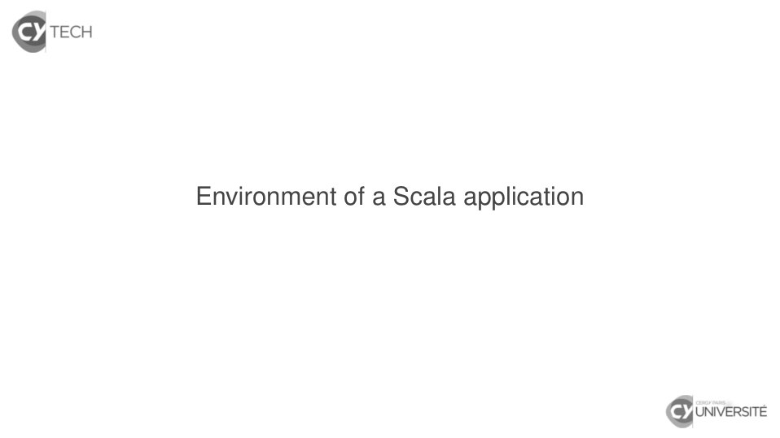
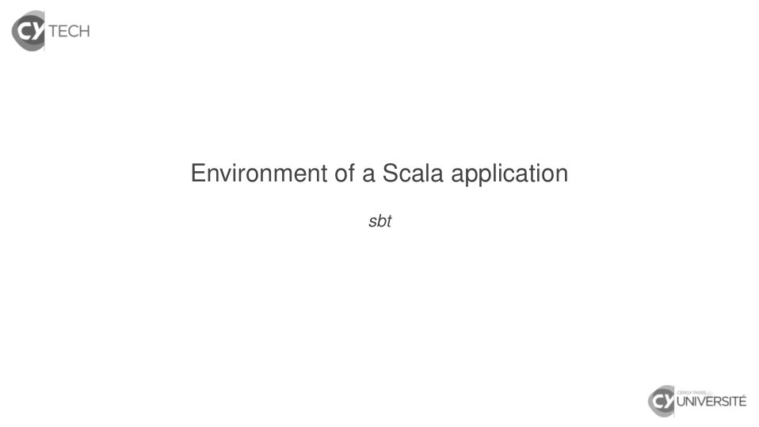
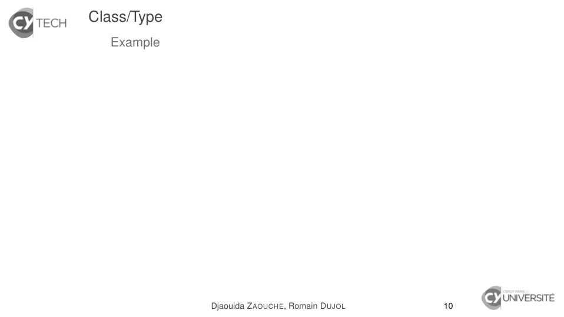
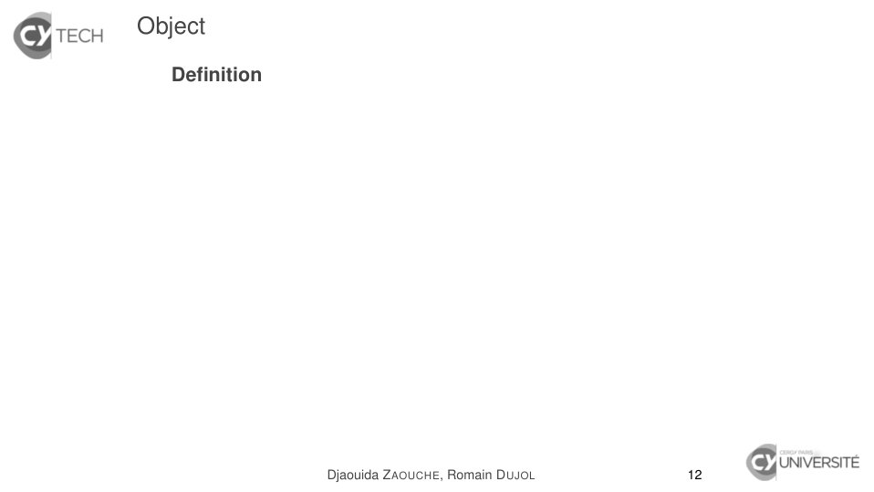
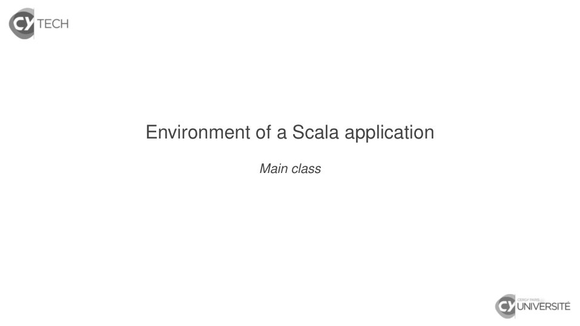
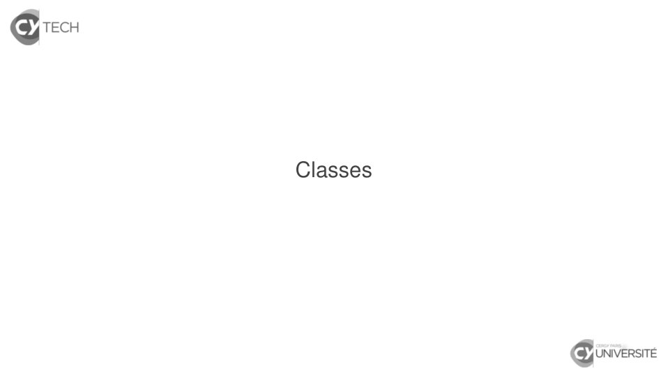
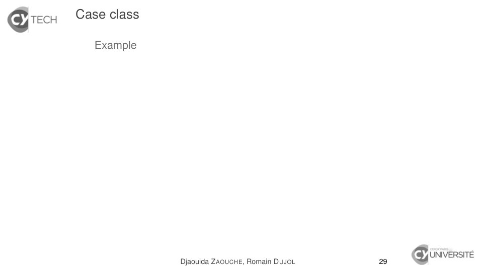
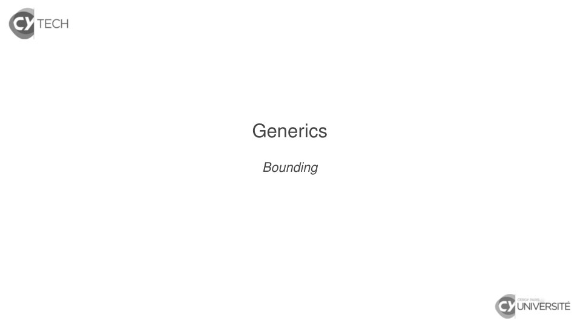

# Scala_03.pdf

[Ouvrir l’original](https://drive.google.com/open?id=19LPpfCeSfJczyNDZOs3NsKIjDGOr2vSc) · Les pages signalées comprennent du texte reconnu automatiquement ou des éléments graphiques. Le fac-similé permet de vérifier chaque lecture.

**Pages avec fac-similé ou lecture OCR** — 2–3, 26, 40, 56, 61–62, 88, 116, 126, 132, 140, 166–167, 178.

## Page 1

~~~text
Functional programming with Scala
                  Classes

   Djaouida Z AOUCHE, Romain D UJOL

              CY T ECH – ING2

                2020 – 2021

       Djaouida Z AOUCHE, Romain D UJOL   1
~~~

## Page 2

~~~text
Environment of a Scala application
~~~

**Lecture OCR à contrôler**

~~~text
S TECH

Environment of a Scala application

& UNIVERSITÉ
~~~

## Page 3

~~~text
Environment of a Scala application
               sbt
~~~

**Lecture OCR à contrôler**

~~~text
S TECH

Environment of a Scala application

sbt

& UNIVERSITÉ
~~~

## Page 4

~~~text
sbt (Simple Build Tool)

   Open-source build tool for Java and Scala projects
   (Some Java equivalents : Apache Maven, Ant)
   Features
    I Minimal configuration for simple projects
    I Continuous compilation, testing, deployment
    I Incremental compilation and testing
    I Tasks written in Scala DSL
    I Dependency support via Apache Ivy
    I Interactive mode (console) is available
   (Source : Wikipedia)

                      Djaouida Z AOUCHE, Romain D UJOL   4
~~~

## Page 5

~~~text
sbt (Simple Build Tool)

   Create a Scala sbt project
    1. Create following directories (at least the ones in bold) :
          } Working directory
            q build.sbt (Configuration)
            } lib (JARs)
            } src
               } main
                  } java (Java source files)
                  } scala (Scala sources files)
                  } resources (Data files)
               } test
                  } java (Java test source files)
                  } scala (Scala test source files)
                  } resources (Data files)
    2. Create file build.sbt.

                       Djaouida Z AOUCHE, Romain D UJOL             5
~~~

## Page 6

~~~text
sbt (Simple Build Tool)

   Example for build.sbt file
   organization := "fr.cyu"
   name         := "HelloWorld"
   version      := "1.0-SNAPSHOT"
   scalaVersion := "2.13.3"

   // Add one dependency for tests (with '% "test"')
   libraryDependencies += "junit" % "junit" % "4.8" % "test"

   // Add various dependencies
   libraryDependencies ++= Seq("org.scala-lang" % "scala-xml" % "2.11.0-M4",
                               "joda-time"      % "joda-time" % "2.9.5")

                     Djaouida Z AOUCHE, Romain D UJOL            6
~~~

## Page 7

~~~text
sbt (Simple Build Tool)
   Subcommands
   Any subcommand may be invoked :

                    Djaouida Z AOUCHE, Romain D UJOL   7
~~~

## Page 8

~~~text
sbt (Simple Build Tool)
   Subcommands
   Any subcommand may be invoked :
    I as a parameter when calling sbt from terminal ;

                     Djaouida Z AOUCHE, Romain D UJOL   7
~~~

## Page 9

~~~text
sbt (Simple Build Tool)
   Subcommands
   Any subcommand may be invoked :
    I as a parameter when calling sbt from terminal ;
    I directy in sbt console.

                      Djaouida Z AOUCHE, Romain D UJOL   7
~~~

## Page 10

~~~text
sbt (Simple Build Tool)
   Subcommands
   Any subcommand may be invoked :
    I as a parameter when calling sbt from terminal ;
    I directy in sbt console.

   Some useful subcommands

                      Djaouida Z AOUCHE, Romain D UJOL   7
~~~

## Page 11

~~~text
sbt (Simple Build Tool)
   Subcommands
   Any subcommand may be invoked :
    I as a parameter when calling sbt from terminal ;
    I directy in sbt console.

   Some useful subcommands
    I clean deletes all files generated by build in target directory

                      Djaouida Z AOUCHE, Romain D UJOL             7
~~~

## Page 12

~~~text
sbt (Simple Build Tool)
   Subcommands
   Any subcommand may be invoked :
    I as a parameter when calling sbt from terminal ;
    I directy in sbt console.

   Some useful subcommands
    I clean deletes all files generated by build in target directory
    I compile compiles all source files from main directory

                      Djaouida Z AOUCHE, Romain D UJOL             7
~~~

## Page 13

~~~text
sbt (Simple Build Tool)
   Subcommands
   Any subcommand may be invoked :
    I as a parameter when calling sbt from terminal ;
    I directy in sbt console.

   Some useful subcommands
    I clean deletes all files generated by build in target directory
    I compile compiles all source files from main directory
    I test compiles all source files from test directory and launch
       tests

                      Djaouida Z AOUCHE, Romain D UJOL             7
~~~

## Page 14

~~~text
sbt (Simple Build Tool)
   Subcommands
   Any subcommand may be invoked :
    I as a parameter when calling sbt from terminal ;
    I directy in sbt console.

   Some useful subcommands
    I clean deletes all files generated by build in target directory
    I compile compiles all source files from main directory
    I test compiles all source files from test directory and launch
       tests
    I package builds a JAR archive

                      Djaouida Z AOUCHE, Romain D UJOL             7
~~~

## Page 15

~~~text
sbt (Simple Build Tool)
   Subcommands
   Any subcommand may be invoked :
    I as a parameter when calling sbt from terminal ;
    I directy in sbt console.

   Some useful subcommands
    I clean deletes all files generated by build in target directory
    I compile compiles all source files from main directory
    I test compiles all source files from test directory and launch
       tests
    I package builds a JAR archive
    I run arguments executes main class with arguments as
       parameters

                      Djaouida Z AOUCHE, Romain D UJOL             7
~~~

## Page 16

~~~text
sbt (Simple Build Tool)
   Subcommands
   Any subcommand may be invoked :
    I as a parameter when calling sbt from terminal ;
    I directy in sbt console.

   Some useful subcommands
    I clean deletes all files generated by build in target directory
    I compile compiles all source files from main directory
    I test compiles all source files from test directory and launch
       tests
    I package builds a JAR archive
    I run arguments executes main class with arguments as
       parameters
    I help prints the list of available subcommands

                      Djaouida Z AOUCHE, Romain D UJOL             7
~~~

## Page 17

~~~text
sbt (Simple Build Tool)
   Subcommands
   Any subcommand may be invoked :
    I as a parameter when calling sbt from terminal ;
    I directy in sbt console.

   Some useful subcommands
    I clean deletes all files generated by build in target directory
    I compile compiles all source files from main directory
    I test compiles all source files from test directory and launch
       tests
    I package builds a JAR archive
    I run arguments executes main class with arguments as
       parameters
    I help prints the list of available subcommands
    I help command prints the help of command
                      Djaouida Z AOUCHE, Romain D UJOL             7
~~~

## Page 18

~~~text
Environment of a Scala application
          Classes and objects
~~~

## Page 19

~~~text
Class/Type

  Definition (similar to Java)
  A class described all the members defined for any instance :

                     Djaouida Z AOUCHE, Romain D UJOL            9
~~~

## Page 20

~~~text
Class/Type

  Definition (similar to Java)
  A class described all the members defined for any instance :
    I Values (or variables)

                     Djaouida Z AOUCHE, Romain D UJOL            9
~~~

## Page 21

~~~text
Class/Type

  Definition (similar to Java)
  A class described all the members defined for any instance :
    I Values (or variables)
    I Functions (a.k.a. methods) whose instance is implicitly is a
       parameter with keyword this

                      Djaouida Z AOUCHE, Romain D UJOL               9
~~~

## Page 22

~~~text
Class/Type

  Definition (similar to Java)
  A class described all the members defined for any instance :
    I Values (or variables)
    I Functions (a.k.a. methods) whose instance is implicitly is a
        parameter with keyword this

  Default declaration syntax
  class ClassName[ParameterTypes∗ ](typedParameter∗ )
    {
        classBody
    }

                      Djaouida Z AOUCHE, Romain D UJOL               9
~~~

## Page 23

~~~text
Class/Type

  Definition (similar to Java)
  A class described all the members defined for any instance :
    I Values (or variables)
    I Functions (a.k.a. methods) whose instance is implicitly is a
        parameter with keyword this

  Default declaration syntax
  class ClassName[ParameterTypes∗ ](typedParameter∗ )
    {
        classBody
    }

    I Usually in ClassName.scala (except for sealed classes)

                      Djaouida Z AOUCHE, Romain D UJOL               9
~~~

## Page 24

~~~text
Class/Type

  Definition (similar to Java)
  A class described all the members defined for any instance :
    I Values (or variables)
    I Functions (a.k.a. methods) whose instance is implicitly is a
        parameter with keyword this

  Default declaration syntax
  class ClassName[ParameterTypes∗ ](typedParameter∗ )
    {
        classBody
    }

    I Usually in ClassName.scala (except for sealed classes)
    I ClassName must start with an uppercase letter.

                      Djaouida Z AOUCHE, Romain D UJOL               9
~~~

## Page 25

~~~text
Class/Type

  Definition (similar to Java)
  A class described all the members defined for any instance :
    I Values (or variables)
    I Functions (a.k.a. methods) whose instance is implicitly is a
        parameter with keyword this

  Default declaration syntax
  class ClassName[ParameterTypes∗ ](typedParameter∗ )
    {
        classBody
    }

    I Usually in ClassName.scala (except for sealed classes)
    I ClassName must start with an uppercase letter.
    I classBody contains val/var and def declarations.
                      Djaouida Z AOUCHE, Romain D UJOL               9
~~~

## Page 26

~~~text
Class/Type
  Example

             Djaouida Z AOUCHE, Romain D UJOL   10
~~~

**Lecture OCR à contrôler**

~~~text
& recu  Class/Type

Example

: irversre
Djaouida ZAOUCHE, Romain DUJOL 10
~~~

## Page 27

~~~text
Class/Type
  Example
  scala> class A
  defined class A

                    Djaouida Z AOUCHE, Romain D UJOL   10
~~~

## Page 28

~~~text
Class/Type
  Example
  scala> class A
  defined class A

  scala> class A1 extends A
  defined class A1

                    Djaouida Z AOUCHE, Romain D UJOL   10
~~~

## Page 29

~~~text
Class/Type
  Example
  scala> class A
  defined class A

  scala> class A1 extends A
  defined class A1

  scala> val a : A = new A()
  a: A = A@2e8b24a1

  scala> val a1 : A1 = new A1()
  a1: A1 = A1@3f0c6b3c

                    Djaouida Z AOUCHE, Romain D UJOL   10
~~~

## Page 30

~~~text
Class/Type
  Example
  scala> class A
  defined class A

  scala> class A1 extends A
  defined class A1

  scala> val a : A = new A()
  a: A = A@2e8b24a1

  scala> val a1 : A1 = new A1()
  a1: A1 = A1@3f0c6b3c

  scala> val test : A = a1
  test: A = A1@3f0c6b3c

                    Djaouida Z AOUCHE, Romain D UJOL   10
~~~

## Page 31

~~~text
Class/Type
  Example
  scala> class A
  defined class A

  scala> class A1 extends A
  defined class A1

  scala> val a : A = new A()
  a: A = A@2e8b24a1

  scala> val a1 : A1 = new A1()
  a1: A1 = A1@3f0c6b3c

  scala> val test : A = a1
  test: A = A1@3f0c6b3c

  scala> val test : A1 = a
  <console>:13: error: type mismatch;
   found   : A
   required: A1
         val test : A1 = a
                           ^ Z AOUCHE, Romain D UJOL
                     Djaouida                          10
~~~

## Page 32

~~~text
Class
  Instantation : new
    I Same syntax as Java

                       Djaouida Z AOUCHE, Romain D UJOL   11
~~~

## Page 33

~~~text
Class
  Instantation : new
    I Same syntax as Java

  Special declarations (instead of just class)

                       Djaouida Z AOUCHE, Romain D UJOL   11
~~~

## Page 34

~~~text
Class
  Instantation : new
    I Same syntax as Java

  Special declarations (instead of just class)
    I final class : same as Java (cannot have subtypees)

                       Djaouida Z AOUCHE, Romain D UJOL    11
~~~

## Page 35

~~~text
Class
  Instantation : new
    I Same syntax as Java

  Special declarations (instead of just class)
    I final class : same as Java (cannot have subtypees)
    I sealed class : all subtypees must be in the same
                          compilation unit (typically a file)

                       Djaouida Z AOUCHE, Romain D UJOL         11
~~~

## Page 36

~~~text
Class
  Instantation : new
    I Same syntax as Java

  Special declarations (instead of just class)
    I final class : same as Java (cannot have subtypees)
    I sealed class : all subtypees must be in the same
                          compilation unit (typically a file)
    I case class : class designed for pattern matching

                       Djaouida Z AOUCHE, Romain D UJOL         11
~~~

## Page 37

~~~text
Class
  Instantation : new
    I Same syntax as Java

  Special declarations (instead of just class)
    I final class : same as Java (cannot have subtypees)
    I sealed class : all subtypees must be in the same
                          compilation unit (typically a file)
    I case class : class designed for pattern matching
    I abstract class : same as Java (i.e. non-instantiable class)

                       Djaouida Z AOUCHE, Romain D UJOL         11
~~~

## Page 38

~~~text
Class
  Instantation : new
    I Same syntax as Java

  Special declarations (instead of just class)
    I final class : same as Java (cannot have subtypees)
    I sealed class : all subtypees must be in the same
                          compilation unit (typically a file)
    I case class : class designed for pattern matching
    I abstract class : same as Java (i.e. non-instantiable class)

  Extensions
    I extends : first superclass (or implemented trait)
    I with : for each other trait implemented by class

                       Djaouida Z AOUCHE, Romain D UJOL         11
~~~

## Page 39

~~~text
Class
  Instantation : new
    I Same syntax as Java

  Special declarations (instead of just class)
    I final class : same as Java (cannot have subtypees)
    I sealed class : all subtypees must be in the same
                          compilation unit (typically a file)
    I case class : class designed for pattern matching
    I abstract class : same as Java (i.e. non-instantiable class)

  Extensions
    I extends : first superclass (or implemented trait)
    I with : for each other trait implemented by class
  Like Java, a class may extend at most one class.
                       Djaouida Z AOUCHE, Romain D UJOL         11
~~~

## Page 40

~~~text
Object
   Definition

                Djaouida Z AOUCHE, Romain D UJOL   12
~~~

**Lecture OCR à contrôler**

~~~text
& recu Object

Definition

| irversre
Djaouida ZaoucHE, Romain DUJOL 12
~~~

## Page 41

~~~text
Object
   Definition
    I An object is a class with one immutable instance so :

                     Djaouida Z AOUCHE, Romain D UJOL         12
~~~

## Page 42

~~~text
Object
   Definition
    I An object is a class with one immutable instance so :
         I an object cannot be type-dependant ;

                     Djaouida Z AOUCHE, Romain D UJOL         12
~~~

## Page 43

~~~text
Object
   Definition
    I An object is a class with one immutable instance so :
         I an object cannot be type-dependant ;
         I an object cannot be parameter-dependant.

                     Djaouida Z AOUCHE, Romain D UJOL         12
~~~

## Page 44

~~~text
Object
   Definition
    I An object is a class with one immutable instance so :
         I an object cannot be type-dependant ;
         I an object cannot be parameter-dependant.
    I This instance is treated as a lazy value.

                      Djaouida Z AOUCHE, Romain D UJOL        12
~~~

## Page 45

~~~text
Object
   Definition
    I An object is a class with one immutable instance so :
          I an object cannot be type-dependant ;
          I an object cannot be parameter-dependant.
    I This instance is treated as a lazy value.

   Declaration syntax
   object ObjectName
     {
         objectBody
     }

                      Djaouida Z AOUCHE, Romain D UJOL        12
~~~

## Page 46

~~~text
Object
   Definition
    I An object is a class with one immutable instance so :
          I an object cannot be type-dependant ;
          I an object cannot be parameter-dependant.
    I This instance is treated as a lazy value.

   Declaration syntax
   object ObjectName
     {
         objectBody
     }

    I Usually in ObjectName.scala

                      Djaouida Z AOUCHE, Romain D UJOL        12
~~~

## Page 47

~~~text
Object
   Definition
    I An object is a class with one immutable instance so :
          I an object cannot be type-dependant ;
          I an object cannot be parameter-dependant.
    I This instance is treated as a lazy value.

   Declaration syntax
   object ObjectName
     {
         objectBody
     }

    I Usually in ObjectName.scala
    I ObjectName must start with an uppercase letter.

                      Djaouida Z AOUCHE, Romain D UJOL        12
~~~

## Page 48

~~~text
Object
   Definition
    I An object is a class with one immutable instance so :
          I an object cannot be type-dependant ;
          I an object cannot be parameter-dependant.
    I This instance is treated as a lazy value.

   Declaration syntax
   object ObjectName
     {
         objectBody
     }

    I Usually in ObjectName.scala
    I ObjectName must start with an uppercase letter.
    I objectBody contains val/var and def declarations.
                      Djaouida Z AOUCHE, Romain D UJOL        12
~~~

## Page 49

~~~text
Object

   Special declaration
    I case object : case class and object (e.g. None)

                    Djaouida Z AOUCHE, Romain D UJOL    13
~~~

## Page 50

~~~text
Object

   Special declaration
    I case object : case class and object (e.g. None)

   Extensions
    I extends : first superclass (or implemented trait)
    I with : for each other trait implemented by object

                     Djaouida Z AOUCHE, Romain D UJOL     13
~~~

## Page 51

~~~text
Object

   Special declaration
    I case object : case class and object (e.g. None)

   Extensions
    I extends : first superclass (or implemented trait)
    I with : for each other trait implemented by object

   Companion object

                     Djaouida Z AOUCHE, Romain D UJOL     13
~~~

## Page 52

~~~text
Object

   Special declaration
    I case object : case class and object (e.g. None)

   Extensions
    I extends : first superclass (or implemented trait)
    I with : for each other trait implemented by object

   Companion object
   Object with same name as a class (usually in same file)

                      Djaouida Z AOUCHE, Romain D UJOL       13
~~~

## Page 53

~~~text
Object

   Special declaration
    I case object : case class and object (e.g. None)

   Extensions
    I extends : first superclass (or implemented trait)
    I with : for each other trait implemented by object

   Companion object
   Object with same name as a class (usually in same file)
    I Class can access private members of its companion object.

                      Djaouida Z AOUCHE, Romain D UJOL            13
~~~

## Page 54

~~~text
Object

   Special declaration
    I case object : case class and object (e.g. None)

   Extensions
    I extends : first superclass (or implemented trait)
    I with : for each other trait implemented by object

   Companion object
   Object with same name as a class (usually in same file)
    I Class can access private members of its companion object.
    I Members of companion object do not depend on any class
         instance

                      Djaouida Z AOUCHE, Romain D UJOL            13
~~~

## Page 55

~~~text
Object

   Special declaration
    I case object : case class and object (e.g. None)

   Extensions
    I extends : first superclass (or implemented trait)
    I with : for each other trait implemented by object

   Companion object
   Object with same name as a class (usually in same file)
    I Class can access private members of its companion object.
    I Members of companion object do not depend on any class
         instance (think Java’s static).

                       Djaouida Z AOUCHE, Romain D UJOL           13
~~~

## Page 56

~~~text
Environment of a Scala application
             Main class
~~~

**Lecture OCR à contrôler**

~~~text
S TECH

Environment of a Scala application

Main class

& UNIVERSITÉ
~~~

## Page 57

~~~text
Main class. . . rather main object

   Same purpose as Java. . .
    I Entry point for program with main method
    I Arguments from call in console captured in a string array

                     Djaouida Z AOUCHE, Romain D UJOL             15
~~~

## Page 58

~~~text
Main class. . . rather main object

   Same purpose as Java. . .
    I Entry point for program with main method
    I Arguments from call in console captured in a string array

   . . . but some differences in defining it
    I One instance =⇒ object declaration (instead of class)
    I App trait defines main method :
         I no need to declare method if object extends App ;
         I the whole object body becomes the main method body.

                      Djaouida Z AOUCHE, Romain D UJOL            15
~~~

## Page 59

~~~text
Main class. . . rather main object

   Hello World
   object HelloWorld
     {
       def main(args : Array[String])
         {
           println("Hello World !")
         }
     }

                   Djaouida Z AOUCHE, Romain D UJOL   16
~~~

## Page 60

~~~text
Main class. . . rather main object

   Hello World
   object HelloWorld
     {
       def main(args : Array[String])
         {
           println("Hello World !")
         }
     }

   Hello World (extending App)
   object HelloWorld extends App
     {
       println("Hello, world!")
     }
   (Not recommended in Scala 3 for performance reasons)
                     Djaouida Z AOUCHE, Romain D UJOL     16
~~~

## Page 61

~~~text
Classes
~~~

**Lecture OCR à contrôler**

~~~text
& TECH

Classes

& UNIVERSITÉ
~~~

## Page 62

~~~text
Classes
Members
~~~

**Lecture OCR à contrôler**

~~~text
& TECH

Classes

Members

& UNIVERSITÉ
~~~

## Page 63

~~~text
Members declarations
  As expected. . .

                     Djaouida Z AOUCHE, Romain D UJOL   19
~~~

## Page 64

~~~text
Members declarations
  As expected. . .
    I Values : with val (or lazy val)

                     Djaouida Z AOUCHE, Romain D UJOL   19
~~~

## Page 65

~~~text
Members declarations
  As expected. . .
    I Values : with val (or lazy val)
    I Variables : with var

                     Djaouida Z AOUCHE, Romain D UJOL   19
~~~

## Page 66

~~~text
Members declarations
  As expected. . .
    I Values : with val (or lazy val)
    I Variables : with var
    I Methods : with def

                     Djaouida Z AOUCHE, Romain D UJOL   19
~~~

## Page 67

~~~text
Members declarations
  As expected. . .
    I Values : with val (or lazy val)
    I Variables : with var
    I Methods : with def
  By default, visibility is public.

                        Djaouida Z AOUCHE, Romain D UJOL   19
~~~

## Page 68

~~~text
Members declarations
  As expected. . .
    I Values : with val (or lazy val)
    I Variables : with var
    I Methods : with def
  By default, visibility is public.
  Preceding declaration with private makes it private.

                     Djaouida Z AOUCHE, Romain D UJOL    19
~~~

## Page 69

~~~text
Members declarations
  As expected. . .
    I Values : with val (or lazy val)
    I Variables : with var
    I Methods : with def
  By default, visibility is public.
  Preceding declaration with private makes it private.

  Example

                     Djaouida Z AOUCHE, Romain D UJOL    19
~~~

## Page 70

~~~text
Members declarations
  As expected. . .
    I Values : with val (or lazy val)
    I Variables : with var
    I Methods : with def
  By default, visibility is public.
  Preceding declaration with private makes it private.

  Example
  scala> class A {
             val x : Int = 2
             private val ans : Int = 42
           }
  defined class A

                      Djaouida Z AOUCHE, Romain D UJOL   19
~~~

## Page 71

~~~text
Members declarations
  As expected. . .
    I Values : with val (or lazy val)
    I Variables : with var
    I Methods : with def
  By default, visibility is public.
  Preceding declaration with private makes it private.

  Example
  scala> class A {
             val x : Int = 2
             private val ans : Int = 42
           }
  defined class A

  scala> (new A()).x
  res0: Int = 2

                       Djaouida Z AOUCHE, Romain D UJOL   19
~~~

## Page 72

~~~text
Members declarations
  As expected. . .
    I Values : with val (or lazy val)
    I Variables : with var
    I Methods : with def
  By default, visibility is public.
  Preceding declaration with private makes it private.

  Example
  scala> class A {
             val x : Int = 2
             private val ans : Int = 42
           }
  defined class A

  scala> (new A()).x
  res0: Int = 2

  scala> (new A()).ans
  <console>:13: error: value ans in class A cannot be accessed in A
         (new A()).ans
                   ^
                       Djaouida Z AOUCHE, Romain D UJOL               19
~~~

## Page 73

~~~text
Method call

   Standard (Java-like) notation

                     Djaouida Z AOUCHE, Romain D UJOL   20
~~~

## Page 74

~~~text
Method call

   Standard (Java-like) notation
    I instance.methodName(parameters)

                     Djaouida Z AOUCHE, Romain D UJOL   20
~~~

## Page 75

~~~text
Method call

   Standard (Java-like) notation
    I instance.methodName(parameters)
    I Parameters may be called in another order if named.

                     Djaouida Z AOUCHE, Romain D UJOL       20
~~~

## Page 76

~~~text
Method call

   Standard (Java-like) notation
    I instance.methodName(parameters)
    I Parameters may be called in another order if named.

   Example

                     Djaouida Z AOUCHE, Romain D UJOL       20
~~~

## Page 77

~~~text
Method call

   Standard (Java-like) notation
    I instance.methodName(parameters)
    I Parameters may be called in another order if named.

   Example
   scala> class A {
              def f(x : Int, y : Int) = x + y
            }
   defined class A

                     Djaouida Z AOUCHE, Romain D UJOL       20
~~~

## Page 78

~~~text
Method call

   Standard (Java-like) notation
    I instance.methodName(parameters)
    I Parameters may be called in another order if named.

   Example
   scala> class A {
              def f(x : Int, y : Int) = x + y
            }
   defined class A

   scala> (new A()).f(2, 3)
   res0: Int = 5

                     Djaouida Z AOUCHE, Romain D UJOL       20
~~~

## Page 79

~~~text
Method call

   Standard (Java-like) notation
    I instance.methodName(parameters)
    I Parameters may be called in another order if named.

   Example
   scala> class A {
              def f(x : Int, y : Int) = x + y
            }
   defined class A

   scala> (new A()).f(2, 3)
   res0: Int = 5

   scala> (new A()).f(y = 3, x = 2)
   res1: Int = 5

                     Djaouida Z AOUCHE, Romain D UJOL       20
~~~

## Page 80

~~~text
Method call

   Infix notation

                    Djaouida Z AOUCHE, Romain D UJOL   21
~~~

## Page 81

~~~text
Method call

   Infix notation
    I Only valid for a method with one parameter

                    Djaouida Z AOUCHE, Romain D UJOL   21
~~~

## Page 82

~~~text
Method call

   Infix notation
    I Only valid for a method with one parameter
    I instance methodName parameter
      ≡ instance.methodName(parameter )

                    Djaouida Z AOUCHE, Romain D UJOL   21
~~~

## Page 83

~~~text
Method call

   Infix notation
    I Only valid for a method with one parameter
    I instance methodName parameter
      ≡ instance.methodName(parameter )
   Comes in handy to define DSLs (e.g. sbt)

                     Djaouida Z AOUCHE, Romain D UJOL   21
~~~

## Page 84

~~~text
Method call

   Infix notation
    I Only valid for a method with one parameter
    I instance methodName parameter
      ≡ instance.methodName(parameter )
   Comes in handy to define DSLs (e.g. sbt)

   Example

                     Djaouida Z AOUCHE, Romain D UJOL   21
~~~

## Page 85

~~~text
Method call

   Infix notation
    I Only valid for a method with one parameter
    I instance methodName parameter
      ≡ instance.methodName(parameter )
   Comes in handy to define DSLs (e.g. sbt)

   Example
   scala> class A(x : Int) {
              def + (y : Int) = x + y
            }
   defined class A

                     Djaouida Z AOUCHE, Romain D UJOL   21
~~~

## Page 86

~~~text
Method call

   Infix notation
    I Only valid for a method with one parameter
    I instance methodName parameter
      ≡ instance.methodName(parameter )
   Comes in handy to define DSLs (e.g. sbt)

   Example
   scala> class A(x : Int) {
              def + (y : Int) = x + y
            }
   defined class A

   scala> (new A(2)).+(3)
   res0: Int = 5

                     Djaouida Z AOUCHE, Romain D UJOL   21
~~~

## Page 87

~~~text
Method call

   Infix notation
    I Only valid for a method with one parameter
    I instance methodName parameter
      ≡ instance.methodName(parameter )
   Comes in handy to define DSLs (e.g. sbt)

   Example
   scala> class A(x : Int) {
              def + (y : Int) = x + y
            }
   defined class A

   scala> (new A(2)).+(3)
   res0: Int = 5

   scala> (new A(2)) + 3
   res1: Int = 5

                     Djaouida Z AOUCHE, Romain D UJOL   21
~~~

## Page 88

~~~text
Classes
Constructors
~~~

**Lecture OCR à contrôler**

~~~text
& TECH

Classes

Constructors

& UNIVERSITÉ
~~~

## Page 89

~~~text
Primary constructor

   Primary constructor is implicitly defined in class declaration

                     Djaouida Z AOUCHE, Romain D UJOL               23
~~~

## Page 90

~~~text
Primary constructor

   Primary constructor is implicitly defined in class declaration
    I Parameters : the list of parameters of the class

                     Djaouida Z AOUCHE, Romain D UJOL               23
~~~

## Page 91

~~~text
Primary constructor

   Primary constructor is implicitly defined in class declaration
    I Parameters : the list of parameters of the class
    I Body : the whole body of the class

                     Djaouida Z AOUCHE, Romain D UJOL               23
~~~

## Page 92

~~~text
Primary constructor

   Primary constructor is implicitly defined in class declaration
    I Parameters : the list of parameters of the class
    I Body : the whole body of the class
   Since class parameters are actually method parameters, same
   mechanisms apply (in particular, default parameters).

                     Djaouida Z AOUCHE, Romain D UJOL               23
~~~

## Page 93

~~~text
Primary constructor

   Primary constructor is implicitly defined in class declaration
    I Parameters : the list of parameters of the class
    I Body : the whole body of the class
   Since class parameters are actually method parameters, same
   mechanisms apply (in particular, default parameters).

   WARNING !
   By default, class parameters are private immutable members.
   Adding some modifier before parameter alter this behaviour :

                     Djaouida Z AOUCHE, Romain D UJOL               23
~~~

## Page 94

~~~text
Primary constructor

   Primary constructor is implicitly defined in class declaration
    I Parameters : the list of parameters of the class
    I Body : the whole body of the class
   Since class parameters are actually method parameters, same
   mechanisms apply (in particular, default parameters).

   WARNING !
   By default, class parameters are private immutable members.
   Adding some modifier before parameter alter this behaviour :
    I val : parameter is a public immutable member ;

                     Djaouida Z AOUCHE, Romain D UJOL               23
~~~

## Page 95

~~~text
Primary constructor

   Primary constructor is implicitly defined in class declaration
    I Parameters : the list of parameters of the class
    I Body : the whole body of the class
   Since class parameters are actually method parameters, same
   mechanisms apply (in particular, default parameters).

   WARNING !
   By default, class parameters are private immutable members.
   Adding some modifier before parameter alter this behaviour :
    I val : parameter is a public immutable member ;
    I var : parameter is a public mutable member ;

                     Djaouida Z AOUCHE, Romain D UJOL               23
~~~

## Page 96

~~~text
Primary constructor

   Primary constructor is implicitly defined in class declaration
    I Parameters : the list of parameters of the class
    I Body : the whole body of the class
   Since class parameters are actually method parameters, same
   mechanisms apply (in particular, default parameters).

   WARNING !
   By default, class parameters are private immutable members.
   Adding some modifier before parameter alter this behaviour :
    I val : parameter is a public immutable member ;
    I var : parameter is a public mutable member ;
    I private val : parameter is a private immutable member ;

                     Djaouida Z AOUCHE, Romain D UJOL               23
~~~

## Page 97

~~~text
Primary constructor

   Primary constructor is implicitly defined in class declaration
    I Parameters : the list of parameters of the class
    I Body : the whole body of the class
   Since class parameters are actually method parameters, same
   mechanisms apply (in particular, default parameters).

   WARNING !
   By default, class parameters are private immutable members.
   Adding some modifier before parameter alter this behaviour :
    I val : parameter is a public immutable member ;
    I var : parameter is a public mutable member ;
    I private val : parameter is a private immutable member ;
    I private var : parameter is a private mutable member.

                     Djaouida Z AOUCHE, Romain D UJOL               23
~~~

## Page 98

~~~text
Primary constructor

   By default, class parameter is private

                     Djaouida Z AOUCHE, Romain D UJOL   24
~~~

## Page 99

~~~text
Primary constructor

   By default, class parameter is private
   scala> class A(x : Int) {
             def test = println(this.x)
           }
   defined class A

                     Djaouida Z AOUCHE, Romain D UJOL   24
~~~

## Page 100

~~~text
Primary constructor

   By default, class parameter is private
   scala> class A(x : Int) {
             def test = println(this.x)
           }
   defined class A

   scala> (new A(2)).test
   2

                     Djaouida Z AOUCHE, Romain D UJOL   24
~~~

## Page 101

~~~text
Primary constructor

   By default, class parameter is private
   scala> class A(x : Int) {
             def test = println(this.x)
           }
   defined class A

   scala> (new A(2)).test
   2

   scala> (new A(2)).x
   <console>:13: error: value x is not a member of A
          (new A(2)).x
                     ^

                     Djaouida Z AOUCHE, Romain D UJOL   24
~~~

## Page 102

~~~text
Primary constructor

   By default, class parameter is private
   scala> class A(x : Int) {
             def test = println(this.x)
           }
   defined class A

   scala> (new A(2)).test
   2

   scala> (new A(2)).x
   <console>:13: error: value x is not a member of A
          (new A(2)).x
                     ^

   By default, class parameter is immutable

                     Djaouida Z AOUCHE, Romain D UJOL   24
~~~

## Page 103

~~~text
Primary constructor

   By default, class parameter is private
   scala> class A(x : Int) {
             def test = println(this.x)
           }
   defined class A

   scala> (new A(2)).test
   2

   scala> (new A(2)).x
   <console>:13: error: value x is not a member of A
          (new A(2)).x
                     ^

   By default, class parameter is immutable
   scala> class A(x : Int) {
             def test = { x = -1 ; println(this.x) }
           }
   <console>:12: error: reassignment to val
             def test = { x = -1 ; println(this.x) }
                             ^
                     Djaouida Z AOUCHE, Romain D UJOL   24
~~~

## Page 104

~~~text
Primary constructor

   Example with val
   scala> class A(val x : Int)
   defined class A

                  Djaouida Z AOUCHE, Romain D UJOL   25
~~~

## Page 105

~~~text
Primary constructor

   Example with val
   scala> class A(val x : Int)
   defined class A

   scala> (new A(2)).x
   res0: Int = 2

                  Djaouida Z AOUCHE, Romain D UJOL   25
~~~

## Page 106

~~~text
Primary constructor

   Example with val
   scala> class A(val x : Int)
   defined class A

   scala> (new A(2)).x
   res0: Int = 2

   Example with var
   scala> class A(var x : Int)
   defined class A

                  Djaouida Z AOUCHE, Romain D UJOL   25
~~~

## Page 107

~~~text
Primary constructor

   Example with val
   scala> class A(val x : Int)
   defined class A

   scala> (new A(2)).x
   res0: Int = 2

   Example with var
   scala> class A(var x : Int)
   defined class A

   scala> val a = new A(2) ; a.x = 3
   a: A = A@74cd798f
   a.x: Int = 3

                  Djaouida Z AOUCHE, Romain D UJOL   25
~~~

## Page 108

~~~text
Auxiliary constructors

   Same principle as Java

                   Djaouida Z AOUCHE, Romain D UJOL   26
~~~

## Page 109

~~~text
Auxiliary constructors

   Same principle as Java
    I Auxiliary constructor : method whose name is this

                    Djaouida Z AOUCHE, Romain D UJOL      26
~~~

## Page 110

~~~text
Auxiliary constructors

   Same principle as Java
    I Auxiliary constructor : method whose name is this
    I Signature must be different from other constructors (primary
       or auxiliary).

                        Djaouida Z AOUCHE, Romain D UJOL             26
~~~

## Page 111

~~~text
Auxiliary constructors

   Same principle as Java
    I Auxiliary constructor : method whose name is this
    I Signature must be different from other constructors (primary
       or auxiliary).
   Any internal call to a constructor is done with keyword this.

                        Djaouida Z AOUCHE, Romain D UJOL             26
~~~

## Page 112

~~~text
Auxiliary constructors

   Same principle as Java
    I Auxiliary constructor : method whose name is this
    I Signature must be different from other constructors (primary
       or auxiliary).
   Any internal call to a constructor is done with keyword this.

   Example

                        Djaouida Z AOUCHE, Romain D UJOL             26
~~~

## Page 113

~~~text
Auxiliary constructors

   Same principle as Java
    I Auxiliary constructor : method whose name is this
    I Signature must be different from other constructors (primary
       or auxiliary).
   Any internal call to a constructor is done with keyword this.

   Example
   scala> class A(x : Int, y : Int) {
              def this(x : Int) = this(x, 0)
            }
   defined class A

                        Djaouida Z AOUCHE, Romain D UJOL             26
~~~

## Page 114

~~~text
Auxiliary constructors

   Same principle as Java
    I Auxiliary constructor : method whose name is this
    I Signature must be different from other constructors (primary
       or auxiliary).
   Any internal call to a constructor is done with keyword this.

   Example
   scala> class A(x : Int, y : Int) {
              def this(x : Int) = this(x, 0)
            }
   defined class A

   scala> new A(1, 2)
   res0: A = A@5cbe95b1

                        Djaouida Z AOUCHE, Romain D UJOL             26
~~~

## Page 115

~~~text
Auxiliary constructors

   Same principle as Java
    I Auxiliary constructor : method whose name is this
    I Signature must be different from other constructors (primary
       or auxiliary).
   Any internal call to a constructor is done with keyword this.

   Example
   scala> class A(x : Int, y : Int) {
              def this(x : Int) = this(x, 0)
            }
   defined class A

   scala> new A(1, 2)
   res0: A = A@5cbe95b1

   scala> new A(1)
   res1: A = A@65d7eea4

                        Djaouida Z AOUCHE, Romain D UJOL             26
~~~

## Page 116

~~~text
Classes
Case class
~~~

**Lecture OCR à contrôler**

~~~text
& TECH

Classes

Case class

& UNIVERSITÉ
~~~

## Page 117

~~~text
Case class ≡ class + . . .

   val modifier implicitly applied to any class parameter

                     Djaouida Z AOUCHE, Romain D UJOL       28
~~~

## Page 118

~~~text
Case class ≡ class + . . .

   val modifier implicitly applied to any class parameter
    I Any parameter is actually a public immutable member.

                     Djaouida Z AOUCHE, Romain D UJOL        28
~~~

## Page 119

~~~text
Case class ≡ class + . . .

   val modifier implicitly applied to any class parameter
    I Any parameter is actually a public immutable member.
    I == compares content, not reference

                     Djaouida Z AOUCHE, Romain D UJOL        28
~~~

## Page 120

~~~text
Case class ≡ class + . . .

   val modifier implicitly applied to any class parameter
    I Any parameter is actually a public immutable member.
    I == compares content, not reference
    I toString method is updated accordingly

                     Djaouida Z AOUCHE, Romain D UJOL        28
~~~

## Page 121

~~~text
Case class ≡ class + . . .

   val modifier implicitly applied to any class parameter
    I Any parameter is actually a public immutable member.
    I == compares content, not reference
    I toString method is updated accordingly

   Companion object is implicitly created with :

                     Djaouida Z AOUCHE, Romain D UJOL        28
~~~

## Page 122

~~~text
Case class ≡ class + . . .

   val modifier implicitly applied to any class parameter
    I Any parameter is actually a public immutable member.
    I == compares content, not reference
    I toString method is updated accordingly

   Companion object is implicitly created with :
    I method apply with same parameters as class

                     Djaouida Z AOUCHE, Romain D UJOL        28
~~~

## Page 123

~~~text
Case class ≡ class + . . .

   val modifier implicitly applied to any class parameter
    I Any parameter is actually a public immutable member.
    I == compares content, not reference
    I toString method is updated accordingly

   Companion object is implicitly created with :
    I method apply with same parameters as class
      =⇒ keyword new is no longer required :
            CompanionObject (parameters)
             ≡ CompanionObject .apply(parameters)

                     Djaouida Z AOUCHE, Romain D UJOL        28
~~~

## Page 124

~~~text
Case class ≡ class + . . .

   val modifier implicitly applied to any class parameter
    I Any parameter is actually a public immutable member.
    I == compares content, not reference
    I toString method is updated accordingly

   Companion object is implicitly created with :
    I method apply with same parameters as class
      =⇒ keyword new is no longer required :
            CompanionObject (parameters)
             ≡ CompanionObject .apply(parameters)
    I method unapply that enables constructor in any case clause
       (hence the name of this type of class)

                      Djaouida Z AOUCHE, Romain D UJOL        28
~~~

## Page 125

~~~text
Case class ≡ class + . . .

   val modifier implicitly applied to any class parameter
    I Any parameter is actually a public immutable member.
    I == compares content, not reference
    I toString method is updated accordingly

   Companion object is implicitly created with :
    I method apply with same parameters as class
      =⇒ keyword new is no longer required :
             CompanionObject (parameters)
              ≡ CompanionObject .apply(parameters)
    I method unapply that enables constructor in any case clause
        (hence the name of this type of class)
   Hint : Explicit object declaration implicity includes all properties
                        Djaouida Z AOUCHE, Romain D UJOL                  28
~~~

## Page 126

~~~text
Case class

  Example

             Djaouida Z AOUCHE, Romain D UJOL   29
~~~

**Lecture OCR à contrôler**

~~~text
[CES Case class

Example

: irversre
Djaouida ZAOUCHE, Romain DUJOL 29
~~~

## Page 127

~~~text
Case class

  Example
  scala> case class Person(last : String, first : String)
  defined class Person

                    Djaouida Z AOUCHE, Romain D UJOL        29
~~~

## Page 128

~~~text
Case class

  Example
  scala> case class Person(last : String, first : String)
  defined class Person

  scala> val rdl = Person("Dujol", "Romain")
  rdl: Person = Person(Dujol,Romain)

                    Djaouida Z AOUCHE, Romain D UJOL        29
~~~

## Page 129

~~~text
Case class

  Example
  scala> case class Person(last : String, first : String)
  defined class Person

  scala> val rdl = Person("Dujol", "Romain")
  rdl: Person = Person(Dujol,Romain)

  scala> rdl == Person("Dujol", "Romain")
  res0: Boolean = true

                    Djaouida Z AOUCHE, Romain D UJOL        29
~~~

## Page 130

~~~text
Case class

  Example
  scala> case class Person(last : String, first : String)
  defined class Person

  scala> val rdl = Person("Dujol", "Romain")
  rdl: Person = Person(Dujol,Romain)

  scala> rdl == Person("Dujol", "Romain")
  res0: Boolean = true

  scala> rdl.first + " " + rdl.last
  res1: String = Romain Dujol

                    Djaouida Z AOUCHE, Romain D UJOL        29
~~~

## Page 131

~~~text
Case class

  Example
  scala> case class Person(last : String, first : String)
  defined class Person

  scala> val rdl = Person("Dujol", "Romain")
  rdl: Person = Person(Dujol,Romain)

  scala> rdl == Person("Dujol", "Romain")
  res0: Boolean = true

  scala> rdl.first + " " + rdl.last
  res1: String = Romain Dujol

  scala> Person("Romain", "Dujol") match {
             case Person("Dujol", "Romain") => "bibi"
             case Person("Dujol", _        ) => "famille"
             case Person(l, f) if l == f     => "Ca existe ?"
             case _                          => "autre"
           }
  res2: String = autre

                    Djaouida Z AOUCHE, Romain D UJOL            29
~~~

## Page 132

~~~text
Classes
Sealed class
~~~

**Lecture OCR à contrôler**

~~~text
& TECH

Classes

Sealed class

& UNIVERSITÉ
~~~

## Page 133

~~~text
Sealed class

   Standard use case
    I Class is abstract.
    I Any subtype is a case class.

                     Djaouida Z AOUCHE, Romain D UJOL   31
~~~

## Page 134

~~~text
Sealed class

   Standard use case
    I Class is abstract.
    I Any subtype is a case class.

   Exhaustivity in a pattern matching may be checked
    I Indeed, any instance class must be one of the subtypees.

                     Djaouida Z AOUCHE, Romain D UJOL            31
~~~

## Page 135

~~~text
Sealed class and case classes

   Example : integer-valued option

                    Djaouida Z AOUCHE, Romain D UJOL   32
~~~

## Page 136

~~~text
Sealed class and case classes

   Example : integer-valued option
   scala> sealed abstract class IntOption
   defined class IntOption

                     Djaouida Z AOUCHE, Romain D UJOL   32
~~~

## Page 137

~~~text
Sealed class and case classes

   Example : integer-valued option
   scala> sealed abstract class IntOption
   defined class IntOption

   scala> case class IntSome(x : Int) extends IntOption
   defined class IntSome

                     Djaouida Z AOUCHE, Romain D UJOL     32
~~~

## Page 138

~~~text
Sealed class and case classes

   Example : integer-valued option
   scala> sealed abstract class IntOption
   defined class IntOption

   scala> case class IntSome(x : Int) extends IntOption
   defined class IntSome

   scala> case object IntNone extends IntOption
   defined class IntNone

                     Djaouida Z AOUCHE, Romain D UJOL     32
~~~

## Page 139

~~~text
Sealed class and case classes

   Example : integer-valued option
   scala> sealed abstract class IntOption
   defined class IntOption

   scala> case class IntSome(x : Int) extends IntOption
   defined class IntSome

   scala> case object IntNone extends IntOption
   defined class IntNone

   scala> val test : IntOption = IntNone
   res0: IntOption = IntNone

   scala> test match { case IntNone => 0 }
   <console>:14: warning: match may not be exhaustive.
   It would fail on the following input: IntSome(_)
           test match { case IntNone => 0 }
           ^
   res1: Int = 0
   (Warning does not appear if class IntOption is not sealed.)
                        Djaouida Z AOUCHE, Romain D UJOL         32
~~~

## Page 140

~~~text
Traits
~~~

**Lecture OCR à contrôler**

~~~text
& TECH

Traits

& UNIVERSITÉ
~~~

## Page 141

~~~text
Traits

   A trait is like a Java interface. . .

                        Djaouida Z AOUCHE, Romain D UJOL   34
~~~

## Page 142

~~~text
Traits

   A trait is like a Java interface. . .
     I No parameters (parameters will be available in Scala 3)

                        Djaouida Z AOUCHE, Romain D UJOL         34
~~~

## Page 143

~~~text
Traits

   A trait is like a Java interface. . .
     I No parameters (parameters will be available in Scala 3)
     I Abstract, i.e. no direct instantiation with new

                        Djaouida Z AOUCHE, Romain D UJOL         34
~~~

## Page 144

~~~text
Traits

   A trait is like a Java interface. . .
     I No parameters (parameters will be available in Scala 3)
     I Abstract, i.e. no direct instantiation with new
     I No constructor

                        Djaouida Z AOUCHE, Romain D UJOL         34
~~~

## Page 145

~~~text
Traits

   A trait is like a Java interface. . .
     I No parameters (parameters will be available in Scala 3)
     I Abstract, i.e. no direct instantiation with new
     I No constructor
     I Any class/trait may implement any number of traits.

                        Djaouida Z AOUCHE, Romain D UJOL         34
~~~

## Page 146

~~~text
Traits

   A trait is like a Java interface. . .
     I No parameters (parameters will be available in Scala 3)
     I Abstract, i.e. no direct instantiation with new
     I No constructor
     I Any class/trait may implement any number of traits.

   . . . but

                        Djaouida Z AOUCHE, Romain D UJOL         34
~~~

## Page 147

~~~text
Traits

   A trait is like a Java interface. . .
     I No parameters (parameters will be available in Scala 3)
     I Abstract, i.e. no direct instantiation with new
     I No constructor
     I Any class/trait may implement any number of traits.

   . . . but
     I Trait may contain values/variables.

                        Djaouida Z AOUCHE, Romain D UJOL         34
~~~

## Page 148

~~~text
Traits

   A trait is like a Java interface. . .
     I No parameters (parameters will be available in Scala 3)
     I Abstract, i.e. no direct instantiation with new
     I No constructor
     I Any class/trait may implement any number of traits.

   . . . but
     I Trait may contain values/variables.
     I Trait body may contain partially implemented bits.

                        Djaouida Z AOUCHE, Romain D UJOL         34
~~~

## Page 149

~~~text
Traits

   A trait is like a Java interface. . .
     I No parameters (parameters will be available in Scala 3)
     I Abstract, i.e. no direct instantiation with new
     I No constructor
     I Any class/trait may implement any number of traits.

   . . . but
     I Trait may contain values/variables.
     I Trait body may contain partially implemented bits.
     I Trait may be implemented by a sole instance (not the whole
         class).

                        Djaouida Z AOUCHE, Romain D UJOL            34
~~~

## Page 150

~~~text
Traits

   Default declaration syntax
   trait TraitName[ParameterTypes∗ ]
     {
         traitBody
     }

                     Djaouida Z AOUCHE, Romain D UJOL   35
~~~

## Page 151

~~~text
Traits

   Default declaration syntax
   trait TraitName[ParameterTypes∗ ]
     {
         traitBody
     }

     I Usually in TraitName.scala

                     Djaouida Z AOUCHE, Romain D UJOL   35
~~~

## Page 152

~~~text
Traits

   Default declaration syntax
   trait TraitName[ParameterTypes∗ ]
     {
         traitBody
     }

     I Usually in TraitName.scala
     I TraitName must start with an uppercase letter.

                      Djaouida Z AOUCHE, Romain D UJOL   35
~~~

## Page 153

~~~text
Traits

   Default declaration syntax
   trait TraitName[ParameterTypes∗ ]
     {
         traitBody
     }

     I Usually in TraitName.scala
     I TraitName must start with an uppercase letter.
     I traitBody contains val/var and def signatures (at least)

                      Djaouida Z AOUCHE, Romain D UJOL            35
~~~

## Page 154

~~~text
Traits

   Comparable.scala : (Java style)
   trait Comparable[T]
     {
       def == (that : T)
       def != (that : T)
       def < (that : T)
       def <= (that : T)
       def > (that : T)
       def >= (that : T)
     }
     I Any implementing class must define all methods.

                     Djaouida Z AOUCHE, Romain D UJOL    36
~~~

## Page 155

~~~text
Traits : partial implementation

   Comparable.scala : (Scala style)
   trait Comparable[T]
     {
       def == (that : T)
       def != (that : T) = !(this == that)
       def < (that : T)
       def <= (that : T) = (this < that) || (this == that)
       def > (that : T) = !(this <= that)
       def >= (that : T) = !(this < that)
     }
    I Any implementing class only needs to define == and <.

                     Djaouida Z AOUCHE, Romain D UJOL         36
~~~

## Page 156

~~~text
Trait : values/variables

   Example

                   Djaouida Z AOUCHE, Romain D UJOL   37
~~~

## Page 157

~~~text
Trait : values/variables

   Example
   scala> trait Person {
              val last : String
              val first : String
            }
   defined trait Person

                     Djaouida Z AOUCHE, Romain D UJOL   37
~~~

## Page 158

~~~text
Trait : values/variables

   Example
   scala> trait Person {
              val last : String
              val first : String
            }
   defined trait Person

   scala> case class Employee(         last : String,
                                      first : String,
                                 department : String) extends Person
   defined class Employee

                     Djaouida Z AOUCHE, Romain D UJOL              37
~~~

## Page 159

~~~text
Trait : values/variables

   Example
   scala> trait Person {
              val last : String
              val first : String
            }
   defined trait Person

   scala> case class Employee(         last : String,
                                      first : String,
                                 department : String) extends Person
   defined class Employee

   scala> val rdl : Person = Employee("Dujol", "Romain", "Mathematics")
   rdl: Person = Employee(Dujol,Romain,Mathematics)

                     Djaouida Z AOUCHE, Romain D UJOL              37
~~~

## Page 160

~~~text
Trait : values/variables

   Example
   scala> trait Person {
              val last : String
              val first : String
            }
   defined trait Person

   scala> case class Employee(         last : String,
                                      first : String,
                                 department : String) extends Person
   defined class Employee

   scala> val rdl : Person = Employee("Dujol", "Romain", "Mathematics")
   rdl: Person = Employee(Dujol,Romain,Mathematics)

   scala> rdl.last
   res0: String = Dujol

                     Djaouida Z AOUCHE, Romain D UJOL              37
~~~

## Page 161

~~~text
Trait : implementation by an instance

   Example

                  Djaouida Z AOUCHE, Romain D UJOL   38
~~~

## Page 162

~~~text
Trait : implementation by an instance

   Example
   scala> trait Employee {
              val department : String
            }
   defined trait Employee

                     Djaouida Z AOUCHE, Romain D UJOL   38
~~~

## Page 163

~~~text
Trait : implementation by an instance

   Example
   scala> trait Employee {
              val department : String
            }
   defined trait Employee

   scala> case class Person(last : String, first : String)
   defined class Person

                     Djaouida Z AOUCHE, Romain D UJOL        38
~~~

## Page 164

~~~text
Trait : implementation by an instance

   Example
   scala> trait Employee {
              val department : String
            }
   defined trait Employee

   scala> case class Person(last : String, first : String)
   defined class Person

   scala> val rdl = Person("Dujol", "Romain") with Employee {
                        override val department = "Mathematics"
                      }
   rdl: Person with Employee = Person(Dujol,Romain)

                     Djaouida Z AOUCHE, Romain D UJOL             38
~~~

## Page 165

~~~text
Trait : implementation by an instance

   Example
   scala> trait Employee {
              val department : String
            }
   defined trait Employee

   scala> case class Person(last : String, first : String)
   defined class Person

   scala> val rdl = Person("Dujol", "Romain") with Employee {
                        override val department = "Mathematics"
                      }
   rdl: Person with Employee = Person(Dujol,Romain)

   scala> rdl.department
   res0: String = Mathematics

                     Djaouida Z AOUCHE, Romain D UJOL             38
~~~

## Page 166

~~~text
Generics
~~~

**Lecture OCR à contrôler**

~~~text
& TECH

Generics

& UNIVERSITÉ
~~~

## Page 167

~~~text
Generics
 Bounding
~~~

**Lecture OCR à contrôler**

~~~text
& TECH

Generics

Bounding

& UNIVERSITÉ
~~~

## Page 168

~~~text
Generic classes/traits
   As for methods, type may be infered when used. . .

                    Djaouida Z AOUCHE, Romain D UJOL    41
~~~

## Page 169

~~~text
Generic classes/traits
   As for methods, type may be infered when used. . .
    I . . . but it may not be always recommended.

                    Djaouida Z AOUCHE, Romain D UJOL    41
~~~

## Page 170

~~~text
Generic classes/traits
   As for methods, type may be infered when used. . .
    I . . . but it may not be always recommended.

   Bounding types parameters

                    Djaouida Z AOUCHE, Romain D UJOL    41
~~~

## Page 171

~~~text
Generic classes/traits
   As for methods, type may be infered when used. . .
    I . . . but it may not be always recommended.

   Bounding types parameters
    I Upper bound : class A[T <: T1]
       T must extend (or implement) T1

                     Djaouida Z AOUCHE, Romain D UJOL   41
~~~

## Page 172

~~~text
Generic classes/traits
   As for methods, type may be infered when used. . .
    I . . . but it may not be always recommended.

   Bounding types parameters
    I Upper bound : class A[T <: T1]
       T must extend (or implement) T1
    I Lower bound : class A[T >: T0]
       T0 must extend (or implement) T

                     Djaouida Z AOUCHE, Romain D UJOL   41
~~~

## Page 173

~~~text
Generic classes/traits
   As for methods, type may be infered when used. . .
    I . . . but it may not be always recommended.

   Bounding types parameters
    I Upper bound : class A[T <: T1]
       T must extend (or implement) T1
    I Lower bound : class A[T >: T0]
       T0 must extend (or implement) T
   Both on the same is possible : class A[T <: T1 >: T0]

                     Djaouida Z AOUCHE, Romain D UJOL      41
~~~

## Page 174

~~~text
Generic classes/traits
   As for methods, type may be infered when used. . .
    I . . . but it may not be always recommended.

   Bounding types parameters
    I Upper bound : class A[T <: T1]
       T must extend (or implement) T1
    I Lower bound : class A[T >: T0]
       T0 must extend (or implement) T
   Both on the same is possible : class A[T <: T1 >: T0]

   Why ?

                     Djaouida Z AOUCHE, Romain D UJOL      41
~~~

## Page 175

~~~text
Generic classes/traits
   As for methods, type may be infered when used. . .
    I . . . but it may not be always recommended.

   Bounding types parameters
    I Upper bound : class A[T <: T1]
       T must extend (or implement) T1
    I Lower bound : class A[T >: T0]
       T0 must extend (or implement) T
   Both on the same is possible : class A[T <: T1 >: T0]

   Why ?
    I Upper bound may be used to ensure that any element of type
       T has some properties (namely, the ones defined by T1).

                     Djaouida Z AOUCHE, Romain D UJOL            41
~~~

## Page 176

~~~text
Generic classes/traits
   As for methods, type may be infered when used. . .
    I . . . but it may not be always recommended.

   Bounding types parameters
    I Upper bound : class A[T <: T1]
       T must extend (or implement) T1
    I Lower bound : class A[T >: T0]
       T0 must extend (or implement) T
   Both on the same is possible : class A[T <: T1 >: T0]

   Why ?
    I Upper bound may be used to ensure that any element of type
       T has some properties (namely, the ones defined by T1).
    I Lower bound may be used for contravariant type parameters
       (e.g. actual definition of methods on collections).

                      Djaouida Z AOUCHE, Romain D UJOL           41
~~~

## Page 177

~~~text
Generic classes/traits
   As for methods, type may be infered when used. . .
    I . . . but it may not be always recommended.

   Bounding types parameters
    I Upper bound : class A[T <: T1]
       T must extend (or implement) T1
    I Lower bound : class A[T >: T0]
       T0 must extend (or implement) T
   Both on the same is possible : class A[T <: T1 >: T0]

   Why ?
    I Upper bound may be used to ensure that any element of type
       T has some properties (namely, the ones defined by T1).
    I Lower bound may be used for contravariant type parameters
       (e.g. actual definition of methods on collections).
   Also works with type parameters in methods.
                      Djaouida Z AOUCHE, Romain D UJOL           41
~~~

## Page 178

~~~text
Generics
 Variance
~~~

**Lecture OCR à contrôler**

~~~text
& TECH

Generics

Variance

& UNIVERSITÉ
~~~

## Page 179

~~~text
Let’s start with a basic example
   Example

                  Djaouida Z AOUCHE, Romain D UJOL   43
~~~

## Page 180

~~~text
Let’s start with a basic example
   Example
   scala> class A[T]
   defined class A

                       Djaouida Z AOUCHE, Romain D UJOL   43
~~~

## Page 181

~~~text
Let’s start with a basic example
   Example
   scala> class A[T]
   defined class A

   scala> val a = new A[Int]()
   a: A[Int] = A@12448de1

                       Djaouida Z AOUCHE, Romain D UJOL   43
~~~

## Page 182

~~~text
Let’s start with a basic example
   Example
   scala> class A[T]
   defined class A

   scala> val a = new A[Int]()
   a: A[Int] = A@12448de1

   scala> val a0 : A[Any] = a
   <console>:13: error: type mismatch;
    found   : A[Int]
    required: A[Any]
   Note: Int <: Any, but class A is invariant in type T.
   You may wish to define T as +T instead. (SLS 4.5)
          val a0 : A[Any] = a
                            ^

   Any Int is an Any so that should work. . . right ?

                       Djaouida Z AOUCHE, Romain D UJOL    43
~~~

## Page 183

~~~text
Let’s start with a basic example
   Example
   scala> class A[T]
   defined class A

   scala> val a = new A[Int]()
   a: A[Int] = A@12448de1

   scala> val a0 : A[Any] = a
   <console>:13: error: type mismatch;
    found   : A[Int]
    required: A[Any]
   Note: Int <: Any, but class A is invariant in type T.
   You may wish to define T as +T instead. (SLS 4.5)
          val a0 : A[Any] = a
                            ^

   Any Int is an Any so that should work. . . right ?
    I Scala must be told explicitly that it should behave that way.

                       Djaouida Z AOUCHE, Romain D UJOL               43
~~~

## Page 184

~~~text
Let’s start with a basic example
   Example
   scala> class A[T]
   defined class A

   scala> val a = new A[Int]()
   a: A[Int] = A@12448de1

   scala> val a0 : A[Any] = a
   <console>:13: error: type mismatch;
    found   : A[Int]
    required: A[Any]
   Note: Int <: Any, but class A is invariant in type T.
   You may wish to define T as +T instead. (SLS 4.5)
          val a0 : A[Any] = a
                            ^

   Any Int is an Any so that should work. . . right ?
    I Scala must be told explicitly that it should behave that way.
    I Error message give a hint : put +T instead of T.
                       Djaouida Z AOUCHE, Romain D UJOL               43
~~~

## Page 185

~~~text
Covariance

  By default, any type parameter is invariant.

                    Djaouida Z AOUCHE, Romain D UJOL   44
~~~

## Page 186

~~~text
Covariance

  By default, any type parameter is invariant.
    I Adding + before makes it covariant : class A[+T].

                    Djaouida Z AOUCHE, Romain D UJOL      44
~~~

## Page 187

~~~text
Covariance

  By default, any type parameter is invariant.
    I Adding + before makes it covariant : class A[+T].
    I Then, if T is a subtype of U, then A[T] is a subtype of A[U].

                     Djaouida Z AOUCHE, Romain D UJOL                 44
~~~

## Page 188

~~~text
Covariance

  By default, any type parameter is invariant.
    I Adding + before makes it covariant : class A[+T].
    I Then, if T is a subtype of U, then A[T] is a subtype of A[U].

  Example (corrected)

                     Djaouida Z AOUCHE, Romain D UJOL                 44
~~~

## Page 189

~~~text
Covariance

  By default, any type parameter is invariant.
    I Adding + before makes it covariant : class A[+T].
    I Then, if T is a subtype of U, then A[T] is a subtype of A[U].

  Example (corrected)
  scala> class A[+T]
  defined class A

                       Djaouida Z AOUCHE, Romain D UJOL               44
~~~

## Page 190

~~~text
Covariance

  By default, any type parameter is invariant.
    I Adding + before makes it covariant : class A[+T].
    I Then, if T is a subtype of U, then A[T] is a subtype of A[U].

  Example (corrected)
  scala> class A[+T]
  defined class A

  scala> val a = new A[Int]()
  a: A[Int] = A@134abd78

                       Djaouida Z AOUCHE, Romain D UJOL               44
~~~

## Page 191

~~~text
Covariance

  By default, any type parameter is invariant.
    I Adding + before makes it covariant : class A[+T].
    I Then, if T is a subtype of U, then A[T] is a subtype of A[U].

  Example (corrected)
  scala> class A[+T]
  defined class A

  scala> val a = new A[Int]()
  a: A[Int] = A@134abd78

  scala> val a0 : A[Any] = a
  a0: A[Any] = A@134abd78

                       Djaouida Z AOUCHE, Romain D UJOL               44
~~~

## Page 192

~~~text
Covariance : class Option

   Here how is (roughly) defined Option
   sealed abstract class Option[+T]

   case class Some[+T](x : T) extends Option[T]
   case object None           extends Option[Nothing]

                    Djaouida Z AOUCHE, Romain D UJOL   45
~~~

## Page 193

~~~text
Covariance : class Option

   Here how is (roughly) defined Option
   sealed abstract class Option[+T]

   case class Some[+T](x : T) extends Option[T]
   case object None           extends Option[Nothing]

   Why such a declaration for None works ?

                    Djaouida Z AOUCHE, Romain D UJOL   45
~~~

## Page 194

~~~text
Covariance : class Option

   Here how is (roughly) defined Option
   sealed abstract class Option[+T]

   case class Some[+T](x : T) extends Option[T]
   case object None           extends Option[Nothing]

   Why such a declaration for None works ?
    1. Reminder : Nothing is a subtype of any type T.

                     Djaouida Z AOUCHE, Romain D UJOL   45
~~~

## Page 195

~~~text
Covariance : class Option

   Here how is (roughly) defined Option
   sealed abstract class Option[+T]

   case class Some[+T](x : T) extends Option[T]
   case object None           extends Option[Nothing]

   Why such a declaration for None works ?
    1. Reminder : Nothing is a subtype of any type T.
    2. So Option[Nothing] is a subtype of any type Option[T].

                     Djaouida Z AOUCHE, Romain D UJOL           45
~~~

## Page 196

~~~text
Covariance : class Option

   Here how is (roughly) defined Option
   sealed abstract class Option[+T]

   case class Some[+T](x : T) extends Option[T]
   case object None           extends Option[Nothing]

   Why such a declaration for None works ?
    1. Reminder : Nothing is a subtype of any type T.
    2. So Option[Nothing] is a subtype of any type Option[T].
    3. By transitivity, None is a subtype of any type Option[T].

                     Djaouida Z AOUCHE, Romain D UJOL              45
~~~

## Page 197

~~~text
Contravariance

   Contravariant type parameter

                    Djaouida Z AOUCHE, Romain D UJOL   46
~~~

## Page 198

~~~text
Contravariance

   Contravariant type parameter
    I Adding - before makes it contravariant : class A[-T].

                    Djaouida Z AOUCHE, Romain D UJOL          46
~~~

## Page 199

~~~text
Contravariance

   Contravariant type parameter
    I Adding - before makes it contravariant : class A[-T].
    I Then, if T is a subtype of U, then A[U] is a subtype of A[U].

                     Djaouida Z AOUCHE, Romain D UJOL                 46
~~~

## Page 200

~~~text
Contravariance

   Contravariant type parameter
    I Adding - before makes it contravariant : class A[-T].
    I Then, if T is a subtype of U, then A[U] is a subtype of A[U].
   So mechanism is reversed, compared to covariance.

                     Djaouida Z AOUCHE, Romain D UJOL                 46
~~~

## Page 201

~~~text
Contravariance

   Contravariant type parameter
    I Adding - before makes it contravariant : class A[-T].
    I Then, if T is a subtype of U, then A[U] is a subtype of A[U].
   So mechanism is reversed, compared to covariance.

   Why bother with contravariance ?
    I Let us consider the type T => R, also denoted
       Function1[T, R].
    I Then the right variance is Function1[-T, +R] , i.e. :

                     Djaouida Z AOUCHE, Romain D UJOL                 46
~~~

## Page 202

~~~text
Contravariance

   Contravariant type parameter
    I Adding - before makes it contravariant : class A[-T].
    I Then, if T is a subtype of U, then A[U] is a subtype of A[U].
   So mechanism is reversed, compared to covariance.

   Why bother with contravariance ?
    I Let us consider the type T => R, also denoted
       Function1[T, R].
    I Then the right variance is Function1[-T, +R] , i.e. :
         I if T1 is a subtype of T2 ;
         I if R1 is a subtype of R2 ;
       Function1[T2, R1] is a subtype of Function1[T1, R2].

                       Djaouida Z AOUCHE, Romain D UJOL               46
~~~

## Page 203

~~~text
L ISKOV substitution principle

   Actual formulation (Barbara L ISKOV, 1994)
   Let P be a provable property on objects of type U.
   Then P should be provable on objects of any subtype of U.

                      Djaouida Z AOUCHE, Romain D UJOL         47
~~~

## Page 204

~~~text
L ISKOV substitution principle

   Actual formulation (Barbara L ISKOV, 1994)
   Let P be a provable property on objects of type U.
   Then P should be provable on objects of any subtype of U.

   Reformulation (Martin O DERSKY, Coursera online course)
   If T is a subtype of U, then :

                        Djaouida Z AOUCHE, Romain D UJOL       47
~~~

## Page 205

~~~text
L ISKOV substitution principle

   Actual formulation (Barbara L ISKOV, 1994)
   Let P be a provable property on objects of type U.
   Then P should be provable on objects of any subtype of U.

   Reformulation (Martin O DERSKY, Coursera online course)
   If T is a subtype of U, then :
    I everything one can do with a value of type U,

                        Djaouida Z AOUCHE, Romain D UJOL       47
~~~

## Page 206

~~~text
L ISKOV substitution principle

   Actual formulation (Barbara L ISKOV, 1994)
   Let P be a provable property on objects of type U.
   Then P should be provable on objects of any subtype of U.

   Reformulation (Martin O DERSKY, Coursera online course)
   If T is a subtype of U, then :
    I everything one can do with a value of type U,
    I one should also be able to so do with a value of type T.

                        Djaouida Z AOUCHE, Romain D UJOL         47
~~~

## Page 207

~~~text
L ISKOV substitution principle

   Actual formulation (Barbara L ISKOV, 1994)
   Let P be a provable property on objects of type U.
   Then P should be provable on objects of any subtype of U.

   Reformulation (Martin O DERSKY, Coursera online course)
   If T is a subtype of U, then :
    I everything one can do with a value of type U,
    I one should also be able to so do with a value of type T.

   Application to following property
   For any element of Function1[T, R], one can :
    I take an input of type T ;
    I get a result of type R.

                        Djaouida Z AOUCHE, Romain D UJOL         47
~~~

## Page 208

~~~text
L ISKOV substitution principle

   Let’s check !
    I For any element of Function1[T1, R2], one can :
        I take an input of type T1 ;
        I get a result of type R2.

                      Djaouida Z AOUCHE, Romain D UJOL   48
~~~

## Page 209

~~~text
L ISKOV substitution principle

   Let’s check !
    I For any element of Function1[T1, R2], one can :
        I take an input of type T1 ;
        I get a result of type R2.
    I For any element of Function1[T2, R1], one can :

                      Djaouida Z AOUCHE, Romain D UJOL   48
~~~

## Page 210

~~~text
L ISKOV substitution principle

   Let’s check !
    I For any element of Function1[T1, R2], one can :
        I take an input of type T1 ;
        I get a result of type R2.
    I For any element of Function1[T2, R1], one can :
        I take an input of type T1 :

                      Djaouida Z AOUCHE, Romain D UJOL   48
~~~

## Page 211

~~~text
L ISKOV substitution principle

   Let’s check !
    I For any element of Function1[T1, R2], one can :
        I take an input of type T1 ;
        I get a result of type R2.
    I For any element of Function1[T2, R1], one can :
        I take an input of type T1 : indeed, input will have type T2 ;

                      Djaouida Z AOUCHE, Romain D UJOL                   48
~~~

## Page 212

~~~text
L ISKOV substitution principle

   Let’s check !
    I For any element of Function1[T1, R2], one can :
        I take an input of type T1 ;
        I get a result of type R2.
    I For any element of Function1[T2, R1], one can :
        I take an input of type T1 : indeed, input will have type T2 ;
        I get a result of type R2 :

                      Djaouida Z AOUCHE, Romain D UJOL                   48
~~~

## Page 213

~~~text
L ISKOV substitution principle

   Let’s check !
    I For any element of Function1[T1, R2], one can :
        I take an input of type T1 ;
        I get a result of type R2.
    I For any element of Function1[T2, R1], one can :
        I take an input of type T1 : indeed, input will have type T2 ;
        I get a result of type R2 : indeed, result has type R1.

                      Djaouida Z AOUCHE, Romain D UJOL                   48
~~~

## Page 214

~~~text
L ISKOV substitution principle

   Let’s check !
    I For any element of Function1[T1, R2], one can :
        I take an input of type T1 ;
        I get a result of type R2.
    I For any element of Function1[T2, R1], one can :
        I take an input of type T1 : indeed, input will have type T2 ;
        I get a result of type R2 : indeed, result has type R1.

   So Function1[T2, R1] is a subtype of Function1[T1, R2].

                      Djaouida Z AOUCHE, Romain D UJOL                   48
~~~

## Page 215

~~~text
L ISKOV substitution principle

   Let’s check !
    I For any element of Function1[T1, R2], one can :
         I take an input of type T1 ;
         I get a result of type R2.
    I For any element of Function1[T2, R1], one can :
         I take an input of type T1 : indeed, input will have type T2 ;
         I get a result of type R2 : indeed, result has type R1.

   So Function1[T2, R1] is a subtype of Function1[T1, R2].

   Consequences
   When defining methods in a class with type parameters :

                       Djaouida Z AOUCHE, Romain D UJOL                   48
~~~

## Page 216

~~~text
L ISKOV substitution principle

   Let’s check !
    I For any element of Function1[T1, R2], one can :
         I take an input of type T1 ;
         I get a result of type R2.
    I For any element of Function1[T2, R1], one can :
         I take an input of type T1 : indeed, input will have type T2 ;
         I get a result of type R2 : indeed, result has type R1.

   So Function1[T2, R1] is a subtype of Function1[T1, R2].

   Consequences
   When defining methods in a class with type parameters :
    I covariant type parameters can only appear as result types ;

                       Djaouida Z AOUCHE, Romain D UJOL                   48
~~~

## Page 217

~~~text
L ISKOV substitution principle

   Let’s check !
    I For any element of Function1[T1, R2], one can :
         I take an input of type T1 ;
         I get a result of type R2.
    I For any element of Function1[T2, R1], one can :
         I take an input of type T1 : indeed, input will have type T2 ;
         I get a result of type R2 : indeed, result has type R1.

   So Function1[T2, R1] is a subtype of Function1[T1, R2].

   Consequences
   When defining methods in a class with type parameters :
    I covariant type parameters can only appear as result types ;
    I contravariant type parameters can only appear as types of
       input parameters ;

                       Djaouida Z AOUCHE, Romain D UJOL                   48
~~~

## Page 218

~~~text
L ISKOV substitution principle

   Let’s check !
    I For any element of Function1[T1, R2], one can :
         I take an input of type T1 ;
         I get a result of type R2.
    I For any element of Function1[T2, R1], one can :
         I take an input of type T1 : indeed, input will have type T2 ;
         I get a result of type R2 : indeed, result has type R1.

   So Function1[T2, R1] is a subtype of Function1[T1, R2].

   Consequences
   When defining methods in a class with type parameters :
    I covariant type parameters can only appear as result types ;
    I contravariant type parameters can only appear as types of
       input parameters ;
    I invariant type parameters may appear anywhere.
                       Djaouida Z AOUCHE, Romain D UJOL                   48
~~~
