# Scala_04.pdf

[Ouvrir l’original](https://drive.google.com/open?id=14ft8f66yKK5331N0-zyFdDNzNtEBEHB6) · Les pages signalées comprennent du texte reconnu automatiquement ou des éléments graphiques. Le fac-similé permet de vérifier chaque lecture.

**Pages avec fac-similé ou lecture OCR** — 14, 24–25, 53, 77, 99, 112–113, 122, 130, 143, 164, 215, 226–227, 238, 261.

## Page 1

~~~text
Functional programming with Scala
                Collections

   Djaouida Z AOUCHE, Romain D UJOL

              CY T ECH – ING2

                2020 – 2021

       Djaouida Z AOUCHE, Romain D UJOL   1
~~~

## Page 2

~~~text
Scala collection library
   Definition
   Container of an arbitrary number of elements with same type

                      Djaouida Z AOUCHE, Romain D UJOL           2
~~~

## Page 3

~~~text
Scala collection library
   Definition
   Container of an arbitrary number of elements with same type

   Example (kinda) from already seen types : Option

                      Djaouida Z AOUCHE, Romain D UJOL           2
~~~

## Page 4

~~~text
Scala collection library
   Definition
   Container of an arbitrary number of elements with same type

   Example (kinda) from already seen types : Option

   Scala collection library

                      Djaouida Z AOUCHE, Romain D UJOL           2
~~~

## Page 5

~~~text
Scala collection library
   Definition
   Container of an arbitrary number of elements with same type

   Example (kinda) from already seen types : Option

   Scala collection library
    I New design since version 2.13 (see official documentation)
       (likely to be used in Scala 3)

                       Djaouida Z AOUCHE, Romain D UJOL            2
~~~

## Page 6

~~~text
Scala collection library
   Definition
   Container of an arbitrary number of elements with same type

   Example (kinda) from already seen types : Option

   Scala collection library
    I New design since version 2.13 (see official documentation)
       (likely to be used in Scala 3)
    I For versions 2.8 to 2.12 :

                       Djaouida Z AOUCHE, Romain D UJOL            2
~~~

## Page 7

~~~text
Scala collection library
   Definition
   Container of an arbitrary number of elements with same type

   Example (kinda) from already seen types : Option

   Scala collection library
    I New design since version 2.13 (see official documentation)
       (likely to be used in Scala 3)
    I For versions 2.8 to 2.12 :
         I see official documentation

                       Djaouida Z AOUCHE, Romain D UJOL            2
~~~

## Page 8

~~~text
Scala collection library
   Definition
   Container of an arbitrary number of elements with same type

   Example (kinda) from already seen types : Option

   Scala collection library
    I New design since version 2.13 (see official documentation)
       (likely to be used in Scala 3)
    I For versions 2.8 to 2.12 :
         I see official documentation
         I see also official migration guide from 2.11 or 2.12 to 2.13

                       Djaouida Z AOUCHE, Romain D UJOL                  2
~~~

## Page 9

~~~text
Scala collection library
   Definition
   Container of an arbitrary number of elements with same type

   Example (kinda) from already seen types : Option

   Scala collection library
    I New design since version 2.13 (see official documentation)
       (likely to be used in Scala 3)
    I For versions 2.8 to 2.12 :
         I see official documentation
         I see also official migration guide from 2.11 or 2.12 to 2.13
    I Standard usage is not changed much, but design is cleaner.

                       Djaouida Z AOUCHE, Romain D UJOL                  2
~~~

## Page 10

~~~text
Scala collection library
   Definition
   Container of an arbitrary number of elements with same type

   Example (kinda) from already seen types : Option

   Scala collection library
    I New design since version 2.13 (see official documentation)
       (likely to be used in Scala 3)
    I For versions 2.8 to 2.12 :
         I see official documentation
         I see also official migration guide from 2.11 or 2.12 to 2.13
    I Standard usage is not changed much, but design is cleaner.

   In this course
    I New design will be presented.
    I Some remarks about previous design may be adressed.
                       Djaouida Z AOUCHE, Romain D UJOL                  2
~~~

## Page 11

~~~text
Scala collection library

   Two main packages
    I scala.collection.immutable
    I scala.collection.mutable

                   Djaouida Z AOUCHE, Romain D UJOL   3
~~~

## Page 12

~~~text
Scala collection library

   Two main packages
    I scala.collection.immutable
    I scala.collection.mutable
   Of course, functional programming favors immutable
   collections (and so does concurrent programming. . . )

                      Djaouida Z AOUCHE, Romain D UJOL      3
~~~

## Page 13

~~~text
Scala collection library

   Two main packages
    I scala.collection.immutable
    I scala.collection.mutable
   Of course, functional programming favors immutable
   collections (and so does concurrent programming. . . )

   Rich set of. . .
    I collection types (classes and traits)
    I common methods for most collections
    I methods for specific collections

                      Djaouida Z AOUCHE, Romain D UJOL      3
~~~

## Page 14

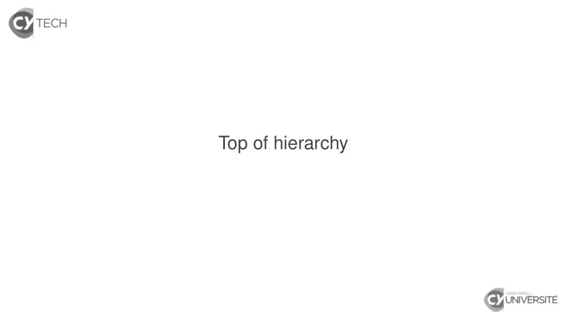

~~~text
Top of hierarchy
~~~

**Lecture OCR à contrôler**

~~~text
& TECH

Top of hierarchy

& UNIVERSITÉ
~~~

## Page 15

~~~text
   Scala collection library
                                         Iterable

                Seq                        Set                      Map

IndexedSeq    LinearSeq        SortedSet            BitSet       SortedMap           SeqMap

                                       (Source : Scala 2.13 Collection API Charts)

                          Djaouida Z AOUCHE, Romain D UJOL                      5
~~~

## Page 16

~~~text
   Scala collection library
                                            Iterable

                   Seq                        Set                      Map

IndexedSeq       LinearSeq        SortedSet            BitSet       SortedMap           SeqMap

                                          (Source : Scala 2.13 Collection API Charts)

        Prior versions : Traversable at top of hierarchy
         I introduced foreach[U](f : A => U) : Unit
             (now available in Iterable via IterableOnceOps)
         I removed in 2.13 due to underuse
                             Djaouida Z AOUCHE, Romain D UJOL                      5
~~~

## Page 17

~~~text
Scala collection hierarchy : Iterable

   Any Iterable has an iterator

                    Djaouida Z AOUCHE, Romain D UJOL   6
~~~

## Page 18

~~~text
Scala collection hierarchy : Iterable

   Any Iterable has an iterator
    I Iterator is accessible via method iterator.

                     Djaouida Z AOUCHE, Romain D UJOL   6
~~~

## Page 19

~~~text
Scala collection hierarchy : Iterable

   Any Iterable has an iterator
    I Iterator is accessible via method iterator.
    I An iterator is a mutable object with two important methods :

                      Djaouida Z AOUCHE, Romain D UJOL               6
~~~

## Page 20

~~~text
Scala collection hierarchy : Iterable

   Any Iterable has an iterator
    I Iterator is accessible via method iterator.
    I An iterator is a mutable object with two important methods :
        I hasNext checks if there is elements left in the iteration ;

                       Djaouida Z AOUCHE, Romain D UJOL                 6
~~~

## Page 21

~~~text
Scala collection hierarchy : Iterable

   Any Iterable has an iterator
    I Iterator is accessible via method iterator.
    I An iterator is a mutable object with two important methods :
        I hasNext checks if there is elements left in the iteration ;
        I next gives the next element (if exists).

                       Djaouida Z AOUCHE, Romain D UJOL                 6
~~~

## Page 22

~~~text
Scala collection hierarchy : Iterable

   Any Iterable has an iterator
    I Iterator is accessible via method iterator.
    I An iterator is a mutable object with two important methods :
          I hasNext checks if there is elements left in the iteration ;
          I next gives the next element (if exists).

   Example
   scala> List(1, 3, 5) foreach { x => println(s"Current element is $x") }
   Current element is 1
   Current element is 3
   Current element is 5

                         Djaouida Z AOUCHE, Romain D UJOL                 6
~~~

## Page 23

~~~text
Scala collection hierarchy : Iterable

   Any Iterable has an iterator
    I Iterator is accessible via method iterator.
    I An iterator is a mutable object with two important methods :
          I hasNext checks if there is elements left in the iteration ;
          I next gives the next element (if exists).

   Example
   scala> List(1, 3, 5) foreach { x => println(s"Current element is $x") }
   Current element is 1
   Current element is 3
   Current element is 5

   scala> val it = List(1, 3, 5).iterator
   it: Iterator[Int] = non-empty iterator

   scala> while (it.hasNext) println(s"Current element is ${it.next()})
   Current element is 1
   Current element is 3
   Current element is 5

                         Djaouida Z AOUCHE, Romain D UJOL                 6
~~~

## Page 24

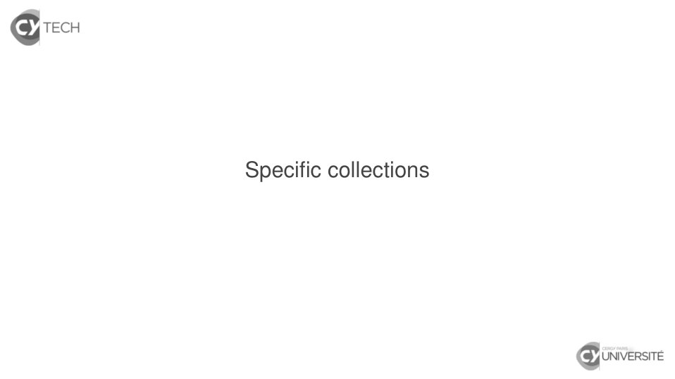

~~~text
Specific collections
~~~

**Lecture OCR à contrôler**

~~~text
& TECH

Specific collections

& UNIVERSITÉ
~~~

## Page 25

~~~text
Specific collections
        Seq
~~~

**Lecture OCR à contrôler**

~~~text
& TECH

Specific collections

Seq

& UNIVERSITÉ
~~~

## Page 26

~~~text
Scala collection hierarchy : Seq[+T]

   Base trait for sequences

                     Djaouida Z AOUCHE, Romain D UJOL   9
~~~

## Page 27

~~~text
Scala collection hierarchy : Seq[+T]

   Base trait for sequences
    I As name suggests, a sequence is an ordered collection.

                     Djaouida Z AOUCHE, Romain D UJOL          9
~~~

## Page 28

~~~text
Scala collection hierarchy : Seq[+T]

   Base trait for sequences
    I As name suggests, a sequence is an ordered collection.
    I Type parameter is covariant.

                     Djaouida Z AOUCHE, Romain D UJOL          9
~~~

## Page 29

~~~text
Scala collection hierarchy : Seq[+T]

   Base trait for sequences
    I As name suggests, a sequence is an ordered collection.
    I Type parameter is covariant.
    I Main methods : head, tail, apply, length
       + update (for mutable sequences)

                     Djaouida Z AOUCHE, Romain D UJOL          9
~~~

## Page 30

~~~text
Scala collection hierarchy : Seq[+T]

   Base trait for sequences
    I As name suggests, a sequence is an ordered collection.
    I Type parameter is covariant.
    I Main methods : head, tail, apply, length
       + update (for mutable sequences)
    I Default implementation : List

                     Djaouida Z AOUCHE, Romain D UJOL          9
~~~

## Page 31

~~~text
Scala collection hierarchy : Seq[+T]

   Base trait for sequences
    I As name suggests, a sequence is an ordered collection.
    I Type parameter is covariant.
    I Main methods : head, tail, apply, length
       + update (for mutable sequences)
    I Default implementation : List
   Two main subtraits

                     Djaouida Z AOUCHE, Romain D UJOL          9
~~~

## Page 32

~~~text
Scala collection hierarchy : Seq[+T]

   Base trait for sequences
    I As name suggests, a sequence is an ordered collection.
    I Type parameter is covariant.
    I Main methods : head, tail, apply, length
       + update (for mutable sequences)
    I Default implementation : List
   Two main subtraits
    I IndexedSeq[T] for sequences with fast random access, i.e.
       efficient methods apply and length

                     Djaouida Z AOUCHE, Romain D UJOL             9
~~~

## Page 33

~~~text
Scala collection hierarchy : Seq[+T]

   Base trait for sequences
    I As name suggests, a sequence is an ordered collection.
    I Type parameter is covariant.
    I Main methods : head, tail, apply, length
       + update (for mutable sequences)
    I Default implementation : List
   Two main subtraits
    I IndexedSeq[T] for sequences with fast random access, i.e.
       efficient methods apply and length
         I Default implementation : Vector[T]

                      Djaouida Z AOUCHE, Romain D UJOL            9
~~~

## Page 34

~~~text
Scala collection hierarchy : Seq[+T]

   Base trait for sequences
    I As name suggests, a sequence is an ordered collection.
    I Type parameter is covariant.
    I Main methods : head, tail, apply, length
       + update (for mutable sequences)
    I Default implementation : List
   Two main subtraits
    I IndexedSeq[T] for sequences with fast random access, i.e.
       efficient methods apply and length
         I Default implementation : Vector[T]
    I LinearSeq[T] for sequences with linear random access, i.e.
       efficient methods head and tail

                      Djaouida Z AOUCHE, Romain D UJOL            9
~~~

## Page 35

~~~text
Scala collection hierarchy : Seq[+T]

   Base trait for sequences
    I As name suggests, a sequence is an ordered collection.
    I Type parameter is covariant.
    I Main methods : head, tail, apply, length
       + update (for mutable sequences)
    I Default implementation : List
   Two main subtraits
    I IndexedSeq[T] for sequences with fast random access, i.e.
       efficient methods apply and length
         I Default implementation : Vector[T]
    I LinearSeq[T] for sequences with linear random access, i.e.
       efficient methods head and tail
         I Default implementation : List[T]

                      Djaouida Z AOUCHE, Romain D UJOL            9
~~~

## Page 36

~~~text
Scala collection hierarchy : Seq[+T]

   Base trait for sequences
    I As name suggests, a sequence is an ordered collection.
    I Type parameter is covariant.
    I Main methods : head, tail, apply, length
       + update (for mutable sequences)
    I Default implementation : List
   Two main subtraits
    I IndexedSeq[T] for sequences with fast random access, i.e.
       efficient methods apply and length
         I Default implementation : Vector[T]
    I LinearSeq[T] for sequences with linear random access, i.e.
       efficient methods head and tail
         I Default implementation : List[T]
         I Other implementations : Queue[T], LazyList[T]

                      Djaouida Z AOUCHE, Romain D UJOL            9
~~~

## Page 37

~~~text
Scala collection hierarchy : Seq[+T]

   Base trait for sequences
    I As name suggests, a sequence is an ordered collection.
    I Type parameter is covariant.
    I Main methods : head, tail, apply, length
       + update (for mutable sequences)
    I Default implementation : List
   Two main subtraits
    I IndexedSeq[T] for sequences with fast random access, i.e.
       efficient methods apply and length
         I Default implementation : Vector[T]
    I LinearSeq[T] for sequences with linear random access, i.e.
       efficient methods head and tail
         I Default implementation : List[T]
         I Other implementations : Queue[T], LazyList[T]
   NB: In Scala, any String object is implicitly seen as a Seq[Char].
                      Djaouida Z AOUCHE, Romain D UJOL              9
~~~

## Page 38

~~~text
Scala collection hierarchy : Seq[+T]
   Example
   scala> Seq.empty (ou Seq())
   res0: Seq[Nothing] = List()

                     Djaouida Z AOUCHE, Romain D UJOL   10
~~~

## Page 39

~~~text
Scala collection hierarchy : Seq[+T]
   Example
   scala> Seq.empty (ou Seq())
   res0: Seq[Nothing] = List()

   scala> val s = Seq(5, 1, 3, 1)
   s: Seq[Int] = List(5, 1, 3, 1)

                     Djaouida Z AOUCHE, Romain D UJOL   10
~~~

## Page 40

~~~text
Scala collection hierarchy : Seq[+T]
   Example
   scala> Seq.empty (ou Seq())
   res0: Seq[Nothing] = List()

   scala> val s = Seq(5, 1, 3, 1)
   s: Seq[Int] = List(5, 1, 3, 1)

   scala> s.length
   res1: Int = 4

                     Djaouida Z AOUCHE, Romain D UJOL   10
~~~

## Page 41

~~~text
Scala collection hierarchy : Seq[+T]
   Example
   scala> Seq.empty (ou Seq())
   res0: Seq[Nothing] = List()

   scala> val s = Seq(5, 1, 3, 1)
   s: Seq[Int] = List(5, 1, 3, 1)

   scala> s.length
   res1: Int = 4

   scala> s.head
   res2: Int = 5

                     Djaouida Z AOUCHE, Romain D UJOL   10
~~~

## Page 42

~~~text
Scala collection hierarchy : Seq[+T]
   Example
   scala> Seq.empty (ou Seq())
   res0: Seq[Nothing] = List()

   scala> val s = Seq(5, 1, 3, 1)
   s: Seq[Int] = List(5, 1, 3, 1)

   scala> s.length
   res1: Int = 4

   scala> s.head
   res2: Int = 5

   scala> s.tail
   res3: Seq[Int] = List(1, 3, 1)

                     Djaouida Z AOUCHE, Romain D UJOL   10
~~~

## Page 43

~~~text
Scala collection hierarchy : Seq[+T]
   Example
   scala> Seq.empty (ou Seq())
   res0: Seq[Nothing] = List()

   scala> val s = Seq(5, 1, 3, 1)
   s: Seq[Int] = List(5, 1, 3, 1)

   scala> s.length
   res1: Int = 4

   scala> s.head
   res2: Int = 5

   scala> s.tail
   res3: Seq[Int] = List(1, 3, 1)

   scala> s(1) (shortcut for s.apply(1))
   res4: Int = 1 (WARNING ! Indexing starts at 0)

                        Djaouida Z AOUCHE, Romain D UJOL   10
~~~

## Page 44

~~~text
Scala collection hierarchy : Seq[+T]
   Example
   scala> Seq.empty (ou Seq())
   res0: Seq[Nothing] = List()

   scala> val s = Seq(5, 1, 3, 1)
   s: Seq[Int] = List(5, 1, 3, 1)

   scala> s.length
   res1: Int = 4

   scala> s.head
   res2: Int = 5

   scala> s.tail
   res3: Seq[Int] = List(1, 3, 1)

   scala> s(1) (shortcut for s.apply(1))
   res4: Int = 1 (WARNING ! Indexing starts at 0)

   scala> s == Seq(1, 1, 3, 5)
   res5: Boolean = false
                        Djaouida Z AOUCHE, Romain D UJOL   10
~~~

## Page 45

~~~text
Scala collection hierarchy : Seq[+T]

   Sequence operators

                  Djaouida Z AOUCHE, Romain D UJOL   11
~~~

## Page 46

~~~text
Scala collection hierarchy : Seq[+T]

   Sequence operators
    I ++ : concatenation

                    Djaouida Z AOUCHE, Romain D UJOL   11
~~~

## Page 47

~~~text
Scala collection hierarchy : Seq[+T]

   Sequence operators
    I ++ : concatenation
    I :+ / +: : append/prepend element
      Hint: COLon (:) is on the COLlection side

                    Djaouida Z AOUCHE, Romain D UJOL   11
~~~

## Page 48

~~~text
Scala collection hierarchy : Seq[+T]

   Sequence operators
    I ++ : concatenation
    I :+ / +: : append/prepend element
      Hint: COLon (:) is on the COLlection side
    I reverse : mirror sequence

                    Djaouida Z AOUCHE, Romain D UJOL   11
~~~

## Page 49

~~~text
Scala collection hierarchy : Seq[+T]

   Sequence operators
    I ++ : concatenation
    I :+ / +: : append/prepend element
        Hint: COLon (:) is on the COLlection side
    I reverse : mirror sequence

   Example
   scala> Seq(5, 1, 3) ++ Seq(1, 4)
   res0: Seq[Int] = List(5, 1, 3, 1, 4)

                       Djaouida Z AOUCHE, Romain D UJOL   11
~~~

## Page 50

~~~text
Scala collection hierarchy : Seq[+T]

   Sequence operators
    I ++ : concatenation
    I :+ / +: : append/prepend element
        Hint: COLon (:) is on the COLlection side
    I reverse : mirror sequence

   Example
   scala> Seq(5, 1, 3) ++ Seq(1, 4)
   res0: Seq[Int] = List(5, 1, 3, 1, 4)

   scala> Seq(5, 1, 3) :+ 1
   res1: Seq[Int] = List(5, 1, 3, 1)

                       Djaouida Z AOUCHE, Romain D UJOL   11
~~~

## Page 51

~~~text
Scala collection hierarchy : Seq[+T]

   Sequence operators
    I ++ : concatenation
    I :+ / +: : append/prepend element
        Hint: COLon (:) is on the COLlection side
    I reverse : mirror sequence

   Example
   scala> Seq(5, 1, 3) ++ Seq(1, 4)
   res0: Seq[Int] = List(5, 1, 3, 1, 4)

   scala> Seq(5, 1, 3) :+ 1
   res1: Seq[Int] = List(5, 1, 3, 1)

   scala> 2 +: Seq(5, 1, 3)
   res1: Seq[Int] = List(2, 5, 1, 3)

                       Djaouida Z AOUCHE, Romain D UJOL   11
~~~

## Page 52

~~~text
Scala collection hierarchy : Seq[+T]

   Sequence operators
    I ++ : concatenation
    I :+ / +: : append/prepend element
        Hint: COLon (:) is on the COLlection side
    I reverse : mirror sequence

   Example
   scala> Seq(5, 1, 3) ++ Seq(1, 4)
   res0: Seq[Int] = List(5, 1, 3, 1, 4)

   scala> Seq(5, 1, 3) :+ 1
   res1: Seq[Int] = List(5, 1, 3, 1)

   scala> 2 +: Seq(5, 1, 3)
   res1: Seq[Int] = List(2, 5, 1, 3)

   scala> Seq(5, 1, 3).reverse
   res2: Seq[Int] = List(3, 1, 5)

                       Djaouida Z AOUCHE, Romain D UJOL   11
~~~

## Page 53

~~~text
Specific collections
        Set
~~~

**Lecture OCR à contrôler**

~~~text
& TECH

Specific collections

Set

& UNIVERSITÉ
~~~

## Page 54

~~~text
Scala collection hierarchy : Set[T]
   Base trait for sets

                         Djaouida Z AOUCHE, Romain D UJOL   13
~~~

## Page 55

~~~text
Scala collection hierarchy : Set[T]
   Base trait for sets
    I As name suggests, a set is an unordered collection with no
       duplicates.

                         Djaouida Z AOUCHE, Romain D UJOL      13
~~~

## Page 56

~~~text
Scala collection hierarchy : Set[T]
   Base trait for sets
    I As name suggests, a set is an unordered collection with no
       duplicates.
    I Type parameter is invariant.

                         Djaouida Z AOUCHE, Romain D UJOL      13
~~~

## Page 57

~~~text
Scala collection hierarchy : Set[T]
   Base trait for sets
    I As name suggests, a set is an unordered collection with no
       duplicates.
    I Type parameter is invariant.
    I Main methods : contains, diff
       + addOne, subtractOne (for mutable sets)

                         Djaouida Z AOUCHE, Romain D UJOL      13
~~~

## Page 58

~~~text
Scala collection hierarchy : Set[T]
   Base trait for sets
    I As name suggests, a set is an unordered collection with no
       duplicates.
    I Type parameter is invariant.
    I Main methods : contains, diff
       + addOne, subtractOne (for mutable sets)
    I Default implementation : HashSet[T]

                         Djaouida Z AOUCHE, Romain D UJOL      13
~~~

## Page 59

~~~text
Scala collection hierarchy : Set[T]
   Base trait for sets
    I As name suggests, a set is an unordered collection with no
       duplicates.
    I Type parameter is invariant.
    I Main methods : contains, diff
       + addOne, subtractOne (for mutable sets)
    I Default implementation : HashSet[T]
    I Subtrait SortedSet[T] is designed for sorted sets.
       Default implementation : TreeSet[T]

                         Djaouida Z AOUCHE, Romain D UJOL      13
~~~

## Page 60

~~~text
Scala collection hierarchy : Set[T]
   Base trait for sets
    I As name suggests, a set is an unordered collection with no
       duplicates.
    I Type parameter is invariant.
    I Main methods : contains, diff
       + addOne, subtractOne (for mutable sets)
    I Default implementation : HashSet[T]
    I Subtrait SortedSet[T] is designed for sorted sets.
       Default implementation : TreeSet[T]

   Set operators

                         Djaouida Z AOUCHE, Romain D UJOL      13
~~~

## Page 61

~~~text
Scala collection hierarchy : Set[T]
   Base trait for sets
    I As name suggests, a set is an unordered collection with no
       duplicates.
    I Type parameter is invariant.
    I Main methods : contains, diff
       + addOne, subtractOne (for mutable sets)
    I Default implementation : HashSet[T]
    I Subtrait SortedSet[T] is designed for sorted sets.
       Default implementation : TreeSet[T]

   Set operators
    I ++ : set union

                         Djaouida Z AOUCHE, Romain D UJOL      13
~~~

## Page 62

~~~text
Scala collection hierarchy : Set[T]
   Base trait for sets
    I As name suggests, a set is an unordered collection with no
       duplicates.
    I Type parameter is invariant.
    I Main methods : contains, diff
       + addOne, subtractOne (for mutable sets)
    I Default implementation : HashSet[T]
    I Subtrait SortedSet[T] is designed for sorted sets.
       Default implementation : TreeSet[T]

   Set operators
    I ++ : set union
    I & : set intersection

                         Djaouida Z AOUCHE, Romain D UJOL      13
~~~

## Page 63

~~~text
Scala collection hierarchy : Set[T]
   Base trait for sets
    I As name suggests, a set is an unordered collection with no
       duplicates.
    I Type parameter is invariant.
    I Main methods : contains, diff
       + addOne, subtractOne (for mutable sets)
    I Default implementation : HashSet[T]
    I Subtrait SortedSet[T] is designed for sorted sets.
       Default implementation : TreeSet[T]

   Set operators
    I ++ : set union
    I & : set intersection
    I &~ : set difference

                         Djaouida Z AOUCHE, Romain D UJOL      13
~~~

## Page 64

~~~text
Scala collection hierarchy : Set[T]
   Base trait for sets
    I As name suggests, a set is an unordered collection with no
       duplicates.
    I Type parameter is invariant.
    I Main methods : contains, diff
       + addOne, subtractOne (for mutable sets)
    I Default implementation : HashSet[T]
    I Subtrait SortedSet[T] is designed for sorted sets.
       Default implementation : TreeSet[T]

   Set operators
    I ++ : set union
    I & : set intersection
    I &~ : set difference
    I apply : equivalent for contains
                         Djaouida Z AOUCHE, Romain D UJOL      13
~~~

## Page 65

~~~text
Scala collection hierarchy : Set[T]
   Example
   scala> val s = Set(5, 1, 3, 1)
   s: scala.collection.immutable.Set[Int] = Set(5, 1, 3)

                     Djaouida Z AOUCHE, Romain D UJOL      14
~~~

## Page 66

~~~text
Scala collection hierarchy : Set[T]
   Example
   scala> val s = Set(5, 1, 3, 1)
   s: scala.collection.immutable.Set[Int] = Set(5, 1, 3)

   scala> s contains 4
   res0: Boolean = false

                     Djaouida Z AOUCHE, Romain D UJOL      14
~~~

## Page 67

~~~text
Scala collection hierarchy : Set[T]
   Example
   scala> val s = Set(5, 1, 3, 1)
   s: scala.collection.immutable.Set[Int] = Set(5, 1, 3)

   scala> s contains 4
   res0: Boolean = false

   scala> s ++ Set(2, 3, 4)
   res1: scala.collection.immutable.Set[Int] = Set(5, 1, 2, 3, 4)

                     Djaouida Z AOUCHE, Romain D UJOL           14
~~~

## Page 68

~~~text
Scala collection hierarchy : Set[T]
   Example
   scala> val s = Set(5, 1, 3, 1)
   s: scala.collection.immutable.Set[Int] = Set(5, 1, 3)

   scala> s contains 4
   res0: Boolean = false

   scala> s ++ Set(2, 3, 4)
   res1: scala.collection.immutable.Set[Int] = Set(5, 1, 2, 3, 4)

   scala> s & Set(2,3,4)
   res2: scala.collection.immutable.Set[Int] = Set(3)

                     Djaouida Z AOUCHE, Romain D UJOL           14
~~~

## Page 69

~~~text
Scala collection hierarchy : Set[T]
   Example
   scala> val s = Set(5, 1, 3, 1)
   s: scala.collection.immutable.Set[Int] = Set(5, 1, 3)

   scala> s contains 4
   res0: Boolean = false

   scala> s ++ Set(2, 3, 4)
   res1: scala.collection.immutable.Set[Int] = Set(5, 1, 2, 3, 4)

   scala> s & Set(2,3,4)
   res2: scala.collection.immutable.Set[Int] = Set(3)

   scala> s &~ Set(2,3,4)
   res3: scala.collection.immutable.Set[Int] = Set(1, 5)

                     Djaouida Z AOUCHE, Romain D UJOL           14
~~~

## Page 70

~~~text
Scala collection hierarchy : Set[T]
   Example
   scala> val s = Set(5, 1, 3, 1)
   s: scala.collection.immutable.Set[Int] = Set(5, 1, 3)

   scala> s contains 4
   res0: Boolean = false

   scala> s ++ Set(2, 3, 4)
   res1: scala.collection.immutable.Set[Int] = Set(5, 1, 2, 3, 4)

   scala> s & Set(2,3,4)
   res2: scala.collection.immutable.Set[Int] = Set(3)

   scala> s &~ Set(2,3,4)
   res3: scala.collection.immutable.Set[Int] = Set(1, 5)

   scala> s == Set(1, 3, 5)
   res4: Boolean = true

                     Djaouida Z AOUCHE, Romain D UJOL           14
~~~

## Page 71

~~~text
Scala collection hierarchy : Set[T]
   Example
   scala> val s = Set(5, 1, 3, 1)
   s: scala.collection.immutable.Set[Int] = Set(5, 1, 3)

   scala> s contains 4
   res0: Boolean = false

   scala> s ++ Set(2, 3, 4)
   res1: scala.collection.immutable.Set[Int] = Set(5, 1, 2, 3, 4)

   scala> s & Set(2,3,4)
   res2: scala.collection.immutable.Set[Int] = Set(3)

   scala> s &~ Set(2,3,4)
   res3: scala.collection.immutable.Set[Int] = Set(1, 5)

   scala> s == Set(1, 3, 5)
   res4: Boolean = true

   scala> s(1) (shortcut for s.apply(1))
   res5: Boolean = true
                        Djaouida Z AOUCHE, Romain D UJOL        14
~~~

## Page 72

~~~text
Scala collection hierarchy : Set[T]
   Empty set Set.empty

                  Djaouida Z AOUCHE, Romain D UJOL   15
~~~

## Page 73

~~~text
Scala collection hierarchy : Set[T]
   Empty set Set.empty
    I Since parameter type is invariant, Set[Nothing] is not a
      subtype of Set[T].

                     Djaouida Z AOUCHE, Romain D UJOL            15
~~~

## Page 74

~~~text
Scala collection hierarchy : Set[T]
   Empty set Set.empty
    I Since parameter type is invariant, Set[Nothing] is not a
      subtype of Set[T].
    I So exact type of elements must be known beforehand.

                     Djaouida Z AOUCHE, Romain D UJOL            15
~~~

## Page 75

~~~text
Scala collection hierarchy : Set[T]
   Empty set Set.empty
    I Since parameter type is invariant, Set[Nothing] is not a
        subtype of Set[T].
    I So exact type of elements must be known beforehand.

   Example
   scala> val emptySet = Set.empty (ou Set())
   emptySet: scala.collection.immutable.Set[Nothing] = Set()

   scala> emptySet + 1
   <console>:13: error: type mismatch;
    found   : Int(1)
    required: Nothing
          emptySet + 1
                     ^

                       Djaouida Z AOUCHE, Romain D UJOL          15
~~~

## Page 76

~~~text
Scala collection hierarchy : Set[T]
   Empty set Set.empty
    I Since parameter type is invariant, Set[Nothing] is not a
        subtype of Set[T].
    I So exact type of elements must be known beforehand.

   Example
   scala> val emptySet = Set.empty (ou Set())
   emptySet: scala.collection.immutable.Set[Nothing] = Set()

   scala> emptySet + 1
   <console>:13: error: type mismatch;
    found   : Int(1)
    required: Nothing
          emptySet + 1
                     ^

   scala> val emptySet = Set.empty[Int] (ou Set[Int]())
   emptySet: scala.collection.immutable.Set[Int] = Set()

   scala> emptySet + 1
   res0: scala.collection.immutable.Set[Int] = Set(1)
                       Djaouida Z AOUCHE, Romain D UJOL          15
~~~

## Page 77

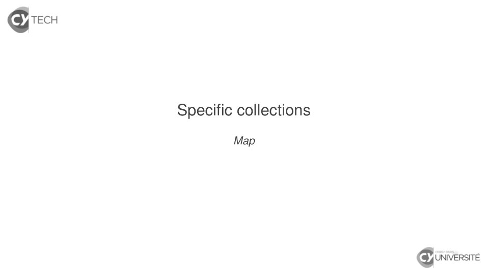

~~~text
Specific collections
        Map
~~~

**Lecture OCR à contrôler**

~~~text
& TECH

Specific collections

Map

& UNIVERSITÉ
~~~

## Page 78

~~~text
Scala collection hierarchy : Map[K, +V]

   Base trait for maps

                    Djaouida Z AOUCHE, Romain D UJOL   17
~~~

## Page 79

~~~text
Scala collection hierarchy : Map[K, +V]

   Base trait for maps
    I Type parameter for keys is invariant.

                     Djaouida Z AOUCHE, Romain D UJOL   17
~~~

## Page 80

~~~text
Scala collection hierarchy : Map[K, +V]

   Base trait for maps
    I Type parameter for keys is invariant.
    I Type parameter for values is covariant.

                     Djaouida Z AOUCHE, Romain D UJOL   17
~~~

## Page 81

~~~text
Scala collection hierarchy : Map[K, +V]

   Base trait for maps
    I Type parameter for keys is invariant.
    I Type parameter for values is covariant.
    I Main methods : get, removed
       + addOne, subtractOne (for mutable maps)

                     Djaouida Z AOUCHE, Romain D UJOL   17
~~~

## Page 82

~~~text
Scala collection hierarchy : Map[K, +V]

   Base trait for maps
    I Type parameter for keys is invariant.
    I Type parameter for values is covariant.
    I Main methods : get, removed
       + addOne, subtractOne (for mutable maps)
    I Default implementation : HashMap

                     Djaouida Z AOUCHE, Romain D UJOL   17
~~~

## Page 83

~~~text
Scala collection hierarchy : Map[K, +V]

   Base trait for maps
    I Type parameter for keys is invariant.
    I Type parameter for values is covariant.
    I Main methods : get, removed
       + addOne, subtractOne (for mutable maps)
    I Default implementation : HashMap

   Subtraits

                     Djaouida Z AOUCHE, Romain D UJOL   17
~~~

## Page 84

~~~text
Scala collection hierarchy : Map[K, +V]

   Base trait for maps
    I Type parameter for keys is invariant.
    I Type parameter for values is covariant.
    I Main methods : get, removed
       + addOne, subtractOne (for mutable maps)
    I Default implementation : HashMap

   Subtraits
    I SeqMap[K, V] for maps as sequences of key/value
       mappings (version 2.13 only)

                     Djaouida Z AOUCHE, Romain D UJOL   17
~~~

## Page 85

~~~text
Scala collection hierarchy : Map[K, +V]

   Base trait for maps
    I Type parameter for keys is invariant.
    I Type parameter for values is covariant.
    I Main methods : get, removed
       + addOne, subtractOne (for mutable maps)
    I Default implementation : HashMap

   Subtraits
    I SeqMap[K, V] for maps as sequences of key/value
       mappings (version 2.13 only)
        I Default implementation : VectorMap[K, V]

                     Djaouida Z AOUCHE, Romain D UJOL   17
~~~

## Page 86

~~~text
Scala collection hierarchy : Map[K, +V]

   Base trait for maps
    I Type parameter for keys is invariant.
    I Type parameter for values is covariant.
    I Main methods : get, removed
       + addOne, subtractOne (for mutable maps)
    I Default implementation : HashMap

   Subtraits
    I SeqMap[K, V] for maps as sequences of key/value
       mappings (version 2.13 only)
        I Default implementation : VectorMap[K, V]
    I SortedMap for maps ordered with respect to keys

                     Djaouida Z AOUCHE, Romain D UJOL   17
~~~

## Page 87

~~~text
Scala collection hierarchy : Map[K, +V]

   Base trait for maps
    I Type parameter for keys is invariant.
    I Type parameter for values is covariant.
    I Main methods : get, removed
       + addOne, subtractOne (for mutable maps)
    I Default implementation : HashMap

   Subtraits
    I SeqMap[K, V] for maps as sequences of key/value
       mappings (version 2.13 only)
        I Default implementation : VectorMap[K, V]
    I SortedMap for maps ordered with respect to keys
         I Default implementation : TreeMap[K, V]

                     Djaouida Z AOUCHE, Romain D UJOL   17
~~~

## Page 88

~~~text
Scala collection hierarchy : Map[K, +V]

   Example
   scala> val m = Map("dze" -> "Cergy", "rdl" -> "Pau")
   m: scala.collection.immutable.Map[String, String]
      = Map(dze -> Cergy, rdl -> Pau)

                       Djaouida Z AOUCHE, Romain D UJOL   18
~~~

## Page 89

~~~text
Scala collection hierarchy : Map[K, +V]

   Example
   scala> val m = Map("dze" -> "Cergy", "rdl" -> "Pau")
   m: scala.collection.immutable.Map[String, String]
      = Map(dze -> Cergy, rdl -> Pau)

   scala> m("rdl")
   res0: String = Pau

                        Djaouida Z AOUCHE, Romain D UJOL   18
~~~

## Page 90

~~~text
Scala collection hierarchy : Map[K, +V]

   Example
   scala> val m = Map("dze" -> "Cergy", "rdl" -> "Pau")
   m: scala.collection.immutable.Map[String, String]
      = Map(dze -> Cergy, rdl -> Pau)

   scala> m("rdl")
   res0: String = Pau

   scala> m("bge")
   java.util.NoSuchElementException: key not found: bge
     at scala.collection.immutable.Map$Map2.apply(Map.scala:298)
     ... 40 elided

                        Djaouida Z AOUCHE, Romain D UJOL           18
~~~

## Page 91

~~~text
Scala collection hierarchy : Map[K, +V]

   Example
   scala> val m = Map("dze" -> "Cergy", "rdl" -> "Pau")
   m: scala.collection.immutable.Map[String, String]
      = Map(dze -> Cergy, rdl -> Pau)

   scala> m("rdl")
   res0: String = Pau

   scala> m("bge")
   java.util.NoSuchElementException: key not found: bge
     at scala.collection.immutable.Map$Map2.apply(Map.scala:298)
     ... 40 elided

   scala> m.get("bge")
   res1: Option[String] = None

                        Djaouida Z AOUCHE, Romain D UJOL           18
~~~

## Page 92

~~~text
Scala collection hierarchy : Map[K, +V]

   Example
   scala> val m = Map("dze" -> "Cergy", "rdl" -> "Pau")
   m: scala.collection.immutable.Map[String, String]
      = Map(dze -> Cergy, rdl -> Pau)

   scala> m("rdl")
   res0: String = Pau

   scala> m("bge")
   java.util.NoSuchElementException: key not found: bge
     at scala.collection.immutable.Map$Map2.apply(Map.scala:298)
     ... 40 elided

   scala> m.get("bge")
   res1: Option[String] = None

   scala> val m1 = m + ("bge" -> "Cergy")
   m1 : scala.collection.immutable.Map[String, String]
        = Map(dze -> Cergy, rdl -> Pau, bge -> Cergy)

                        Djaouida Z AOUCHE, Romain D UJOL           18
~~~

## Page 93

~~~text
Scala collection hierarchy : Map[K, +V]

   Example
   scala> val m = Map("dze" -> "Cergy", "rdl" -> "Pau")
   m: scala.collection.immutable.Map[String, String]
      = Map(dze -> Cergy, rdl -> Pau)

   scala> m("rdl")
   res0: String = Pau

   scala> m("bge")
   java.util.NoSuchElementException: key not found: bge
     at scala.collection.immutable.Map$Map2.apply(Map.scala:298)
     ... 40 elided

   scala> m.get("bge")
   res1: Option[String] = None

   scala> val m1 = m + ("bge" -> "Cergy")
   m1 : scala.collection.immutable.Map[String, String]
        = Map(dze -> Cergy, rdl -> Pau, bge -> Cergy)

   scala> m1 - "rdl"
   res2 : scala.collection.immutable.Map[String, String]
          = Map(dze -> Cergy, bge -> Cergy)

                        Djaouida Z AOUCHE, Romain D UJOL           18
~~~

## Page 94

~~~text
Scala collection hierarchy : Map[K, +V]
   Empty map Map.empty

                 Djaouida Z AOUCHE, Romain D UJOL   19
~~~

## Page 95

~~~text
Scala collection hierarchy : Map[K, +V]
   Empty map Map.empty
    I Since parameter type K is invariant, Map[Nothing,V] is not a
      subtype of Map[T,V].

                     Djaouida Z AOUCHE, Romain D UJOL           19
~~~

## Page 96

~~~text
Scala collection hierarchy : Map[K, +V]
   Empty map Map.empty
    I Since parameter type K is invariant, Map[Nothing,V] is not a
      subtype of Map[T,V].
    I So exact type of keys must be known beforehand.

                     Djaouida Z AOUCHE, Romain D UJOL           19
~~~

## Page 97

~~~text
Scala collection hierarchy : Map[K, +V]
   Empty map Map.empty
    I Since parameter type K is invariant, Map[Nothing,V] is not a
        subtype of Map[T,V].
    I So exact type of keys must be known beforehand.

   Example
   scala> val emptyMap = Map.empty (ou Map())
   emptySet: scala.collection.immutable.Map[Nothing,Nothing] = Map()

   scala> emptyMap + ("test" -> "failed")
   <console>:13: error: type mismatch;
    found   : (String, String)
    required: (Nothing, ?)
          emptyMap + ("test" -> "failed")
                             ^

                       Djaouida Z AOUCHE, Romain D UJOL                19
~~~

## Page 98

~~~text
Scala collection hierarchy : Map[K, +V]
   Empty map Map.empty
    I Since parameter type K is invariant, Map[Nothing,V] is not a
        subtype of Map[T,V].
    I So exact type of keys must be known beforehand.

   Example
   scala> val emptyMap = Map.empty (ou Map())
   emptySet: scala.collection.immutable.Map[Nothing,Nothing] = Map()

   scala> emptyMap + ("test" -> "failed")
   <console>:13: error: type mismatch;
    found   : (String, String)
    required: (Nothing, ?)
          emptyMap + ("test" -> "failed")
                             ^

   scala> val emptyMap = Map.empty[String, String]
   (ou Map[String, String]())
   emptySet: scala.collection.immutable.Map[String] = Map()

   scala> emptyMap + ("test" -> "success")
   res0: scala.collection.immutable.Map[String, String] = Map(test -> success)
                       Djaouida Z AOUCHE, Romain D UJOL                19
~~~

## Page 99

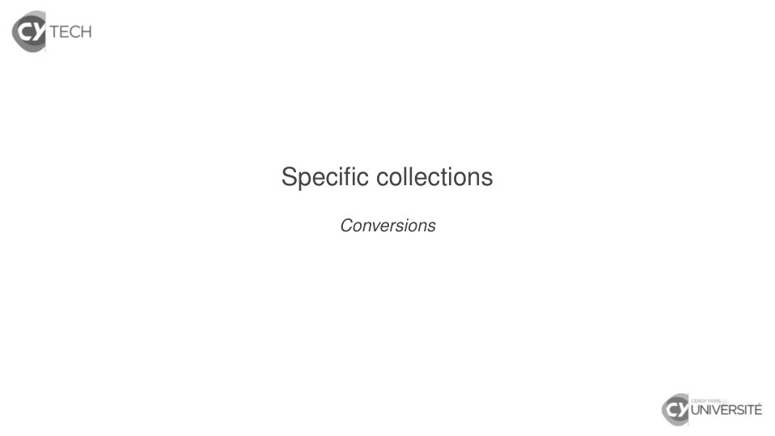

~~~text
Specific collections
     Conversions
~~~

**Lecture OCR à contrôler**

~~~text
& TECH

Specific collections

Conversions

& UNIVERSITÉ
~~~

## Page 100

~~~text
Scala collection hierarchy : conversions with to(_)

   Conversion Seq[T] ↔ Set[T]

                  Djaouida Z AOUCHE, Romain D UJOL    21
~~~

## Page 101

~~~text
Scala collection hierarchy : conversions with to(_)

   Conversion Seq[T] ↔ Set[T]
    I from sets to sequences : to(Seq)

                    Djaouida Z AOUCHE, Romain D UJOL   21
~~~

## Page 102

~~~text
Scala collection hierarchy : conversions with to(_)

   Conversion Seq[T] ↔ Set[T]
    I from sets to sequences : to(Seq)
        I to(IndexedSeq), to(Vector)

                    Djaouida Z AOUCHE, Romain D UJOL   21
~~~

## Page 103

~~~text
Scala collection hierarchy : conversions with to(_)

   Conversion Seq[T] ↔ Set[T]
    I from sets to sequences : to(Seq)
        I to(IndexedSeq), to(Vector)
        I to(LinearSeq), to(List)

                    Djaouida Z AOUCHE, Romain D UJOL   21
~~~

## Page 104

~~~text
Scala collection hierarchy : conversions with to(_)

   Conversion Seq[T] ↔ Set[T]
    I from sets to sequences : to(Seq)
        I to(IndexedSeq), to(Vector)
        I to(LinearSeq), to(List)
    I from sequences to sets : to(Set)

                    Djaouida Z AOUCHE, Romain D UJOL   21
~~~

## Page 105

~~~text
Scala collection hierarchy : conversions with to(_)

   Conversion Seq[T] ↔ Set[T]
    I from sets to sequences : to(Seq)
        I to(IndexedSeq), to(Vector)
        I to(LinearSeq), to(List)
    I from sequences to sets : to(Set)
        I to(SortedSet)

                    Djaouida Z AOUCHE, Romain D UJOL   21
~~~

## Page 106

~~~text
Scala collection hierarchy : conversions with to(_)

   Conversion Seq[T] ↔ Set[T]
    I from sets to sequences : to(Seq)
        I to(IndexedSeq), to(Vector)
        I to(LinearSeq), to(List)
    I from sequences to sets : to(Set)
        I to(SortedSet)

   Conversion Map[K, V] ↔ Seq[(K, V)] or Set[(K, V)]

                    Djaouida Z AOUCHE, Romain D UJOL   21
~~~

## Page 107

~~~text
Scala collection hierarchy : conversions with to(_)

   Conversion Seq[T] ↔ Set[T]
    I from sets to sequences : to(Seq)
        I to(IndexedSeq), to(Vector)
        I to(LinearSeq), to(List)
    I from sequences to sets : to(Set)
        I to(SortedSet)

   Conversion Map[K, V] ↔ Seq[(K, V)] or Set[(K, V)]
    I from maps to sequences/sets : same as above

                    Djaouida Z AOUCHE, Romain D UJOL   21
~~~

## Page 108

~~~text
Scala collection hierarchy : conversions with to(_)

   Conversion Seq[T] ↔ Set[T]
    I from sets to sequences : to(Seq)
        I to(IndexedSeq), to(Vector)
        I to(LinearSeq), to(List)
    I from sequences to sets : to(Set)
        I to(SortedSet)

   Conversion Map[K, V] ↔ Seq[(K, V)] or Set[(K, V)]
    I from maps to sequences/sets : same as above
    I from sets/sequences to maps : to(Map)

                    Djaouida Z AOUCHE, Romain D UJOL   21
~~~

## Page 109

~~~text
Scala collection hierarchy : conversions with to(_)

   Conversion Seq[T] ↔ Set[T]
    I from sets to sequences : to(Seq)
        I to(IndexedSeq), to(Vector)
        I to(LinearSeq), to(List)
    I from sequences to sets : to(Set)
        I to(SortedSet)

   Conversion Map[K, V] ↔ Seq[(K, V)] or Set[(K, V)]
    I from maps to sequences/sets : same as above
    I from sets/sequences to maps : to(Map)

   Syntax introduced in version 2.13

                    Djaouida Z AOUCHE, Romain D UJOL   21
~~~

## Page 110

~~~text
Scala collection hierarchy : conversions with to(_)

   Conversion Seq[T] ↔ Set[T]
    I from sets to sequences : to(Seq)
        I to(IndexedSeq), to(Vector)
        I to(LinearSeq), to(List)
    I from sequences to sets : to(Set)
        I to(SortedSet)

   Conversion Map[K, V] ↔ Seq[(K, V)] or Set[(K, V)]
    I from maps to sequences/sets : same as above
    I from sets/sequences to maps : to(Map)

   Syntax introduced in version 2.13
    I Old syntax : to[Seq], to[Set], to[Map], etc. . .

                     Djaouida Z AOUCHE, Romain D UJOL    21
~~~

## Page 111

~~~text
Scala collection hierarchy : conversions with to(_)

   Conversion Seq[T] ↔ Set[T]
    I from sets to sequences : to(Seq)
        I to(IndexedSeq), to(Vector)
        I to(LinearSeq), to(List)
    I from sequences to sets : to(Set)
        I to(SortedSet)

   Conversion Map[K, V] ↔ Seq[(K, V)] or Set[(K, V)]
    I from maps to sequences/sets : same as above
    I from sets/sequences to maps : to(Map)

   Syntax introduced in version 2.13
    I Old syntax : to[Seq], to[Set], to[Map], etc. . .
    I Other available syntax : toSeq, toSet, toMap, etc. . .
                     Djaouida Z AOUCHE, Romain D UJOL          21
~~~

## Page 112

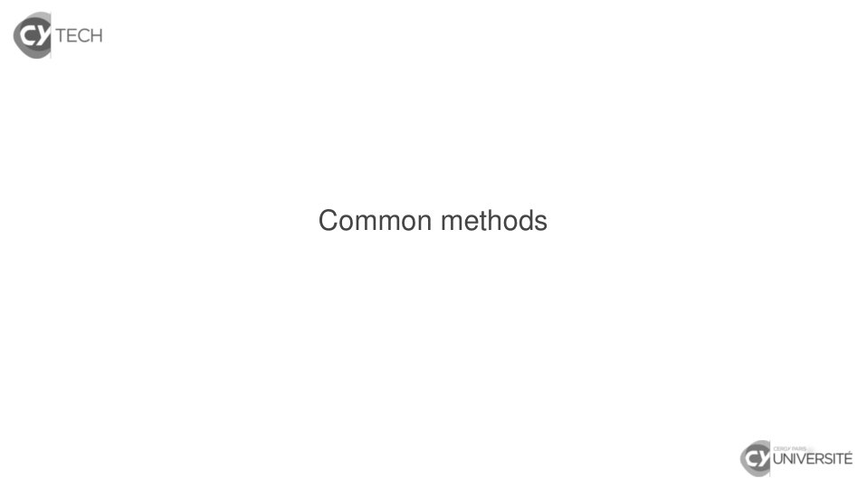

~~~text
Common methods
~~~

**Lecture OCR à contrôler**

~~~text
& TECH

Common methods

& UNIVERSITÉ
~~~

## Page 113

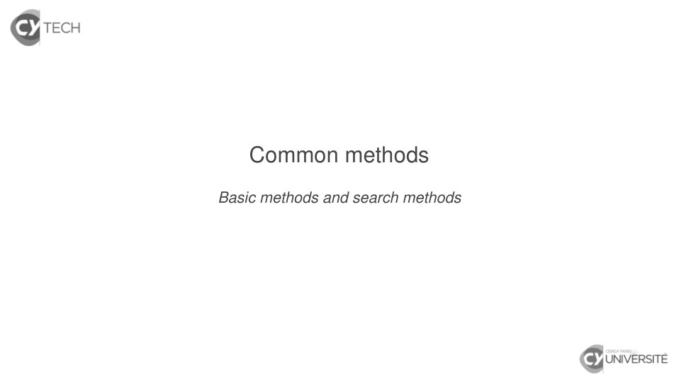

~~~text
    Common methods
Basic methods and search methods
~~~

**Lecture OCR à contrôler**

~~~text
S TECH

Common methods

Basic methods and search methods

& UNIVERSITÉ
~~~

## Page 114

~~~text
Common methods on Iterable[T]

  Simple methods

                   Djaouida Z AOUCHE, Romain D UJOL   24
~~~

## Page 115

~~~text
Common methods on Iterable[T]

  Simple methods
   I isEmpty and nonEmpty ≡ !isEmpty

                   Djaouida Z AOUCHE, Romain D UJOL   24
~~~

## Page 116

~~~text
Common methods on Iterable[T]

  Simple methods
   I isEmpty and nonEmpty ≡ !isEmpty
   I size (length is an alias of size for sequences)

                   Djaouida Z AOUCHE, Romain D UJOL    24
~~~

## Page 117

~~~text
Common methods on Iterable[T]

  Simple methods
   I isEmpty and nonEmpty ≡ !isEmpty
   I size (length is an alias of size for sequences)

  Search methods

                   Djaouida Z AOUCHE, Romain D UJOL    24
~~~

## Page 118

~~~text
Common methods on Iterable[T]

  Simple methods
   I isEmpty and nonEmpty ≡ !isEmpty
   I size (length is an alias of size for sequences)

  Search methods
   I exists(p : T => Boolean) : Boolean
     Checks if at least one element x satisfies p(x) == true

                   Djaouida Z AOUCHE, Romain D UJOL            24
~~~

## Page 119

~~~text
Common methods on Iterable[T]

  Simple methods
   I isEmpty and nonEmpty ≡ !isEmpty
   I size (length is an alias of size for sequences)

  Search methods
   I exists(p : T => Boolean) : Boolean
     Checks if at least one element x satisfies p(x) == true
   I forall(p : T => Boolean) : Boolean
     Checks if all elements x satisfy p(x) == true

                   Djaouida Z AOUCHE, Romain D UJOL            24
~~~

## Page 120

~~~text
Common methods on Iterable[T]

  Simple methods
   I isEmpty and nonEmpty ≡ !isEmpty
   I size (length is an alias of size for sequences)

  Search methods
   I exists(p : T => Boolean) : Boolean
     Checks if at least one element x satisfies p(x) == true
   I forall(p : T => Boolean) : Boolean
     Checks if all elements x satisfy p(x) == true
   I count(p : T => Boolean) : Boolean
     Counts number of elements satisfying p(x) == true

                   Djaouida Z AOUCHE, Romain D UJOL            24
~~~

## Page 121

~~~text
Common methods on Iterable[T]

  Simple methods
   I isEmpty and nonEmpty ≡ !isEmpty
   I size (length is an alias of size for sequences)

  Search methods
   I exists(p : T => Boolean) : Boolean
     Checks if at least one element x satisfies p(x) == true
   I forall(p : T => Boolean) : Boolean
     Checks if all elements x satisfy p(x) == true
   I count(p : T => Boolean) : Boolean
     Counts number of elements satisfying p(x) == true
   I find(p : T => Boolean) : Option[T]
     Find first element x satisfying p(x) == true
     (returns None if no such element is found)

                   Djaouida Z AOUCHE, Romain D UJOL            24
~~~

## Page 122

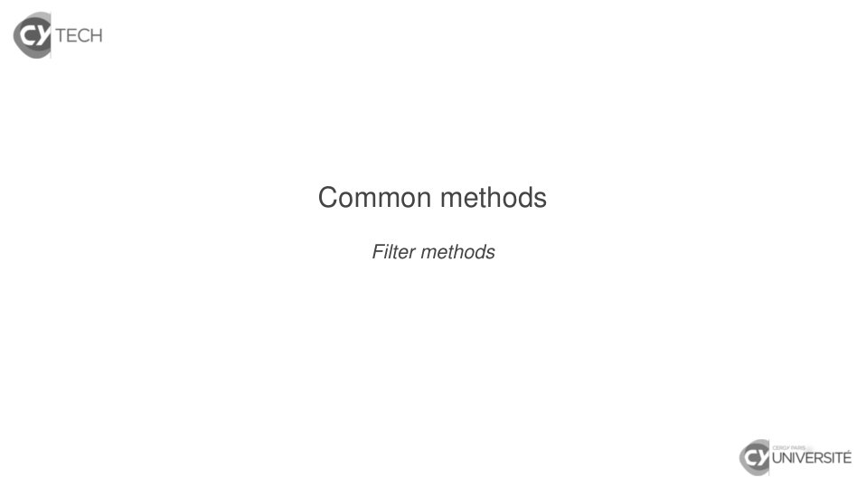

~~~text
Common methods
   Filter methods
~~~

**Lecture OCR à contrôler**

~~~text
& TECH

Common methods

Filter methods

& UNIVERSITÉ
~~~

## Page 123

~~~text
Filter methods on Iterable[T]
  Filter methods

                   Djaouida Z AOUCHE, Romain D UJOL   26
~~~

## Page 124

~~~text
Filter methods on Iterable[T]
  Filter methods
    I filter(p : T => Boolean)
      Returns subcollection of all elements x satisfying
      p(x) == true

                     Djaouida Z AOUCHE, Romain D UJOL      26
~~~

## Page 125

~~~text
Filter methods on Iterable[T]
  Filter methods
    I filter(p : T => Boolean)
      Returns subcollection of all elements x satisfying
      p(x) == true
    I filterNot(p : T => Boolean)
         ≡ filter(x => !p(x))

                     Djaouida Z AOUCHE, Romain D UJOL      26
~~~

## Page 126

~~~text
Filter methods on Iterable[T]
  Filter methods
    I filter(p : T => Boolean)
      Returns subcollection of all elements x satisfying
      p(x) == true
    I filterNot(p : T => Boolean)
         ≡ filter(x => !p(x))
    I partition(p : T => Boolean)
         ≡ (filter p, filterNot p)
      (more efficient than mere calls to filter and filterNot)

                     Djaouida Z AOUCHE, Romain D UJOL            26
~~~

## Page 127

~~~text
Filter methods on Iterable[T]
  Filter methods
    I filter(p : T => Boolean)
      Returns subcollection of all elements x satisfying
      p(x) == true
    I filterNot(p : T => Boolean)
         ≡ filter(x => !p(x))
    I partition(p : T => Boolean)
         ≡ (filter p, filterNot p)
      (more efficient than mere calls to filter and filterNot)

  Features

                     Djaouida Z AOUCHE, Romain D UJOL            26
~~~

## Page 128

~~~text
Filter methods on Iterable[T]
  Filter methods
    I filter(p : T => Boolean)
      Returns subcollection of all elements x satisfying
      p(x) == true
    I filterNot(p : T => Boolean)
         ≡ filter(x => !p(x))
    I partition(p : T => Boolean)
         ≡ (filter p, filterNot p)
      (more efficient than mere calls to filter and filterNot)

  Features
    I Type result is the same as actual type of input collection
      e.g. if called on List[T], result has type List[T]

                     Djaouida Z AOUCHE, Romain D UJOL            26
~~~

## Page 129

~~~text
Filter methods on Iterable[T]
  Filter methods
    I filter(p : T => Boolean)
       Returns subcollection of all elements x satisfying
       p(x) == true
    I filterNot(p : T => Boolean)
         ≡ filter(x => !p(x))
    I partition(p : T => Boolean)
         ≡ (filter p, filterNot p)
       (more efficient than mere calls to filter and filterNot)

  Features
    I Type result is the same as actual type of input collection
       e.g. if called on List[T], result has type List[T]
    I When called on ordered collections, relative order is
       preserved.
                      Djaouida Z AOUCHE, Romain D UJOL            26
~~~

## Page 130

~~~text
Common methods
 Extraction methods
~~~

**Lecture OCR à contrôler**

~~~text
& TECH

Common methods

Extraction methods

& UNIVERSITÉ
~~~

## Page 131

~~~text
Extraction methods on Iterable[T]

  Fixed extraction methods

                   Djaouida Z AOUCHE, Romain D UJOL   28
~~~

## Page 132

~~~text
Extraction methods on Iterable[T]

  Fixed extraction methods
    I take(n : Int) / takeRight(n : Int)
      Take first/last n elements of collection

                     Djaouida Z AOUCHE, Romain D UJOL   28
~~~

## Page 133

~~~text
Extraction methods on Iterable[T]

  Fixed extraction methods
    I take(n : Int) / takeRight(n : Int)
      Take first/last n elements of collection
    I drop(n : Int) / dropRight(n : Int)
      Drop first/last n elements of collection

                     Djaouida Z AOUCHE, Romain D UJOL   28
~~~

## Page 134

~~~text
Extraction methods on Iterable[T]

  Fixed extraction methods
    I take(n : Int) / takeRight(n : Int)
      Take first/last n elements of collection
    I drop(n : Int) / dropRight(n : Int)
      Drop first/last n elements of collection
    I splitAt(n : Int) ≡ (take n, drop n)
      (more efficient than mere calls to take and drop)

                     Djaouida Z AOUCHE, Romain D UJOL     28
~~~

## Page 135

~~~text
Extraction methods on Iterable[T]

  Fixed extraction methods
    I take(n : Int) / takeRight(n : Int)
      Take first/last n elements of collection
    I drop(n : Int) / dropRight(n : Int)
      Drop first/last n elements of collection
    I splitAt(n : Int) ≡ (take n, drop n)
      (more efficient than mere calls to take and drop)

  Features

                     Djaouida Z AOUCHE, Romain D UJOL     28
~~~

## Page 136

~~~text
Extraction methods on Iterable[T]

  Fixed extraction methods
    I take(n : Int) / takeRight(n : Int)
      Take first/last n elements of collection
    I drop(n : Int) / dropRight(n : Int)
      Drop first/last n elements of collection
    I splitAt(n : Int) ≡ (take n, drop n)
      (more efficient than mere calls to take and drop)

  Features
    I Type result is the same as actual type of input collection
      e.g. if called on List[T], result has type List[T]

                     Djaouida Z AOUCHE, Romain D UJOL          28
~~~

## Page 137

~~~text
Extraction methods on Iterable[T]

  Fixed extraction methods
    I take(n : Int) / takeRight(n : Int)
      Take first/last n elements of collection
    I drop(n : Int) / dropRight(n : Int)
      Drop first/last n elements of collection
    I splitAt(n : Int) ≡ (take n, drop n)
      (more efficient than mere calls to take and drop)

  Features
    I Type result is the same as actual type of input collection
      e.g. if called on List[T], result has type List[T]
    I When called on unordered collections, method is not
      guaranteed to be pure.

                     Djaouida Z AOUCHE, Romain D UJOL          28
~~~

## Page 138

~~~text
Extraction methods on Iterable[T]

  Conditional extraction methods

                   Djaouida Z AOUCHE, Romain D UJOL   29
~~~

## Page 139

~~~text
Extraction methods on Iterable[T]

  Conditional extraction methods
    I takeWhile(p : T => Boolean)
      Take elements while elements x satisfies p(x) == true

                   Djaouida Z AOUCHE, Romain D UJOL           29
~~~

## Page 140

~~~text
Extraction methods on Iterable[T]

  Conditional extraction methods
    I takeWhile(p : T => Boolean)
      Take elements while elements x satisfies p(x) == true
    I dropWhile(p : T => Boolean)
      Drop elements while elements x satisfies p(x) == true

                   Djaouida Z AOUCHE, Romain D UJOL           29
~~~

## Page 141

~~~text
Extraction methods on Iterable[T]

  Conditional extraction methods
    I takeWhile(p : T => Boolean)
      Take elements while elements x satisfies p(x) == true
    I dropWhile(p : T => Boolean)
      Drop elements while elements x satisfies p(x) == true
    I span(p : T => Boolean)
         ≡ (takeWhile p, dropWhile p)
      (more efficient than mere calls to takeWhile and dropWhile)

                    Djaouida Z AOUCHE, Romain D UJOL           29
~~~

## Page 142

~~~text
Extraction methods on Iterable[T]

  Conditional extraction methods
    I takeWhile(p : T => Boolean)
      Take elements while elements x satisfies p(x) == true
    I dropWhile(p : T => Boolean)
      Drop elements while elements x satisfies p(x) == true
    I span(p : T => Boolean)
         ≡ (takeWhile p, dropWhile p)
      (more efficient than mere calls to takeWhile and dropWhile)

  Features
    I Type result is the same as actual type of input collection
      e.g. if called on List[T], result has type List[U]
    I When called on unordered collections, method is not
      guaranteed to be pure.

                    Djaouida Z AOUCHE, Romain D UJOL           29
~~~

## Page 143

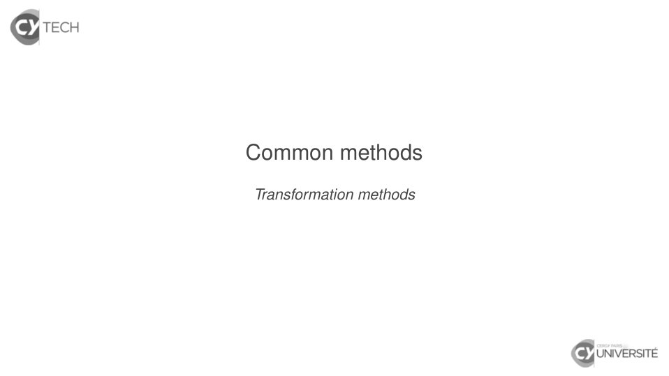

~~~text
Common methods
Transformation methods
~~~

**Lecture OCR à contrôler**

~~~text
S TECH

Common methods

Transformation methods

& UNIVERSITÉ
~~~

## Page 144

~~~text
Transformation methods on Iterable[T]

  Transformation methods
    I flatten “flattens” a collection of collections
    I map(f : T => U)
       Returns the collection of results of f for all elements
    I flatMap(f : T => Iterable[U]) ≡ map(f).flatten

  Features

                      Djaouida Z AOUCHE, Romain D UJOL           31
~~~

## Page 145

~~~text
Transformation methods on Iterable[T]

  Transformation methods
    I flatten “flattens” a collection of collections
    I map(f : T => U)
       Returns the collection of results of f for all elements
    I flatMap(f : T => Iterable[U]) ≡ map(f).flatten

  Features
    I Type result is the same as actual type of input collection
       e.g. if called on List[T], result has type List[U]

                      Djaouida Z AOUCHE, Romain D UJOL           31
~~~

## Page 146

~~~text
Transformation methods on Iterable[T]

  Transformation methods
    I flatten “flattens” a collection of collections
    I map(f : T => U)
       Returns the collection of results of f for all elements
    I flatMap(f : T => Iterable[U]) ≡ map(f).flatten

  Features
    I Type result is the same as actual type of input collection
       e.g. if called on List[T], result has type List[U]
    I When called on ordered collections, relative order is
       preserved.

                      Djaouida Z AOUCHE, Romain D UJOL           31
~~~

## Page 147

~~~text
Transformation methods on Iterable[T]
  Example
  scala> Seq(Seq(5, 1, 1), Seq(1)).flatten
  res0: Seq[Int] = List(5, 1, 1, 1)

                    Djaouida Z AOUCHE, Romain D UJOL   32
~~~

## Page 148

~~~text
Transformation methods on Iterable[T]
  Example
  scala> Seq(Seq(5, 1, 1), Seq(1)).flatten
  res0: Seq[Int] = List(5, 1, 1, 1)

  scala> Set(Seq(5, 1, 1), Seq(1)).flatten
  res1: scala.collection.immutable.Set[Int] = Set(5, 1)

                    Djaouida Z AOUCHE, Romain D UJOL      32
~~~

## Page 149

~~~text
Transformation methods on Iterable[T]
  Example
  scala> Seq(Seq(5, 1, 1), Seq(1)).flatten
  res0: Seq[Int] = List(5, 1, 1, 1)

  scala> Set(Seq(5, 1, 1), Seq(1)).flatten
  res1: scala.collection.immutable.Set[Int] = Set(5, 1)

  scala> Seq(Set(5, 1, 1), Set(1)).flatten
  res2: scala.collection.immutable.Set[Int] = Seq(5, 1, 1)

                    Djaouida Z AOUCHE, Romain D UJOL         32
~~~

## Page 150

~~~text
Transformation methods on Iterable[T]
  Example
  scala> Seq(Seq(5, 1, 1), Seq(1)).flatten
  res0: Seq[Int] = List(5, 1, 1, 1)

  scala> Set(Seq(5, 1, 1), Seq(1)).flatten
  res1: scala.collection.immutable.Set[Int] = Set(5, 1)

  scala> Seq(Set(5, 1, 1), Set(1)).flatten
  res2: scala.collection.immutable.Set[Int] = Seq(5, 1, 1)

  scala> Seq(5, 1, 2) map { 1.0 / _ }
  res3: Seq[Double] = List(0.2, 1.0, 0.5)

                    Djaouida Z AOUCHE, Romain D UJOL         32
~~~

## Page 151

~~~text
Transformation methods on Iterable[T]
  Example
  scala> Seq(Seq(5, 1, 1), Seq(1)).flatten
  res0: Seq[Int] = List(5, 1, 1, 1)

  scala> Set(Seq(5, 1, 1), Seq(1)).flatten
  res1: scala.collection.immutable.Set[Int] = Set(5, 1)

  scala> Seq(Set(5, 1, 1), Set(1)).flatten
  res2: scala.collection.immutable.Set[Int] = Seq(5, 1, 1)

  scala> Seq(5, 1, 2) map { 1.0 / _ }
  res3: Seq[Double] = List(0.2, 1.0, 0.5)

  scala> Set(5, 1, 2) map { 1.0 / _ }
  res4: scala.collection.immutable.Set[Double] = Set(0.2, 1.0, 0.5)

                    Djaouida Z AOUCHE, Romain D UJOL           32
~~~

## Page 152

~~~text
Transformation methods on Iterable[T]
  Example
  scala> Seq(Seq(5, 1, 1), Seq(1)).flatten
  res0: Seq[Int] = List(5, 1, 1, 1)

  scala> Set(Seq(5, 1, 1), Seq(1)).flatten
  res1: scala.collection.immutable.Set[Int] = Set(5, 1)

  scala> Seq(Set(5, 1, 1), Set(1)).flatten
  res2: scala.collection.immutable.Set[Int] = Seq(5, 1, 1)

  scala> Seq(5, 1, 2) map { 1.0 / _ }
  res3: Seq[Double] = List(0.2, 1.0, 0.5)

  scala> Set(5, 1, 2) map { 1.0 / _ }
  res4: scala.collection.immutable.Set[Double] = Set(0.2, 1.0, 0.5)

  scala> Seq(5, 1, 2) flatMap { x => List(x, x) }
  res5 : Seq[Int] = List(5, 5, 1, 1, 2, 2)

                    Djaouida Z AOUCHE, Romain D UJOL           32
~~~

## Page 153

~~~text
Transformation methods on Iterable[T]
  Example
  scala> Seq(Seq(5, 1, 1), Seq(1)).flatten
  res0: Seq[Int] = List(5, 1, 1, 1)

  scala> Set(Seq(5, 1, 1), Seq(1)).flatten
  res1: scala.collection.immutable.Set[Int] = Set(5, 1)

  scala> Seq(Set(5, 1, 1), Set(1)).flatten
  res2: scala.collection.immutable.Set[Int] = Seq(5, 1, 1)

  scala> Seq(5, 1, 2) map { 1.0 / _ }
  res3: Seq[Double] = List(0.2, 1.0, 0.5)

  scala> Set(5, 1, 2) map { 1.0 / _ }
  res4: scala.collection.immutable.Set[Double] = Set(0.2, 1.0, 0.5)

  scala> Seq(5, 1, 2) flatMap { x => List(x, x) }
  res5 : Seq[Int] = List(5, 5, 1, 1, 2, 2)

  scala> Set(5, 1, 2) flatMap { x => List(x, x) }
  res6 : scala.collection.immutable.Set[Int] = Set(5, 1, 2)
                    Djaouida Z AOUCHE, Romain D UJOL           32
~~~

## Page 154

~~~text
for-comprehensions by example
   for (x <- c) yield f(x) ≡ c map f
  scala> for (x <- Seq(5, 1, 2)) yield 1.0 / x
  res0: Seq[Double] = List(0.2, 1.0, 0.5)

  scala> Seq(5, 1, 2) map { x => 1.0 / x }
  res1: Seq[Double] = List(0.2, 1.0, 0.5)

                     Djaouida Z AOUCHE, Romain D UJOL   33
~~~

## Page 155

~~~text
for-comprehensions by example
   for (x <- c) yield f(x) ≡ c map f
  scala> for (x <- Seq(5, 1, 2)) yield 1.0 / x
  res0: Seq[Double] = List(0.2, 1.0, 0.5)

  scala> Seq(5, 1, 2) map { x => 1.0 / x }
  res1: Seq[Double] = List(0.2, 1.0, 0.5)

   for (x <- c if cond(x)) yield f(x) ≡ (c filter cond) map f
  scala> for (x <- Seq(5, 1, 2) if x > 1) yield 1.0 / x
  res2: Seq[Double] = Seq(0.2, 0.5)

  scala> (Seq(5, 1, 2) filter {x => x > 1}) map { x => 1.0 / x }
  res3: Seq[Double] = Seq(0.2, 0.5)

                     Djaouida Z AOUCHE, Romain D UJOL           33
~~~

## Page 156

~~~text
for-comprehensions by example
   for (x <- c) yield f(x) ≡ c map f
  scala> for (x <- Seq(5, 1, 2)) yield 1.0 / x
  res0: Seq[Double] = List(0.2, 1.0, 0.5)

  scala> Seq(5, 1, 2) map { x => 1.0 / x }
  res1: Seq[Double] = List(0.2, 1.0, 0.5)

   for (x <- c if cond(x)) yield f(x) ≡ (c filter cond) map f
  scala> for (x <- Seq(5, 1, 2) if x > 1) yield 1.0 / x
  res2: Seq[Double] = Seq(0.2, 0.5)

  scala> (Seq(5, 1, 2) filter {x => x > 1}) map { x => 1.0 / x }
  res3: Seq[Double] = Seq(0.2, 0.5)

   for (x <- c1 ; y <- c2) yield f(x, y) ≡ c1 flatMap (x => c2 map (y => f(x, y)))
  scala> for (x <- Seq(5, 1, 2) ; y <- Seq(2, 3)) yield x + y
  res4: Seq[Int] = List(7, 8, 3, 4, 4, 5)

  scala> Seq(5, 1, 2) flatMap (x => Seq(2, 3) map (y => x + y))
  res4: Seq[Int] = List(7, 8, 3, 4, 4, 5)
                     Djaouida Z AOUCHE, Romain D UJOL             33
~~~

## Page 157

~~~text
for-comprehensions by example

  Do not forget the yield keyword !

                   Djaouida Z AOUCHE, Romain D UJOL   34
~~~

## Page 158

~~~text
for-comprehensions by example

  Do not forget the yield keyword !
  Example
  scala> def couplesWithSum(n : Int) =
           for (i <- 0 to n ;
                j <- 0 to n if i + j == n)
              yield (i, j)
  couplesWithSum(n: Int): IndexedSeq[(Int, Int)]

  scala> couplesWithSum(4)
  res1: IndexeqSeq[(Int, Int)] = Vector((0,4), (1,3), (2,2), (3,1), (4,0))

                    Djaouida Z AOUCHE, Romain D UJOL           34
~~~

## Page 159

~~~text
for-comprehensions by example

  Do not forget the yield keyword !
  Example
  scala> def couplesWithSum(n : Int) =
           for (i <- 0 to n ;
                j <- 0 to n if i + j == n)
              yield (i, j)
  couplesWithSum(n: Int): IndexedSeq[(Int, Int)]

  scala> couplesWithSum(4)
  res1: IndexeqSeq[(Int, Int)] = Vector((0,4), (1,3), (2,2), (3,1), (4,0))

  Think DBMS. . .

                    Djaouida Z AOUCHE, Romain D UJOL           34
~~~

## Page 160

~~~text
for-comprehensions by example

  Do not forget the yield keyword !
  Example
  scala> def couplesWithSum(n : Int) =
           for (i <- 0 to n ;
                j <- 0 to n if i + j == n)
              yield (i, j)
  couplesWithSum(n: Int): IndexedSeq[(Int, Int)]

  scala> couplesWithSum(4)
  res1: IndexeqSeq[(Int, Int)] = Vector((0,4), (1,3), (2,2), (3,1), (4,0))

  Think DBMS. . .
    I Object ≡ Item in database

                    Djaouida Z AOUCHE, Romain D UJOL           34
~~~

## Page 161

~~~text
for-comprehensions by example

  Do not forget the yield keyword !
  Example
  scala> def couplesWithSum(n : Int) =
           for (i <- 0 to n ;
                j <- 0 to n if i + j == n)
              yield (i, j)
  couplesWithSum(n: Int): IndexedSeq[(Int, Int)]

  scala> couplesWithSum(4)
  res1: IndexeqSeq[(Int, Int)] = Vector((0,4), (1,3), (2,2), (3,1), (4,0))

  Think DBMS. . .
    I Object ≡ Item in database
    I Collection ≡ Table in database

                    Djaouida Z AOUCHE, Romain D UJOL           34
~~~

## Page 162

~~~text
for-comprehensions by example

  Do not forget the yield keyword !
  Example
  scala> def couplesWithSum(n : Int) =
           for (i <- 0 to n ;
                j <- 0 to n if i + j == n)
              yield (i, j)
  couplesWithSum(n: Int): IndexedSeq[(Int, Int)]

  scala> couplesWithSum(4)
  res1: IndexeqSeq[(Int, Int)] = Vector((0,4), (1,3), (2,2), (3,1), (4,0))

  Think DBMS. . .
    I Object ≡ Item in database
    I Collection ≡ Table in database
    I for (x <- table) ≡ SELECT * FROM table

                    Djaouida Z AOUCHE, Romain D UJOL           34
~~~

## Page 163

~~~text
for-comprehensions by example

  Do not forget the yield keyword !
  Example
  scala> def couplesWithSum(n : Int) =
           for (i <- 0 to n ;
                j <- 0 to n if i + j == n)
              yield (i, j)
  couplesWithSum(n: Int): IndexedSeq[(Int, Int)]

  scala> couplesWithSum(4)
  res1: IndexeqSeq[(Int, Int)] = Vector((0,4), (1,3), (2,2), (3,1), (4,0))

  Think DBMS. . .
    I Object ≡ Item in database
    I Collection ≡ Table in database
    I for (x <- table) ≡ SELECT * FROM table
    I if cond(x) ≡ WHERE cond(x)

                    Djaouida Z AOUCHE, Romain D UJOL           34
~~~

## Page 164

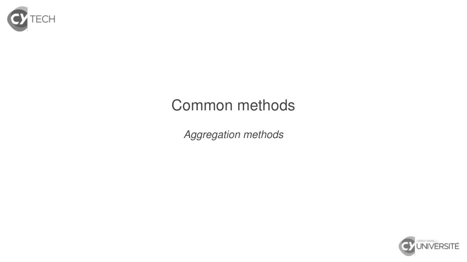

~~~text
Common methods
 Aggregation methods
~~~

**Lecture OCR à contrôler**

~~~text
& TECH

Common methods

Aggregation methods

& UNIVERSITÉ
~~~

## Page 165

~~~text
Aggregation methods on Iterable[T]

  fold-like aggregation methods

                  Djaouida Z AOUCHE, Romain D UJOL   36
~~~

## Page 166

~~~text
Aggregation methods on Iterable[T]

  fold-like aggregation methods
   I foldLeft[U](z : U)(op : (U, T) => U) : U
          ≡ op(...(op(op(z, a_1), a_2) ...), a_n)

                 Djaouida Z AOUCHE, Romain D UJOL   36
~~~

## Page 167

~~~text
Aggregation methods on Iterable[T]

  fold-like aggregation methods
   I foldLeft[U](z : U)(op : (U, T) => U) : U
          ≡ op(...(op(op(z, a_1), a_2) ...), a_n)
   I foldRight[U](z : U)(op : (T, U) => U) : U
          ≡ op(a1, op(a2, op(... , op(an, z))))

                 Djaouida Z AOUCHE, Romain D UJOL   36
~~~

## Page 168

~~~text
Aggregation methods on Iterable[T]

  fold-like aggregation methods
   I foldLeft[U](z : U)(op : (U, T) => U) : U
          ≡ op(...(op(op(z, a_1), a_2) ...), a_n)
   I foldRight[U](z : U)(op : (T, U) => U) : U
          ≡ op(a1, op(a2, op(... , op(an, z))))
   I fold[T1 >: T](z : T1)(op : (T1, T1) => T1) : T1
     behaves like above if op is associative

                Djaouida Z AOUCHE, Romain D UJOL   36
~~~

## Page 169

~~~text
Aggregation methods on Iterable[T]

  fold-like aggregation methods
   I foldLeft[U](z : U)(op : (U, T) => U) : U
          ≡ op(...(op(op(z, a_1), a_2) ...), a_n)
   I foldRight[U](z : U)(op : (T, U) => U) : U
          ≡ op(a1, op(a2, op(... , op(an, z))))
   I fold[T1 >: T](z : T1)(op : (T1, T1) => T1) : T1
     behaves like above if op is associative

  Features

                Djaouida Z AOUCHE, Romain D UJOL   36
~~~

## Page 170

~~~text
Aggregation methods on Iterable[T]

  fold-like aggregation methods
   I foldLeft[U](z : U)(op : (U, T) => U) : U
          ≡ op(...(op(op(z, a_1), a_2) ...), a_n)
   I foldRight[U](z : U)(op : (T, U) => U) : U
          ≡ op(a1, op(a2, op(... , op(an, z))))
   I fold[T1 >: T](z : T1)(op : (T1, T1) => T1) : T1
     behaves like above if op is associative

  Features
   I If collection is empty, result is always z.

                      Djaouida Z AOUCHE, Romain D UJOL   36
~~~

## Page 171

~~~text
Aggregation methods on Iterable[T]

  fold-like aggregation methods
   I foldLeft[U](z : U)(op : (U, T) => U) : U
          ≡ op(...(op(op(z, a_1), a_2) ...), a_n)
   I foldRight[U](z : U)(op : (T, U) => U) : U
          ≡ op(a1, op(a2, op(... , op(an, z))))
   I fold[T1 >: T](z : T1)(op : (T1, T1) => T1) : T1
     behaves like above if op is associative

  Features
   I If collection is empty, result is always z.
   I When called on unordered collections, method is not
      guaranteed to be pure
      (except fold if op is associative AND commutative)

                      Djaouida Z AOUCHE, Romain D UJOL     36
~~~

## Page 172

~~~text
Folding process for foldLeft
   Example on 4-element list List(a1 , a2 , a3 , a4 )

                                            op

                                       op        a4

                                  op        a3

                             op        a2

                         z        a1
                    Djaouida Z AOUCHE, Romain D UJOL    37
~~~

## Page 173

~~~text
Folding process for foldLeft

   (List(a1 , a2 , a3 , a4 ) foldLeft z)(op)

                z       op       op       op           op

                        a1       a2       a3           a4

                    Djaouida Z AOUCHE, Romain D UJOL        37
~~~

## Page 174

~~~text
Folding process for foldLeft

   (List(a1 , a2 , a3 , a4 ) foldLeft z)(op)

              op(z, a1 )       op       op           op

                               a2        a3          a4

                  Djaouida Z AOUCHE, Romain D UJOL        37
~~~

## Page 175

~~~text
Folding process for foldLeft

   (List(a1 , a2 , a3 , a4 ) foldLeft z)(op)

              op(op(z, a1 ), a2 )          op        op

                                           a3        a4

                  Djaouida Z AOUCHE, Romain D UJOL        37
~~~

## Page 176

~~~text
Folding process for foldLeft

   (List(a1 , a2 , a3 , a4 ) foldLeft z)(op)

              op(op(op(z, a1 ), a2 ), a3 )           op

                                                     a4

                  Djaouida Z AOUCHE, Romain D UJOL        37
~~~

## Page 177

~~~text
Folding process for foldLeft

   (List(a1 , a2 , a3 , a4 ) foldLeft z)(op)

                op(op(op(z, a1 ), a2 ), a3 )           op

                                                       a4

   Résultat final

            op(op(op(op(z, a1 ), a2 ), a3 ), a4 )

                    Djaouida Z AOUCHE, Romain D UJOL        37
~~~

## Page 178

~~~text
Folding process for foldRight
   Example on 4-element list List(a1 , a2 , a3 , a4 )

                              op

                         a1        op

                              a2        op

                                   a3        op

                                        a4        z
                    Djaouida Z AOUCHE, Romain D UJOL    38
~~~

## Page 179

~~~text
Folding process for foldRight

   (List(a1 , a2 , a3 , a4 ) foldRight z)(op)

              op      op       op        op       z

              a1      a2       a3        a4

                   Djaouida Z AOUCHE, Romain D UJOL   38
~~~

## Page 180

~~~text
Folding process for foldRight

   (List(a1 , a2 , a3 , a4 ) foldRight z)(op)

              op      op       op       op(a4 , z)

              a1      a2       a3

                   Djaouida Z AOUCHE, Romain D UJOL   38
~~~

## Page 181

~~~text
Folding process for foldRight

   (List(a1 , a2 , a3 , a4 ) foldRight z)(op)

              op      op      op(a3 , op(a4 , z))

              a1      a2

                   Djaouida Z AOUCHE, Romain D UJOL   38
~~~

## Page 182

~~~text
Folding process for foldRight

   (List(a1 , a2 , a3 , a4 ) foldRight z)(op)

              op    op(a2 , op(a3 , op(a4 , z)))

              a1

                   Djaouida Z AOUCHE, Romain D UJOL   38
~~~

## Page 183

~~~text
Folding process for foldRight

   (List(a1 , a2 , a3 , a4 ) foldRight z)(op)

                op    op(a2 , op(a3 , op(a4 , z)))

                a1

   Résultat final

            op(a1 , op(a2 , op(a3 , op(a4 , z))))

                     Djaouida Z AOUCHE, Romain D UJOL   38
~~~

## Page 184

~~~text
foldLeft VS foldRight

  How to tell foldLeft from foldRight ?

                  Djaouida Z AOUCHE, Romain D UJOL   39
~~~

## Page 185

~~~text
foldLeft VS foldRight

  How to tell foldLeft from foldRight ?
   I In foldLeft :

                     Djaouida Z AOUCHE, Romain D UJOL   39
~~~

## Page 186

~~~text
foldLeft VS foldRight

  How to tell foldLeft from foldRight ?
   I In foldLeft :
       I result is accumulated in the left parameter of op ;

                     Djaouida Z AOUCHE, Romain D UJOL          39
~~~

## Page 187

~~~text
foldLeft VS foldRight

  How to tell foldLeft from foldRight ?
   I In foldLeft :
       I result is accumulated in the left parameter of op ;
       I elements are taken from the left ;

                     Djaouida Z AOUCHE, Romain D UJOL          39
~~~

## Page 188

~~~text
foldLeft VS foldRight

  How to tell foldLeft from foldRight ?
   I In foldLeft :
       I result is accumulated in the left parameter of op ;
       I elements are taken from the left ;
       I tree is folded leftwise.

                     Djaouida Z AOUCHE, Romain D UJOL          39
~~~

## Page 189

~~~text
foldLeft VS foldRight

  How to tell foldLeft from foldRight ?
   I In foldLeft :
       I result is accumulated in the left parameter of op ;
       I elements are taken from the left ;
       I tree is folded leftwise.
   I In foldRight :

                     Djaouida Z AOUCHE, Romain D UJOL          39
~~~

## Page 190

~~~text
foldLeft VS foldRight

  How to tell foldLeft from foldRight ?
   I In foldLeft :
       I result is accumulated in the left parameter of op ;
       I elements are taken from the left ;
       I tree is folded leftwise.
   I In foldRight :
       I result is accumulated in the right parameter of op ;

                     Djaouida Z AOUCHE, Romain D UJOL           39
~~~

## Page 191

~~~text
foldLeft VS foldRight

  How to tell foldLeft from foldRight ?
   I In foldLeft :
       I result is accumulated in the left parameter of op ;
       I elements are taken from the left ;
       I tree is folded leftwise.
   I In foldRight :
       I result is accumulated in the right parameter of op ;
       I elements are taken from the right ;

                     Djaouida Z AOUCHE, Romain D UJOL           39
~~~

## Page 192

~~~text
foldLeft VS foldRight

  How to tell foldLeft from foldRight ?
   I In foldLeft :
       I result is accumulated in the left parameter of op ;
       I elements are taken from the left ;
       I tree is folded leftwise.
   I In foldRight :
       I result is accumulated in the right parameter of op ;
       I elements are taken from the right ;
       I tree is folded rightwise.

                     Djaouida Z AOUCHE, Romain D UJOL           39
~~~

## Page 193

~~~text
foldLeft VS foldRight

  How to tell foldLeft from foldRight ?
   I In foldLeft :
        I result is accumulated in the left parameter of op ;
        I elements are taken from the left ;
        I tree is folded leftwise.
   I In foldRight :
        I result is accumulated in the right parameter of op ;
        I elements are taken from the right ;
        I tree is folded rightwise.

  Both are inherently recursive

                      Djaouida Z AOUCHE, Romain D UJOL           39
~~~

## Page 194

~~~text
foldLeft VS foldRight

  How to tell foldLeft from foldRight ?
   I In foldLeft :
        I result is accumulated in the left parameter of op ;
        I elements are taken from the left ;
        I tree is folded leftwise.
   I In foldRight :
        I result is accumulated in the right parameter of op ;
        I elements are taken from the right ;
        I tree is folded rightwise.

  Both are inherently recursive
   I foldLeft is inherently tail-recursive.

                      Djaouida Z AOUCHE, Romain D UJOL           39
~~~

## Page 195

~~~text
foldLeft VS foldRight

  How to tell foldLeft from foldRight ?
   I In foldLeft :
        I result is accumulated in the left parameter of op ;
        I elements are taken from the left ;
        I tree is folded leftwise.
   I In foldRight :
        I result is accumulated in the right parameter of op ;
        I elements are taken from the right ;
        I tree is folded rightwise.

  Both are inherently recursive
   I foldLeft is inherently tail-recursive.
   I foldRight is not.

                      Djaouida Z AOUCHE, Romain D UJOL           39
~~~

## Page 196

~~~text
Aggregations methods on Iterable[T]

  Compute all combinations of elements of a set
  scala> def combinations[T](s : Set[T]) =
           (s foldLeft Set(Set[T]())) { case (z, x) => z ++ (z map { _ + x }) }
  combinations: [T](s: Seq[T])Seq[Seq[T]]

                    Djaouida Z AOUCHE, Romain D UJOL           40
~~~

## Page 197

~~~text
Aggregations methods on Iterable[T]

  Compute all combinations of elements of a set
  scala> def combinations[T](s : Set[T]) =
           (s foldLeft Set(Set[T]())) { case (z, x) => z ++ (z map { _ + x }) }
  combinations: [T](s: Seq[T])Seq[Seq[T]]

  scala> combinations((1 to 3).to(Set))
  res0: Set[Set[Int]] = HashSet(Set(), Set(1, 3), Set(2), Set(2, 3), Set(3),
                                Set(1, 2), Set(1), Set(1, 2, 3))

                    Djaouida Z AOUCHE, Romain D UJOL           40
~~~

## Page 198

~~~text
Aggregations methods on Iterable[T]

  Compute all combinations of elements of a set
  scala> def combinations[T](s : Set[T]) =
           (s foldLeft Set(Set[T]())) { case (z, x) => z ++ (z map { _ + x }) }
  combinations: [T](s: Seq[T])Seq[Seq[T]]

  scala> combinations((1 to 3).to(Set))
  res0: Set[Set[Int]] = HashSet(Set(), Set(1, 3), Set(2), Set(2, 3), Set(3),
                                Set(1, 2), Set(1), Set(1, 2, 3))

  Find corresponding existing methods

                    Djaouida Z AOUCHE, Romain D UJOL           40
~~~

## Page 199

~~~text
Aggregations methods on Iterable[T]

  Compute all combinations of elements of a set
  scala> def combinations[T](s : Set[T]) =
           (s foldLeft Set(Set[T]())) { case (z, x) => z ++ (z map { _ + x }) }
  combinations: [T](s: Seq[T])Seq[Seq[T]]

  scala> combinations((1 to 3).to(Set))
  res0: Set[Set[Int]] = HashSet(Set(), Set(1, 3), Set(2), Set(2, 3), Set(3),
                                Set(1, 2), Set(1), Set(1, 2, 3))

  Find corresponding existing methods
   I fold(0)(_ + _)

                    Djaouida Z AOUCHE, Romain D UJOL           40
~~~

## Page 200

~~~text
Aggregations methods on Iterable[T]

  Compute all combinations of elements of a set
  scala> def combinations[T](s : Set[T]) =
           (s foldLeft Set(Set[T]())) { case (z, x) => z ++ (z map { _ + x }) }
  combinations: [T](s: Seq[T])Seq[Seq[T]]

  scala> combinations((1 to 3).to(Set))
  res0: Set[Set[Int]] = HashSet(Set(), Set(1, 3), Set(2), Set(2, 3), Set(3),
                                Set(1, 2), Set(1), Set(1, 2, 3))

  Find corresponding existing methods
   I fold(0)(_ + _)
   I foldLeft(0){ case (z, x) => z + 1 }

                    Djaouida Z AOUCHE, Romain D UJOL           40
~~~

## Page 201

~~~text
Aggregations methods on Iterable[T]

  Compute all combinations of elements of a set
  scala> def combinations[T](s : Set[T]) =
           (s foldLeft Set(Set[T]())) { case (z, x) => z ++ (z map { _ + x }) }
  combinations: [T](s: Seq[T])Seq[Seq[T]]

  scala> combinations((1 to 3).to(Set))
  res0: Set[Set[Int]] = HashSet(Set(), Set(1, 3), Set(2), Set(2, 3), Set(3),
                                Set(1, 2), Set(1), Set(1, 2, 3))

  Find corresponding existing methods
   I fold(0)(_ + _)
   I foldLeft(0){ case (z, x) => z + 1 }
   I foldLeft(0){ case (z, x) => if (p(x)) z+1 else z }

                    Djaouida Z AOUCHE, Romain D UJOL           40
~~~

## Page 202

~~~text
Aggregations methods on Iterable[T]

  reduce-like aggregation methods

                  Djaouida Z AOUCHE, Romain D UJOL   41
~~~

## Page 203

~~~text
Aggregations methods on Iterable[T]

  reduce-like aggregation methods
   I reduceLeft[T1 >: T](op : (T1, T) => T1) : T1
        ≡ (tail foldLeft head)(op)

                Djaouida Z AOUCHE, Romain D UJOL    41
~~~

## Page 204

~~~text
Aggregations methods on Iterable[T]

  reduce-like aggregation methods
   I reduceLeft[T1 >: T](op : (T1, T) => T1) : T1
        ≡ (tail foldLeft head)(op)
   I reduceRight[T1 >: T](op : (T, T1) => T1) : T1
        ≡ (init foldLeft last)(op)

                Djaouida Z AOUCHE, Romain D UJOL     41
~~~

## Page 205

~~~text
Aggregations methods on Iterable[T]

  reduce-like aggregation methods
   I reduceLeft[T1 >: T](op : (T1, T) => T1) : T1
        ≡ (tail foldLeft head)(op)
   I reduceRight[T1 >: T](op : (T, T1) => T1) : T1
        ≡ (init foldLeft last)(op)
   I reduce[T1 >: T](op : (T1, T1) => T1) : T1
     behaves like above if op is associative

                Djaouida Z AOUCHE, Romain D UJOL     41
~~~

## Page 206

~~~text
Aggregations methods on Iterable[T]

  reduce-like aggregation methods
   I reduceLeft[T1 >: T](op : (T1, T) => T1) : T1
        ≡ (tail foldLeft head)(op)
   I reduceRight[T1 >: T](op : (T, T1) => T1) : T1
        ≡ (init foldLeft last)(op)
   I reduce[T1 >: T](op : (T1, T1) => T1) : T1
     behaves like above if op is associative

  Features

                Djaouida Z AOUCHE, Romain D UJOL     41
~~~

## Page 207

~~~text
Aggregations methods on Iterable[T]

  reduce-like aggregation methods
   I reduceLeft[T1 >: T](op : (T1, T) => T1) : T1
        ≡ (tail foldLeft head)(op)
   I reduceRight[T1 >: T](op : (T, T1) => T1) : T1
        ≡ (init foldLeft last)(op)
   I reduce[T1 >: T](op : (T1, T1) => T1) : T1
     behaves like above if op is associative

  Features
   I If collection is empty, methods throw an exception.
      Option-valued version are also defined.

                    Djaouida Z AOUCHE, Romain D UJOL       41
~~~

## Page 208

~~~text
Aggregations methods on Iterable[T]

  reduce-like aggregation methods
   I reduceLeft[T1 >: T](op : (T1, T) => T1) : T1
        ≡ (tail foldLeft head)(op)
   I reduceRight[T1 >: T](op : (T, T1) => T1) : T1
        ≡ (init foldLeft last)(op)
   I reduce[T1 >: T](op : (T1, T1) => T1) : T1
     behaves like above if op is associative

  Features
   I If collection is empty, methods throw an exception.
      Option-valued version are also defined.
   I When called on unordered collections, method is not
      guaranteed to be pure
      (except reduce if op is associative AND commutative)

                    Djaouida Z AOUCHE, Romain D UJOL         41
~~~

## Page 209

~~~text
Aggregations methods on Iterable[T]
  fold VS reduce

                   Djaouida Z AOUCHE, Romain D UJOL   42
~~~

## Page 210

~~~text
Aggregations methods on Iterable[T]
  fold VS reduce
   I fold is more general

                   Djaouida Z AOUCHE, Romain D UJOL   42
~~~

## Page 211

~~~text
Aggregations methods on Iterable[T]
  fold VS reduce
   I fold is more general
   I reduce does not need a z parameter.

                   Djaouida Z AOUCHE, Romain D UJOL   42
~~~

## Page 212

~~~text
Aggregations methods on Iterable[T]
  fold VS reduce
   I fold is more general
   I reduce does not need a z parameter.
  Examples
  scala> Set(5, 1, 2) reduce (_ + _)
  res0: Int = 8

                    Djaouida Z AOUCHE, Romain D UJOL   42
~~~

## Page 213

~~~text
Aggregations methods on Iterable[T]
  fold VS reduce
   I fold is more general
   I reduce does not need a z parameter.
  Examples
  scala> Set(5, 1, 2) reduce (_ + _)
  res0: Int = 8

  scala> Set[Int]() reduce (_ + _)
  java.lang.UnsupportedOperationException: empty.reduceLeft
    at scala.collection.IterableOnceOps.reduceLeft(IterableOnce.scala:723)
    at scala.collection.IterableOnceOps.reduceLeft$(IterableOnce.scala:720)
    at scala.collection.AbstractIterable.reduceLeft(Iterable.scala:920)
    at scala.collection.IterableOnceOps.reduce(IterableOnce.scala:692)
    at scala.collection.IterableOnceOps.reduce$(IterableOnce.scala:692)
    at scala.collection.AbstractIterable.reduce(Iterable.scala:920)
    ... 40 elided

                    Djaouida Z AOUCHE, Romain D UJOL           42
~~~

## Page 214

~~~text
Aggregations methods on Iterable[T]
  fold VS reduce
   I fold is more general
   I reduce does not need a z parameter.
  Examples
  scala> Set(5, 1, 2) reduce (_ + _)
  res0: Int = 8

  scala> Set[Int]() reduce (_ + _)
  java.lang.UnsupportedOperationException: empty.reduceLeft
    at scala.collection.IterableOnceOps.reduceLeft(IterableOnce.scala:723)
    at scala.collection.IterableOnceOps.reduceLeft$(IterableOnce.scala:720)
    at scala.collection.AbstractIterable.reduceLeft(Iterable.scala:920)
    at scala.collection.IterableOnceOps.reduce(IterableOnce.scala:692)
    at scala.collection.IterableOnceOps.reduce$(IterableOnce.scala:692)
    at scala.collection.AbstractIterable.reduce(Iterable.scala:920)
    ... 40 elided

  scala> Set[Int]() reduceOption (_ + _)
  res1: Option[Int] = None
                    Djaouida Z AOUCHE, Romain D UJOL           42
~~~

## Page 215

~~~text
Common methods
  Grouping methods
~~~

**Lecture OCR à contrôler**

~~~text
& TECH

Common methods

Grouping methods

& UNIVERSITÉ
~~~

## Page 216

~~~text
Grouping methods on Iterable[T]

  Grouping methods

                 Djaouida Z AOUCHE, Romain D UJOL   44
~~~

## Page 217

~~~text
Grouping methods on Iterable[T]

  Grouping methods
   I groupBy[K](f : T => K)
     Builds a map such that value at any key is the subcollection of
     elements whose values by f is that key.

                    Djaouida Z AOUCHE, Romain D UJOL              44
~~~

## Page 218

~~~text
Grouping methods on Iterable[T]

  Grouping methods
   I groupBy[K](f : T => K)
     Builds a map such that value at any key is the subcollection of
     elements whose values by f is that key.
   I groupMap[K, U](key : T => K)(f : T => U)
     ≡ groupBy(key).map(k -> group => k -> group map f)
     Same as before, but applies in addition f to each element of
     subcollections

                    Djaouida Z AOUCHE, Romain D UJOL                44
~~~

## Page 219

~~~text
Grouping methods on Iterable[T]

  Grouping methods
   I groupBy[K](f : T => K)
     Builds a map such that value at any key is the subcollection of
     elements whose values by f is that key.
   I groupMap[K, U](key : T => K)(f : T => U)
     ≡ groupBy(key).map(k -> group => k -> group map f)
     Same as before, but applies in addition f to each element of
     subcollections
   I groupMapReduce[K, U](key : T => K)(f : T => U)(op : (U, U) => U)
     ≡ groupMap(key)(f).map(k -> c => k -> c reduce op)
     Same as before, but replaces transformed subcollections by
     their aggregation

                    Djaouida Z AOUCHE, Romain D UJOL                44
~~~

## Page 220

~~~text
Grouping methods on Iterable[T]

  Grouping methods
   I groupBy[K](f : T => K)
     Builds a map such that value at any key is the subcollection of
     elements whose values by f is that key.
   I groupMap[K, U](key : T => K)(f : T => U)
     ≡ groupBy(key).map(k -> group => k -> group map f)
     Same as before, but applies in addition f to each element of
     subcollections
   I groupMapReduce[K, U](key : T => K)(f : T => U)(op : (U, U) => U)
     ≡ groupMap(key)(f).map(k -> c => k -> c reduce op)
     Same as before, but replaces transformed subcollections by
     their aggregation

  New in version 2.13 : groupMap, groupMapReduce

                    Djaouida Z AOUCHE, Romain D UJOL                44
~~~

## Page 221

~~~text
Common methods on Iterable[T]

  Combining methods

                 Djaouida Z AOUCHE, Romain D UJOL   45
~~~

## Page 222

~~~text
Common methods on Iterable[T]

  Combining methods
   I zip(other : Iterable[U]) : Iterable[(T, U)]
     Builds the collection of pairs taken element-wise

                    Djaouida Z AOUCHE, Romain D UJOL     45
~~~

## Page 223

~~~text
Common methods on Iterable[T]

  Combining methods
   I zip(other : Iterable[U]) : Iterable[(T, U)]
     Builds the collection of pairs taken element-wise
   I unzip
     Reverse operation of zip and return a pair collection from a
     collection of pairs (i.e. T must be a couple of types)

                    Djaouida Z AOUCHE, Romain D UJOL                45
~~~

## Page 224

~~~text
Common methods on Iterable[T]

  Combining methods
   I zip(other : Iterable[U]) : Iterable[(T, U)]
     Builds the collection of pairs taken element-wise
   I unzip
     Reverse operation of zip and return a pair collection from a
     collection of pairs (i.e. T must be a couple of types)
   I zipWithIndex : Iterable[(T, Int)]
     Builds the collection of pairs element/index

                    Djaouida Z AOUCHE, Romain D UJOL                45
~~~

## Page 225

~~~text
Common methods on Iterable[T]

  Combining methods
   I zip(other : Iterable[U]) : Iterable[(T, U)]
     Builds the collection of pairs taken element-wise
   I unzip
     Reverse operation of zip and return a pair collection from a
     collection of pairs (i.e. T must be a couple of types)
   I zipWithIndex : Iterable[(T, Int)]
     Builds the collection of pairs element/index

                 Current list is not exhaustive !

              Refer to official API documentation

                    Djaouida Z AOUCHE, Romain D UJOL                45
~~~

## Page 226

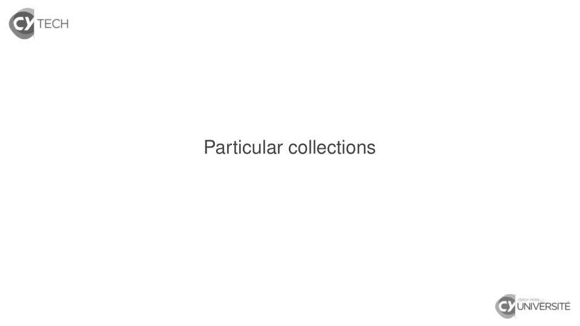

~~~text
Particular collections
~~~

**Lecture OCR à contrôler**

~~~text
& TECH

Particular collections

& UNIVERSITÉ
~~~

## Page 227

~~~text
Particular collections
        Option
~~~

**Lecture OCR à contrôler**

~~~text
S TECH

Particular collections

Option

& UNIVERSITÉ
~~~

## Page 228

~~~text
Option can be treated as an Iterable
  How so ?

                Djaouida Z AOUCHE, Romain D UJOL   48
~~~

## Page 229

~~~text
Option can be treated as an Iterable
  How so ?
    I An Option[T] object can be seen as a collection of at most
      one element.

                     Djaouida Z AOUCHE, Romain D UJOL              48
~~~

## Page 230

~~~text
Option can be treated as an Iterable
  How so ?
    I An Option[T] object can be seen as a collection of at most
      one element.
    I So None is seen as the empty collection.

                     Djaouida Z AOUCHE, Romain D UJOL              48
~~~

## Page 231

~~~text
Option can be treated as an Iterable
  How so ?
    I An Option[T] object can be seen as a collection of at most
      one element.
    I So None is seen as the empty collection.

  Result transmission made easier

                     Djaouida Z AOUCHE, Romain D UJOL              48
~~~

## Page 232

~~~text
Option can be treated as an Iterable
  How so ?
    I An Option[T] object can be seen as a collection of at most
      one element.
    I So None is seen as the empty collection.

  Result transmission made easier
    I o map f
      ≡ o match { case Some(x) => Some(f(x)) ; case None => None }

                     Djaouida Z AOUCHE, Romain D UJOL              48
~~~

## Page 233

~~~text
Option can be treated as an Iterable
  How so ?
    I An Option[T] object can be seen as a collection of at most
      one element.
    I So None is seen as the empty collection.

  Result transmission made easier
    I o map f
      ≡ o match { case Some(x) => Some(f(x)) ; case None => None }
    I o flatMap f with f : T => Option[U]
      ≡ o match { case Some(x) => f(x) ; case None => None }

                     Djaouida Z AOUCHE, Romain D UJOL              48
~~~

## Page 234

~~~text
Option can be treated as an Iterable
  How so ?
    I An Option[T] object can be seen as a collection of at most
      one element.
    I So None is seen as the empty collection.

  Result transmission made easier
    I o map f
      ≡ o match { case Some(x) => Some(f(x)) ; case None => None }
    I o flatMap f with f : T => Option[U]
      ≡ o match { case Some(x) => f(x) ; case None => None }
    I (o fold z)(op)
      ≡ o match { case Some(x) => op(x) ; case None => z }

                     Djaouida Z AOUCHE, Romain D UJOL              48
~~~

## Page 235

~~~text
Option can be treated as an Iterable
  How so ?
    I An Option[T] object can be seen as a collection of at most
      one element.
    I So None is seen as the empty collection.

  Result transmission made easier
    I o map f
      ≡ o match { case Some(x) => Some(f(x)) ; case None => None }
    I o flatMap f with f : T => Option[U]
      ≡ o match { case Some(x) => f(x) ; case None => None }
    I (o fold z)(op)
      ≡ o match { case Some(x) => op(x) ; case None => z }

  NB: o getOrElse z ≡ o match { case Some(x) => x ; case None => z }

                     Djaouida Z AOUCHE, Romain D UJOL              48
~~~

## Page 236

~~~text
Option can be treated as an Iterable
  How so ?
    I An Option[T] object can be seen as a collection of at most
      one element.
    I So None is seen as the empty collection.

  Result transmission made easier
    I o map f
      ≡ o match { case Some(x) => Some(f(x)) ; case None => None }
    I o flatMap f with f : T => Option[U]
      ≡ o match { case Some(x) => f(x) ; case None => None }
    I (o fold z)(op)
      ≡ o match { case Some(x) => op(x) ; case None => z }

  NB: o getOrElse z ≡ o match { case Some(x) => x ; case None => z }
  Option-valued collections

                     Djaouida Z AOUCHE, Romain D UJOL              48
~~~

## Page 237

~~~text
Option can be treated as an Iterable
  How so ?
    I An Option[T] object can be seen as a collection of at most
      one element.
    I So None is seen as the empty collection.

  Result transmission made easier
    I o map f
      ≡ o match { case Some(x) => Some(f(x)) ; case None => None }
    I o flatMap f with f : T => Option[U]
      ≡ o match { case Some(x) => f(x) ; case None => None }
    I (o fold z)(op)
      ≡ o match { case Some(x) => op(x) ; case None => z }

  NB: o getOrElse z ≡ o match { case Some(x) => x ; case None => z }
  Option-valued collections
    I flatten remove all None-valued elements.
                     Djaouida Z AOUCHE, Romain D UJOL              48
~~~

## Page 238

~~~text
Particular collections
       LazyList
~~~

**Lecture OCR à contrôler**

~~~text
S TECH

Particular collections

LazyList

& UNIVERSITÉ
~~~

## Page 239

~~~text
LazyList[T]
  As name suggests, a lazy list has. . .

                    Djaouida Z AOUCHE, Romain D UJOL   50
~~~

## Page 240

~~~text
LazyList[T]
  As name suggests, a lazy list has. . .
   I head and tail evaluated lazily and once ;

                     Djaouida Z AOUCHE, Romain D UJOL   50
~~~

## Page 241

~~~text
LazyList[T]
  As name suggests, a lazy list has. . .
   I head and tail evaluated lazily and once ;
   I asking tail make head automatically evaluated.

                    Djaouida Z AOUCHE, Romain D UJOL   50
~~~

## Page 242

~~~text
LazyList[T]
  As name suggests, a lazy list has. . .
   I head and tail evaluated lazily and once ;
   I asking tail make head automatically evaluated.
  So infinite collections are conceptually possible.

                    Djaouida Z AOUCHE, Romain D UJOL   50
~~~

## Page 243

~~~text
LazyList[T]
  As name suggests, a lazy list has. . .
   I head and tail evaluated lazily and once ;
   I asking tail make head automatically evaluated.
  So infinite collections are conceptually possible.

  Example : list of all possible integers
  Already defined as a method in class LazyList
  scala> def from(n : Int) : LazyList[Int] =
             {println(s"$n is computed") ; n} #:: from(n + 1)
  def from(n: Int): LazyList[Int]

                     Djaouida Z AOUCHE, Romain D UJOL           50
~~~

## Page 244

~~~text
LazyList[T]
  As name suggests, a lazy list has. . .
   I head and tail evaluated lazily and once ;
   I asking tail make head automatically evaluated.
  So infinite collections are conceptually possible.

  Example : list of all possible integers
  Already defined as a method in class LazyList
  scala> def from(n : Int) : LazyList[Int] =
             {println(s"$n is computed") ; n} #:: from(n + 1)
  def from(n: Int): LazyList[Int]
  scala> val naturals = from(0)
  naturals: LazyList[Int] = LazyList(<not computed>)

                     Djaouida Z AOUCHE, Romain D UJOL           50
~~~

## Page 245

~~~text
LazyList[T]
  As name suggests, a lazy list has. . .
   I head and tail evaluated lazily and once ;
   I asking tail make head automatically evaluated.
  So infinite collections are conceptually possible.

  Example : list of all possible integers
  Already defined as a method in class LazyList
  scala> def from(n : Int) : LazyList[Int] =
             {println(s"$n is computed") ; n} #:: from(n + 1)
  def from(n: Int): LazyList[Int]
  scala> val naturals = from(0)
  naturals: LazyList[Int] = LazyList(<not computed>)

  How is infinity handled by methods ?
   I some methods cannot : fold and likes, reduce and likes, . . .
   I some methods may : exists, forall, find, . . .
   I some methods can : filter, map, flatMap, . . .

                     Djaouida Z AOUCHE, Romain D UJOL           50
~~~

## Page 246

~~~text
LazyList[T]
  As name suggests, a lazy list has. . .
   I head and tail evaluated lazily and once ;
   I asking tail make head automatically evaluated.
  So infinite collections are conceptually possible.

  Example : list of all possible integers
  Already defined as a method in class LazyList
  scala> def from(n : Int) : LazyList[Int] =
             {println(s"$n is computed") ; n} #:: from(n + 1)
  def from(n: Int): LazyList[Int]
  scala> val naturals = from(0)
  naturals: LazyList[Int] = LazyList(<not computed>)

  How is infinity handled by methods ?
   I some methods cannot : fold and likes, reduce and likes, . . .
   I some methods may : exists, forall, find, . . .
   I some methods can : filter, map, flatMap, . . .
  Expected behaviour is documented in API.
                     Djaouida Z AOUCHE, Romain D UJOL           50
~~~

## Page 247

~~~text
LazyList[T]
  Examples
  scala> val inverses = naturals.tail map { 1.0 / _ }
  0 is computed
  inverses: LazyList[Double] = LazyList(<not computed>)

                    Djaouida Z AOUCHE, Romain D UJOL      51
~~~

## Page 248

~~~text
LazyList[T]
  Examples
  scala> val inverses = naturals.tail map { 1.0 / _ }
  0 is computed
  inverses: LazyList[Double] = LazyList(<not computed>)

  scala> inverses take 3
  res0: LazyList[Double] = LazyList(<not computed>)

                    Djaouida Z AOUCHE, Romain D UJOL      51
~~~

## Page 249

~~~text
LazyList[T]
  Examples
  scala> val inverses = naturals.tail map { 1.0 / _ }
  0 is computed
  inverses: LazyList[Double] = LazyList(<not computed>)

  scala> inverses take 3
  res0: LazyList[Double] = LazyList(<not computed>)

  scala> (inverses take 3).to(List)
  1 is computed
  2 is computed
  3 is computed
  res1: List[Double] = List(1.0, 0.5, 0.3333333333333333)

                    Djaouida Z AOUCHE, Romain D UJOL        51
~~~

## Page 250

~~~text
LazyList[T]
  Examples
  scala> val inverses = naturals.tail map { 1.0 / _ }
  0 is computed
  inverses: LazyList[Double] = LazyList(<not computed>)

  scala> inverses take 3
  res0: LazyList[Double] = LazyList(<not computed>)

  scala> (inverses take 3).to(List)
  1 is computed
  2 is computed
  3 is computed
  res1: List[Double] = List(1.0, 0.5, 0.3333333333333333)

  scala> naturals exists { _ > 0 }
  res2: Boolean = true

                    Djaouida Z AOUCHE, Romain D UJOL        51
~~~

## Page 251

~~~text
LazyList[T]
  Examples
  scala> val inverses = naturals.tail map { 1.0 / _ }
  0 is computed
  inverses: LazyList[Double] = LazyList(<not computed>)

  scala> inverses take 3
  res0: LazyList[Double] = LazyList(<not computed>)

  scala> (inverses take 3).to(List)
  1 is computed
  2 is computed
  3 is computed
  res1: List[Double] = List(1.0, 0.5, 0.3333333333333333)

  scala> naturals exists { _ > 0 }
  res2: Boolean = true

  scala> naturals exists { _ < 0 }
  4 is computed
  5 is computed
  . . . (endless !)
                      Djaouida Z AOUCHE, Romain D UJOL      51
~~~

## Page 252

~~~text
LazyList[T]

  Erathostenes’ sieve
  To build the list of prime numbers from the list of natural numbers :

                      Djaouida Z AOUCHE, Romain D UJOL               52
~~~

## Page 253

~~~text
LazyList[T]

  Erathostenes’ sieve
  To build the list of prime numbers from the list of natural numbers :
   1. Start from n = 2.

                      Djaouida Z AOUCHE, Romain D UJOL               52
~~~

## Page 254

~~~text
LazyList[T]

  Erathostenes’ sieve
  To build the list of prime numbers from the list of natural numbers :
   1. Start from n = 2.
   2. Remove any multiple of n.

                      Djaouida Z AOUCHE, Romain D UJOL               52
~~~

## Page 255

~~~text
LazyList[T]

  Erathostenes’ sieve
  To build the list of prime numbers from the list of natural numbers :
   1. Start from n = 2.
   2. Remove any multiple of n.
   3. Set n as next non-removed integer and go to step 2.

                      Djaouida Z AOUCHE, Romain D UJOL               52
~~~

## Page 256

~~~text
LazyList[T]

  Erathostenes’ sieve
  To build the list of prime numbers from the list of natural numbers :
   1. Start from n = 2.
   2. Remove any multiple of n.
   3. Set n as next non-removed integer and go to step 2.
  scala> def sieve(l : LazyList[Int]) : LazyList[Int] =
           l.head #:: sieve(l.tail filterNot { _ % l.head == 0 })
  sieve(l: LazyList[Int]): LazyList[Int]

                      Djaouida Z AOUCHE, Romain D UJOL               52
~~~

## Page 257

~~~text
LazyList[T]

  Erathostenes’ sieve
  To build the list of prime numbers from the list of natural numbers :
   1. Start from n = 2.
   2. Remove any multiple of n.
   3. Set n as next non-removed integer and go to step 2.
  scala> def sieve(l : LazyList[Int]) : LazyList[Int] =
           l.head #:: sieve(l.tail filterNot { _ % l.head == 0 })
  sieve(l: LazyList[Int]): LazyList[Int]

  scala> val primes = sieve(LazyList.from(2))
  primes: LazyList[Int] = LazyList(<not computed>)

                      Djaouida Z AOUCHE, Romain D UJOL               52
~~~

## Page 258

~~~text
LazyList[T]

  Erathostenes’ sieve
  To build the list of prime numbers from the list of natural numbers :
   1. Start from n = 2.
   2. Remove any multiple of n.
   3. Set n as next non-removed integer and go to step 2.
  scala> def sieve(l : LazyList[Int]) : LazyList[Int] =
           l.head #:: sieve(l.tail filterNot { _ % l.head == 0 })
  sieve(l: LazyList[Int]): LazyList[Int]

  scala> val primes = sieve(LazyList.from(2))
  primes: LazyList[Int] = LazyList(<not computed>)

  scala> (primes take 10).to(List)
  res4: List[Int] = List(2, 3, 5, 7, 11, 13, 17, 19, 23, 29)

                      Djaouida Z AOUCHE, Romain D UJOL               52
~~~

## Page 259

~~~text
LazyList[T]

  Erathostenes’ sieve
  To build the list of prime numbers from the list of natural numbers :
   1. Start from n = 2.
   2. Remove any multiple of n.
   3. Set n as next non-removed integer and go to step 2.
  scala> def sieve(l : LazyList[Int]) : LazyList[Int] =
           l.head #:: sieve(l.tail filterNot { _ % l.head == 0 })
  sieve(l: LazyList[Int]): LazyList[Int]

  scala> val primes = sieve(LazyList.from(2))
  primes: LazyList[Int] = LazyList(<not computed>)

  scala> (primes take 10).to(List)
  res4: List[Int] = List(2, 3, 5, 7, 11, 13, 17, 19, 23, 29)

  Before version 2.12 : Stream[T]

                      Djaouida Z AOUCHE, Romain D UJOL               52
~~~

## Page 260

~~~text
LazyList[T]

  Erathostenes’ sieve
  To build the list of prime numbers from the list of natural numbers :
   1. Start from n = 2.
   2. Remove any multiple of n.
   3. Set n as next non-removed integer and go to step 2.
  scala> def sieve(l : LazyList[Int]) : LazyList[Int] =
           l.head #:: sieve(l.tail filterNot { _ % l.head == 0 })
  sieve(l: LazyList[Int]): LazyList[Int]

  scala> val primes = sieve(LazyList.from(2))
  primes: LazyList[Int] = LazyList(<not computed>)

  scala> (primes take 10).to(List)
  res4: List[Int] = List(2, 3, 5, 7, 11, 13, 17, 19, 23, 29)

  Before version 2.12 : Stream[T]
   I Head was not lazily evaluated.

                      Djaouida Z AOUCHE, Romain D UJOL               52
~~~

## Page 261

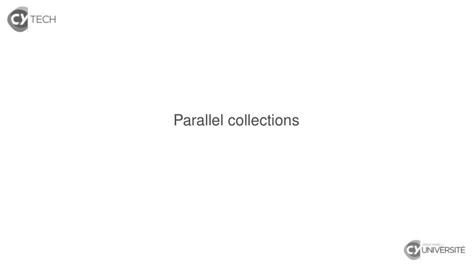

~~~text
Parallel collections
~~~

**Lecture OCR à contrôler**

~~~text
& TECH

Parallel collections

& UNIVERSITÉ
~~~

## Page 262

~~~text
Parallel collections

   Motivation

                   Djaouida Z AOUCHE, Romain D UJOL   54
~~~

## Page 263

~~~text
Parallel collections

   Motivation
    I Improve performances of computation

                    Djaouida Z AOUCHE, Romain D UJOL   54
~~~

## Page 264

~~~text
Parallel collections

   Motivation
    I Improve performances of computation
    I Some computations may be done independently because
       they depend on independent elements.

                    Djaouida Z AOUCHE, Romain D UJOL        54
~~~

## Page 265

~~~text
Parallel collections

   Motivation
    I Improve performances of computation
    I Some computations may be done independently because
      they depend on independent elements.
    I Hence they may be performed in parallel on several threads.

                     Djaouida Z AOUCHE, Romain D UJOL           54
~~~

## Page 266

~~~text
Parallel collections

   Motivation
    I Improve performances of computation
    I Some computations may be done independently because
      they depend on independent elements.
    I Hence they may be performed in parallel on several threads.

   How to use parallel collections ?

                     Djaouida Z AOUCHE, Romain D UJOL           54
~~~

## Page 267

~~~text
Parallel collections

   Motivation
    I Improve performances of computation
    I Some computations may be done independently because
      they depend on independent elements.
    I Hence they may be performed in parallel on several threads.

   How to use parallel collections ?
    I Before version 2.13 : package scala.collection.parallel

                     Djaouida Z AOUCHE, Romain D UJOL           54
~~~

## Page 268

~~~text
Parallel collections

   Motivation
    I Improve performances of computation
    I Some computations may be done independently because
      they depend on independent elements.
    I Hence they may be performed in parallel on several threads.

   How to use parallel collections ?
    I Before version 2.13 : package scala.collection.parallel
    I From version 2.13 : separate module scala-parallel-collections
       Dependency to add in build.sbt (package name preserved)

                     Djaouida Z AOUCHE, Romain D UJOL           54
~~~

## Page 269

~~~text
Parallel collections

   Motivation
    I Improve performances of computation
    I Some computations may be done independently because
      they depend on independent elements.
    I Hence they may be performed in parallel on several threads.

   How to use parallel collections ?
    I Before version 2.13 : package scala.collection.parallel
    I From version 2.13 : separate module scala-parallel-collections
       Dependency to add in build.sbt (package name preserved)

   Make standard collections parallelizable : .par
    I Version 2.13 requires specific import :
       import scala.collection.parallel.CollectionConverters._

                     Djaouida Z AOUCHE, Romain D UJOL           54
~~~

## Page 270

~~~text
Parallel collections

   Sequential VS parallel collections
   import scala.collection.parallel.CollectionConverters._

   object Parallel extends App
     {
       def elapsedNano[T](chunk : => T, times : Int = 1) : Long =
         {
           val start = System.nanoTime() // from Java
           for (i <- 0 until times) { val res = chunk }
           System.nanoTime() - start
         }

         val c = 0 to 1000000
         println(s"${elapsedNano(c     count { _ %3 == 0 }, 1000)/1000000.0} ms")
         println(s"${elapsedNano(c.par count { _ %3 == 0 }, 1000)/1000000.0} ms")
     }

                       Djaouida Z AOUCHE, Romain D UJOL           55
~~~

## Page 271

~~~text
Parallel collections and (im)mutability

   Mutability implies state management
    I Shared variable needs explicit lock to ensure correctness.

                     Djaouida Z AOUCHE, Romain D UJOL              56
~~~

## Page 272

~~~text
Parallel collections and (im)mutability

   Mutability implies state management
    I Shared variable needs explicit lock to ensure correctness.

   Immutability implies referential transparency

                     Djaouida Z AOUCHE, Romain D UJOL              56
~~~

## Page 273

~~~text
Parallel collections and (im)mutability

   Mutability implies state management
    I Shared variable needs explicit lock to ensure correctness.

   Immutability implies referential transparency
    I Think “purity” : same input always yield same results

                     Djaouida Z AOUCHE, Romain D UJOL              56
~~~

## Page 274

~~~text
Parallel collections and (im)mutability

   Mutability implies state management
    I Shared variable needs explicit lock to ensure correctness.

   Immutability implies referential transparency
    I Think “purity” : same input always yield same results
    I Applicable to val but not var

                     Djaouida Z AOUCHE, Romain D UJOL              56
~~~

## Page 275

~~~text
Parallel collections and (im)mutability

   Mutability implies state management
    I Shared variable needs explicit lock to ensure correctness.

   Immutability implies referential transparency
    I Think “purity” : same input always yield same results
    I Applicable to val but not var
   ⇒ No need for explicit lock

                      Djaouida Z AOUCHE, Romain D UJOL             56
~~~

## Page 276

~~~text
Parallel collections and (im)mutability

   Mutability implies state management
    I Shared variable needs explicit lock to ensure correctness.

   Immutability implies referential transparency
    I Think “purity” : same input always yield same results
    I Applicable to val but not var
   ⇒ No need for explicit lock

        Immutability is highly recommended for parallel
                          computations

                      Djaouida Z AOUCHE, Romain D UJOL             56
~~~

## Page 277

~~~text
Parallel collections and (im)mutability

   Mutability implies state management
    I Shared variable needs explicit lock to ensure correctness.

   Immutability implies referential transparency
    I Think “purity” : same input always yield same results
    I Applicable to val but not var
   ⇒ No need for explicit lock

        Immutability is highly recommended for parallel
                          computations

         (At least, use mutable state as rarely as possible. . . !)

                      Djaouida Z AOUCHE, Romain D UJOL                56
~~~

## Page 278

~~~text
Parallel collections and (im)mutability
   Immutability VS mutable state
   import scala.collection.parallel._
   import scala.collection.parallel.CollectionConverters._

   object MutableIsEvil extends App
     {
       val c = 1 to 1000000
       def isPrime(n : Int) = (2 to math.sqrt(n).toInt) forall { n % _ != 0 }

         // Immutable case
         for (i <- 1 to 3) println(s"count isPrime = ${c.par count isPrime}")

         // Mutable case with a counter
         def countPrimes(c : ParSeq[Int]) = {
             var count = 0
             c foreach { n => if (isPrime(n)) count = count + 1 }
             count
           }
         for (i <- 1 to 3) println(s"countPrimes = ${countPrimes(c.par)}")
     }
                       Djaouida Z AOUCHE, Romain D UJOL           57
~~~
