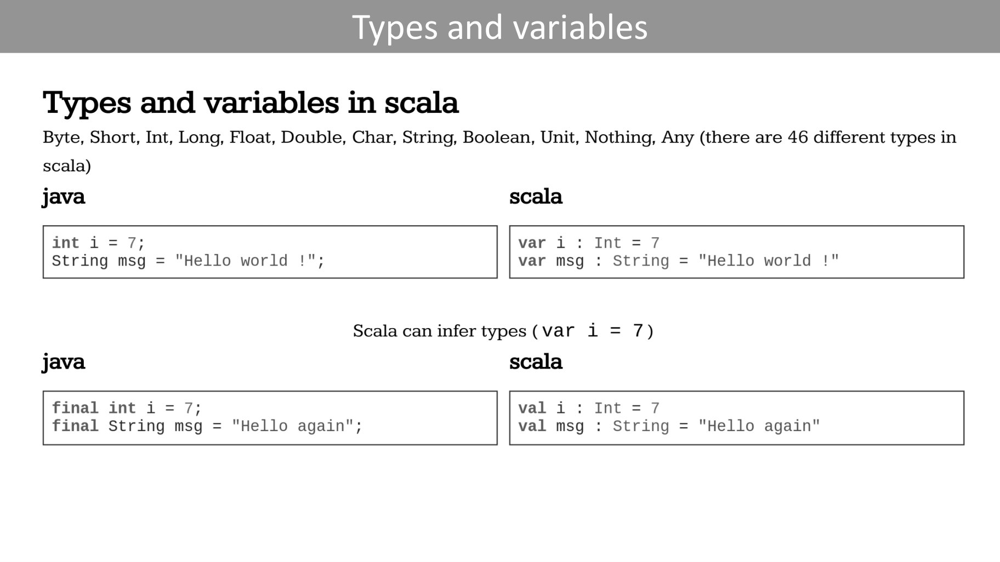
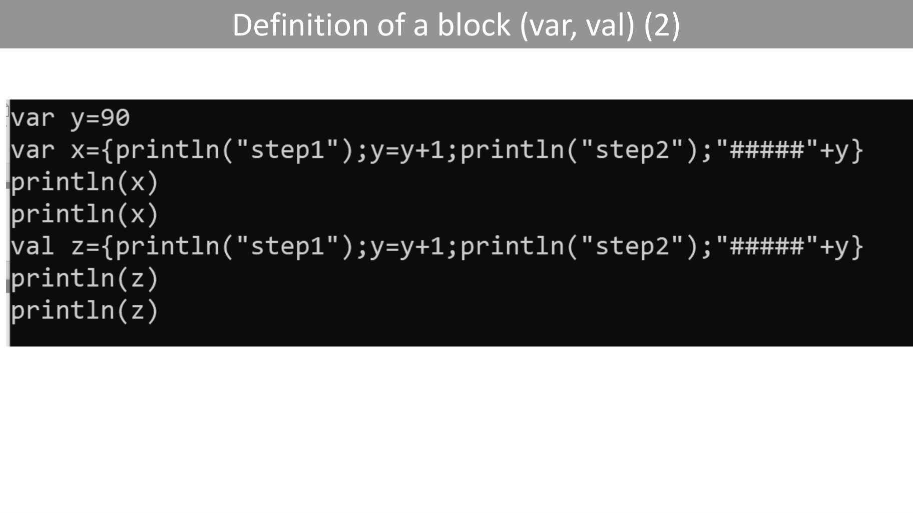
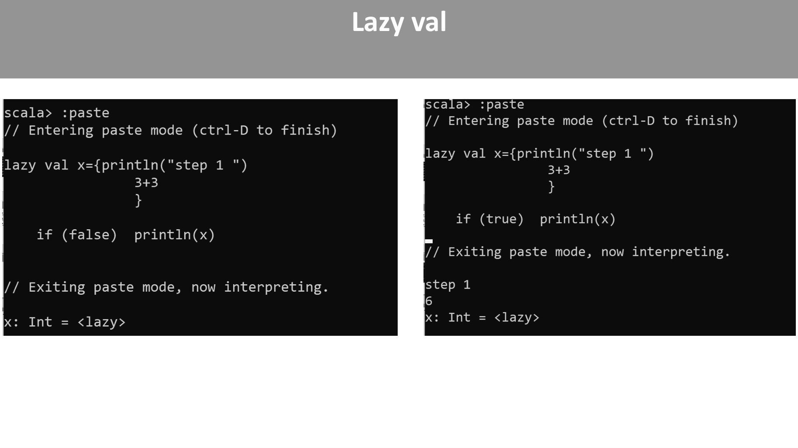
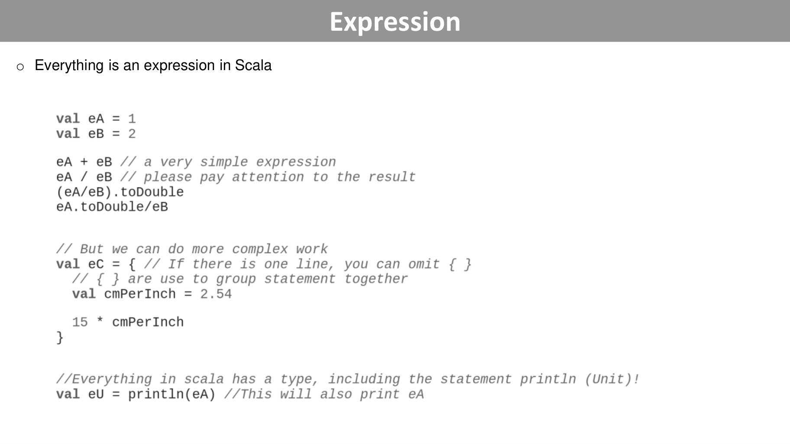
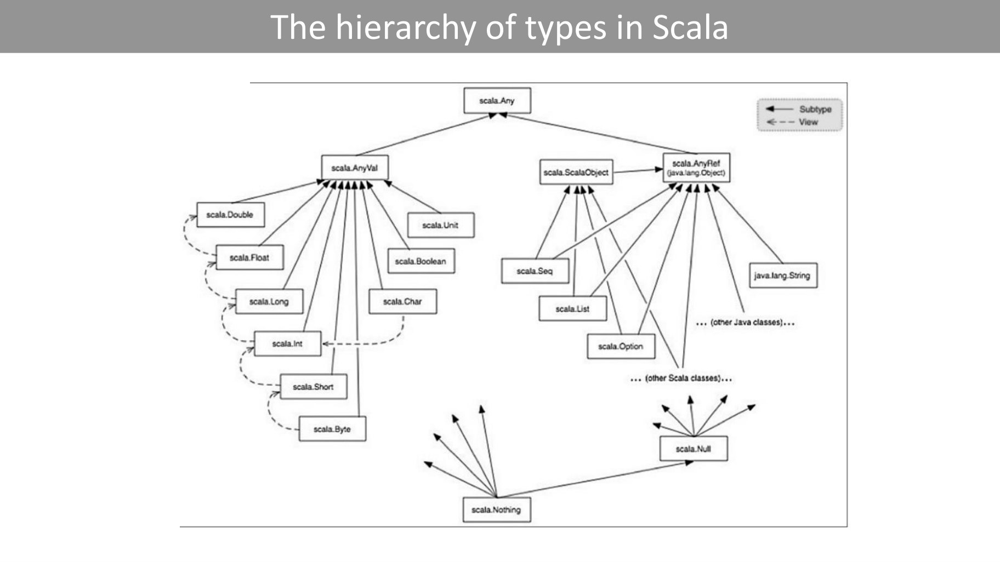
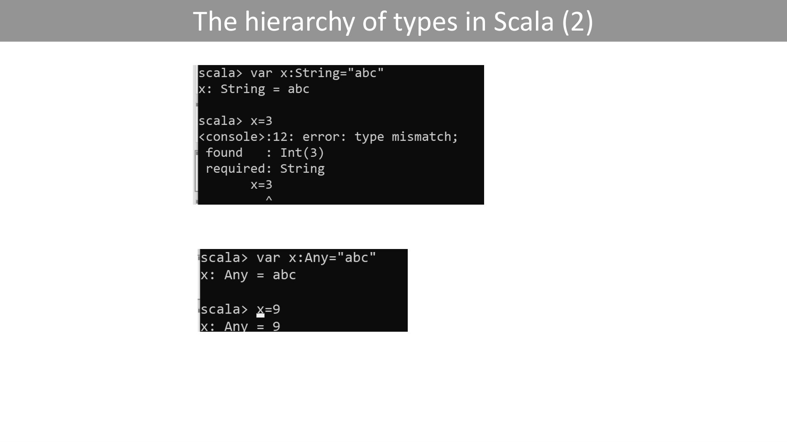
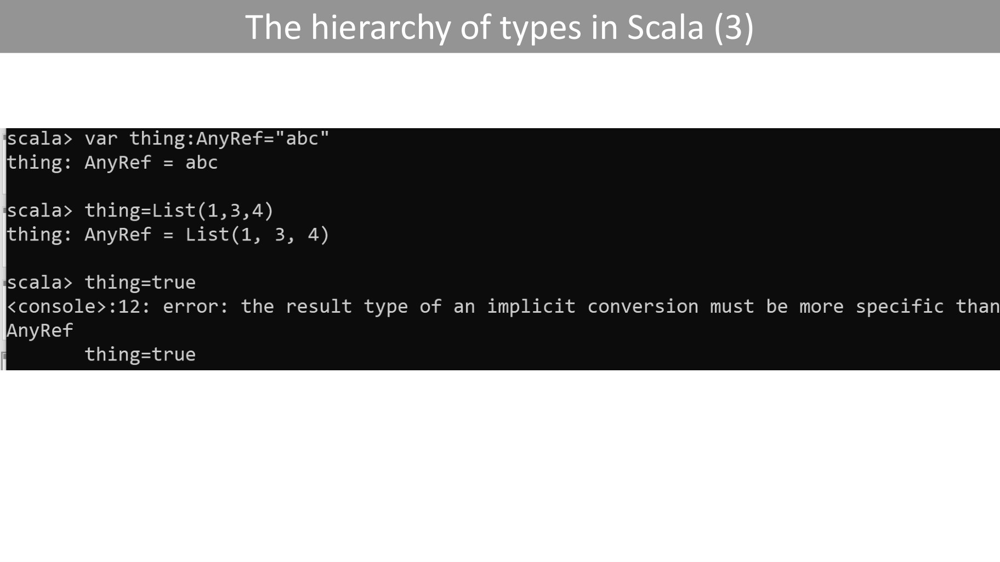

# basics_scala.pdf

[Ouvrir l’original](https://drive.google.com/open?id=1q3FVMmq2tadPxnOEeko9hnXpwDkmpE-1) · Les pages signalées comprennent du texte reconnu automatiquement ou des éléments graphiques. Le fac-similé permet de vérifier chaque lecture.

**Pages avec fac-similé ou lecture OCR** — 3, 6, 8–10, 12–13.

## Page 1

~~~text
                               Hello program

object HelloWorld {                  object HelloWorld extends App{
  def main(args: Array[String]) {          println("Hello, world!")
   println("Hello, world!")
}                                                                }
                   }
~~~

## Page 2

~~~text
                                 Scala as a REPL

o Very useful to test some short programs
~~~

## Page 3

~~~text
Types and variables
~~~

**Lecture OCR à contrôler**

~~~text
Types and variables

Types and variables in scala

Byte, Short, Int, Long, Float, Double, Char, String, Boolean, Unit, Nothing, Any (there are 46 different types in
scala)

java scala

int i=7; var i: Int = 7

String msg = "Hello world !"; var msg : String = "Hello world !"

Scala can infer types(var i = 7)
java scala

val i: Int =7

val msg : String = "Hello again"

final int i = 7;
final String msg = "Hello again";
~~~

## Page 4

~~~text
                                      Types and variables

o Specification of x’s type and inference of x’s type
scala> var x:String="String"
x: String = String

o Wrong specification of x’s type
scala> var x:Int="String"
<console>:11: error: type mismatch;
 found : String("String")
 required: Int
    var x:Int="String"
          ^
o No specification of x’s type and inference of x’s type
scala> var x="String"
x: String = String
~~~

## Page 5

~~~text
                   Definition of a block (var, val) (1)
o The value of a scala block is the value of its last expression
o The println statements are performed
o The evaluation of a block with var or val is done as soon as it is
  declared
o The val and var are evaluated when defined.
o Also, val defines a constant, a fixed value which cannot be modified
  once declared and assigned while var defines a variable, which can
  be modified or reassigned
~~~

## Page 6

~~~text
Definition of a block (var, val) (2)
~~~

**Lecture OCR à contrôler**

~~~text
var y=90
var x={printlin("step1");y=y+1;println("step2");"#####"+y}
~~~

## Page 7

~~~text
                                                     Lazy val

o Lazy execution means delaying the initialization of values. The constant is valued when it is
accessed for the first time.

o This is useful in cases where the val needs to be initialized only when it is referenced for the
first time.

o Once it is referenced, the val is initialized and is never re-evaluated for any subsequent
references.
~~~

## Page 8

~~~text
Lazy val
~~~

**Lecture OCR à contrôler**

~~~text
scala> :paste
// Entering paste mode (ctrl-D to finish)

scala> :paste
// Entering paste mode (ctrl-D to finish)

lazy val x={println("step 1 "
lazy val x={println("step 1 ") . {p ei P )
3+3 }

}

if (false) printin(x)

if (true) printin(x)
// Exiting paste mode, now interpreting.

// Exiting paste mode, now interpreting.

<lazy>

x: Int = <lazy>
~~~

## Page 9

~~~text
                                         Expression
o Everything is an expression in Scala
~~~

**Lecture OCR à contrôler**

~~~text
o Everything is an expression in Scala

1
2

val eA
val eB

eA + eB // a very simple expression

eA / eB // please pay attention to the result
(eA/eB) . toDouble

eA. toDouble/eB

// But we can do more complex work

val eC = { // If there is one line, you can omit { }
// { } are use to group statement together
val cmPerInch = 2.54

15 * cmPerInch

}

//Everything in scala has a type, including the statement println (Unit)!
val eU = println(eA) //This will also print eA
~~~

## Page 10

~~~text
The hierarchy of types in Scala
~~~

## Page 11

~~~text
                          The hierarchy of types in Scala (1)
o The previous Figure shows the type hierarchy in scala

o Any is the supertype of all types

o Any has two subclasses : AnyVal and AnyRef

o   The value types ("simple" types in french) are subclasses of AnyVal: Boolean, Int, Char, etc.

o   The other types are subclasses of AnyRef

o Null is a subtype of all AnyRefs and Nothing the subtype of Any
~~~

## Page 12

~~~text
The hierarchy of types in Scala (2)
~~~

**Lecture OCR à contrôler**

~~~text
scala> var x:String="
x: String = abc

:12: error: type mismatch;
found : Int(3)
required: String

X=3

A
~~~

## Page 13

~~~text
The hierarchy of types in Scala (3)
~~~

**Lecture OCR à contrôler**

~~~text
scala> var thing:AnyRef="abc"
thing: AnyRef = abc

scala> thing=List(1,3,4)
thing: AnyRef = List(1, 3, 4)

scala> thing=true
<console>:12: error: the result type of an implicit conversion must be more specific than
AnyRef

thing=true
~~~

## Page 14

~~~text
                                     Option type
o Scala Option[ T ] is a container for zero or one element of a given type. An
  Option[T] can be either Some[T] or None object, which represents a missing
  value.

scala> def toInt(s: String): Option[Int] = {
   | try {
   |      Some(Integer.parseInt(s.trim))
   | } catch {
   |      case e: Exception => None
   | }
   |}
toInt: (s: String)Option[Int]
scala> toInt("abc")
res5: Option[Int] = None
scala> toInt("123")
res6: Option[Int] = Some(123)
~~~

## Page 15

~~~text
                             If expression

if (your test) {                     scala> var x=10
  // do something                    x: Int = 10
}
else if (some test) {                scala> var y=20
  // do something                    y: Int = 20
}
else {                               scala> val z= if (x<y){x=y+5;x+90}
  // do some default thing           else y
}                                    z: Int = 115
~~~
