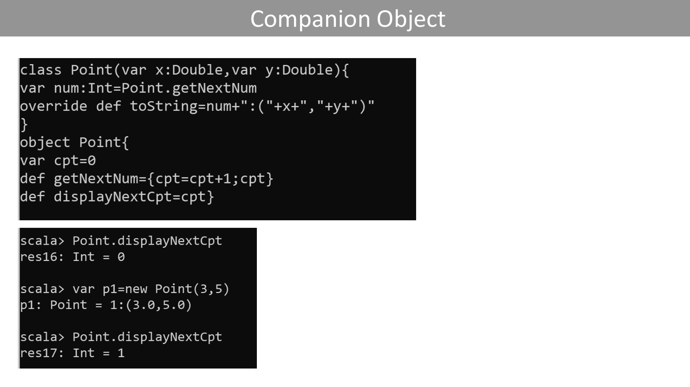
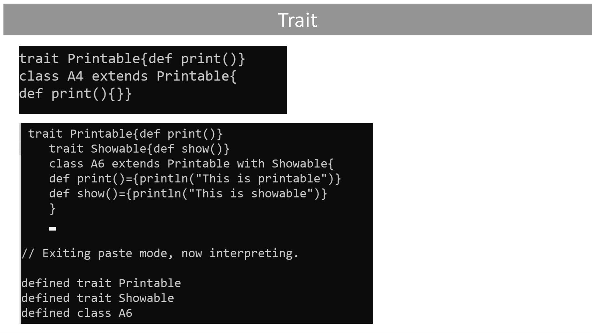

# classe.pdf

[Ouvrir l’original](https://drive.google.com/open?id=1Rmnds_fJXNZz5HmAIlR_ihYLhgE5NAit) · Les pages signalées comprennent du texte reconnu automatiquement ou des éléments graphiques. Le fac-similé permet de vérifier chaque lecture.

**Pages avec fac-similé ou lecture OCR** — 11, 17.

## Page 1

~~~text
                           Declaration of a class
o Classes and Objects are basic concepts of Object Oriented Programming which revolve
  around the real-life entities.
~~~

## Page 2

~~~text
                                      OBJECTS
o We create an object by prefixing an application of the constructor of the class with the
  operator new.
~~~

## Page 3

~~~text
                          MEMBERS OF AN OBJECT
o We select the members of an object with the infix operator (like in Java).
~~~

## Page 4

~~~text
                          MEMBERS OF AN OBJECT
o We select the members of an object with the infix operator (like in Java).
~~~

## Page 5

~~~text
                                  CONSTRUCTOR
o We select the members of an object with the infix operator (like in Java).
~~~

## Page 6

~~~text
                                  CONSTRUCTOR
o We select the members of an object with the infix operator (like in Java).
~~~

## Page 7

~~~text
                                  CONSTRUCTOR
o We select the members of an object with the infix operator (like in Java).
~~~

## Page 8

~~~text
                                  AN OBJECT SCALA
o An object is a class that has exactly one instance. It is created lazily when it is
  referenced, like a lazy val
~~~

## Page 9

~~~text
                                  AN OBJECT SCALA
o An object is a class that has exactly one instance. It is created lazily when it is
  referenced, like a lazy val
~~~

## Page 10

~~~text
                             Companion Object
o An object with the same name as a class is called a companion object
o The class is the object’s companion class
o A companion class or object can access the private members of its companion
o The companion object associated with a given class contains members which are not
  specific to the instances of the class
~~~

## Page 11

~~~text
Companion Object
~~~

**Lecture OCR à contrôler**

~~~text
class Point(var x:Double,var y:Double){
var num:Int=Point.getNextNum

override def toString=num+": ("+x+", "+y+")"
}
object Point{

var cpt=0

def getNextNum={cpt=cpt+1;cpt}
def displayNextCpt=cpt}

scala> Point.displayNextCpt
res16: Int = @

scala> var pi=new Point(3,5)
pl: Point = 1:(3.0,5.0)

scala> Point.displayNextCpt
Res17= inc a=
~~~

## Page 12

~~~text
                                           Exercise

                             Construct the point class :
case class Point(var x:Int,y:Int){
var num:Int =….
def deplace(a:Int,b:Int)=…..
def symetrie():Point=…..
def estCentre()=….
def surLigne(a:Int,b:Int)=…
def dansCercle(centre:Point,r:Int)=…..
def surCercle(centre:Point,r:Int)=…..}
object Point {……}
~~~

## Page 13

~~~text
                                               case class
o case classes in Scala are regular classes with some extra features like equal, hashcode, and
  toString.
~~~

## Page 14

~~~text
                                     case class
o A class must be abstract as soon as a variable or constant is not initialized or
  that a method is not defined
~~~

## Page 15

~~~text
                                         Sealed
o It is possible to precede the class name class by sealed. All its sub-classes must be placed
  in the same file.

sealed class Form
class Point(x:Int,y:Int) extends Form
class Circle(centre:Point,rayon:Double) extends Form
~~~

## Page 16

~~~text
                                           Trait

o A trait is an abstract class with no parameter

o A trait encapsulates method and field definitions, which can then be reused by
  mixing them into classes

o A class can mix in any number of traits

o Scala also allows traits to be partially implemented but traits may not have
  constructor parameters
~~~

## Page 17

~~~text
Trait
~~~

**Lecture OCR à contrôler**

~~~text
trait Printable{def print()}
class A4 extends Printable{

def print(){}}

trait Printable{def print()}
trait Showable{def show()}
class A6 extends Printable with Showable{
def print()={println("This is printable")}
def show()={printlin("This is showable")}
}

// Exiting paste mode, now interpreting.

defined trait Printable
defined trait Showable
defined class A6
~~~
