# collectionBis.pdf

[Ouvrir l’original](https://drive.google.com/open?id=1KMoWCr4tjUqZpGZpPChd5qMkC1YYycgR) · Les pages signalées comprennent du texte reconnu automatiquement ou des éléments graphiques. Le fac-similé permet de vérifier chaque lecture.

**Pages avec fac-similé ou lecture OCR** — 2–3, 6–7, 11–12, 18–19, 22, 24, 26–27, 29–34, 41, 43.

## Page 1

~~~text
                                      Collections
o Collections are containers of objects. Each container can be a List, Tuple,
  Option, Map, etc. A collection may have an arbitrary number of elements.

o Scala provides rich set of collection library. It contains classes and traits to
  collect data.

o These collections can be mutable or immutable.

o Scala.collection.mutable package contains all the mutable collections. You
 can add, remove and update data while using this package.

o Scala.collection.immutable contains all the immutable collections. It does not
  allow you to modify data.
~~~

## Page 2

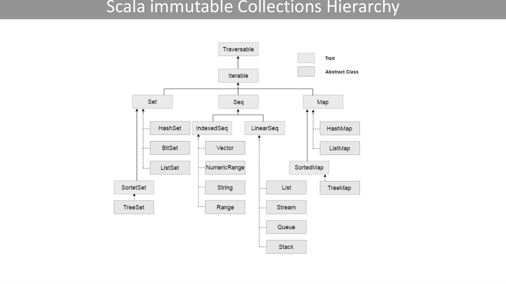

~~~text
Scala immutable Collections Hierarchy
~~~

**Lecture OCR à contrôler**

~~~text
cala Immutable Collections Hierarchy

Traversable
Trait
| noe Abstract Class
[ ; 1
Set | Seq Map
11 ——— t
ie HashSet _IndexedSeq LinearSeq L- HashMap
t E
BitSet it Vector | i)  ListMap
ListSet i--lNumericRange| SortedMap
t ! a
SortetSet i) string hej List TreeMap
a 7 f : -
TreeSet “| Range |.) Stream
~~~

## Page 3

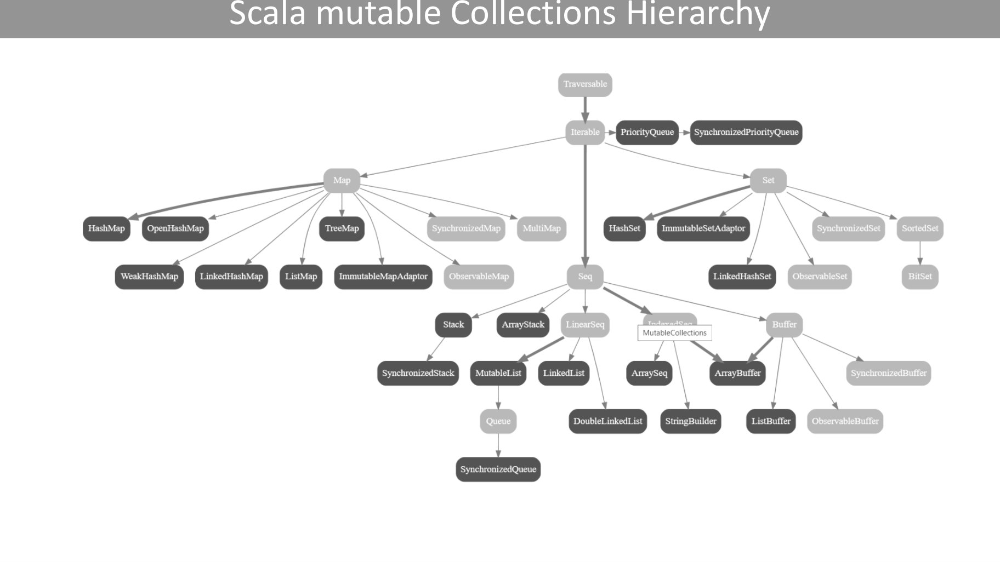

~~~text
Scala mutable Collections Hierarchy
~~~

**Lecture OCR à contrôler**

~~~text
cala mutable Collections

PriorityQueue HM SynchronizedPriorityQueue

HashMap HashSet SortedSet

Linkedk

MutableCollections

MutableList D LinkedL ist ArrayBuffer

DoubleL inkedList ListBuffer

SynchronizedQueue
~~~

## Page 4

~~~text
                                  Trait Traversable
o All the collections Traversable implement foreach : def foreach[U](f:Element=>U):Unit :

       o foreach method allows to traverse all the collection’s elements.
       o the f function is applied to each element of the collection.
       o U is an arbitrary result type.
       o Element is the type of the collection’s elements.
~~~

## Page 5

~~~text
                         Creation of a new collection
o Collections are created by the same uniform syntax : the name class followed by its
  elements.
~~~

## Page 6

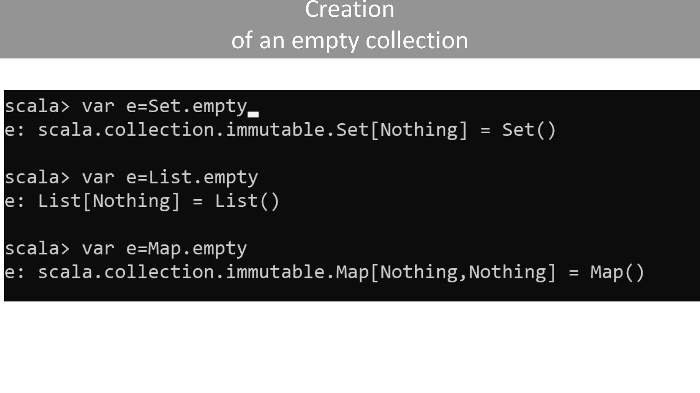

~~~text
       Creation
of an empty collection
~~~

**Lecture OCR à contrôler**

~~~text
scala> var e=Set.empty,
e: scala.collection.immutable.Set[Nothing] = Set()

scala> var e=List.empty
e: List[Nothing] = List()

scala> var e=Map.empty
e: scala.collection.immutable.Map[Nothing, Nothing ]
~~~

## Page 7

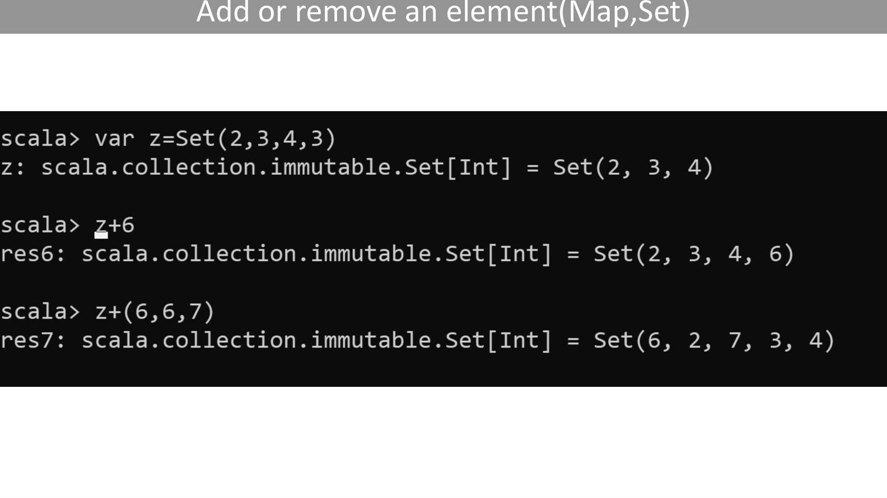

~~~text
Add or remove an element(Map,Set)
~~~

**Lecture OCR à contrôler**

~~~text
scala> var z=Set(2,3,4,3)
z: scala.collection.immutable.Set[Int] = Set(2, 3, 4)

scala> Z+6
res6: scala.collection.immutable.Set[Int] = Set(2, 3, 4, 6)

scala> z+(6,6,7)
res7: scala.collection.immutable.Set[Int]

Set(6, 2, 7, 3, 4)
~~~

## Page 8

~~~text
                           Add or remove an element(Map,Set)
scala> var z=Set(2,3,4,3)
z: scala.collection.immutable.Set[Int] = Set(2, 3, 4)
scala> z+6
res5: scala.collection.immutable.Set[Int] = Set(2, 3, 4, 6)
scala> z+(6,6,7)
res6: scala.collection.immutable.Set[Int] = Set(6, 2, 7, 3, 4)
scala> var tab=Map.empty[String,Int]
~~~

## Page 9

~~~text
                                        Update operations
scala> r: Array[Int] = Array(3, 4, 5)
scala> r(1)=80
scala> r
res33: Array[Int] = Array(3, 80, 5)
~~~

## Page 10

~~~text
                                        Update operations
scala> r: Array[Int] = Array(3, 4, 5)
scala> r(1)=80
scala> r
res33: Array[Int] = Array(3, 80, 5)
~~~

## Page 11

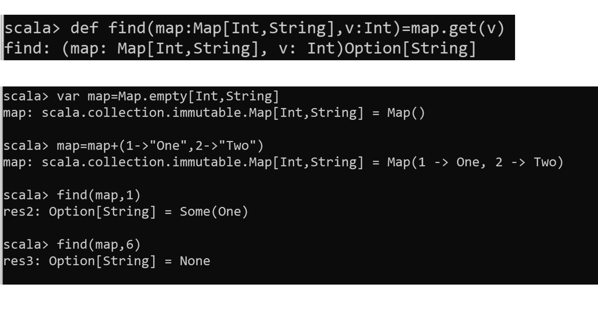

**Lecture OCR à contrôler**

~~~text
scala> def find(map:Map[Int,String],v:Int)=map.get(v)
find: (map: Map[int, String], v: Int)Option[String]

scala> var map=Map.empty[Int,String]
map: scala.collection.immutable.Map[Int,String] = Map()

scala> map=map+(1->"One",2->"Two")
map: scala.collection.immutable.Map[Int, String]

Map(1 -> One, 2 -> Two)

scala> find(map,1)
res2: Option[String] = Some(One)

scala> find(map,6)
res3: Option[String]
~~~

## Page 12

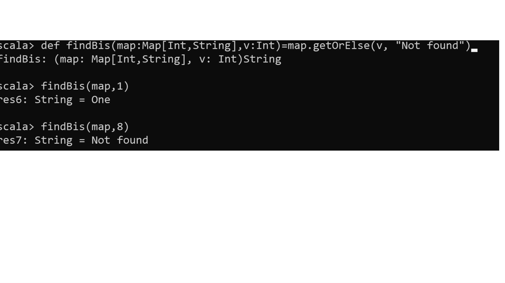

**Lecture OCR à contrôler**

~~~text
scala> def findBis(map:Map[Int,String],v:Int)=map.getOrElse(v, "Not found").
indBis: (map: Map[Int,String], v: Int)String

scala> findBis(map,1)
es6: String = One

scala> findBis(map, 8)
es7: String = Not found
~~~

## Page 13

~~~text
                                     Conversions
o It is possible to translate a collection into another collection such as :
          - toArray
           - toBuffer
           - toList
           - toMap
           - toStream
           -toString
           -toVector
~~~

## Page 14

~~~text
                                        Exercice

Write a function scala printDecrease(n : Int) similar to the following C++ one :

                                           void printDecrease(int n) {
                                                      for (int i=n; i>=0; i--) {
                                                            cout << i << "\n";
                                                                                   }}
~~~

## Page 15

~~~text
                     Exercice

def printDecrease(n : Int) : Unit = {
              (0 to n).toList.reverse.foreach(println)
                                           }
~~~

## Page 16

~~~text
                                          Exercice

Write a function scala values(fun: Int => Int, low: Int, high: Int) which generates ,for a
given function fun, a list of couples bounded by the integers low et high. For instance :
                              values(x=> x*x, -5, 4)
                                       gives
                    List((-5,25), (-4,16), (-3,9), (-2,4), (-1,1), (0,0), (1,1), (2,4), (3,9),
(4,16))
~~~

## Page 17

~~~text
                                  Exercice

def values(fun : Int => Int, low : Int, high : Int) : List[(Int,Int)] = {
                     (low to high).toList.map(x => (x,fun(x)))
                                                                            }
~~~

## Page 18

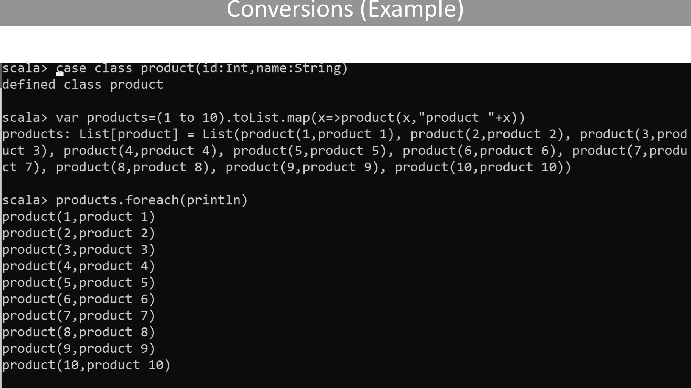

~~~text
Conversions (Example)
~~~

**Lecture OCR à contrôler**

~~~text
scala> gase class product(i
defined class product

:Int, name: String

scala> var products=(1 to 10).toList.map(x=>product(x, "product "+x))

products: List[product] = List(product(1,product 1), product(2,product 2), product(3,prod
uct 3), product(4,product 4), product(5,product 5), product(6,product 6), product(7,produ
ct 7), product(8,product 8), product(9,product 9), product(10,product 10) )

scala> products. foreach(printl1n)
product(1,product 1)
product(2,product 2)
product(3,product 3)
product(4,product 4)
product(5,product 5)
product(6,product 6)
product(7,product 7)
product(8,product 8)
product(9,product 9)
product(10,product 10)
~~~

## Page 19

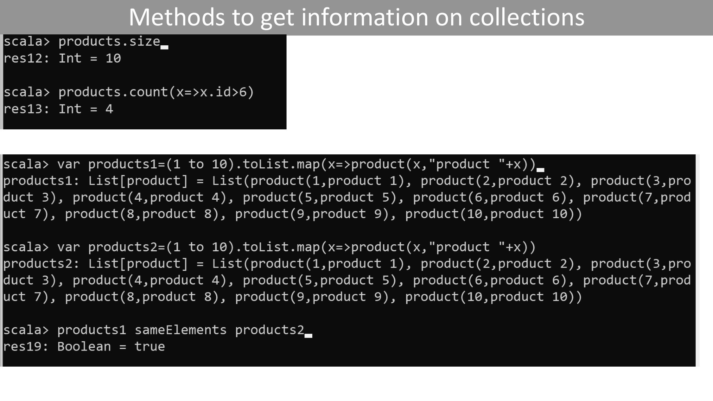

~~~text
Methods to get information on collections
~~~

**Lecture OCR à contrôler**

~~~text
scala> products.size,
res12: Int = 10

scala> products.count(x=>x.id>6)
res13: Int = 4

scala> var products1=(1 to 10).toList.map(x=>product(x, "product "+x))
products1: List[product] = List(product(1,product 1), product(2,product 2), product(3,pro
duct 3), product(4,product 4), product(5,product 5), product(6,product 6), product(7,prod

uct 7), product(8,product 8), product(9,product 9), product(10,product 10))

scala> var products2=(1 to 10).toList.map(x=>product(x, "product "+x))

products2: List[product] = List(product(1,product 1), product(2,product 2), product(3,pro
duct 3), product(4,product 4), product(5,product 5), product(6,product 6), product(7,prod
uct 7), product(8,product 8), product(9,product 9), product(10,product 10))

scala> products1 sameElements products2,
res19: Boolean = true
~~~

## Page 20

~~~text
             Methods to get information on collections
o See also:
       - forall
        - exists
        - sum
        - product
        - min
        - max
~~~

## Page 21

~~~text
                             Methods to select or split collections
scala> var liste=List(1,2,3,4,5)
liste: List[Int] = List(1, 2, 3, 4, 5)
scala> liste head
res42: Int = 1
scala> liste last
res43: Int = 5
scala> liste tail
res44: List[Int] = List(2, 3, 4, 5)
scala> liste init
res45: List[Int] = List(1, 2, 3, 4)
scala> liste take(2)
res47: List[Int] = List(1, 2)
scala> var z=liste splitAt(2)
z: (List[Int], List[Int]) = (List(1, 2),List(3, 4, 5))
~~~

## Page 22

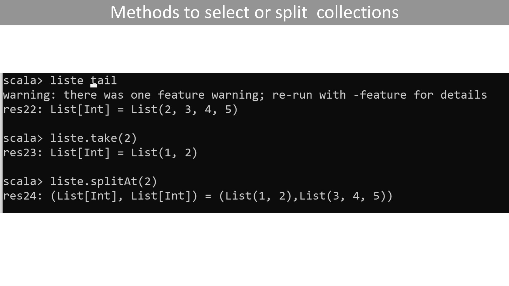

~~~text
Methods to select or split collections
~~~

**Lecture OCR à contrôler**

~~~text
scala> liste tail
warning: there was one feature warning; re-run with -feature for details
res22E [Laisiel[iime]| = (laisie(2, 3, Zl, 5)

scala> liste.take(2)
res23: List[Int] = List(1, 2)

scala> liste.splitAt(2)
res24: (List[Int], List[Int]) = (List(1, 2),List(3, 4, 5))
~~~

## Page 23

~~~text
                        Methods to select or split collections
   o See the following methods :
            - takeRight
            - dropRight
            - takeWhile
            - span
            - filter
            -filterNot
            - partition
            - slice
Example
~~~

## Page 24

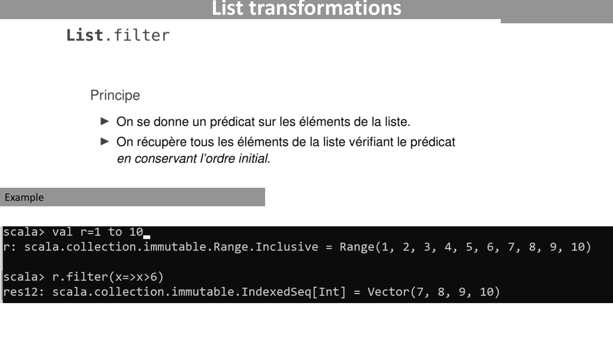

~~~text
          List transformations

Example
~~~

**Lecture OCR à contrôler**

~~~text
List.filter

Principe

> On se donne un prédicat sur les éléments de la liste.

> On récupère tous les éléments de la liste vérifiant le prédicat
en conservant l'ordre initial.

Example

scala> val r=1 to 10,
r: scala.collection.immutable.Range.Inclusive = Range(1, 2, 3, 4, 5, 6, 7, 8, 9, 10)

scala> r.filter(x=>x>6)
res12: scala.collection.immutable.IndexedSeq[Int] = Vector(7, 8, 9, 10)
~~~

## Page 25

~~~text
                               List transformations
o There are several transformations available in the standard Scala library such as
  map, flatMap, filter, sort, foldLeft, and foldRight.

o   map() is a higher order function.
           Every collection object has the map() method.
           map() takes some function as a parameter.
           map() applies the function to every element of the source collection.
          map() returns a new collection of the same type as the source collection.

o Distributing a function f on a collection’s elements by using function map
~~~

## Page 26

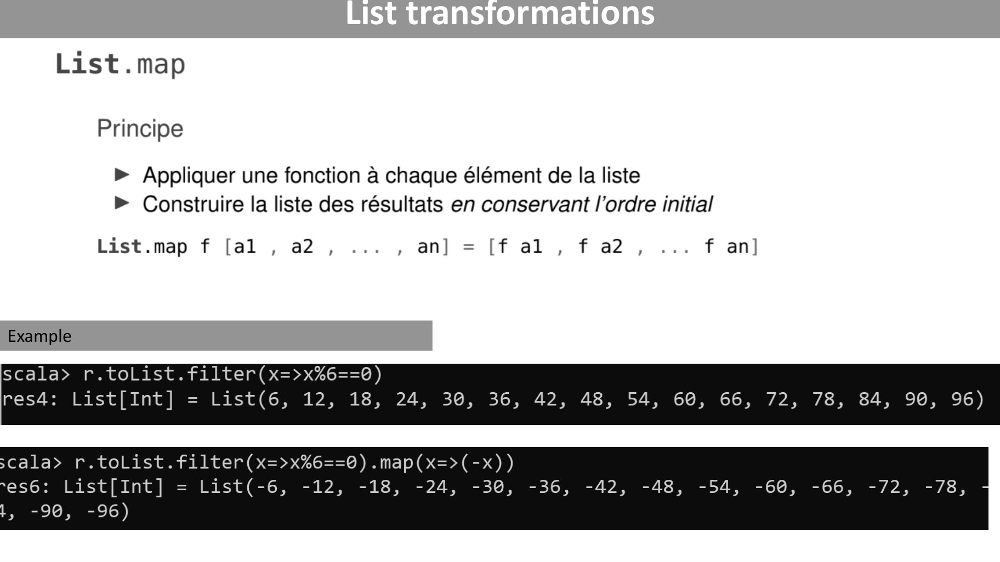

~~~text
          List transformations

Example
~~~

**Lecture OCR à contrôler**

~~~text
List.map

Principe

> Appliquer une fonction à chaque élément de la liste
> Construire la liste des résultats en conservant l'ordre initial

List.map f [al , a2 ,

, an] = [f al , fa, f an]

Example

scala> r.toList.filter(x=>x%6==0)

res4: List[Int] = List(6, 12, 18, 24, 30, 36, 42, 48, 54, 60, 66, 72, 78, 84, 90, 96)

scala> r.toList.filter(x=>x%6==0) .map(x=>(-x) )
es6: List[Int] = List(-6, -12, -18, -24, -30, -36, -42, -48, -54, -60, -66, -72, -78,
» -90, -96)
~~~

## Page 27

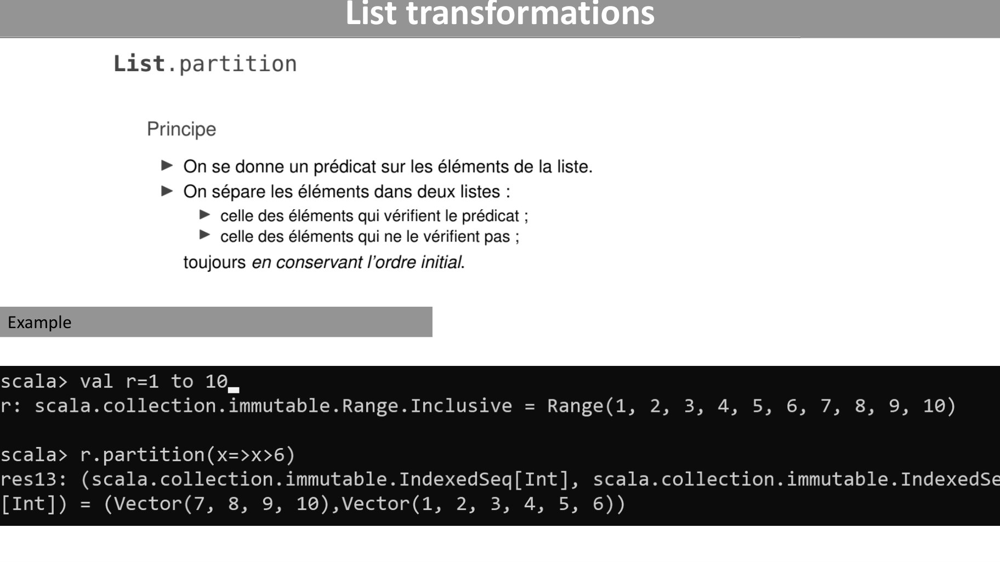

~~~text
          List transformations

Example
~~~

**Lecture OCR à contrôler**

~~~text
List.partition

Principe

> On se donne un prédicat sur les éléments de la liste.
> On sépare les éléments dans deux listes :

> celle des éléments qui vérifient le prédicat ;
> celle des éléments qui ne le vérifient pas ;

toujours en conservant l'ordre initial.

Example

scala> val r=1 to 10,
r: scala.collection.immutable.Range.Inclusive = Range(1, 2, 3, 4, 5, 6, 7, 8, 9, 10)

scala> r.partition(x=>x>6)
res13: (scala.collection.immutable.IndexedSeg[Int], scala.collection. immutable. IndexedSe
[Int]) = (Vector(7, 8, 9, 10),Vector(1, 2, 3, 4, 5, 6))
~~~

## Page 28

~~~text
                                  List transformations

o foldLeft and foldRight
  In the functional programming paradigm, foldLeft and foldRight are used to reduce a set of
  values to one value. Typical examples include, but are not restricted to, summing a set of
  numbers in a list, concatenating a set of strings, and so on. Using the foldLeft and foldRight
  operations can help a transition to doing parallel operations in future. The foldLeft (resp.
  foldRight) operation applies the function passed to every element from left to right (resp. right
to left).

o foldLeft
def foldLeft[B](z: B)(f: (B, A) => B): B
The foldLeft takes two sets of parameters, they are curried. It accepts an initial value denoted
by the z parameter of type B and an input parameter that is a function denoted by f. The f
function accepts parameters of type B and A and outputs B. Ultimately, foldLeft returns B.
~~~

## Page 29

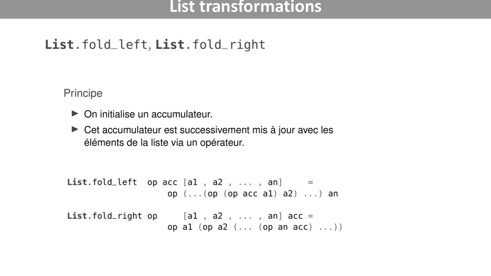

~~~text
List transformations
~~~

**Lecture OCR à contrôler**

~~~text
List transtormations

List.fold_ left, List.fold_ right

Principe

> Oninitialise un accumulateur.

> Cet accumulateur est successivement mis à jour avec les
éléments de la liste via un opérateur.

List.fold_left op acc [al , a2, ... , an] =
op (...(op (op acc al) a2) ...) an

List.fold_right op [al , a2, ... , an] acc =
op al (op a2 (... (op an acc) ...))
~~~

## Page 30

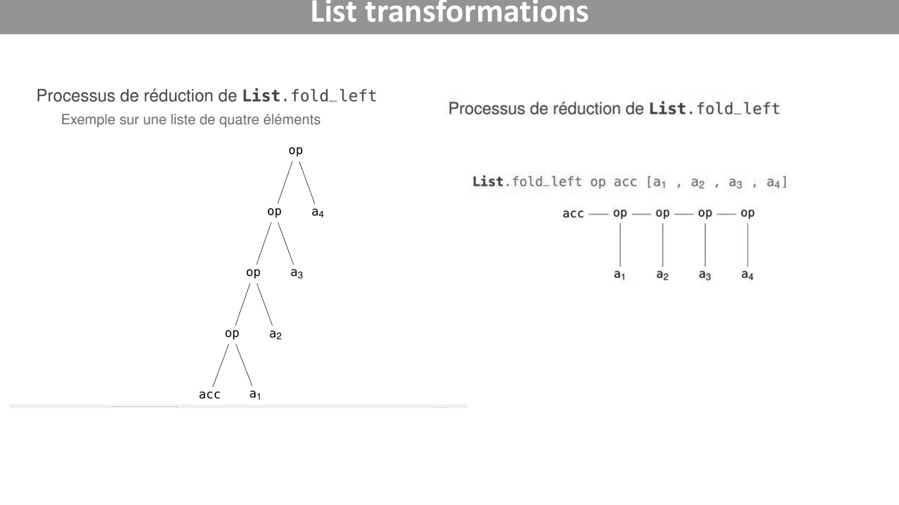

~~~text
List transformations
~~~

**Lecture OCR à contrôler**

~~~text
List transtormations

Processus de réduction de List. fold_left

: vig Processus de réduction de List. fold_left
Exemple sur une liste de quatre éléments

op
/\ List.fold_left op acc [ay , a2 , a3 ; a4]
op a4 acc op op op op
op ag ay a2 a3 a4
op ao
~~~

## Page 31

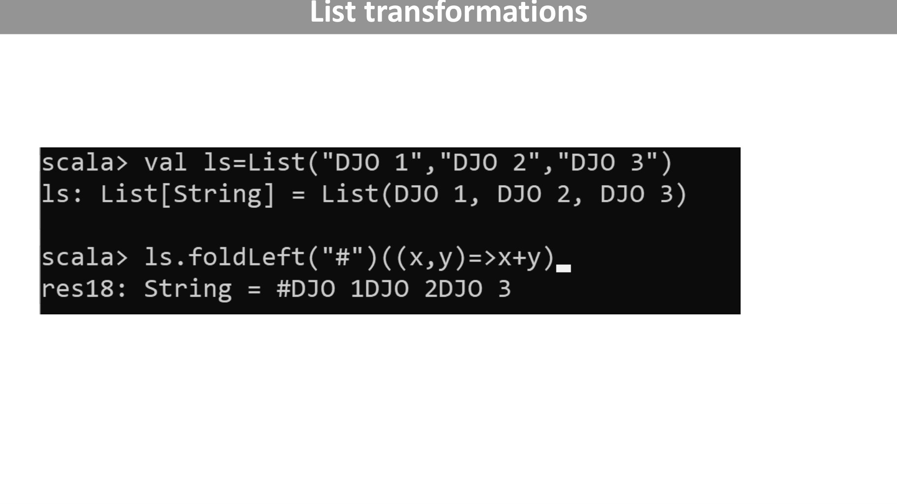

~~~text
List transformations
~~~

**Lecture OCR à contrôler**

~~~text
scala> val ls=List("DJO 1","DJO 2","DJO 3")
ls: List[String] = List(DJO 1, DJO 2, DJO 3)

scala> 1ls.foldLeft("#")((x,y)=>x+y).
res18: String = #DJO 1DJO 2DJ0 3
~~~

## Page 32

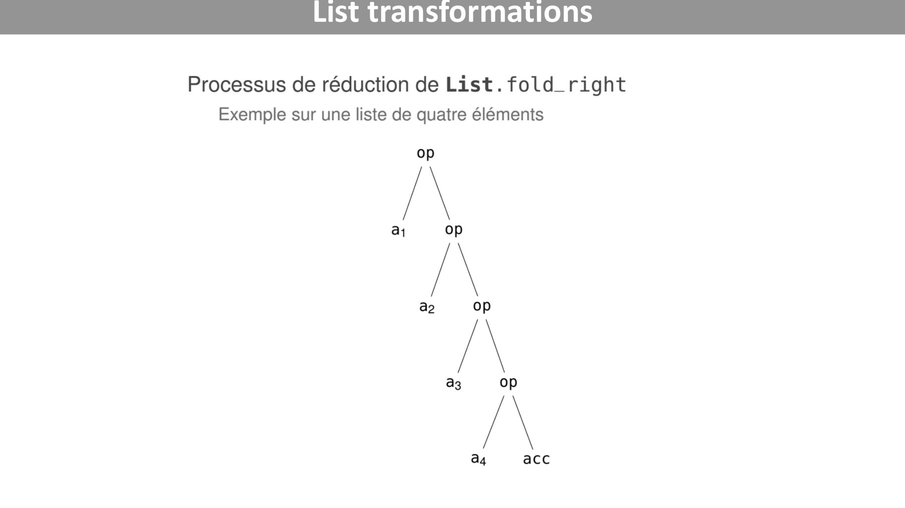

~~~text
List transformations
~~~

**Lecture OCR à contrôler**

~~~text
List transtormations

Processus de réduction de List.fold_ right
Exemple sur une liste de quatre éléments
~~~

## Page 33

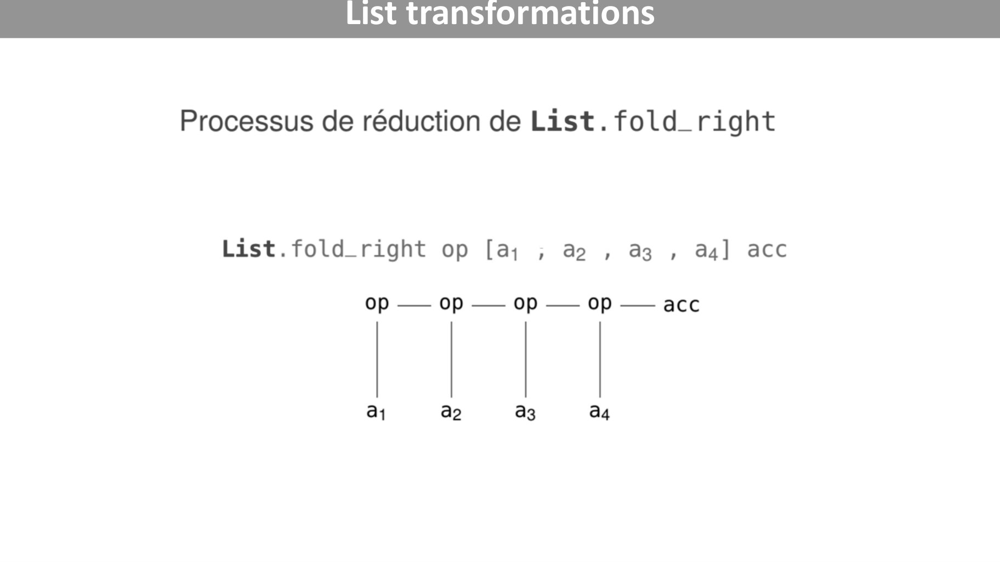

~~~text
List transformations
~~~

**Lecture OCR à contrôler**

~~~text
List transtormations

Processus de réduction de List.fold_right

List.fold_right op [ai , a2 , a3 , a4] acc

OP —— op —— Op —— OP —— acc

ai a2 a3 a4
~~~

## Page 34

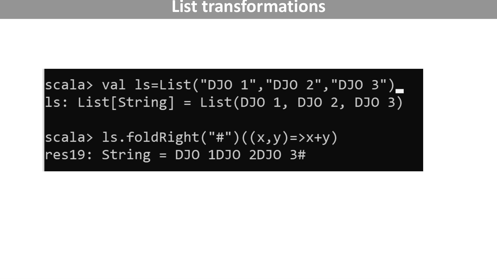

~~~text
List transformations
~~~

**Lecture OCR à contrôler**

~~~text
scala> val 1s=List("DJO 1","DJO 2","DJO 3"),
ls: List[String] = List(DJO 1, DJO 2, DJO 3)

scala> 1s.foldRight("#")((x,y)=>x+y)
res19: String = DJO 1DJO 2DJ0 3#
~~~

## Page 35

~~~text
                       Application(map,Map,mkString)
o Translate a sentence from french to English

scala> val dic=Map("le"->"the","chat"->"cat","mange"->"eats","souris"->"mouse","la"->"the")
dic: scala.collection.immutable.Map[String,String] = Map(le -> the, souris -> mouse, la -> the,
mange -> eats, chat -> cat)
scala> val phrase="Le chat mange la souris"
phrase: String = Le chat mange la souris
scala> val sentence1=phrase.toLowerCase
sentence1: String = le chat mange la souris
scala> val sentence2=sentence.split(" ")
sentence2: Array[String] = Array(le, chat, mange, la, souris)
scala> val sentence3=sentence2.map(dic(_))
sentence3: Array[String] = Array(the, cat, eats, the, mouse)
scala> val sentence4=sentence2.mkString(" ")
sentence4: String = le chat mange la souris
~~~

## Page 36

~~~text
Application(map,Map,mkString)

        scala> val sentence=phrase
                   .toLowerCase.split(" ")
                         .map(dic(_))
                        .mkString(" ")
  sentence: String = the cat eats the mouse
~~~

## Page 37

~~~text
                                 Parallel collections

o Until now, we have only used sequential collections. In some cases, computations may be
  done independently since they involve independent elements.

o For example, the distribution of a function on the collection’s elements may be done in
  parallel, by creating several threads.

o The parallel computation aims to improve the performances of the computation.

o A parallel collection is obtained by converting the collection thanks to the method par.
~~~

## Page 38

~~~text
                               Parallel collections

Conceptually, Scala's parallel collections framework parallelizes an operation on a parallel
collection by recursively “splitting” a given collection, applying an operation on each
partition of the collection in parallel, and re-“combining” all the results that were
completed in parallel.
~~~

## Page 39

~~~text
                             Parallel collections
o Sequential code
                    val start=System.nanoTime
                    val r=0 to 1000
                    val cpt=r.count(_%3==0)
                    val micros=(System.nanoTime -start)/1000
                    println("%d microseconds".format(micros))

 o Parallel code
                    val start=System.nanoTime
                    val r=0 to 1000
                    val cpt=r.par.count(_%3==0)
                    val micros=(System.nanoTime -start)/1000
                    println("%d microseconds".format(micros))
~~~

## Page 40

~~~text
                               Mutability versus immutability
o Immutability is a very important concept of functional programming. Immutable objects cannot
  be changed, however the values of a mutable object can be changed once it is created. There
  are several reasons to prefer immutable objects instead of mutable ones .

o Referential transparency is one of the properties of functional programming that always
  evaluates to the same result with the same input. In other words, there are no side effects of the
  operation.

           scala> val x="Hello"
           x: String = Hello

           scala> var y=x.reverse
           y: String = olleH

           scala> var z=x.reverse
           z: String = olleH
           "x" is referentially transparent. No side effects after substitution
~~~

## Page 41

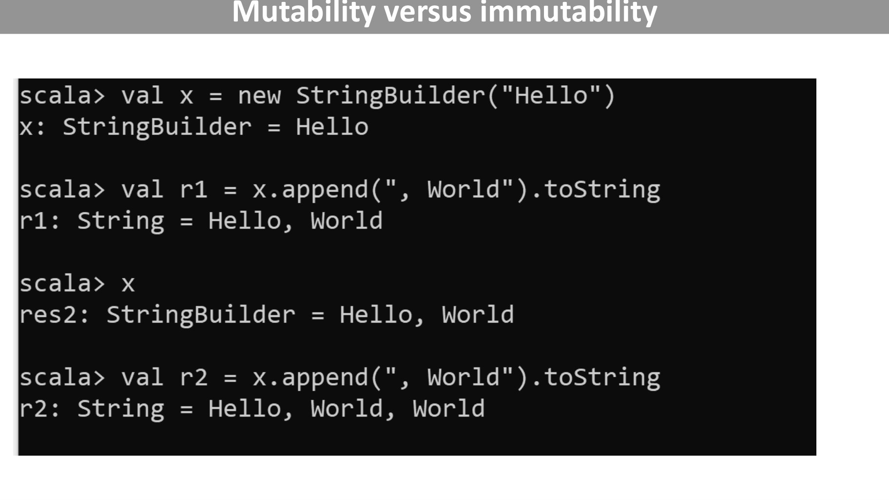

~~~text
Mutability versus immutability
~~~

**Lecture OCR à contrôler**

~~~text
scala> val x = new StringBuilder("Hello")
x: StringBuilder = Hello

scala> val ri = x.append(", World").toString
rl: String = Hello, World

scala> x
res2: StringBuilder = Hello, World

scala> val r2 = x.append(", World").toString
r2: String = Hello, World, World
~~~

## Page 42

~~~text
                      Mutability versus immutability

State: State in a program is difficult to manage when the variable is shared with more than one
thread. Without an explicit lock, such as a mutex, it becomes impossible to detect the correctnes
of a program. The following is a program that illustrates the aforementioned point. We use the
par method to perform an operation in parallel:
~~~

## Page 43

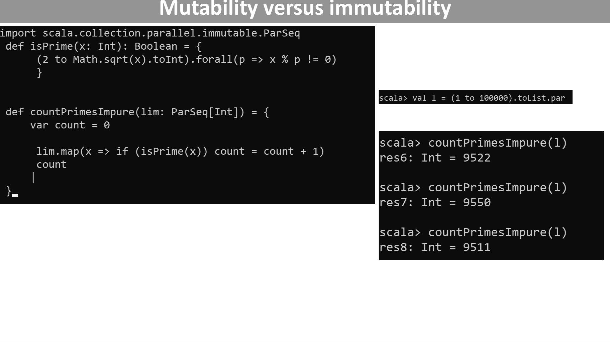

~~~text
Mutability versus immutability
~~~

**Lecture OCR à contrôler**

~~~text
import scala.collection.parallel.immutable.ParSeq
def isPrime(x: Int): Boolean = {
(2 to Math.sqrt(x).toInt).forall(p => x % p != @)

scala> val 1 = (1 to 100000).toList.par

def countPrimesImpure(lim: ParSeq[Int])

var count = @

scala> countPrimesImpure(1)

lim.map(x => if (isPrime(x)) count = count + 1) res6: Int = 9522

count

scala> countPrimesImpure(1)
res7: Int = 9550

scala> countPrimesImpure(1)
res8: Int = 9511
~~~

## Page 44

~~~text
                          Mutability versus immutability
o With pure functions , there is no need for an explicit lock. Pure functions are functions that
result in the same output for the same set of inputs without side effects.

o Immutability is desirable given the advantages it provides compared to mutability. Of course,
  real-world programming has mutability, but it should be used judiciously.
~~~

## Page 45

~~~text
                                   Exercices

Write a function which accepts a string and returns the number of each word's
occurrences.
~~~

## Page 46

~~~text
                                Exercices

scala> def occ(sentence:String)=
       {sentence.split(" ").foldLeft(Map.empty[String, Int]) {
           (count, word) =>
             count + (word -> (count.getOrElse(word, 0) + 1))
          }
        }
occ: (sentence: String)scala.collection.immutable.Map[String,Int]
~~~

## Page 47

~~~text
                                       Exercices
scala> def intermediateResult(text:List[String])=text.map(occ)

intermediateResult: (text:
List[String])List[scala.collection.immutable.Map[String,Int]]

scala> def merge(text:List[String]): Map[String, Int] = {
    intermediateResult(text).foldLeft(Map[String, Int]()) {
        (el, acc) =>
         el.map {
           case (word, count) =>
            acc.get(word).map(accCount => (word -> (accCount +
count))).getOrElse(word -> count)
         } ++ (acc -- el.keys)
      }
    }
merge: (text: List[String])Map[String,Int]
~~~

## Page 48

~~~text
                                      Exercices

scala> var text=List("Hello Mr Alex","How are you, Mr Alex","Hello","You are right")
text: List[String] = List(Hello Mr Alex, How are you, Mr Alex, Hello, You are right)

scala> merge(text)
res2: Map[String,Int] = Map(are -> 2, How -> 1, Mr -> 2, Alex -> 2, You -> 1, you, -> 1,
Hello -> 2, right -> 1)
~~~

## Page 49

~~~text
                                    Exercices

// a parallel computation

scala> def intermediateResult(text:List[String])=text.par.map(occ)
intermediateResult: (text:
List[String])scala.collection.parallel.immutable.ParSeq[scala.collection.immutable.M
ap[String,Int]]
~~~
