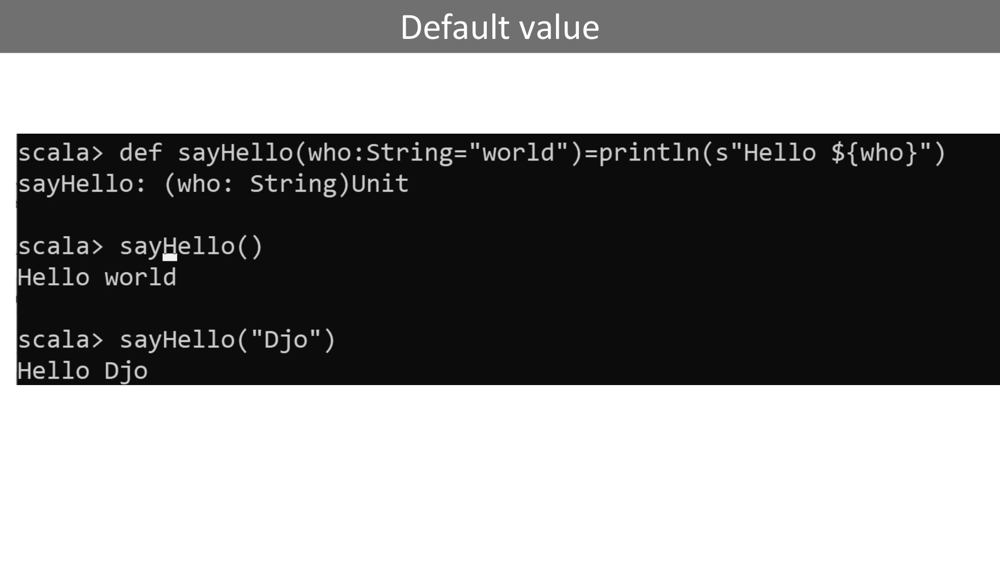
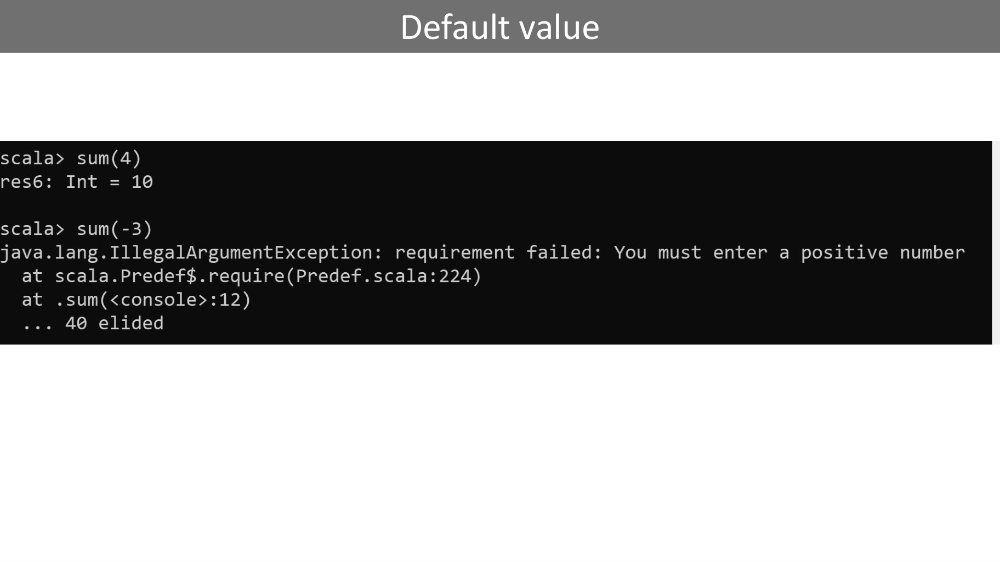
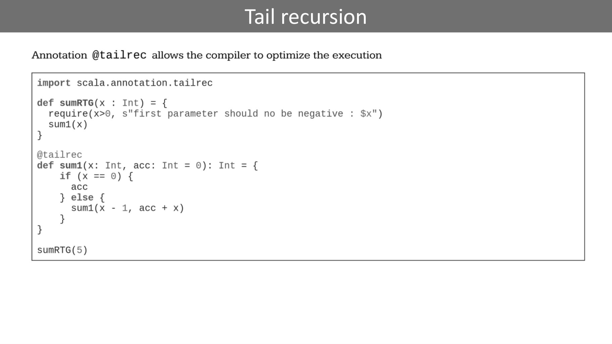
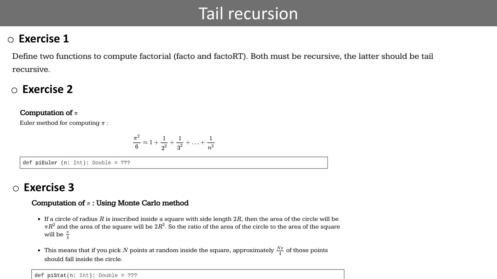
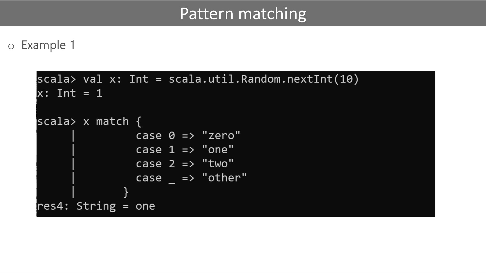
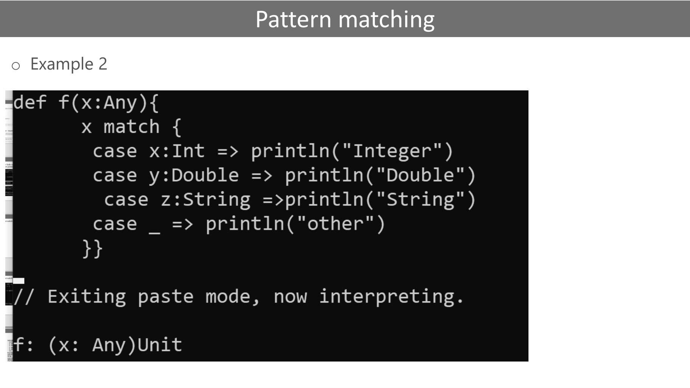
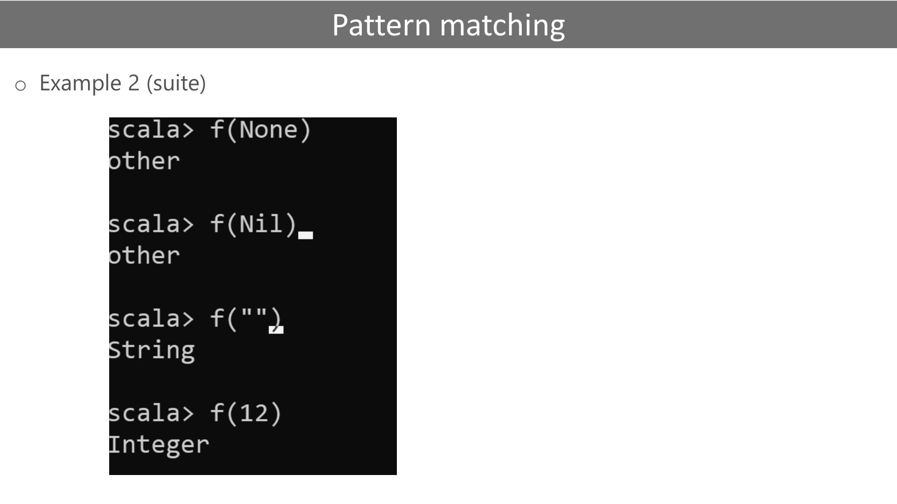
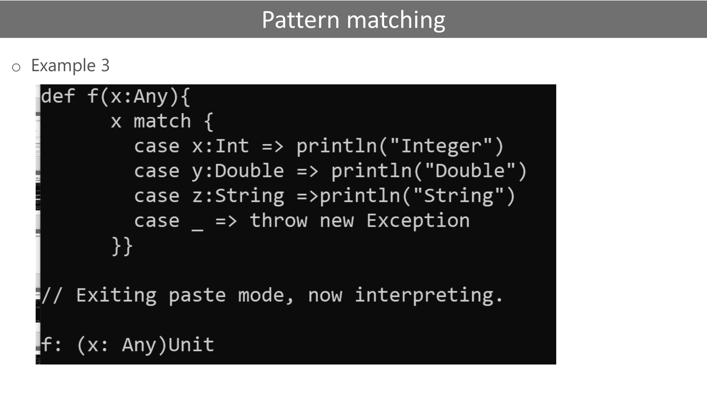
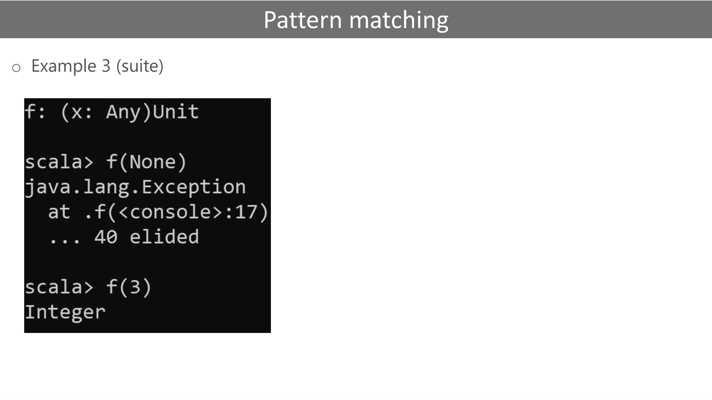

# functions (1).pdf

[Ouvrir l’original](https://drive.google.com/open?id=1MvFiAsmz59JeEsSFa029Q7VeEI3bIer_) · Les pages signalées comprennent du texte reconnu automatiquement ou des éléments graphiques. Le fac-similé permet de vérifier chaque lecture.

**Pages avec fac-similé ou lecture OCR** — 3–6, 9–13.

## Page 1

~~~text
                                  Functions (def)
o A function is a group of statements that perform a task.

Syntax : def functionName ([list of parameters]) : [return type] = {
           function body

           }
~~~

## Page 2

~~~text
                              Evaluation by name
o By-name parameters are evaluated every time they are used. They won’t be evaluated at
  all if they are unused
o To make a parameter called by-name, simply prepend => to its type
~~~

## Page 3

~~~text
Default value
~~~

**Lecture OCR à contrôler**

~~~text
Default value

scala> def sayHello(who:String="world")=println(s"Hello ${who}")
sayHello: (who: String)Unit

scala> sayHello()
Hello world

scala> sayHello("Djo")
Hello Djo
~~~

## Page 4

~~~text
Default value
~~~

**Lecture OCR à contrôler**

~~~text
Default value

scala> sum(4)
res6: Int = 10

scala> sum(-3)

java.lang.IllegalArgumentException: requirement failed: You must enter a positive number
at scala.Predef$.require(Predef.scala:224)
at .sum(<console>:12)
. 40 elided
~~~

## Page 5

~~~text
Tail recursion
~~~

**Lecture OCR à contrôler**

~~~text
Tail recursion

Annotation @tailrec allows the compiler to optimize the execution

import scala.annotation.tailrec

def sumRTG(x : Int) = {
require(x>0, s"first parameter should no be negative : $x")
sum1(x)

}

@tailrec
def sumi(x: Int, acc: Int = 0): Int = {
if (x == 0) {
acc
} else {
sumi(x - 1, acc + x)

}
sumRTG(5)
~~~

## Page 6

~~~text
               Tail recursion
o Exercise 1

o Exercise 2

o Exercise 3
~~~

**Lecture OCR à contrôler**

~~~text
Tail recursion

o Exercise 1

Define two functions to compute factorial (facto and factoRT). Both must be recursive, the latter should be tail

recursive.
o Exercise 2

Computation of x
Euler method for computing x :

5 statuts

def piEuler (n: Int): Double = ???

o Exercise 3
Computation of r : Using Monte Carlo method
+ Ifa circle of radius R is inscribed inside a square with side length 2R, then the area of the circle will be
TR? and the area of the square will be 2R?. So the ratio of the area of the circle to the area of the square

will be +

+ This means that if you pick N points at random inside the square, approximately a of those points
should fall inside the circle.

def piStat(n: Int): Double = ???
~~~

## Page 7

~~~text
                                           Polymorphic function
o Methods in Scala can be parameterized by type. The syntax is similar to that of generic
  classes. Type parameters are enclosed in square brackets

  scala> def listOfDuplicates[A](x: A, length: Int): List[A] = {
     | if (length < 1)
     | Nil
     | else
     | x :: listOfDuplicates(x, length - 1)
     |}
~~~

## Page 8

~~~text
                                 Pattern matching
o Generalized switch-case

                            value match{
                            case x1=> action1
                            case x2=> action2
                            _ =>default action
                                       }
~~~

## Page 9

~~~text
              Pattern matching
o Example 1
~~~

**Lecture OCR à contrôler**

~~~text
Pattern matching
o Example 1

scala> val x: Int = scala.util.Random.nextInt(10)
x: Int = 1

scala> x match {

| case
case
case
case

res4: String = one
~~~

## Page 10

~~~text
              Pattern matching
o Example 2
~~~

**Lecture OCR à contrôler**

~~~text
Pattern matching
o Example 2

def f(x:Any){
x match {
case x:Int => println("Integer")
case y:Double => println("Double")
case z:String =>println("String")
case _ => printlin("other")

}}

// Exiting paste mode, now interpreting.

af: (x: Any)Unit
~~~

## Page 11

~~~text
                      Pattern matching
o Example 2 (suite)
~~~

**Lecture OCR à contrôler**

~~~text
Pattern matching

o Example 2 (suite)
cala> f(None)
other

cala> f(Nil),
other

cala> f("")

cala> f(12)
~~~

## Page 12

~~~text
              Pattern matching
o Example 3
~~~

**Lecture OCR à contrôler**

~~~text
Pattern matching

o Example 3

def f(x:Any){
x match {
case x:Int => printin("Integer")
case y:Double => println("Double")
case z:String =>println( "String" )
case => throw new Exception

}} 7

// Exiting paste mode, now interpreting.

f: (x: Any)Unit
~~~

## Page 13

~~~text
                      Pattern matching
o Example 3 (suite)
~~~

**Lecture OCR à contrôler**

~~~text
Pattern matching

o Example 3 (suite)

fF: (x: Any)Unit

scala> f(None)
java.lang.Exception
at .f(<console>:17)
. 40 elided
~~~
