# 2023-09-28-Note-13-17.pdf

[Ouvrir l’original](https://drive.google.com/open?id=1OvzbNzGrhCUohrHj8_sNmaQhHE9BwIam) · Les pages signalées comprennent du texte reconnu automatiquement ou des éléments graphiques. Le fac-similé permet de vérifier chaque lecture.

**Pages avec fac-similé ou lecture OCR** — 1–11.

## Page 1

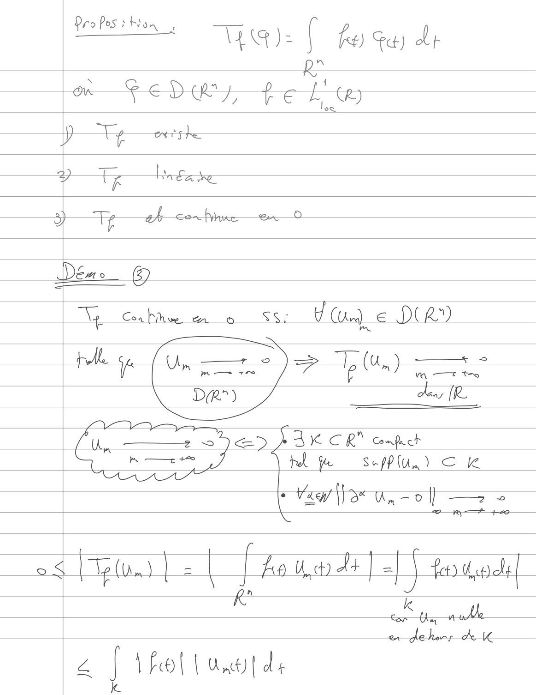

**Lecture OCR à contrôler**

~~~text
Dro Pos ù Ron ;

WA):

[ fe) Se) 2
Ro

1
f CR.)

i
low

Ww

Demo

@

Con Fire A. oy

Ss: USE e DCR)

V

=

——

[Ue

—<
M TT to

)
=~]

5) Tu

pelle on,

mom +0

DR)

4
Le TR

{LVI
fu, ——2_ se A BK CR” cape

Ke

A
CT Fe ee

SupPlu,) €

Shi ju

ane, = 0) — =

ul
VF t \

[ , 41 +
[Ha tho] =| | feo dc

kr

k
he noe

de i

&. J \ fo! | Unt) { d4
~~~

## Page 2

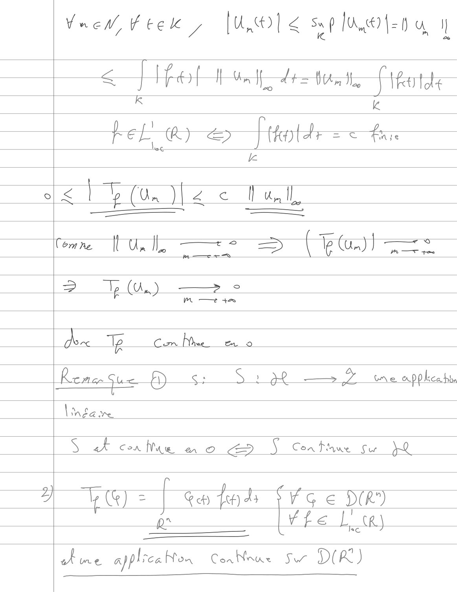

**Lecture OCR à contrôler**

~~~text
Vrew,fter , [UO] < sop [fet a IL

<q f Ref Du dei Perte
5 k

Comme NU, —=> =| ru:

M tee

Reman Sue a Si & 1 AP —— Zz wre AP Pca ha

Lu EG Ke

S ake con Nue a © i Confhue Su  }Q

pr

YU = | tafads Vo e DR
a Let Zz LR)

we applrca hon ConNnue Sw DIR)
~~~

## Page 3

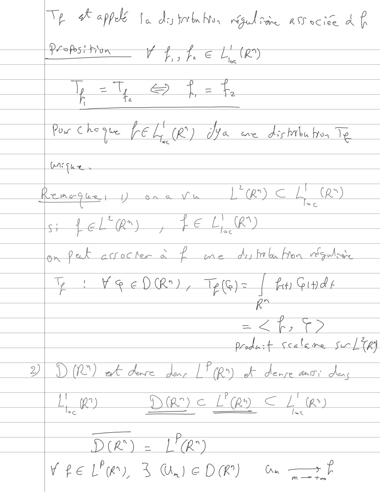

**Lecture OCR à contrôler**

~~~text
Vp gk appelé fee. ds tre bn Noa PRES AS oclee At

Recep Bion 4 EE te)

np eT ~& f.f,

\

Pour Che pe re Le) ha me dishilu bron Te

Lane fue
emerges Don a Vu
tel Qn, fe LR

on fa ecrocter à fre diy fr bn Hon véquhr

in  ¥eeDR) TplG)= Î ft Gin d 4
k° :
=< T2
produit fcalere sr Le
D DOC) at dure Jeu 1 (Rr) ok derre ant Jen

Li Daye Ley € Le)

L'œ) € LT ta)

DA) = LR
Vre lhe, 3 OUIEDR) a
~~~

## Page 4

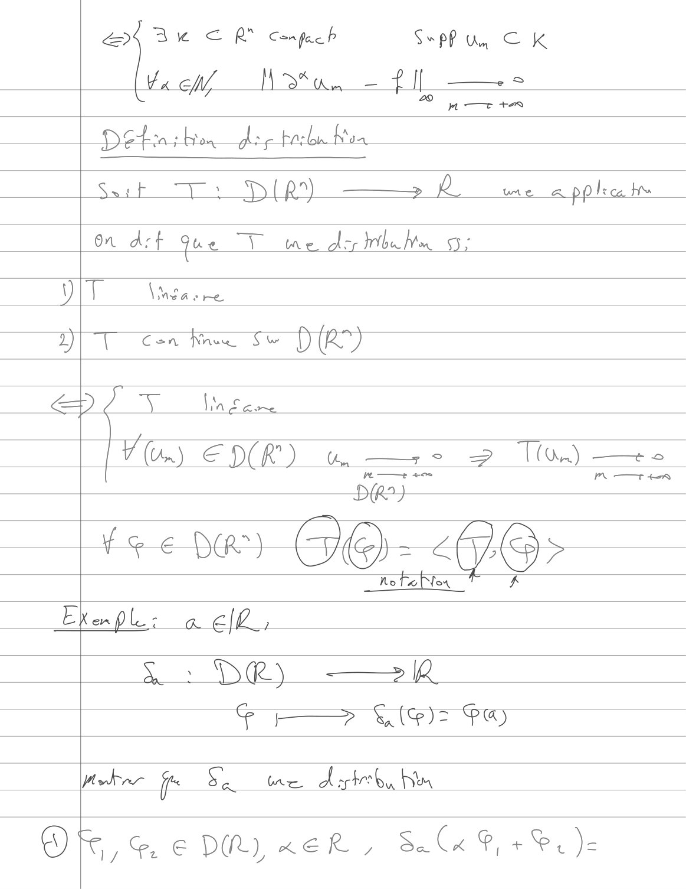

**Lecture OCR à contrôler**

~~~text
“| Bee onpucl S*PP my CK

[Yee Iota. = PIL

Ss

motes

Petra; bon E bal Ka

Saif “Ts DQ) ——» À me x ppla tw

On Act que TT me der bu Mn Se

VIT us we
DIT cea tae se PR
€ FN He.
[ ¥ (Un) EDR) 0 —s 2 UM) —
DR)
rene) GO-<96>——
_ofeler 7 À
Ekenple: à Elf.

S > DR) —»1û

2

Fr Ke): F@)

Haha ft: va Wwe PAIN Lin

RM € DR) KER, Sur, +R)
~~~

## Page 5

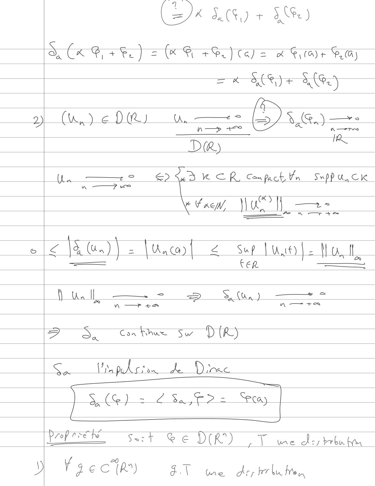

**Lecture OCR à contrôler**

~~~text
(20k SC + SR)

SK, +L) a(R eS) Cele à Filae FG)

= K SCR + ae)

(ue DR wa =

SOS:

DR;

Ua — EXD CR Cnpcbln Space

a
ea OT =.

A

£ NU) ) 2 luc 2 sop lue Hal,

FER —©

QU Sy —+"*

À —+ + A Tres

f

SS. Cri Sw DR)

Se [ty ped cts de. D PAC

| SG) = 282,622 ray |

/ Ox f Ÿ

Propre St Ge DIR) 1 we day hha

\s

Fa e C'{A°) AT me dep hla he,
~~~

## Page 6

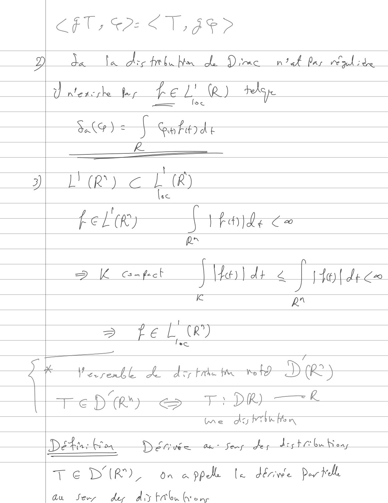

**Lecture OCR à contrôler**

~~~text
Cl; PE <T,Je>
D da ta dre tba Nm ol Direc ntak far plie
À ntencshe fur fel" (RQ) there
RG) J eaberde
J L'(R) € L (R)
t
bet tk) { the de
Rr
Ç ja)
2 K pret | | fee) | dx « HHe{ dr €
kK pr
> fel ®)
fa F
i+ Ya renll hed hiemessh DR)
oe Pry <> Fi DR ——k
me dobrbrhen
Dé. bes D Lip Qt Se des dost @bu Now
TED EUR), on app le dériwe Par tele
au Je der dry ton hon,
~~~

## Page 7

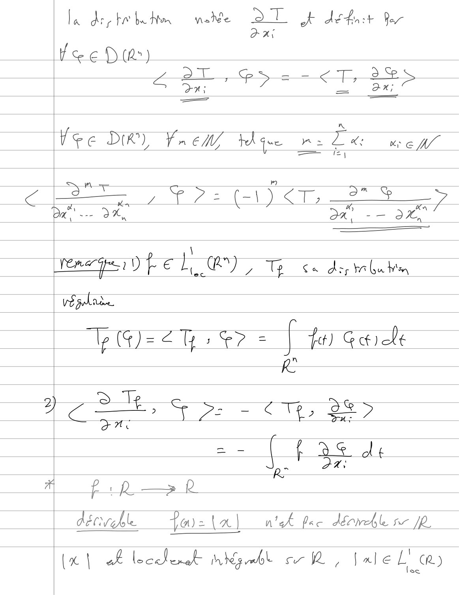

**Lecture OCR à contrôler**

~~~text
la dry he be Hen made à

Tk detest Yor

Xi
loc P(e)
aT, = -¢ 7, 3%
> On; F == one
fee Dik) Frem thie wile mew
ere kee
Da DK, aa) -— On

\
Er A D) fF € Ce) / Tp Ça dis A bu Wan

végelaèe

Wp (4)=¢ 7 1? = i fit) Gale

Re
ro) D Te EN
ay { - — € Te, 2%
—_— i 72 Cs a?
(rar
PR —> R

décrekl Ta) = ta] nek pec dr sr JR.

Le | À Leccderet- Mk abl csr, Jale Lt CR)
~~~

## Page 8

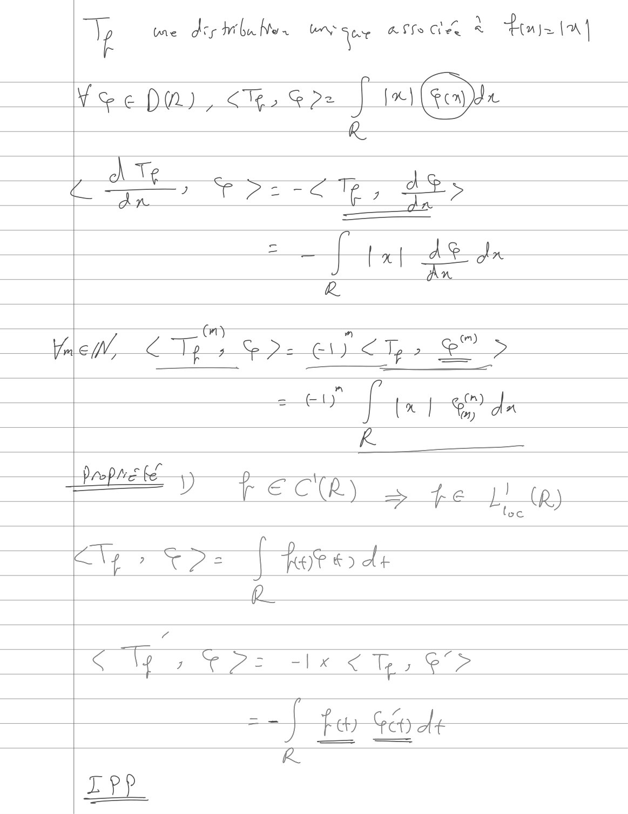

**Lecture OCR à contrôler**

~~~text
y Wwe de tba Nos HV ur asf hee à Hays (AY

Yee PM), <%sSr2 | bel (Fema

R
À Te :
Ci Fri CR, Le
= [Hp dle

Dy prc be '
LT D fT € CTR) eSs fe (R,)

oc

Ry tps ore dr

QR

a

Cly yf: ale € Ts >

Fe th

-} te
RK

EPP
~~~

## Page 9

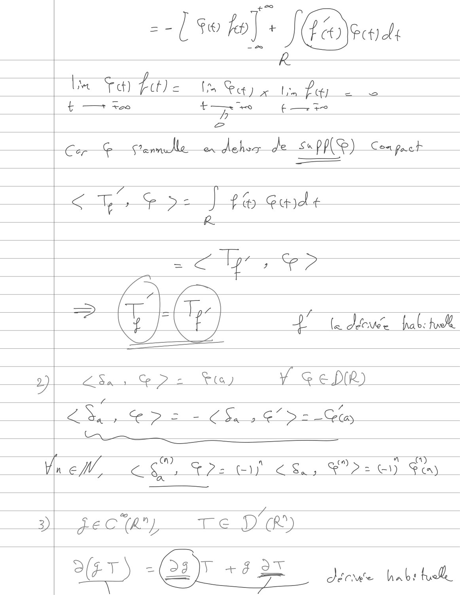

**Lecture OCR à contrôler**

~~~text
--/ $e ka] + Jrad

| p
DT) Fotle 1 Sey etn = =»

L — *Xco 4+ —~. 0 ¢ — +

h

Cor & Cane share de s«pp(®) Con pret

675 Fs ] 16 Gade
R
cy >
= (7 L/t-)
i f 4 la doe hab: fol,
2 Sas & >= Stay ¥ GeP(R)
LE, 7 € D EE C Se 2G >= _ Clay
Ny
View CE toe ei es, 2 OY) Fe

3)

% 7
pec (A?) Te DR)

SET) -Qayr +8 3S ici habs bol
~~~

## Page 10

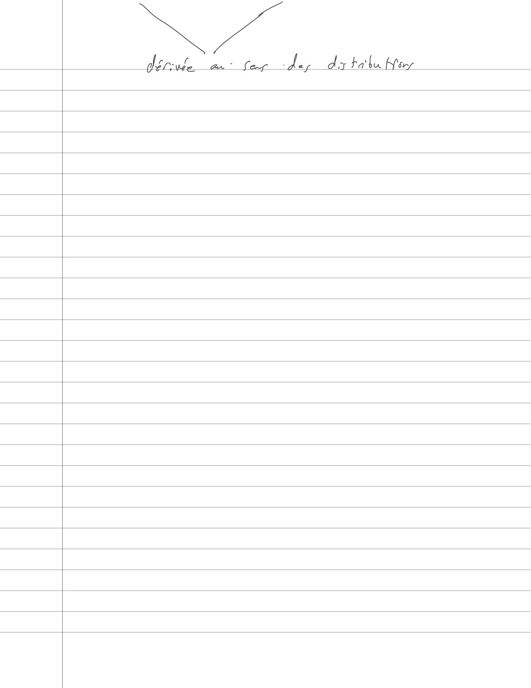

**Lecture OCR à contrôler**

~~~text
NT

der: Me Gan fe ws dx bath Nr
~~~

## Page 11

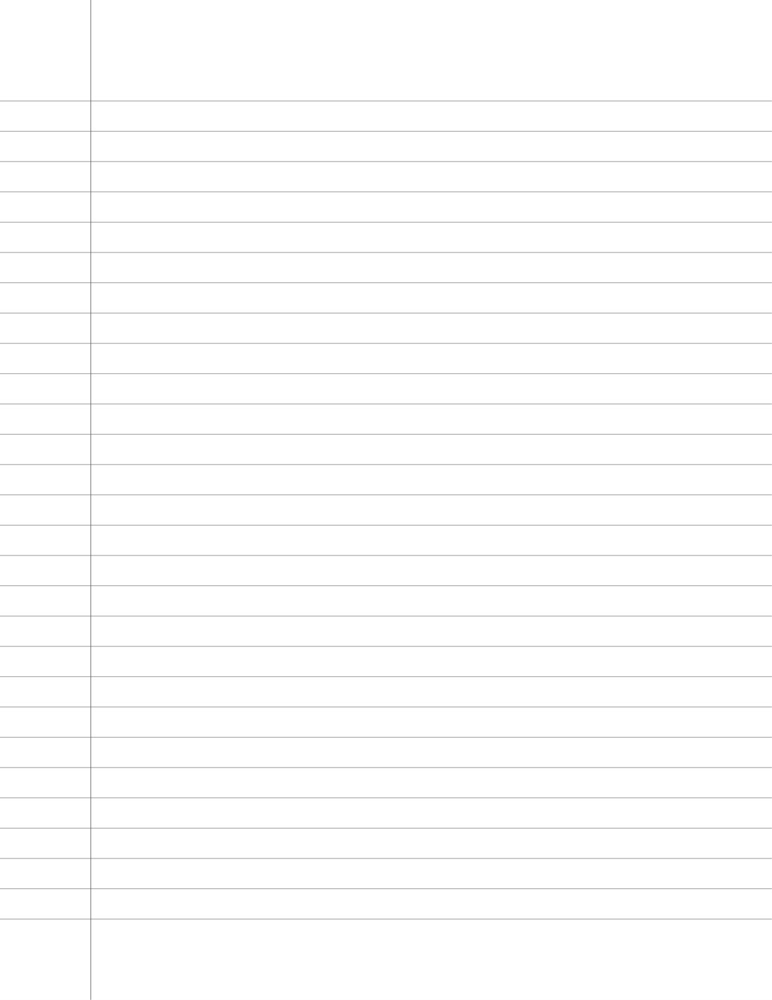

Page de cahier lignée, sans texte.
