# 2023-10-13-Note-11-44.pdf

[Ouvrir l’original](https://drive.google.com/open?id=13smbCYiGsEQjC2VcRAxVTHGF3uKdsEND) · Les pages signalées comprennent du texte reconnu automatiquement ou des éléments graphiques. Le fac-similé permet de vérifier chaque lecture.

**Pages avec fac-similé ou lecture OCR** — 1–32.

## Page 1

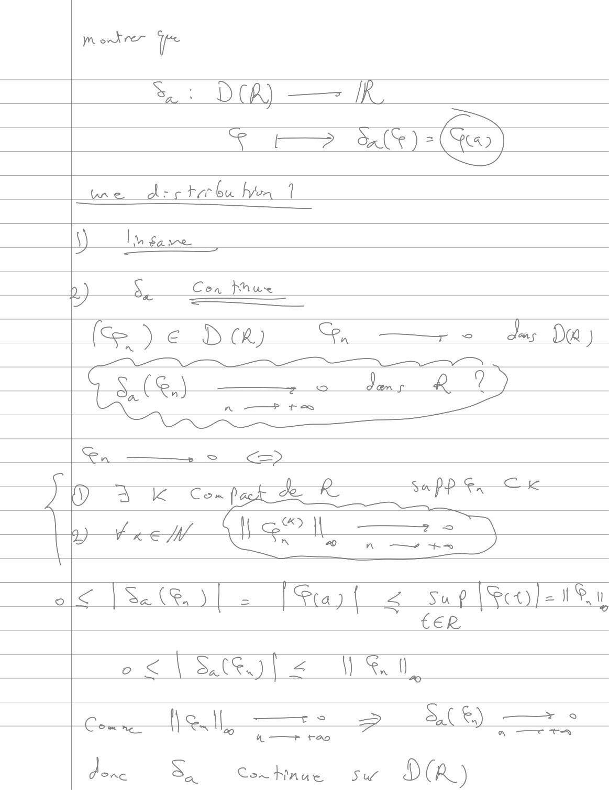

**Lecture OCR à contrôler**

~~~text
mere” tr

< F2 GR) (ww)

ne Arc trrbu hon 1

\ I fare
0) Se Con Mu
(<>) e DCR) SG, ——+ + dus Du)
=
Sx &e) o dons &
La” NA — tar
are = <=>
Jo 3k cop RTe
[pte SAIGON rs
ole |S.(B [2 [Stayt 2 sup [Feo] ey
CER

o< | Se] se NAN,

€ Noi xs > BCE) —— 0

4 —+ +ao NT A

done Su Con Nau Su D(A)
~~~

## Page 2

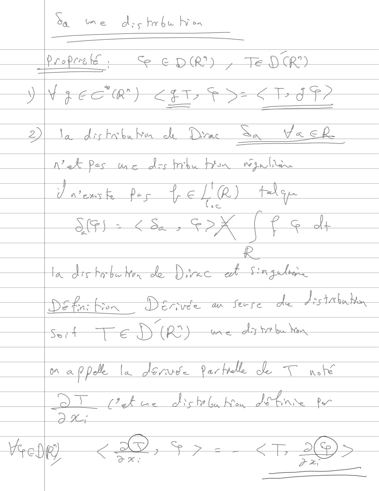

**Lecture OCR à contrôler**

~~~text
da me

ase ba bu IP sa
Propre ¢ DR) Te DCR)
0 n =
YN ESR’) a aa

>= FT, 1)
— ww | © }

2)

Ve drs Par bu Non ah Dyac Sa ipa Ee

Mek Pes we des mhu brn wy wlion.

D memck Per fe LQ) felon
S(F} >< Sa FX | Ÿ & di

R
ba dic Poe ben ate: Dee at Single

De far ben Derwe a Serpe de Jistatahe
#
Sert TE D (RE) Sore Ave at lye Waa
ma Ppele la Jervee Parhtlle de TT note
LOT plus di Pr bu ou Jin Per
On;
red AD, >
we Ox

2 Bien,
—
aX

OU
~~~

## Page 3

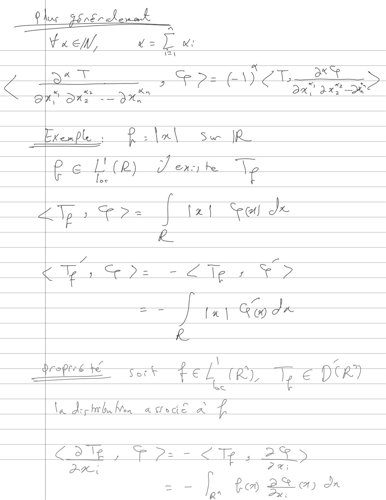

**Lecture OCR à contrôler**

~~~text
tue, = L Xd
À
PEN: >: EUET =
< M ohn an,’ pate
On, O%2 — OX

Exemple : k 5 \ «\ Suc JRE

Pe L (2) Jens 4,

vf

V2: mes el Je

Dr prré va

———=—

\ ET
sot fel (RL Ty € DR?
Voc \

le À: chrrba Mon a ide À f£

LA

Cole, Fp: -

+ 28
ZX ?

Xs

a= J, fo) Bato on
~~~

## Page 4

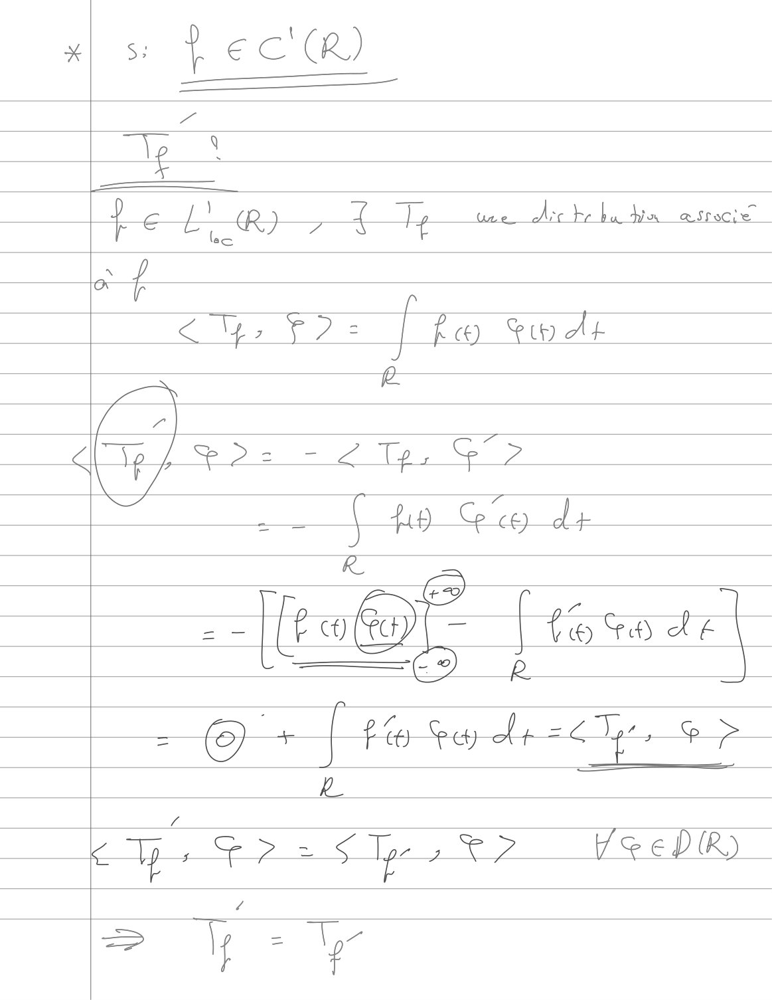

**Lecture OCR à contrôler**

~~~text
A
T
Te À
} € pt RR { 4 Ure_ Ave he bi ha arte
Be
of

[pf +22 -2 Tp. &

a i fip & ce ae

R

Ie Ef pe ]
> Tt @ (oa to ob LE |
U D À

© + ftétwde-e 6;
#_

L

eV: > = SI: 2 YeeDR)
~~~

## Page 5

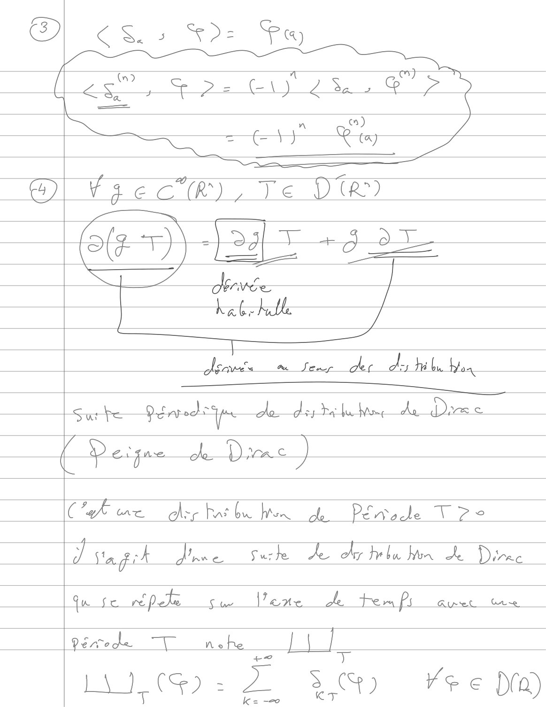

**Lecture OCR à contrôler**

~~~text
CS. 5 de Pa)

es, pe Ci Zu 7

[ S,
{= . \
=f nu Pa) Vi
Ql ¥gecR), Te DR)

—-\\ .\ 93) 7 3 DT

l'a oe
(AF 7) LL TO

; |
deb /

less au Sew, der des hi bu DA

Ca OAT der Pas bu Mn ole Pinole T7

y V2 pik dus e Suche Je oy te ba Mn À. Direc

Lu fe re pele Su Vente pa Fer fs Aust trie

péree. TT nohe Ls ]

Lo

.
111,6): 2 8) ¥¢ © Din)
~~~

## Page 6

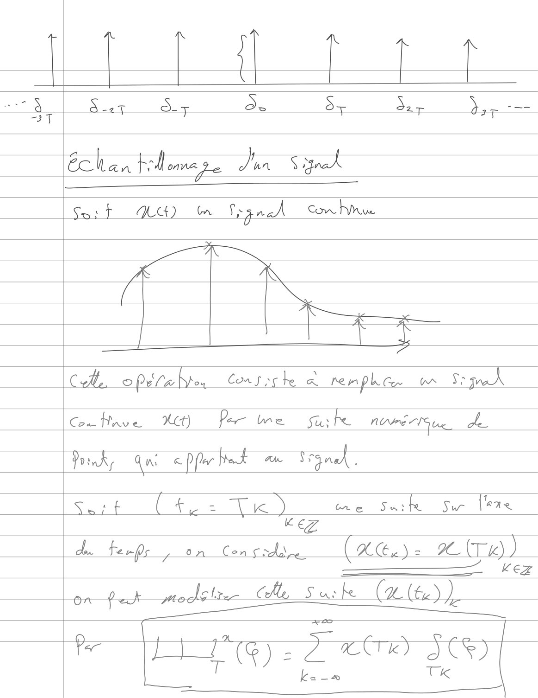

**Lecture OCR à contrôler**

~~~text
Échan Frllomne ge Tia S grok

Sort IL) tm SrgneAl Conhmu

EX

cS

/
TT

A © Peu Conjishk a nem ph Gr Ww Sa gra À

Cou. Favre. Wt) Pa me ik NORME tu FA

Poink, qu « Par Mt au Fan.

Seat À ( Le = TK) me sk Sw [ere
LEZ

du. Fenfr On Con fra (E.) = 9C (TK) )
RD 4

Kez

on Peck pe sl Vi Ale Suck (a (te)

=-2

(a) n 4 = e |
ox La - ST -
re Zee 5
~~~

## Page 7

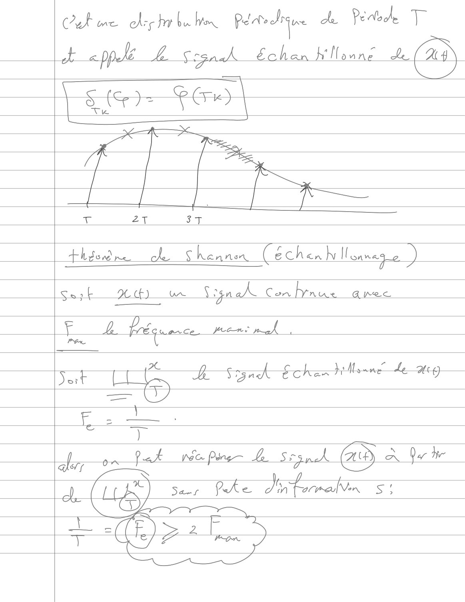

**Lecture OCR à contrôler**

~~~text
Ca one. cher bat bu bin, Peedi. 4 Pe bole T

we <pple he Scgaah Echan hllonne Le A4

| 5 ter) Sex)
CO On es 7 À
—

thied ne cle. Chess ron, (Echenhllounag e +)

ok De) ar Veen ak Con Mnue &rec

an
_ I"

[ px Pak Nee Pine Le SEinh ax À Dar hr

ay
TE) > 2 F

a
T N74 ?

= re
~~~

## Page 8

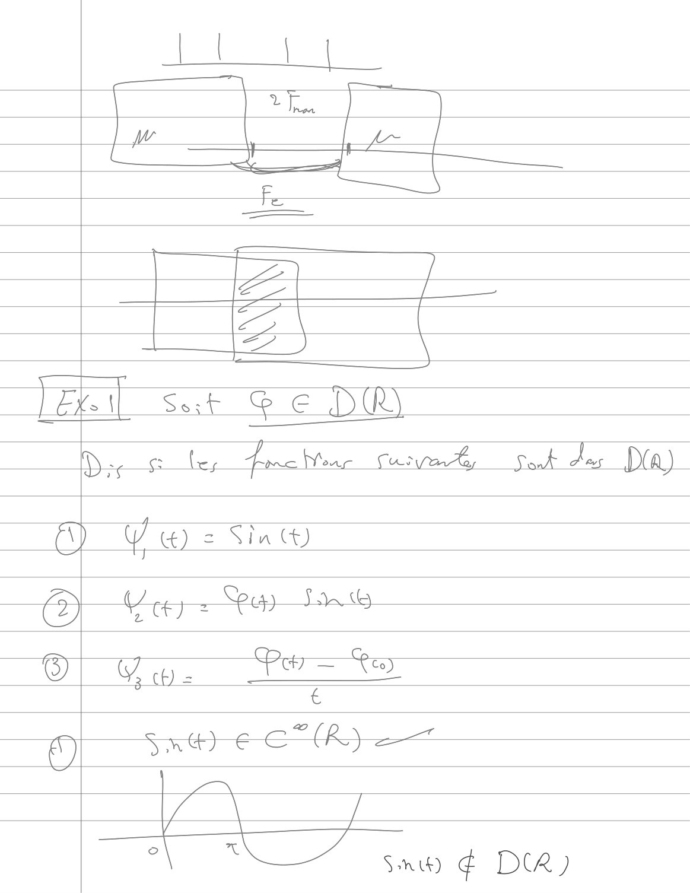

**Lecture OCR à contrôler**

~~~text
— nf
PE RE a,
ne LE
—
L ) )
Al f
j=’ D \
ll sat Ge DB
D CRT Frac Moar Luc ren ler Sout das DA)

y &) = Sin ©)

2) Vee ~ Puy SAG
za

Ol Vw. Perte
. €
rte ER

\ /

° 7 Sanh) ¢ DCR)
~~~

## Page 9

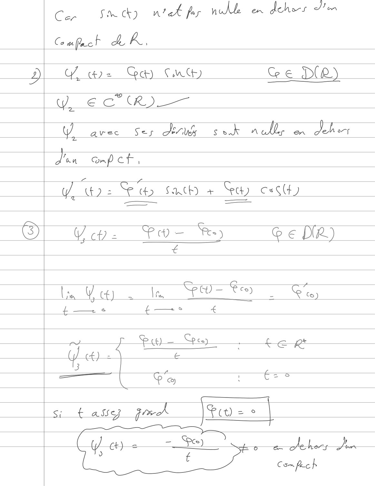

**Lecture OCR à contrôler**

~~~text
Cer tu ck) nek for nude en dehs-s J'en
Compact k& À.

2)

UY ure Ga) Cut Ge INR)

Ye CRD

VY avec Ses drug sok nelly on dehor

a np cf 1

pH: Seto Sach à Qu) cet)

PE —

(2 Cf) = Po) — es) G = DR)
€

lin Ye 2 Im SPO ED Bee
fs € £-—s* <
ar F TS) Co coy fe pe
(J) ct) 4 —— :
13
— re C= s

|
Si ft aSssyy jock JX = 2 |

( Yc) = ne o —_— i —
woe Com fich
~~~

## Page 10

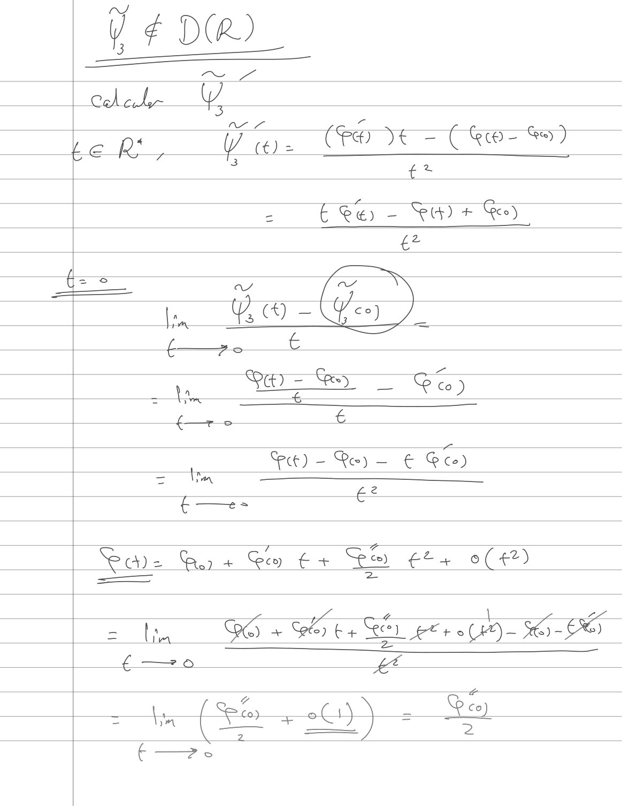

**Lecture OCR à contrôler**

~~~text
ÿ ¢ DR)

~
Le R* V tw (ea ye - C Rw= Sy)
L É re
= € Se) - Se) + Gee)
£2
{|
OM y, © _ Ÿ ce) _
{—+ ie
Le pce Cas @ co
{—+ 6
tr et) - Rey € Gee)
= ann
(aia
£ —s €

eae for + Gee) t+ Le fo + 0 (+2)

= | l'on VO

+ Gé) b+ RO PACE 221

cos Æ
z
hia (ee Gy) - G co)
= ; 2G) <
~~~

## Page 11

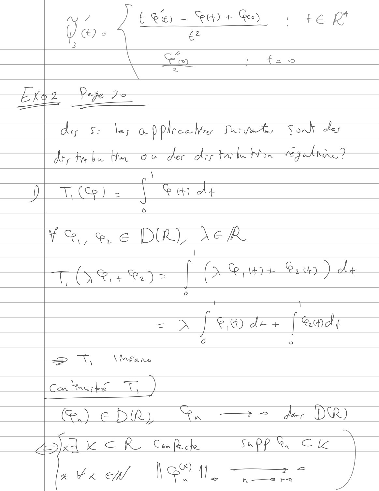

**Lecture OCR à contrôler**

~~~text
ws € Se) ~ Sh) + Geo LZ ed

y GE ze

So
2

Wy

Page

dr s: les opplrec Men Fur Sont Les

des Fie bu Ha ou der dir ra bu on re goh rere?

‘=

A
TE) al Sc Ag

Ce]

¥e % e DIR), 1e R

x = (> Supt Gra) ) ole

o
|

=< > few At + RE

Q oo

=> 7, A Mtane

T_)

Con Pure t,

&,) Ç DR) en —_ 7 pe DR)

bac] kK € Ro Cmfèck supp Cle |
eee JE = es
~~~

## Page 12

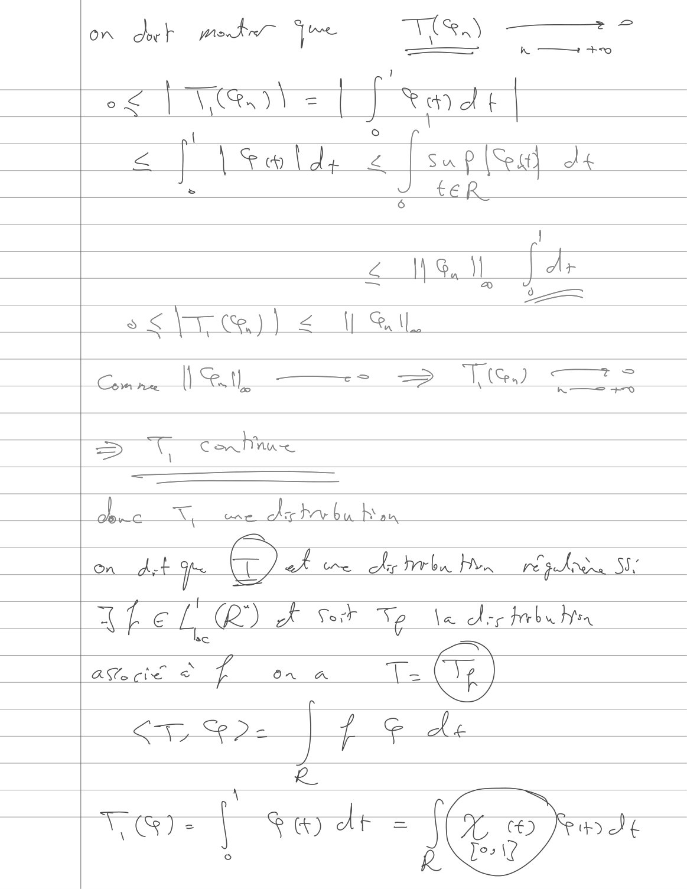

**Lecture OCR à contrôler**

~~~text
on chef probs que Ths a) 22

Ket Eo

° | Vea) = | fear € |
Ï t
\ CE
= wild < | sup (Seal dé
r J'éeR
A
£ Wei | dr
D

i \ Cc Sah Na

=>
de ae ee Abel bean

On dat { y À COS He db in reg hone SJ’

hel RQ) A st Te le decdobatin

amas fo a  1-(0)

2e - œ Ae

)
— &

V (a7 = | fy (&) At = { À Ct) mat
° p tok?
~~~

## Page 13

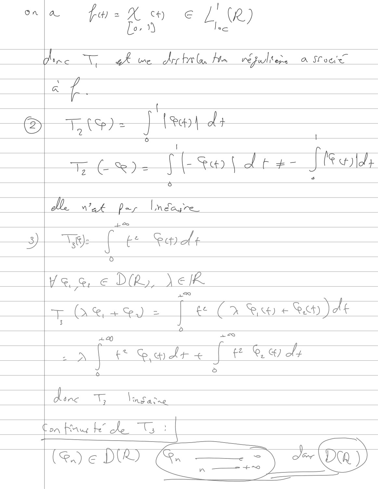

**Lecture OCR à contrôler**

~~~text
On

!
a fus i so € LR)

Or

t

Pine TT À ce Arc tre Cu Ha julie a ou

CS)

Fe,
FT CR) [ERwi de +- (St) oly

) TK): [pe Cyr fa
3° J Le tr orf

vec, € D(R, eR

(se, se) = & (2 Ro en at

J
à

DS]
400 +

x | Et Gwdre | # . &) y

oT

à

A
Aine TG naine

Con Fur he he “Lg : |

(ee DO FR, oe ) JADE)
~~~

## Page 14

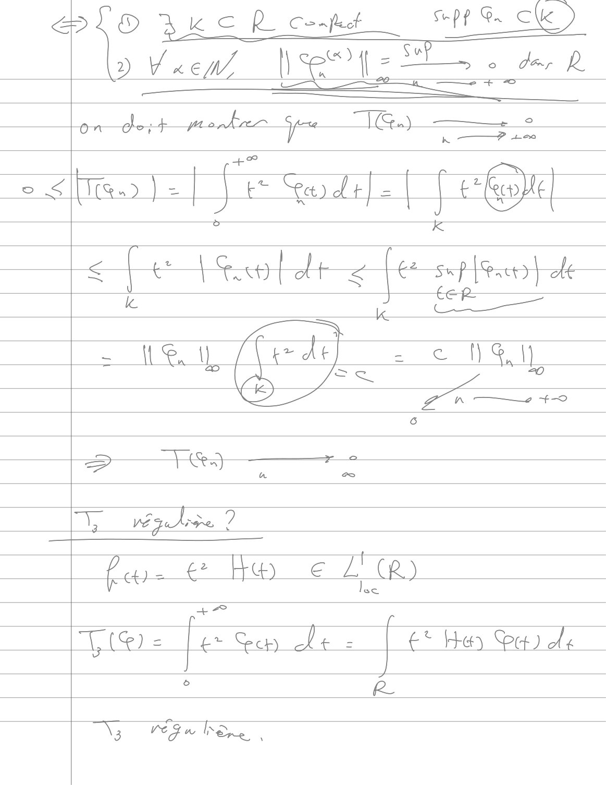

**Lecture OCR à contrôler**

~~~text
AS

DIE Ak SR ch spp G. Clk )

PARENT R
See

Pena nets Gone TG) . 2
‘ / LP ee

lire. >} ft a a ft] eg f Efoyre)

£
K
= [a & tol ges) he —
lc i Sa
ay
- Wet, /\ dt - ec Ne
* Van i=
sa Za
2 TR) ==
Ty veg live ?
Pa. € Tw € LR
Te) = le Go Je : j €* He Get) de
2 R
~~~

## Page 15

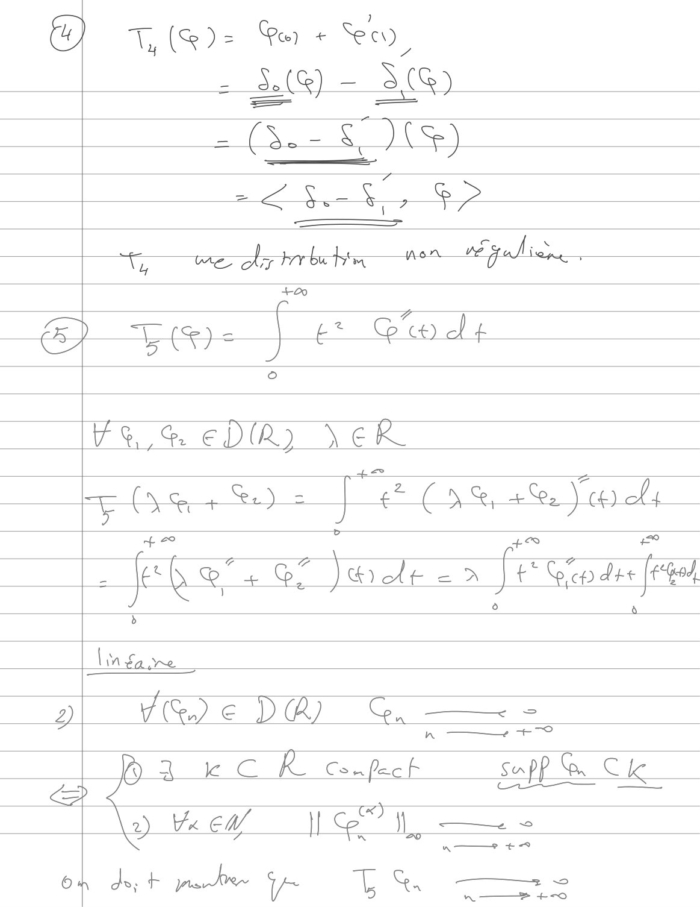

**Lecture OCR à contrôler**

~~~text
&) Ty, (@)= Gey + ee

- S.(&) = 3(G)

=

- (S.- & JUS)
est, $>
es obz rr behing awe geNiene
BP Vo: } & Gods

Fe & EDR) \ER

aa Ce +) = J ee (5e +. Vay oly

+ =~
A

eo
as Cc

LA
\

= ANR GT joe ern Jt Ge dar [thor
J )

J
2 8

fy

\ "$a we

Pe v@e DA Gi — >

ro

Ba «eC K cufect supp & Ck

el awa ——

\a kW ier 7 —_ =

20

CE) ds; + pra hen l'a L Na pe
~~~

## Page 16

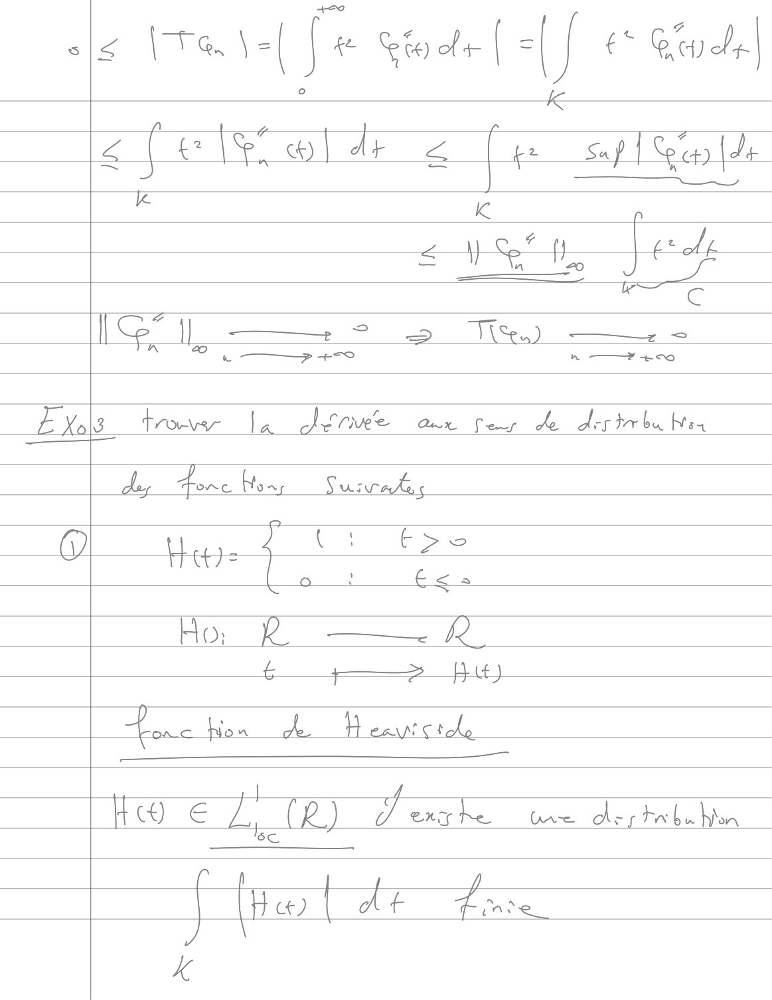

**Lecture OCR à contrôler**

~~~text
a

< (Taie fe Géo + | -( | Gad

K

£ { C1 «| dr < ge Saf | Ge [de

i kK à
2 EE — ed
Er €

| IL — © > Ti)

=

(Cl er din nd n —F+00

Ex

3

rover La ” Lee CARE: de. des tor bu Nea

de, Fone Hon, Suivre

yr ( 4 ¢ 2
Hhe=—4 =

( a : E<s
Ho, R  ——~ A
> Bt)

LR hou A Heawnçtle

ae € Ly TR) Task tae es tabu bn

i Hu | At FR

K
~~~

## Page 17

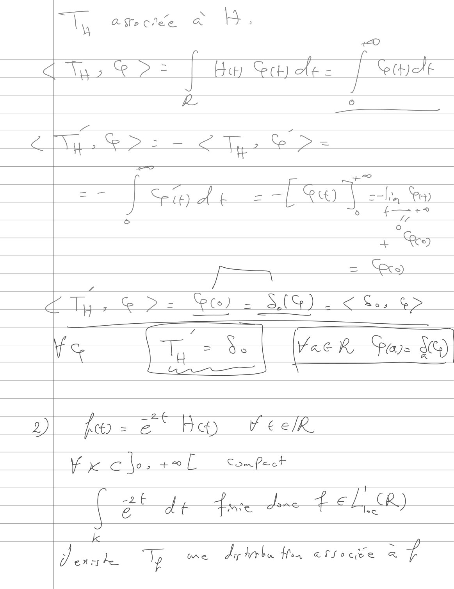

**Lecture OCR à contrôler**

~~~text
“ly Ao eve a i 5
420

d'u: & >= { Bu Sa fe = f Got

kB o
CRDI <T.& >=
— 44) À f= 7 G& | ality Ce
7 a J Er

°
+ cs

; i = &»

CT, & >= Se) = SAG) 2 < Ss &,

= ie ]
Fe JUIN (er pur

| —

2)

fesse Ray veeR

Pye a Nea ool Saupe

( zt d+ Finte cone ¢ el CR)

D
k

Dene he Ty one. de rbe Me, aSfocrve a 7
~~~

## Page 18

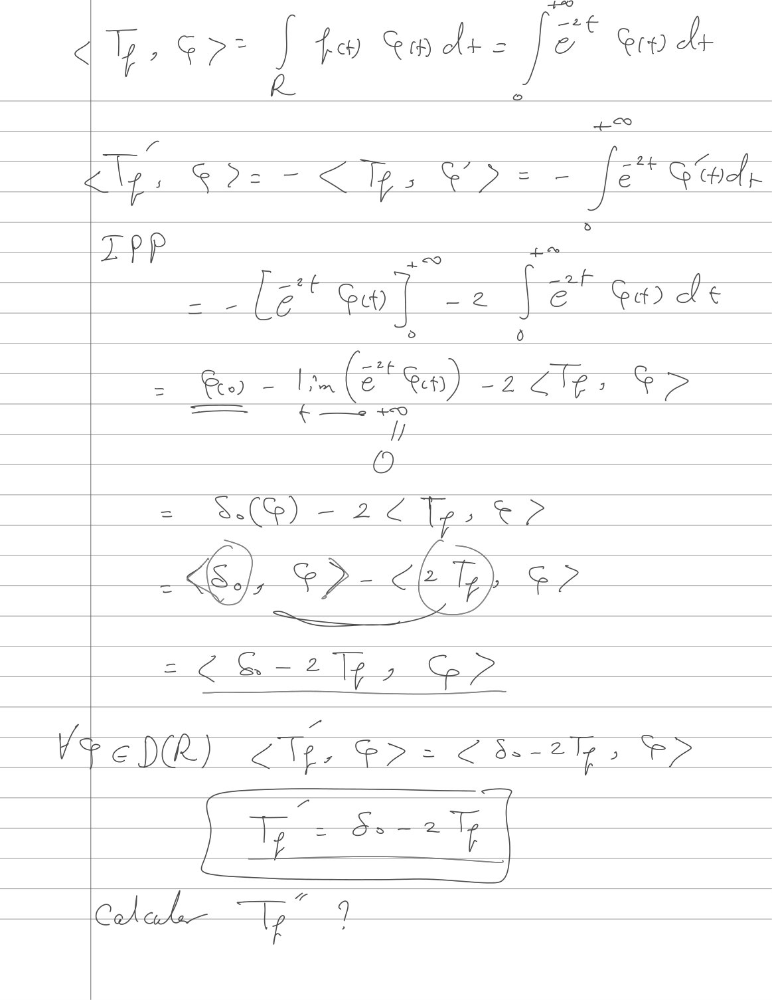

**Lecture OCR à contrôler**

~~~text
dy: G P= J te ein ote= fer Gr) Le
aR

ro}

Es)
>
|, fs |
y, S 2s = Ips >= - JE Gode
vr ÿ J
TPP es
P+ af A
_l@' Gn{[ -2 je de
J, :
a À - ee AE Te: ES
2’

- 8.) -2¢Ty. tr?

+) += Sy

2 ¢ G&=-2]¢ 5 BD

x

Z

€ DR) lp, >= <8-27%, F

a

J

SX |

) ips

Cela : TT” 9
~~~

## Page 19

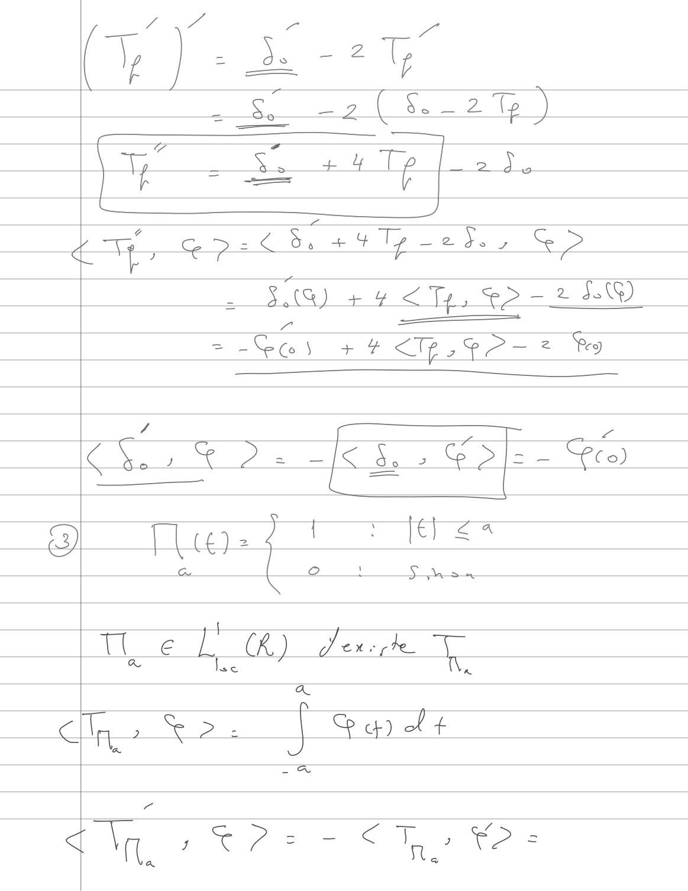

**Lecture OCR à contrôler**

~~~text
7 4 + _
(1, ) = 2-24
~ Se _2 (8.27% )
‘ Tru Te]
py th
D
Cp, Gps best Ty eds € 2
SAS) +4 < Ty, LD - 2 à
. Sot té
=-Ges ++ Poe Po
/ re 2 ee
Cyc 2: JS, 5 | S]2- Fc)
L
©) Fu: à UT ji zx
a = : Shs
Toe LR) Jak TT
= . .
Cl: Se ja +4
Sins T7: - ST =
~~~

## Page 20

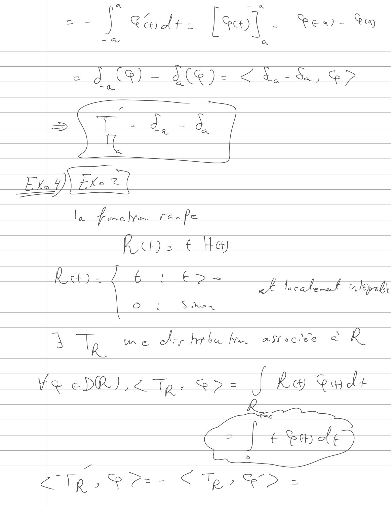

**Lecture OCR à contrôler**

~~~text
Se = y Gen d'u [so] - Res Fe

od (8) = 4): LE -S, ep
> \ L ~ a a
2%
——
Eu) Ex? |
Le sh Pan Pe
ut) € Hey
Rit) = & > € > = A het f nl
Oo ! S how
\ TR Wane alt, habe Fa aSrocree à R
[ )
¥ecDRLety. «>= | ko Gude
R

\

Sg 7
C= |e teres

U

CTR, PR- STR HD =
~~~

## Page 21

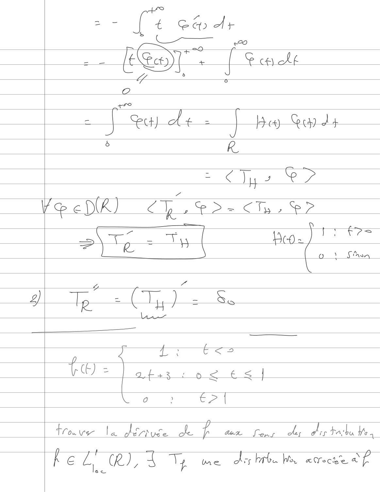

**Lecture OCR à contrôler**

~~~text
= fe Gay dtr

CU —7wo
2 5 Gasp” a Î CE co LE

(es
2.
- fea Aa: ft Be San tt
° R
= 7, 62
œ e NA) CR t= 6Te $7
ASE Ho.) 1! $7
Ee 7) Cane
4) Tp. - (Ty) = 8.
À RE ES
FO = ap. oc € < |
Loo 2 E> |

tro. Vs" le deri Use oe b Gen Sens cher dr hatha Won

f e Li), 4 Vy me es bbe by zac © f
~~~

## Page 22

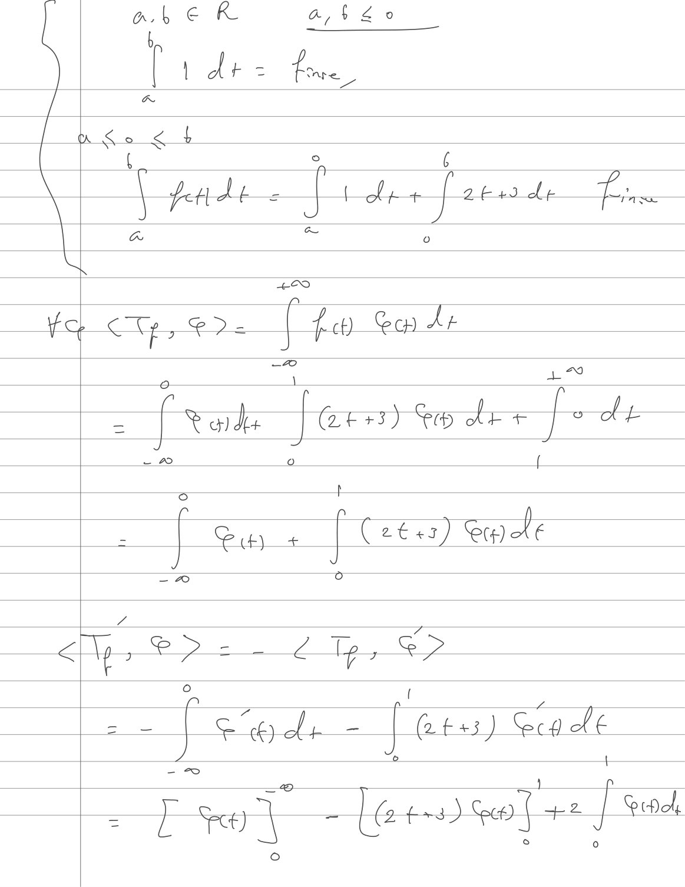

**Lecture OCR à contrôler**

~~~text
a, $ £ o
b
[ | de = Eine
A <6 L
ay ? (
"2 = 4
\ J pride — | der fereds ps
[a _—_—.
Q
fy CO, 2 | ct) Sg At
= [ead Fer) Gt tee fe At
À : ;
Eu) + Czés+s) Gt AE
J
Ze
Wo P= eS
a |
a= ; ats —_ | tas) Gra lt
° {
= . |
= 7 Fe | Le ts) Go | 2 A Qo,
~~~

## Page 23

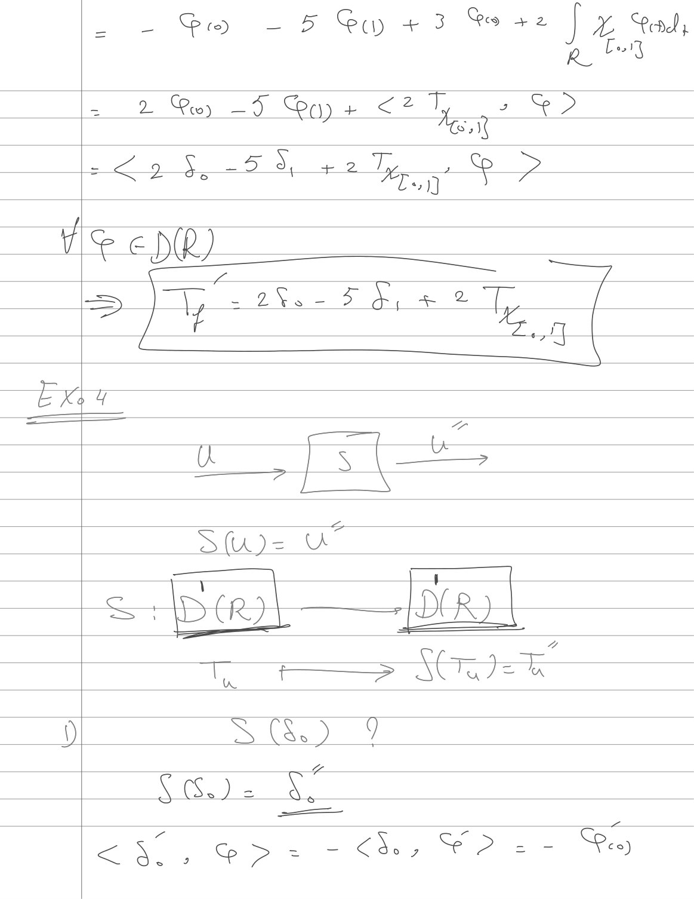

**Lecture OCR à contrôler**

~~~text
~ Ge = 5 Qu +3 es +2 Jz i al
RTS

2 Ge =F ays €? e 2

9 3. 5 à a $ ?

Se

ENR)

“7, «2%. TE, & 8 7
&

>

aw
TT

Fe

-P—_.

CS.) = ve

Li %>5
~~~

## Page 24

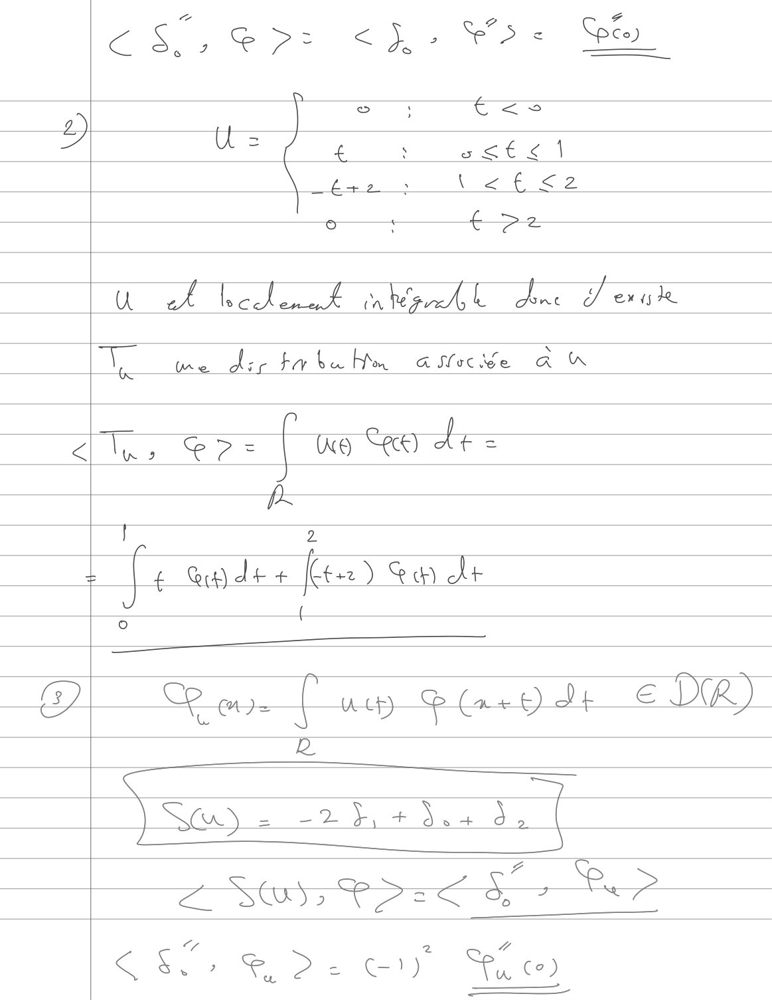

**Lecture OCR à contrôler**

~~~text
“ < oe 2 S75 = le)

€ <s

2

2.)

Lief <2

|
Us y Swetz i
\

6

a he on hé & nd au

we dir frbuhn affocke AW

F Ke Ce) re

dus eC? =

|
)
p

J 2
: Cy Qu de + tz) Gun At

(

©

E WIR)

UC) $ (a+b) dE

ED) em

&

D

—

\ 7
Sum): -2h+3.4 3,

EC >

7
a sayy re 3; 4

a

GS, De co) GT ce)
~~~

## Page 25

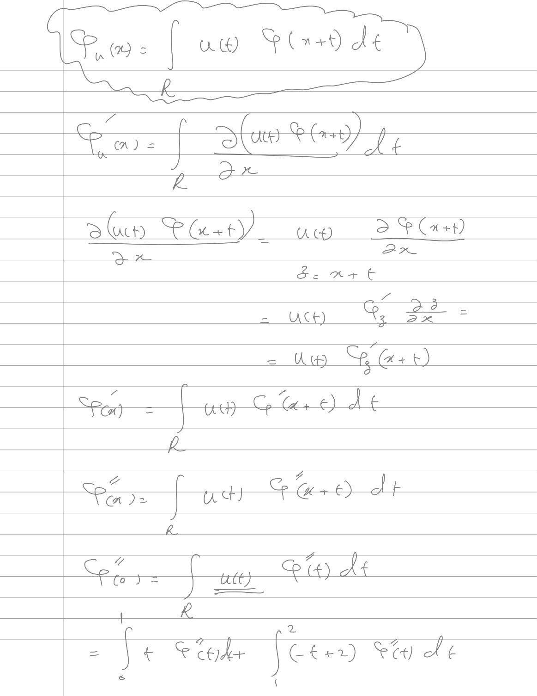

**Lecture OCR à contrôler**

~~~text
pe
SATE | al) Ford de

Pa = i slow ee) y

Zo

aap SAC YA ug 2 Cot)
2%

2
& = A+ €

Zz
D
ACE) ca 2x

= Uw 4 G+ 0)

See) - [us Gt) de

2
PE | ti FG dr
k
CT. Ju Sit) AE
; R

ake

_ Ve © Coder TS Sea) Le

© ‘
~~~

## Page 26

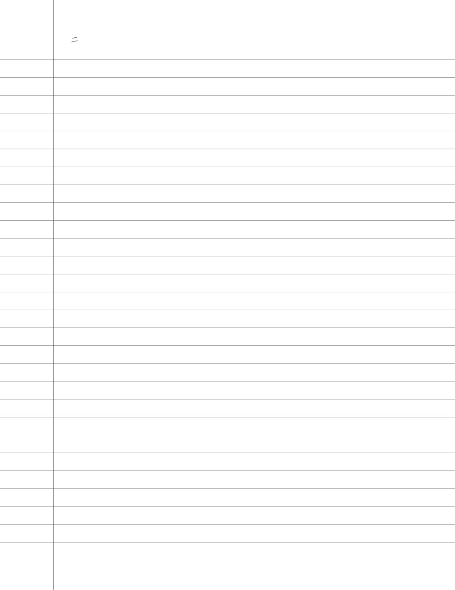

Page lignée. Un signe « = » isolé apparaît en haut de page.

## Page 27

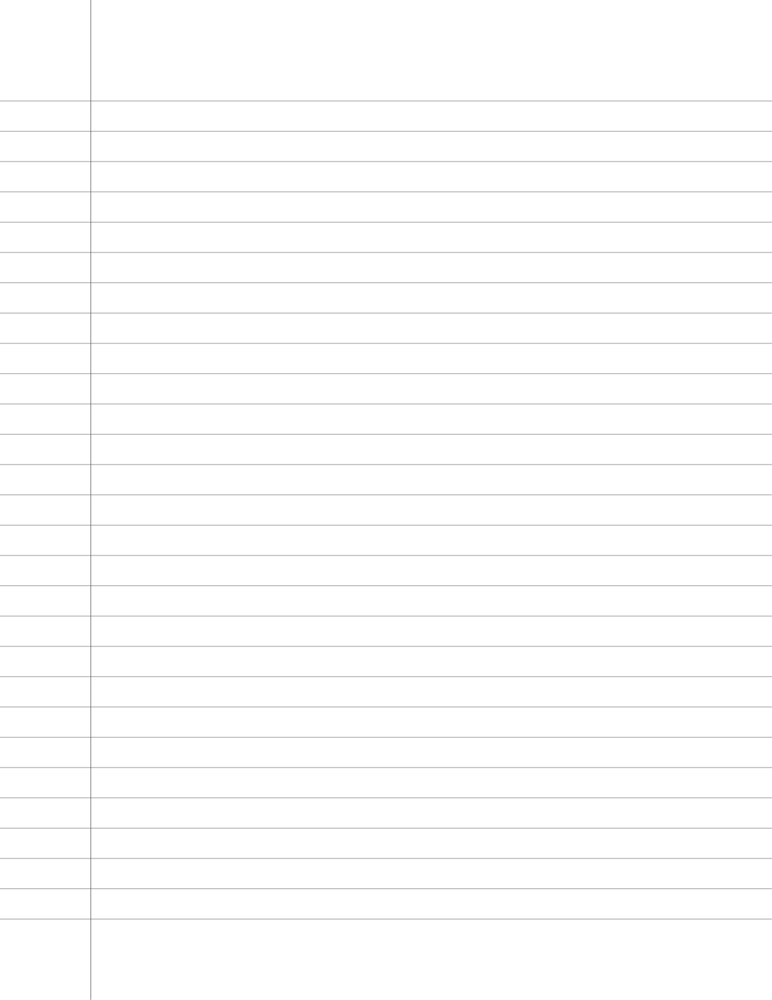

Page de cahier lignée, sans texte.

## Page 28

Page de cahier lignée, sans texte.

## Page 29

Page de cahier lignée, sans texte.

## Page 30

Page de cahier lignée, sans texte.

## Page 31

Page de cahier lignée, sans texte.

## Page 32

Page de cahier lignée, sans texte.
