# 2023-11-03-Note-11-49.pdf

[Ouvrir l’original](https://drive.google.com/open?id=1QBNUFp4AkT0pdpDdP2pf8rkbpNJg3Heu) · Les pages signalées comprennent du texte reconnu automatiquement ou des éléments graphiques. Le fac-similé permet de vérifier chaque lecture.

**Pages avec fac-similé ou lecture OCR** — 1–21.

## Page 1

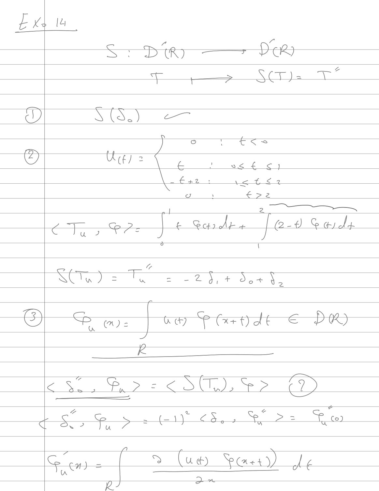

**Lecture OCR à contrôler**

~~~text
Ew

'D) SCS.) ee
, © tT cs
lao
© WE) | & ss € ¢ 4
\ E42 as
o € >2
J} 2 —
Es Ga J £ Ceo al pane fed G œ lg
ud ~
8 1
= CG

Se (") = | Gy) Pr dé EDR

ci, Boe ce SYS CL)
Ss $ 7 ae PE. Re = Sete
en = > (ud Vox) We

[UN

pd on
~~~

## Page 2

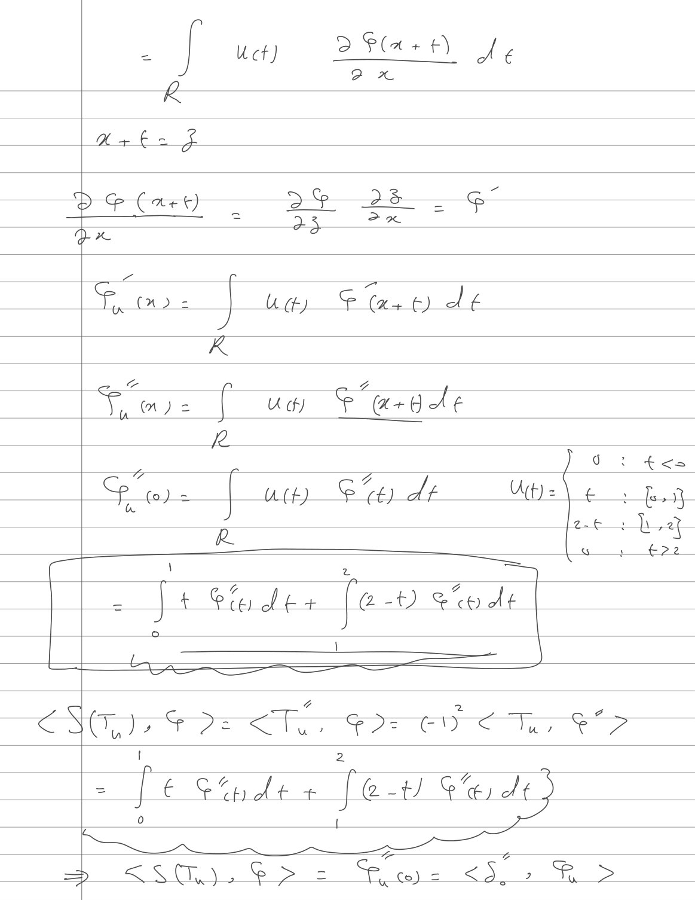

**Lecture OCR à contrôler**

~~~text
. fun 28D 4,
2 x

R
Arts 7
Dy Caret) SE 2 = ao
x 23 7%
F, CRE Udy F (ast) dé
R
yA) = ud PF G-HAE
V2
y Gt <<s
pote) | ut) $e) df ute e CE
2e À à
CS S E22

1 zu =

= t Sly Jes fe +) Cr

©
| 3
l oo

og

NE 7 DE <tr. CRE ety oe
! 2
= Ve Cb lt + fe Ge de S
3 J yy,
EC |
=? = LP & = Se Ce) = <)> are
~~~

## Page 3

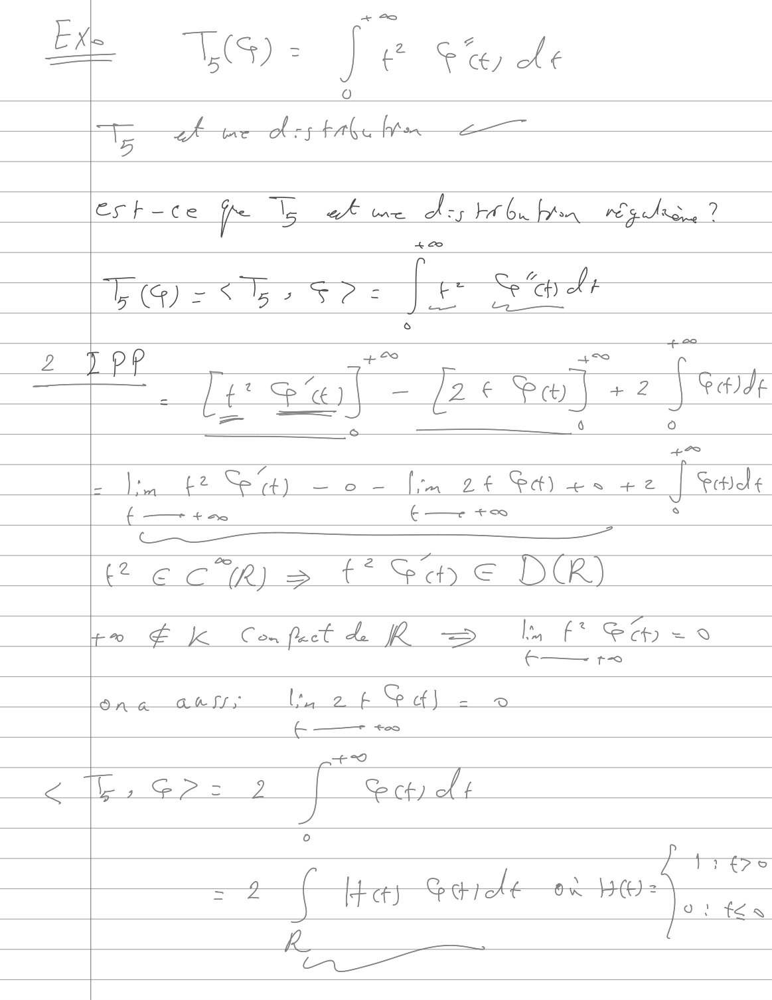

**Lecture OCR à contrôler**

~~~text
EE To: fe ou de

+= Are ol ta hrs

Est-ce f- TT ak we whey ke bu. fs gra ?

420

_ ( 2
ACER ER IAE RASE
2 TPP = = +
se Be) =] € PF) + 2 Ge
TT 6 o
= lint? St) = o = [im 24 St) ee +e | Feel
( —~ + E—— += 6

C

Becks 1° $4e DR)

» Fk Conf R = In FSH =

€— ro

Ona ak ln, 2 Gel - 0

+es

&

+0
Tes ps 2 J Sct) oft

P
Frs
2 Her Grole où He nn
l

J
a =

at
~~~

## Page 4

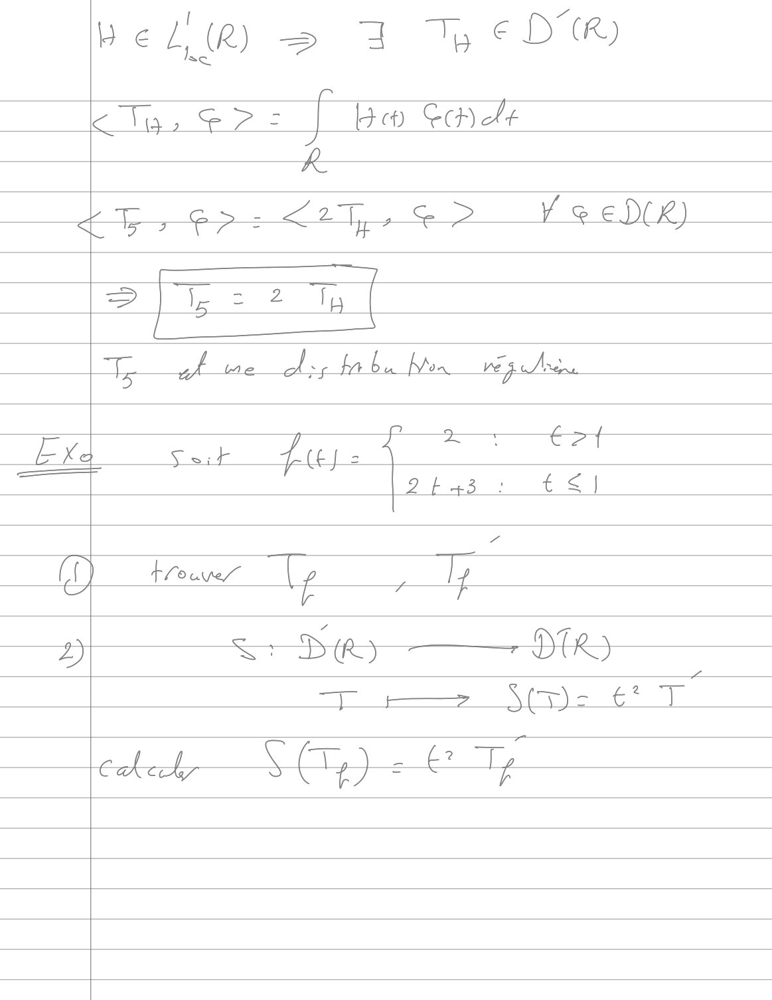

**Lecture OCR à contrôler**

~~~text
pelle = 3 HED

|

a
Ho Cle

ce la, FP =

À

2T., & > ¥ eef(R)

LB: EP: HE

7

21% a= a {

DER

——> Sfr): ET
~~~

## Page 5

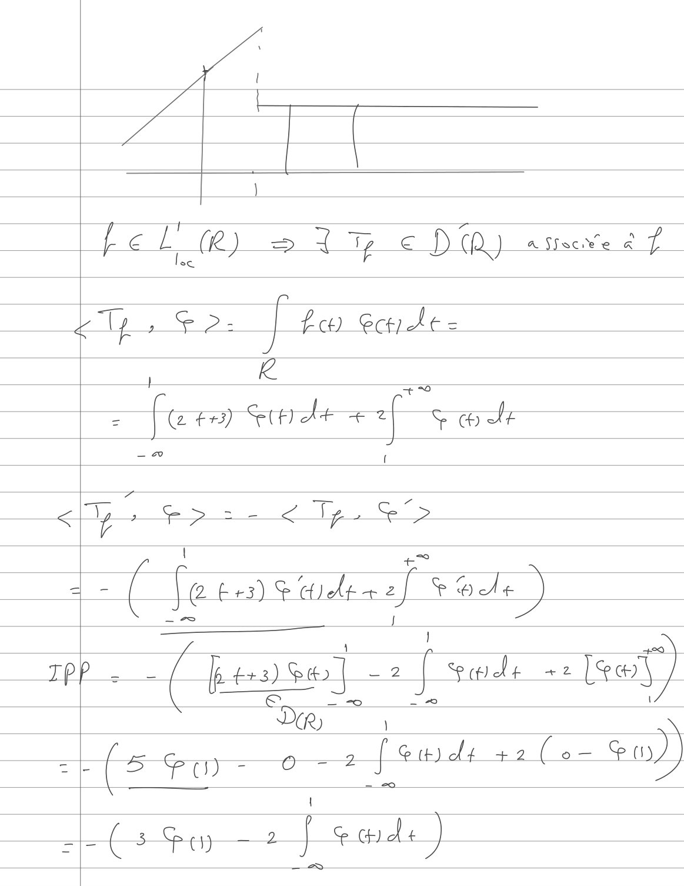

**Lecture OCR à contrôler**

~~~text
AG

fel’ @) 27%

f € D CQ) a Sfociee a t

7

lps ee Lo Sct At =

; R :

= fe +3) Sf) At + ef ares) Jr

_ æ

lf

$- 7 = fp. S

[or ia

iu}

- ( le brs) Sdtsz] bore )

2

J

IPP - —{ bte] _ 2

=
/

{ pel p +2 [sect

ET Te
DR)

1

“(SFU = o---2 feuds eal a= Sy) }

-

1

{
- a) 2 fede)
~~~

## Page 6

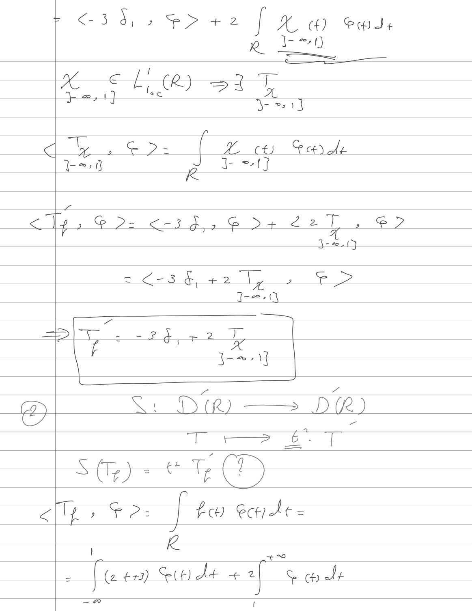

**Lecture OCR à contrôler**

~~~text
L ch, +>+2 | Ha SH dt
Re)
I ——
x M LCR) LE. x
py 3-0]

> DR)

t

Ki DR)

Tr 6:17

| Cr
ar Fe: | tw caite=
a

+

l
_ Fee #9 CH At + “| & & lt

= æ f
~~~

## Page 7

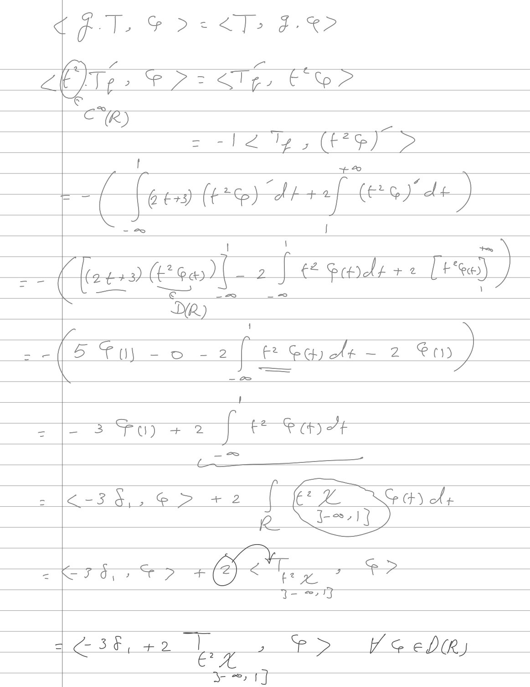

**Lecture OCR à contrôler**

~~~text
(pT. F>e<T: ">

ZEIT - = ZT) EG

CR )

127,97

' La
--( (gen (ee) de val (eas de )

J 7
| 0 = +
Neer Gay 24 €2 Gels +2 [Hes }
DR)
(5 = © -2 | Fr ele - 2 ea)
XN >

= 3 Fu) +2 Î SR TD ot

1-=:17} )
—Tt +? (ng >
T= #77)
sise | P> ee
~~~

## Page 8

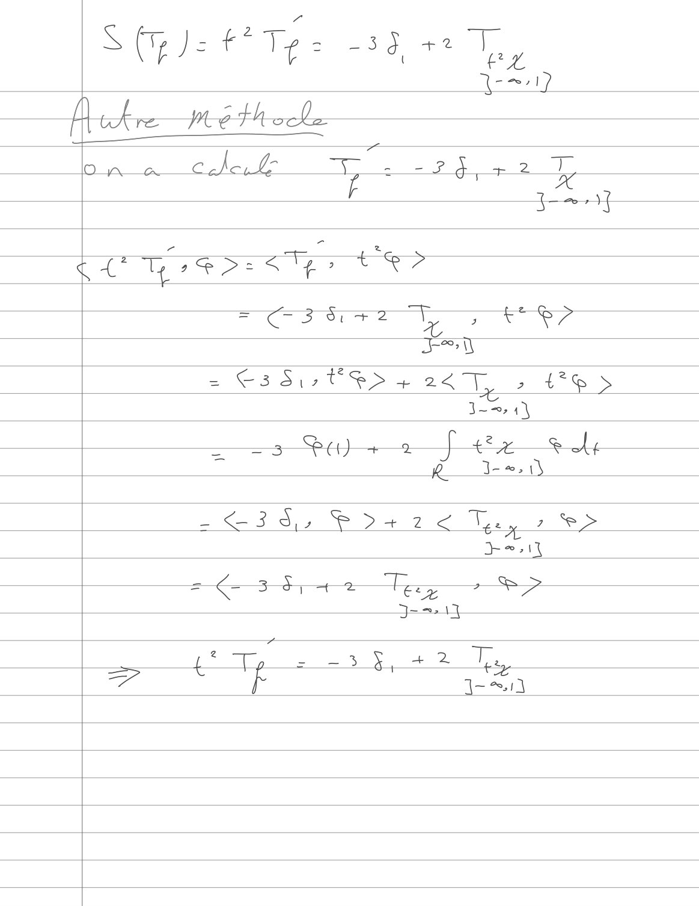

**Lecture OCR à contrôler**

~~~text
t {° Te «Ty ? <>

——

= CS Sr +2 54 5 £ &
or

= CaS, FS + 2s Vy ? RS

J--,1)

= 3 Base 4e by

= gp J-*.15

-S3d, FD+r2< Te, ;

+ e-th

= 3-3-4 Pe an

4
3-543

‘ =3 3, +2 Ty

TT, -
Z € F 1-12
~~~

## Page 9

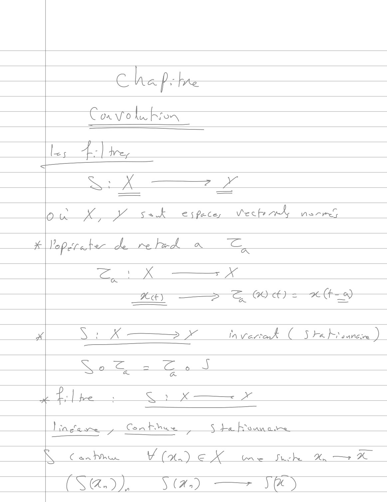

**Lecture OCR à contrôler**

~~~text
Chapihre

Va) { fl
Coa 0 hu Rion

les

4. | trey

T

Ss A 2 X

© x sk € § Pale, Veep mh nsrre

=
eo
&
>
\

WEY) > at d= x (Fe)
x X > x Invertenk (5 Ye san )
Set 2 Tai
L'hlre Li x x
line ses Con thee dog émet

IN

Conte (H.C XK re Sache A — 2

(\@.)), V4) — > SR)
~~~

## Page 10

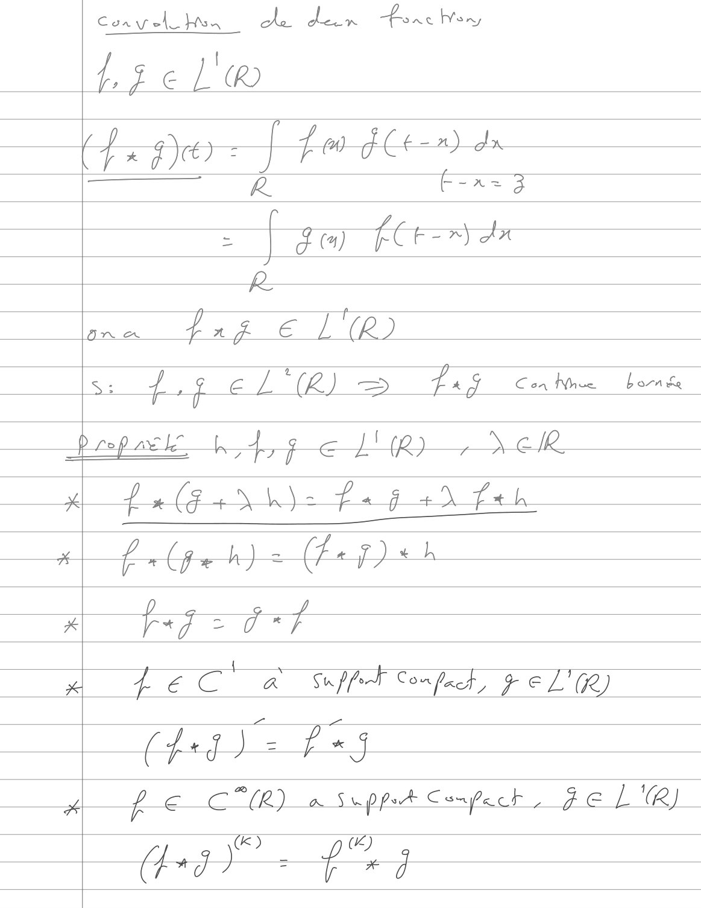

**Lecture OCR à contrôler**

~~~text
Con vel Ws. de deen fone Nery

1, 5 ce L'@

Jupe | fo dena
ST ry 6-x~=3

gen heron

R

T

On A ¢ np E

si fig el Rl = fag cate book

Rep Kg € LR) +> Elk

4 PAGE fe ad fh

pl fh} (Fe f+

*®

Fi ort

Af EC à Suffick Confack, FEL)

(Fed d= fes

PE CUR) a Suppit Conpach , FE L'R)

(kK) (4)
fr) fod
~~~

## Page 11

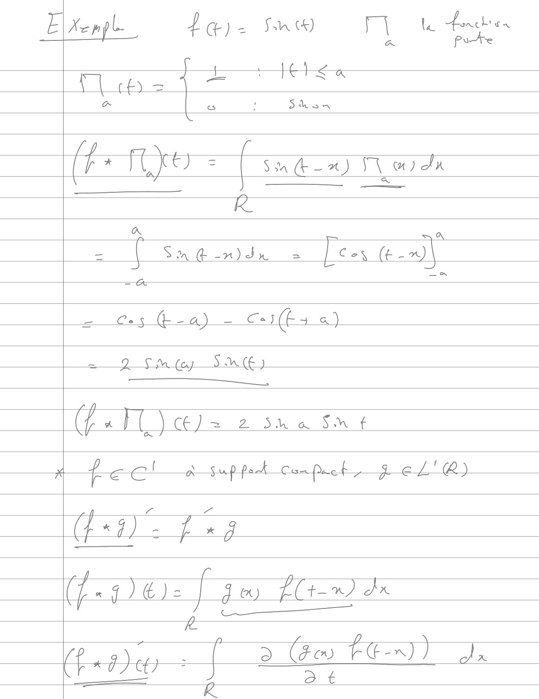

**Lecture OCR à contrôler**

~~~text
EE. = > le anehidn,
Elxempl days mew To rés
fy Le
FT (hy = À TT | “
ae | GS i Shon
Le

f
| San) Pi ar JA
) CS

(fro =

R

A

SnŒ-n)dx = | cos (a
& =)

i}
Te?

ECS

Ces E-a) = Car(ts a)

= 2 FM SM(E)

(Gall) ce)- 2 Sha Sn ¢

tec! a Suppo cunpet, g eL'@)

Zz

(eee

Pi a 4
(Fr): } gm) Lt dx

He

n En) ) x
xs) > Ge J) A

R
~~~

## Page 12

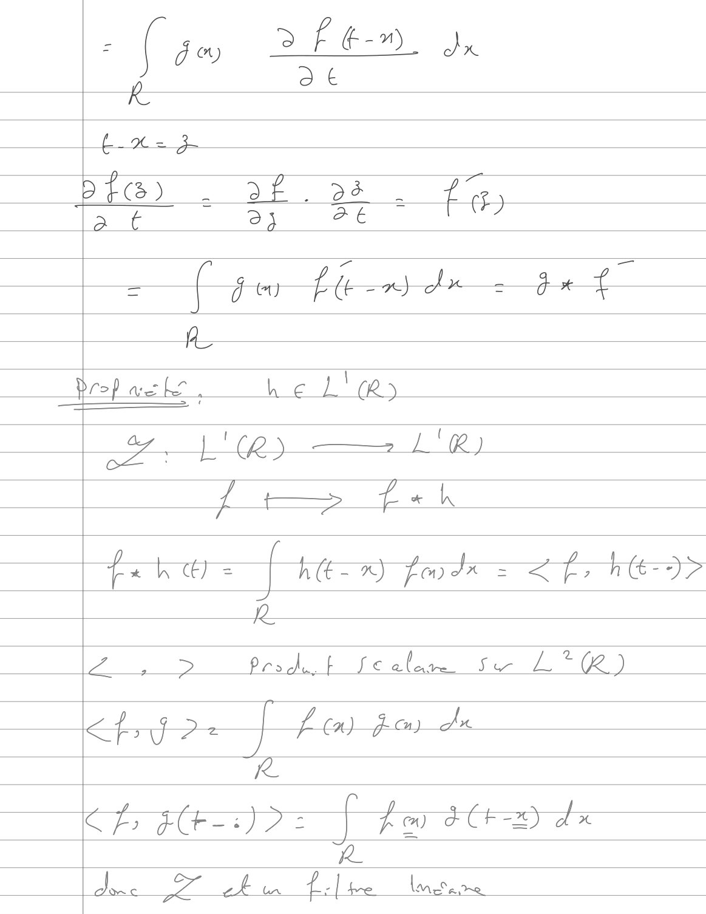

**Lecture OCR à contrôler**

~~~text
À 2€
tx = 3
DEG) af Dé | )
at ay Fe Fe
[je és de 3 f
Le
Peopache, he L'@R)

! (
oy | (2) ——» L'R)

Be
LR f+

fake f htt-~) foodx = < fo ht

7

2

> Prod. f Se alarm Su L*K)

tod D + Lea) ny dx

R

Cfo ft) 7 fF 7 0 CF) dx

ia
dias wa ch lan f.| fre Ihara
~~~

## Page 13

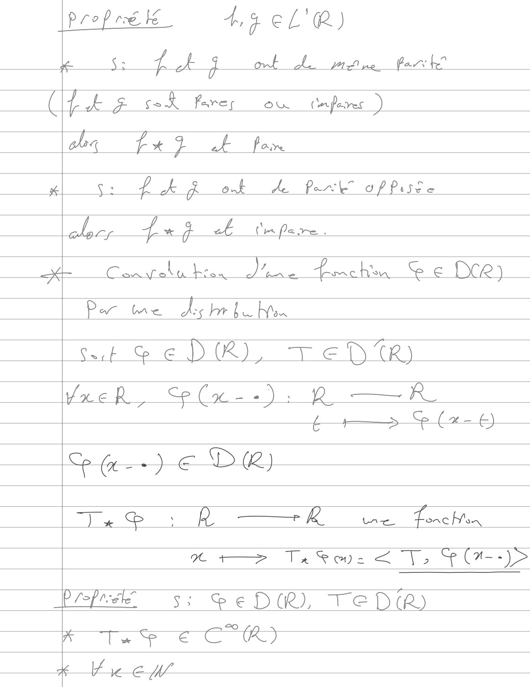

**Lecture OCR à contrôler**

~~~text
JProfrék 4,5 eL'@)
ess fk ÿ ot ch moe part

— |

tr Æ Æ cod fares OW Cnperes )

ba fx 7 À foe

# ME £ Æ À ont A Park of Pisce

br. Lx À Wa Crs Pare .

Ke Co. poke Les. Dur ves clay & € OCR)

Par Mme dos br be Hon

cut Se DIR), TED TR)

VreRk, (x--): R — RO

L + G(x-E)

C

Ce eee HE DR)

TX & i R R nie onc Msn

Li Ta tome 1, PCA)

PP 5; Se DMR), Te D(R)

HT € CR)

|Z iP
* Fr’ ECW
~~~

## Page 14

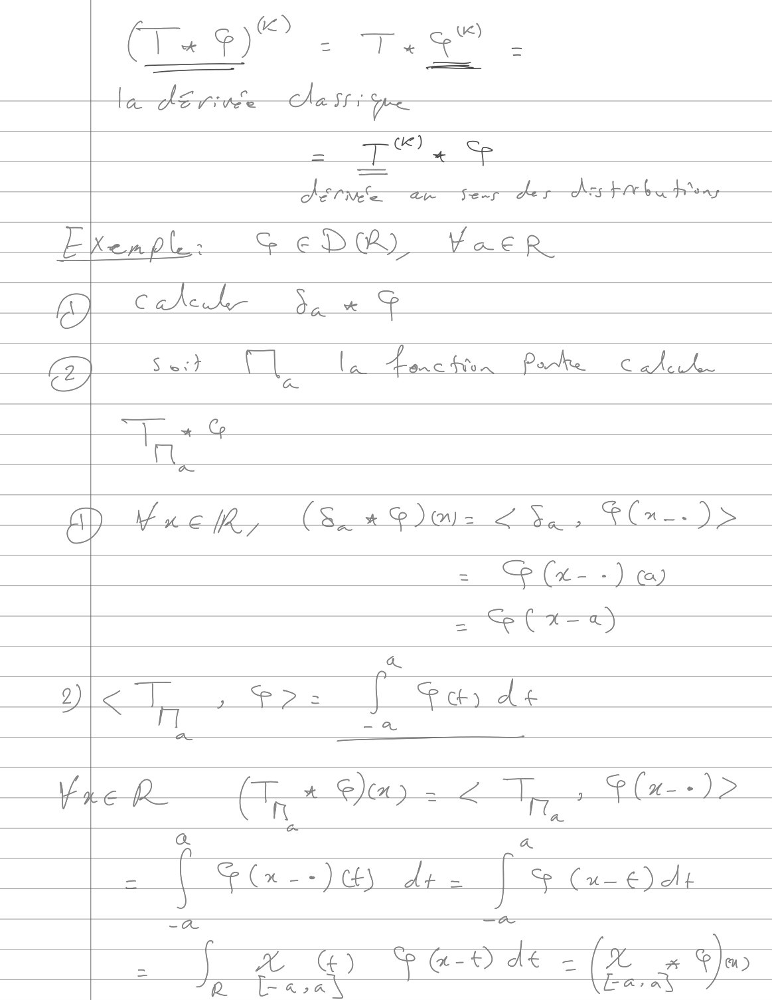

**Lecture OCR à contrôler**

~~~text
(T+ 9) 2 Tia -

bal err —he HH pe

_ Tl xe Ss

Herve creer les Ars ab his

Ekenplr GeDRW VaeR

QO Cw Neidge ar =

> Sos} ae la A anichit Pore tank.

are
i”

&) iE «cf (Sex Sous ~ 3., Fm.)
= Sp (4--) œ
= Se C%= et)

&

Diet in Fes J € At

bre R(T, + Se ee TF la--)2

a

a a
~ [eGo 42 fs God

ts

=æ

fx &) Feb des f; ze

2 Larval Era
~~~

## Page 15

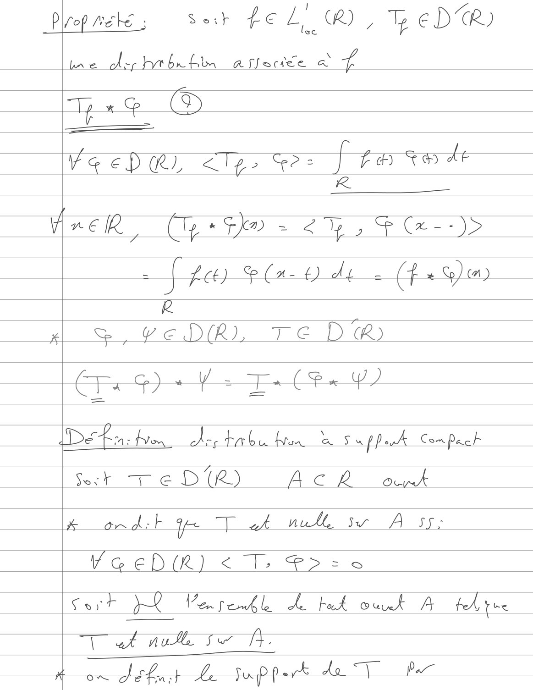

**Lecture OCR à contrôler**

~~~text
Proprete : seit LE Le CR) , Te e DR)
bne As hebrftn afisciée à A

Ty» & (XD

a
a

va eD RI are Go = fF FASS de
R

fneR (ys te - 2%, FC--)>

he plat) dy. (fae

es TE Te De®

L

Ex DV EF

aoe ban he, tabu No a 5 + fp ook Com Pack

Serr Tee D (2) A € 2 out

k_ondiF ye Tot null sw À 5j:

YGePD(R) < LT F>>ze

Sort PR Veretk L tal out A hlyre

Tat nulle Su ft.

© débat La Fup pk LT Par
~~~

## Page 16

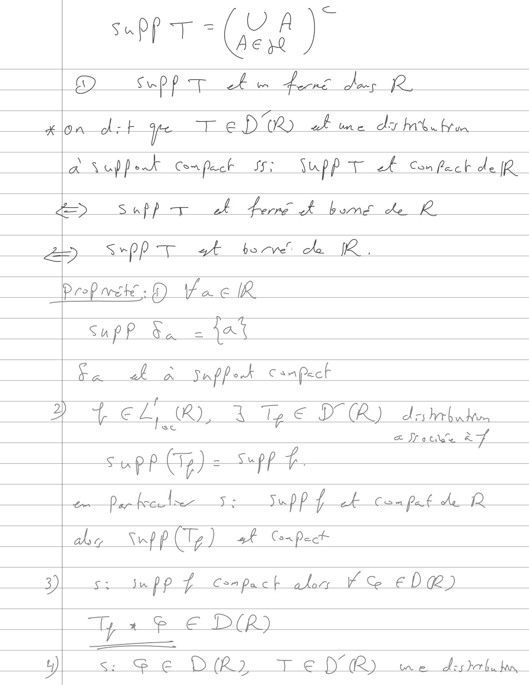

**Lecture OCR à contrôler**

~~~text
PPT =U

iD) supp TT À bn 2 re hans R

£lon dif 9p Te) hime dy hhitu

a \uppeK Conpech 5 Supp T ef Confact de iQ

d=> sup + af few t bons de 2

2 Sv PP 44 bone le JR.

_PcoP anche: 1) faocIR

SupP Ve = fat

Fa af à jnpfuk csnPect

TEL R, IE DR) dima

\w

& Sates 27
spp Cp) = Spp

so pue 55 SapPf ob conpebale À

alg Sup P Tg) +f onPeck

3) ss supp f compact alo V& EDR)

Ty & € DUR)

ty) . qe P(R2 Te DR) we Asbrh ton
~~~

## Page 17

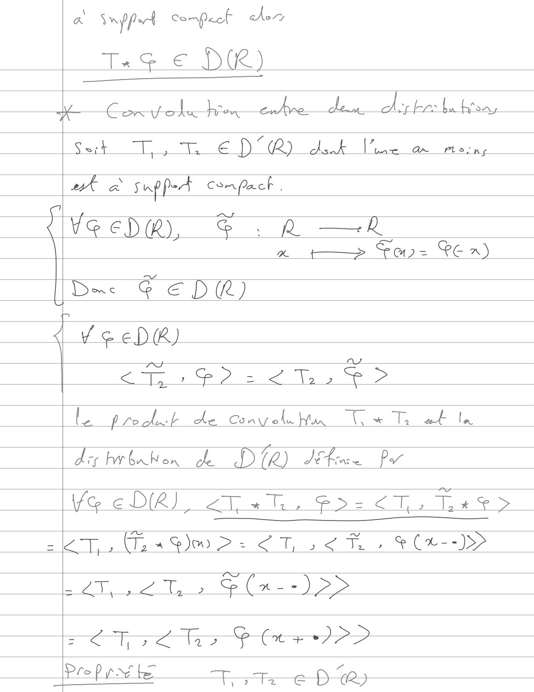

**Lecture OCR à contrôler**

~~~text
a Snppwd Compact cher

T«gG € DR)
x ano he T cuhvre den disk chefs .
Sst TT, "TT € D@ chink Vs Gx ov ny

we a Support compact |

fvVeepe, ¢ 2 —2%

x t+—> Fore CEA)

[Dee ¢ €D@)
d Veepu)
| a Pe >

lL pro hb Ae Controle Han («Th at: la

dx by GRR on de. DR) RER px

Vœ eDIR] et et, P>2€T, hee

in

Tasos: CT och. ex

-27,,2T% » Glx--)>

aS Rs SY Ot >

[Pre Pynnd be

M: a dé
Fe BHR:
~~~

## Page 18

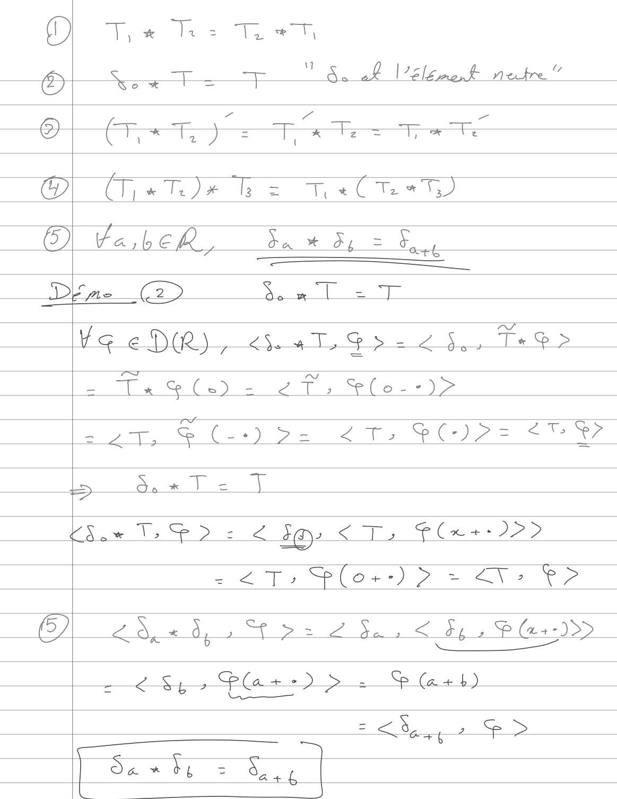

**Lecture OCR à contrôler**

~~~text
) Ta: Ten

© se 77 TS af Velénet netre ”
5) {= T- ee a En red cl

CA ET + r ) = F, x te Fae

Ol (hate Re name)

©) Va, bem den * Og = Feet

Du @ 3,

= —

Va eDR), 25. 4T Go- 2 h,. Tee

= Ta & Ce) = Zt. Slo--)

set $ (+) oe 27, $OID= SOY

Sim en

=

Sax TD ED: Ja < Ts Fle+:922

=a

=< Ts Plo+) 2 = <V> RO

dei. > 2 5, < fy, Pl:

Le Sy S++) >. Past)

Saxby = al
~~~

## Page 19

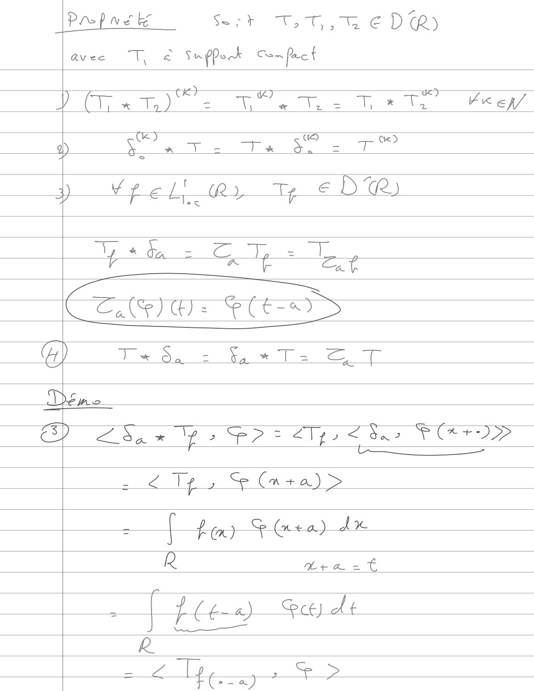

**Lecture OCR à contrôler**

~~~text
JPofusk _ sir TT, EDR)

avec TT, € Su PPook Com fac À

\

DY Tat) 2 PAR: TETE y

te) V2)
D Sat: Ta SU = T°"

vp el! Qy Ty e DR)

if Hine

Vs das CT = 1

a a

CAGE: $C

©

T x SA = Eu * T= CT

€

Le In

Cle

<8a = pr SPs Te Fr»
a

_ « Ty Se (n+a)

À Joy ea) dx

R A+a = À
L | fle 2) Gce) dt
| Er
R
- 2 Ie ,

Fa)
~~~

## Page 20

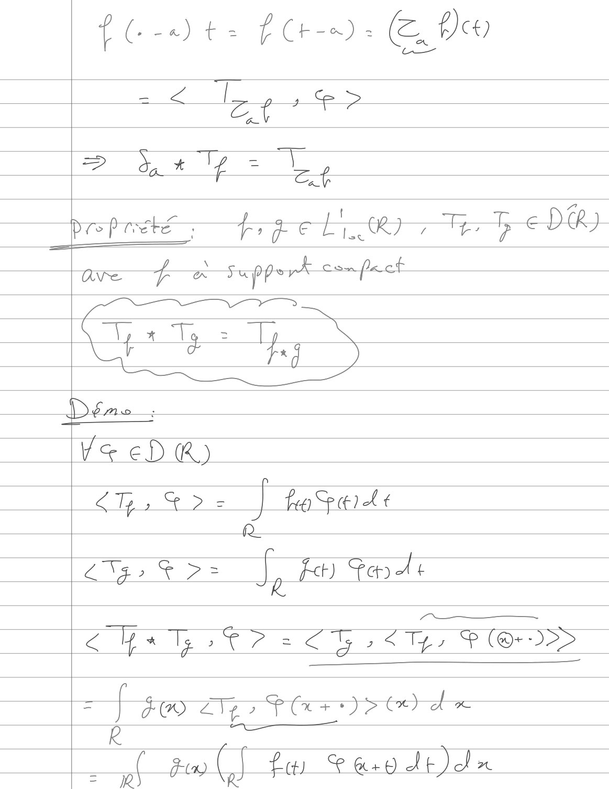

**Lecture OCR à contrôler**

~~~text
foot. 70). Ep

_ LL 7 Gis ©

2
À À
qj

=> on * |e = à

Cah

Dr jt ej he DRY
prep ete i Fr pe Lie i ci la

AVE 2 nm Sappork compact

te 3 »

Démo_.

V&eDR)

CT >=) HaGedt
&

Vs RD 2 ft) er de

< Yat oC? = TF < Tey P (@*D>>

= f o® ZT Pr) > 60 dx

R

(aml | fa Cero dt) x

= RS wR
~~~

## Page 21

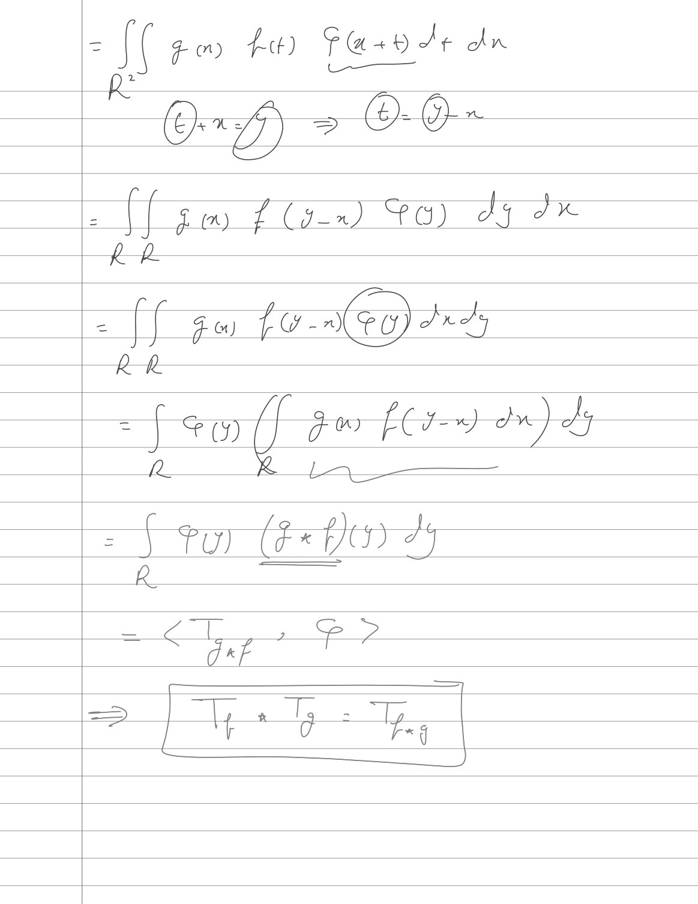

**Lecture OCR à contrôler**

~~~text
“dl 7”) f-tt) Fa+o/¢ An

Ore) = (©-O-»

0
qt
>

gm LU) #0) dj dx

4 TN
ÿ a) LO -ACO) Dns
~~~
