# 2023-11-10-Note-10-01.pdf

[Ouvrir l’original](https://drive.google.com/open?id=1XiEuUwb8i5dp1HUzArin91f44y9eWTah) · Les pages signalées comprennent du texte reconnu automatiquement ou des éléments graphiques. Le fac-similé permet de vérifier chaque lecture.

**Pages avec fac-similé ou lecture OCR** — 1–17.

## Page 1

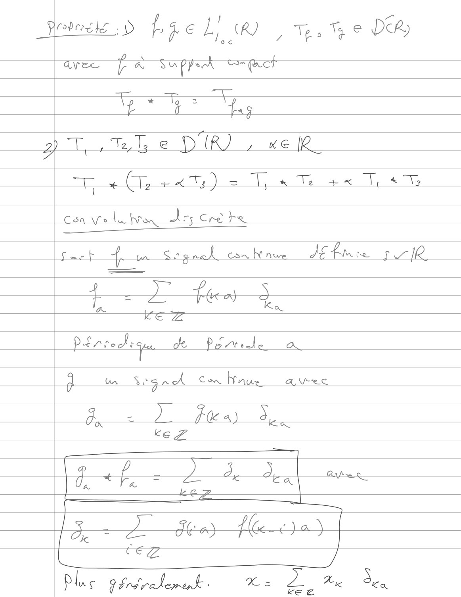

**Lecture OCR à contrôler**

~~~text
PDL

mes Bae tk

» €

5 Vs e DCR)

avec Fa Su ppsrk cect

TT

Fi = Lar

2p T,.%, e DIR) , we [2

SRE

Ip ex tz) = Tax Te 4x TT 47%

J

Coq Ve le bio Jr; Crd be

fast 4— St gack Cow Wave JE fm se sR
4. D frs à
LAS jee : a
Paceline de Portede aA
| Un Lignd Con au Awe
g, = 2 Fes 3.
keZ
]
a as p ~ ) de deal He
— fe =a
x = )— Abe a \ 70 ‘ja ) [
/ Ne DE F7 T 7 ]
Ce CEZ /
Plas 9 nd rchemenk Ke A Sea
~~~

## Page 2

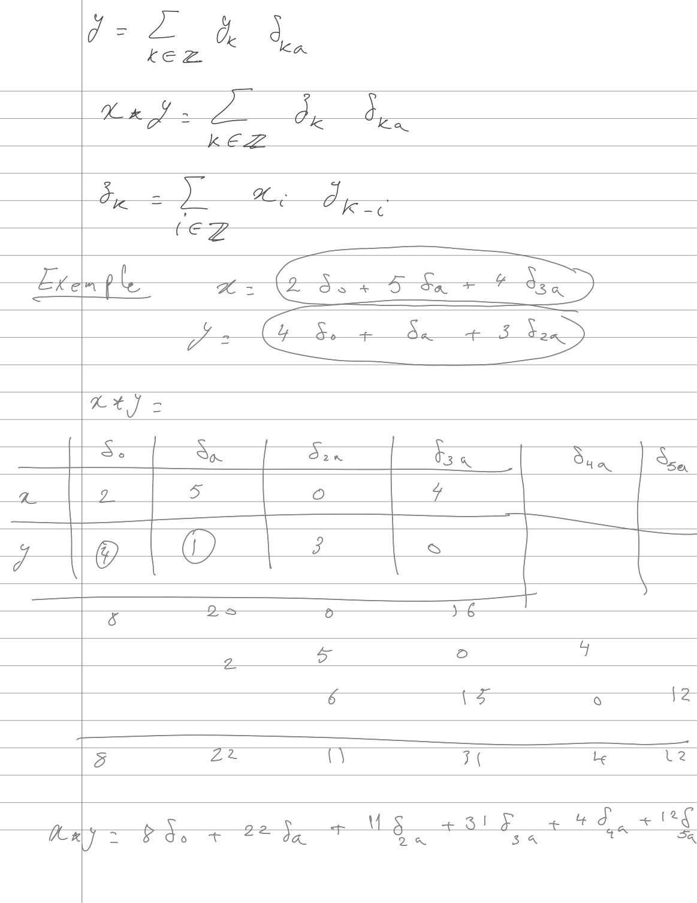

**Lecture OCR à contrôler**

~~~text
kez ka
Lx} 2. bn ds
kEZ
ë,_= )_ H: de
FED
Exempla Hatt Soa 5 SK a ere
2 Gs Sa 43 La)
LEY =
fal i nl c ec
| Se Qa On O3 à Sua Sa
x 2 5 o 7
—+ À
3 lg DO j 8
5
z 2 © 6 T
2 5 2 a
6 tS © F2
3 Zz (A) 7{ Le T2
ud (2
DRY = ae Æ 22 + Hg Std +o £
~~~

## Page 3

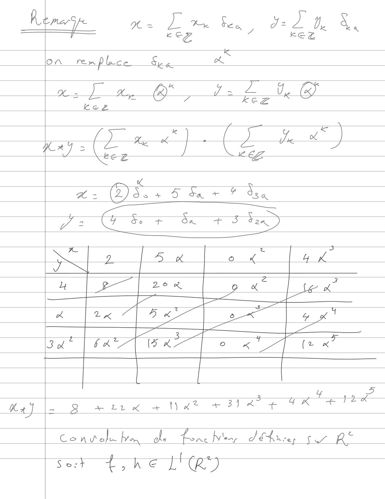

**Lecture OCR à contrôler**

~~~text
+ aKa
+ 3) 27 +

5
LS

3 x~trK + DMX?

HJ

Con Pole bron ole fone Nea, S Efrcey far R is

set the LCR)
~~~

## Page 4

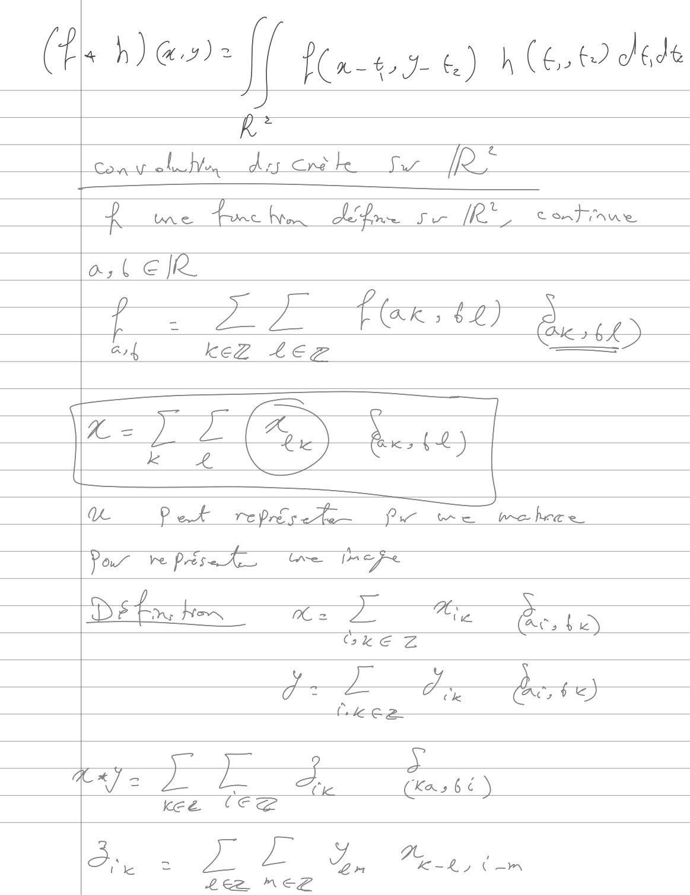

**Lecture OCR à contrôler**

~~~text
(Ff

4 h) Gas)? if Pat, 3 e.) h (6.62 lide
D

R*

Convobuhty dycrèk tur fee

À me a ho MP rive Su IR! continne

a,6 €/R

5 i= Ly IN
a FRB) PATES
arf keZ LEG TT

uw Pat reposete— fir we mehoce

Pour re Pit we The

Ton

=
Dita tes x Me

Co bey

GOkKEZ

a = a a, be $e)

Ty
DE ZL Bs a, den

À. = ri Z VA OS bn d
~~~

## Page 5

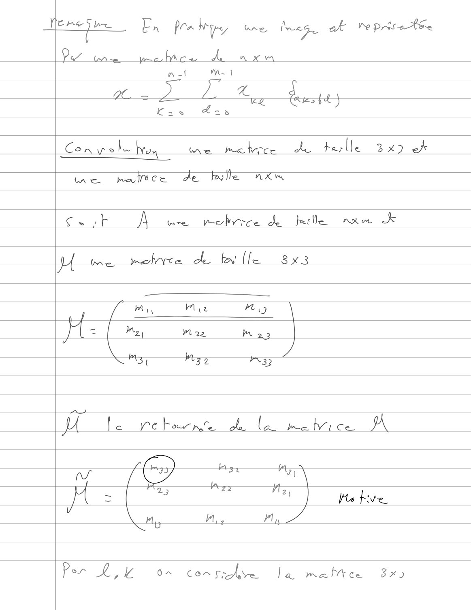

**Lecture OCR à contrôler**

~~~text
rep En Pra Np, We, rege ok We PRIS -e tee

Pv We peace A nxn

a= D

A mw
a oe dt

Con poke hom me melecer À Faslle 3x2 €K

bre. malice de Alle ax

Cs yh A unre rrobyrrce de bille nave &

VY Un 2 monte ch fon! [Le 8x3

M 23

HE |
\ ,

P33

U Le Ve bourne de ls. me Mice A

CD
ye
FA = | ~* 2] potve

\ ny m,, Ay

Per Lyk on corde

la male 8x)
~~~

## Page 6

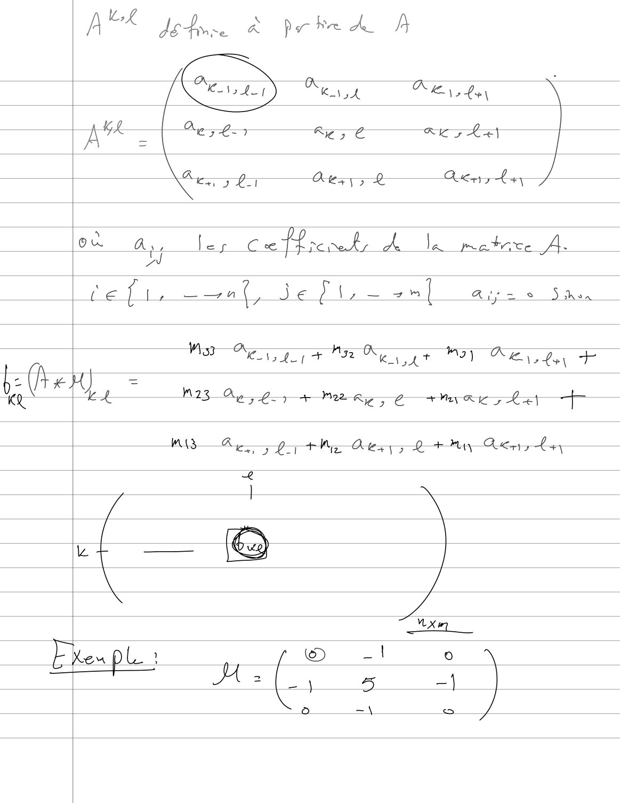

**Lecture OCR à contrôler**

~~~text
AX jl À prie k À

er ar évé

t | Mee, Ré; € cakes |

\ een yb Atezy aR Ress hy /

où à, ler Ceffront Ala metre

“ty

Cefi, nt Je fl, = sn] Riz s Shs

4 On
Mar Reg + 7 Near T Mey P

H) = i

EL 5 fie K 3 tae

M Ap gp th Aes, QR +My Dem Ly

| \
~~~

## Page 7

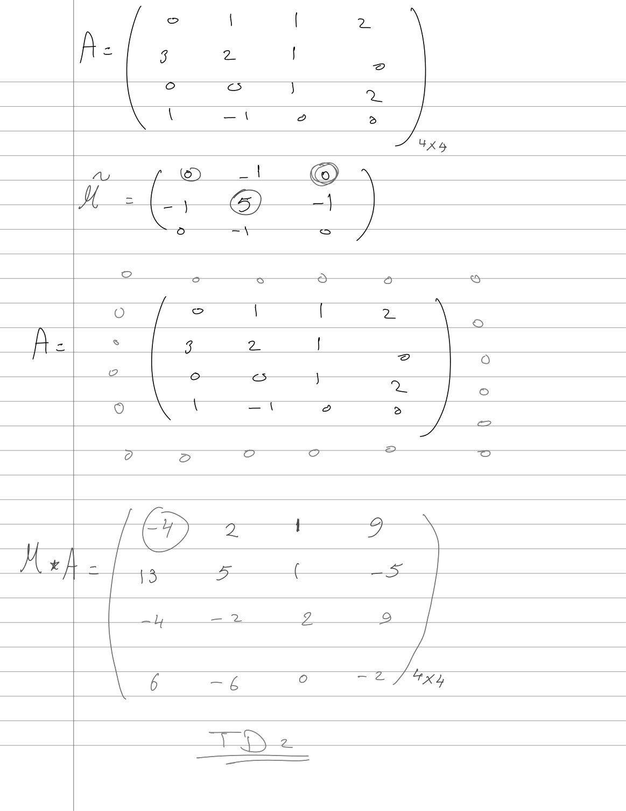

**Lecture OCR à contrôler**

~~~text
4x4

f &

A

Le)

oa 1
> (

[L&D
13

4x3

=

ae
~~~

## Page 8

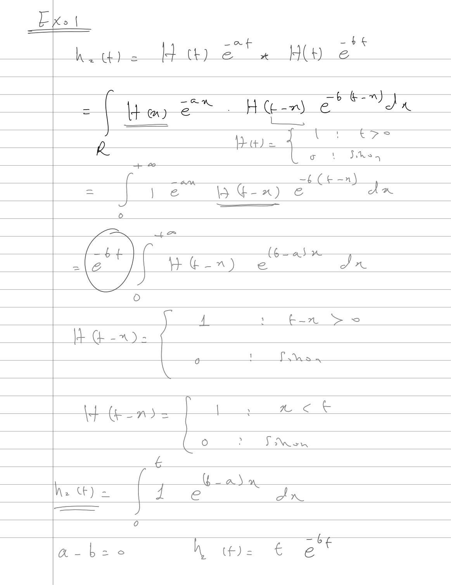

**Lecture OCR à contrôler**

~~~text
ue Hi et Ho 2"

-& —$ =~)
ej es HG-n € Jn

| —e
2 Dus 4

{yt >es
Loo 4 Jus.
or ~£ (En)
= J ET pea eax
a
—_ eux
ala") HE-n) e Jr
K
o
er: tn 2
\4 Gand f
5 LA
k
tn) | | wo €
(0 Sen
&
G
We tf) = l za An
— J
a-bee h, th) = € ot
~~~

## Page 9

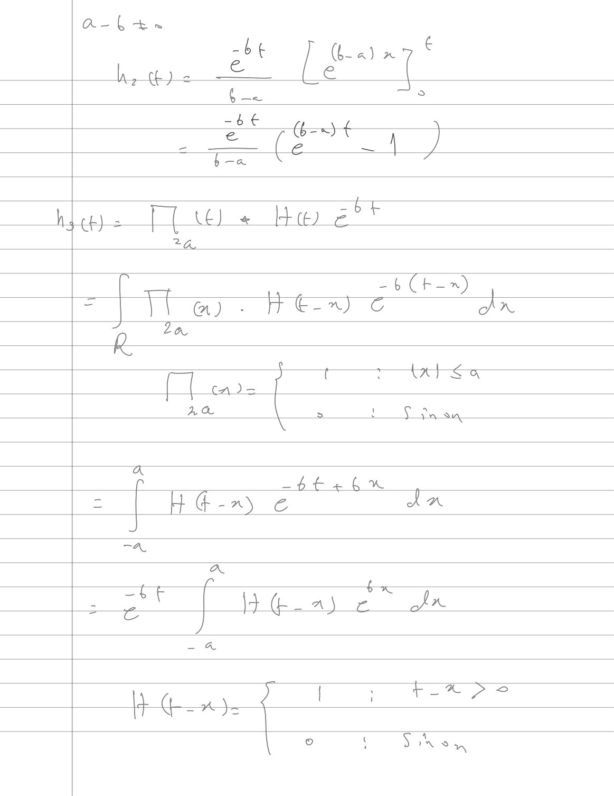

**Lecture OCR à contrôler**

~~~text
A-kes
-bt (Coa) x ‘
he th}-< Le {
-6€
2 (er
lue FT « He £°®
2G.
| ~§ Ch)
ee NE C =
R a
Teste
CA) =
aa Ke FS Sa an
a btehu
| { HG-») € .
FA,
ss
fo
Then ET
RE =.
\ 8 $ Siren
~~~

## Page 10

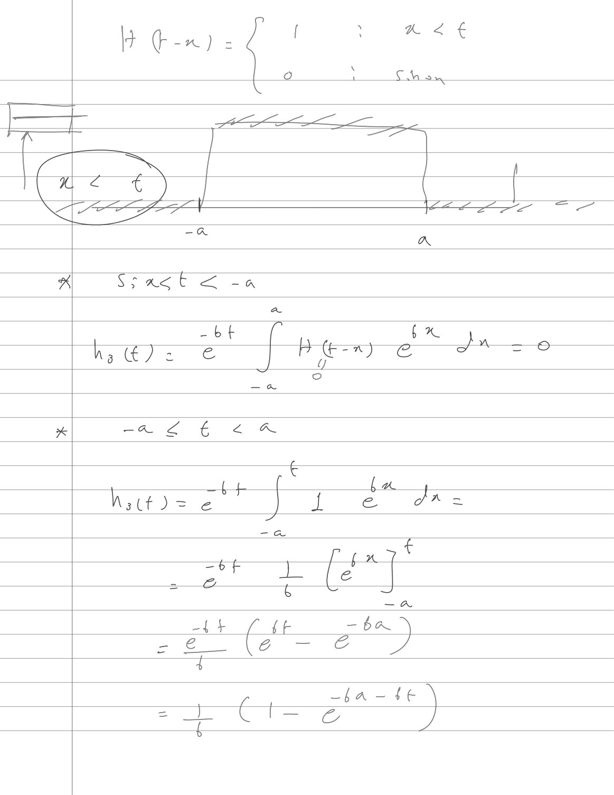

$H(t-x)=1$ si $x<t$ et $0$ sinon. Le schéma compare le demi-axe $x<t$ à l’intervalle $[-a,a]$.

- Si $x<t<-a$, $h_3(t)=e^{-bt}\int_{-a}^{a}H(t-x)e^{bx}\,dx=0$.
- Si $-a\le t<a$, $h_3(t)=e^{-bt}\int_{-a}^{t}e^{bx}\,dx=\frac{e^{-bt}}b[e^{bx}]_{-a}^{t}=\frac{e^{-bt}}b(e^{bt}-e^{-ba})=\frac1b(1-e^{-ba-bt})$.

## Page 11

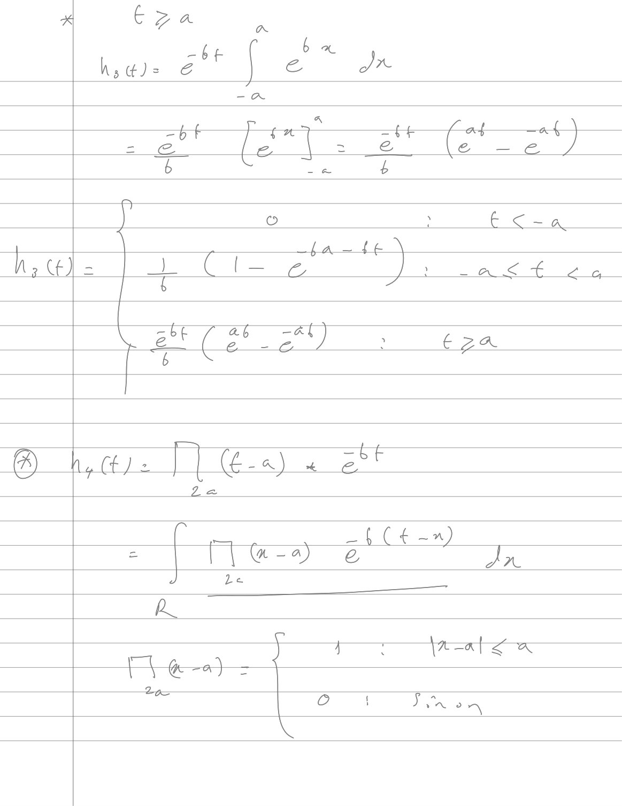

**Lecture OCR à contrôler**

~~~text
K
box
mw oft | e
- Ppa af
= a" Le (ET À
i © E<-a
ta =te \
esp OS a Ce Bt
pee bza
@)_h, ct) | (4-4) « Adi
Le
=
1, —-f(t-»
= [| @ =a) ? nA
J Le
RL
y LENS
Fao)
ao J
+ 9 FX
~~~

## Page 12

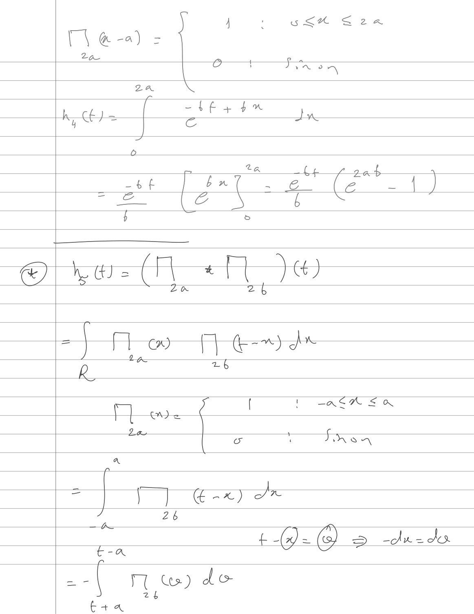

**Lecture OCR à contrôler**

~~~text
oY

Za 2b
= Fc) FE de
R =
ag, ¢ | À TR
q ig Ar
ee | Oo Tan
( ;
7 ÿ J E-xr #7
7 26
Lule). fed > hu = ks

i
= - | FE Sr) de
~~~

## Page 13

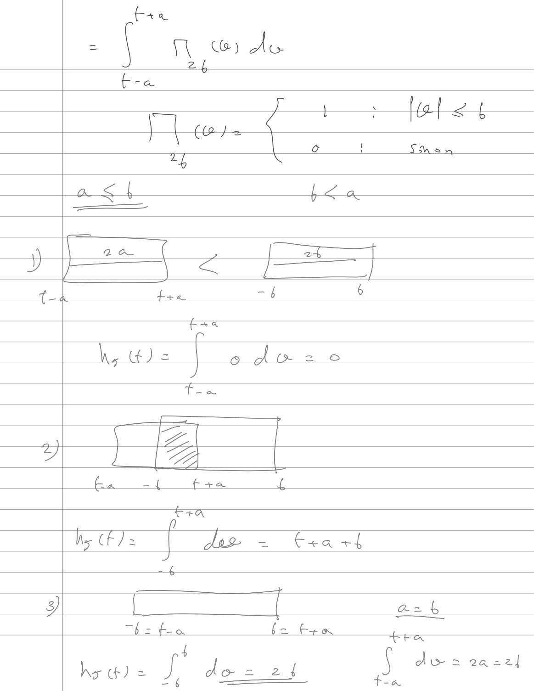

**Lecture OCR à contrôler**

~~~text
- FN wy Ao
24
an laf 2
\ | (QJ ¢ a
; | Ca Ths 4
4, K
at b
À = 2. a ( | z
tl bee =
se
hy (t) = © À (x 2 8
tee
: S
7
Ga 4 fra L
Fra
hs CF] = f de =~ Era + {
4
The fo f= Fro —

4
ho &) = J ol

o = 24

a

Aw = 2a-
3 Ww 2 2a =2{
~~~

## Page 14

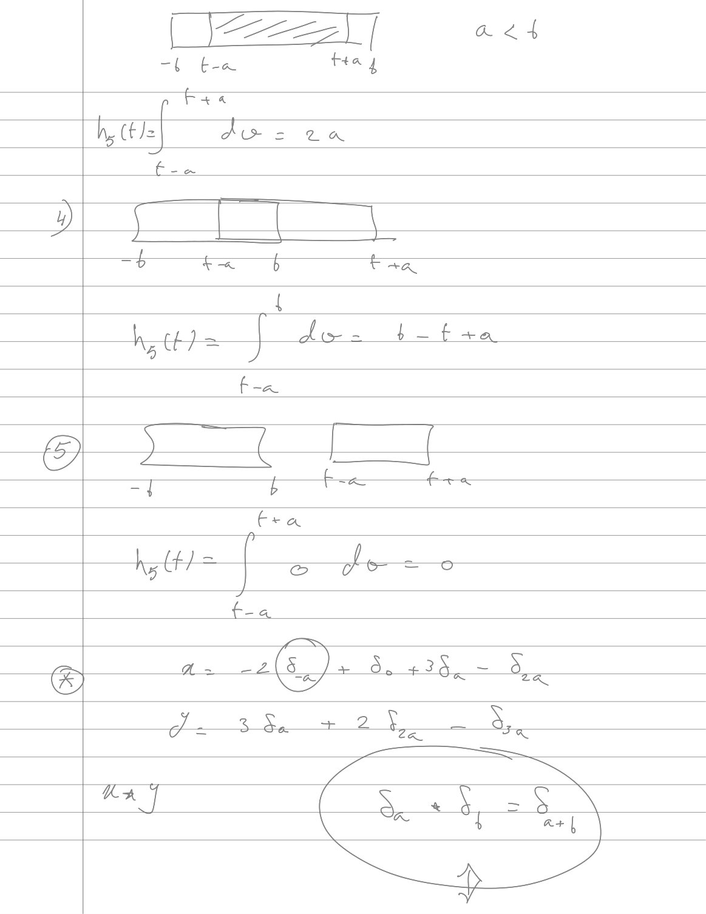

**Lecture OCR à contrôler**

~~~text
CIE ] acd

-( bee Fra 4
Fra
LE] pr = TA
fre

J
fa
— À b Psa os
te
hg tt} | le) po Le)
fra
F A= -2(6,) ds +30, ~ Soe
p= 3 ê« — Le dr
"AJ is ens
~~~

## Page 15

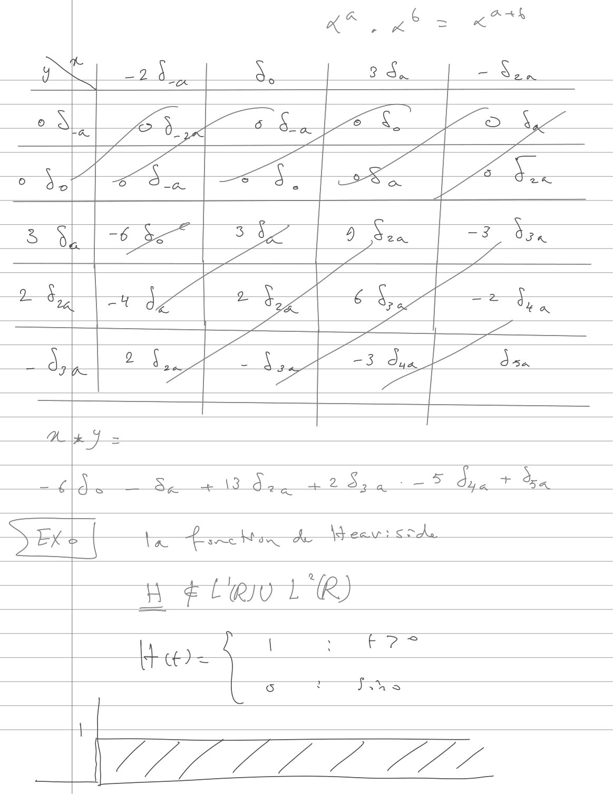

$\alpha^a\alpha^b=\alpha^{a+b}$. Le tableau de convolution a pour colonnes $-2\delta_{-a},\delta_0,3\delta_a,-\delta_{2a}$ et pour lignes $0\delta_{-a},0\delta_0,3\delta_a,2\delta_{2a},-\delta_{3a}$. Les diagonales regroupent les termes de même décalage.

| Multiplicateur | $-2\delta_{-a}$ | $\delta_0$ | $3\delta_a$ | $-\delta_{2a}$ |
|---|---|---|---|---|
| $0\delta_{-a}$ | $0\delta_{-2a}$ | $0\delta_{-a}$ | $0\delta_0$ | $0\delta_a$ |
| $0\delta_0$ | $0\delta_{-a}$ | $0\delta_0$ | $0\delta_a$ | $0\delta_{2a}$ |
| $3\delta_a$ | $-6\delta_0$ | $3\delta_a$ | $9\delta_{2a}$ | $-3\delta_{3a}$ |
| $2\delta_{2a}$ | $-4\delta_a$ | $2\delta_{2a}$ | $6\delta_{3a}$ | $-2\delta_{4a}$ |
| $-\delta_{3a}$ | $2\delta_{2a}$ | $-\delta_{3a}$ | $-3\delta_{4a}$ | $\delta_{5a}$ |

$x*y=-6\delta_0-\delta_a+13\delta_{2a}+2\delta_{3a}-5\delta_{4a}+\delta_{5a}$.

**Exercice — la fonction de Heaviside.** $H\notin L^1(\mathbb R)\cup L^2(\mathbb R)$. $H(t)=1$ pour $t>0$ et $0$ sinon. Le graphique montre l’échelon unité.

## Page 16

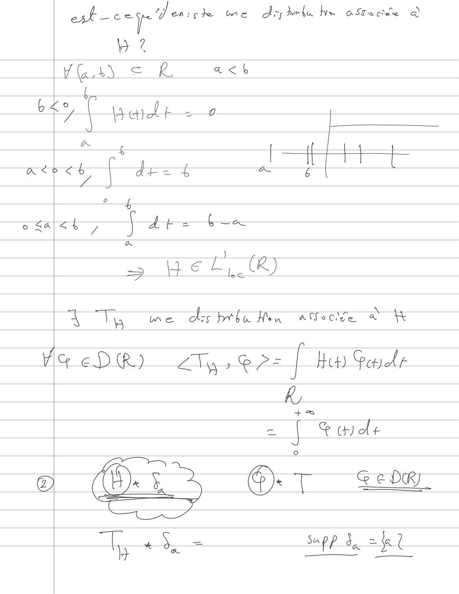

**Lecture OCR à contrôler**

~~~text
af cape ence me any boda hs aSssese

b 2
Qi € À a < b
{
b<e
| bat =
+ | nt {4
Us $ f dr = + | -

À Th we drhrla tn atecve à À

Tye P=] Hen Gabe

R

= § S Hole

°

ZT
GT LEE

Sopp à. = k ?
~~~

## Page 17

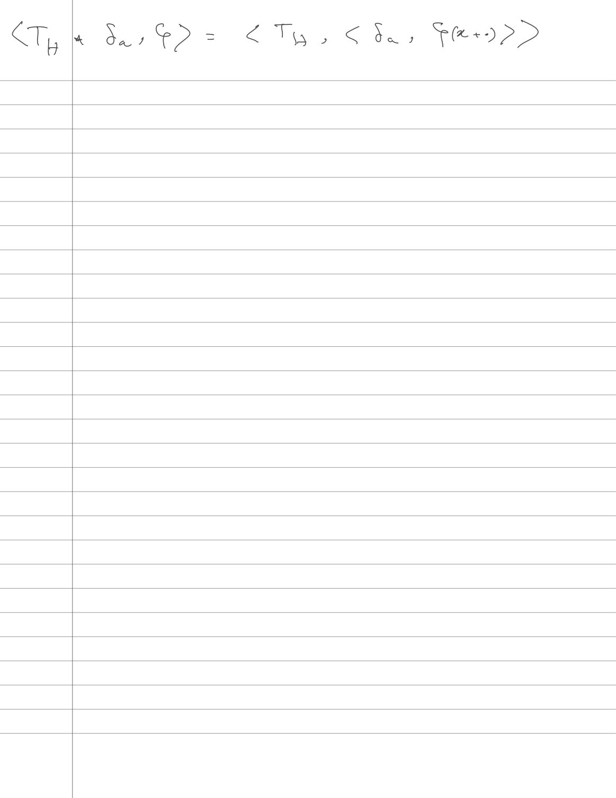

**Lecture OCR à contrôler**

~~~text
LS dar FD =

LT,

Cdn, Tæ+2DD
~~~
