# 2023-11-22-Note-11-45.pdf

[Ouvrir l’original](https://drive.google.com/open?id=1--MxcOyz3c73noADppxRQHQfO1Fw_w9i) · Les pages signalées comprennent du texte reconnu automatiquement ou des éléments graphiques. Le fac-similé permet de vérifier chaque lecture.

**Pages avec fac-similé ou lecture OCR** — 1–28.

## Page 1

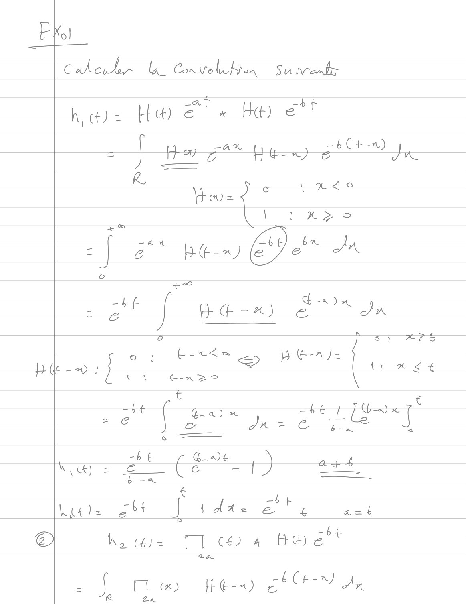

**Lecture OCR à contrôler**

~~~text
ol

Eclat la, ConVoli Hon Su vente

a', Ha) ét

htt} tt) E
( _ -bCt-
ss the AH tea 6 he
K à Se 1_U <9
| CEE
\ \ 1 #2 >
ora bf ba
=f ce" REX) DE 7%
wi
o
+22
= a5
Ss at | Hh-«) et Ja
o ] 8; MCE
7 G= — bte
pin} © 2 tones
Ct &-n Be
rt €
Le ax AE ns
ze \ a) x = = | J
\ -bE Gave
WY a) = = Ce ~ > =
£
Rue oft J die et, ied
ry “6
@ Ke (d= | ED 4 TUE 7

J, To) He-«) pete An
~~~

## Page 2

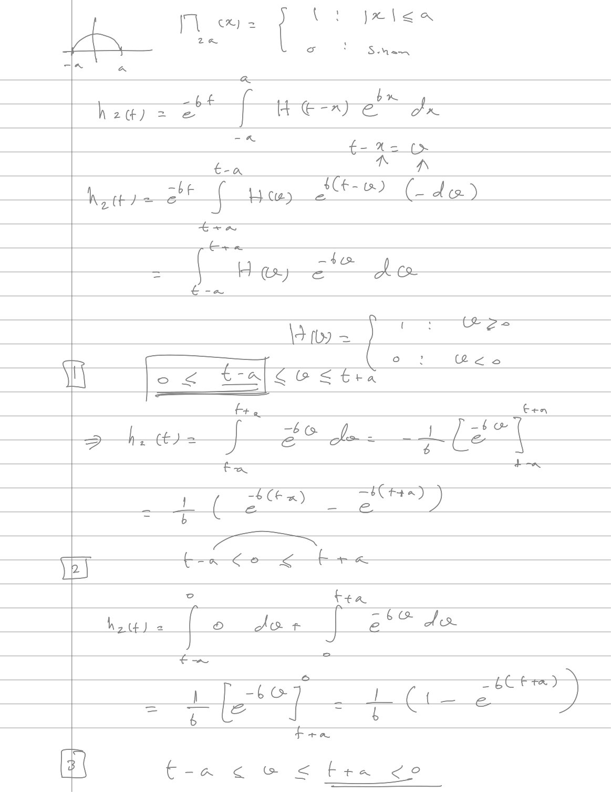

**Lecture OCR à contrôler**

~~~text
î b
heaps eo f HE) € ox

ma
f-%= (>

NK

t-a nN
hott et f Du oY C de)

orn

(oo

ata
~ ) Hoes c Abs
€

re

\à fy = ] fo es

AN
La)

eo: Reo
€

-§(C& EF)
1 idee )

=

Era —< Er k

°

fea

hott) = fe Je + J ALP
~~~

## Page 3

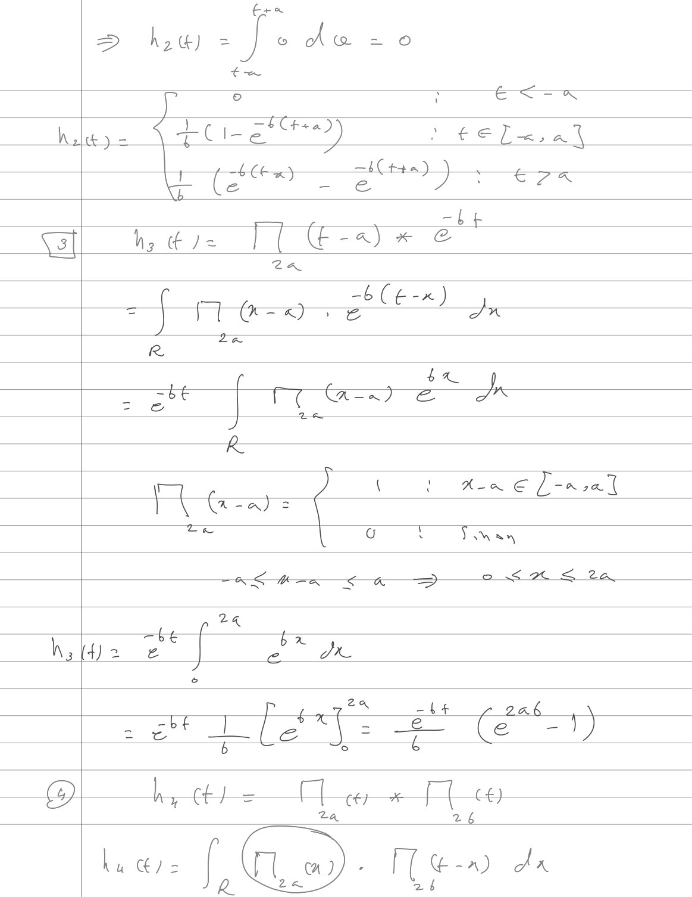

**Lecture OCR à contrôler**

~~~text
Era

=> ho) - Je Aw = 0
toe
= 5 ER
he. ( ECi-e oF?) fe Tas wh
C —sCt+a) )
ae (= tay = &. 7 EE
cb
Gi nue T[ E-a* @
| =
— -6(E-x
fee re ) Ds
R a
=be—f Fe y
z 5 | FT Wad € 24
J Tea
R
tn ) { { Aa Ef-asal
Pi Gas {
Te [© © as
LH <a © WBS 2a
6 7
=e
hf ¢ ek
P Fa = a
ef MC?
(2) ha, = Te FT
Ta 26
La es Cw) Gea) Ja
“ R. FC
~~~

## Page 4

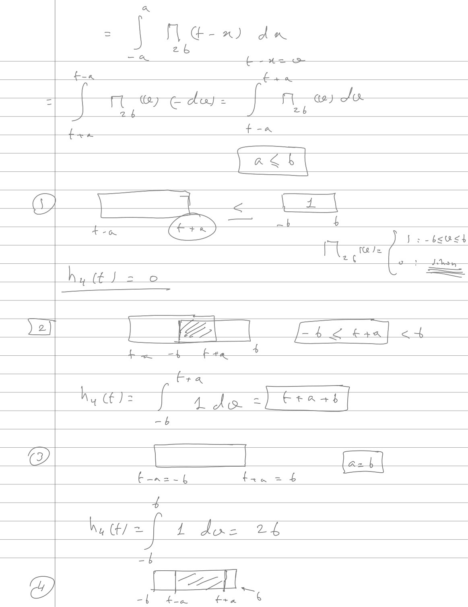

Avec $u=t-x$, $\int_{-a}^a\Pi_{2b}(t-x)\,dx=\int_{t+a}^{t-a}\Pi_{2b}(u)(-du)=\int_{t-a}^{t+a}\Pi_{2b}(u)\,du$. On suppose $a\le b$. La porte $\Pi_{2b}(u)$ vaut 1 pour $-b\le u\le b$ et 0 sinon.

1. Intervalles disjoints, $t+a\le-b$ : $h_4(t)=0$.
2. Recouvrement à gauche, $-b\le t+a<b$ : $h_4(t)=\int_{-b}^{t+a}1\,du=t+a+b$.
3. Si les deux intervalles coïncident ($t-a=-b$, $t+a=b$, $a=b$), $h_4(t)=\int_{-b}^{b}1\,du=2b$.
4. Le dernier schéma hachure $[t-a,t+a]$ à l’intérieur de $[-b,b]$.

## Page 5

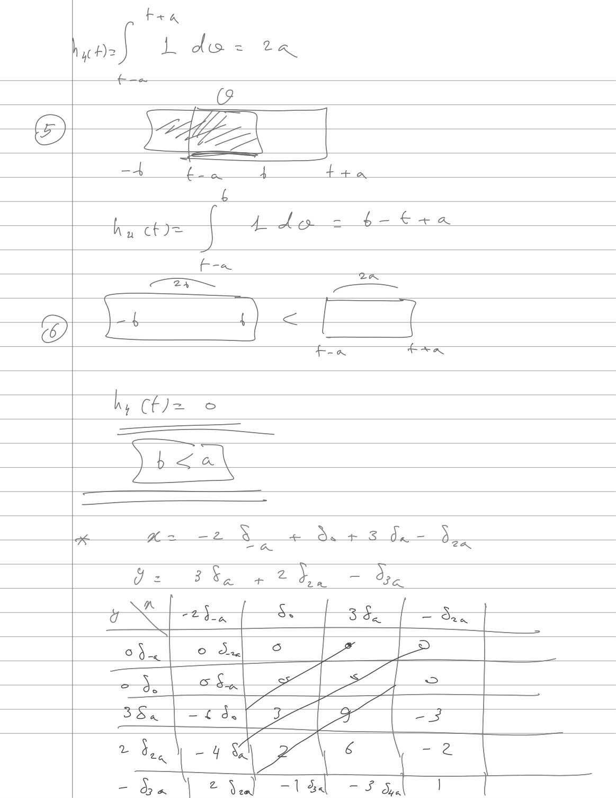

**Lecture OCR à contrôler**

~~~text
œ
£-€+a
—
O| Ce —— -
~~~

## Page 6

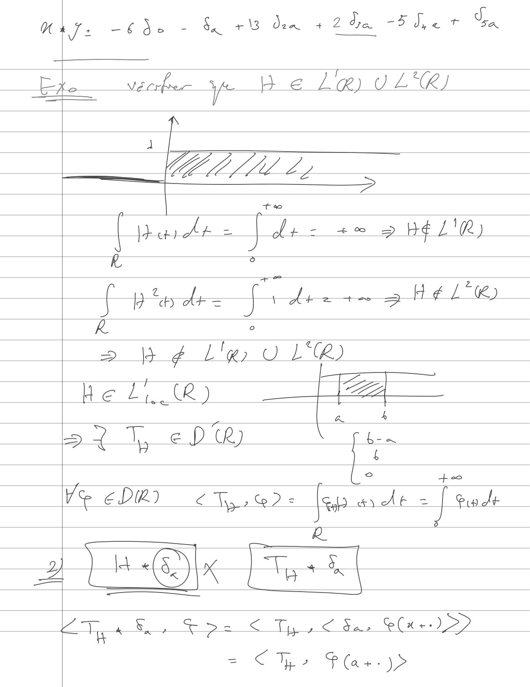

**Lecture OCR à contrôler**

~~~text
Kafe =—b Xe - § + \3 dix 4: 2 da 25 Jar Sa
Exe Ve creer y + L@) JL RI
1 |
[A
(jpear ke = [des += > HE L'R
J J
RK o
[ ptodes frite gle l
À °
> |} ¢ Lie O LR)
Re Li) TA
a 4
> 1, _e D te) Phew
x p | ni
Le
Ve 6D) Wy s&2< Fe ar At | ead
2 OK | ER
Fa Cpe LT, Sas E(x) >>
= Co Flax.)
~~~

## Page 7

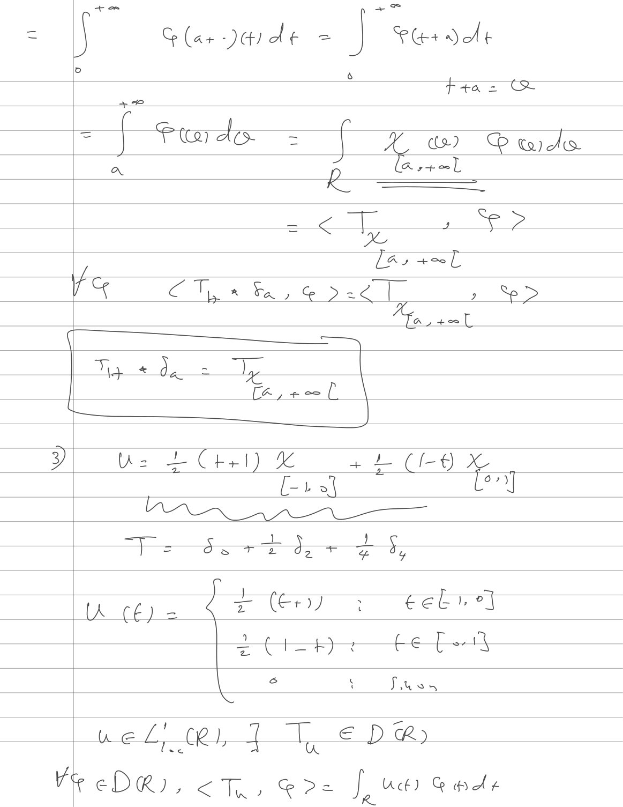

**Lecture OCR à contrôler**

~~~text
+

a Gar de = Jaros

6

f+az CL
_ ( ic =f
| TO 3 Kw) Cul
EN £- laszel
- < i; “E>
. Te
CECI
re CTs ha, &@ ded | » >
ayr+el
os
Ty ed 2 Te
ra, reo
|
DT OU: OG) K st (lox
(-1 =] [973]
“y= os FE — z s,
lA re) = + (ery tebtre]
= C1=+#) te [at
L e Twos
wel, ce, 4 EPR)
a

Fr eDR), LT, & Pe wey QG HAr
~~~

## Page 8

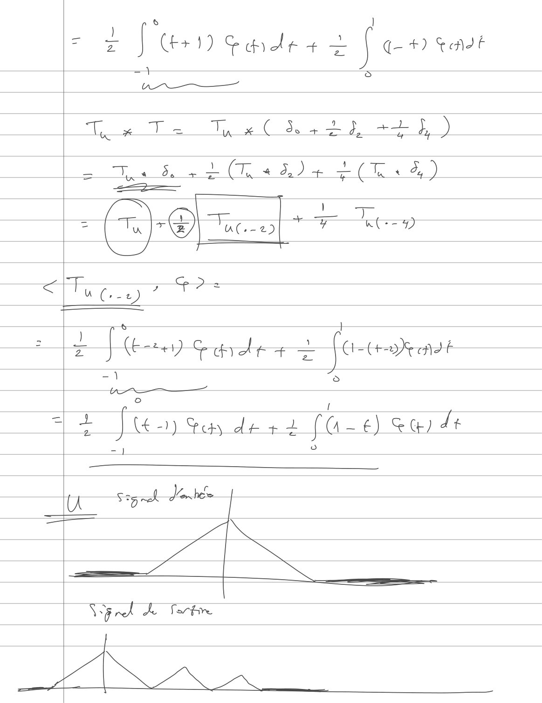

**Lecture OCR à contrôler**

~~~text
2 + | GN qudes

}
> J q- +) Ce Ë

S

et
Tee Te WeC dat, ++} )
- he et (Th 4 + LR)

a
IN Os LL
rest rt

KL

5 De

enr +
J Cu ñ A + Cu. fa
Z Et) Co chy 1. Er ttt

ee :

I

= < (4-1) Gen de+2t (G-€) ou) dt

ssh Monhehe
LU ‘% |
= A

——.

es  —Z

Synl LÀ Fort

NAR
~~~

## Page 9

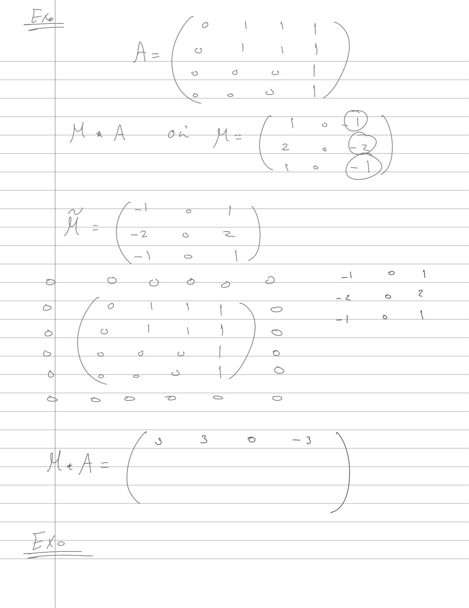

**Lecture OCR à contrôler**

~~~text
ph

M.A =
~~~

## Page 10

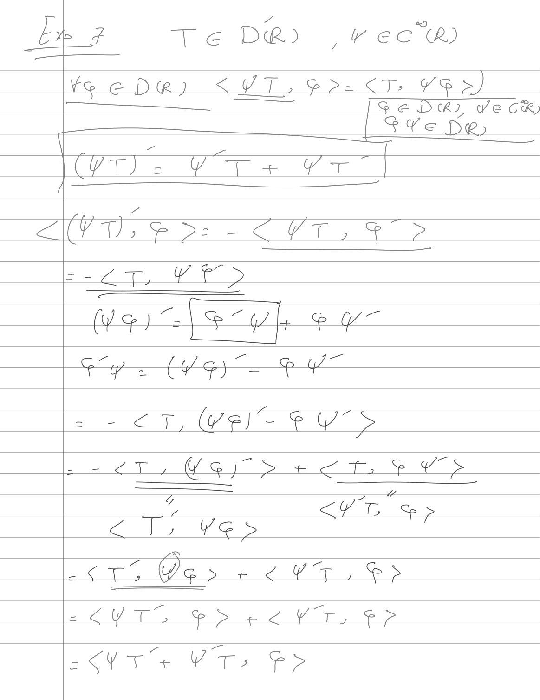

**Lecture OCR à contrôler**

~~~text
bie _7 Te DR) ,vec®

Fe ce DR) VT,G>2 CT» YS )

[Se DA) VWecR

NE Vrs VT

VU, FS: - CVT, F

z-¢ TT, ¥ FT D

Woe) ov FY

NB eG YP

> - <T,YVFI- PY SD

2-<T, YS); Sect ews

É <V rR &
Zi ve ni

«Ti Wes + e VTT, ES

LEYTS PS + € V7, $

F7 À Yt

SVT WT, F>
~~~

## Page 11

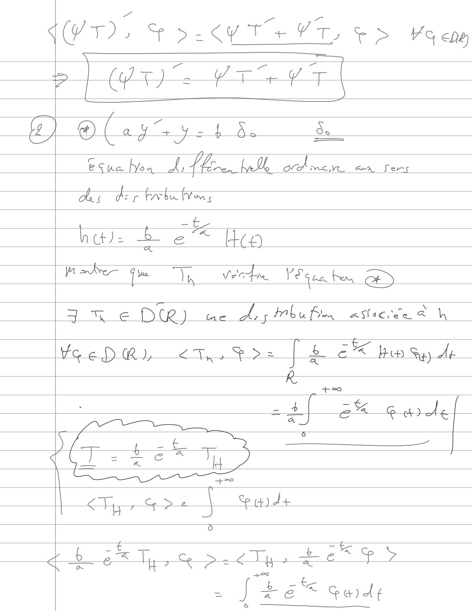

**Lecture OCR à contrôler**

~~~text
YD. DUT NT + > va <Db)

\ = —
= (pr) Try T |
EL À
DÙagT set 3. 5,

fue yon À Fe. beh Se vr. an. Fairy

es kr Frbu ons

4 -€
ht) = = se fra

M ke ind Va Ved VP eae tiene =

37m ee Pte) me “A wba. affecte à bd

ET
oe DR) LT, Ds f+ Cc beep Sey At

+
-2f EX Garde
~~~

## Page 12

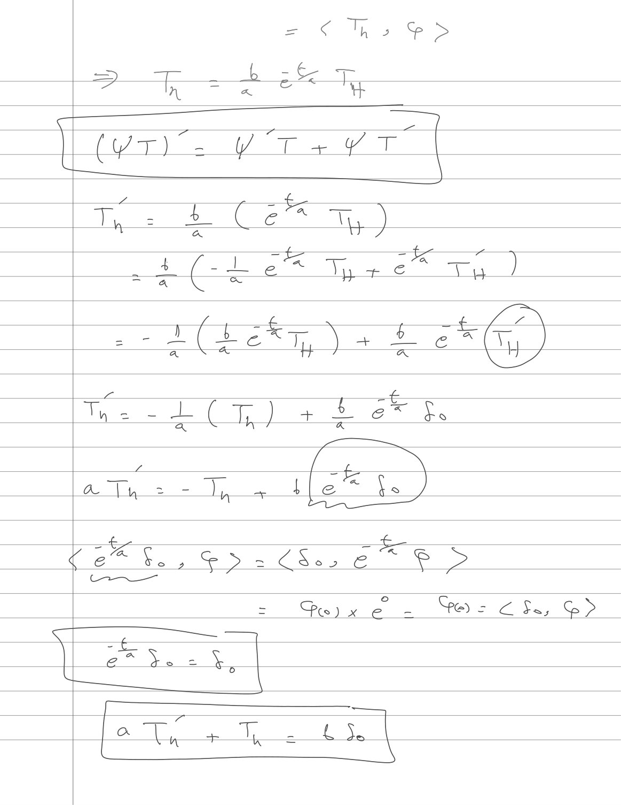

**Lecture OCR à contrôler**

~~~text
IN
ea
QT À
à) v
[| alk 0
A _ | Ÿ 2 NE
FT cb
rs. aN ik rN Q- |
Û K
: HP EATS | ETES (| ed\ | de | fo | —
< Nay
Pou, pele IT) Ly a x 4
V y F 7 L | v0 114
Nie IH Nf oy VY |
iy l'y ul + 4 al ih | L
ns ™ KL | F vu cad | | [TL H
| | (ty in Ly ‘i Le ;
{ lv SLA NS ; a
Le TT “ls rie ni 1 À i Ï
Hy ree de Lda Sp | ay
DS N < u a = ANY ue S
AN LL IE Ls Q iy) ' TT +
Le LL
~~~

## Page 13

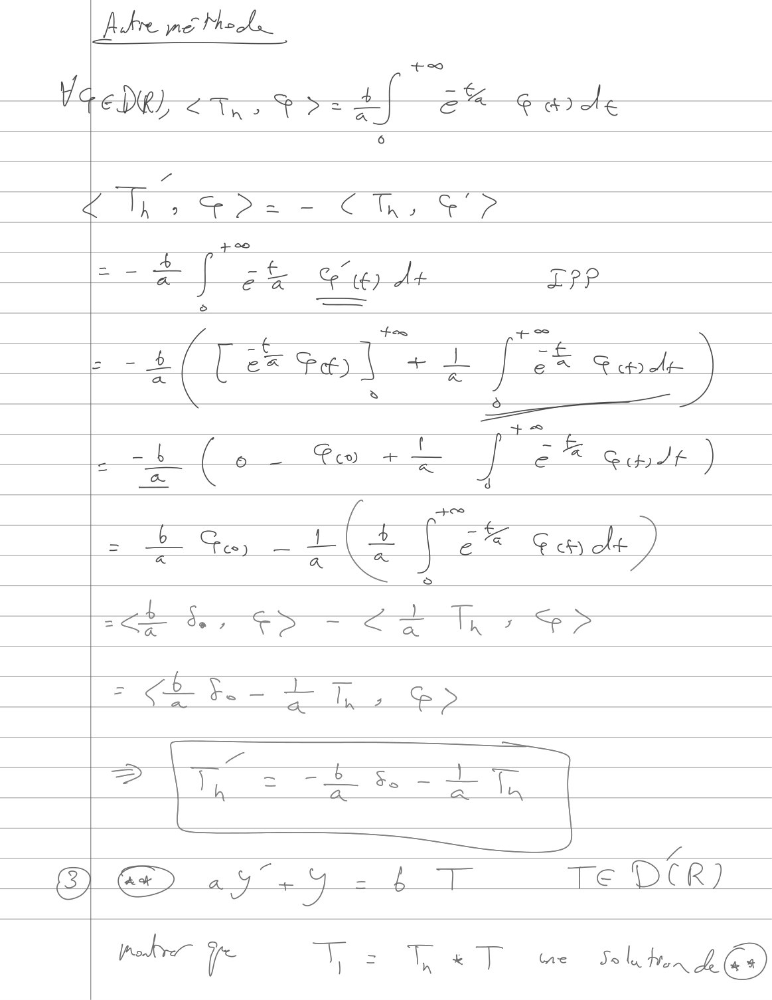

**Lecture OCR à contrôler**

~~~text
Ade ne Mel.

Yee Dey, oa am ele

6

a

The &D>2- CR, >

of eh eu J, [Pee
J TT J
€ ts prc
»-4( [exge | + L | ck ew |
k NN Z Fr.
UE
= = ( fo) So) + — J = GuwJt )
- =
> Ge, - + = 2 Goole |

 =~ <a hr >
: EH LT, BD
= < 5 i=
oa jis ST Se 2 he
À
D ED ag +4 = bh T Te DR)
pobre Ts eT

me Sola ten Alas)
~~~

## Page 14

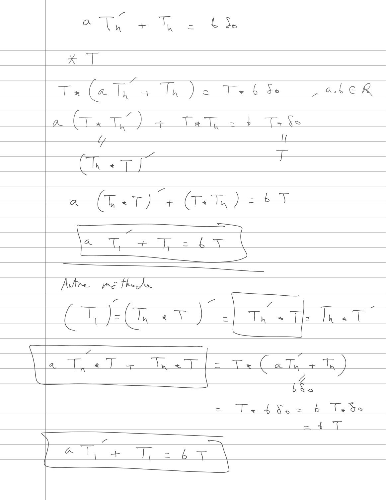

**Lecture OCR à contrôler**

~~~text
oT, + T= LE

KT
T + (x T. + Th ) = Te & So alkeR
À (+. TO) + Ta Ty - À Te Ys
/ I
— 7
(Tos TJ
a (he) + FT) =
{ TT
\a Le + PT:ily (
l ; D)
Afre pe Hs
— \T Zz
( iy EC ay ) =) Ty «T}e lé "4
— (
\ C
a ne « T + Ti «7 Z + al + Ty
n e
— > bf
= Fe + Nig b Ta Ss
= 4 T
~~~

## Page 15

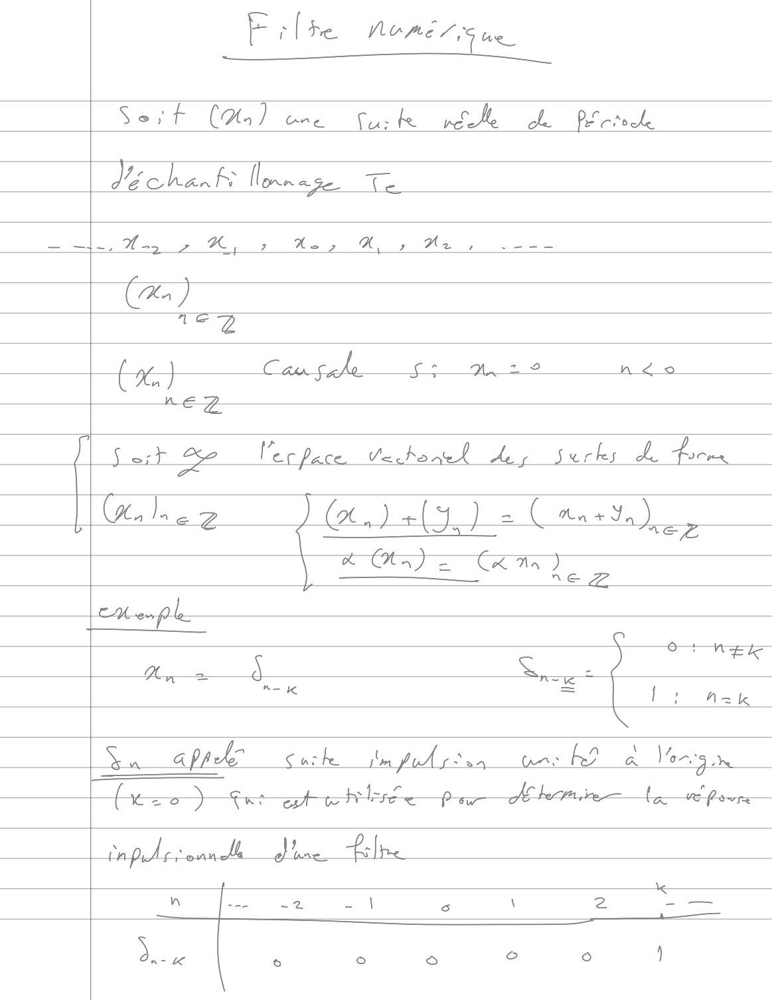

**Lecture OCR à contrôler**

~~~text
fe 7 [ He. Wit pee 76 ie

S S > t (An) one Cus te pi Me ae Pete

Jéchanr Tlonage

Te

ap Ang 7 KH, 5 Hoy Ay gp He à sm

(a)

Te?

(a) Cam sale 55 mi ze nés

WE?

ith 2 Mer pace. Ye honed Acy Sucks À. Roux

TTT

Gale g CRE ) = (( Mara) ay
x Ota) = CK Ms y.
Conf :
An = 5 Ge © EK

a No)
= J
a
=

Ça aprl Such tim Pu ¢2 a2 awn bo a a

beset apt ht po ol bettie Nig panne
~~~

## Page 16

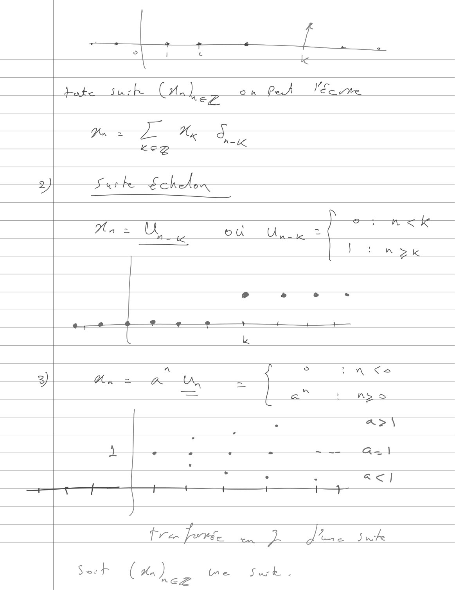

**Lecture OCR à contrôler**

~~~text
D _f
o I % le
date sack (A = CE PeA Ente.
——— We J
kep ms
9) Surk Echo
D
n
Ha = Ue où ot = (
| 4 a
[2 ea eo e
— 2. + + + +
le
n ° in Ce
D
= | « Ass
: a>\
À © = e - a)
. . 5 ac]
oo {$———t—_—_+——+ +
ren jorge. om À JP Suite
Sect Ca) me Sub,
~~~

## Page 17

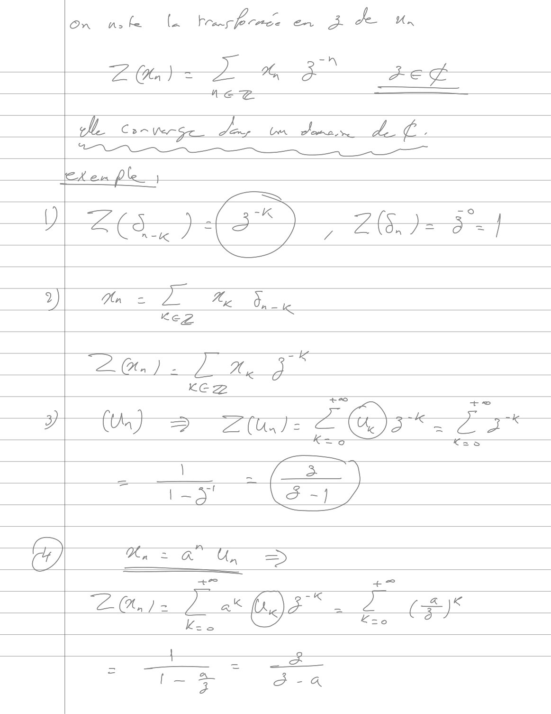

**Lecture OCR à contrôler**

~~~text
va L
© mA fe Ce boxe © 3 uv
n > and en “

ma Regt
} 2 9G, a eo E
Z Oat =

4

oc

22 Creer ge ur ie hong C.
ae a

2) Wa = À 4 6,

CREME
~~~

## Page 18

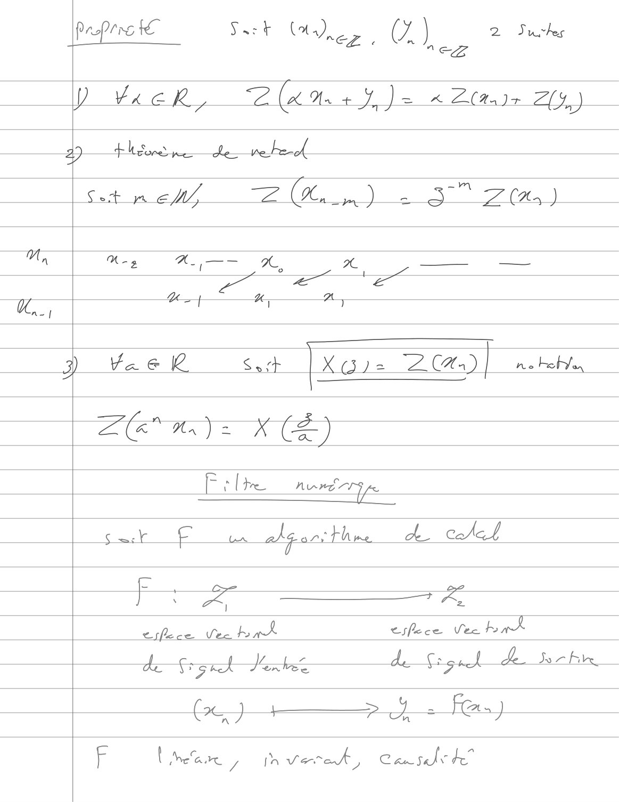

**Lecture OCR à contrôler**

~~~text
Propre te St (OÙ . (7) 2 Sucks

eZ

D Vack, Pam: Je «217 YY)

Le) th se Le ve LA

CE aw ZA) 2 5° ZMH)

jj vaekR Set |X G72 ZCA)]  nebebhy

(Tr): x CE)

F os re NOADTS pe
Yo

G see à 2 LA abe arithne À. cale À

fe Coo. 22

DSA, a,

esfece Vec ha efface Vee ha

de Ford Vhs de Gest ce. Jac Fire
Ce —+ À - Fern)

F Lean yt verak, Can salt ke
~~~

## Page 19

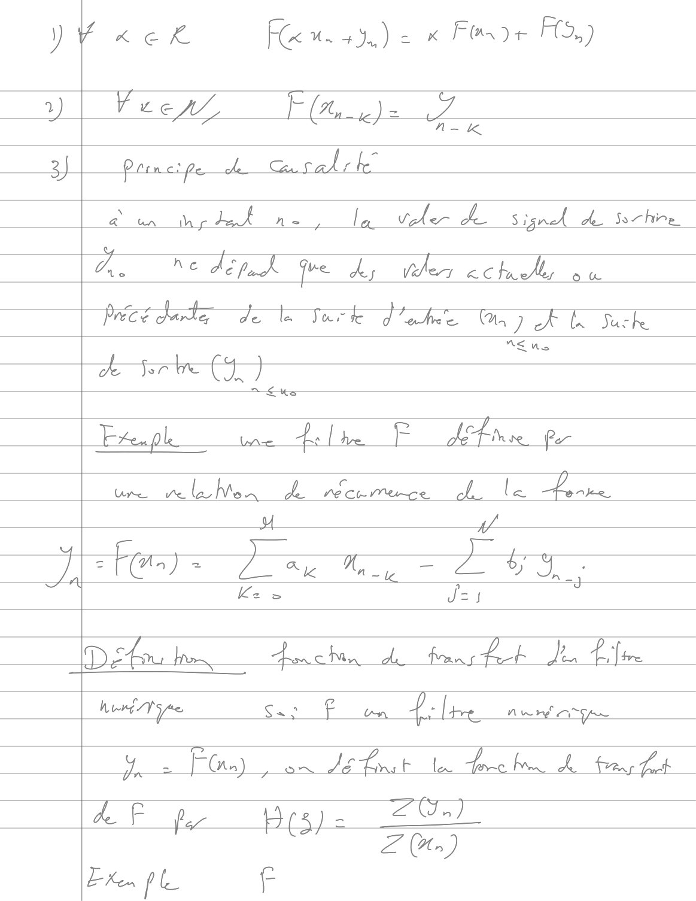

**Lecture OCR à contrôler**

~~~text
)

VF rkck Hx ss) «x Faye FCS.)

1)

Vee, Fu) = 7

2]

Nak
Prenetpe he Gusalrk

aun hpdet ne, la tgler À. Signed he She

v7, ne dé pack fre À; ler echols Ow

Pré hote dele Tarte dete On) kb Suck

NS us
Sarre (J)

ae

Exp une ln FA finne pe

Une rl de né Cie ence de le aie,

# /

IC

-

a -

Cc \
AGE Er A, —

JE ÿ

Du ne Auchan d fur bet the Pl

here Gad À by 4: lee ner gas
FA = FCs) © LE tint I tome, ho. A Gas Lit
a F af iw Sj). be)
FREE Zu

Exu pl -
~~~

## Page 20

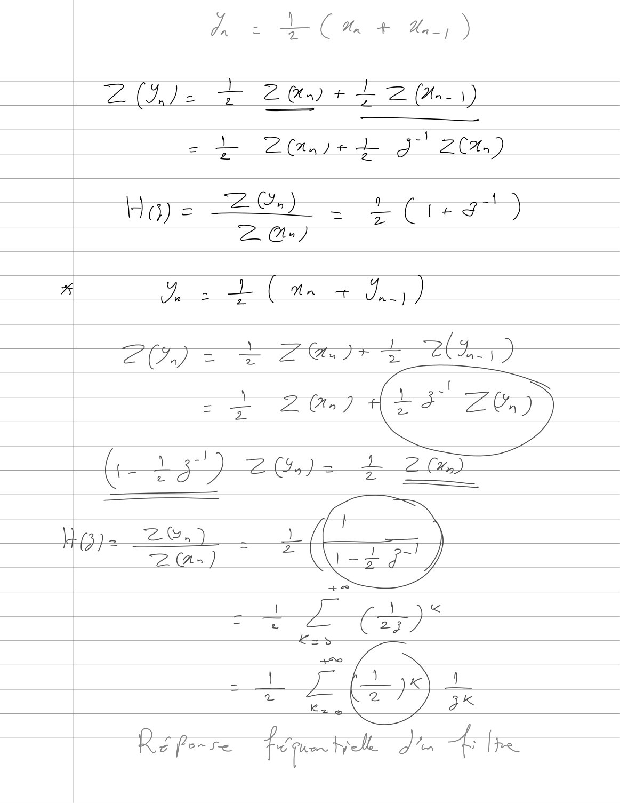

**Lecture OCR à contrôler**

~~~text
HG) = 20,5 4 Cie g"
o)
# 2 à ot ( tn + of, |
\ 7 =n sl 4 \
(Zn = ee Gr CAT
\ \ al
= = An) A> à , ) )
PER n 3-5 (4) 2 1 2%)
\ ss
t
Wop. 2b) . 1/ »
Zar) ee ey
1 Fr 1 \«
7 # (237
= - 1. !
+ LE
Ref fp trek Be k Pre
~~~

## Page 21

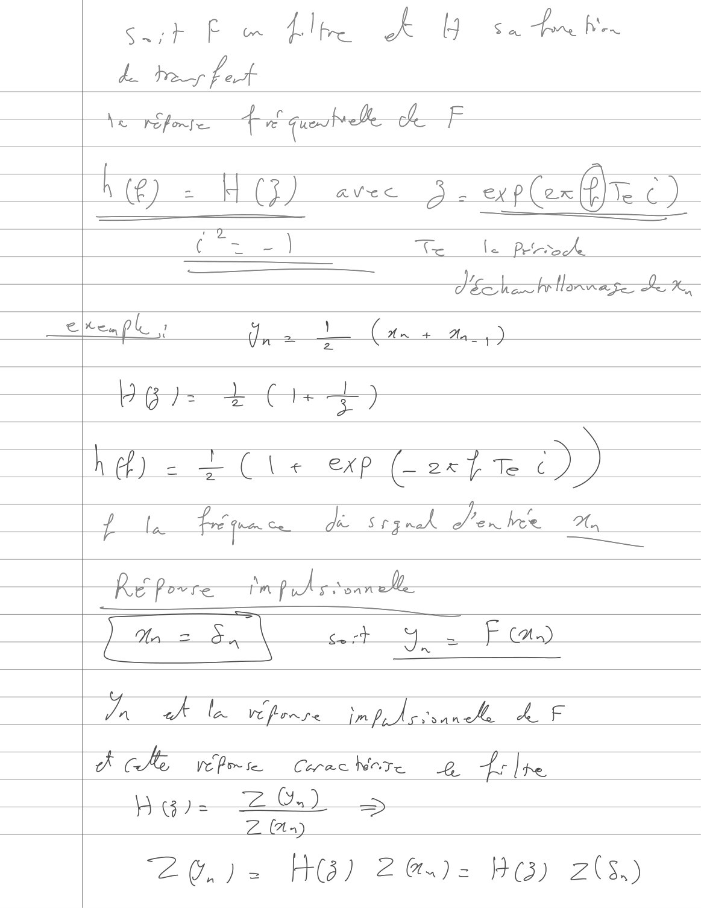

**Lecture OCR à contrôler**

~~~text
Sach F Cr. Llhe Æ [4 sa Pore ber
du. hs

Ve RS fee ve of gach he F

À te) - H (J) avec 3. explex (flr c)

(= -) ee ph

Ve

déchehllnrese dx
Em L } (1 = | (ax + Ae»)
Un Zz 1
Pgs + t=)

he) = + (i+ exp (_exf tec) )

fl Lind tian. de Srgnah alten, bee Aa
a . | —__

Re Powre tim frs some

Yt, = 5. + y 2 Fo

A À la Ve fra re im Pa frs an le ALF

À Me yoPote Cerec Wate Qe Ls Ihe

A G)-= On)

(An)

26,)> HG) 2@)2 Bo) 2(3,)
~~~

## Page 22

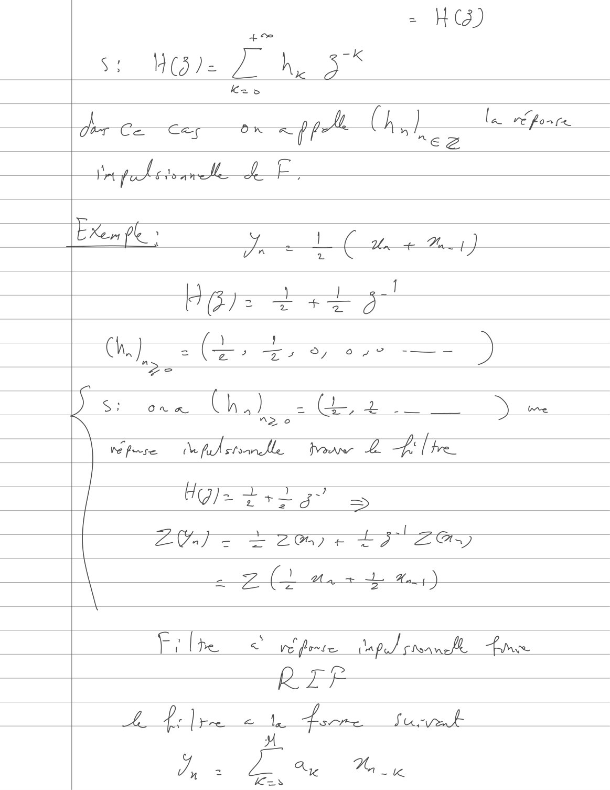

**Lecture OCR à contrôler**

~~~text
> HG)
S: eae J h 5“

oe Ce Car ne GI le re force

| MURAT PRES

| Ze] = + ze) er £3 Gr)
(a, ++ 4,)

\ — a Ve

F: [ pe. < ve fonte lapel creanehe fice

REF

DA À Ju i ‘i Asa fes Æ

are Wy ig

fs
~~~

## Page 23

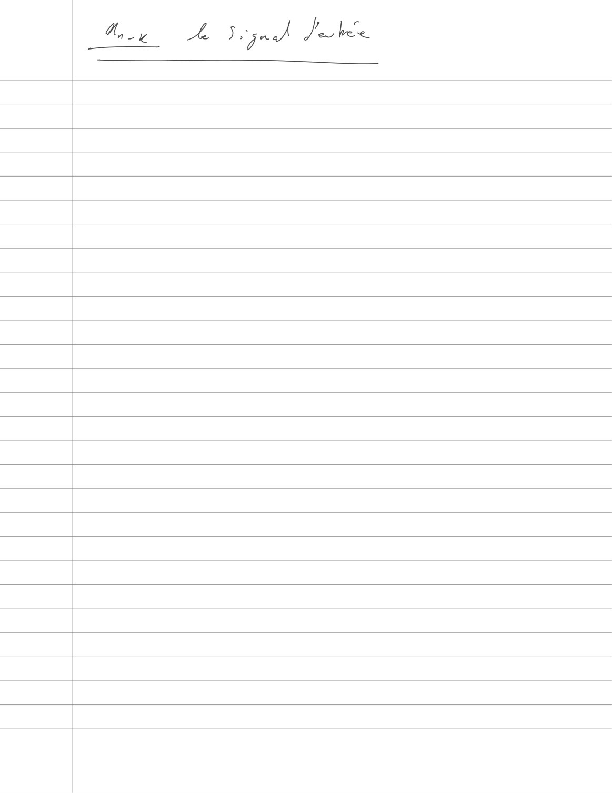

**Lecture OCR à contrôler**

~~~text
24
nek A 3 ja HAS
~~~

## Page 24

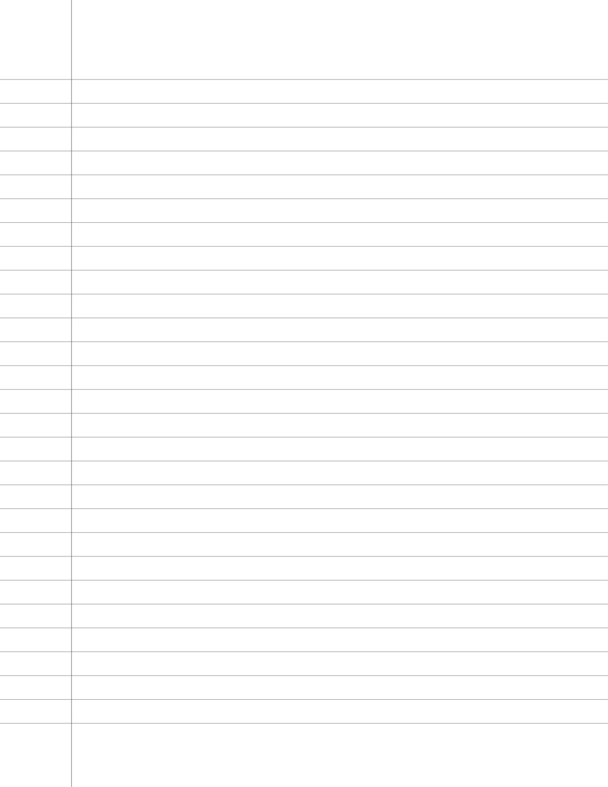

Page de cahier lignée, sans texte.

## Page 25

Page de cahier lignée, sans texte.

## Page 26

Page de cahier lignée, sans texte.

## Page 27

Page de cahier lignée, sans texte.

## Page 28

Page de cahier lignée, sans texte.
