# 2023-11-30-Note-13-18.pdf

[Ouvrir l’original](https://drive.google.com/open?id=1DvgivMtLtTu1BYjwZa_3jt-_rJze3fMN) · Les pages signalées comprennent du texte reconnu automatiquement ou des éléments graphiques. Le fac-similé permet de vérifier chaque lecture.

**Pages avec fac-similé ou lecture OCR** — 1–11.

## Page 1

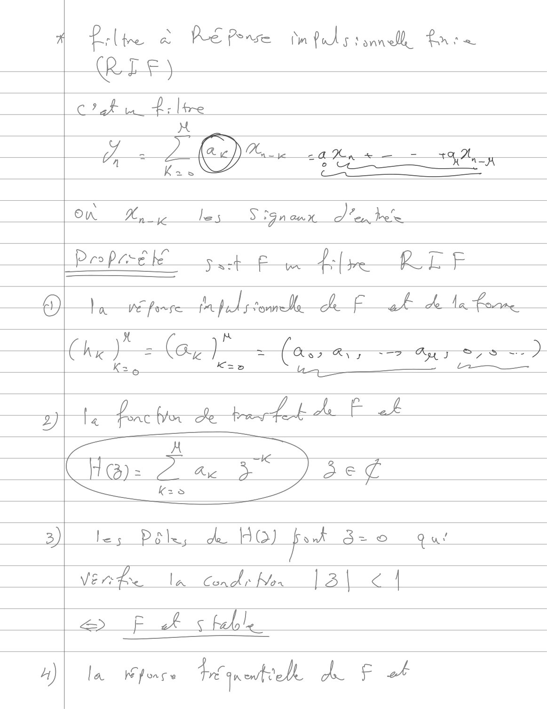

**Lecture OCR à contrôler**

~~~text
À Pile à RE Perse mplssndh frre
CR LE)
+ T 7
c'fu À lone
>
= acN\AG can + = +42,
1 Kas 0 ee
On Hs } les Son aux d'a bite

)

Peo pore st Pe fre Ro

q

| Ré firre jhe pool tonne. _F ah he la Forrne

4)
Ce
x re
Chie} = (ay) : (as Ry 7 yy S,S =)
Ke Kao u 2 —
te fon Aff
A HE
Ha): a 37 73e
K=Ss
3) Jes Pele, & HO) fost B= 0 Qa!

Vente la Conds Now | 3 | € |

=> F ak s feb!

la he force tr anewtiele a 5 ot
~~~

## Page 2

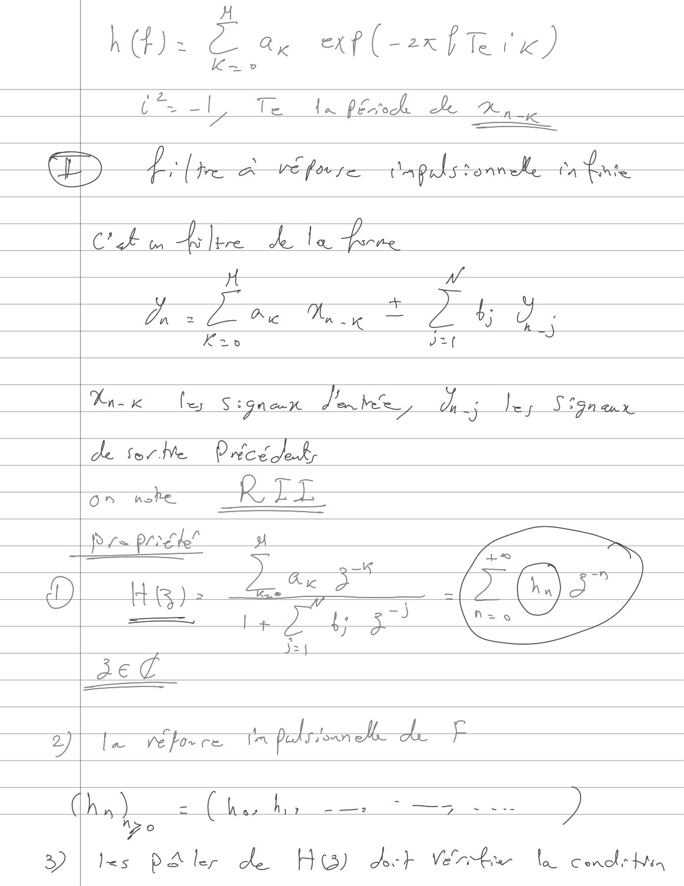

**Lecture OCR à contrôler**

~~~text
Ms Ê ae ech (ean Pere)

= -| Te La PE, Je Rog

——— K …
—.

HD Lie À VE for Dapals sonnele ile

CE i À Ne: L la Vin.

a 4 ;
Dn = Rie a = $; d
AR J?f

Tn x beg Signaux Pate ch; ley SSG aux

de Sov Ne. Ducs LR

on «he RTE

Propriék 4 —
———E—
5 En

he ee SD GS"

©

Ax
i Fy ge
J 4

ae

gite noce tmpohreneh def

ka) = gs hr = — 7? oes à we )
nz o
D | les PA ler he. Hw doe} Verde la Conolr Ha
~~~

## Page 3

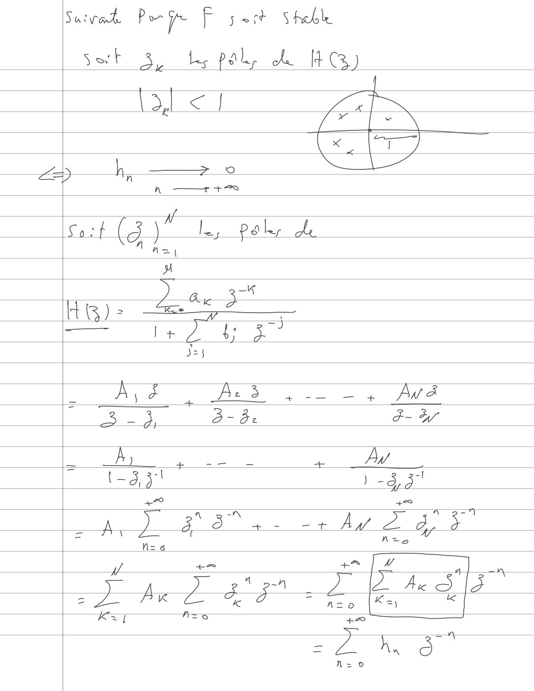

**Lecture OCR à contrôler**

~~~text
Suivat Pore Pose Steble
Sok Jy

tes pal, A HG)

DJ <] a N
x (TT)
LS h, ————— © \—
#
Sort (3 "Le, Pah Ae
"1
) Cre a
HG): = =
= En ty 3
Jey
_ À é Az 3 + — oT + Aw à
: LEE. 3 - 82 F-W
A, %, _— eo AW
7 (-3,5" ) -d, 3"
A, J § 84 + Ay Da F"
4 7 +2 + [2 4] \
he
Kz AzsS =2 75
a À h à”
~~~

## Page 4

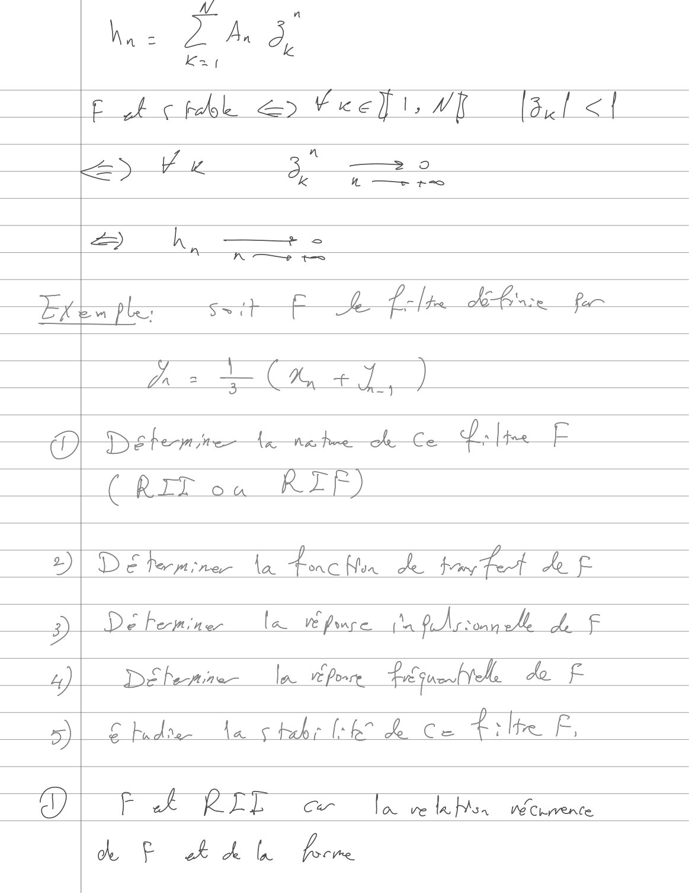

**Lecture OCR à contrôler**

~~~text
4 n
ha: 2 A à,

!

pA hbk a> Vrefi, WE [at <!

n

Le 7272 3 > 9

CK Ww — +

ak —-

AT tT

Lies Lex ss + F he Pal dl pe

À = +Ux +7)

©

Deere hic Nas hne— ok Ce Da [te
(RIT on RIF)

2) DE Perm one La Le Non Je Boy Po Af

2) De Femina la VE Prope. (Sa flr ronn ehh FA ie

4) D&bemne la Pere Papa hole & _F

=) £ bid ase La s hehe (he ke. Ce Lite F,

ag F À KEL Car la ve le Mia We Chyvence,

k & hd Porn
~~~

## Page 5

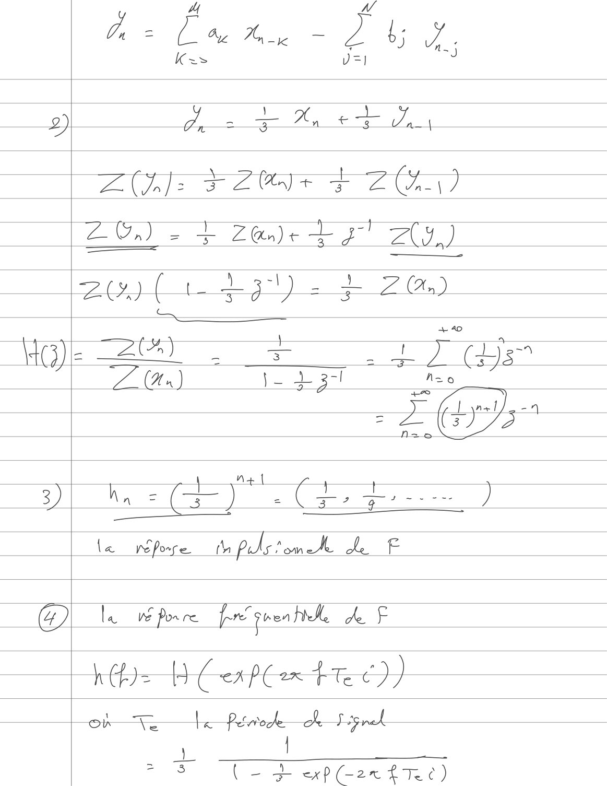

**Lecture OCR à contrôler**

~~~text
À = NES Suy
Kus

UI
2) À. ne X, = Ja
Ge F204 + ZA)
ZG,) 2+ 2@)+t377" ZY)
2x) pdt). + 70)
— =o
HG): BCs LT GT
77 (An) ju ft gl
= (Late a
= ron CG D
{+4
3) Nn = (= ) ( 372 47 )
le We porre. th pols Pome Ae F

la ve Por re ré grea hike de F

nr fees te

Ve
)
Dd exp(-2x hhc)

> 3 —
~~~

## Page 6

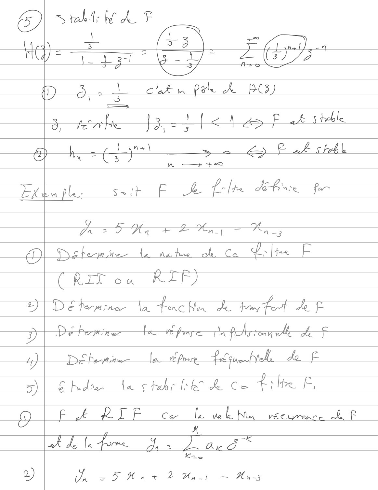

**Lecture OCR à contrôler**

~~~text
D

Srbt bf dL F

KG)

: a ° > 2

D - À in pale A PCS)
Ô, nb 5. _. [<\ 4> fF AS teble.
joins) a Pia e 2
& ie & ÿ As bebe

AF Ah

— Etlupl,  s=t F ble bbe fe

ÿ EH IH — MO

QO Defemines {à nea hne oh Ce Ds [toe

(Rit oa RIF)

De Pert reer ta re Non Je Fan tot Ae F

=)

Ey De bemine ta pure a ftArronneke he Fo
a een ee ee k £
Dlshd ché a Co tile E

F À RIF Car fie ve k Non ve Cwrence À. F

F À
À de le fre PRE l'ai

Kae

Un = 5 Hut 2 Hair ~ Aas
~~~

## Page 7

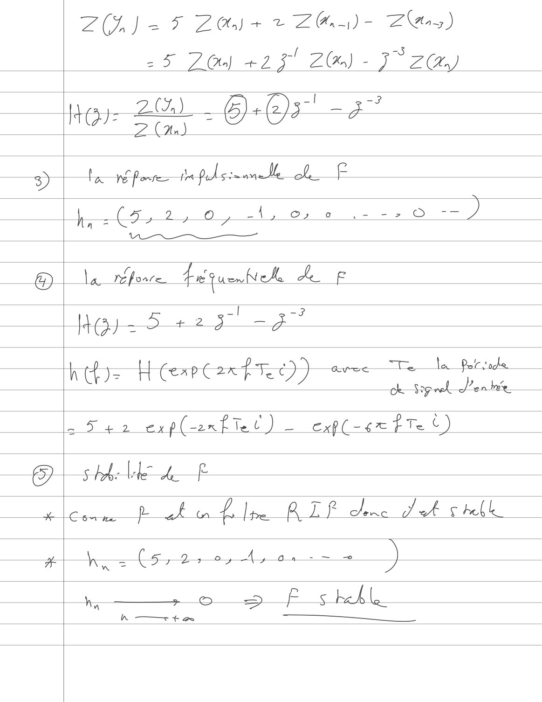

**Lecture OCR à contrôler**

~~~text
Zh) oF Zoisr Zn) Ze)
25 2) +23! Z@) - J° ZG)

|< at 2S) &&).(2)37! —~ 377
| (o/ ( = \ Ky 2
An)
3) Fa NS forre Pl sie ame Île hf
Ite =O 2, 0 -\, ©, © un en = ÿ
Vea a ru
@) la réfonre Frquenheke ca F

Jj) -5 +23 23

| it Poe +) bao le Por sage
h = RH CxPC2R FRET) Eve e
th) 0) eres

ee exp(-enfret) _ cxp(-se tTe ©)

5-tobe ll hf

Comme at fle ALP de d'A shell
a hy = (5,2%, 4,0 — a) \

hy — 6 +» fs heble
~~~

## Page 8

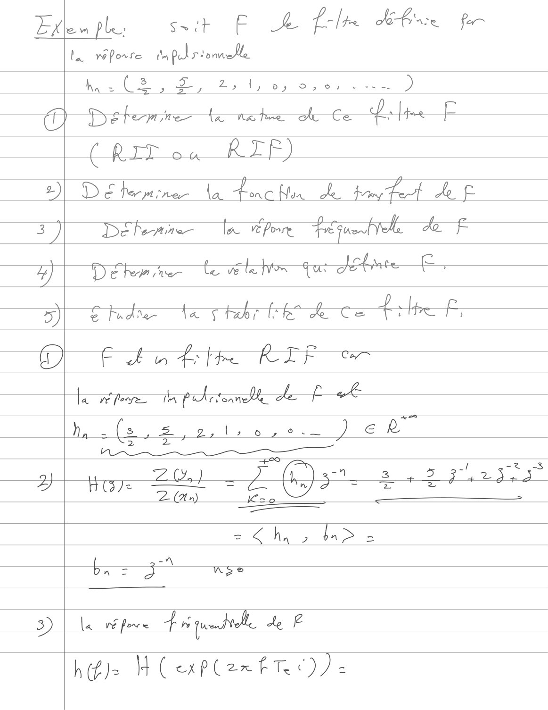

**Lecture OCR à contrôler**

~~~text
Lite ple. Sait EF Je b> lt He fer

ta réporre daplriomelle

h -(2, 2, 2,4, Dj Bs OF be D

TY)

Pre bermires ta nator où Co Lrlpe

(tet ., KEE)

DE Pemine la Lich de Hing Fo Af
F

Défenne la efor Requete de.
eC
A

De kw hen te v6 te We {us Je

€ Puolles Ta chbr FEO oe Ce LE.

F Lo Lfre REF cer

te Pere poeme le Ê Æ

by -(s,#,2tre,s. )eR
Bas ur une re
— - =
2) | He Ge) 27 (RES 35 eS Oe
20) Keo
= g hy 2 > =
ba = 3 nse

3)

la We for e que ke F

h(£)= H ( exPlzexfTe))=
~~~

## Page 9

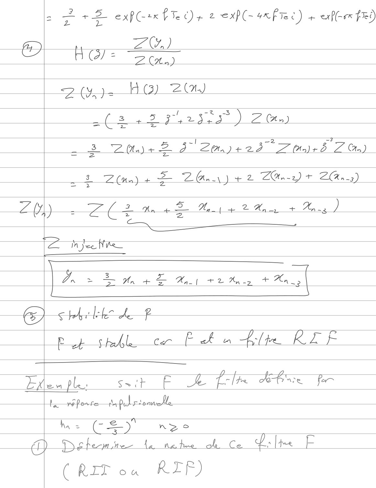

**Lecture OCR à contrôler**

~~~text
Cat)

= {y (3) 2(1,)

( à
NAT

a(R 22 Parser) 2a)

3 Z2tay+ 2 3 2m) + 237 Zr)

2 = +2 exp(-*x fre Or 2 <xP(- ÊTRE) ane exf-rx fr 0

A Hoss Zl”, )

: (ns) + = PACE ye Z ZOn-2) + ZAn-3)

ZL) 2 An e 2 | À A ne Ans )
Ps CE Z '
In Jee Nite
Lx > Lmar ee -20., |

CRM

pue Sheba. cer Pal n Alte RIF

la

en ples seit fF he tole LE for

Lari fonte—tnpulrtonmelle

ha = CET n>se

) Defemnme (a nature où Ce Da [te E

(RIT ou RIF)
~~~

## Page 10

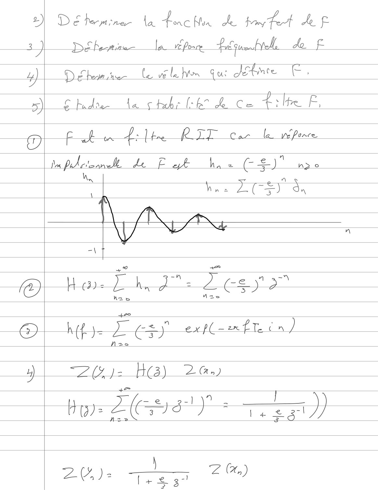

**Lecture OCR à contrôler**

~~~text
D'éhomine- La tone Non de jing tet Ae F
DE heme la A Ponre LE füoP VA do f

D eben i le vile on Gus Je e ,

4)
SN Shdr La cheb heh ce tilte F,
pi Fa dir RIT cor le np
a Ph ctormele de Fak ha, = es)" n> o
ha _
fA —
at
= =n = à a
t@) Hare 2 hd = CS) 27
D} Hp Le ert Fen)

1) Zl j= HG) 2G.)
+e Le : A |
ter Ge)
2%): — ZO)
~~~

## Page 11

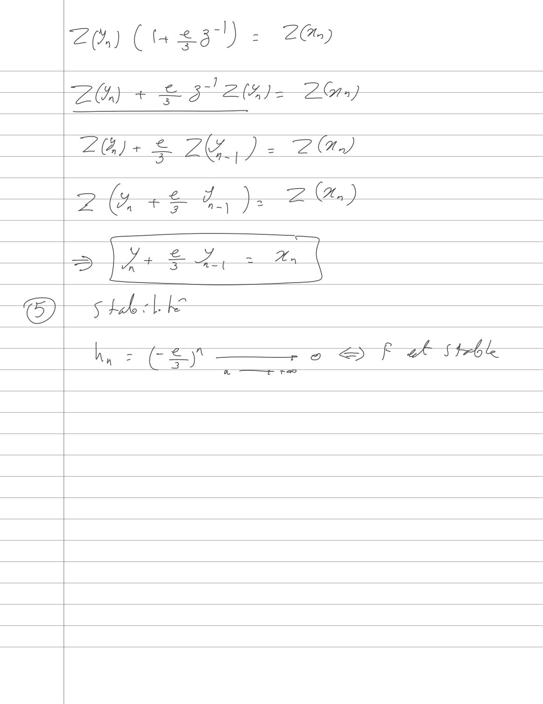

**Lecture OCR à contrôler**

~~~text
Zon) (t+ eal) = 2G)

]

ZO) + Fi 27 20m)

(a, )

@
~~~
