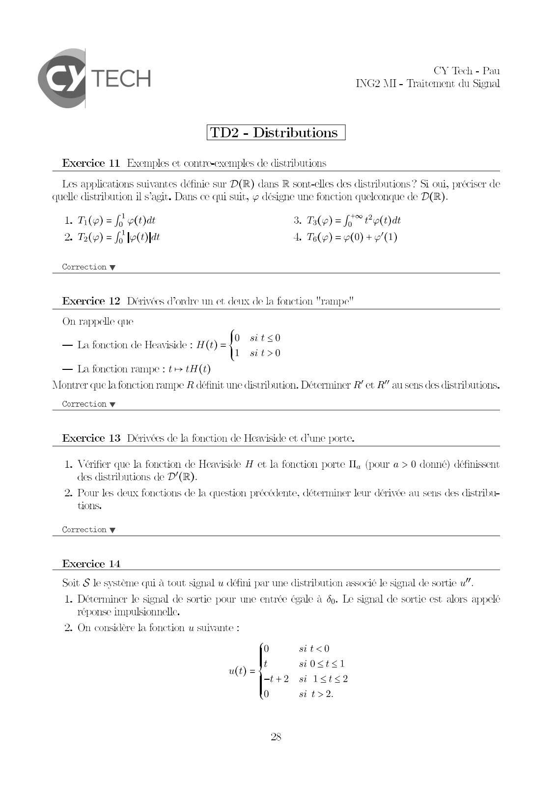
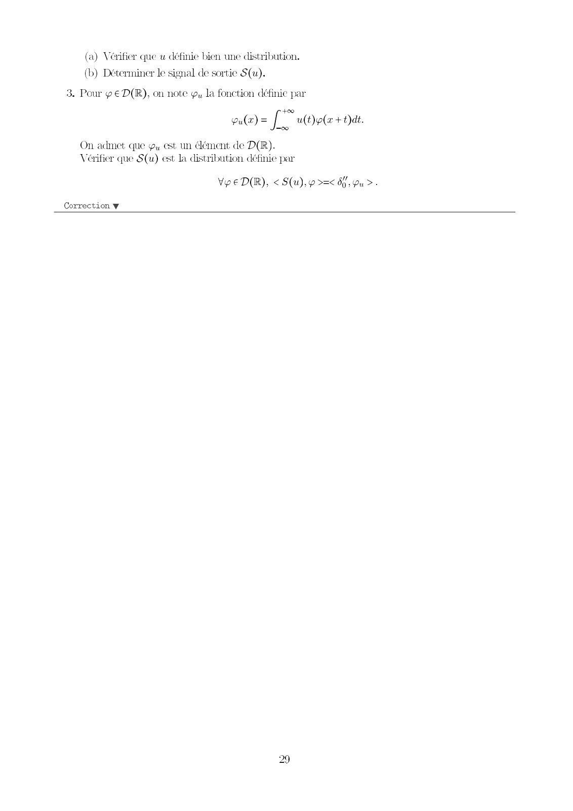
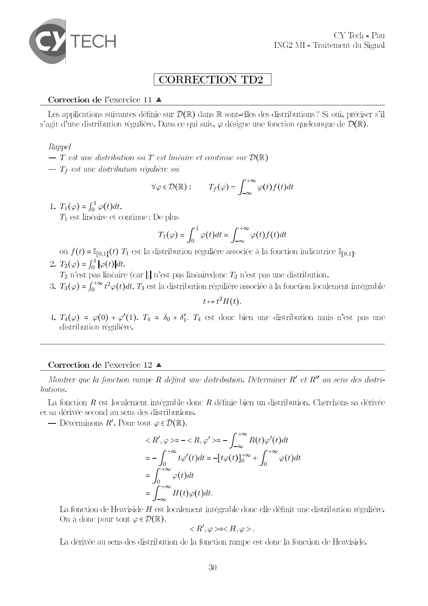
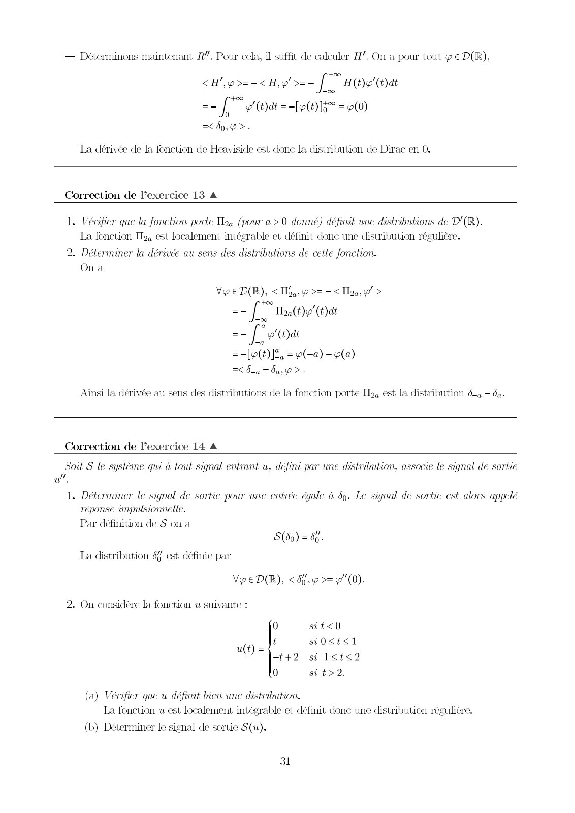
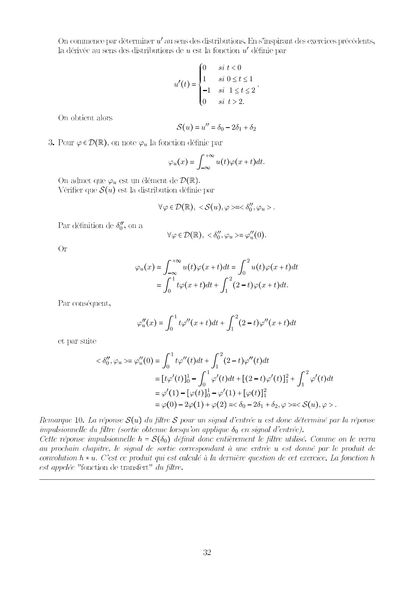

# 2425_TdS_TD2Corr.pdf

[Ouvrir l’original](https://drive.google.com/open?id=1dwgwWA1UpWQcLc-HLo9bBmIclBrCZbk3) · Les pages signalées comprennent du texte reconnu automatiquement ou des éléments graphiques. Le fac-similé permet de vérifier chaque lecture.

**Pages avec fac-similé ou lecture OCR** — 1–5.

## Page 1

**Lecture OCR à contrôler**

~~~text
CY Tech - Pe
TEC H MI - Traitement atu Signal

TD2 - Distributions

Exercice 11 Exemples et contre-exemples de distributions

Les applications suivantes définie sur D(R) dans R sont-elles des distributions? Si oui, préciser de
quelle distribution il s’agit. Dans ce qui suit, ¢ désigne une fonction quelconque de D(R).

L Ti(y) = fo p(t)dt 3. T3(y) = fo" Pp(t)at
2. De) = fo le 4. Te) = (0) + (1)

Correction ¥

Exercice 12 Dérivées d'ordre un et deux de la fonction "rampe!

On rappelle que
. 3 5 à 0 sit<0
— La fonction de Heaviside : H(t) = .
1 sit>0
— La fonction rampe : te tH (t)
Montrer que la fonction rampe R définit une distribution. Déterminer R’ et R” au sens des distributions.

Correction w

Exercice 13 Dérivées de la fonction de Heaviside et d’une porte.

1. Vérifier que la fonction de Heaviside H et la fonction porte Il, (pour a > 0 donné) définissent
des distributions de D'(R).

2. Pour les deux fonctions de la question précédente, déterminer leur dérivée au sens des distribue
tions,

Correction ¥

Exercice 14

Soit S le système qui à tout signal u défini par une distribution associé le signal de sortie w”.

1. Déterminer le signal de sortie pour une entrée égale à 69. Le signal de sortie est alors appelé
réponse impulsionnelle.
2. On considère la fonction u suivante :

0 it<0

u(t) = t si0<ts1
—t+2 si l<t<2
0 si t>2.
~~~

## Page 2

**Lecture OCR à contrôler**

~~~text
(a) Ve
(b) Déterminer le signal de sortie S(u).

er que u définie bien une distribution.

3. Pour € D(R), on note y, la fonction définie par

pula) =f * u(t)o(w + Ddt.

On admet que yy est un élément de D(R).
Vérifier que S(u) est la distribution définie par

Vee D(R), < S(u), 9 >=< dj, pu >.

Correction w

29
~~~

## Page 3

**Lecture OCR à contrôler**

~~~text
TE C H CY Tech - Pau
ING2 MI- Traitement du Signal

CORRECTION TD2

Correction de l'exercice 11 A

Les applications suivantes définie sur D(R) dans R sont-elles des distributions? Si oui, préciser s'il
s’agit Pune distribution régulière. Dans ce qui suit, y désigne une fonction quelconque de D(R).

Rappel
= Pe
— Ty est une distribution réguliè:

vent): To [Ter

| une distribution ssi T est linéaire et continue sur D(R)

=

- Ti(e) = fo e(Oût.
T, est linéaire et continue; De plus

ne [leo [Tai

où f(t) =Tpoaq(t) Ti est la distribution régulière associée à la fonction indicatrice Tro1]-

T 1

. (2) = fe belle

T2 n'est pas linéaire (car [n’est pas lin¢airedonc > n'est pas une distribution.

Te) = J* Pe (tat. Ts est la distribution régulière associée à la fonction localement intégrable

RD

te PH(t).

Ti(y) = p(0) + 9/1). Ty = 60 + 84. Ty est donc bien unc distribution mais n’est pas ue
distribution régulière,

Correction de lexercice 12 A

Montrer que la fonction rampe R définit une distribution. Déterminer R' et RY au sens des distri-
butions.

La fonction R est localement intégrable donc R définie bien un distribution. Cherchons sa dérivé
et sa dérivée second au sens des distributions.
— Déterminons R’. Pour tout y € D(R),

 =-< Ry! >=- LT R(t)" (t)dt
2 [bete + Poor
= f a p(t)dt

= J * H(t)p(t)dt.

La fonction de Heaviside H est localement intégrable donc elle définit une distribution régulière,
On a donc pour tout g€ D(R),

<R',çp>=<H,p>.
La dérivée au sens des distribution de la fonction rampe est donc la fonction de Heaviside,

30
~~~

## Page 4

**Lecture OCR à contrôler**

~~~text
— Déterminons maintenant R”. Pour cela, il suffit de calculer H”. On a pour tout y € D(R),
F5
<H p>=-< Hy! >=- f H(t)y'(t)at
oo

== [bu = OR = oO)

=< do, >.

La dérivée de la fonction de Heaviside est donc la distribution de Dirac en 0.

Correction de lexercice 13 A

1. Vérifier que la fonction porte T2, (pour a > 0 donné) définit une distributions de D'(R).
La fonction Ib, est localement intégrable et définit donc une distribution régulière,

2. Déterminer la dérivée au sens des distributions de cette fonction.
On à

Vo e D(R), < Ia, >= = < Tay’ >

== [Thee at
=- [ “(bat

= [LIL = (a) - 9a)
=< da — du p>.

Ainsi la dérivée au sens des distributions de la fonction porte I, est la distribution bq — 5a.

Correction de l'exercice 14 A

Soit S le système qui à tout signal entrant u, défini par une distribution. associe le signal de sortie
ul.

1. Déterminer le signal de sortie pour une entrée égale à 69. Le signal de sortie est alors appelé

réponse impulsionnelle.

Par définition de S on a

S(50) = 66.
La distribution 6% est définic par
VeeD(R), < 6. >=9"(0).

2. On considère la fonction u suivante :

0 sit<0

u(t) = t si0<t<1
—t+2 si 1<t<2
0 sit>2.

(a) Vérifier que u définit bien une distribution.
La fonction u est localement intégrable et définit donc une distribution régulière.

(b) Déterminer le signal de sortie S(u).

31
~~~

## Page 5

**Lecture OCR à contrôler**

~~~text
On commence par déterminer w/ au sens des distributions. En s'inspirant des exercices précédents,
Ja dérivée au sens des distributions de u est la fonction u! définie par

0 sit<0

4 si0<t<1
w= sree

-l si 1<t<2

0 si t>2.

On obtient alors
S(u) =u" = bg - 201 + 02

Pour y€ D(R), on note @, la fonction définic par
+00
u(x) = [ ult)p(a + Ddt.
00

On admet que @, est un élément de D(R).
Vérifier que S(u) est la distribution définie par

VeeD(R), <S(u),p >=< 04 ,pu >.

Par définition de 6%, on a
Ve ED(R), < 66, pu >= pu (0).

Or
pulr)= [ uldele+iat= fFutoete +Dat
=f toler oars fFe-net + dat.

Par conséquent,

1 2
(x) = f tol" (w+ Ddt+ J 2-0" (x + Oat

et par suite

4 2
<5 pu >= 9"(0) = f te" (dt + J (2-t)y"(t)at
0 1

08 ff Oarle-ogon+ [" ea

=2M-leOlo- oD) + Le}
= (0) - 2p(1) + p(2) =< bp — 261 + 82, >=< S(u), >.

Remarque 10. La réponse S(u) du filtre S pour un signal d'entrée u est done déterminé par la réponse
impulsionnelle du filtre (sortie obtenue lorsqu'on applique 69 en signal d'entrée).
Cette réponse impulsionnelle h = S(69) définit donc entièrement le filtre utilisé. Comme on le verra
au prochain chapitre, le signal de so pondant à une entrée u est donné par le produit de
convolution hu. C'est ce produit qui est calculé à la dernière question de cet exercice. La fonction h
est appelée "fonction de transfert" du filtre.
~~~
