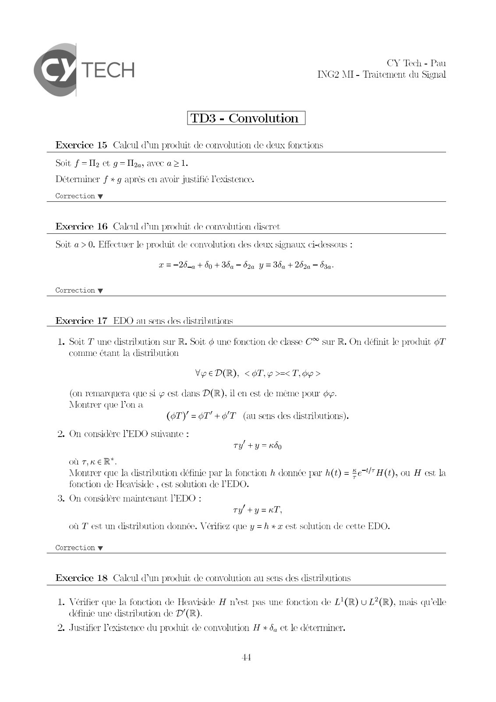
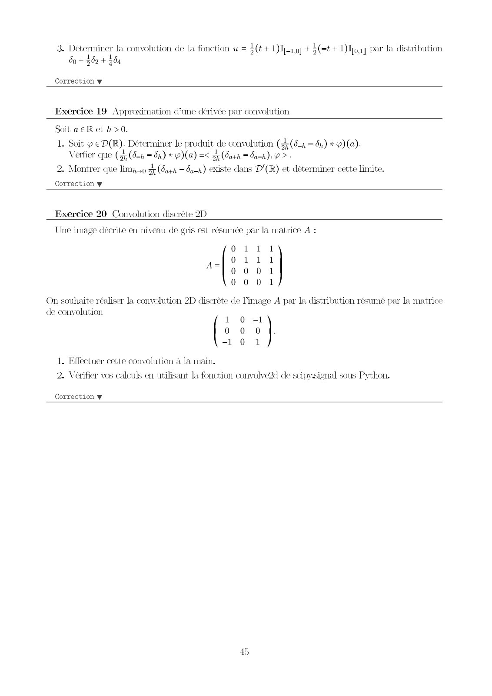
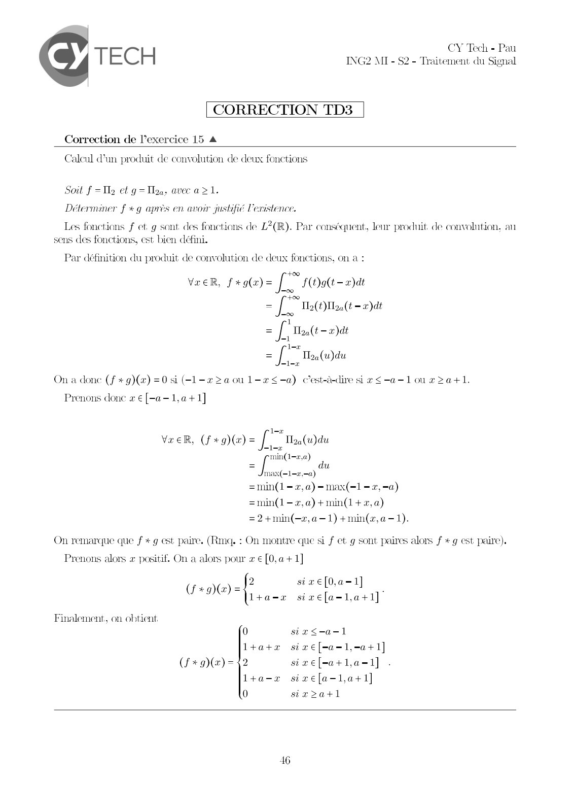
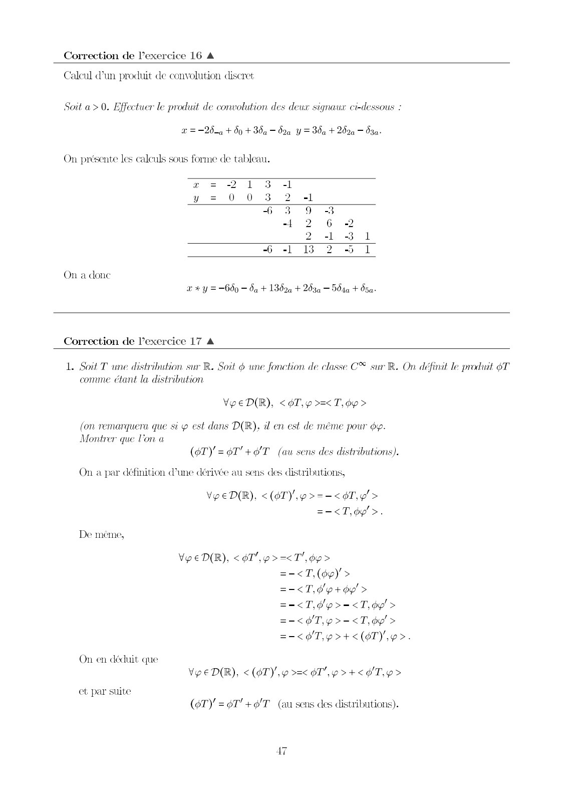
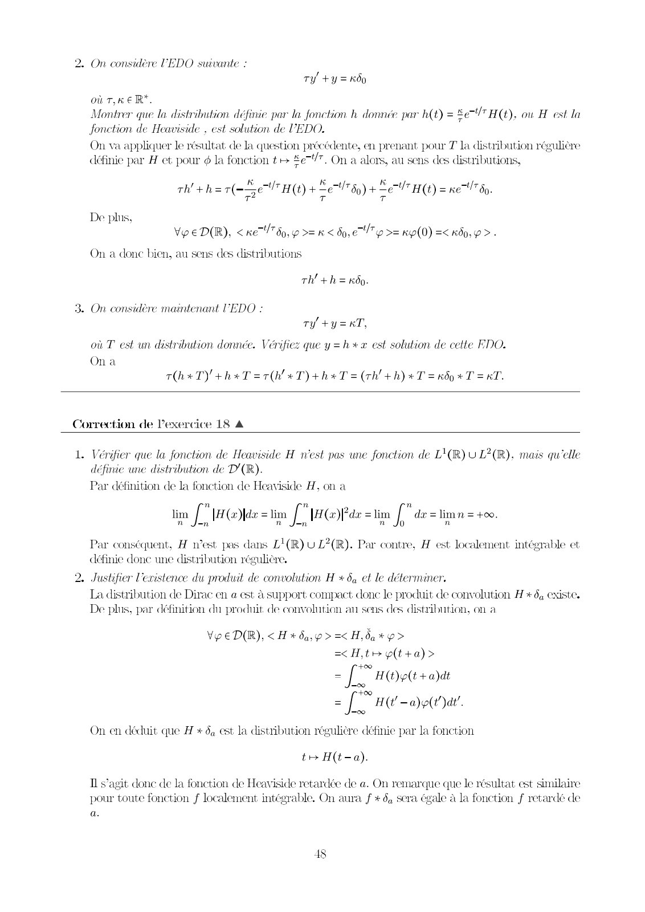
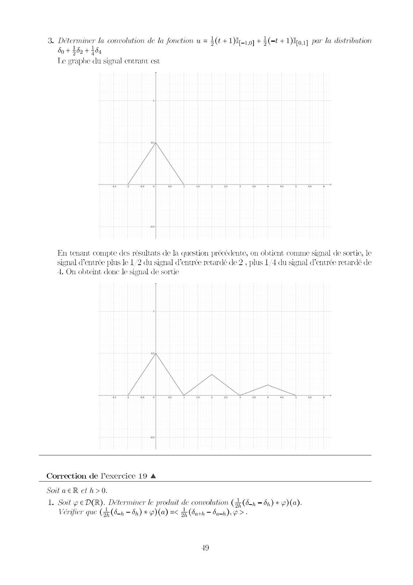
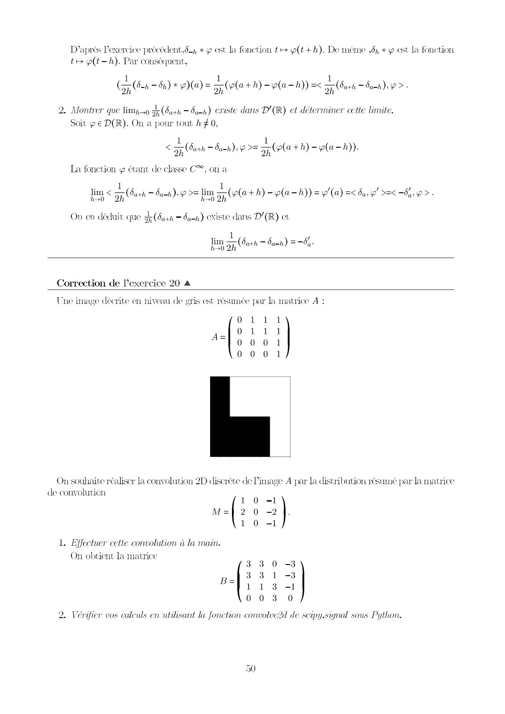
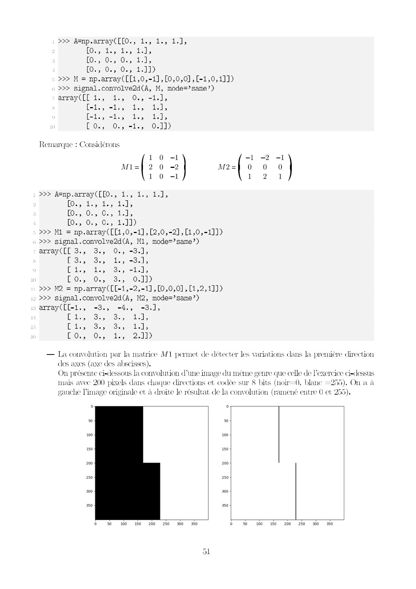
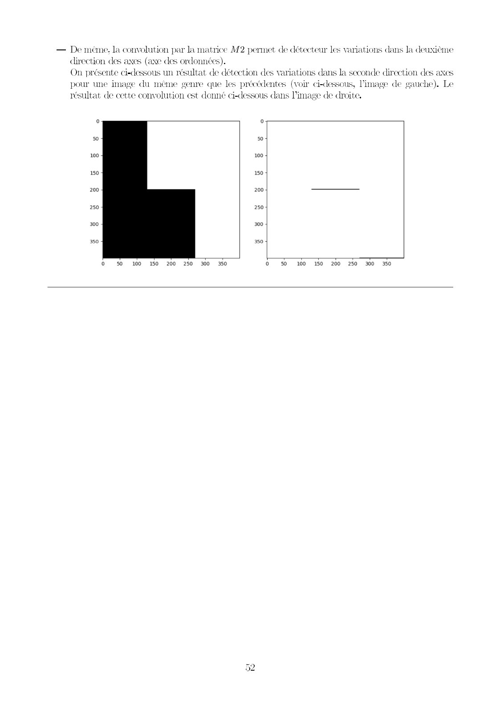

# 2425_TdS_TD3Corr.pdf

[Ouvrir l’original](https://drive.google.com/open?id=1zuNnZPnn4tI02RDSYGalqtOV_dwGlpo1) · Les pages signalées comprennent du texte reconnu automatiquement ou des éléments graphiques. Le fac-similé permet de vérifier chaque lecture.

**Pages avec fac-similé ou lecture OCR** — 1–9.

## Page 1

**Lecture OCR à contrôler**

~~~text
] CY Tech - Pau
TECH MIT - Traitement du Signal

TD3 - Convolution

Exercice 15 Calcul d’un produit de convolution de deux fonctions

Soit f = Il2 ct g= Il, avec a > 1.
Déterminer f #g après en avoir justifié l'existence.

Correction w

Exercice 16 Calenl dim produit de convolution discret

Soit a > 0. Effectuer le produit de convolution des deux signaux ci-dessous :

© = 204 + 00 + 30a — 52a Y = 30a + 202a — 530+

Correction w

Exercice 17_EDO au sens des distributions

1. Soit T une distribution sur R. Soit @ une fonction de classe C® sur R. On définit le produit 6T
comme étant la distribution

Ve eD(R), <¢T,y >=<T,dp>

(on remarquera que si est dans D(IR), il en est de même pour dy.
Montrer que Pon a
(GT) =6T'+6/T (au sens des distributions).

D

On considère PEDO suivante :
ty! +y = Kkôo
où 7,K€ R*.
Montrer que Ja distribution définie par la fonction À donnée par h(t) =
fonction de Heaviside , est solution de PEDO.

cl” H(t), où H est la

3. On considère maintenant EDO :
ty +y=aT,

où T est un distribution donnée. Vérifiez que y = h * x est solution de cette EDO.

Correction w

Exercice 18 Calcul dun produit de convolution au sens des distributions

L. Vérifier que la fonction de Heaviside H n’est pas une fonction de LI(R) U L?(R), mais qu’elle
définie une distribution de D/(R).
2. Justificr l'existence du produit de convolution H + 6, et le déterminer,

EH
~~~

## Page 2

**Lecture OCR à contrôler**

~~~text
3. Déterminer la convolution de la fonction w = $(¢+1)Ie1o] + (4 + Dog par la distribution
do + 302 + 404

Correction w

Exercice 19 Approximation d’une dérivée par convolution

Soit a €R et h>0.
ae

nit ¢ € D(R). Déterminer le produit de convolution (3; (d-n —ôn) + 9) (a).
Verfier que (HE (52h = dn) + p)(a) =< 3; Gath = San): > -
2. Montrer que lim; .0 Fath = dah) existe dans D/(R) et déterminer cette limite.

Correction w

Exercice 20 Convolution discrète 2D

Une image décrite en niveau de gris est résumée par la matrice À :

111
111
0 0 0 1
001
On souhaite réaliser la convolution 2D discrète de Pimage A par la distribution résumé par la matrice
de convolution,
1 0 -1
0 0 0
-1 0 1
1. Effectuer cette convolution à la main.

2. Vérifier vos calculs en utilisant la fonction convolve2d de scipysignal sous Python.

Correction ¥
~~~

## Page 3

**Lecture OCR à contrôler**

~~~text
CY Tech - Pau
- Traitement du Signal

TECH ING2 MI -

[CORRECTION TD3 |

Correction de l’exercice 15 A

Calcul d'un produit de convolution de deux fonctions

Soil f = Il et g= Il, avec a >1.

ristence.

Determiner f + g après en avoir justifié 1
Les fonctions f et g sont des fonctions de L2(R). Par conséquent, leur produit. de convolution, au
sens des fonctions, est bien défini.

Par définition du produit de convolution de deux fonctions, on a :
+00
VER, f+g(x)= [ f(Qg(t=2)at
pre
= [ Ta (t)Haq(t = )dt
00
1
=f, THoa(t—2)dt
i-z
= f Tloa(u)du
mime

On a donc (f + g)(x) =0 si (-l-2 2a ou 1=r<-a) c’est-à-dire si x <-a-1ou a#>a+l.

Prenons donc « € [-a-1,a+1]

1-2
Va ER, (f*g)(x) = JL Toa(u)du
ir
min(1-2,a)
7 J du
max(—1—,—a)
=min(1 -2,a)-max(-1 -2,-a)
=min(1-.2,a)+min(1+2,a)
=2+min(-2,a-1)+min(«,a-1).
On remarque que f * g est paire, (Rmq. : On montre que si f et g sont paires alors f * g est paire).
Prenons alors x positif. On a alors pour x € [0,a+1]

six€[0,a-1]
a=x sixefa-l,a+1]

(Fae) = f .

Finalement, on obtient

0 siz<-a-1

l+a+x sixe[-a-1,-a+1]
(f * g(x) = 12 sive[-atla-1] .

l+a-a sixe[a-1,a+1]

0 sir>a+l

16
~~~

## Page 4

**Lecture OCR à contrôler**

~~~text
Correction de l'exercice 16 A

Calcul d'un produit de convolution discret

Soit a > 0. Effectuer le produit de convolution des deux signaux ci-dessous +

@ = —20 à + 00 + 30a — O2a Y = 30a + 2520 — 530.

On présente les calculs sous forme de tableau.

= 2 1 3 -1
y = 0 0 3 2 -1
6 3 9 3B
-+ 2 6 2

2 -1 3 1
-6 -1 13 2 5 1

On a donc
a + y = 600 — da + 1302a + 203a — 504a + 050+

Correction de l'exercice 17 A

L Soit T une distribution sur R. Soil @ une fonction de classe C® sur R. On définit le produit 6T
comme étant la distribution

Vp EDR), <6T,p>=<T,p >

(on remarquera que sip est dans D(R), il en est de même pour oy.
Montrer que Von a
(OT) = 9T'+ HT (au sens des distributions).

On a par définition d’une dérivée au sens des distributions,

VpeD(R), <(4TY,p>=-< oT, >
=-<T,oy’>.

De meme,

Vy eD(R), < oT’, p>=<T"',¢9>
=-<T,(ép) >
=-<T,d'pt+ dy'>
=-<T,é'p>-<T,¢9'>
=-<$T,p>-<T,dy'>
=-<'T,p>+<(6TY, p>.
On en déduit que
VpeD(R), <(¢TY,y >=< oT’, p >+< ¥'T, p>
et par suite
(eT) =6T'+@/T (au sens des distributions).
~~~

## Page 5

**Lecture OCR à contrôler**

~~~text
2. On considère VEDO suivante :
ty! +y = Kkôo
où T,K € R*.
Montrer que la distribution définie par la fonction h donnée par h(t) = Se" H(t). ou H est la
fonction de Heaviside , est solution de VEDO.
On va appliquer le résultat de la question précédente, en prenant pour T la distribution régulière
définie par H ct pour ¢ la fonction tr ser. On a alors, au sens des distributions,

Th! + har UF H(E) = Kem! ,

el? H(t) + Let 60) + ©
T T
De plis,
Ve eD(R), < Ken! bo, p >= < 60,67! p >= Ky(0) =< kô0,p > .
On a donc bien, au sens des distributions
Th +h = K60.
3. On considère maintenant VEDO :
ty +y=KT,
où T est un distribution donnée. Vérifiez que y =h* ax est solution de cette RDO.

Ona
The Ty +h+T=r(h’*T)+hsT = (th' +h) *T = kdo 4 T = KT.

Correction de Pexercice 18 A

L. Vérifier que la fonction de Heaviside H nest pas une fonction de L'(R) U L?(R). mais qu'elle
définie une distribution de D'(R).
Par définition de la fonction de Heaviside H, on a

je # J y a 2 4e bs = _
Tin if HOTTE [ IG de = lim [ dx = limn = +00.

Par conséquent, H n’est pas dans L1(R) U L2(R). Par contre, H est localement intégrable et
définie done une distribution régulière,

2. Justifier l'existence du produit de convolution H * 6, et le déterminer.
La distribution de Dirac en a est à support compact donc le produit de convolution H +4, existe.
De plus, par définition du produit de convolution au sens des distribution, on a

Vo ED(R), <H + 60,9 > =< Hyba* p>
=< Ht y(t +a)>

+00
= [ H(E)p(E + a)dt
I-00
+99 J lA 4
= [ H(t = a)e(l)dt".
Joo
On en déduit que A * dq est la distribution régulière définie par la fonction
tr H(t-a).
IL s’agit donc de la fonction de Heaviside retardée de a. On remarque que le résultat est similaire

pour toute fonction f localement intégrable, On aura f + 4 sera égale à la fonction f retardé de
a.

18
~~~

## Page 6

**Lecture OCR à contrôler**

~~~text
3. Déterminer la convolution de la fonction w= $(t +107 + $(-t + Dlton par la distribution
do + 302 + 404
Te graphe du signal entrant est

En tenant compte des résultats de la question précédente, on obtient comme signal de sortie, le
signal d'entrée plus le L/2 du signal d'entrée retardé de 2 , plus 1/4 du signal (entrée retardé de
4. On obteint done le signal de sortie

\

AN
PIN

VA i a a ali 28

Correction de l’exercice 19 A

SoilaeR et h>0.
L Soit ÿ €D(R). Déterminer le produit de convolution (4,(6-n = dn) + 9) (a).
Verifier que (zh — ôn) * p)(a) =< 3 (Sark — an), > -

19
~~~

## Page 7

**Lecture OCR à contrôler**

~~~text
D’après L'exercice précédent, 6 + g est la fonction > g(t+h). De même ,ô + y est la fonction
tr p(t-h). Par conséquent,

(

1

35 at 1 À ve ”
salon dn) + Ya) = Cela + hy = (a =) =< (an dede >

2. Montrer que limpso (ain — an) existe dans D'(R) et déterminer cette limite.
Soit ¢ € D(R). On a pour tout h #0,

1). - 1
< ppp Oath ~ dan) ? >= 57 (ea +h) ~ p(a-h))-
La fonction y étant de classe C®, on a

ë 1 | Ps
lim < pra — bah); >= lim 5, (Pla +h) -p(a-h)) = (a) =< da, >=< 6%, >.

On en déduit que ai (Oath = a-h) existe dans D'(R) et

1
lim —

jath — Oa-h) = —0,-
ay 3p (oath ah) a

Correction de l’exercice 20 A

Une image décrite en niveau de gris est résumée par la matrice A :

0 111
0 111
A=l0 001
0 0 0 1

On souhaite réaliser la convolution 2D discrète de image A par la distribution résumé par la matrice
de convolution

10 -1

M=] 2 0 -2

1 0 -1

1. Effectuer cette convolution à la main.
On obtient la matricc

3 3 0 -3
= 3 3 1 -3
Bly 1 3
0 0 3 0

2. Vérifier vos calculs en utilisant la fonction convolve2d de scipy.signal sous Python.

50
~~~

## Page 8

**Lecture OCR à contrôler**

~~~text
>>> A=np.array([[0., 1., 1., 1.1,

[RGus tos 110 tally

FO RO Wen shally

(Css Chis Gas tall)
>>> M = np.array([[1,0,-1],[0,0,0],[-1,0,1]])
>>> signal.convolve2d(A, M, mode=’same’)
array([[1., 1., 0., -1.],

[- miles ihe; Hs

ESC NE,

[0., 0.,-1., 0.]])

Remarque : Considérons

>>> A=np.array([[0., 1., 1., 1.1,

on thoy hogy dell

(5 Wes Wks tall,

as Obs Cae 1-11)

>>> Mi = np.array([[1,0,-1], [2,0,-2],[1,0,-1]])

>>> signal.convolve2d(A, M1, mode=?same?)

array (les 20 C5 1;

Sng Gey los ul

Was tles Sag lal

0 Gb5 Oo Son Call)
>>> M2 = np.array([[-1,-2,-1],[0,0,0],[1,2,1]])
>>> signal.convolve2d(A, M2, mode=’same’)
array([[-1., -3., -4., -3.],

bo Ee Sea lle
an éo5 Son 11;
@s5 Woy toy allt)

— La convolution par la matrice M1 permet de détecter les variations dans la première direction

des axes (axe des abscisses).

Ont

gauche l’image originale et à droite le résultat de la convolution

ante ci-dessous la convolution d'une image du méme genre que celle de l'ex
mais avec 200 pixels dans chaque directions et codée sur 8 bits (noir—0, blanc

ice ci-dessus
On a à

).

(ramené entre 0 et

100 100

150 150

10 230 250 %0 30
~~~

## Page 9

**Lecture OCR à contrôler**

~~~text
— De mane. la convolution par la matrice M2 permet de détecteur les variations dans la det
direction des axes (axe des ordonnées).
On présente ci-dessous un résultat de détection des variations dans la seconde direction des axes
pour une image du méme genre que les précédentes (voir ci-dessous, l'image de gauche). Le
résultat de cette convolution est donné ci-dessous dans l’image de droite,

so

100

150

200

250

300

350

50 100 150 200 250 300 350 © 50 100 150 200 250 300 350
~~~
