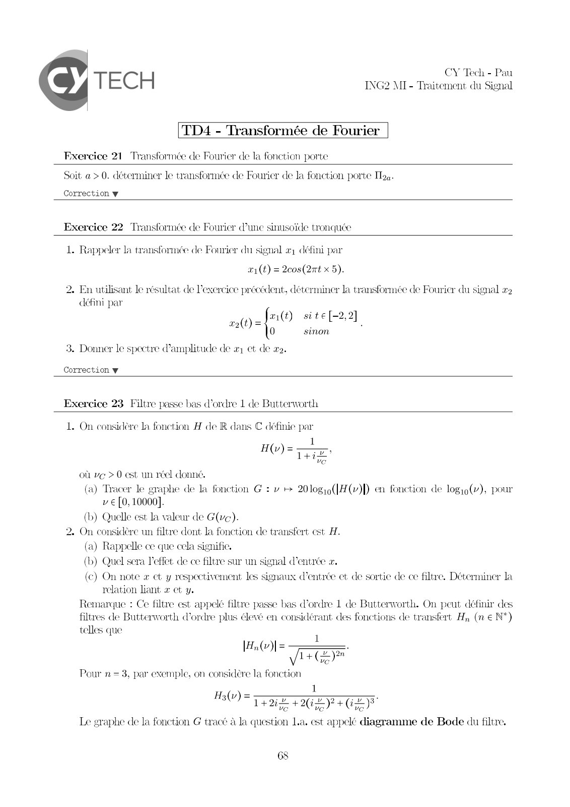
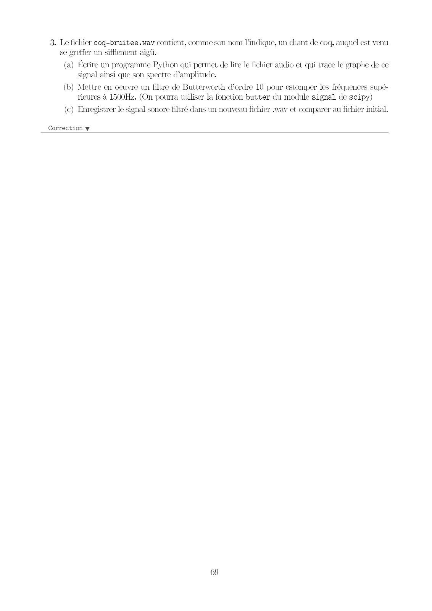
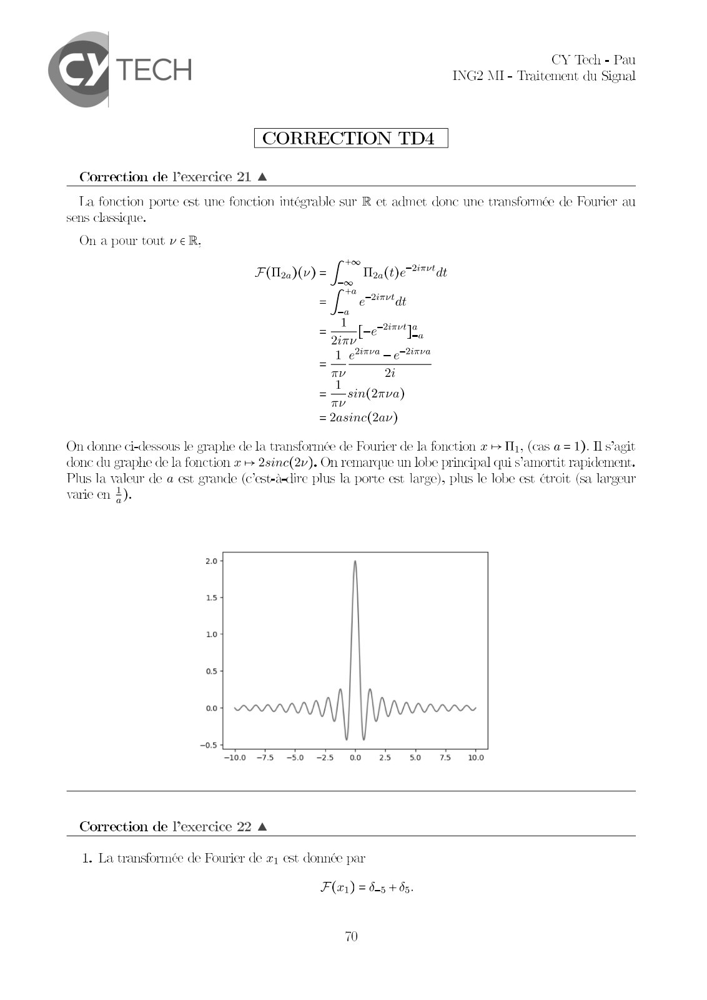
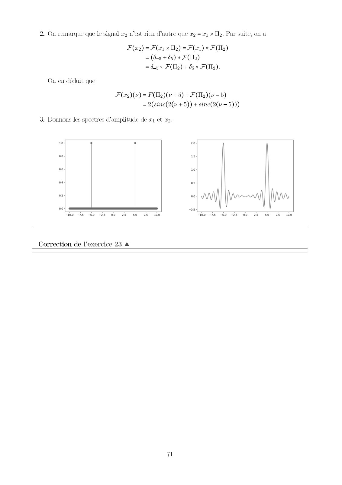

# 2425_TdS_TD4Corr.pdf

[Ouvrir l’original](https://drive.google.com/open?id=16YPGgKJ9gVFjIADzSZ0T9sY6664CxkBg) · Les pages signalées comprennent du texte reconnu automatiquement ou des éléments graphiques. Le fac-similé permet de vérifier chaque lecture.

**Pages avec fac-similé ou lecture OCR** — 1–4.

## Page 1

**Lecture OCR à contrôler**

~~~text
CY Tech - Pe
TEC H MI - Traitement atu Signal

TD4 - Transformée de Fourier

Exercice 21 Transformée de Fourier de la fonction porte

Soit a > 0. déterminer le transformée de Fourier de la fonction porte Tea.

Correction w

Exercice 22 Transformée de Fourier d’une simisoide tronquée

1. Rappeler la transformée de Fourier du signal a défini par
x(t) = 2cos(2nt x 5).
2. En utilisant le résultat de l'exercice précédent, déterminer la transformée de Fourier du signal x2

défini par
x ite[-2,2
20 ro site[-2,2] ;

0 sinon

3. Donner le spectre amplitude de x; et de x2.

Correction w

Exercice 23 Filtre passe bas d’ordre 1 de Butterworth

1. On considère la fonction H de R dans € définie par

1
H(v)= DE
où vo > 0 est un réel donné.
(a) Tracer le graphe de la fonction G : v + 20log9([H(v)[) en fonction de logip(v), pour
v € [0, 10000].
(b) Quelle est la valeur de G(vc).
2. On considère un filtre dont la fonction de transfert est H.
(a) Rappelle ce que cela signifie,
(b) Quel sera l'effet de ce filtre sur un signal d'entrée a.
(c) On note x et y respectivement les signaux d'entrée et de sortie de ce filtre. Déterminer la
relation liant x et y.
Remarque : Ce filtre est appelé filtre passe bas d'ordre L de Butterworth. On peut définir des
filtres de Butterworth d'ordre plus élevé en considérant des fonctions de transfert H, (n € N*)
telles que

IQ) =

Pour n= 3, par exemple, on considère la fonction

1
LH 426K P+ °

H3(v) =

Le graphe de la fonction G tracé à la question La, est appclé diagramme de Bode du filtre.

6S
~~~

## Page 2

**Lecture OCR à contrôler**

~~~text
3. Le fichier coq-bruitee.wav contient, comme son nom l'indique, un chant de coq, auquel est venu

se greffer un sifflement aig
(a) Écrire un programme Python qui permet de lire le fichier audio et qui trace le graphe de ce
signal ainsi que son spectre d'amplitude.
(b) Mettre en oeuvre un filtre de Butterworth d'ordre 10 pour estomper les fréquences supé-
ricures à 1500Hz. (On pourra utiliser la fonction butter du module signal de scipy)

(c) Enregistrer le signal sonore filtré dans un nouveau fichier «wav et comparer au fichier initial.

Correction w

69
~~~

## Page 3

**Lecture OCR à contrôler**

~~~text
CY Tech - Pau
TECH ING2 MI- Traitement du Signal

CORRECTION TD4

Correction de Vexercice 21 A

Ta fonction porte est une fonction intégrable sur R et admet donc une transformée de Fourier au
sens Classique.

On a pour tout v eR,
‘te, -2invt
F(Uaa)(v) = fi Thao tye ti" at
Joo

+a
= [ env qe
ma

_ 1
2inv
1 e2itva

[eve

=a

inva

Tv 2

L
— sin(2rva)
TL

= 2asine(2av)

On donne ci-dessous le graphe de la transformée de Fourier de la fonction «+ Th, (cas a = 1). Il s'agit
done du graphe de la fonction x + 2sinc(2v). On remarque un lobe principal qui s’amortit rapidement.
Plus la valeur de a est grande (c’est-à-dire plus la porte est large), plus le lobe est étroit (sa largeur
varie en À).

2.0

10

05

00

—100 -75 -50 -25 00 25 50 75 100

Correction de l’exercice 22 4

1. La transformée de Fourier de x; est donnée par

F(x) = 6-5 +65.

70
~~~

## Page 4

**Lecture OCR à contrôler**

~~~text
2. On remarque que le signal #2 West rien d'autre que x2 = #1 x Tz. Par suite, on a

F (#2) = F (x1 x Iz) = F(x1) * F(IL)
= (6-5 + 05) * F(z)
= 6.5 * FT) +5 * FI).
On en déduit que
F(a2)(v) = F(a )(v + 5) + FT)(v - 5)
= 2(sine(2(v +5)) + sinc(2(v -5)))

3. Donnons les spectres d'amplitude de x1 et x2.

10 20
os 15
06 10
oa os
02 oo
00 os
bo 3s 30 5 00 25 50 73 100 bo -Js Jo -25 00 25 So 75 100

Correction de lexercice 23 A
~~~
