# Exercices supplémentaires corrigés (pour s_entrainer à l_examen).pdf

[Ouvrir l’original](https://drive.google.com/open?id=1Zzi2mFaTRScUOIHnEa_9_Jan6dGrBu2w) · Les pages signalées comprennent du texte reconnu automatiquement ou des éléments graphiques. Le fac-similé permet de vérifier chaque lecture.

**Pages avec fac-similé ou lecture OCR** — 16–35, 37–40.

## Page 1

~~~text
                                                                                 CY Tech - Pau
                                                                 ING2 MI - Traitement du Signal

                                           TD0
Exercice 1
Considérons   les   signaux   s1   à   s6        représentés   sur   la   gure     ci-dessous   :

                                            1. Ces signaux sont-ils continus ?
                                            2. Ces signaux sont-ils discrets ?
                                            3. Ces signaux sont-ils quantiés ?
                                            4. Ces signaux sont-ils analogiques ?
                                            5. Ces signaux sont-ils numériques ?
                                            6. Parmi ces signaux, un seul est issu de l'échan-
                                               tillonnage d'un signal continu avec une période
                                               d'échantillonnage Te xe. Lequel ?
                                            7. Dessiner un chronogramme irréaliste ne représen-
                                               tant pas un signal.

Exercice 2
Considérons   les   signaux   s1   à   s6        représentés   sur   la   gure     ci-dessous   :

                                           On suppose que l'horizon de temps choisi en
                                           indique assez sur l'allure du signal.

                                       5
                                             1. Quels sont les signaux périodiques ?
                                             2. Il y en a t-ils qui ne soient pas périodiques
                                                mais qui présentent une pseudo-période ?

                                             7
~~~

## Page 2

~~~text
Exercice 3
Soit un signal x apériodique décrit par :

                                     x(t) = x0 e−t ,   ∀t > 0,
                                 {
                                     x(t) = 0,         ∀t < 0
1. Dessiner le signal x = f (t).
2. Calculer la moyenne de x sur tout l'horizon de temps. Commenter.
3. Calculer la moyenne de x sur l'intervalle [0; 1].

Exercice 4
Soit un signal c carré impair d'amplitude A et de fréquence fp .
1. Dessiner le signal c.
2. Quel est son rapport cyclique ?
3. Calculer la moyenne de c sur tout l'horizon de temps. Est-ce une surprise ?
4. Calculer la moyenne sur l'intervalle [0; Tp /2] en appliquant la formule rigoureuse. Est-ce une
   surprise ?
5. On ajoute une composante continue A0 à c. Que devient sa valeur moyenne ?
6. Que devient sa moyenne sur [0; Tp /2] ?

Exercice 5    Conversion analogique numérique
Soit la courbe analogique suivante et le résultat de sa conversion numérique :

                                                8
~~~

## Page 3

~~~text
1. Sur combien de bits travaille ce convertisseur A/N (amplitude) ?
2. Combien de valeurs diérentes sont possibles (amplitude) ?
3. Déterminer la période d'échantillonnage Te utilisée par ce convertisseur.
4. Calculer la fréquence d'échantillonnage.
5. Sachant que les valeurs max et min du signal analogique sont 2V et -2V, calculer le pas de ce
   convertisseur.
6. Pour mémoriser le signal numérique correspondant à ces 4ms, combien de bits de données
   va-t-on avoir ?
7. Si le signal total dure 5 minutes, combien de bits de données seront nécessaires pour mémoriser
   numériquement le signal ?
8. Donner le résultat précédent en ko.

                                               9
~~~

## Page 4

~~~text
                                                                                     CY Tech - Pau
                                                                     ING2 MI - Traitement du Signal

                               TD1 - Analyse des signaux
  Exercice 6
  Un signal s est placé en entrée d'un analyseur de spectre. L'analyseur propose alors un graphe
donné par la gure ci dessous :

  1. Que représente ce graphe ?
  2. Le signal est-il périodique ? Si oui, quelle est sa période notée T ?
  3. Le signal comporte-t-il des harmoniques ? Si oui, combien ?
  4. Donner son expression.
  5. Dessiner la représentation fréquentielle de : s(t) + 2.

  Exercice 7
  Soit le signal s suivant :

                                           s(t) = Ssin(ωt)

ainsi que les signaux c et d représentés sur la gure ci dessous :

                                                  16
~~~

## Page 5

~~~text
1. Que représentent S et A ?
2. Calculer le développement en série de Fourier de s, c et d (c'est-à-dire les coecients an et bn ).
   Commenter.
3. Déduire les coecients cn et ϕn de l'autre forme du développement pour s, c et d.
4. Déterminer le développement des signaux s1 (t) = −s(t), c1 (t) = −c(t) et d1 (t) = −d(t).
5. Déterminer le développement des signaux s2 (t) = −s(t), c2 (t) = 2c(t) et d2 (t) = 2d(t).
6. Que faut il modier pour passer du développement de c (ou de d) à celui du même signal mais
                         A
   décalé vers le haut de ?
                         2

Exercice 8
Soit r, un signal rectangulaire pair. Il est représenté sur la gure ci-dessous :

Calculer les coecients du développement en série de Fourier de r.

                                                 17
~~~

## Page 6

~~~text
                                                                                          CY Tech - Pau
                                                                          ING2 MI - Traitement du Signal

                                    TD2 - Distributions
  Exercice 9 Exemples et contre-exemples de distributions
  Les applications suivantes dénie sur D(R) dans R sont-elles des distributions ? Si oui, préciser de
quelle distribution il s'agit. Dans ce qui suit, ϕ désigne une fonction quelconque de D(R).
                1
  1. T1 (ϕ) = ∫0 ϕ(t)dt                                  3. T3 (ϕ) = ∫0
                                                                         +∞ 2
                                                                            t ϕ(t)dt
                1
  2. T2 (ϕ) = ∫0 ∣ϕ(t)∣dt                                4. T6 (ϕ) = ϕ(0) + ϕ′ (1)

  Exercice 10 Dérivées d'ordre un et deux de la fonction "rampe"
  On rappelle que
                                      ⎧
                                      ⎪
                                      ⎪0 si t ≤ 0
   La fonction de Heaviside : H(t) = ⎨
                                      ⎪
                                      ⎩1 si t > 0
                                      ⎪
   La fonction rampe : t ↦ tH(t)
Montrer que la fonction rampe R dénit une distribution. Déterminer R′ et R′′ au sens des distribu-
tions.

  Exercice 11 Dérivées de la fonction de Heaviside et d'une porte.
  1. Vérier que la fonction de Heaviside H et la fonction porte Πa (pour a > 0 donné) dénissent
     des distributions de D′ (R).
  2. Pour les deux fonctions de la question précédente, déterminer leur dérivée au sens des distri-
     butions.

  Exercice 12
  Soit S le système qui à tout signal u déni par une distribution associé le signal de sortie u′′ .
  1. Déterminer le signal de sortie pour une entrée égale à δ0 . Le signal de sortie est alors appelé
     réponse impulsionnelle.
  2. On considère la fonction u suivante :
                                               ⎧
                                               ⎪0         si t < 0
                                               ⎪
                                               ⎪
                                               ⎪
                                               ⎪
                                               ⎪
                                               ⎪t         si 0 ≤ t ≤ 1
                                        u(t) = ⎨
                                               ⎪
                                               ⎪
                                               ⎪−t + 2    si 1 ≤ t ≤ 2
                                               ⎪
                                               ⎪
                                               ⎪
                                               ⎪
                                               ⎩0         si t > 2.

                                                  29
~~~

## Page 7

~~~text
   (a) Vérier que u dénie bien une distribution.
   (b) Déterminer le signal de sortie S(u).
3. Pour ϕ ∈ D(R), on note ϕu la fonction dénie par
                                               +∞
                                  ϕu (x) = ∫        u(t)ϕ(x + t)dt.
                                              −∞

  On admet que ϕu est un élément de D(R).
  Vérier que S(u) est la distribution dénie par

                               ∀ϕ ∈ D(R), < S(u), ϕ >=< δ0′′ , ϕu > .

                                               30
~~~

## Page 8

~~~text
                                                                                      CY Tech - Pau
                                                                      ING2 MI - Traitement du Signal

                                   TD3 - Convolution
Exercice 13 Calcul d'un produit de convolution de deux fonctions
Soit f = Π2 et g = Π2a , avec a ≥ 1.
Déterminer f ∗ g après en avoir justié l'existence.

Exercice 14 Calcul d'un produit de convolution discret
Soit a > 0. Eectuer le produit de convolution des deux signaux ci-dessous :

                           x = −2δ−a + δ0 + 3δa − δ2a y = 3δa + 2δ2a − δ3a .

Exercice 15 EDO au sens des distributions
1. Soit T une distribution sur R. Soit φ une fonction de classe C ∞ sur R. On dénit le produit
   φT comme étant la distribution

                                       ∀ϕ ∈ D(R), < φT, ϕ >=< T, φϕ >

   (on remarquera que si ϕ est dans D(R), il en est de même pour φϕ.
   Montrer que l'on a
                          (φT )′ = φT ′ + φ′ T (au sens des distributions).

2. On considère l'EDO suivante :
                                                τ y ′ + y = κδ0
   où τ, κ ∈ R∗ .
   Montrer que la distribution dénie par la fonction h donnée par h(t) = κτ e−t/τ H(t), ou H est
   la fonction de Heaviside , est solution de l'EDO.
3. On considère maintenant l'EDO :
                                                τ y ′ + y = κT,
   où T est un distribution donnée. Vériez que y = h ∗ x est solution de cette EDO.

Exercice 16 Calcul d'un produit de convolution au sens des distributions

1. Vérier que la fonction de Heaviside H n'est pas une fonction de L1 (R) ∪ L2 (R), mais qu'elle
   dénie une distribution de D′ (R).
2. Justier l'existence du produit de convolution H ∗ δa et le déterminer.

                                                  43
~~~

## Page 9

~~~text
  3. Déterminer la convolution de la fonction u = 12 (t + 1)I[−1,0] + 12 (−t + 1)I[0,1] par la distribution
     δ0 + 12 δ2 + 41 δ4

  Exercice 17 Approximation d'une dérivée par convolution
  Soit a ∈ R et h > 0.
  1. Soit ϕ ∈ D(R). Déterminer le produit de convolution ( 2h    1
                                                                   (δ−h − δh ) ∗ ϕ)(a).
     Vérer que ( 2h (δ−h − δh ) ∗ ϕ)(a) =< 2h (δa+h − δa−h ), ϕ > .
                   1                         1

  2. Montrer que limh→0 2h
                         1
                           (δa+h − δa−h ) existe dans D′ (R) et déterminer cette limite.

  Exercice 18 Convolution discrète 2D
  Une image décrite en niveau de gris est résumée par la matrice A :

                                            ⎛ 0      1   1   1 ⎞
                                            ⎜ 0      1   1   1 ⎟
                                          A=⎜                  ⎟
                                            ⎜ 0      0   0   1 ⎟
                                            ⎝ 0      0   0   1 ⎠

On souhaite réaliser la convolution 2D discrète de l'image A par la distribution résumé par la matrice
de convolution
                                           ⎛ 1 0 −1 ⎞
                                           ⎜ 0 0 0 ⎟.
                                           ⎝ −1 0 1 ⎠

  1. Eectuer cette convolution à la main.
  2. Vérier vos calculs en utilisant la fonction convolve2d de scipy.signal sous Python.

                                                    44
~~~

## Page 10

~~~text
                                                                                           CY Tech - Pau
                                                                           ING2 MI - Traitement du Signal

                         TD4 - Transformée de Fourier
Exercice 19 Transformée de Fourier de la fonction porte
Soit a > 0. déterminer le transformée de Fourier de la fonction porte Π2a .

Exercice 20 Transformée de Fourier d'une sinusoïde tronquée
1. Rappeler la transformée de Fourier du signal x1 déni par
                                        x1 (t) = 2cos(2πt × 5).
2. En utilisant le résultat de l'exercice précédent, déterminer la transformée de Fourier du signal
   x2 déni par
                                              ⎧
                                              ⎪
                                              ⎪x1 (t) si t ∈ [−2, 2]
                                     x2 (t) = ⎨                      .
                                              ⎪0
                                              ⎪       sinon
                                              ⎩
3. Donner le spectre d'amplitude de x1 et de x2 .

Exercice 21 Filtre passe bas d'ordre 1 de Butterworth
1. On considère la fonction H de R dans C dénie par
                                                  1
                                        H(ν) =           ,
                                               1 + i ννC
   où νC > 0 est un réel donné.
    (a) Tracer le graphe de la fonction G ∶ ν ↦ 20 log10 (∣H(ν)∣) en fonction de log10 (ν), pour
         ν ∈ [0, 10000].
    (b) Quelle est la valeur de G(νC ).
2. On considère un ltre dont la fonction de transfert est H.
    (a) Rappelle ce que cela signie.
    (b) Quel sera l'eet de ce ltre sur un signal d'entrée x.
    (c) On note x et y respectivement les signaux d'entrée et de sortie de ce ltre. Déterminer la
         relation liant x et y .
   Remarque : Ce ltre est appelé ltre passe bas d'ordre 1 de Butterworth. On peut dénir des
   ltres de Butterworth d'ordre plus élevé en considérant des fonctions de transfert Hn (n ∈ N∗ )
   telles que
                                                        1
                                       ∣Hn (ν)∣ = √               .
                                                    1 + ( ννC )2n
   Pour n = 3, par exemple, on considère la fonction
                                                             1
                                 H3 (ν) =                                       .
                                            1 + 2i ννC + 2(i ννC )2 + (i ννC )3
   Le graphe de la fonction G tracé à la question 1.a. est appelé diagramme de Bode du ltre.

                                                   60
~~~

## Page 11

~~~text
3. Le chier coq-bruitee.wav contient, comme son nom l'indique, un chant de coq, auquel est
   venu se greer un siement aigü.
   (a) Écrire un programme Python qui permet de lire le chier audio et qui trace le graphe de
       ce signal ainsi que son spectre d'amplitude.
   (b) Mettre en oeuvre un ltre de Butterworth d'ordre 10 pour estomper les fréquences supé-
       rieures à 1500Hz. (On pourra utiliser la fonction butter du module signal de scipy)
   (c) Enregistrer le signal sonore ltré dans un nouveau chier .wav et comparer au chier
       initial.

                                            61
~~~

## Page 12

~~~text
                                                                                      CY Tech - Pau
                                                                      ING2 MI - Traitement du Signal

                                        TD5 : Filtrage
  Exercice 22 Exo/cours ltrage par le circuit RC
  Un ltre en électrocinétique ne laissera passer que certains signaux sinusoïdaux caractérisés par
une pulsation ω (= 2πf , avec f la fréquence du signal).
À l'entrée du ltre, on applique par exemple une tension de pulsation ω :
   si, à la sortie du ltre, la tension n'est pas atténuée, on considère que le ltre laisse passer la
      pulsation ω ;
   si au contraire, la tension est atténuée, on considère que le ltre ne laisse pas passer la pulsation
    ω.

  Soit un circuit formé d'un conducteur ohmique R et d'un condensateur de capacité C , soumis à
une tension sinusoïdale ue (t) :

                                                                      us
  1. Déterminer la fonction de transfert H du ltre RC : H(ω) =          .
                                                                      ue
                                                                             A
  2. On écrit la fonction de transfert de la façon suivante : H(ω) =       ω avec j = −1, A : le gain
                                                                                   2
                                                                       1+j
                                                                           ωc
     et ωc : la pulsation de coupure. Identier A et ωc .
  3. Déduire la fréquence de coupure notée fc .
  4. Calculer le gain GdB en dB à la fréquence de coupure. On rappelle que GdB = 20log(∣ H ∣).
  5. Représenter le diagramme de Bode de ce ltre.
  6. Déduire la nature de ce ltre.

  Rappels : Le diagramme de Bode d'un ltre se compose de deux tracés :
   Le gain en décibels (dB) en fonction de ω donné par GdB = 20log(∣ H(ω) ∣).
   la phase en degré en fonction de ω , donnée par arg(H(ω))

  Exercice 23     Filtrage et spectre
   La gure ci-dessous représente les spectres de Fourier du signal de commande envoyé par un
générateur basse fréquence (GBF) à un émetteur d'ultrasons (grande amplitude, gris foncé) et de
celui recueilli par un récepteur placé quelques dizaines de centimètre plus loin (faible amplitude, gris
clair).

                                                   70
~~~

## Page 13

~~~text
  1. Quelle est la nature du ltrage réalisé entre le signal du GBF et sa réception ?
  2. Donner sa fréquence centrale et estimer le facteur de qualité Q du ltre.
  3. Identier les diérentes étapes de transformation/propagation du signal. À votre avis, où se
     produit le ltrage observé ?

   Rappels concernant les ltres passe-bande du second ordre :

   Fréquence centrale f0 . Pour un ltre passe-bande, l'amplitude de la fonction de transfert est
    maximale (= Hmax ) à la fréquence centrale.
   Largeur de bande ∆f = fc2 − fc1 : C'est la largeur de la bande passante (à −3dB ). ωc1√= 2πfc1
    et ωc2 = 2πfc2 sont les pulsations de coupure pour lesquelles le gain vaut ∣ H ∣= Hmax / 2.
   Facteur de qualité Q : C'est le rapport entre la frequence centrale et la largeur de la bande
                           f
    passante. On a : Q = 0
                           ∆f

  Exercice 24    Conception d'un ltre de signaux acoustiques
  Un dispositif de traitement de signaux acoustiques nécessite la séparation de composantes sonores
et ultrasonores.
  On souhaite éliminer les composantes ultrasonores : il faut donc réaliser un ltre passe-bas. Le
cahier des charges du dispositif indique les caractéristiques suivantes :

                                                71
~~~

## Page 14

~~~text
   Fréquence de coupure 20kHz ;
   Gain nominal 0dB ;
   L'atténuation des fréquences comprises entre 0 et 20kHz doit être inférieure à 3dB ;
   L'atténuation des fréquences supérieures à 40kHz doit être supérieure à 10dB .

  1. Tracer le gabarit (qui synthétise les contraintes de la réponse fréquentielle du ltre en gain) de
     ce ltre sur le diagramme semi logarithmique ci-dessous.
  2. Le ltre le plus simple serait un passe-bas du premier ordre de fréquence de coupure fc = 20kHz .
     On rappelle que la fonction de transfert d'un tel ltre s'écrit sous forme réduite :
                                              1                        f
                                  H(x) =          avec j 2 = −1 et x =
                                           1 + jx                      fc
      (a) Rappeler où retrouver la pente des asymptotes du diagramme de Bode en gain de ce ltre
          et calculer son gain à la fréquence de coupure.
      (b) Montrer qu'il ne peut satisfaire au cahier des charges imposé. Justier qu'il est nécessaire
          d'utiliser un ltre d'ordre plus élevé.

  Exercice 25    Filtre Butterworth - Python
  Un ltre de Butterworth est un type de ltre linéaire, conçu pour posséder un gain aussi constant
que possible dans sa bande passante. Le gain d'un ltre de Butterworth est le plus constant possible
dans la bande passante et tend vers 0 dans la bande de coupure.

  On considère un signal d'entrée e déni comme suit : e(t) = 2 + sin(3 ∗ 2πt) + 0.4sin(500 ∗ 2πt).

  1. Représenter e et son spectre.
  2. Appliquer le ltre Butterworth à e. Vous pouvez commencer votre code par :
     from scipy.signal import butter, llter
     from scipy.signal import freqs.
     Vous pouvez également vous renseigner sur :
     https ://docs.scipy.org/doc/scipy/reference/generated/scipy.signal.butter.html

                                                 72
~~~

## Page 15

~~~text
  3. Acher s.
  4. Comparer le spectre de s avec celui de e. Faire ce travail avec diérentes valeurs de paramètres
     d'entrée du ltre.

  Exercice 26    Analyse spectrale - Python

  Le chier ConsoGazElec.csv contient la consommation horaire en gaz (deuxième colonne, en MW)
et en électricité (troisième colonne, en MW).

  1. Acher la consommation électrique. Utiliser numpy.loadtxt pour charger le chier.
  2. Acher la TFD du signal pour déterminer les principales fréquences.
  3. Identier quel phénomène correspond aux principales fréquences.

  Exercice 27    Filtre numérique Python
  Soit un ltre numérique, appelé ltre moyenneur, qui calcule la moyenne arithmétique de deux
valeurs consécutives :

                                             1
                                         yn = (xn−1 + xn )
                                             2
  1. Tracer le module de sa réponse fréquentielle.
  2. Quel type de ltre est-ce ?

     On se propose d'appliquer ce ltre à un signal d'entrée comme suit :
                                                         π                 π
                             e = 2cos(2πt) + cos(3πt +     ) + 0.5cos(5πt + )
                                                         2                 4
     Au moment d'échantillonner le signal d'entrée, on ajoutera un bruit gaussien (import random ).
  3. Représenter le spectre du signal discret.
  4. Tracer le signal discret ltré (résultat de la convolution avec la réponse impulsionnelle).

  Note : Pour réduire plus ecacement le bruit d'un signal, on utilise un ltre passe-bas gaussien.

                                                 73
~~~

## Page 16

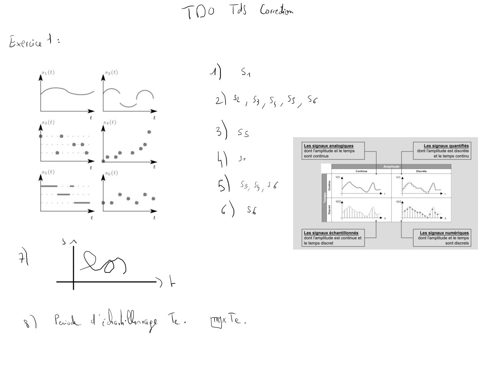

**Lecture OCR à contrôler**

~~~text
TO o TA Conedion

Exerica À:

go Fac A) 6

à # 3,5%,5%, se

s3(t) ' sa(t)
À . À . 3) Sc
Les signaux anak. Los signaux quantins
dont ample est cite

: ee L) 7 sont continus tle temps contin
sms f Bese WR a
SS =... ¢) SE i; En vie Bi whe.

28 signaux échantilonnés Les signaux numériques |
dont Tampitude est continue et dent Tampltude ete temps
SA le temps discret sont dscrets

s) Peced d'y Te. pyle.
~~~

## Page 17

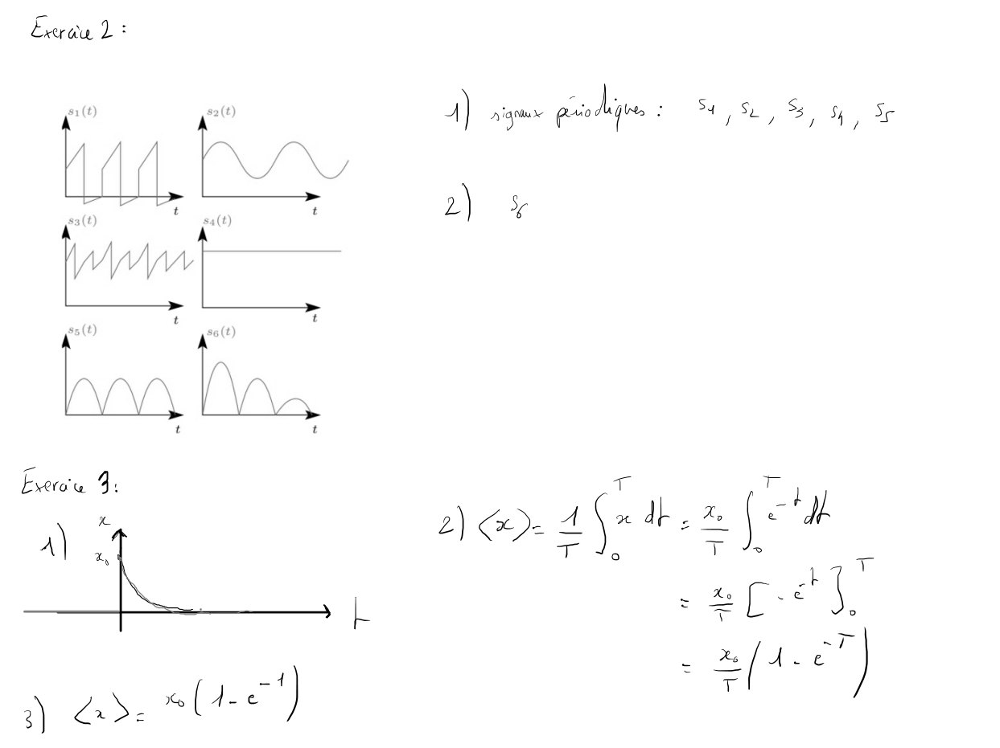

**Lecture OCR à contrôler**

~~~text
ee hao 4) aigu pole 54 Se $, 5 Or
il - L ae 2 &
A A
NA) 11 A
La *
ee A
Éverou 3.

À : 2) om are [od
“hk , L apts!

fd e”
y ede ele) lee)
~~~

## Page 18

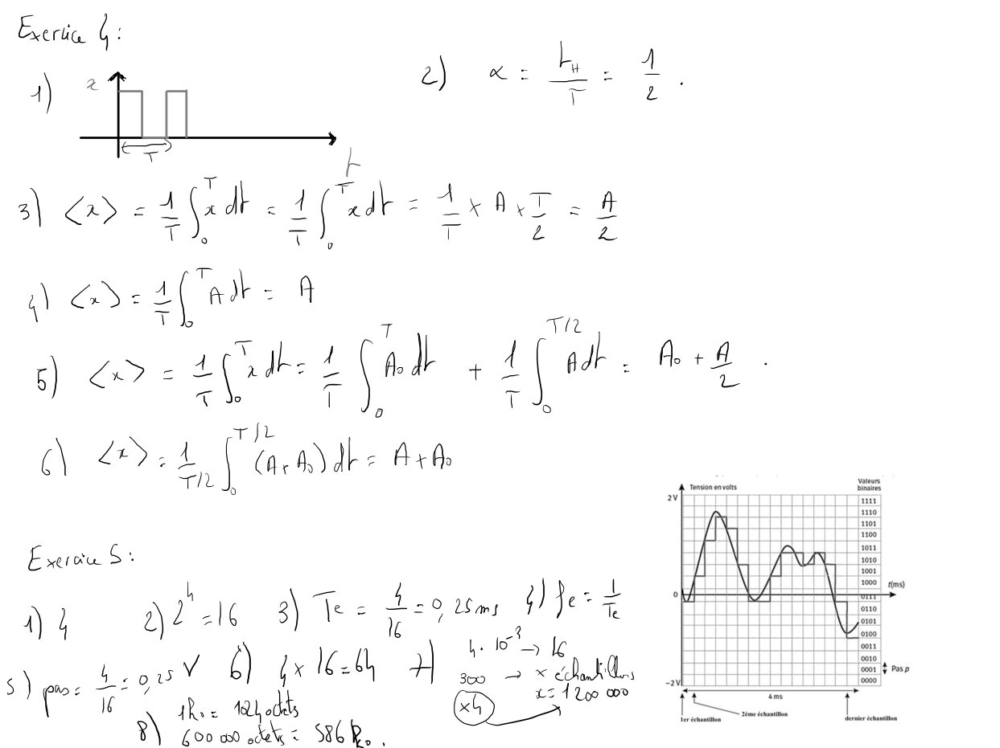

**Lecture OCR à contrôler**

~~~text
Exeri 4:
de °
_ I
"dhe Ant 2 4
T Bie

4 € eA ladk 4 7

dad (Tadks À
= Te
6) go tft LR -1[ at Ae A
% vd, TJ,
Tye
(\ 26324, | (neh) dk = At
Exerou SG:
- +
au dP a) Tee deg ues lex
beguv 0 gr let À LL
L2 1 Low wv
~~~

## Page 19

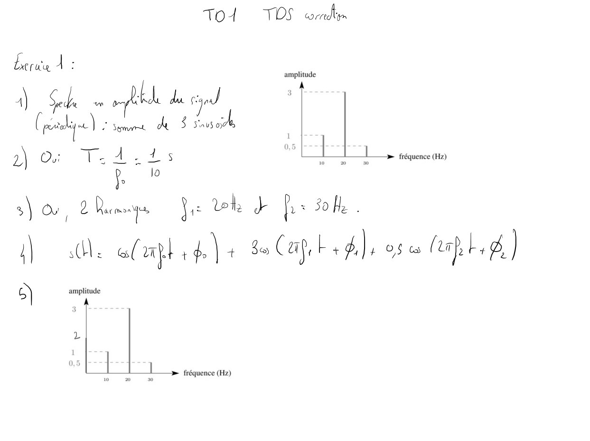

**Lecture OCR à contrôler**

~~~text
Tod

Welt. 4;

4) En hy kde du san)
(din £ i a 3 Tu

5) amplitude

TOS “oped tps

amplitude

0,5
LL fréquence (Hz)

Je vl J pis Sol .
| A. co amp + 4. # 3% Carp, L + g,

OS Co (opted }
~~~

## Page 20

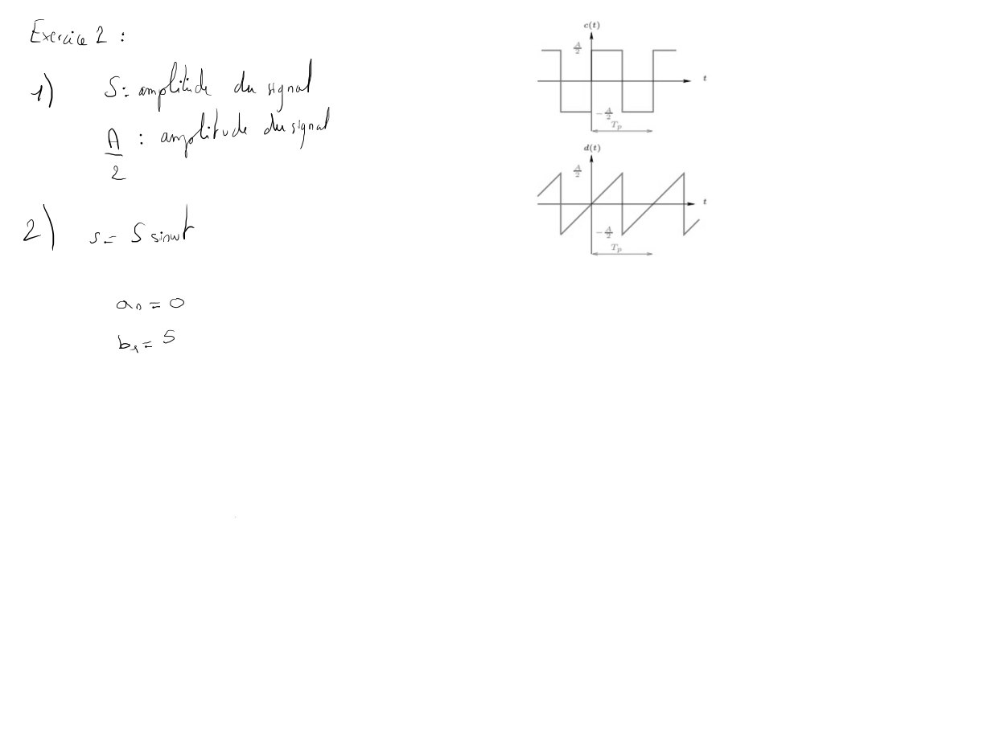

**Lecture OCR à contrôler**

~~~text
bere 2:
~~~

## Page 21

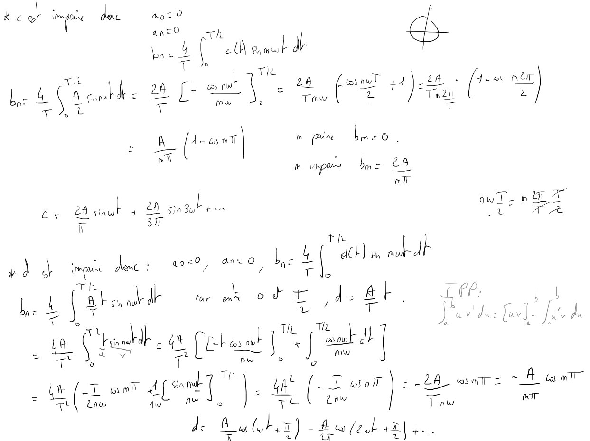

**Lecture OCR à contrôler**

~~~text
Ke of de der Bor 0

anno th
bone f UY sual db
be & Ca pub rel 1
ar & À A ours me CA - 24 fe owl i
| L 21 el LÉ ta) Tran im )
a
=e à. bt r pe bed
aT oe
fh wpa bn = cA
mT
€ Ai at 2A ca Bw
= 4 ne zt+ ju ET
L FA
Th
el à wet der ort, mé be L | J) ne nuk dt
Th / T Jo
A \3 abat dr tae ook o¢ t | a | — op
= Tr ,d- 2. LP:
L. L T eae ho
mn bit Ad j" T J'av hi fav] Ja de
2 (res ere (Eten! | | suk Al | A
° , mw
& fel T of sand À. T
à ( im 20 AN |- if (ae -2A- sat = ~ À wa
T Tnw AT

d: Authx) - fea {al wD) 4.
~~~

## Page 22

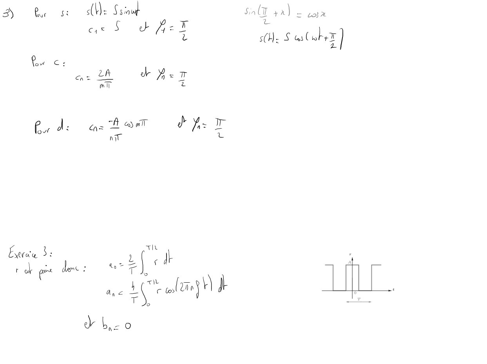

**Lecture OCR à contrôler**

~~~text
3 La se se Ssiou Sat 4a) = cope

4X § e 27 =
4 2 à she S tal ote )

Execwe 3: y cult |
rok gx Jeon: web
}
ra
~~~

## Page 23

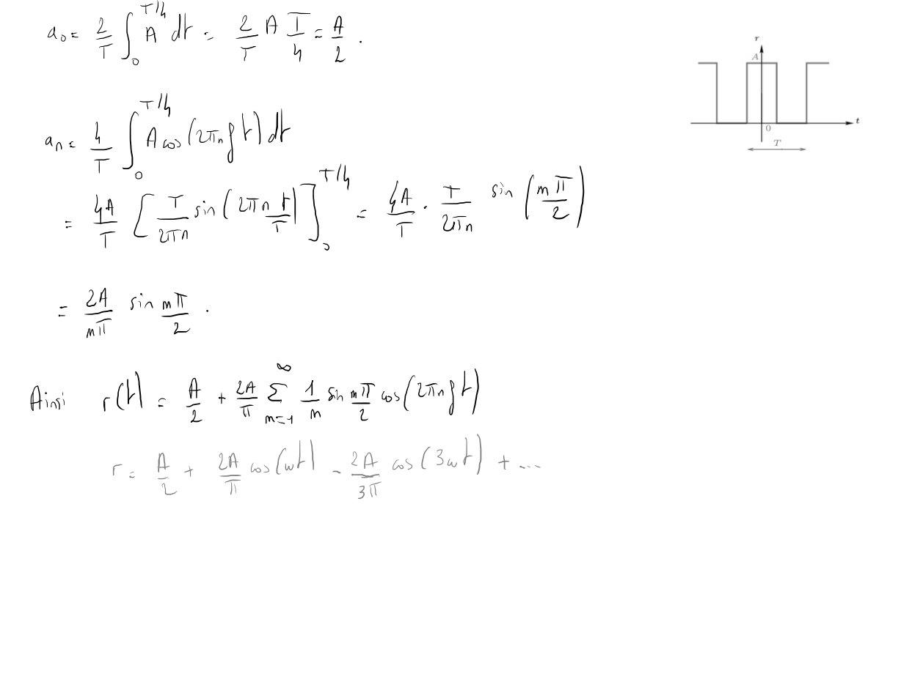

**Lecture OCR à contrôler**

~~~text
TI}

ae blade. £ T4.

Ane A «fr [up
4 wy { ÜTa F L A. TH fn [mir
- =" ( a ~ ts ü, | ue

= 24 Samm,
ww
Di tH EF # pes 4 by aT (ue) l
Le Vos M
c A, UR & (+ La as (ut) +.

2 | 3
~~~

## Page 24

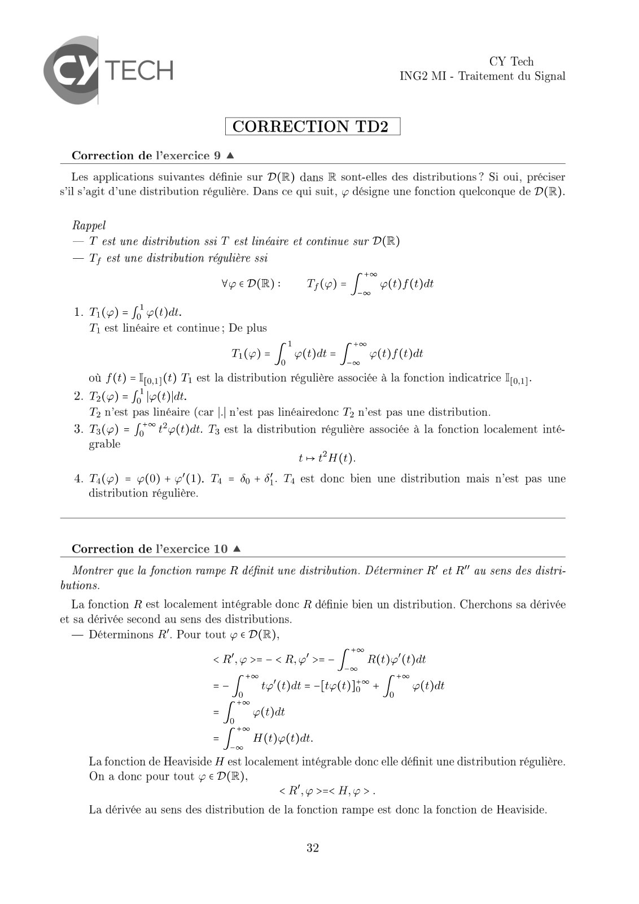

**Lecture OCR à contrôler**

~~~text
CY Tech
TECH ING2 MI - Traitement du Signal

CORRECTION TD2

Correction de l’exercice 9 A

Les applications suivantes définie sur D(R) dans R sont-elles des distributions? Si oui, préciser
s'il s’agit d’une distribution régulière. Dans ce qui suit, désigne une fonction quelconque de D(R).

Rappel
— T est une distribution ssi T est linéaire et continue sur D(R)
— Ty est une distribution régulière ssi

veeD(R): — THlp)= [pe scat

1. T(y) = fo e(dt.
T, est linéaire et continue; De plus
1 +00
nie)= [ete [Trot
où f(t) = Ijo(t) Ti est la distribution régulière assc

9 1
2. Bo) = fo \e(t)ldt.
T2 n'est pas linéaire (car |.| n’est pas linéairedonc T2 n’est pas une distribution.

iée à la fonction indicatrice Ijo,1)-

3. T3(y) = fo” Po(t)dt. Ts est la distribution régulière associée à la fonction localement inté-
grable
t+ H(t).
4. Ty(~) = (0) + y'(1). Ty = 0 + 84. TA est donc bien une distribution mais n’est pas une
distribution réguliére.

Correction de l’exercice 10 4

Montrer que la fonction rampe R définit une distribution. Déterminer R' et R" au sens des distri-
butions.

La fonction R est localement intégrable donc R définie bien un distribution. Cherchons sa dérivée
et sa dérivée second au sens des distributions.
— Déterminons R’. Pour tout y € D(R),

<P, psec Roose [7 R(t)y' (tat
RO ECO + [oat
7 JL : e(b)dt

= f. H(t)p(t)dt.

La fonction de Heaviside H est localement intégrable donc elle définit une distribution régulière.
On a donc pour tout y¢ D(R),
<R',p>=<H,p>.

La dérivée au sens des distribution de la fonction rampe est donc la fonction de Heaviside.

32
~~~

## Page 25

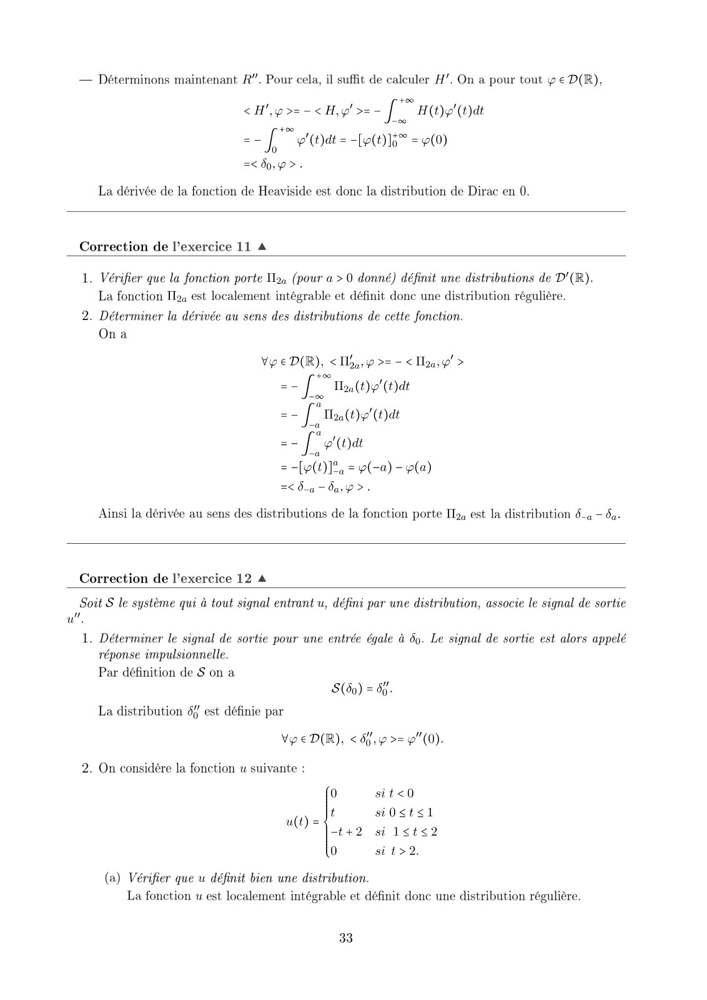

**Lecture OCR à contrôler**

~~~text
— Déterminons maintenant R”. Pour cela, il suffit de calculer H’. On a pour tout 4 € D(R),
se
< Hip >= —< Hig! >=~ [Heat
wo _
= fr bdt- OR = (0)
=< 60, >.

La dérivée de la fonction de Heaviside est donc la distribution de Dirac en 0.

Correction de l'exercice 11 A

1. Vérifier que la fonction porte Iza (pour a > 0 donné) définit une distributions de D'(R).
La fonction I, est localement intégrable et définit donc une distribution régulière.

2. Déterminer la dérivée au sens des distributions de cette fonction.

Ona
Vye D(R), <Ilousg >= - < Ia, 9! >
=- Î ” To, (t)o!(t)at
=~ [ne (ot
== Î “goat
= -[(t)]*a = 9(-a) - (a)
=<d-a-da p>.

Ainsi la dérivée au sens des distributions de la fonction porte I, est la distribution 6 - 5a.

Correction de l’exercice 12 A

Soit S le système qui à tout signal entrant u, défini par une distribution, associe le signal de sortie
u”.
1. Déterminer le signal de sortie pour une entrée égale à do. Le signal de sortie est alors appelé

réponse impulsionnelle.

Par définition de S on a

S(50) = 64.
La distribution 6f est définie par
vee D(R), < 00,9 >=p"(0).

2. On considère la fonction u suivante :

0 sit<0
O<t<1
u(t) = =
-t+2 si l<t<2
0 si t>2.

(a) Vérifier que u définit bien une distribution.
La fonction u est localement intégrable et définit donc une distribution régulière.

33
~~~

## Page 26

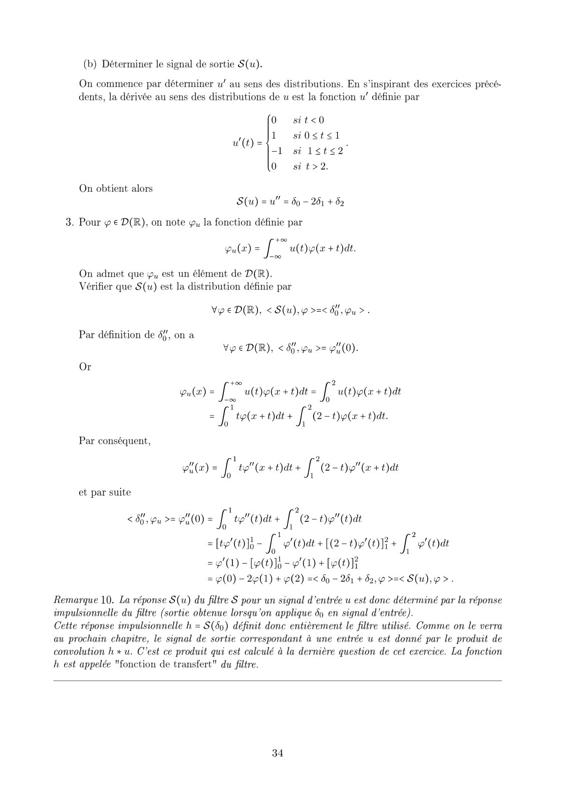

**Lecture OCR à contrôler**

~~~text
(b) Déterminer le signal de sortie S(u).

On comme par déterminer u’ au sens des distributions. En s'inspirant des exercices précé-

dents, la dérivée au sens des distributions de u est la fonction wu’ définie par
0 sit<0
1 si0<t<1
w(t) = * .
-1 si l<t<2
0 sit>2.

On obtient alors
S(u) = wl = by - 261 + 82

3. Pour y e D(R), on note w, la fonction définie par
+0
gale) = [aber + tat.

On admet que y, est un élément de D(R).
Vérifier que S(u) est la distribution définie par

Vee D(R), < S(u), 9 >=< 86, pu >.

Par définition de 67, on a
Yee D(R), < 59, Pu >= 91 (0).

Or
00 2
ut [7 u(thela + tat = [ u(t)y(« + t)dt
1 2
=f tolartdes [ (2-1 ye +t)dt.
Par conséquent,
1 2
eile) = f tel(e+ bats [ 2-1)" (x + tat
et par suite
1 2
eur eu = fi te"(ede+ [ 2-tp"(eat

OR [Was (e-oe'OR+ [ea

=¢'(1)-[e®]o- 9) + [eH
= 9(0) - 29(1) + (2) =< dy - 261 + 62, >=< S(u), p>.

Remarque 10. La réponse S(u) du filtre S pour un signal d'entrée u est donc déterminé par la réponse
impulsionnelle du filtre (sortie obtenue lorsqu'on applique 60 en signal d'entrée)
Cette réponse impulsionnelle h = S(5p) définit donc entièrement le filtre utilisé. Comme on le verra
au prochain chapitre, le signal de sortie correspondant à une entrée u est donné par le produit de
convolution h * u. C'est ce produit qui est calculé à la dernière question de cet exercice. La fonction
h est appelée "fonction de transfert" du filtre.

34
~~~

## Page 27

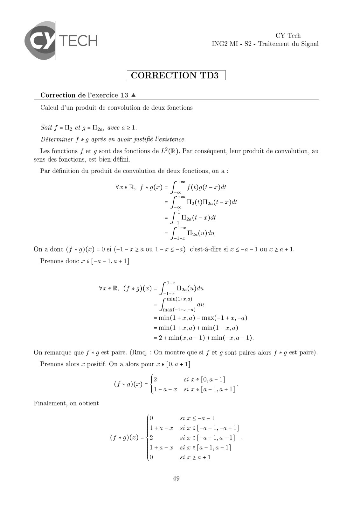

**Lecture OCR à contrôler**

~~~text
CY Tech

TECH ING2 MI - $2 - Traitement du Signal

CORRECTION TD3

Correction de l'exercice 13 A

Calcul d’un produit de convolution de deux fonctions

Soit f = Il et g = Il, avec a > 1.

Déterminer f * g après en avoir justifié l'existence.

Les fonctions f et g sont des fonctions de L?(R). Par conséquent, leur produit de convolution, au
sens des fonctions, est bien défini.

Par définition du produit de convolution de deux fonctions, on a :
eo
veeR, fxg(x) = f f(t)g(t-a)at
og
= [7 T(t) Toa(t- x) dt
x
= [, Toa (t —2)at
ple
-f, Tlaa(u)du

On a donc (f *g)(x)=0 si (-l-22a0u1-2<~-a) c'est-à-dire six <-a-lour2a+l.

Prenons donc « € [-a-1,a+1]

Le
VeeR, (f+ g(x) =f’ Man(u)du
“1-2
min(1+2,a)
=f du
max(-1+x,-a)
=min(l+æ,a)-max(-1+x,-a)
=min(1+2,a) +min(1-2,a)
=2+min(x,a-1)+min(-x,a-1).
On remarque que f * g est paire. (Rmq. : On montre que si f et g sont paires alors f + g est paire).
Prenons alors « positif. On a alors pour x € [0,a +1]

sixe[0,a-1]

(f*9)(0) = f

l+a-x sirefa-l,a+1]
Finalement, on obtient
0 sizs-a-1
l+a+æ sive[-a-1,-a+1]
(f * 9)(x) = {2 sixe[-a+l,a-1]
l+a-x sizela-l,a+i]

0 six>a+l

49
~~~

## Page 28

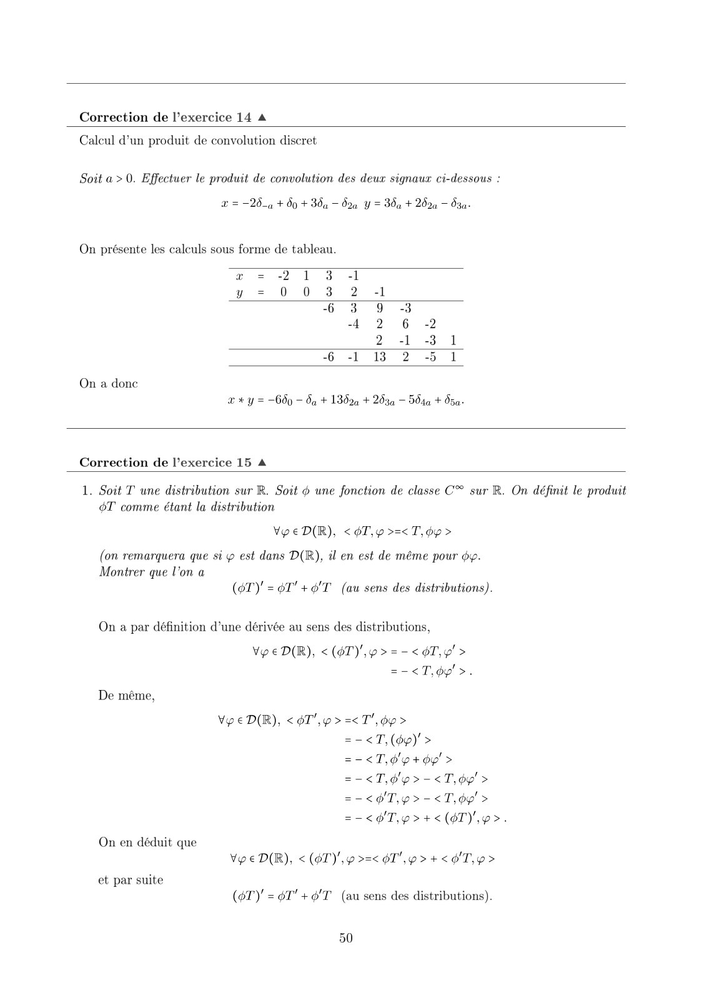

**Lecture OCR à contrôler**

~~~text
Correction de l'exercice 14 A

Calcul d’un produit de convolution discret

Soit a > 0. Effectuer le produit de convolution des deux signaux ci-dessous :

22-204 + 00 + 304 — 020 Y = 85a + 2520 — 53a

On présente les calculs sous forme de tableau.

z= 2 1 3 1
y = 0 0 3 2 -1
6 3 9 3

A 2 6 2

2 -1 -3 1

-6 -1 13 2 -5 1

On a donc
æ * y = 600 — Ja + 1302a + 203a — 504a + O5a-

Correction de l’exercice 15 A

1. Soit T une distribution sur R. Soit @ une fonction de classe C® sur R. On définit le produit
OT comme étant la distribution

VpeD(R), < ¢T,y >=<T, dy >

(on remarquera que si est dans D(R), il en est de même pour dp.
Montrer que Von a
(OT) = $1’ + ¢'T (au sens des distributions).

On a par définition d’une dérivée au sens des distributions,

YpeD(R), < (4T)',p>=-< oT," >
=-<T,¢y'>.
De méme,
Vp €D(R), < $T’,p>=<T', gy >
<T, (dy)! >

=-<T,¢'p+ dy’ >
=-<T,¢'p>-<T, dy! >
<¢T,p>-<T,oy'>
<DTip>+<(T),p>.

On en déduit que
Vee D(R), <(4T)',y>=< oT, p>+< dT, p>

et par suite
(GT) = 6T' + 4'T (au sens des distributions).

50
~~~

## Page 29

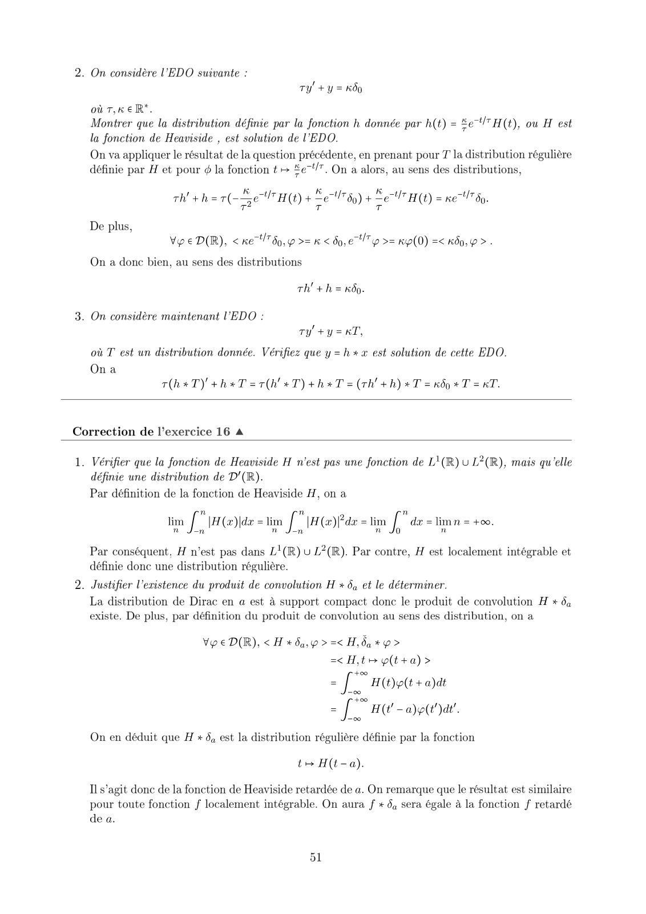

**Lecture OCR à contrôler**

~~~text
2. On considère l'EDO suivante :
ty + y = Ko
ou7, KER".
Montrer que la distribution définie par la fonction h donnée par h(t) = Se" H(t), ou H est
la fonction de Heaviside , est solution de l'EDO.
On va appliquer le résultat de la question précédente, en prenant pour T la distribution régulière
définie par H et pour ¢ la fonction t+ £e-/". On a alors, au sens des distributions,

th he TC Le He + Nelo) + Ze H(t) = Kel".
7 7 7

De plus,

tr,

Vo e D(R), < ke #/"60,p >= K < 60, ep >= Kp(0) =< Kô0,p >.

On a donc bien, au sens des distributions
th’ +h= Kido.
3. On considère maintenant l'EDO :
ty +y=KT,

où T est un distribution donnée. Vérifiez que y = h + x est solution de cette EDO.

On a
TRE T) +h*T=r(h'*T)+h*T =(rth' +h) *T = kdo *T = KT.

Correction de l'exercice 16 A

1. Vérifier que la fonction de Heaviside H n’est pas une fonction de L\(R) U L2(R), mais qu'elle
définie une distribution de D'(R).
Par définition de la fonction de Heaviside H, on a

i we i
tim f | (w)lde = im [ DORE dy = limn = +00.
ae ni an fo a

Par conséquent, H n’est pas dans L'(R) u L?(R). Par contre, H est localement intégrable et
définie donc une distribution réguliére.

2. Justifier l'existence du produit de convolution H * dq et le déterminer.

La distribution de Dirac en a est à support compact done le produit de convolution H * 5a
existe. De plus, par définition du produit de convolution au sens des distribution, on a

Vy D(R), < H *6a,9 > =< Hyba * p>
=< H,t+ g(t+a)>

= [7 H(t)y(t+a)dt
= [© H(t = a)e(t')dt".
On en déduit que H + &, est la distribution régulière définie par la fonction
t+ H(t-a).

Ils’agit donc de la fonction de Heaviside retardée de a. On remarque que le résultat est similaire
pour toute fonction f localement intégrable. On aura f * 6, sera égale à la fonction f retardé
de a.
~~~

## Page 30

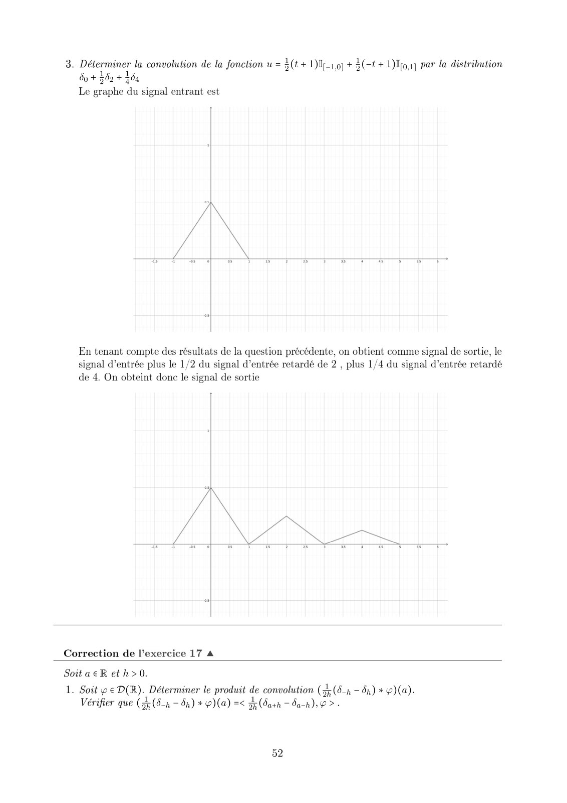

**Lecture OCR à contrôler**

~~~text
3. Déterminer la convolution de la fonction u = 5(t + 1)I107 + 3(-4+ Ilo par la distribution
do + 362 + 404
Le graphe du signal entrant est

En tenant compte des résultats de la question précédente, on obtient comme signal de sortie, le
signal d’entrée plus le 1/2 du signal d'entrée retardé de 2 , plus 1/4 du signal d'entrée retardé
de 4. On obteint donc le signal de sortie

Correction de l’exercice 17 A

SoitaeReth>0.
1. Soit y € D(R). Déterminer le produit de convolution (3,(6-n —ôn) + )(a).
Vérifier que (35 (6-n — ôn) * p)(a) =< 3% (Oarh ~ 5a-n)s 9 > -

52
~~~

## Page 31

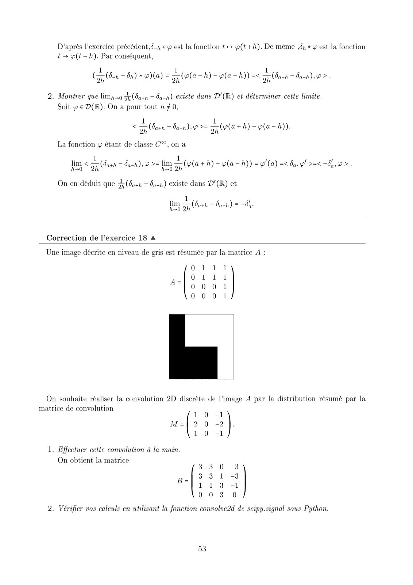

**Lecture OCR à contrôler**

~~~text
D'après l'exercice précédent, 5y # ¢ est la fonction t + g(t+h). De même ,6, +4 est la fonction
tr y(t-h). Par conséquent,

1 5 1 : re =
Gr Gn = bn) * p)(a) = SF (PCa + h) — (a h)) =< 5 (ath — Ban} 6 > -
2. Montrer que limp+o 3; (Ja+h — 5a-n) existe dans D'(R) et déterminer cette limite.
Soit ¢ e D(R). On a pour tout h #0,
1 . 1
< 5p Gah = Sah), 9 >= (a+ h)- (a hy).

La fonction étant de classe C'®, on a

: En de _ L DAS ol sce —s! oo
lim < 55 (Sash — dan), 9 >= lim ZE (o(a +h) - (a h)) = pa) =< ba, >=< -5y, 9 >

On en déduit que g-(bnsn~da-n) existe dans D'(R) et

1

lim —(da+n — 8a-h) =
Tim 55, (Sa+h — Sa-h)

Correction de l’exercice 18 A

Une image décrite en niveau de gris est résumée par la matrice A :

O0 1 1 1
0 1 1 1
a= 0001
0 0 0 1

On souhaite réaliser la convolution 2D discrète de l’image A par la distribution résumé par la
matrice de convolution
1 0 -1
M = | 2 0 -2 |
A: Q: eck

1. Effectuer cette convolution à la main.

On obtient la matrice

3 3 0 -3
3 3 1 -8
B=lius
0 0 3 0

ipy.signal sous Python.
~~~

## Page 32

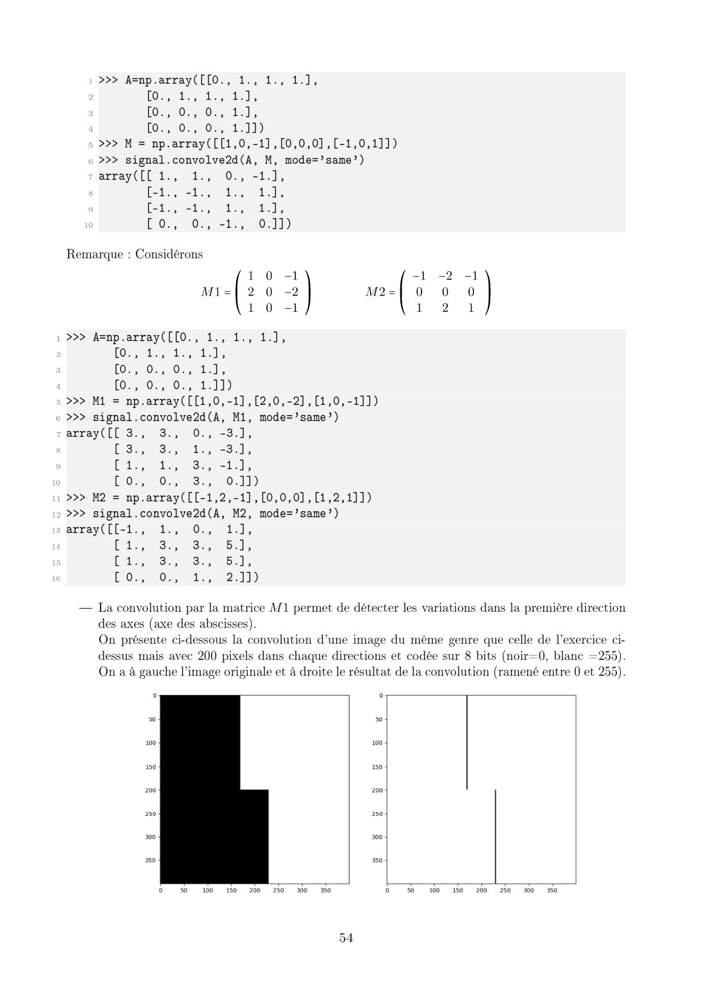

**Lecture OCR à contrôler**

~~~text
>>> A=np.array([[0., 1., 1., 1.],
COM A,
(Rls Wes Way 117
fo., 0., 0., 2.11)

>>> M = np.array([[1,0,-1],[0,0,0],[-1,0,1]])

>>> signal.convolve2d(A, M, mode=’same’)

array([[1., 1., 0., -1.],

RMI
> then dolls
5 hs 041)

Remarque : Considérons

1 0 -1 ahs 2) À
M1=| 2 0 -2 M2=1 0 0 0
1 0 -1 1 2 1

>>> A=np.array([[0., 1., 1., 1.1],

Wan tly lon Shelly

0., 0., 0., 1.1,

a5 Osy Way tet)

>>> Mi = np.array([[1,0,-1],[2,0,-2],[1,0,-1]])
>>> signal.convolve2d(A, M1, mode=’same’)
array([[ 3., 3., 0., -3.],

3.3, 1. 31,

thes then Blog, 11,

Ox, Wy Sey 0 1)

>>> M2 = np.array([[-1,2,-1],[0,0,0],[1,2,1]])
>>> signal.convolve2d(A, M2, mode=’same’)

array([f=1-, 125002, 11
thes Shy Shap, Bally
1., 3., 3., 5.],
a5 Won Shen Pili)

les variations dans la premiére direction

— La convolution par la matrice M1 permet de détec!
des axes (axe des abscisses).

On présente ci-dessous la convolution d’une image du même genre que celle de l’exercice
00 pixels dans chaque dir
inale et à droite le résultat de la convolution (ramené entre 0 et

tions et codée sur 8 bits (noir=0, blanc

dessus mais
On aa gauche l'image or
~~~

## Page 33

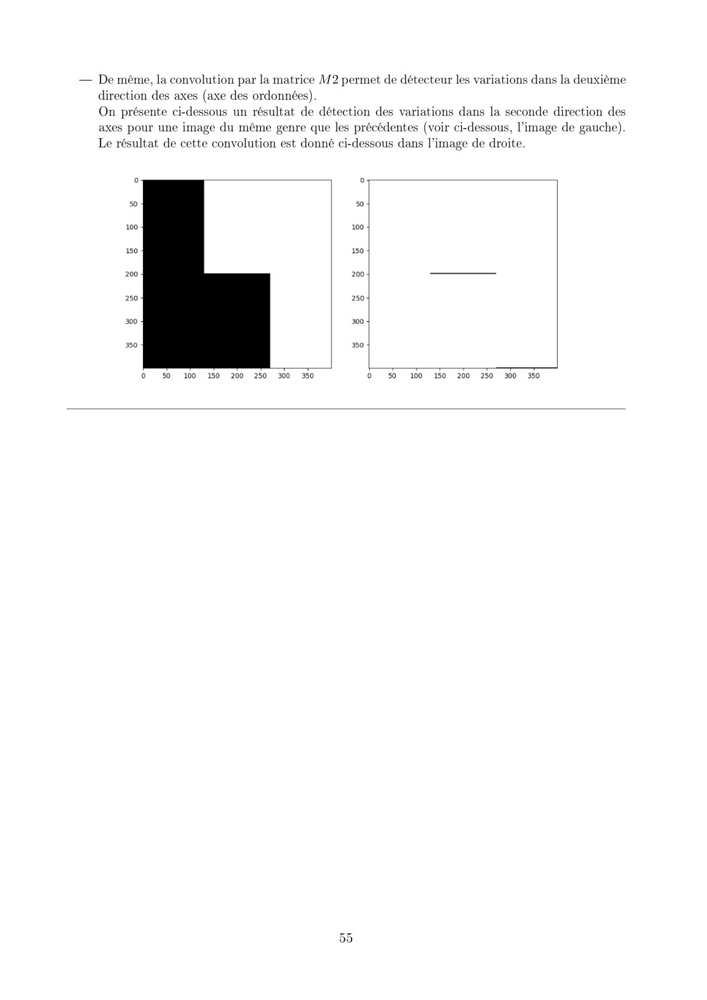

**Lecture OCR à contrôler**

~~~text
— De même, la convolution par la matrice M2 permet de détecteur les variations dans la deuxième
direction des axes (axe des ordonnées).
On présente
axes pour une image du même genre que les précédentes (voir ci-dessous, l’image de gauche).
Le résultat de cette convolution est donné ci-dessous dans l’image de droite.

i-dessous un résultat de détection des variations dans la seconde direction des

100

150

200

250

300

350 0 50 100 150 200 250 300 350
~~~

## Page 34

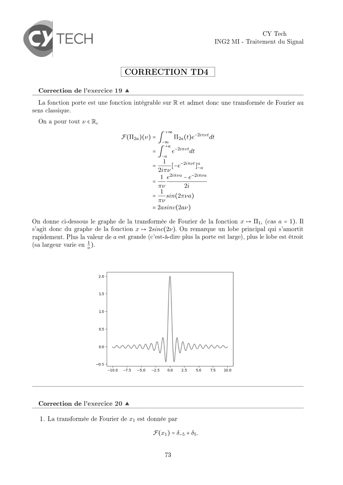

**Lecture OCR à contrôler**

~~~text
CY Tech
TECH ING2 MI - Traitement ai Signal

CORRECTION TD4

Correction de l’exercice 19 A

La fonction porte est une fonction intégrable sur R et admet donc une transformée de Fourier au
sens classique.

On a pour tout 7 eR,

+00 :
[ Tlag(t)e-2""™”*at
00

a
= Î PLAT
-a

1

inv
@ “3
1 etitva _ ¢-2inva

pre mette,

Ty 2i
4
= —sin(2
= sin(2rva)
= 2asinc(2av)

On donne ci-dessous le graphe de la transformée de Fourier de la fonction « + Il, (cas a = 1). Il
s’agit donc du graphe de la fonction x + 2sinc(2v). On remarque un lobe principal qui s’amortit
rapidement. Plus la valeur de a est grande (c’est-à-dire plus la porte est large), plus le lobe est étroit
(sa largeur varie en D.

2.0

Os

00

05

10.0 -75 -50 -25 00 25 50 75 100

Correction de l’exercice 20 A

1. La transformée de Fourier de x1 est donnée par

Fa) = 6-5 + 55.

73
~~~

## Page 35

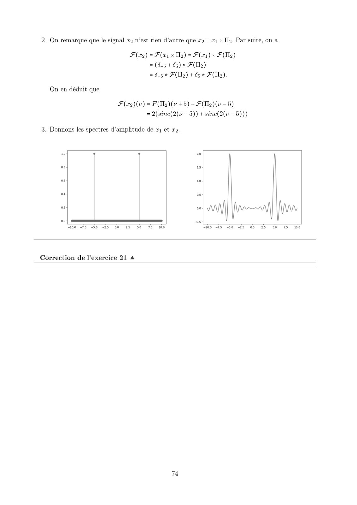

**Lecture OCR à contrôler**

~~~text
2. On remarque que le signal x2 n’est rien d’autre que x2 = x x Hp. Par suite, on a

F (x2) = Fi x My) = F(x1) * F(T)
= (6-5 +65) * F(a)
= 6-5 * F(Il2) + 65 + F(I).

On en déduit que

F(a2)(v) = F()(v + 5) + F(T2)(v - 5)
= 2(sine(2(v + 5)) + sine(2(v -5)))

3. Donnons les spectres d’amplitude de x et x9.

10 20
os 15
o6 10
o4 os
02 oo
00 os

“bo 3s 30 23 co 23 50 75 10 “bo 3s 30 2

oo

Correction de l’exercice 21 4

74
~~~

## Page 36

~~~text
https://sti2d.ecolelamache.org/
ii_exemple_et_calculs_pour_un_filtre_passebas_1er_ordre.html
~~~

## Page 37

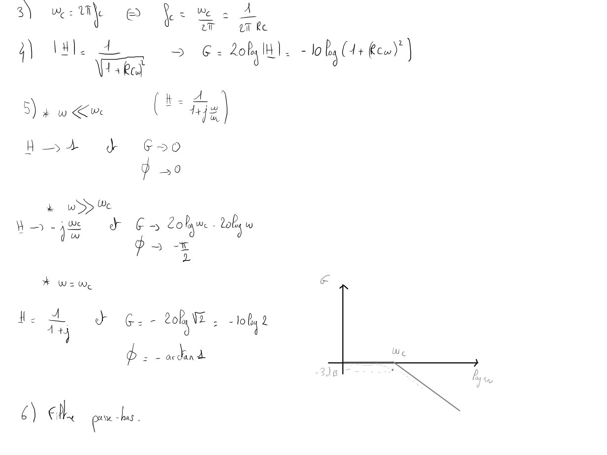

**Lecture OCR à contrôler**

~~~text
ci we = UT ee) z Mr A
\ fé \ € \ Se im be

3) Vale 4 > 6-2. - lo by (4+ kew*)

a t- 4
5 y w Eu (+ ize)
H»4 J G50
4 wp He
ho; JF € Zolym. Lol w
. 4 -t
pe
A We We
do 4} GL- LE , toby
ba - atin
~~~

## Page 38

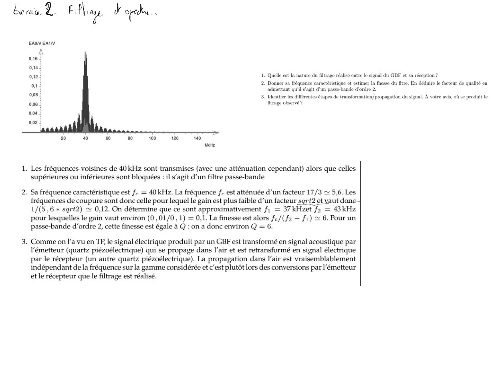

**Lecture OCR à contrôler**

~~~text
race 2. Fa J oped,

EAOV EAIV

1. Quelle est la nature du filtrage réalisé entre le signal du GBF et sa réception ?
2. Donner sa fré istique et estimer la fnesse du fitre. En déduire le facteur de qualité en
admettant q se-bande d'ordre 2.

Identfer es diférentes étapes de transformation/propagation du signal. À votre avis, où se produit le
ftrage obeervé?

1. Les fréquences voisines de 40 kHz sont transmises (avec une atténuation cependant) alors que celles
supérieures ou inférieures sont bloquées : il s’agit d’un filtre passe-bande

[sd

Sa fréquence caractéristique est fe = 40 kHz. La fréquence f- est atténuée d’un facteur 17/3 = 5,6. Les
fréquences de coupure sont donc celle pour lequel le gain est plus faible d’un facteur sqrt2 et vaut donc-|
1/(5,6 * sqrt2) ~ 0,12. On détermine que ce sont approximativement f1 = 37kHzet f2 = 43kHz
pour lesquelles le gain vaut environ (0,01/0, 1) = 0,1. La finesse est alors fe/(f2 — fr) ~ 6. Pour un
passe-bande d’ordre 2, cette finesse est égale à Q : on a donc environ Q = 6.

oe

Comme on l’a vu en TP, le signal électrique produit par un GBF est transformé en signal acoustique par
l'émetteur (quartz piézoélectrique) qui se propage dans l'air et est retransformé en signal électrique
par le récepteur (un autre quartz piézoélectrique). La propagation dans lair est vraisemblablement
indépendant de la fréquence sur la gamme considérée et c'est plutôt lors des conversions par l'émetteur
et le récepteur que le filtrage est réali
~~~

## Page 39

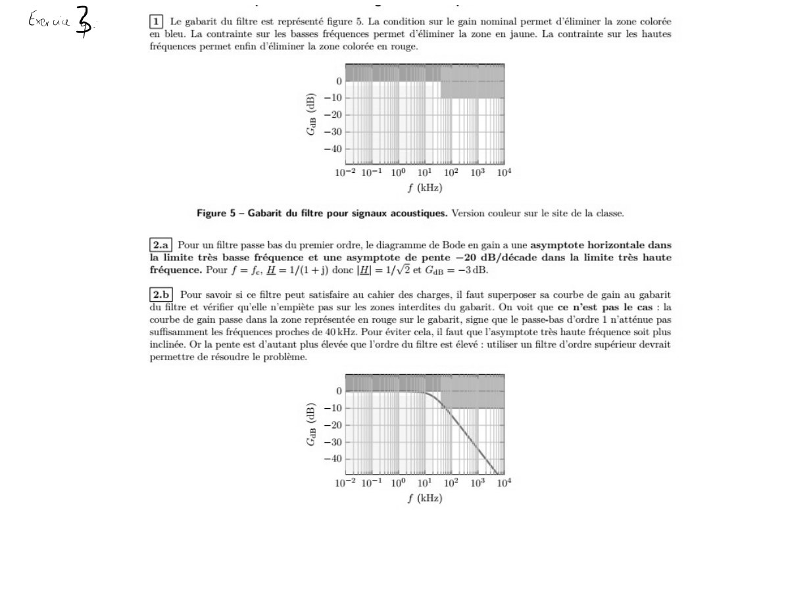

**Lecture OCR à contrôler**

~~~text
bave &

1] Le gabarit du filtre est représenté figure 5. La condition sur le gain nominal permet d'éliminer la zone colorée
en bleu. La contrainte sur les basses fréquences permet d'éliminer la zone en jaune. La contrainte sur les hautes
fréquences permet enfin d’éliminer la zone colorée en rouge.

Gas (dB)

10-2 10-1 109 10! 102
F (Hz)

Figure 5 — Gabarit du filtre pour signaux acoustiques. Version couleur sur le site de la classe.
Pour un filtre passe bas du premier ordre, le diagramme de Bode en gain a une asymptote horizontale dans

la limite très basse fréquence et une asymptote de pente —20 dB/décade dans la limite très haute
fréquence. Pour f = fc, H = 1/(1+ j) donc |A] = 1/V3 et Gan = -3dB.

Pour savoir si ce filtre peut satisfaire au cahier des charges, il faut superposer sa courbe de gain au gabarit
du filtre et vérifier qu'elle n'empiète pas sur les zones interdites du gabarit. On voit que ce n’est pas le cas : la
courbe de gain passe dans la zone représentée en rouge sur le gabarit, signe que le passe-bas d'ordre 1 n’atténue pas
suffisamment les fréquences proches de 40 kHz. Pour éviter cela, il faut que l'asymptote très haute fréquence soit plus
inclinée. Or la pente est d'autant plus élevée que l’ordre du filtre est élevé : utiliser un filtre d'ordre supérieur devrait
permettre de résoudre le problème.

Gap (AB)

1072 1071 10° 10 102 10* “108
ro)
~~~

## Page 40

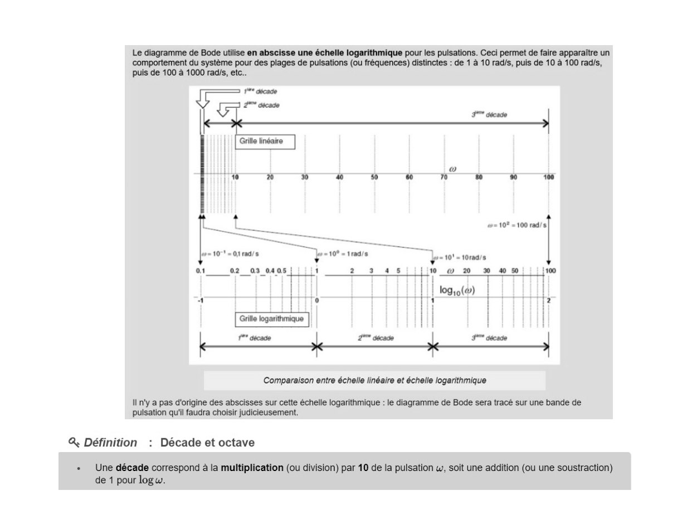

**Lecture OCR à contrôler**

~~~text
Le diagramme de Bode utilise en abscisse une échelle logarithmique pour les pulsations. Ceci permet de faire apparaître un

comportement du système pour des plages de pulsations (ou fréquences) distinctes : de 1 à 10 rad/s, puis de 10 à 100 rad/s,
puis de 100 à 1000 rad/s, etc...
1° décade
F 2" atcade
47 decade
Grille linéaire
o
16 L] % 4 # 6 7% 6 6 100
4

v= 10 =100 rad/s
v= 10-¥ = 09 rad/s Yp=10'- soins
01____o2_as3 0405] | iii 2 3 4s) iii © 2% > «| | {10
1 TH T 1
| | |
| |! |'logio(æ) | |
i tt tH pe
Grille logarithmique [|| | |
fe" decade 2 décade

Comparaison entre échelle linéaire et échelle logarithmique

Il n'y a pas d'origine des abscisses sur cette échelle logarithmique : le diagramme de Bode sera tracé sur une bande de
pulsation qu'il faudra choisir judicieusement.

® Définition: Décade et octave

+ Une décade correspond à la multiplication (ou division) par 10 de la pulsation w, soit une addition (ou une soustraction)
de 1 pour logw.
~~~
