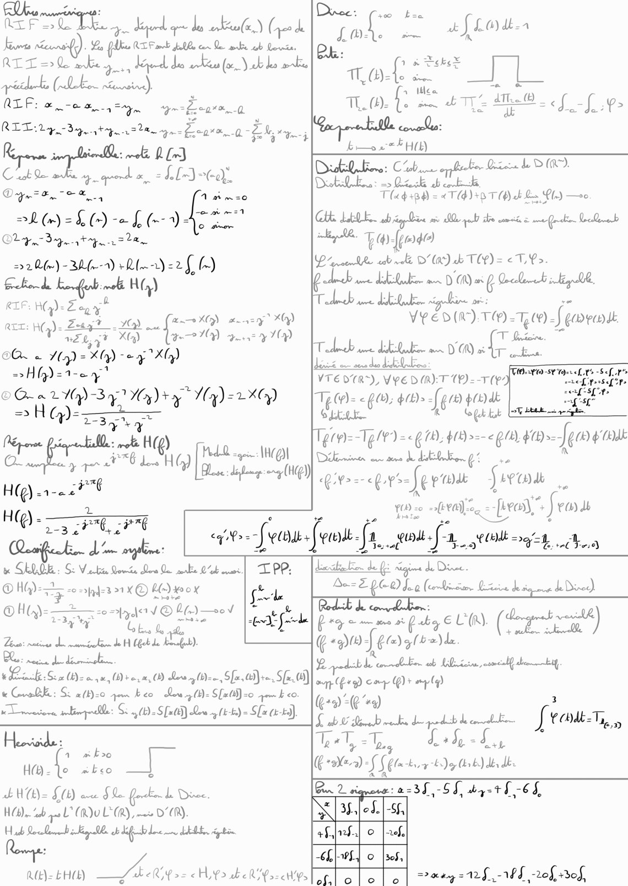
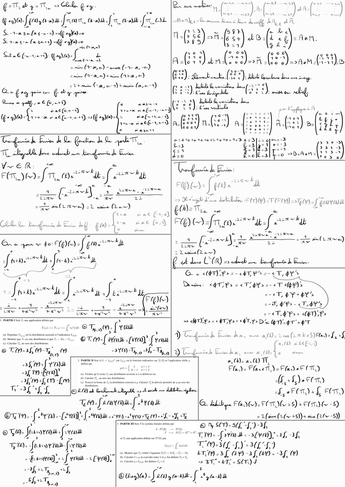

# Fiche Traitement.pdf

[Ouvrir l’original](https://drive.google.com/open?id=1xB6A_eKHvYI-wdgE14hxASsr_-LmI0bm) · Les pages signalées comprennent du texte reconnu automatiquement ou des éléments graphiques. Le fac-similé permet de vérifier chaque lecture.

**Pages avec fac-similé ou lecture OCR** — 1–2.

## Page 1

**Lecture OCR à contrôler**

~~~text
er ÊTE, on degerd ge de ko, (pee de
ko ne rt Abe Re mb ab ore
RTT- bey, a aka (oc, ab bes arbi

spark (ke caine

ALP: &-o 4 Hay, ar

RID gets ge Lente 0 Eu
4 À sel R Lr}

Cabos pe geet a= LE (co).

Dy,-E. sex A mmzo
Ph (m2 f)-e L(A BO
Or Sq. pe te
sale) - BU fea) lea =2 fn)
Getonds kenflr melt HG)

RIF: AG): Zep y

= asy Xf)
RET: H Zu? LO) a (RAND wo MG
ais Eby? XQ) CES ID
OO. = Hy) = Xaq)- oy Xl)
2H)=1-e4"

= T

CG a LUA) -3 4 Wy) ty *A(y)=LXCy)
a5 G): TT TU

ye

Pepe Pi 10

(ARR EU TP (CIE

H(Q) 1-2 2"
tes

=qe HI

À

3776, #76
Le

« SALÈE CPR Ter IPP:

© Hÿ-- FF" e =afyf=3 21 © Ko x

OHG)=- 20=>fyAe1V © LG —s0¥
La Gs fae

Loner: nations de mumirctinn de H bck da het).

eon ay renee ra

Leck: Se 0 (t)- ae, Drea, de (tee, Sfa,ti}te, S(x A)

t Gre B: Si a(t)=0 qom beo Leu (M: S[eltl)=0 pur bo.
aber: Se (D. Sfx) Lowy (t-te) = Sa 02-9),

one Cro

HE - af

HUE £0) we Se L'oee.
HOB) “sb goo LORD LCR), i D'OR).

Ha Reco gp AR dif Le dal ig in

ee

RE)= EHCE)

1 bo
eo mbco

bee Hy fr becs

eq >= feu] er ff. wou fa. AUDE gt

BR
£ . af La

LO:
JIL

ae () _

. 1 à THE
TO à
a tea

Mb: fe ma T= me

CL J.-[v>

bb Hit)

Die: Clb de Baca BU
Doll te: 06h ob
T (a4 +84) = aan +8 T4) db Le PI.) —s0

CU LUE. ebay Que wis de pall be mms à eg Loeb
“ke. 7 54) {joa

Se er ee
peters OL anata

db ue LEE. à
YVREDIR 3 T- T9 Scorers

sv QE
es a nude UE.

VTE DR), V DMR): 1) - NES
Tec < ge, #1» [ge pe
SELLE.

pro Tg/P) =< G70 HD epr #9 [goo aut
Déni on ane dat 6

LP Gs foro

YO =

{tale - «etre fra

7 Ve à

debut de fi sigime de Dine
Dez Ep O Moa (bins fish -

db de
vend
Boca pig EU. tage )
k: nr) feral» sb.
Rob de fl ab Hit camel cheb

or + D cop (+ my Gq)

(22%) 3
ue MS TN UE [tue Ty
Lett, Leh-f :

Beg
Ce, 2) {er Lg ha (br Bd, “h
ere 2238-5 shyt f -6 4,
.|-S$
EUA

moy=128,-168 20f of,
~~~

## Page 2

**Lecture OCR à contrôler**

~~~text
Oa Th ge 2 COL. Gag. en

G-D0- fi PDA Jf TNT, Croll fo (db

Si -1-0 20 fmee-s) a og}ed=0
Same (x 2001) nf fe

EC]

eae!

13

ar) 2 Dame kines. de aff LA

Jt

ALAN ~ fe he

nGR)on PE) of Fe
Eu +

ne GO) a 5 ( ) A= A Vand SL) (? an Cie
= me (Vo) - px (-3- x, -&,
han Cie) GEJASRAE 42"): ee
224 min (Loc, 0-9) Yi (xse--1) ( He) kkba.@. on FEED
ng" gre Fey pe Fee Riga tale 31} mine on nl,
Be a pol» € (0;-+i) i : LEbe te Le

éaé(o.e-7) At ne
G-D0- tem À aËfu-r.e +1) =3(G+9)@)= = ce as
Wf d Eu de Qe Que de Qe ek.
Th ble dove ecb wee bougon de Goren
VER:
FER DR “in BAT dE ic Fo

CS

ere) = nn

ii CE: ees
aa re-t cea
(222)) n- ad:
cer) nano

a=oteteterortteto:1:3

ben

+

steep

coe

C00. Q. bag dE Le ge ae æ
Ex à yew to: (O63 fom ve

fr. he “TT ee be su

crie)
ace fo [FE fr. wc be

= Leome(Le~)
£ Abe (1) edhe boue be Genin,
G « <4T)P> =- 47 0% =-<T, dv
Denim: OT) Po = Th =-<T pP)s

= $Y + OES
à ae an (OO 2-H, b> - <T.b¥S
oe ree Feet ue

| 2e Td' Pre Ps
= TPs = OTs + AT. Ps De GILET ET

TPE So Ty ww op

OT, (0; {rou

orm [a io - (ere? fe taut
3f- Ta,

a) 27% Eu ba, one are (rb x5) Ftadel, +f
afk) à LE

TM: EUR
© T(P-3$, () En

318) Tey 6,9 | D) Legende Eu dew, ou (Hao oem
‘oS Da. a) TT,
£a fra “
ap fo) Flad= Flare.) = Flas) E CT)

23h 4f OO) RE)

ed

Ono. f: *ea)--[240)'s f: MEUBLE 290) 2565) 10 =
eT,®- Jus Fay fou
TQ): Jen. fee ‘jt

ET OR sof vaut pe)

th

= nT

: Sf, at on

AS, 6,) «FOr

2f,4F Om) £ FT)
(x Else FRIC FT Me +8) + FRIC - 5)

= (owe (2 (a +5)) + aime (2--5))

CRUE RE
"Th 10)2 TT EE TE) ETAT
TOUL SL) 3)
LTD -3f AP) -3f UY) --3f (+)
= 3T+kT = S(T) J

ated s
O3) DIET ya

OLB ak Coen EUR ay Lah me ARE gi
LUS Jéavou.f: Ayan dk
~~~

## Page 3

*Page blanche.*
