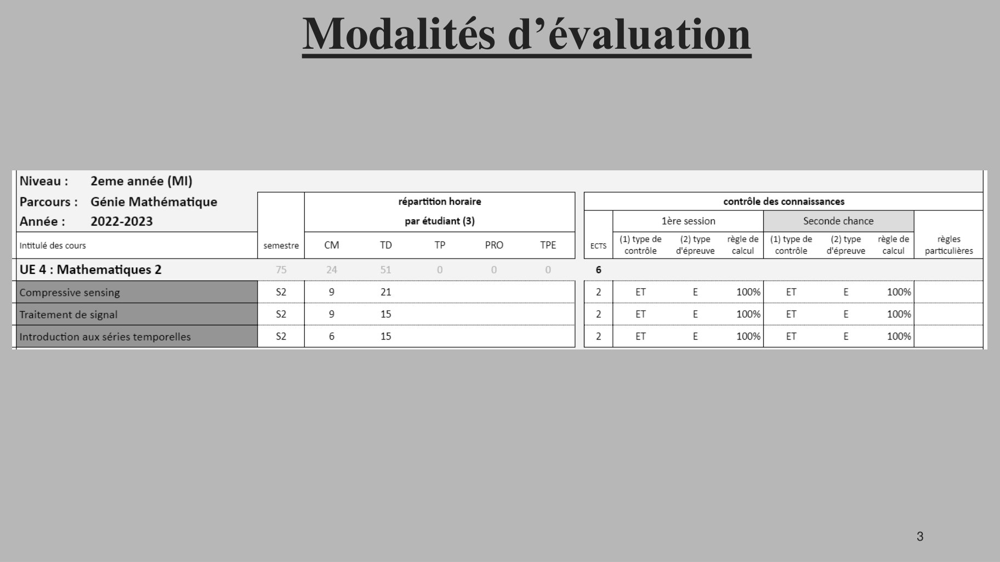
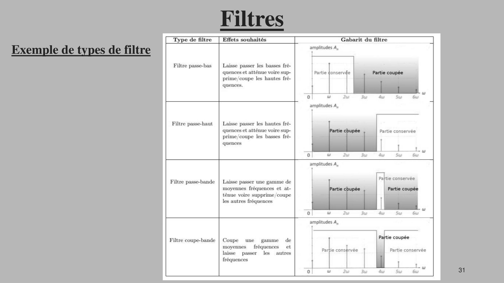

# Intro_Traitement_du_signal_PRES.pdf

[Ouvrir l’original](https://drive.google.com/open?id=1xiB3qqrv0sYxka0cQgZQiKFlCAvlt_bO) · Les pages signalées comprennent du texte reconnu automatiquement ou des éléments graphiques. Le fac-similé permet de vérifier chaque lecture.

**Pages avec fac-similé ou lecture OCR** — 3, 31.

## Page 1

~~~text
  Traitement du signal

            ING2 2021/2022
Nelly Barrau : nbu@cy-tech.fr, bureau E203
                                             1
Lucie Desplat: ld@cy-tech.fr, bureau E207
~~~

## Page 2

~~~text
      Objectifs à atteindre à la fin de ce module

• Mobiliser des concepts des sciences fondamentales afin de résoudre des
  problèmes spécifiques aux sciences et techniques de l’ingénieur.

• Mobiliser les outils mathématiques nécessaires à la résolution de problèmes
  complexes et notamment lors de la modélisation.

• Mettre en œuvre des techniques d’algorithmique et de programmation
  (Python) et utiliser les outils numériques spécifiques aux sciences et
  techniques de l’ingénieur.

                                                                         2
~~~

## Page 3

~~~text
Modalités d’évaluation

                         3
~~~

**Lecture OCR à contrôler**

~~~text
Niveau: 2eme année (MI)

Parcours : Génie Mathématique contrôle des connaissances

(i)typede (2itype règlede| (1)typede (2itype règlede règles
contrôle  d'épreuve calcul | contrôle  d'épreuve calcul | particulières
~~~

## Page 4

~~~text
                 Modalités d’évaluation

1ère session :
  • 1 note de Projet (mini-soutenance + rapport) comptant pour 50%
    (semaine du 04/04)
  • 1 examen écrit de 2h comptant chacun pour 50% (semaine du
    11/04)

2ème session :
  • 1 rattrapage de 2h (100%)

                                                              4
~~~

## Page 5

~~~text
                       Modalités d’évaluation
                   Concernant le projet (mini-soutenance + rapport)
• Groupe de 2 à 5 étudiants
• Thématique: détection de contours & critères de performance
• Durée de la soutenance : ~ 5 min par personne (à titre indicatif) .
• Rapport rédigé façon cahier des charges (+ fichiers codes à fournir)

                                      Dates limites :
 •   Avant les vacances de février, les groupes doivent être formés;
 •   Au retour des vacances : communication de la thématique choisie par groupe;
 •   Rendu de rapport (cahier des charges + codes) : Dimanche 03/04/2022 avant 17h
 •   Soutenance (+présentation/démo des codes) : durant la dernière séance de TD
     (semaine du 4 avril)
                                                                                     5
~~~

## Page 6

~~~text
     Programme Traitement du signal

  • Partie 1 : Introduction
  • Partie 2 : Généralités autour du signal et de son traitement
  • Partie 3 : Filtres
  • Partie 4 : Traitement de l’image
  • Partie 5 : Outils mathématiques, Analyse et modélisation
  • Partie 6 : Application: projet

L’ensemble des supports de cours (documents, présentations, TD/TP,..) est
disponible sur Teams

                                                                            6
~~~

## Page 7

~~~text
             Traitement du signal

• Partie 1 : Introduction
• Partie 2 : Généralités autour du signal et de son traitement
• Partie 3 : Filtres
• Partie 4 : Traitement de l’image

                                                                 7
~~~

## Page 8

~~~text
                                Introduction
•   Le traitement du signal :science incontournable de nos jours.
•   Toutes applications de mesures, de traitement d’information mettent en œuvre des
    techniques de traitement sur le signal pour extraire l’information désirée.

                                             Télé-communication

Informatique

                                         Bio-mécanique            Musique, Acoustique
                Imagerie médicale                                              8
~~~

## Page 9

~~~text
                                                                     Introduction
Un bref aperçu de l’historique du traitement de l’image

 •       1839 : photographie (Louis Jacques Mandé Daguerre)
 •       1885 : Rayon X (Röntgen)
 •       1895 : cinématographe (frères Lumière)

                                                                              Premier cliché radiographique (Röntgen,195).   9
     Boulevard du Temple, Paris (1838). Un des tout premiers daguerréotypes
~~~

## Page 10

~~~text
                                   Introduction
Un bref aperçu de l’historique du traitement de l’image

•   Années 1920 : transmission d'images par câble sous-marin de New York à Londres.
    Harry G. Bartholomew et Maynard D. McFarlane effectuent la première numérisation
    d'image avec compression de données pour envoyer des fax.

•   Années 60 : conquête de l’espace et diffusion d’images

•   fin des années 60, début des années 70 : imagerie médicale (tomographie)

•   Depuis les années 70 : augmentation constante de l’utilisation des images géographie,
    biologie, médecine, nucléaire, internet, télévision, satellite, microscopie, ...

                                                                                   10
~~~

## Page 11

~~~text
            Traitement du signal

• Partie 1 : Introduction
• Partie 2 : Généralités autour du signal et de son traitement
• Partie 3 : Filtres
• Partie 4 : Traitement de l’image

                                                                 11
~~~

## Page 12

~~~text
Généralités autour du signal et de son traitement
Qu’est ce qu’un signal ?
Un signal est la représentation physique de l'information qu'il transporte de sa
source à son destinataire. Il sert de vecteur à une information. Il constitue la manifestation
physique d'une grandeur mesurable .
Par exemple: signal sismique, mesure du pouls, déplacement, intensité, etc...
 Signal audio : mesure avec un microphone.      Signal électrique : mesure de la tension ou de
 Prise de son – concert de Jazz                 l’intensité (oscilloscope, voltmètre, ...)

                                                                                       12
~~~

## Page 13

~~~text
Généralités autour du signal et de son traitement
Le bruit
Le bruit est défini comme tout phénomène perturbateur gênant la perception ou
l'interprétation d'un signal, par analogie avec les nuisances acoustiques (interférence, bruit de
fond, etc.).

                                                                                                      OEM: Onde
                                                                                                      électromagnétique

                          https://wikitge-cmaisonneuve.profweb.ca/index.php?title=Fichier:SNR_2.png

Note : La différentiation entre le signal et le bruit est artificielle et dépend de l'utilisateur. Exp: les OEM
d'origine galactique sont du bruit pour un ingénieur-télécom et un signal pour les radioastronomes.               13
~~~

## Page 14

~~~text
Généralités autour du signal et de son traitement
Le traitement du signal
• La théorie du signal a pour objectif fondamental la "description mathématique" des signaux. Mise en
  évidence des caractéristiques (distribution fréquentielle, énergie, etc.) et analyse les modifications
  subies lors de la transmission ou du traitement de ces signaux.

• Le traitement du signal a pour objet l'élaboration ou l'interprétation des signaux. L'objectif est de
  proposer une palette d'outils (mathématiques) performants, permettant de détecter, mesurer, contrôler,
  comparer et évaluer l'intégrité structurelle d'un signal (son, image, info, etc).

• Le traitement de l'information fournit un ensemble de concepts permettant d'évaluer les
  performances des systèmes de transfert d'informations, en particulier lorsque le signal porteur de
  message est "bruité". Cela inclut les méthodes de "codage de l'information" ( correction des erreurs,
  confidentialité )

• L'ensemble des concepts/méthodes développés dans le traitement de l'information et du signal forme
  la théorie de la communication.
                                                                                                14
~~~

## Page 15

~~~text
Généralités autour du signal et de son traitement
 Le traitement du signal
Les fonctions du traitement du signal se divisent en deux catégories : l'élaboration des
signaux (incorporation des informations) et l'interprétation des signaux (extraction des informations).

• Élaboration
o Synthèse : création de signaux de forme appropriée (Exp : par combinaison de signaux élémentaires)
o Modulation : adaptation d’un signal aux caractéristiques fréquentielles d'une voie de transmission
o Codage : traduction en code binaire (quantification), etc.

• Interprétation
o Filtrage : élimination de certaines composantes indésirables
o Détection : extraction du signal d'un bruit de fond (corrélation)
o Identification : classement d'un signal dans des catégories préalablement définies
o Analyse : isolement des composantes essentielles/utiles d'un signal (transformée de Fourier)
o Mesure : estimation d'une grandeur caractéristique d'un signal (valeur moyenne, etc.)

                                                                                                 15
~~~

## Page 16

~~~text
 Généralités autour du signal et de son traitement
 Le traitement du signal
Le traitement du signal s'applique à tous les signaux physiques : onde acoustique, onde EM, etc.).
Traitement d'images : extension du traitement du signal aux signaux bidimensionnels (images).
 Traitement d’images - Exemples:

           Image d’origine en
                                                                     Inversion noir/blanc
           noir et blanc

                                                                     Réduction
                      Contours
                                                                     du contraste
                                                                                            16
~~~

## Page 17

~~~text
Généralités autour du signal et de son traitement
Le traitement du signal

Différentes applications (liste non exhaustive) :
    •   Privilégier la perception de certaines structures de l’image
    •   Faire un agrandissement
    •   Inverser l’image de sens
    •   Extraire des informations fonctionnelles
    •   Visualiser plusieurs images en même temps
    •   Calcul de plan de coupe
    •   Addition, soustraction, recalage d’image
    •   Lissage, filtrage
    •   Accentuer les contours
    •   Superposition d’images d’origines différentes
    •   Reconstruire des coupes dans différents plans, autres que ceux qui ont été acquis au départ

                                                                                                 17
~~~

## Page 18

~~~text
Généralités autour du signal et de son traitement
Classification des signaux
Pour faciliter l'étude des signaux, différents modes de classification peuvent être envisagés

Par représentation
   Représentation temporelle des signaux            Représentation spectrale (fréquentielle)

                                                                                               18
~~~

## Page 19

~~~text
Généralités autour du signal et de son traitement
Classification des signaux
Par type de signaux
Signaux déterministes : dont l'évolution peut être décrite par un modèle mathématique. Ces
signaux proviennent de phénomènes dont les lois physiques et les conditions initiales sont
connues : prédiction du résultat.

      Exemple : le pendule simple (sans frottement)
     Pendule simple : fil sans masse de longueur L
     au bout duquel est attachée une masse m.

     Pour des petits angles θ, on a :

                             𝑔
                      𝜃ሷ +     𝜃=0
                             𝑙
                                                                                  19
~~~

## Page 20

~~~text
Généralités autour du signal et de son traitement
Classification des signaux
Par type de signaux

Les signaux aléatoires (probabilistes) : dont le comportement temporel est imprévisible et
pour la description desquels il faut se contenter d'observations statistiques.
                                    Exemple                                         Exemple de
                                                                                    bruit blanc
                                     • Un bruit blanc est un signal aléatoire qui   sonore…
                                       prend des valeurs au hasard à chaque t.
                                     • Les valeurs prises sont indépendantes
                                       les unes des autres.
                                     • Utilisé pour modéliser des perturbations
                                       dont on ne connaît que l’ordre de
                                       grandeur.
                                                                                      20
~~~

## Page 21

~~~text
Généralités autour du signal et de son traitement
Classification des signaux
Par caractéristique morphologique

• Le temps est un paramètre important de classification. Distinction à faire entre les signaux à
  temps continus (signaux continus) et les signaux à temps discrets (signaux discrets ou
  échantillonnés).

• Autre paramètre à prendre en compte : l'amplitude qui peut aussi être continue ou discrète
  (quantifiée).

                                                                                         21
~~~

## Page 22

~~~text
Généralités autour du signal et de son traitement
Classification des signaux
Par caractéristique morphologique

• Signal analogique : signal à amplitude et temps continus.

• Signal échantillonné : signal à amplitude continue et temps discret. Ce signal, obtenu à
  l'aide d'un échantillonneur bloqueur, est transmis à un circuit convertisseur analogique
  numérique (CAN) pour obtenir un signal numérique utilisable par un ordinateur.

• Signal quantifié : signal à amplitude discrète et temps continu. Il est fourni à la sortie
  d'un circuit convertisseur numérique analogique (CNA).

• Signal logique ou numérique : signal à amplitude discrète et temps discret. Ce dernier
  cas correspond à une suite de nombres codés en binaire.
                                                                                        22
~~~

## Page 23

~~~text
Généralités autour du signal et de son traitement
Classification des signaux
Par caractéristique morphologique

            Attention : choix de la
        fréquence d’échantillonnage
       doit respecter le th. de Shannon

                                                                 Chaîne de traitement numérique du signal

                                          CAN

         Signal analogique                                                    Signal quantifié
                                          Signal échantillonné

                                                                                                            23
~~~

## Page 24

~~~text
Généralités autour du signal et de son traitement
Classification des signaux
Par caractéristique morphologique
                                                                                            CAN

           http://christopheg.fr/physique-appliquee-et-technologie-en-imagerie-radiologique/94-construction-et-caracteristiques-de-l-image-numerique/83-3-caracteristiques-et-   24
           construction-de-l-image-numerique-l-echantillonnage
~~~

## Page 25

~~~text
Généralités autour du signal et de son traitement
Numérisation d’un signal

  • La numérisation d'un signal : consiste à faire passer un signal de la représentation
    domaine temps et amplitudes continus au domaine temps et amplitudes discrets. Pour
    ce faire, deux étapes principales : échantillonnage et quantification.

  • La restitution (ou l'interpolation) constitue le processus inverse qui intervient lors du
    passage du signal numérique au signal analogique : commande d'un actionneur.

  Ces trois étapes sont indissociables. Le signal doit conserver tout le contenu informatif
  initial. Cette condition, ajoutée à la notion de coût limite d'un système, est à la base de la
  numérisation des signaux et de l'étude du traitement numérique.

                                                                                           25
~~~

## Page 26

~~~text
             Traitement du signal

• Partie 1 : Introduction
• Partie 2 : Généralités autour du signal et de son traitement
• Partie 3 : Filtres
• Partie 4 : Traitement de l’image

                                                                 26
~~~

## Page 27

~~~text
                                                        Filtres
 Analyse spectrale : spectre de Fourier
 Série de Fourier et spectre d'un signal périodique

Spectre : représentation graphique où les fréquences sont en abscisses et les amplitudes en ordonnées.
                                                                                                         f fondamentale

                                                           Représentation temporelle               Représentation spectrale
              Th. de Fourier :                                                                         (fréquentielle)
                                                                                                           harmoniques

Un signal périodique (u, fonction du
temps à valeurs réelles) peut s'écrire
comme une somme de sinusoïdes dont
les fréquences sont multiples de la
fréquence fondamentale.

                                                                                                                     27
~~~

## Page 28

~~~text
                                         Filtres
Analyse spectrale : spectre de Fourier

   Note :

   • Pour les signaux périodiques, la décomposition en Série de Fourier est le lien
     entre représentation temporelle d'un signal et représentation fréquentielle.

   • Pour les signaux non périodiques, il s'agit de la Transformée de Fourier.

                                                                                      28
~~~

## Page 29

~~~text
                                                     Filtres
Analyse spectrale : spectre de Fourier
Série de Fourier et spectre d'un signal périodique

    Rappels : pour un signal périodique
    • T : période temporelle (s)
    • f : fréquence (Hz ou 𝑠 −1 )
                         1
                     𝑓=                                   T
                         𝑇

                                                               29
~~~

## Page 30

~~~text
                                               Filtres
Principe du filtrage

                Signal d’entrée : excitation   Système               Signal de sortie: réponse

• Filtre (linéaire) : cas particulier de système linéaire et invariant dans le temps.

Un filtre adapté permet de sélectionner les composantes du spectre qui nous intéressent et ce
quelque soit la nature du signal (électrique, sonore, lumineux,…). Par exemple pour le son :
• Supprimer un bruit haute fréquence (grésillement).
• Supprimer les fréquences élevées d’un enregistrement audio peu audibles (compression mp3).
• Sélectionner une station de radio en sélectionnant une plage de fréquence précise.

                                                                                                 30
~~~

## Page 31

~~~text
                             Filtres
Exemple de types de filtre

                                       31
~~~

**Lecture OCR à contrôler**

~~~text
Filtre passe-bas | Laisse passer les basses fré-
quences et atténue voire sup- Partie ¢onservde
prime/coupe les hautes fré-
quences.
Filtre passe-haut | Laisse passer les hautes fré-
quences et atténue voire sup- tie ée Partie conservée
prime/coupe les basses fré-
quences

Filtre passe-bande | Laisse passer une gamme de
moyennes fréquences et at-
ténue voire supprime /coupe
les autres fréquences
Filtre coupe-bande ;
; Partie cons¢rvée Partie conservée
fréquences
~~~

## Page 32

~~~text
                                              Filtres
Types de filtre : exemples                                               Filtres sur une image :

              Filtres sur un son ( à écouter!):
  https://www.youtube.com/watch?v=4DGJGX6Am2Q

                Filtres sur la lumière :

                                                        Rmq: vous verrez qu’il existe de nombreux types de filtre..

                                                                                                           32
~~~

## Page 33

~~~text
                                               Filtres
Types de filtre : exemples

  Le filtrage sur une image numérique permet de :
  • réduire le bruit dans une image (filtre passe-bas),
  • d'accentuer les détails (filtre passe-haut),
  • de détecter les contours des objets (filtre dérivateur), etc..

                                                                     33
~~~

## Page 34

~~~text
                       Traitement du signal

     • Partie 1 : Introduction
     • Partie 2 : Généralités autour du signal et de son traitement
     • Partie 3 : Filtres
     • Partie 4 : Traitement de l’image

Focus sur le traitement
de l’image puisque c’est
l’objet de votre projet.

                                                                      34
~~~

## Page 35

~~~text
                                         Traitement de l’image
Quelles sont les sources d’une image ?
   • Le spectre électromagnétique est la principale source d’énergie pour les images
   • Il en existe d’autres : acoustique, ...
   • OEM : signal contenant des quanta d’énergie : le photon

           Uploaded by D.Pellion                                                                                         35
           from https://www.researchgate.net/figure/Les-differents-domaines-du-spectre-electromagnetique_fig1_30514255
~~~

## Page 36

~~~text
                              Traitement de l’image
Quelles sont les sources d’une image ?
2 exemples

                     Rayons X
• Rayons pénétrant la matière « molle »
• Utilisations : en médecine (scanner, radiographie,        Le spectre du visible
  …), dans l’industrie, en astronomie, …
                                                       • Utilisations : Photos,…

                                                                                    36
~~~

## Page 37

~~~text
 Traitement de l’image

Défi du Traitement Numérique des Images :
     Analyser le contenu des données

                                            37
~~~

## Page 38

~~~text
                            Traitement de l’image
Qu’est-ce qu’une image ?

• Une image analogique est liée à un support matériel (plaque photo, pigments de peinture et
  toile,..). Impossible de reproduire l'image originale à l'identique. Les copies sont dégradées.

• Une image numérique est composée d’un ensemble fini d’éléments (valeurs entières), appelés
  picture element, ou pixels. Création d’une copie exacte de l'image d'origine possible.

                                   Image analogique ou numérique ?
                       •   image "web"
                       •   radiographie
                       •   sortie des appareils photos et camescopes numériques
                       •   image de TV numérique
                       •   photo argentique
                       •   diapositive
                       •   peinture
                       •   image d'un film d'animation
                                                                                         38
~~~

## Page 39

~~~text
                            Traitement de l’image
Qu’est-ce qu’une image ?

• Une image analogique est liée à un support matériel (plaque photo, pigments de peinture et
  toile,..). Impossible de reproduire l'image originale à l'identique. Les copies sont dégradées.

• Une image numérique est composée d’un ensemble fini d’éléments (valeurs entières), appelés
  picture element, ou pixels. Création d’une copie exacte de l'image d'origine possible.

                                   Image analogique ou numérique ?
                       •   image "web"
                       •   radiographie
    Image numérique    •   sortie des appareils photos et camescopes numériques
    Image analogique   •   image de TV numérique
                       •   photo argentique
                       •   diapositive
                       •   peinture
                       •   image d'un film d'animation
                                                                                         39
~~~

## Page 40

~~~text
                             Traitement de l’image
    Image numérique : représentation matricielle

         Image analogique => image numérique : numérisation en deux étapes :
         • échantillonnage spatial : discrétisation des coordonnées de l’image;
         • quantification des luminances : discrétisation des intensités de l’image.

                           Image numérique : représentation matricielle

•    La largeur de l’image est donnée par le nbre de colonnes M, sa hauteur par le nbre de lignes N;
•    k : un niveau de gris ;
•    m : le nombre de bits sur lesquels est codée la valeur d’un niveau de gris ;
•    Le pixel au croisement de la ligne i et de la colonne j est désigné par f (i, j)

                                                                                            40
~~~

## Page 41

~~~text
                         Traitement de l’image
Image numérique : représentation matricielle

     Image analogique => image numérique : numérisation en deux étapes :
     • échantillonnage spatial : discrétisation des coordonnées de l’image;
     • quantification des luminances : discrétisation des intensités de l’image.

   • L’échantillonnage spatial définit la taille du plus petit élément de l’image (pixel)
   • La quantification des luminances définit plus petit changement d’intensité dans
     l’image (est-il toujours perceptible à l’œil ?)

                                                                                        41
~~~

## Page 42

~~~text
                          Traitement de l’image
Image numérique : représentation matricielle
                     image binaire de Félix le Chat & matrice de taille 35×35

                                                                                               42
                   http://blog.kleinproject.org/wp-content/uploads/2012/04/sample-matrix.gif
~~~

## Page 43

~~~text
                        Traitement de l’image
Type d’image

  Après discrétisation des positions et des valeurs, l'image numérique est un tableau à
  deux dimensions contenant des valeurs entières pour les images en niveaux de gris
  (ou triplets de valeurs entières pour les images couleurs)

                                                                                     43
~~~

## Page 44

~~~text
                            Traitement de l’image
Type d’image

 • m = 1, k ∈ [0; 255] : image binaire;
 • m = 8, k ∈ [0;…; 255] : image en niveaux de gris. En général codée sur 1 octet ; par convention :
   noir = 0 et blanc = 255 (ou 1 si normalisation) ;

 •   m = 24, k ∈ [0;… ; 16777215] : image en couleurs (3 octets)

                                                                                                       44
~~~

## Page 45

~~~text
                          Traitement de l’image
Type d’image
Image couleur

     • Le codage de la couleur est réalisé sur 3 octets.
     • Un octet : valeur d'une composante couleur cad un
       entier de 0 à 255.
     • Ces trois valeurs codent généralement la couleur dans
       l'espace RVB.
     • Le nombre de couleurs différentes pouvant être ainsi
       représenté est de 256 × 256 × 256 possibilités, soit
       environ 16,7 millions de couleurs.

                                                               45
~~~

## Page 46

~~~text
                             Traitement de l’image
 Rappels autour du poids (informatique!)

    • Nb de niveaux de gris possibles = 2𝑁𝑏 𝑑𝑒 𝑏𝑖𝑡𝑠                        8 bits = 1 octet
    • 8 bits (=1 octet) : 256 niveaux de gris                              1024 octets = 1 Ko
    • 10 bits : 1024 niveaux de gris (scanner, IRM,…), …                   1024 Ko = 1Mo

• Le poids informatique d’un pixel: espace de stockage nécessaire pour coder chaque pixel de l’image;
• Un bit (Binary digIT) = Unité élémentaire d’information numérique (0 ou 1)
• Chaque pixel est codé sur plusieurs bits. Par exp : pixel codé sur 8 bits = 1 octet

                                    Calculer le poids d'une image:
    Nb de pix dans 1 axe de l'image x nb de pix de l'autre axe x nb d'octets pour coder chaque pixel ;

                                                                                                  46
~~~

## Page 47

~~~text
                      Traitement de l’image
Relations analogique/numérique

  La fidélité de l'image numérique par rapport à l'image analogique dépend de
  nombreux paramètres. Par exp:
  • la résolution,
  • la définition,
  • l'échantillonnage,
  • la qualité de stockage.

                                                                           47
~~~

## Page 48

~~~text
                               Traitement de l’image
Relations analogique/numérique

  Résolution : nbre de pixels par unité de longueur.
                                                            Définition : nombre fixe de pixels utilisé.
  Plus la résolution est élevée (plus le pas de
                                                            Plus la définition est grande, plus la précision
  discrétisation est faible), mieux les détails seront
                                                            des détails sera élevée.
  représentés.

                                                                                                Image 32× 32

  Image en pleine résolution      Image en 1/8 résolution      Image en pleine taille 256×256        48
~~~

## Page 49

~~~text
                          Traitement de l’image
Histogramme : un outil du traitement du signal
   Histogramme : fonction décrivant la répartition des niveaux de gris de l’image. Fournit
   des informations propres à l’image, telles que :
   • La distribution statistique des niveaux de gris
   • Les bornes de répartition des niveaux de gris
   • Mais aucune information spatiale !

                                                                                             49
~~~

## Page 50

~~~text
                        Traitement de l’image
Histogramme : un outil du traitement du signal

             Que pouvez vous dire des histogrammes de ces deux images ?

                                                                          50
~~~

## Page 51

~~~text
                                Traitement de l’image
 Binarisation d’une image par seuillage
• Exemple basique de traitement d’image.
• Seuillage : opération qui consiste à « binariser » une image (image binaire = en pixels soit noirs soit blancs).

• On remplace donc la valeur des pixels de l’image à « binariser » en fonction d’une valeur seuil notée
  θ, de la manière suivante :

       Exemple :

                                         Binarisation avec un seuil de θ = 125

                                                                                                            51
~~~

## Page 52

~~~text
                        Traitement de l’image
Et par la suite….

  • Outils mathématiques à définir pour le traitement du signal et plus particulièrement le
    traitement de signaux bi-dimensionnels (=images)

  • Introduction en séance de TD/TP sur le traitement des images numériques en Python.

  • Objectif du module : réaliser des opérations sur les images numériques pour extraire
    de l’information…par exemple, les contours pour le projet !

                                                                                       52
~~~

## Page 53

~~~text
                       Références et liens utiles

• Traitement numérique du signal - Maurice Bellanger – Sciences Sup – Dunod
• Théorie et Traitement du signal - 1. Représentation des signaux et des systèmes –
  Messaoud Benidir - Sciences Sup – Dunod
• Théorie et Traitement du signal - 2.Méthodes de base pour l’analyse et le traitement du
  signal –Messaoud Benidir - Sciences Sup – Dunod
• Mathématiques du signal - Dariush Ghorbanzadeh, Pierre Marry, Nelly Point, Denise
  Vial - Sciences Sup – Dunod
• http://hebergement.u-psud.fr/mkowalski/doc/L3_DLMP_Signal.pdf

                                                                                    53
~~~
