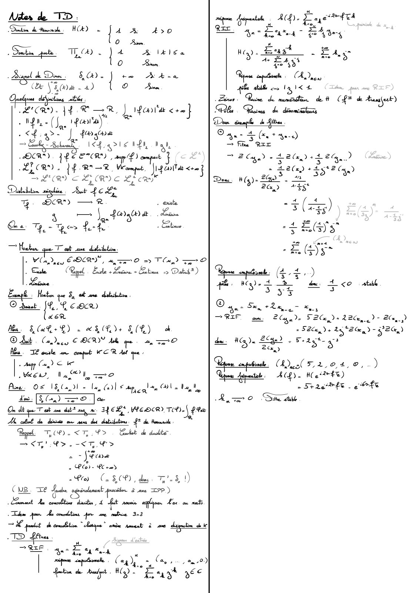

# Notes utiles.pdf

[Ouvrir l’original](https://drive.google.com/open?id=1xDncFaTgJKh4K9xfSmcefrVjOZDUU8k1) · Les pages signalées comprennent du texte reconnu automatiquement ou des éléments graphiques. Le fac-similé permet de vérifier chaque lecture.

**Pages avec fac-similé ou lecture OCR** — 2.

## Page 1

~~~text
    Introduction                                               :
                                                                                                                                                                                                                                             NB                   :
                                                                                                                                                                                                                                                                          Il
                                                                                                                                                                                                                                                                                            slogt d'une distribution FIT) (4)                 +a
                                                                                                                                                                                                                                                                                                                                                                                  .                                               =
                                                                                                                                                                                                                                                                                                                                                                                                                                          T
                                                                                                                                                                                                                                                                                                                                                                                                                                                     (F(4)
·
     On peut
                         representer
                                                   1
                                                       x(t)
                                                                    des
                                                                              signoux
                                                                                                            de deux
                                                                                                                                                 fagous                      :

                                                                                                                                                                                          Amplitude                                      Grosoubli                            .

                                                                                                                                                                                                                                                                                            Tf(4) =(4(Hf(t) dt dist-reg                                                               :                                       .           associe
                                                                                                                                                                                                                                                                                                                                                                                                                                                                 of
           Temperelle                                                                                                                                 Spectrale
                                                   u
                                      :                                                                                                                                               :

                                                                                                                                                                                                                                         Produit de convolution                                                                                              :

                                                                                                                                    t
                                                                                                                                                                                                                                        Definition                                                                                                          (fxg)(t)                                                  (((t-
                                                                                                                                -                                                                                               3

                                                                                                                                                                                                                                                                                            Ff g(2 (R)
                                                                                                                                                                                                                                                                                                                                     =
                                                                                                                                                                                                                                                                                                                                                                                                                                                                      x) de
                                                                                                                                                                                                                           fz
                                                                                                                                                                                                                                                                          :                          ,                                                  :                                                 =

Thereme
                    d'Echantillonage                            :    Un
                                                                                  rignal est bien chantillonne                                                                        si
                                                                                                                                                                                                   fe [fmax                                                                                                                                   E2=

                                                                                                                                                                                                                                                             Le
                                                                                                                                                                                                                                                                                   product de convolution est bilinaire commutatif et associatif                                                      ,
                                                                                                                                                                                                                                                                                                                                                                                                                                                                             .

Analyse de signaux periodiques                                                                                                                                       :
                                                                                                                                                                                                                                                             supp(fxg)  expp(f) supp(g)                                                   <                                                   +

In
·

               signal de periode                                    T     se
                                                                                           repete indefinement                                                       ou            cours           du
                                                                                                                                                                                                           temps .
                                                                                                                                                                                                                                                             (f g)) (f g)                    +                           =                        =

                >x(t)                     =        x(t + kT)                                        ,
                                                                                                            kEI                          .
                                                                                                                                                                                                                                         J est l'element mentre du produit                                                                                  de       convolution                  .

                                                                                                                                                                                     (et
    Il est
                    pseudo-periodique                                         si           son
                                                                                                                amplitude change                                 .
                                                                                                                                                                                                   operiodique simon                     Convolution discrete
                                                                                                                                                                                                                                                                                                             :=                                             rayk = producta                                                                                  *

·
     f 1  =
                         ;
                                 w        =   2+
                                                               f.                                                                                                                                                                        Exemple                  :

                                                                                                                                                                                                                                                                                                                                                                                                                                                                             louchy
                                                                          de Fourier                                                                                                                                                                     25 + 58                                                         483a                                                             2504
Decomposition                             en       serie                                                                :                                                                                                                x       =                                                               +                                           x            :

           x(t)          =
                                 a+                                                       ((impt) +                                                                              sim(dumfot)                                             y
                                                                                                                                                                                                                                                 =       48                        +
                                                                                                                                                                                                                                                                                             da              +
                                                                                                                                                                                                                                                                                                                         352a                               y
                                                                                                                                                                                                                                                                                                                                                                              :           4 13

                                 ·
               magenne       &

           Ove       :

                                                                                                                                                                                                                                        (Grosse analogie                                             ovec            les
                                                                                                                                                                                                                                                                                                                                     polynomes).                                          8           200                                 16

                                                                                                                                                                                                                                        Donc                          x                 *                                                                                                             2                   504
                                                                                                                                                                                                                                                                                            y
                                                                                                                                                                                                                                                         :                                                   =

                                                                                                                                                                                                                                         85 228  +                                      +
                                                                                                                                                                                                                                                                                                 1182a               +
                                                                                                                                                                                                                                                                                                                                 3183a                                                                                    615012

                                                                                                                                                                                                                                                                                                                                                                                      82211                                               31412
                                                                                                                                                                                                                                                 +
                                                                                                                                                                                                                                                             486a                  +
                                                                                                                                                                                                                                                                                             12852
    La voleur
                             moyenne
                                                               dune
                                                                               fonction of est                                                       (f)=1) (A)                                                  at                          Le produit de convolution s'etend                                                                                       aux
                                                                                                                                                                                                                                                                                                                                                                           f multivariable                                                       :

                                                                                                                                                                                                                                                                                                                                                      (+ )
                                                                                                                                                                                                                                                                                                                                                                 +

                                                                                                                                                                                                                                                                  (f b)(x y)            +
                                                                                                                                                                                                                                                                                                                             ,
                                                                                                                                                                                                                                                                                                                                              =

                                                                                                                                                                                                                                                                                                                                                                          f(x te y- t)k(tz t )dtat-

                                                                                                                                                                                                                                                                                                                                                                                                                  ,                                                      ,
                                                                                                                                                                                                                                                                                                                                                                                                                                                                              ,                ,

Outils
                             mathematiques                                                                           L

                                                                                                                    RR
                                                                                                                       temps espace
                                                                                                                            :
                                                                                                                                                         +                        .
                                                                                                                                                                                                                                         Sidem pour les
                                                                                                                                                                                                                                        Product de convolution
                                                                                                                                                                                                                                                                                                             signoux
                                                                                                                                                                                                                                                                                                                                          discrets) "
                                                                                                                                                                                                                                                                                                                                                            notice 3x3                                                    La theorie
    Un
               signal        est              une
                                                               fonctionf                                                            Un but est une
                                                                                                                                                                                                                         perturb -                                                                                               par
                                                                                                                                                                                                                                                                                                                                              une                                                                                                        :
                                                                                                                                                                             .

                                                                                                        :                                                                                                                                                                                                                                                                                                         :
·

·
     S est           un
                                  filtre                       sei                :

                                                                                      f est
                                                                                           SoTa=TaoS
                                                                                                   . (invariant par transe)                                                                                                              M
                                                                                                                                                                                                                                                 (Me· ms)m
                                                                                                                                                                                                                                                                                            as s
                                                                                                                                                                                                                                                                                                                         ,

                                                                                                                                                                                                                                                                                                                                          F(m)                                                                    ,&
                                                                                                                                                                                                                 fini
                                                                                                                                                                                                                                                                                                                                                                                                                                                                             am n
                                                                                                                                                                                                                                                                                  ...

                             est continu                                                                        continue                                                                               nombre               de
    Un
               signal                                                                                                                                 soufen                                                                                                                                                                                                                                                                               am 1
                                                                                                                                                                                                                                                                                                                                                                                                                                                                 . . .

                                                                                                                                                                                                                                                             3 1                                 ,
·                                                                    si                                                                                                               un                                                                      ,
                                                                                                                                                                                                                                                                                                                                                                                                                                             ,
                                                                                                                                                                                                                                                                                                                                                                                                                                                                                  ,

    points de                mesure                            melle
                                                                  .                                                                                                                                                                      Alrs        :
                                                                                                                                                                                                                                                                          (AxM),p                                                =
                                                                                                                                                                                                                                                                                                                                     La           somme          terme                    a           terme des                           coef de Are et M.
    Fanctions usuelles                                                                                                                                                                                                                                                                                                                        -
                                                                                                                                                                                                                                         Transforme                                                                                  de Laurier
                                               :

                                                                                                                                                                                                                                                                                                                                                                                              :

                f-de Heaviside                                                                                                  E
           ·
                                                                          :               H(A)                  =                            0                                   Sit =0
                                                                                                                                                                                                                                                                                                                                                                     +*

                                                                                                                                         1                                   Simon         .

                                                                                                                                                                                                                                         (Rappel F(f) =               .                                                                       (r)
                                                                                                                                                                                                                                                                                                                                                        =(                f(t) eirutot)
               f excomentielles consoles                                                                                                                                     *H(t)                                                               L
                                                                                                                                                                                                                                                             transforme de Fourier est tijective                                                                                                                  F (f) (t)
                                                                                                                                                                                                                                                                                                                                                                                                                                                         ) entrate
                                                                                                                                                                     *                                                                                                                                                                                                                                                        =
           ·
                                                                                                                :                   A1               ce                                                                                      ·
                                                                                                                                                                                                                                                                                                                                                                                                  ove         .                                      =

               frampe
                                                                                                                                                                                                                                        Filtrage
           ·                                               :
                                                                    t 1                         t H(t)          .

                                                                                                                                                                                                                                                                                                         :

                                                                                                                    Th(t)
                                                                                                                                                                 (1
               of parte                                             FatI                                                                                                                           Si        It a
                                                                                                                                                                                                                                                         (NB                                                                 e(t) l'entree et s(t) la sortie).
                                                       :
                                                                                                    ,
                                                                                                                                                                                                                                                                                        On note
           ·                                                                                                                                         =

                                                                                                                                                                                                                                                                              :                                      :

                                                                                                                                                                                 O                 Simon                                     La                                                                                                        est la                                             a                                                                   Dirac
                                                                                                                                                                                                                                                     reponse impulsionnelle g(t)
                                                                                                                                                                                                                                                                                                                                                                                                                                                                      de
                                                                                                                                                                                                             .                           .

                                                                                                                                                                                                                                                                                                                                                                              repones                                 une
                                                                                                                                                                                                                                                                                                                                                                                                                                  impulsion                                                .

Un
               signal est dit discret s'il   fini                                                           ne
                                                                                                                                         prend qu'un                                           nombre                    ou
                                                                                                                                                                                                                                         On          a        =
                                                                                                                                                                                                                                                                          s(t)                           =
                                                                                                                                                                                                                                                                                                                 e(t) +
                                                                                                                                                                                                                                                                                                                                                  g(t)       =

                                                                                                                                                                                                                                                                                                                                                                     ) e(x)y(t                                        -
                                                                                                                                                                                                                                                                                                                                                                                                                              x)dx

                                                                                                                                                                                                                                        Pour trovailler
denombrable de valeurs
                                  Cor (d(t)dt=                                                                                                                                                                                                                                               en
                                                                                                                                                                                                                                                                                                             frequential                              let non
                                                                                                                                                                                                                                                                                                                                                                          jos                     em
                                                                                                                                                                                                                                                                                                                                                                                                                  temporel)                          ,
                                                                                                                                                                                                                                                                                                                                                                                                                                                         on
                                                                                                                                                                                                                                                                                                                                                                                                                                                                      pose        :

    Impulsion de Disas Go=im Ttr (non-sens mathematique)                                                                                                                                                                                La
                                                                                                                                                                                                                                                 fanction de transfect                                                                            G(f)=                                                                                     Module
      ·

                                                                                                                                                                                                                                                                                                                                                                                                                                                                             goin
                                                                              :                                                              m   .
                                                                                                                                                                         .
                                                                                                                                                                                                                                    .
                                                                                                                                                                                                                                                                                                                                      .                                                                                               ·                           =

                                  =
·
  D(MM) fonctions 20    support I
                                  :

                                    Jerme forne)                                            a                                                comoact         ·
                                                                                                                                                                                                                                                     .

                                                                                                                                                                                                                                                             Goin                       :

                                                                                                                                                                                                                                                                                                 Gaz=GOlog(G)                                                                                                                         ·

                                                                                                                                                                                                                                                                                                                                                                                                                                           Argument-dephosage
           tupp(f) Gx Q f(x) 03
                                                                                                                                                                                                                                        Dion
                                                                                                                                                                                                                                                                                             da                  Bode
                                                                                                                                                                                                                                          ramme
                                                           =
                                                                                                            ,
                                                                                                                                                 =                                                                                                                                                                                        :

                                                                                                                                                                                                                                                                                                                 GST
                    occus
·
      un            +0
                                      ,       0
                                                           E)                         ·
                                                                                          FK    ,
                                                                                                    compact                              ,
                                                                                                                                              EMEIN                  ,
                                                                                                                                                                                   supp(en) <K                                                gin
                                                                                                                                                                                                                                                                                                     :

                                                                                          lim                                                                                                                                                                En
                                                                                      ·

                                                                                          n + + as
                                                                                                                    SUPxtmm(u(x))                                                              =       0
                                                                                                                                                                                                                                                    phase
                                                                                                                                                                                                                                                     8                                       :

                                                                                      ·
                                                                                          VEN                                       ,
                                                                                                                                         him supmu(x) =                                                                                  E
                                                                                                                                                                                                                                             Lefiltre ideal                                                  :

·
    Une distribution                                           est une
                                                                                           application linaire de DCA) .                                                                                                                             Le
                                                                                                                                                                                                                                                        passe
                                                                                                                                                                                                                                                                                             bas idea loise
                                                                                                                                                                                                                                                                                                                                                      passer
                                                                                                                                                                                                                                                                                                                                                                     les
                                                                                                                                                                                                                                                                                                                                                                                      frequences inferieurs o f                                                               c

    Leur ensemble est note D'CM)                                                                                                        (On note                                 VYEE                   T(4)             <T     43)                  (Idem                                                               te                            bout            et be                                                          Lande)
                                                                                                                                                                 :                                                   =

                                                                                                                                                                                                                                                                                                 power                               posse                                                                1
                                                                                                                                                                                                                                                                                                                                                                                                              rosse
                                                                                                                    .

                                                                                                                                                                                                   ,
                                                                                                                                                                                                                                                                                                                                                                                                                                                                  .

                                                                                                                                                                                                                            ,

                                                                                                                                                                                                                                                                          -                                                                                                                                           -

                Monten
                                              que
                                                               TC DCR") est                                                                  continue
                                                                                                                                                                                                                                             Goin                                                                                                                                         Goin                                               posse
                                                                                                                                                                                                                                                                                                                                                                                                                                                                         bas
          Ye (D(R)*, 4                                                                    +
                                                                                                    0
                                                                                                                                                 mT() =                                                                                                                                                  posse-bas ideal.                                                                                                                                realiste

.
     Derive                  ou           sens                 des        distributions                             :                                 derive                       an     seus          des d        (ED)           .

                                                                                                                                                                                                                                                                                                                      f                                                               Shannon
                                                                                                                                                                                                                                                                                                                                                                                                                                                                                      f
                                                                                                                                                                                                                                             Signal chantillone
                                                                                                                                                                                                                                                                                                                                                                                                                                                                  1
                                                                                                                                                                                                                                                                                                                                                            (m Te)                                                                        fe
                                                                                                                                                                                                                                                                                                                                                                                                                                  ·
           VTED'CRU)                                                     YEDCA)                                                                      I(Y)=-T(4'
                                                           ,
                                                                                                                                :
                                                                                                                                                                                                                                         ·                                                                               :
                                                                                                                                                                                                                                                                                                                                     xn       =                  .                                    Oec                 :                          =

                                                                                                                                                                                                                                                                                                                                                                                                                                                                 -

                                                                                                                                                                                                                                                                                                                                                                                                                                                                      in
                                                                                                                                                                                                                                                                                                                                                                                                                                                                                      25
                                                                                                                                                                                                                                                                                                                                                                                                                                                                                       max

    Discretisation de
                                                                         Peigne
                                                                                                                                                                                                                                                                                                                                              medchamton
.

                                                       f       .
                                                                                                de Dirac                                .                                                                                                                                                                                                                                                                                                                    e

           D
                a
                    = flak)                                          .

                                                                          ok
                                                                                              Comb linaire de                                                            +
                                                                                                                                                                                 signoux
                                                                                                                                                                                                   de   Dial                            Reprome impulsionelle                                                    :

                                                                                          F(f)=(r) (f(t) e-nanut
     -
·

          transforme de Famier                                            :                                                                              =                                                   o
                                                                                                                                                                                                                                         Fin des notes de                                                        cou rs
                                                                                                                                                                                                                                                                                                                                                                                                                                                                      e
                                                                                                                                                                                                                                                                                                                                                                                                                                                                                  filte
~~~

## Page 2

**Lecture OCR à contrôler**

~~~text
Niter de TD :

Soutien de Hisvnile H(A) 50

"je

: o

Six pote. TAD le a ll Sa
9)

Baran
- Biaçel d Don. 80. = Fi
(Ee Via . 4)
aly déc atiés
LICR) JAR AR, | hear tiae ace]

: Wn, - (Ja 1202)" =
: ee > J 4s Ch) dt
~Balivad ie arte toy
OCR) LÉ ETCR , ae /f)
LICR LP RMR We Les
> L a ee ee 5
Datuhiton ET “Gees

« we

G Aca) —R « eal
3 — Sa Fda at - Lainie
De Ty, - pee Fh » Etim
— Howler que Test une disttlation
VOD gey EBCRY, 4 ZrO => TlH, Tr ©

Pa (Rigel Etes + Eatin à Dateb*)

Fa 3, ot sme dabibton

nn +” "Peace
LER
Meu $8, (ah +£) 2 XS (LI+ ER) ok
© Bat Caney € OCRY tole a ©
Mu. ZE ouite sm compat ER At que :
frame e ke
WCE, Wa OU, mo
Ame OS 18,041 = bay Cdl © tp, le Ol Lag te

deo. [SD er Ole
On dt que Tat ne db zu me TYEE, Wee DCR, Tehn\ ga
Ai cobs de desinia ou om det dabibiton. f° de Hoomile
Repel TCP LT VD Cachet d'dubte
STD HST GD
2 Swe
à Plo- EC re)
= Fee) (25,08), du TiS D)
Cus. TE Face gp irolenent Same TP)
et de matt hain, à LA amie eho Lac ms
dem jun Ae conodatons fr me me 3:3
€ lit d'embition laque! onde smart à ane dination oh k
«1 Les
RE

sae Fak
| sane opine Cag yf =, (ane)
Ain de Auf. We “East yee

se tre Bp). Faget

Rar

Boa Vem be munie det C
la Roms de dont
De à

Done

ool (4,4 ,.)
ER
ph My) + 2 de + <e
S35
® à. Serie -
RIT owe: Cane 2e LBC.

Hoy)
Rete onli

Gat

ahs atb@ cos IQ)

lu de Kitties

a” 4
~ Eur
ae LAS
À. CES
(CREER
< +

Dan > (Ht 40)
= fe arr

EC) 26, +1226, D)

Ha) 240".

= 5° reste ore)

2G,) Le

4
3

|
>
23"

33

-$(z)

Eas"

du. Ha da Se = Feat x?

Rane expats ON 7284, 0,
Que feral

&

> ©

26,

ACh)

Site ae

= Heir)
- S420 hE _e

4 & Aaaafeut)

atabl

> Bw,
= Sax, 25" Bley 5- Je)

)

FN

)
~~~
