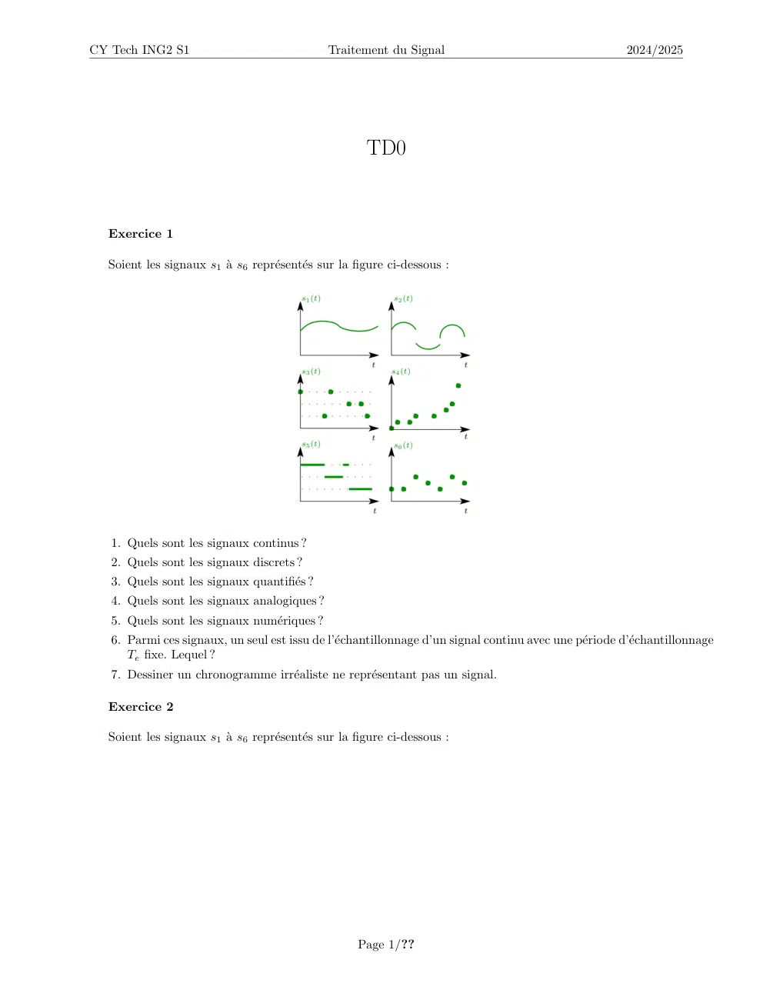
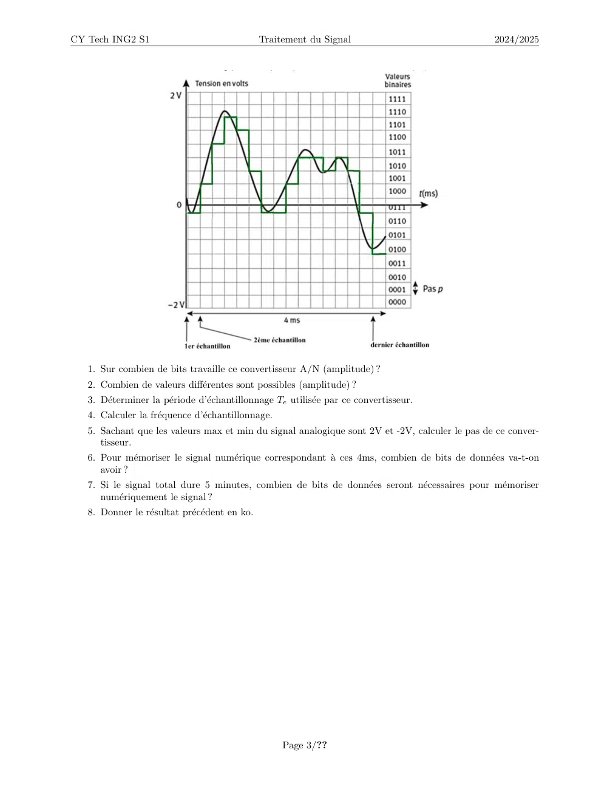

# TD0_traitement_du_signal.pdf

[Ouvrir l’original](https://drive.google.com/open?id=1fAEjGuCeAQ5zMadQ1_B8ScAakgZ_CkhC) · Les deux lectures automatiques du PDF divergent sur les pages indiquées. Leur fac-similé accompagne le texte.

**Pages présentant un écart entre les deux extractions** — 1, 3.

## Page 1

~~~text
CY Tech ING2 S1                              Traitement du Signal                                      2024/2025

                                                     TD0

  Exercice 1

  Soient les signaux s1 à s6 représentés sur la figure ci-dessous :

   1. Quels sont les signaux continus ?
   2. Quels sont les signaux discrets ?
   3. Quels sont les signaux quantifiés ?
   4. Quels sont les signaux analogiques ?
   5. Quels sont les signaux numériques ?
   6. Parmi ces signaux, un seul est issu de l’échantillonnage d’un signal continu avec une période d’échantillonnage
      Te fixe. Lequel ?
   7. Dessiner un chronogramme irréaliste ne représentant pas un signal.

  Exercice 2

  Soient les signaux s1 à s6 représentés sur la figure ci-dessous :

                                                   Page 1/??
~~~

## Page 2

~~~text
CY Tech ING2 S1                               Traitement du Signal                                   2024/2025

  On suppose que l’horizon de temps choisi en indique assez sur l’allure du signal.
   1. Quels sont les signaux périodiques ?
   2. Il y en a t-ils qui ne soient pas périodiques mais qui présentent une pseudo-période ?

  Exercice 3

  Soit un signal x apériodique décrit par :

                                                x(t) = x0 e−t , ∀t > 0,
                                          

                                                x(t) = 0, ∀t < 0
   1. Dessiner le signal x = f (t).
   2. Calculer la moyenne de x sur tout l’horizon de temps. Commenter.
   3. Calculer la moyenne de x sur l’intervalle [0; 1].

  Exercice 4

  Soit un signal c carré impair d’amplitude A et de fréquence fp .
   1. Dessiner le signal c.
   2. Quel est son rapport cyclique ?
   3. Calculer la moyenne de c sur tout l’horizon de temps. Est-ce une surprise ?
   4. Calculer la moyenne sur l’intervalle [0; Tp /2] en appliquant la formule rigoureuse. Est-ce une surprise ?
   5. On ajoute une composante continue A0 à c. Que devient sa valeur moyenne ?
   6. Que devient sa moyenne sur [0; Tp /2] ?

  Exercice 5 : Conversion analogique numérique

  Soient la courbe analogique suivante et le résultat de sa conversion numérique :

                                                     Page 2/??
~~~

## Page 3

~~~text
CY Tech ING2 S1                                Traitement du Signal                             2024/2025

   1. Sur combien de bits travaille ce convertisseur A/N (amplitude) ?
   2. Combien de valeurs différentes sont possibles (amplitude) ?
   3. Déterminer la période d’échantillonnage Te utilisée par ce convertisseur.
   4. Calculer la fréquence d’échantillonnage.
   5. Sachant que les valeurs max et min du signal analogique sont 2V et -2V, calculer le pas de ce conver-
      tisseur.
   6. Pour mémoriser le signal numérique correspondant à ces 4ms, combien de bits de données va-t-on
      avoir ?
   7. Si le signal total dure 5 minutes, combien de bits de données seront nécessaires pour mémoriser
      numériquement le signal ?
   8. Donner le résultat précédent en ko.

                                                    Page 3/??
~~~
