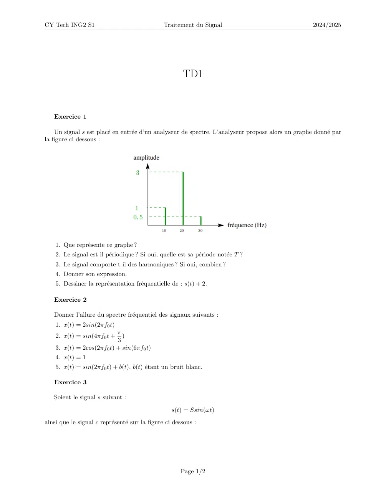
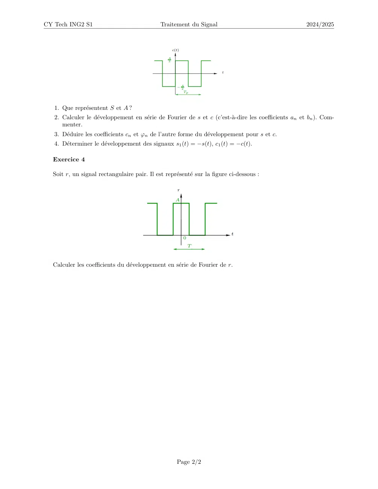

# TD1_traitement_du_signal.pdf

[Ouvrir l’original](https://drive.google.com/open?id=1ZEYAch2RZAMgTal8ApodkC4ePwqlfaIf) · Les deux lectures automatiques du PDF divergent sur les pages indiquées. Leur fac-similé accompagne le texte.

**Pages présentant un écart entre les deux extractions** — 1–2.

## Page 1

~~~text
CY Tech ING2 S1                                 Traitement du Signal                                2024/2025

                                                       TD1

   Exercice 1

    Un signal s est placé en entrée d’un analyseur de spectre. L’analyseur propose alors un graphe donné par
la figure ci dessous :

    1. Que représente ce graphe ?
    2. Le signal est-il périodique ? Si oui, quelle est sa période notée T ?
    3. Le signal comporte-t-il des harmoniques ? Si oui, combien ?
    4. Donner son expression.
    5. Dessiner la représentation fréquentielle de : s(t) + 2.

   Exercice 2

   Donner l’allure du spectre fréquentiel des signaux suivants :
    1. x(t) = 2sin(2πf0 t)
                           π
    2. x(t) = sin(4πf0 t +   )
                           3
    3. x(t) = 2cos(2πf0 t) + sin(6πf0 t)
    4. x(t) = 1
    5. x(t) = sin(2πf0 t) + b(t), b(t) étant un bruit blanc.

   Exercice 3

   Soient le signal s suivant :

                                                   s(t) = Ssin(ωt)
ainsi que le signal c représenté sur la figure ci dessous :

                                                      Page 1/2
~~~

## Page 2

~~~text
CY Tech ING2 S1                              Traitement du Signal                                    2024/2025

   1. Que représentent S et A ?
   2. Calculer le développement en série de Fourier de s et c (c’est-à-dire les coefficients an et bn ). Com-
      menter.
   3. Déduire les coefficients cn et φn de l’autre forme du développement pour s et c.
   4. Déterminer le développement des signaux s1 (t) = −s(t), c1 (t) = −c(t).

  Exercice 4

  Soit r, un signal rectangulaire pair. Il est représenté sur la figure ci-dessous :

  Calculer les coefficients du développement en série de Fourier de r.

                                                    Page 2/2
~~~
