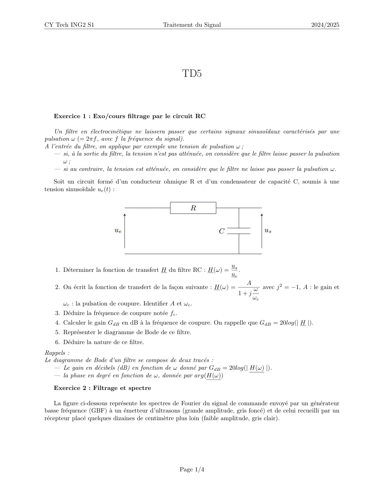
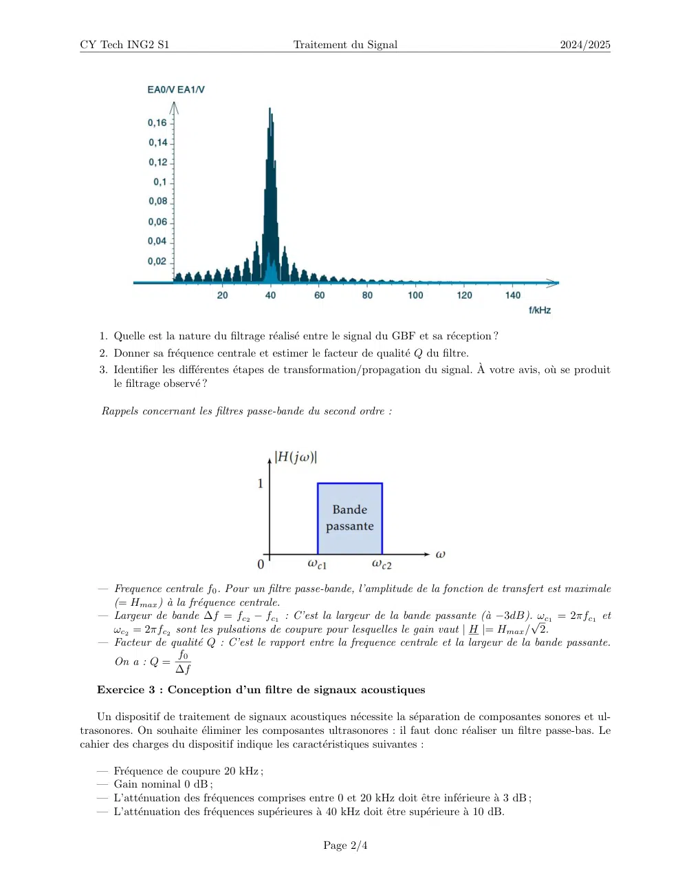
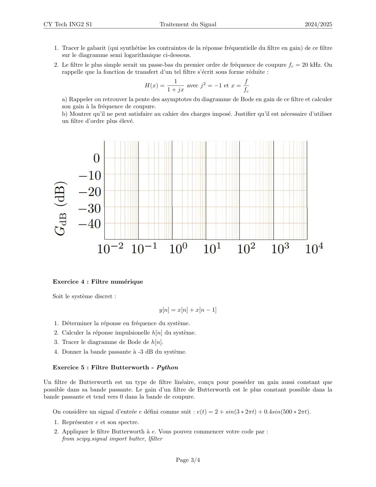
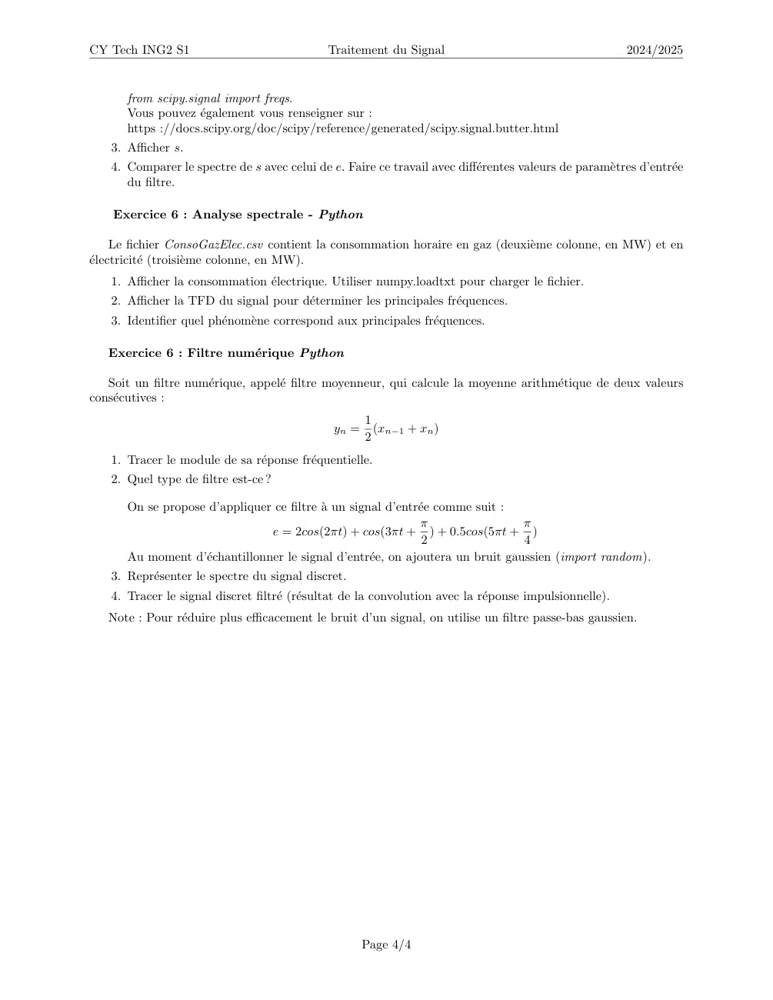

# TD5_traitement_du_signal.pdf

[Ouvrir l’original](https://drive.google.com/open?id=1hCk9gdghG5ESc6D7gjr-fJkxnQQD5bVu) · Les deux lectures automatiques du PDF divergent sur les pages indiquées. Leur fac-similé accompagne le texte.

**Pages présentant un écart entre les deux extractions** — 1–4.

## Page 1

~~~text
CY Tech ING2 S1                                 Traitement du Signal                                        2024/2025

                                                       TD5

   Exercice 1 : Exo/cours filtrage par le circuit RC

   Un filtre en électrocinétique ne laissera passer que certains signaux sinusoı̈daux caractérisés par une
pulsation ω (= 2πf , avec f la fréquence du signal).
A l’entrée du filtre, on applique par exemple une tension de pulsation ω ;
   — si, à la sortie du filtre, la tension n’est pas atténuée, on considère que le filtre laisse passer la pulsation
       ω;
   — si au contraire, la tension est atténuée, on considère que le filtre ne laisse pas passer la pulsation ω.

   Soit un circuit formé d’un conducteur ohmique R et d’un condensateur de capacité C, soumis à une
tension sinusoı̈dale ue (t) :

                                                                            us
    1. Déterminer la fonction de transfert H du filtre RC : H(ω) =            .
                                                                            ue
                                                                                   A           2
    2. On écrit la fonction de transfert de la façon suivante : H(ω) =               ω avec j = −1, A : le gain et
                                                                               1+j
                                                                                       ωc
       ωc : la pulsation de coupure. Identifier A et ωc .
    3. Déduire la fréquence de coupure notée fc .
    4. Calculer le gain GdB en dB à la fréquence de coupure. On rappelle que GdB = 20log(| H |).
    5. Représenter le diagramme de Bode de ce filtre.
    6. Déduire la nature de ce filtre.
Rappels :
Le diagramme de Bode d’un filtre se compose de deux tracés :
   — Le gain en décibels (dB) en fonction de ω donné par GdB = 20log(| H(ω) |).
   — la phase en degré en fonction de ω, donnée par arg(H(ω))

   Exercice 2 : Filtrage et spectre

    La figure ci-dessous représente les spectres de Fourier du signal de commande envoyé par un générateur
basse fréquence (GBF) à un émetteur d’ultrasons (grande amplitude, gris foncé) et de celui recueilli par un
récepteur placé quelques dizaines de centimètre plus loin (faible amplitude, gris clair).

                                                       Page 1/4
~~~

## Page 2

~~~text
CY Tech ING2 S1                              Traitement du Signal                                     2024/2025

    1. Quelle est la nature du filtrage réalisé entre le signal du GBF et sa réception ?
    2. Donner sa fréquence centrale et estimer le facteur de qualité Q du filtre.
    3. Identifier les différentes étapes de transformation/propagation du signal. À votre avis, où se produit
       le filtrage observé ?

    Rappels concernant les filtres passe-bande du second ordre :

   — Frequence centrale f0 . Pour un filtre passe-bande, l’amplitude de la fonction de transfert est maximale
     (= Hmax ) à la fréquence centrale.
   — Largeur de bande ∆f = fc2 − fc1 : C’est la largeur de la bande passante (à −3dB).√ωc1 = 2πfc1 et
     ωc2 = 2πfc2 sont les pulsations de coupure pour lesquelles le gain vaut | H |= Hmax / 2.
   — Facteur de qualité Q : C’est le rapport entre la frequence centrale et la largeur de la bande passante.
                   f0
     On a : Q =
                  ∆f
   Exercice 3 : Conception d’un filtre de signaux acoustiques

    Un dispositif de traitement de signaux acoustiques nécessite la séparation de composantes sonores et ul-
trasonores. On souhaite éliminer les composantes ultrasonores : il faut donc réaliser un filtre passe-bas. Le
cahier des charges du dispositif indique les caractéristiques suivantes :

   — Fréquence de coupure 20 kHz ;
   — Gain nominal 0 dB ;
   — L’atténuation des fréquences comprises entre 0 et 20 kHz doit être inférieure à 3 dB ;
   — L’atténuation des fréquences supérieures à 40 kHz doit être supérieure à 10 dB.

                                                   Page 2/4
~~~

## Page 3

~~~text
CY Tech ING2 S1                               Traitement du Signal                                        2024/2025

   1. Tracer le gabarit (qui synthétise les contraintes de la réponse fréquentielle du filtre en gain) de ce filtre
      sur le diagramme semi logarithmique ci-dessous.
   2. Le filtre le plus simple serait un passe-bas du premier ordre de fréquence de coupure fc = 20 kHz. On
      rappelle que la fonction de transfert d’un tel filtre s’écrit sous forme réduite :
                                                    1                        f
                                        H(x) =          avec j 2 = −1 et x =
                                                 1 + jx                      fc
      a) Rappeler ou retrouver la pente des asymptotes du diagramme de Bode en gain de ce filtre et calculer
      son gain à la fréquence de coupure.
      b) Montrer qu’il ne peut satisfaire au cahier des charges imposé. Justifier qu’il est nécessaire d’utiliser
      un filtre d’ordre plus élevé.

   Exercice 4 : Filtre numérique

   Soit le système discret :

                                              y[n] = x[n] + x[n − 1]

   1. Déterminer la réponse en fréquence du système.
   2. Calculer la réponse impulsionelle h[n] du système.
   3. Tracer le diagramme de Bode de h[n].
   4. Donner la bande passante à -3 dB du système.

   Exercice 5 : Filtre Butterworth - Python

Un filtre de Butterworth est un type de filtre linéaire, conçu pour posséder un gain aussi constant que
possible dans sa bande passante. Le gain d’un filtre de Butterworth est le plus constant possible dans la
bande passante et tend vers 0 dans la bande de coupure.

   On considère un signal d’entrée e défini comme suit : e(t) = 2 + sin(3 ∗ 2πt) + 0.4sin(500 ∗ 2πt).
   1. Représenter e et son spectre.
   2. Appliquer le filtre Butterworth à e. Vous pouvez commencer votre code par :
      from scipy.signal import butter, lfilter

                                                     Page 3/4
~~~

## Page 4

~~~text
CY Tech ING2 S1                              Traitement du Signal                                       2024/2025

      from scipy.signal import freqs.
      Vous pouvez également vous renseigner sur :
      https ://docs.scipy.org/doc/scipy/reference/generated/scipy.signal.butter.html
   3. Afficher s.
   4. Comparer le spectre de s avec celui de e. Faire ce travail avec différentes valeurs de paramètres d’entrée
      du filtre.

    Exercice 6 : Analyse spectrale - Python

     Le fichier ConsoGazElec.csv contient la consommation horaire en gaz (deuxième colonne, en MW) et en
électricité (troisième colonne, en MW).
   1. Afficher la consommation électrique. Utiliser numpy.loadtxt pour charger le fichier.
   2. Afficher la TFD du signal pour déterminer les principales fréquences.
   3. Identifier quel phénomène correspond aux principales fréquences.

   Exercice 6 : Filtre numérique Python

   Soit un filtre numérique, appelé filtre moyenneur, qui calcule la moyenne arithmétique de deux valeurs
consécutives :
                                                     1
                                              yn =     (xn−1 + xn )
                                                     2
   1. Tracer le module de sa réponse fréquentielle.
   2. Quel type de filtre est-ce ?

      On se propose d’appliquer ce filtre à un signal d’entrée comme suit :
                                                              π                π
                               e = 2cos(2πt) + cos(3πt + ) + 0.5cos(5πt + )
                                                              2                4
      Au moment d’échantillonner le signal d’entrée, on ajoutera un bruit gaussien (import random).
   3. Représenter le spectre du signal discret.
   4. Tracer le signal discret filtré (résultat de la convolution avec la réponse impulsionnelle).
   Note : Pour réduire plus efficacement le bruit d’un signal, on utilise un filtre passe-bas gaussien.

                                                     Page 4/4
~~~
