# corrigé ExamenTdS.pdf

[Ouvrir l’original](https://drive.google.com/open?id=1U_X23cpj--adEhpJW2dIp3-kTcEspRPn) · Les pages signalées comprennent du texte reconnu automatiquement ou des éléments graphiques. Le fac-similé permet de vérifier chaque lecture.

**Pages avec fac-similé ou lecture OCR** — 1–14.

## Page 1

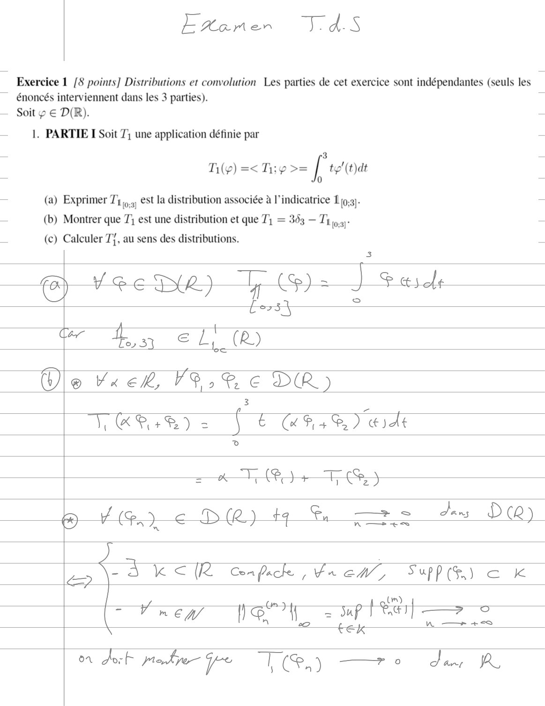

**Lecture OCR à contrôler**

~~~text
EAan en

Tas

Exercice 1 /8 points] Distributions et convolution Les parties de cet exercice sont indépendantes (seuls les
énoncés interviennent dans les 3 parties). :

Soit ÿ € D(R).

1. PARTIE I Soit 7; une application définie par
3
Ti(e) =< Tyy >= | tol(t)dt
0

(a) Exprimer Tyjo,3) est la distribution associée à l’indicatrice 10,3).
(b) Montrer que 7; est une distribution et que T1 = 303 — Ti ta

(c) Calculer TT, au sens des distributions.

CS) = J F aces sole

@) ¥eeDR)

à
5

A
a
7 Es

el} (R)

Vle Ye eR V$,® € DR)

3
TS Ke+B) = i E %4%,) edt

=a TR TES
@ (GS e DR) te GG — 5 ans DR)
CO) VAP t RAR +

== KZ confack , Wa EW, Sup) cK

- ren MA PE ©
tek

Wi — +50

on dork notre Gre TE.) +0 da, JR,
~~~

## Page 2

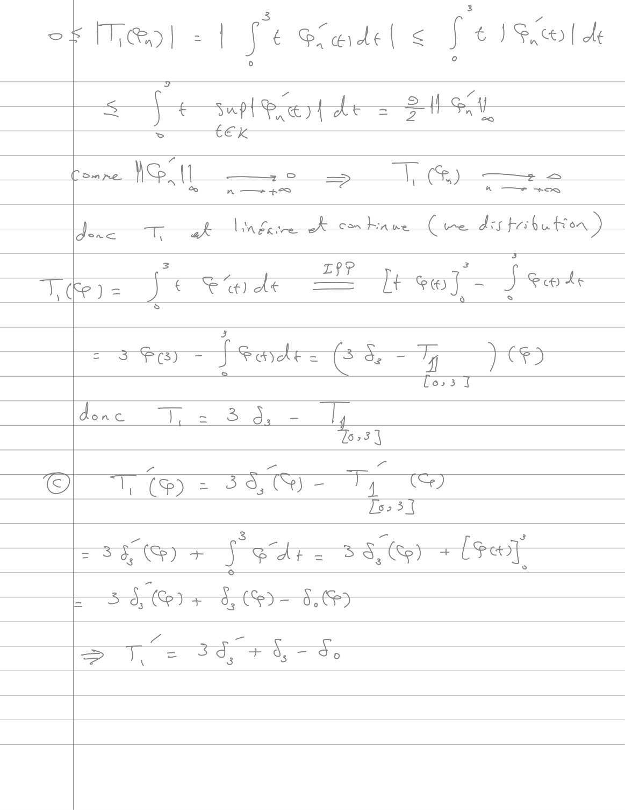

**Lecture OCR à contrôler**

~~~text
3 ° 2
SE M@o] = | fe Sfadel < [Eco dk

7

fn < S Cc
sup he = SESE
tEK

>

bonne WQ [fe — Tie) —=
2S no +9 ) — 5
dene uA bw etre: A bea we (ue dis teibu tion) —

3

° LPP

7 fe
ANSE J t Sade == + FE) = > Go Le

s

90 or
° [os3 J
donc Ty, a & à, _ “Ty
TR
© iF (5) = 35,1%) = Ty (Ce)
Ls:3T

3
i

3 -
7 7 : ;
SSR + J GAPS 3S Cy re

©

55 @r+ Lo SD

7
=> J, = 39, +4 - So

il
~~~

## Page 3

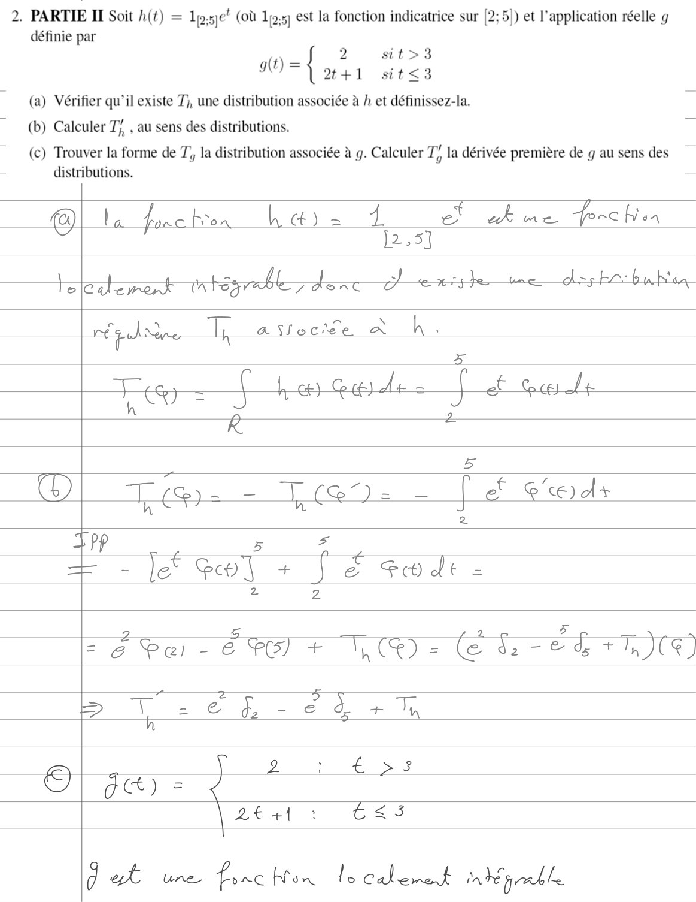

**Lecture OCR à contrôler**

~~~text
2. PARTIE

II Soit h(t) = Lp,sjet (où 112,5 est la fonction indicatrice sur [2;5]) et l'application réelle g

définie par

2 sit>3
10 = { A+1 sit<3

(a) Vérifier qu'il existe 7}, une distribution associée à h et définissez-la.

(b) Calculer Th, , au sens des distributions.
(c) Trouver la forme de T; la distribution associée à g. Calculer T} la dérivée première de g au sens des

distri

butions.

@)

la Pince bon héya 4 et Hume orc bien
12:57

beieatement inbegrabl., donc dexish Aas bho bab on,

Pe AN, Ty, atiectse à h:

T

a
amas = { he) Éget cdg e f € Gee de

h Fs ;
5
©) Tig. = Tren. 2 [ef ends
+ PP 5 2 |
+ - Je Gol + JE ode -
2 2

>See ERT N= (6 EFT MT

Ip Tee §-e fF +h
n

2 7 £33
gC) = 2

\ 2€ +1 : €<3

\

j xt Une frac Hon ks Calremet inhi grbhe
~~~

## Page 4

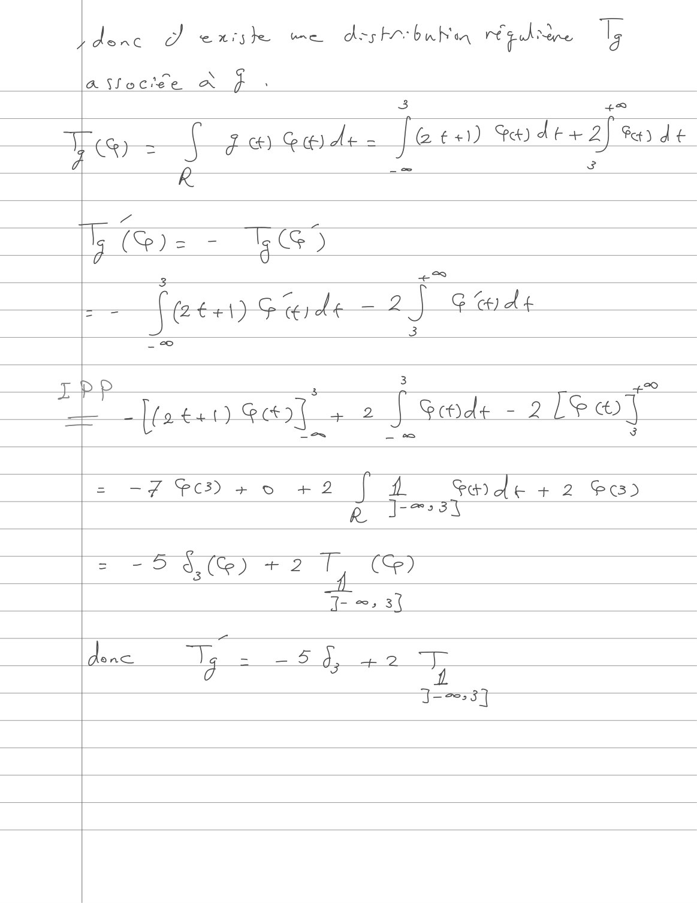

**Lecture OCR à contrôler**

~~~text
donc 2 enrshe me dosh baby régulière Ty

aSSocee À :
3 La
Tw) _ f po Gw de = fees) Gt) de+ 2] Sa) de
R a= ca
Z
4g (S)= = kG)
3 +
— Clo eet) Gerde = 2 | G ©) d+
3
EPP 5 3
— Hat+n) GI 2_ | Sd - 2 Le «|
CS _ 3
= 7 PC3D + © +2 | À Eu Je + 2 CES)
Rp 1731
= -S5 8) +27 (&)
AL
Jos 3]
As nee Js = _ & à, 2 7
I-=:31
~~~

## Page 5

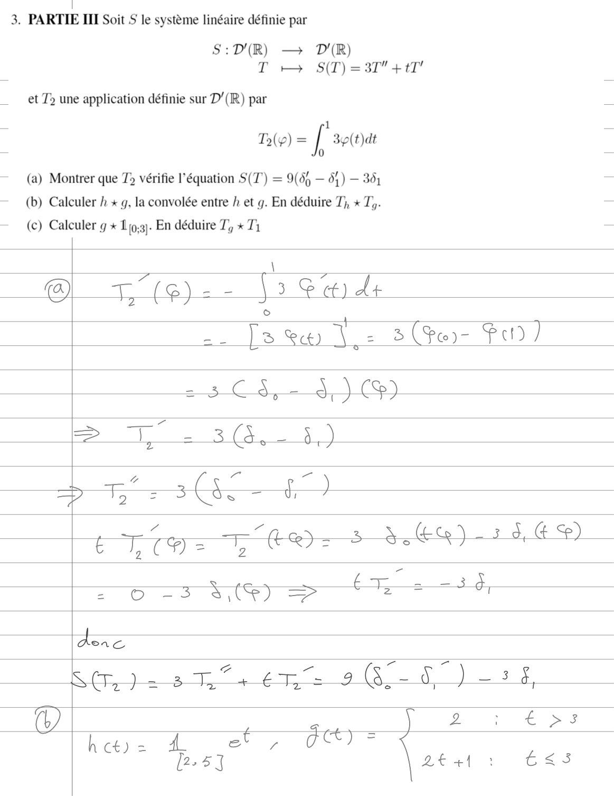

**Lecture OCR à contrôler**

~~~text
|
3. PARTIE II Soit S le système linéaire définie par

S:D'(R) —+ D'(R)
Te S(T)=37"+tT"

et T2 une application définie sur D’(R) par
1
Ro) = [elt

(a) Montrer que 72 vérifie l'équation S(T) = 9(09 — 64) — 36;
(b) Calculer x g, la convolée entre h et g. En déduire T), x Ty.
(c) Calculer g x Ljo,3). En déduire Ty x Ty

@| TT (@)=--

2

D oe sli = d, )
EGS EO = SB ER) 2
Ss tom LR = à

RE
~~~

## Page 6

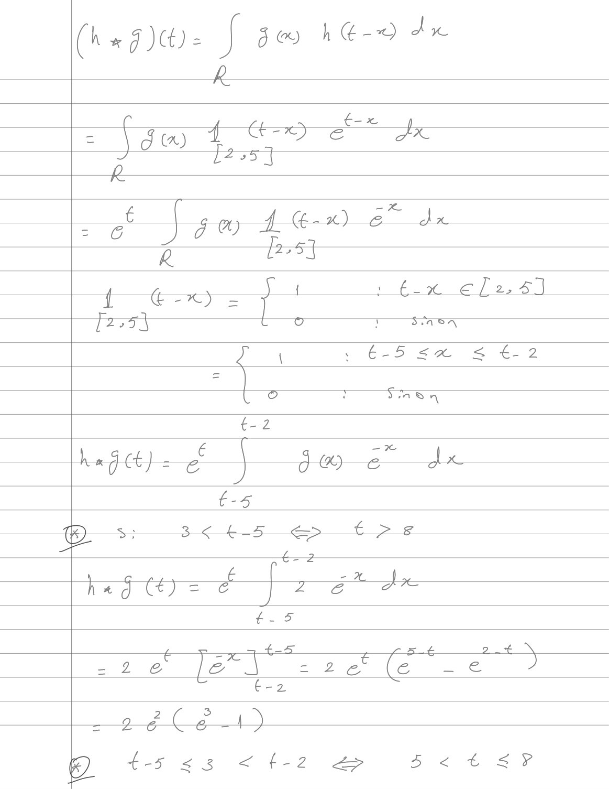

**Lecture OCR à contrôler**

~~~text
(haf )@)= J go he-o ah.
R
= {Jay 4 ie eo he
R
=e Sage 1-6 dx
R 12754
ft EX) = y { à Ex ef2,4]
F255 = es
2 \ E-5 SH < €-2
= |. _
t-2
La} f | 3e EE" Jx
€-5
© — => t>¢
+ po?
had y= a J ze
4-5
js me 5
-2e [e* J) ré CC =
9 8 Ce 1)
~~~

## Page 7

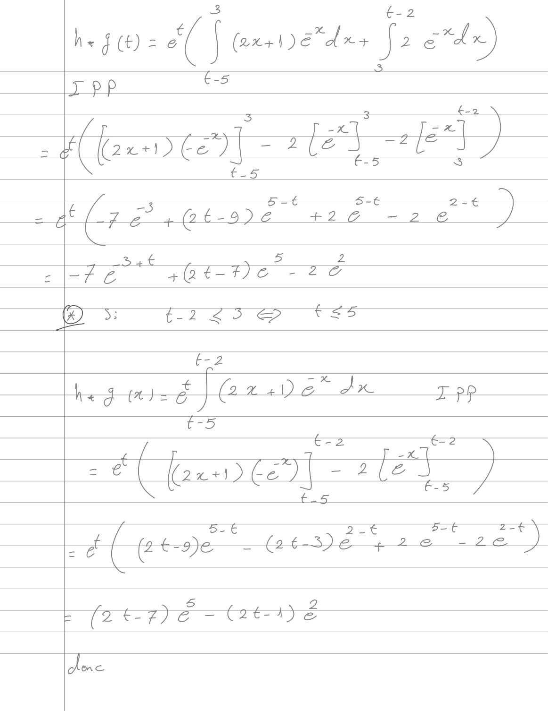

**Lecture OCR à contrôler**

~~~text
he J (€) = “(|

3

€-2
(axx1)é*de+ J} 2 cd»)
3

oP

€-5

F

xT

3

2€

E D

ET)

5 Ft le x+t) ce) |
Gee

si

3
€=5

S

€

=t€

€

=
/

\
Os

=t
trees +216 2

Fe Ste -20

F-2

La Dan

hed =

(2241) z

C75

€

[+
Gr Ce

€

5-€ Ze 3
= {pee _ {st-3)e +22

S.
E (Zt-7/7€ = (24-13 É

donc
~~~

## Page 8

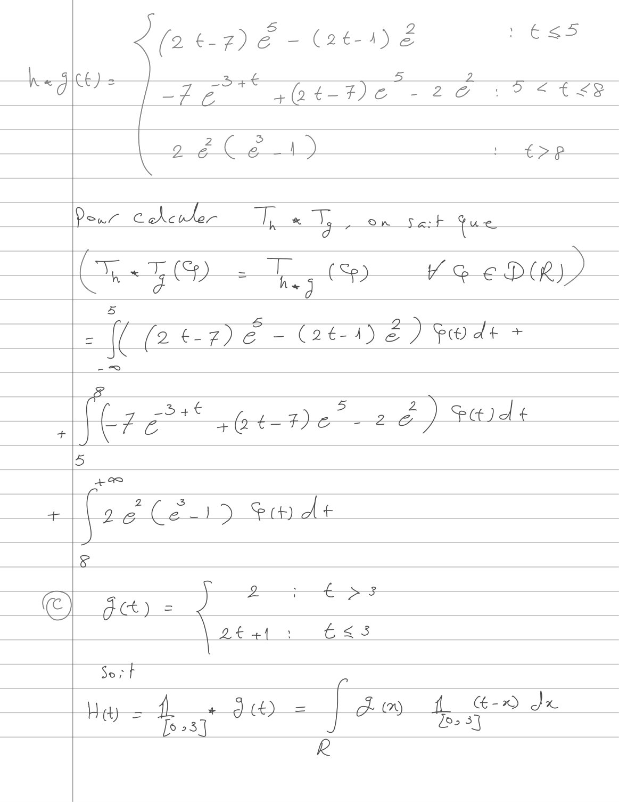

**Lecture OCR à contrôler**

~~~text
1 €25

(2 6-7) Ê - ENE
kite ae LGiDe 72! D 2¢ <8
|
|

6 ER
\
Pour ehetler En «Jy on Sark que
(RTE) _ = (se) ¥eeD(py)

- +

= {( [2 €-7) e - (2t-1) 2) Swat +

[ 7 -3+€ Le De - 2 z ) Pt) dt
# Te te
5
Pail
ee PT. P19) ct At
&
C) act) = J ~
2€ +1 GES
Serf
2 4 S(t) = Ho ff Œ-)9 ara
=a FD 33
~~~

## Page 9

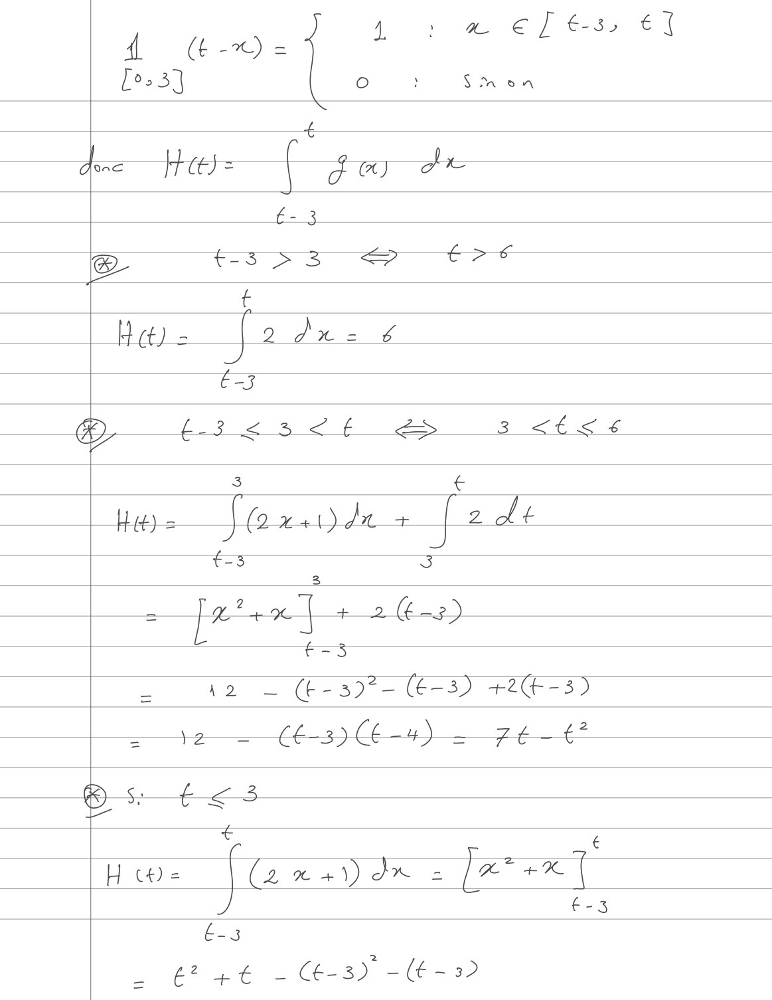

**Lecture OCR à contrôler**

~~~text
4 «D - 1 : æ €f &38, €
L>3) (e] :

Smon
4
de Ht- f fe de
f= 3
@ t-3 > 3 QBS ter
t
> [odne 4
Het J
C-3
& é-3 <3 <f = 3 <<<

€
Hs for de - | 2 Lt

€-3 3
3
= Fete + 2 (€ >)
L
€=3
= 12 — (t-32°- (€-3) +2@-3)
= \ = Cé 3)CL—4) = ZE €?
6 . 2
Bs t«
€ ’
ERCE (ans) dn = JA*+X 7
J i
E-5

etre - Ce-3) -(t-5
~~~

## Page 10

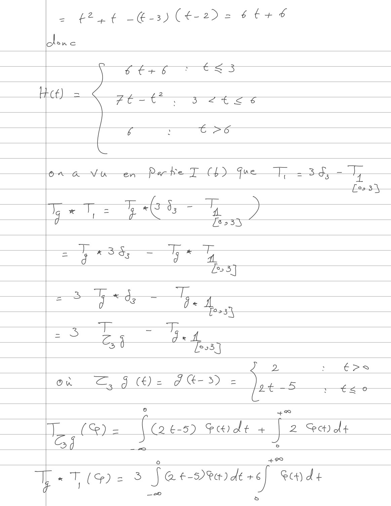

**Lecture OCR à contrôler**

~~~text
2 ¢#4,.¢ Gus) (4-23 = étés

Ex à
Yo ¢+6 e<3
Hc) = zt=¢t? 3 eee Ss
/ 4 É EE
LC
on a Vn —en Parhe FOL) ue FF. 3g, TT,
[os 31
Texts kÇù Tr 4 >
ÿ 533
Re
= d 333 5 4.
ê3]
= a a a
| d “ E Last
J —— 773
= ~ gt
3 0 [53]
2 2 à €>0
où C,§@= dE = ),, » ;
C D ST
TS) = Coes) Pædt + | 2 eHdt+
oi 2 l

+

Ÿ

~T(q= 8 JQtDrarderc}] ends
~~~

## Page 11

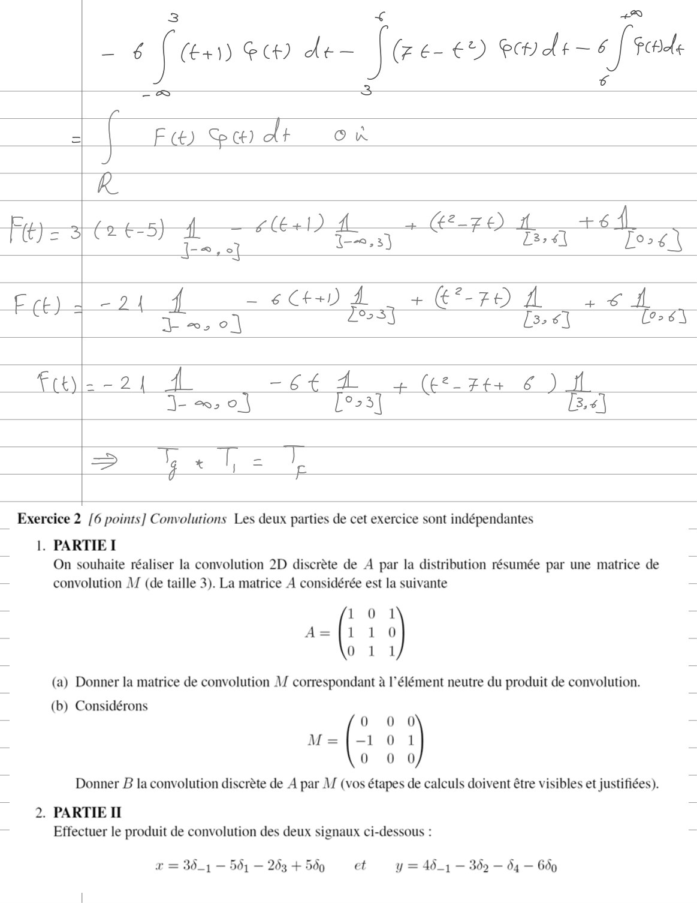

**Lecture OCR à contrôler**

~~~text
3 < a

= é fem Gu) de Je e- €?) ec de- 6 f Fee
6

=o 3

= Fe Sudt+ où

J

R

Fees ere dé fl 70-4, +64

3 =-0,3) al [oo é
Ere) | -21 À ~6CG 4  +€*-7O A wot
F< = To] 058] [361 (758)

Fctyl- - 2 | { ~-€6¢A 5 (2-704 6)
= j- 0, 01 [923] me [3,6]

… Exercice 2 /6 points] Convolutions Les deux parties de cet exercice sont indépendantes

1. PARTIE I
On souhaite réaliser la convolution 2D discrète de A par la distribution résumée par une matrice de
convolution AZ (de taille 3). La matrice A considérée est la suivante

1 0 1
A=|1 10
0 1 1

(a) Donner la matrice de convolution M correspondant à l'élément neutre du produit de convolution.

(b) Considérons
0 0 0
M=|-1 0 1
0 0 0

Donner B la convolution discrète de A par M (vos étapes de calculs doivent être visibles et justifiées).

2. PARTIE II
Effectuer le produit de convolution des deux signaux ci-dessous :

x = 361561 —253+5d9 et y= 46_1 — 302 — 54 — 600
~~~

## Page 12

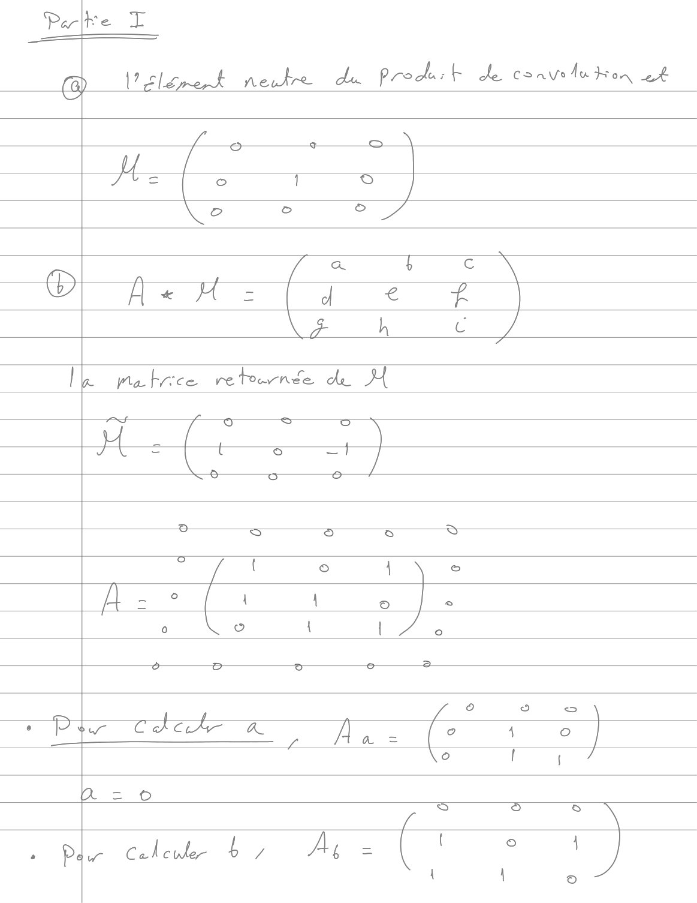

**Lecture OCR à contrôler**

~~~text
Fe T

1? El dprenk neutre du. Prod: t de coavelu kon 2h

pen. li e ¢
\é c

& Ma hrce rebond de HA

jo
Az D
~~~

## Page 13

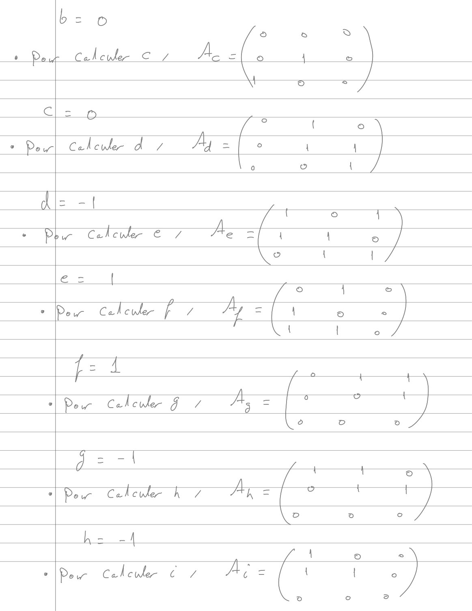

**Lecture OCR à contrôler**

~~~text
b= 6
D Pour Calcider € 7 A. A:

\

ro} s
ce , /° ( ©
6 Pow Calculer d PA id = | o {| 1 ;
\, Q { /
Ale = a

Phun Calculer € 7 À =/ 1 il e/
NE { {
és { 7 5 -
© Pow Celcwle f / A; cf a *
"Xt 5
Eu: |
+ À \
° Pow Cel cule 67 À. = : ° ‘ )
Lo D i)
—— (2)
® Pow Calcul h 7 TK at 2 t i }
h= |
: 1 © °
* | Pow Calculer € / LE a I )
~~~

## Page 14

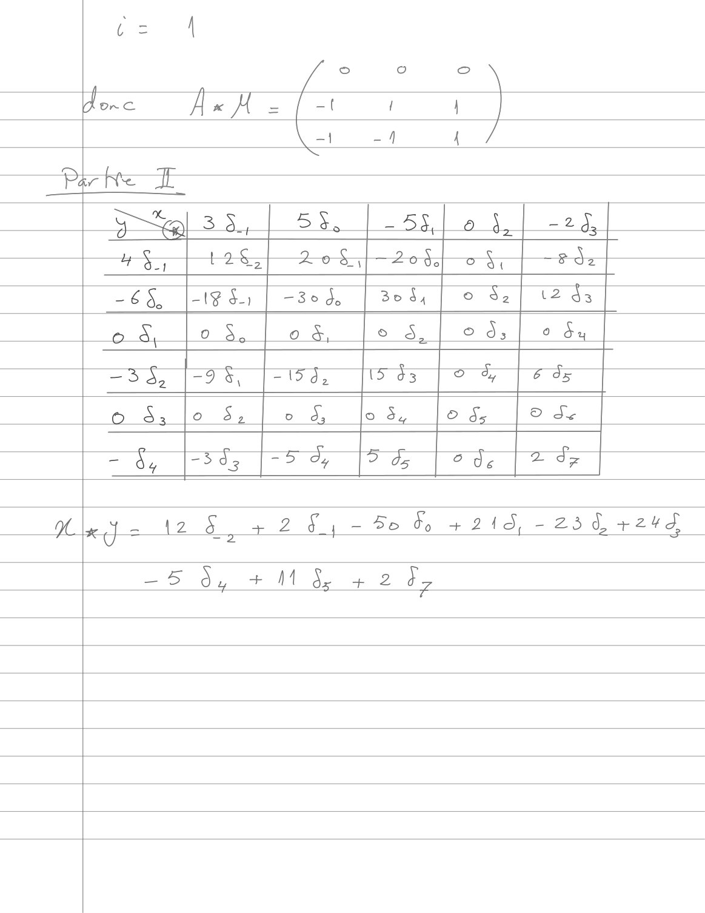

**Lecture OCR à contrôler**

~~~text
Par Fe TE
Me
yal 35, | 53. | - 53] 2 3, | -24
HS 2520S} 2 0h 2 ÿ ads
ES |-1¢ 8.) | -3°8 Bod, | © S,/ 12 93
o 8 o à, o à, o à od; | 0 Sy
=3$, |-98 [-3s, [ods [oe ed
Oo $3 lo 6, o d, © by © ds CE
= §, [sd [5 % [54 [ede [ee

= 12 8, +2 fi - Fe do +215,- 234 +24d

-5 3, +118 +28,
~~~
