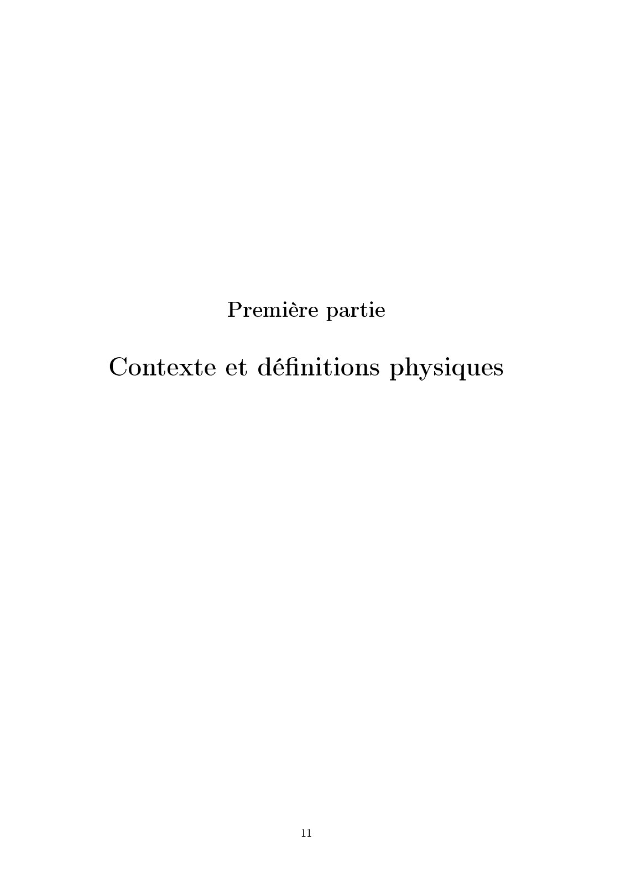
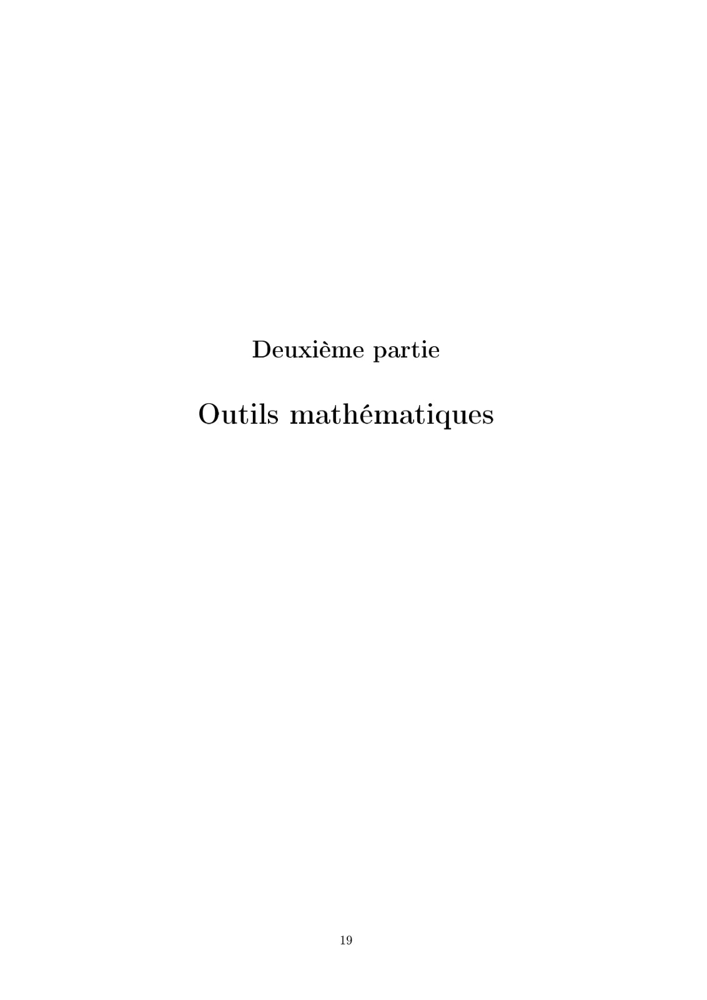

# important 2324_TraitementSignal_Support-Etud.pdf

[Ouvrir l’original](https://drive.google.com/open?id=1DaPwlhwr74gj9z1gCO8-PYoaxd4UHfMf) · Les pages signalées comprennent du texte reconnu automatiquement ou des éléments graphiques. Le fac-similé permet de vérifier chaque lecture.

**Pages avec fac-similé ou lecture OCR** — 13, 15–16, 24, 82–84.

## Page 1

~~~text
                                                         Cycle Ingénieur MI
                                                           Deuxième année

                          Traitement du Signal

 Date :     2023-2024 - Semestre 3
 Lieu :     CY Tech Cergy-Pau

Enseignants :
 Cergy    Mohamed Bahtiti               mbi@cy-tech.fr
 Pau      Lucie Desplat                 ld@cy-tech.fr
 Pau      Nelly Barrau                  nbu@cy-tech.fr

Auteur de ce document : Lucie Desplat et Nelly Barrau
~~~

## Page 2

~~~text
Table des matières

  Modalités . . . . . . . . . . . . . . . . . . . . . . . . . . . . . . . . . . . . . . . . . . . . . . . . . .   II

0 Introduction                                                                                                     1
  0.1   Notion de signal . . . . . . . . . . . . . . . . . . . . . . . . . . . . . . . . . . . . . . . . . .       1
        0.1.1   Dénition du signal . . . . . . . . . . . . . . . . . . . . . . . . . . . . . . . . . . . .        1
        0.1.2   Notion de bruit . . . . . . . . . . . . . . . . . . . . . . . . . . . . . . . . . . . . . .        1
  0.2   Le traitement du signal . . . . . . . . . . . . . . . . . . . . . . . . . . . . . . . . . . . . . .        2
        0.2.1   Dénitions . . . . . . . . . . . . . . . . . . . . . . . . . . . . . . . . . . . . . . . . .       2
        0.2.2   A quoi sert le traitement du signal ? . . . . . . . . . . . . . . . . . . . . . . . . . .          3
  0.3   Classication des signaux . . . . . . . . . . . . . . . . . . . . . . . . . . . . . . . . . . . . .        3
        0.3.1   Classication par représentation . . . . . . . . . . . . . . . . . . . . . . . . . . . .           3
        0.3.2   Classication par type de signal . . . . . . . . . . . . . . . . . . . . . . . . . . . . .         4
        0.3.3   Classication par morphologie . . . . . . . . . . . . . . . . . . . . . . . . . . . . . .          4
  0.4   Traitement numérique . . . . . . . . . . . . . . . . . . . . . . . . . . . . . . . . . . . . . . .         4
        0.4.1   L'échantillonnage . . . . . . . . . . . . . . . . . . . . . . . . . . . . . . . . . . . . .        5
        0.4.2   La quantication . . . . . . . . . . . . . . . . . . . . . . . . . . . . . . . . . . . . . .       5
        0.4.3   En résumé . . . . . . . . . . . . . . . . . . . . . . . . . . . . . . . . . . . . . . . . .        5
  TD0 . . . . . . . . . . . . . . . . . . . . . . . . . . . . . . . . . . . . . . . . . . . . . . . . . . . .      7

I Contexte et dénitions physiques                                                                                11
1 Analyse de signaux périodiques                                                                                  12
  1.1   Les signaux périodiques . . . . . . . . . . . . . . . . . . . . . . . . . . . . . . . . . . . . . . 12
        1.1.1   Dénitions . . . . . . . . . . . . . . . . . . . . . . . . . . . . . . . . . . . . . . . . . 12
        1.1.2   Quelques signaux périodiques . . . . . . . . . . . . . . . . . . . . . . . . . . . . . . 13
  1.2   Décomposition en série de Fourier . . . . . . . . . . . . . . . . . . . . . . . . . . . . . . . . 14
        1.2.1   Première dénition de la série de Fourier . . . . . . . . . . . . . . . . . . . . . . . 14
        1.2.2   Série de Fourier en cosinus . . . . . . . . . . . . . . . . . . . . . . . . . . . . . . . . 14
        1.2.3   Représentation graphique : spectre unilatéral (en amplitude) . . . . . . . . . . . 15
  1.3   Intérêt de la représentation spectrale . . . . . . . . . . . . . . . . . . . . . . . . . . . . . . 16
  1.4   Rappel : A propos de valeur moyenne . . . . . . . . . . . . . . . . . . . . . . . . . . . . . . 16
  TD1 - Analyse des signaux . . . . . . . . . . . . . . . . . . . . . . . . . . . . . . . . . . . . . 17

                                                        I
~~~

## Page 3

~~~text
II Outils mathématiques                                                                                      19

2 Distributions                                                                                              20
  2.1   Notion de signal au sens mathématique . . . . . . . . . . . . . . . . . . . . . . . . . . . . 20
        2.1.1   Dénitions élémentaires . . . . . . . . . . . . . . . . . . . . . . . . . . . . . . . . . 20
        2.1.2   Classication des signaux . . . . . . . . . . . . . . . . . . . . . . . . . . . . . . . . 23
  2.2   Notion de distribution . . . . . . . . . . . . . . . . . . . . . . . . . . . . . . . . . . . . . . . 24
  2.3   Signaux discrets - Échantillonnage . . . . . . . . . . . . . . . . . . . . . . . . . . . . . . . 27
  2.4   Exemple d'applications . . . . . . . . . . . . . . . . . . . . . . . . . . . . . . . . . . . . . . 27
        2.4.1   Analyse d'un son . . . . . . . . . . . . . . . . . . . . . . . . . . . . . . . . . . . . . 28
  TD2 - Distributions . . . . . . . . . . . . . . . . . . . . . . . . . . . . . . . . . . . . . . . . . . 30

3 Produit de convolution                                                                                     32
  3.1   Produit de convolution de deux fonctions . . . . . . . . . . . . . . . . . . . . . . . . . . . 32
        3.1.1   Interprétation géométrique . . . . . . . . . . . . . . . . . . . . . . . . . . . . . . . . 33
        3.1.2   Applications : Lissage d'un signal . . . . . . . . . . . . . . . . . . . . . . . . . . . . 33
  3.2   Convolution par une distribution . . . . . . . . . . . . . . . . . . . . . . . . . . . . . . . . 34
  3.3   Convolution discrète . . . . . . . . . . . . . . . . . . . . . . . . . . . . . . . . . . . . . . . . 36
        3.3.1   Application : Produit de convolution de ces deux signaux discrétisés . . . . . . . 37
  3.4   Convolution de fonction dénies sur R2 . . . . . . . . . . . . . . . . . . . . . . . . . . . . 38
        3.4.1   Applications . . . . . . . . . . . . . . . . . . . . . . . . . . . . . . . . . . . . . . . . 41
  TD3 - Convolution . . . . . . . . . . . . . . . . . . . . . . . . . . . . . . . . . . . . . . . . . . 44

4 Transformée de Fourier                                                                                     46
  4.1   Transformée de Fourier d'un signal continu . . . . . . . . . . . . . . . . . . . . . . . . . . 46
        4.1.1   Dénitions . . . . . . . . . . . . . . . . . . . . . . . . . . . . . . . . . . . . . . . . . 46
        4.1.2   Exemples . . . . . . . . . . . . . . . . . . . . . . . . . . . . . . . . . . . . . . . . . . 47
  4.2   Transformée de Fourier d'une distribution . . . . . . . . . . . . . . . . . . . . . . . . . . . 48
        4.2.1   Dénitions et propriétés . . . . . . . . . . . . . . . . . . . . . . . . . . . . . . . . . 48
        4.2.2   Application au traitement du signal : Analyse spectrale . . . . . . . . . . . . . . 50
  4.3   Échantillonnage et transformée de Fourier discrète . . . . . . . . . . . . . . . . . . . . . . 53
        4.3.1   Exemple d'application de la Transformée de Fourier discrète(DFT) . . . . . . . 58
  TD4 - Transformée de Fourier             . . . . . . . . . . . . . . . . . . . . . . . . . . . . . . . . . . 61

                                                     II
~~~

## Page 4

~~~text
5 Filtrage                                                                                                     63
  5.1   Principe du ltrage . . . . . . . . . . . . . . . . . . . . . . . . . . . . . . . . . . . . . . . . . 63
  5.2   Réponse d'un ltre et produit de convolution . . . . . . . . . . . . . . . . . . . . . . . . . 64
        5.2.1   Réponse impulsionnelle d'un ltre . . . . . . . . . . . . . . . . . . . . . . . . . . . 64
        5.2.2   Produit de convolution . . . . . . . . . . . . . . . . . . . . . . . . . . . . . . . . . . 64
        5.2.3   Transformation de Fourier et produit de convolution . . . . . . . . . . . . . . . . 64
  5.3   Filtrage . . . . . . . . . . . . . . . . . . . . . . . . . . . . . . . . . . . . . . . . . . . . . . . . 65
        5.3.1   Fonction de transfert . . . . . . . . . . . . . . . . . . . . . . . . . . . . . . . . . . . 65
        5.3.2   Diagramme de Bode . . . . . . . . . . . . . . . . . . . . . . . . . . . . . . . . . . . . 65
  5.4   Etude de trois ltres classiques . . . . . . . . . . . . . . . . . . . . . . . . . . . . . . . . . . 66
        5.4.1   Filtre idéal . . . . . . . . . . . . . . . . . . . . . . . . . . . . . . . . . . . . . . . . . 66
        5.4.2   Filtre réel . . . . . . . . . . . . . . . . . . . . . . . . . . . . . . . . . . . . . . . . . . 66
  5.5   Réponse d'un ltre à un signal . . . . . . . . . . . . . . . . . . . . . . . . . . . . . . . . . . 67
        5.5.1   Filtrage passe-bas . . . . . . . . . . . . . . . . . . . . . . . . . . . . . . . . . . . . . 67
        5.5.2   Filtrage passe-haut . . . . . . . . . . . . . . . . . . . . . . . . . . . . . . . . . . . . 67
        5.5.3   Filtrage passe-bande . . . . . . . . . . . . . . . . . . . . . . . . . . . . . . . . . . . 67
  5.6   Gabarit d'un ltre . . . . . . . . . . . . . . . . . . . . . . . . . . . . . . . . . . . . . . . . . 68
  5.7   Filtrage d'un signal numérique . . . . . . . . . . . . . . . . . . . . . . . . . . . . . . . . . . 68
        5.7.1   Signal échantillonné . . . . . . . . . . . . . . . . . . . . . . . . . . . . . . . . . . . . 68
        5.7.2   Filtres à réponse impulsionnelle nie . . . . . . . . . . . . . . . . . . . . . . . . . . 69
        5.7.3   Filtres à réponse impulsionnelle innie . . . . . . . . . . . . . . . . . . . . . . . . . 70
  TD5 . . . . . . . . . . . . . . . . . . . . . . . . . . . . . . . . . . . . . . . . . . . . . . . . . . . . 73

Bibliographie                                                                                                  79

                                                      III
~~~

## Page 5

~~~text
                                             Modalités

Enseignement : Déroulement
  L'enseignement "Traitement du signal" se décompose en Cours ; TD-TP

Le cours sera approfondi à chaque séance (questions, exemples, ...).
  Les TD sont à préparer, et une partie sera corrigée en classe (la correction de l'autre partie sera
donnée : l'étudiant devra la travailler en autonomie).
  Les TP seront réalisés en Python 1 .

   Cours : 7h30 (5 séances de 1h30)
   TD - TP : 15h (10 séances de 1h30)

La présence en Cours - TD - TP est obligatoire.

Évaluation
   1ère session
    1 mini-projet (30%) + Examen terminal écrit de 2h (70 %).
    La rigueur, la rédaction et la justesse des résultats seront pris en compte dans la notation.
    Tout TP non envoyé (sans justication) à la n de la séance entraînera 0.
    Chaque absence (non justiée) en cours/TD/TP entrainera -0.5pt à la note nale.

   2eme session
    Rattrapage écrit de 2h (100 %).

Mini-projet
  Les modalités (thématique, attentes, rendus) du mini-projet seront communiquées après le 3ème
CM. Ce mini-projet devra s'eectuer par groupe (de 2 à 4 membres), il comportera nécessaire un
rendu écrit (rapport) ; un code (en python) et une soutenance (avec slides + démo).

  1. Version dispo à l'Ecole 2.7 :   https://docs.python.org/fr/2.7/

                                                        IV
~~~

## Page 6

~~~text
Chapitre 0

Introduction

  Le traitement du signal est présent dans de nombreux domaines, : télécommunications, télévision,
transports, médecine, etc.

   La théorie du signal propose de modéliser la grandeur physique observée par un objet mathéma-
tique dépendant de la variable réelle t qui correspond au temps.

  Les diérentes opérations que l'on fait subir aux signaux nécessitent des outils mathématiques
appropriés qui sont à la base du traitement du signal. Dans ce cours, on étudiera certains de ces outils.

  On commence avec ce chapitre, par une introduction au traitement du signal, avec de nombreuses
dénitions.

0.1 Notion de signal
0.1.1 Dénition du signal
     Signal
 Dénition 0.1.1. Un signal est la représentation physique de l'information qu'il transporte de sa
 source à son destinataire. Il sert de vecteur à une information. Il constitue la manifestation physique
 d'une grandeur mesurable.

 Dans la suite, le signal désignera indiéremment la grandeur physique observée ou l'objet mathé-
matique servant à la modéliser.

     Signal temporel
 Dénition 0.1.2. Un signal temporel est un signal dont l'évolution varie dans le temps.

Exemple 1. signal sismique, mesure du pouls, déplacement, intensité, etc...

0.1.2 Notion de bruit

                                                   1
~~~

## Page 7

~~~text
     Bruit
 Dénition 0.1.3. Le bruit est déni comme tout phénomène perturbateur gênant la perception ou
 l'interprétation d'un signal, par analogie avec les nuisances acoustiques (interférence, bruit de fond,
 etc.).

Exemple 2. Ci-dessous, un exemple de signal (sinusoïdal) avec présence d'un bruit :

Remarque 1. La diérentiation entre le signal et le bruit est articielle et dépend de l'utilisateur. Exp :
les OEM (Ondes Electro-Magnétiques) d'origine galactique sont du bruit pour un ingénieur-télécom
et un signal pour les radioastronomes.

0.2 Le traitement du signal
0.2.1 Dénitions
  An d'éviter les confusions par exemple entre traitement du signal, de l'information, on se propose
de dénir les termes suivants.

    Théorie du signal
 Dénition 0.2.1. La théorie du signal a pour objectif fondamental la "description mathématique"
 des signaux : mise en évidence des caractéristiques (distribution fréquentielle, énergie, etc.) et
 analyse les modications subies lors de la transmission ou du traitement de ces signaux.

    Traitement du signal
 Dénition 0.2.2. Le traitement du signal a pour objet l'élaboration ou l'interprétation des si-
 gnaux. L'objectif est de proposer une palette d'outils (mathématiques) performants, permettant de
 détecter, mesurer, contrôler, comparer et évaluer l'intégrité structurelle d'un signal (son, image,
 info, etc).

    Traitement de l'information
 Dénition 0.2.3. Le traitement de l'information fournit un ensemble de concepts permettant
 d'évaluer les performances des systèmes de transfert d'informations, en particulier lorsque le signal
 porteur de message est "bruité". Cela inclut les méthodes de "codage de l'information".

                                                    2
~~~

## Page 8

~~~text
     Théorie de la communication
 Dénition 0.2.4. L'ensemble des concepts/méthodes développés dans le traitement de l'information
 et du signal forme la théorie de la communication.

0.2.2 A quoi sert le traitement du signal ?
  Les fonctions du traitement du signal se divisent en deux catégories :
   l'élaboration des signaux (incorporation des informations) ;
   l'interprétation des signaux (extraction des informations).
  L'élaboration comprend :
   la synthèse : création de signaux de forme appropriée (Exp : par combinaison de signaux
    élémentaires) ;
   la modulation : adaptation d'un signal aux caractéristiques fréquentielles d'une voie de trans-
    mission ;
   le codage : traduction en code binaire (quantication), etc.
  L'interprétation comprend :
   le ltrage : élimination de certaines composantes indésirables ;
   la détection : extraction du signal d'un bruit de fond (corrélation) ;
   l'identication : classement d'un signal dans des catégories préalablement dénies
   l'analyse : isolement des composantes essentielles/utiles d'un signal ;
   la mesure : estimation d'une grandeur caractéristique d'un signal (valeur moyenne, etc.).

0.3 Classication des signaux
  Les signaux peuvent être décrits selon diérents types de classication an de faciliter l'étude. Les
trois principales sont les suivantes.

0.3.1 Classication par représentation
  Il existe deux catégories :
   la représentation temporelle des signaux ;
   la représentation fréquentielle (ou spectrale) des signaux.

Exemple 3.

                                                  3
~~~

## Page 9

~~~text
   On a l'habitude d'observer et de décrire les signaux (notamment électriques) dans le domaine
temporel : on suit l'évolution dans le temps d'une grandeur physique et on peut connaitre, par
lecture graphique, sa valeur à un instant t.
   De façon équivalente équivalente, on pourra réaliser une représentation fréquentielle du signal en
s'intéressant, comme on le verra en détail dans le chapitre suivant, à la représentation de l'amplitude
et de la phase du signal en fonction de la fréquence.
   Ces deux représentations, temporelle et fréquentielle, sont équivalentes : elles contiennent la même
information. Ainsi, à titre d'exemple, les deux représentations graphiques ci-dessus correspondent
aux représentations temporelle et spectrale d'un même signal et sont équivalentes.

0.3.2 Classication par type de signal
  Cette classication prend en compte l'évolution du signal dans le temps. On peut distinguer deux
catégories de signal :
   les signaux déterministes ;
   les signaux aléatoires ou stochastiques.
  Un signal déterministe est un signal dont la valeur à chaque instant peut être déterminée par une
expression mathématique. Par exemple, les signaux périodiques (de période T ), pseudo-périodiques
et apériodiques (signaux transitoires) sont des signaux déterministes : ils sont solutions d'une
équation diérentielle.

   Un signal stochastique est un signal pour lequel l'évolution dans le temps est totalement imprévi-
sible. Un tel signal ne peut donc pas être décrit par une expression mathématique (pas de prédiction
possible). Il ne peut être décrit que par des procédés statistiques.

0.3.3 Classication par morphologie
  Le temps est un paramètre important de classication. Il faut en eet distinguer les signaux à temps
continus (signaux continus) et les signaux à temps discrets (signaux discrets ou échantillonnés). Autre
paramètre à prendre en compte : l'amplitude qui peut aussi être continue ou discrète (quantiée).
On a alors la classication suivante :

   Signal analogique : signal à amplitude et temps continus.
   Signal échantillonné : signal à amplitude continue et temps discret. Ce signal, obtenu à l'aide
    d'un échantillonneur bloqueur, est transmis à un circuit électrique "convertisseur analogique
    numérique (CAN)" pour obtenir un signal numérique utilisable par un ordinateur.
   Signal quantié : signal à amplitude discrète et temps continu. Il est fourni à la sortie d'un
    "circuit convertisseur numérique analogique (CNA)".
   Signal logique ou numérique : signal à amplitude discrète et temps discret. Ce dernier cas
    correspond à une suite de nombres codés en binaire.
Remarque 2. Pour information, il existe d'autres classications et notamment la classication éner-
gétique. On ne les traitera pas cette année.

0.4 Traitement numérique
  Le traitement numérique consiste à transformer un signal analogique en un signal numérique.
La numérisation de l'information s'eectue dans un montage électronique appelé convertisseur
analogique-numérique (CAN, parfois convertisseur A/N). Pour ce faire, il faut eectuer deux étapes.

                                                  4
~~~

## Page 10

~~~text
0.4.1 L'échantillonnage
  Pour numériser le signal, la première étape consiste à mesurer son amplitude à intervalles de
temps réguliers : c'est l'échantillonnage.

  Cela consiste à prélever périodiquement des échantillons d'un signal analogique selon une période
que l'on appellera période d'échantillonnage. La fréquence d'échantillonnage, notée fe et exprimée
en Hertz, correspond à la vitesse de capture, c'est-à-dire au nombre de mesures en un temps donné.
  Plus la fréquence d'échantillonnage utilisée sera grande, plus les mesures seront dèles au signal
original. Une valeur trop faible de la période d'échantillonnage augmente inutilement le nombre de
pixels dans l'image.
  Ceci rend nécessaire d'importantes capacités de stockage et augmente sensiblement les temps de
calcul. Il est donc nécessaire de choisir une valeur optimale de la période d'échantillonnage.

  Théorème de l'échantillonnage :
                                              fe C 2fmax                                            (1)
Le signal d'origine est bien représenté si les fréquences présentes dans ce signal sont inférieures ou
égales à la moitié de la fréquence d'échantillonnage notée fe .

0.4.2 La quantication
  La deuxième étape est la quantication du signal. Cela consiste à attribuer un nombre binaire à
toute valeur prélevée au signal lors de l'échantillonnage.
   C'est le CAN (convertisseur analogique numérique) qui réalise cette opération.
   Chaque niveau est codé sur p bits, chaque bit pouvant prendre deux valeurs (0 ou 1). Donc un
    convertisseur à p bits possède 2p niveaux de quantication du signal.
   On considère un CAN 4 bits, il n'y a donc que 24         16 valeurs possibles attribuables à toutes
    les valeurs prélevées lors de l'échantillonnage.
   L'opération se fait donc avec une perte d'information d'autant plus grande que p est petit.
   Le schéma ci-dessous représente un signal analogique codé sur 4 bits :

   q est le pas de quantication : il correspond à la plus petite variation de tension que le conver-
    tisseur peut coder. Plus q est faible, meilleure sera la précision de codage.

0.4.3 En résumé
  L'opération de conversion analogique numérique de signal se schématise, dans les grandes lignes,
comme suit :

                                                   5
~~~

## Page 11

~~~text
Remarque 3.  Le passage dans le numérique s'accompagne d'une perte d'information puisque du
    signal analogique ne sont conservés que des échantillons.
   L'opération inverse, c-à-d convertir un signal numérique en signal analogique, existe : elle
    consiste à transformer un mot binaire (typiquement 8 bits, 12 bits voire 16 bits ou plus) en son
    équivalent analogique à l'aide d'un CNA.
   On pourra voir plus en détails, en séance de TD, comment fonctionne un CAN (quels sont les
    composants électroniques utilisés, etc).

                                                 6
~~~

## Page 12

~~~text
                                                                                                 CY Tech - Pau
                                                                                 ING2 MI - Traitement du Signal

                                                         TD0
Exercice 1
Soit       les      signaux       s1       à        s6    représentés      sur     la     gure     ci-dessous   :

                                                           1. Quels sont les signaux continus ?
                                                           2. Quels sont les signaux discrets ?
                                                           3. Quels sont les signaux quantiés ?
                                                           4. Quels sont les signaux analogiques ?
                                                           5. Quels sont les signaux numériques ?
                                                           6. Parmi ces signaux, un seul est issu de l'échan-
                                                              tillonnage d'un signal continu avec une période
                                                              d'échantillonnage Te xe. Lequel ?
                                                           7. Dessiner un chronogramme irréaliste ne représen-
                                                              tant pas un signal.

Exercice 2
Soit       les      signaux       s1       à        s6    représentés      sur     la     gure     ci-dessous   :

                                                         On suppose que l'horizon de temps choisi en
                                                         indique assez sur l'allure du signal.

                                                           1. Quels sont les signaux périodiques ?
                                                           2. Il y en a t-ils qui ne soient pas périodiques
                                                              mais qui présentent une pseudo-période ?

Exercice 3
                                                                1. Dessiner le signal x   f ˆt .
Soit un signal x apériodique décrit par :
                                                                2. Calculer la moyenne de x sur tout l'horizon
           x ˆt       x e t ,
                        0              ¦   t A 0,                  de temps. Commenter.
       œ
           x ˆt       0,              ¦   t@0                  3. Calculer la moyenne de x sur l'intervalle
                                                                    0; 1.

                                                            7
~~~

## Page 13

~~~text
8
~~~

## Page 14

~~~text
Exercice 4
Soit un signal c carré impair d'amplitude A et de fréquence fp .
1. Dessiner le signal c.
2. Quel est son rapport cyclique ?
3. Calculer la moyenne de c sur tout l'horizon de temps. Est-ce une surprise ?
4. Calculer la moyenne sur l'intervalle 0; Tp ~2 en appliquant la formule rigoureuse. Est-ce une
   surprise ?
5. On ajoute une composante continue A0 à c. Que devient sa valeur moyenne ?
6. Que devient sa moyenne sur 0; Tp ~2 ?

Exercice 5    Conversion analogique numérique
Soit la courbe analogique suivante et le résultat de sa conversion numérique :

1. Sur combien de bits travaille ce convertisseur A/N (amplitude) ?
2. Combien de valeurs diérentes sont possibles (amplitude) ?
3. Déterminer la période d'échantillonnage Te utilisée par ce convertisseur.
4. Calculer la fréquence d'échantillonnage.
5. Sachant que les valeurs max et min du signal analogique sont 2V et -2V, calculer le pas de ce
   convertisseur.
6. Pour mémoriser le signal numérique correspondant à ces 4ms, combien de bits de données
   va-t-on avoir ?
7. Si le signal total dure 5 minutes, combien de bits de données seront nécessaires pour mémoriser
   numériquement le signal ?
8. Donner le résultat précédent en ko.

                                               9
~~~

## Page 15

~~~text
10
~~~

## Page 16

~~~text
         Première partie

Contexte et dénitions physiques

               11
~~~

**Lecture OCR à contrôler**

~~~text
Première partie

Contexte et définitions physiques
~~~

## Page 17

~~~text
Chapitre 1

Analyse de signaux périodiques

  En analyse mathématique, les séries de Fourier sont un outil fondamental dans l'étude des
fonctions périodiques.

  Un signal périodique de fréquence f0 et de forme quelconque peut être obtenu en ajoutant à
une sinusoïde de fréquence f0 (fondamentale), des sinusoïdes dont les fréquences sont des multiples
entiers de f0 . Ces signaux ont des amplitudes et des phases appropriées. De même, on peut
décomposer tout signal périodique en une somme de sinusoïdes (fondamentale et harmoniques).

   Les séries de Fourier se rencontrent, entre autres, dans la décomposition de signaux périodiques,
dans l'étude des courants électriques, des ondes cérébrales, dans la synthèse sonore, le traitement
d'images, etc.

1.1 Les signaux périodiques
1.1.1 Dénitions
     Signal périodique
 Dénition 1.1.1. Un signal périodique est un signal déterministe constitué d'un motif de période
 T exprimée en secondes et ce motif se répète indéniment au cours du temps.

Exemple 4. Mathématiquement, on dénit un signal périodique comme suit :
Soit x une fonction de R dans R et T , un réel strictement positif. On dit que x est T -périodique si :
                                           x ˆt    xˆt  kT                                      (1)

avec :
   k, un entier
   T , la période du signal en secondes

     Signal pseudo-périodique
 Dénition 1.1.2. Un signal est pseudo-périodique si le motif qui se répète dans le temps voit son
 amplitude changer.

                                                    12
~~~

## Page 18

~~~text
Exemple 5. Voici la représentation graphique de l'évolution dans le temps des oscillations d'un pendule
autour de sa position d'équilibre en tenant compte des forces de frottement :

  On peut dénir une pseudo-période notée T dans le schéma ci-dessus.

     Signal apériodique
 Dénition 1.1.3. Un signal apériodique est un signal dont la forme ne se répète pas au cours du
 temps. On ne peut pas dénir de période.

1.1.2 Quelques signaux périodiques
                                                                             1
  Un signal sinusoïdal est caractérisé par sa période T , sa fréquence f       et sa pulsation ω   2πf .
                                                                             T

   L'amplitude A d'un tel signal est la valeur maximale de ce signal. La phase à l'origine φ caractérise
le décalage du signal étudié par rapport à la fonction sinus "pure".

  Un signal rectangulaire est caractérisé par sa période T       tH  tB .

                                                  13
~~~

## Page 19

~~~text
Remarque 4. On appelle signal carré, un signal rectangulaire pour lequel on a : tH                 tB .

1.2 Décomposition en série de Fourier
1.2.1 Première dénition de la série de Fourier
                                                             1
  Soit x, un signal périodique de période T                     . Son développement en série de Fourier a pour
                                                             f0
expression :

                                         Q                                  Q b sin 2πnf t
                                         ª                                  ª
                          xˆt   a0          an cosˆ2πnf0 t                    n     ˆ    0            (2)
                                        n 1                                 n 1

  an et bn sont les coecients de la série de Fourier. Ils sont dénis comme suit :

                                                  S x t cos 2πnf t dt
                                              2          T
                                    an                       ˆ         ˆ         0                       (3)
                                              T      0

                                                  S x t sin 2πnf t dt
                                              2          T
                                    bn                       ˆ         ˆ         0                       (4)
                                              T    0
avec :
   n > N‡
                                                            1
   f0 est la fréquence fondamentale du signal et on a : f0
                                                            T
   a0 est la valeur moyenne ou composante continue du signal. Ce terme est déni mathémati-
    quement comme suit : a0
                               1 T
                              T 0
                                     R
                                   xˆtdt (voir section 1.4).

1.2.2 Série de Fourier en cosinus
  L'expression précédente peut également s'écrire sous la forme d'un développement en harmoniques :

                                                     Q c cos 2πnf t Φ
                                                         ª
                                  x ˆt       c0            n      ˆ         0        n                 (5)
                                                     n 1
avec :
   c0 est la valeur moyenne du signal. Ainsi c0                   a0 ;
          »
   cn      a2n  b2n : il s'agit de l'amplitude de l'harmonique de rang n ;
                       bn
   Φn     arctanˆ  (pour an A 0) : il s'agit de la phase à l'origine de l'harmonique de rang n.
                       an

  On illustre ici ce qu'on a dit en introduction : un signal périodique de fréquence f0 et de forme quel-
conque peut être obtenu en ajoutant à une sinusoïde de fréquence f0 (fondamentale), des sinusoïdes
dont les fréquences sont des multiples entiers de f0 :

                                                             14
~~~

## Page 20

~~~text
1.2.3 Représentation graphique : spectre unilatéral (en amplitude)
   À la décomposition en série de Fourier en cosinus d'un signal x f ˆt, on associe une représenta-
tion graphique que l'on appelle spectre unilatéral en amplitude (il existe aussi le spectre unilatéral
en phase mais on ne l'étudiera pas dans ce document).

  Un spectre unilatéral est gradué sur l'axe des abscisses en f0 .

   Le spectre en fréquence du signal représente l'amplitude du fondamental c0 pour f f0 ainsi que
les diérentes harmoniques cn pour f nf0 . Le spectre d'une fonction périodique est discontinu et
composé de raies dont l'écart minimum sur l'axe des fréquences est f0 .

Exemple 6. Voici un exemple de spectre en amplitude de signaux classiques :

                              Signal sinusoïdal xˆt sinˆ60 2π t :
                                                                    

Remarque 5. La décomposition en série de Fourier peut aussi s'écrire en utilisant la notation com-
plexe.

                                                  15
~~~

## Page 21

~~~text
1.3 Intérêt de la représentation spectrale
   Si un analyseur de spectre fait apparaître une raie importante à une fréquence qui ne devrait pas
gurer dans le signal étudié, c'est que ce dernier est entaché d'un bruit qui caractérise peut-être un
phénomène indésirable.
Si le spectre d'un signal correspondant aux battements de coeur fait apparaître des raies en plus,
c'est peut-être lié à une anomalie cardiaque. Dans bien des domaines, les défauts ou anomalies
laissent une "signature fréquentielle" qui permet de les identier.

   Il est parfois possible d'isoler les diérentes composantes d'un signal, grâce à cette notion de
spectre (ltrage). Ainsi, il est possible d'isoler un signal caractéristique d'un défaut pour mieux
l'étudier ou au contraire, on peut parfois "nettoyer" un signal en le débarrassant de son bruit.

  Lorsqu'on écoute une station de radio, on isole dans l'ensemble des ondes émises une composante
à une fréquence donnée qui permet ensuite de reconstituer le signal sonore. Ce raisonnement est
dicile à concevoir si l'on n'a pas cette vision spectrale des signaux.

  Dans cet esprit, on étudiera dans un prochain chapitre, le ltrage.

1.4 Rappel : A propos de valeur moyenne
 Soit f une fonction T -périodique, continue et de classe C1 par morceaux, on dénit sa valeur
moyenne, notée `f e comme suit :

                                                 S
                                            1    T
                                      `f e         f ˆtdt                                 (6)
                                            T 0

                                                 16
~~~

## Page 22

~~~text
                                                                                     CY Tech - Pau
                                                                     ING2 MI - Traitement du Signal

                               TD1 - Analyse des signaux
  Exercice 6
  Un signal s est placé en entrée d'un analyseur de spectre. L'analyseur propose alors un graphe
donné par la gure ci dessous :

  1. Que représente ce graphe ?
  2. Le signal est-il périodique ? Si oui, quelle est sa période notée T ?
  3. Le signal comporte-t-il des harmoniques ? Si oui, combien ?
  4. Donner son expression.
  5. Dessiner la représentation fréquentielle de : sˆt  2.

  Exercice 7
  Donner l'allure du spectre fréquentiel des signaux suivants :
  1. xˆt   2sinˆ2πf0 t
                         π
  2. xˆt   sinˆ4πf0 t    
                         3
  3. xˆt   2cosˆ2πf0 t  sinˆ6πf0 t
  4. xˆt   1
  5. xˆt   sinˆ2πf0 t  bˆt, bˆt étant un bruit blanc.

  Exercice 8
  Soit le signal s suivant :

                                           s ˆt    Ssinˆωt

ainsi que les signaux c et d représentés sur la gure ci dessous :

                                                    17
~~~

## Page 23

~~~text
1. Que représentent S et A ?
2. Calculer le développement en série de Fourier de s et c (c'est-à-dire les coecients an et bn ).
   Commenter.
3. Déduire les coecients cn et φn de l'autre forme du développement pour s et c.
4. Déterminer le développement des signaux s1 ˆt          sˆt, c1 ˆt   cˆt.
                                                                           

Exercice 9
T étant la période des diérents signaux considérés :
1. Calculer la décomposition en Série de Fourier de xˆt

2. En déduire la décomposition en Série de Fourier de y ˆt

Exercice 10
Soit r, un signal rectangulaire pair. Il est représenté sur la gure ci-dessous :

Calculer les coecients du développement en série de Fourier de r.

                                                 18
~~~

## Page 24

~~~text
   Deuxième partie

Outils mathématiques

         19
~~~

**Lecture OCR à contrôler**

~~~text
Deuxième partie

Outils mathématiques
~~~

## Page 25

~~~text
Chapitre 2

Distributions

     Objectifs
    Comprendre ce qu'est un signal
    diérence entre signal analogique et discret
    Système de traitement d'un signal : Filtre
    Extension de la notion de fonction : les distributions

2.1 Notion de signal au sens mathématique
  Un signal est le support d'une certaine l'information émise par une source et destinée à un récepteur.

Exemple 7. Un signal sonore peut-être émis par une voix, un instrument de musique et peut être
capté par nos tympans ou par un microphone. La parole, les images sont donc des signaux de la vie
courante. Mais il y en a beaucoup d'autres avec des utilisations multiples. Un signal peut, par exemple,
transporter des ordres par le biais d'une télécommande.

2.1.1 Dénitions élémentaires
  De manière plus précise, on retiendra la dénition suivante :

     Signal
 Dénition 2.1.1. On appelle signal toute grandeur physique susceptible de contenir de l'informa-
 tion.
   D'un point de vue mathématique, un signal est souvent modélisé par une fonction f ˆx, y, z, t (
                                                                                         

 R ou C qui peut donc dépendre de la position d'espace et du temps et à valeurs dans R ou C.
   Mais il peut également être modélisé par des objets qui généralisent la notion de fonction que l'on
 appelle distribution.

 Un signal sert de vecteur à une information. Il constitue la manifestation physique d'une grandeur
mesurable (courant, tension, force, puissance, intensité, température, pression, etc.).

                                                  20
~~~

## Page 26

~~~text
Exemple 8. Exemples de signaux :
   Signal électrique : intensité (ampères), tension (volts), puissance (watts) ,
   Signal thermique : intensité (degré Celsus, degré Kelvin), énergie (calorie ou joule),
   Signal lumineux : intensité (lumen), puissance (watts), énergie (joules) ...

   Les signaux sont des grandeurs électriques variant en fonction du temps obtenues à l'aide de
capteurs. Mais le traitement du signal s'applique à tous les signaux physiques (onde acoustique,
signal optique, signal magnétique, signal radioélectrique, etc.).
Le traitement d'images peut être considéré comme une extension du traitement du signal aux signaux
bidimensionnels (images).
Remarque 6. Dans le cadre de ce cours, on prendra souvent pour exemple le cas d'un signal perçu
en un point xe donné de l'espace. Dans ce cas, le signal sera une fonction de la seule variable
temporelle. Un signal sonore perçu en point donné en est un cas important.
On prendra également des exemples de traitement d'images xes. Une image pourra être décrite par
une fonction de deux variables d'espaces ˆx, y .

     Bruit
 Dénition 2.1.2. Le bruit est déni comme tout phénomène perturbateur gênant la perception ou
 l'interprétation d'un signal, par analogie avec les nuisances acoustiques (interférence, bruit de fond,
 ...).

  La diérenciation entre le signal et le bruit est articielle et dépend de l'intérêt de l'utilisateur : les
ondes électromagnétiques d'origine galactique sont du bruit pour un ingénieur des télécommunications
par satellites et un signal pour les radioastronomes.

    Théorie du signal
 Dénition 2.1.3. La théorie du signal a pour objectif fondamental la "description mathématique"
 des signaux.
    Cette représentation commode du signal permet de mettre en évidence ses principales caracté-
 ristiques (distribution fréquentielle, énergie, etc.) et d'analyser les modications subies lors de la
 transmission ou du traitement de ces signaux.

   Les fonctions du traitement du signal peuvent se diviser en deux catégories : l'élaboration des
signaux (incorporation des informations) et l'interprétation des signaux (extraction des informations).
Les principales fonctions intégrées dans ces deux parties sont les suivantes :
   1. Élaboration
         synthèse
         création de signaux de forme appropriée
          par exemple, en procédant à une combinaison de signaux élémentaires
         modulation, changement de fréquences :
          moyen permettant d'adapter un signal aux caractéristiques fréquentielles d'une voie de
          transmission
         codage :
          traduction en code binaire (quantication), etc...

                                                     21
~~~

## Page 27

~~~text
  2. Interprétation
       ltrage :
         élimination de certaines composantes indésirables
       détection :
         extraction du signal d'un bruit de fond (corrélation)
       identication :
         classement d'un signal dans des catégories préalablement dénies
       analyse :
         isolement des composantes essentielles ou utiles d'un signal de forme complexe (transfor-
         mée de Fourier)
       mesure :
         estimation d'une grandeur caractéristique d'un signal avec un certain degré de conance
         (valeur moyenne, etc.)

    Traitement du signal - Système
Dénition 2.1.4. Le traitement du signal désigne l'ensemble des opérations et calculs arithmé-
tiques qui sont eectués sur un signal à traiter pour l'adapter à un mode de transmission ou pour
en extraire de l'information. Il peut être réalisé par un dispositif électrique, électronique, par un
programme informatique etc. Ce type de dispositif est appelé système.
  Un système peut être modélisé par une application S dénie sur un ensemble de signaux A
(ensemble des signaux en entrée) dans un ensemble de signaux B (ensemble des signaux en sortie).

    Filtre
Dénition 2.1.5. Soit S un système agissant A et à valeurs dans B. On suppose que pour tout
a > Rn , Ta est bien déni sur A et sur B .
   On dit alors que S est un ltre si pour tout a > Rn ,

                                              S Ta Ta S .
                                               X            X

  On dit dans ce cas que S est invariant par translation. De plus, le ltre est dit linéaire si la
fonctionnelle S est linéaire. Si les signaux sont à valeurs dans R, on aura donc dans ce cas : pour
tout λ1 , λ2 > R et pour tout signaux u1 , u2 > A  

                                S ˆλ1u1 λ2u2 λ1S ˆu1 λ2ˆU2.
                                                               

Exemple 9. Exemple de traitements du signal
   Soit A l'ensemble des fonctions dénies sur Rn .
    Pour a > Rn donné, on note Ta la fonctionnelle dénie de A dans A telle que
                                   ¦   u > A, ¦x > R, Ta ˆuˆx         uˆx  a.
     Ta eectue une translation du signal d'entrée.

   Soit h une fonction dénie et continue sur le rectangle 0, a 0, b de R2 .
                                                                            

    Introduisons La fonctionnelle S dénie sur l'ensemble C 0 ˆ 0, a 0, b par

                          ¦ u > C 0 ˆ 0, a  0, b, ¦ˆx, y  > 0, a  0, b

                              Lˆuˆx, y S0 S0 uˆx t1, y t2hˆt1, t2dt1dt2
                                               a       b
                                                                   

                                                       22
~~~

## Page 28

~~~text
     est un ltre linéaire sur l'ensemble des signaux de C 0 ˆ 0, a 0, b. Ce ltre correspond à un
                                                                           

     produit de convolution par la fonction h. Ce genre de ltre est souvent utilisé en traitement
     d'images.

    Traitement de l'information
 Dénition 2.1.6. Le traitement de l'information fournit un ensemble de concepts permettant
 d'évaluer les performances des systèmes de transfert d'informations, en particulier lorsque le signal
 porteur de message est "bruité". Cela inclut les méthodes de "codage de l'information" dans le but
 de la réduction de redondance, de la correction des erreurs, de la condentialité (cryptage).

   De manière à acheminer les signaux sur les réseaux d'information, il est indispensable d'en extraire
des informations, de modier le message qu'il transporte et/ou de l'adapter aux moyens de trans-
mission (télévision, radio, téléphone,...). Les problèmes les plus diciles du traitement du signal sont
souvent liés au traitement de l'information. Comment extraire l'information utile d'un signal ? À ce
titre, la reconnaissance de la parole a motivé un grand nombre de travaux dans ce domaine.

2.1.2 Classication des signaux
  Les signaux peuvent être modélisés de plusieurs manières (voir Introduction). La modélisation qui
nous intéresse est celle par caractéristique morphologique.

  Le temps est un paramètre important de classication. Le traitement numérique des signaux
conduit à faire la distinction entre les signaux dits à temps continus (signaux continus) et les si-
gnaux dits à temps discrets (signaux discrets ou échantillonnés). Un autre paramètre des signaux
traités est à prendre en compte, c'est l'amplitude qui peut aussi être continue ou discrète (quantiée).

     Types de signaux
    Signal continu
     Un signal continu est une fonction dénie en tout point ˆx, y, z  et à chaque instant t sauf,
     éventuellement, en un nombre de points de mesure nulle pour lesquels la fonction admet des
     discontinuités de première espèce (les limites à gauche et à droite existent).
     Les fonctions suivantes sont des exemples de signaux continus élémentaires, ne dépendant
     que du temps. :
                                               ¢̈
                                               ¨0    si t B 0
         La fonction de Heaviside : H ˆt     ¦
                                               ¨1
                                               ¤̈
                                                     si t A 0
         Les fonctions exponentielles causales : t      ( eαtH ˆt
         La fonction rampe : t    ( tH ˆt
                                                         ¢̈
                                                         ¨1   si StS B a
         La fonction porte Π2a ˆa A 0  Πa ˆt         ¦
                                                         ¨0   sinon
                                                         ¤̈

    Signaux discrets, échantillonné
     Un signal discret est une fonction qui ne prend qu'un nombre ni ou dénombrable de valeurs.
     Ce signal discret peut être obtenu par échantillonnage d'un signal continu, c'est-à-dire que
     l'on ne garde que la valeur du signal continu qu'en certains points et/ou en certains instants.

                                                    23
~~~

## Page 29

~~~text
    Comme on le verra plus bas, les fonctions ne peuvent décrire de manière rigoureuse certains
     types de signaux. Par exemple, une impulsion est une signal puissant sur une intervalle très
     cours. La réponse d'un système à ce type de signal est appelé "réponse impulsionnelle"
     et joue un rôle très important dans l'étude et l'utilisation du système.
     Prenons le cas d'une impulsion temporelle situé en t 0, on pourrait voir ce signal comme la
     limite de la suite de fonctions (nΠ 1  (porte de largeur n1 et de hauteur n).
                                           n
      Cette suite de fonction converge simplement vers 0 sur R‡ et on a limn nΠ1~n ˆ0       limn n
      ª.

      De plus, on remarque que pour tout n

                                            Sª nΠ
                                               ª
                                                          1~n ˆxdx         1.

      On est alors tenté de dénir cette impulsion comme une fonction δ0 telle que
                                                     ¢̈
                                                     ¨ª         si x 0
                                           δ0 ˆx    ¦
                                                     ¨0          sinon
                                                     ¤̈

      et
                                               Sª δ x dx 1.
                                                    ª
                                                          0ˆ 

      Mais cette dénition de δ0 n'a pas de sens mathématique. Si δ0 est nulle presque partout
      alors son intégrale est nulle.

2.2 Notion de distribution
   Comme nous l'avons indiqué précédemment, la notion de fonction n'est pas susante pour décrire
les caractéristiques de certains signaux, comme par exemple une impulsion. De plus, on est souvent
amené à considérer des systèmes faisant intervenir des dérivées du signal d'entrée. Cela suppose, si
l'on se restreint au sens classique de la notion de dérivée, que seuls les signaux dérivables peuvent
être pris comme entrée de tels systèmes. La plupart des signaux élémentaires décrits plus haut ne
pourrait donc pas être utilisée dans ce contexte.
  Considérons une fonction u0 de classe C 1 sur R et introduisons le signal u déni sur R2 par

                                          uˆx, t        u0 ˆt  x.

On peut interpréter le signal u comme un "transport" puisqu'à chaque instant t xé, le graphe de la
           (
fonction x uˆx, t u0 ˆt  x est le graphe de u0 translaté de t vers la droite.
  Par application des formules de dérivation de fonctions composées, on a
                            ∂u          ∂u
                               ˆx, t     ˆx, t    uœ0 ˆt  x  uœ0 ˆt  x   0.
                            ∂t          ∂x
Ainsi, la fonction u est solution de l'équation aux dérivées partielles (équation de transport)
                                        ∂u          ∂u
                                           ˆx, t     ˆx, t          0.
                                        ∂t          ∂x

  D'une point de vue physique, il n'est pas absurde de considérer le cas où la donnée initiale u0 n'est
pas régulière. On peut par exemple prendre le cas où la fonction u0 est la fonction de Heaviside, et
étudier le déplacement de cette "marche" comme un choc, une discontinuité, en mouvement.
Une telle solution u ne peut être vue comme la solution de l'équation de transport ci-dessous, si l'on

                                                     24
~~~

## Page 30

~~~text
considère que les dérivées intervenant dans cette équation sont prises au sens classique. La théorie
des distributions permet de donner un sens "aaibli" à la notion de dérivée et introduit un cadre
rigoureux dans le lequel une fonction discontinue peut admettre des dérivées.

  On pourra notamment donner un sens à la dérivée au sens des distributions, de la fonction de
Heaviside et la déterminer.

  Pour cela, nous introduisons quelques notations et dénitions.

     Espace vectoriel des fonctions de classes C ª sur Rn à support compact
 Dénition 2.2.1. Soit DˆRn  l'espace vectoriel des fonctions de classes C ª sur Rn à support
 compact (fermé, borné) dans Rn .
   On rappelle que pour une fonction f dénie sur Rn

                                     suppˆf      ˜x > Rn , f ˆx ~ 0.

  On munit l'ensemble    DˆRn de la topologie suivante :
     Topologie de DˆR 
 Dénition 2.2.2. Soit ˆun n une suite de DˆRn .
 ˆun n converge vers 0 dans   DˆRn si et seulement si
    il existe K un compact de Rn tel que

                                            ¦   n    suppˆun  ` K

    ˆun n et toutes ces dérivées (successives) convergent uniformément vers 0 :

                                                lim sup Sun ˆxS   0
                                                 n x> R n

       et pour tout α > Nn ,
                                           lim sup S∂ α un ˆxS    0.
                                            n x>Rn

     Distribution
 Dénition 2.2.3. On appelle distribution T toute application linéaire continue sur l'espace vectoriel
 DˆRn à valeurs dans R.
   Si T est une distribution, on aura donc en particulier :
    φ > DˆRn , α > R, T ˆαφ αT ˆφ.
       ¦             ¦

    φ1 , φ2 > DˆRn , T ˆφ1 φ2  T ˆφ1  T ˆφ2 .
       ¦                                        

   L'ensemble des distributions sur DˆRn  sera noté Dœ ˆRn . De plus, si T > E œ (dual topologique
 de E ) alors pour tout φ > E, on notera

                                         T ˆφ @ T, φ AE œ ,E .

 Cette notation @ ., . AE œ ,E (que l'on résumera souvent en @ ., . A) est appelé crochet de dualité.

                                                      25
~~~

## Page 31

~~~text
Remarque 7. Pour montrer qu'une application linéaire T sur l'espace vectoriel DˆRn  à valeurs dans
R est continue il sut de vérier que

                                         lim @ T, φn A 0 dans R

pour toute suite ˆφn  de fonctions de DˆRn  qui tend vers 0 dans DˆRn .

Remarque 8. D'un point de vue algébrique, l'ensemble des formes linéaires continues sur un espace
vectoriel E est appelé  dual topologique  de E et est noté E œ .

Exemple 10. Soit a > Rn , considérons l'application δa dénie sur DˆRn  par
                                       ¦ φ > D ˆR n  , δ a ˆφ             φˆa.

  Il est immédiat de vérier que δa est une distribution sur DˆRn . Cette distribution est appelée "
distribution de Dirac en a".

     Dérivée au sens des distributions
 Dénition 2.2.4. Soit T > Dœ ˆRn  une distribution sur DˆRn . Pour tout φ > DˆRn , on note
                                                 T œ ˆφ        T ˆφœ .

 Il est facile de vérier que l'application T œ qui à φ associe T œ ˆφ est une forme linéaire continue
 sur DˆRn . En conséquence, T œ est un élément de Dœ ˆRn .
   La distribution T œ est appelée "dérivée de T au sens des distributions" .

Exemple 11. 1. Soit f une fonction localement intégrable, c'est-à-dire intégrable sur tout com-
    pact de R. Notons alors Tf l'application dénie sur DˆR par

                                                                             Sª φ t f t dt.
                                                                               ª
                              ¦  φ > DˆRn , Tf ˆφ @ Tf , φ A                      ˆ  ˆ 

     L'application Tf est linéaire et continue (à démontrer en exercice) sur DˆRn  ; il s'agit donc
     d'une distribution. On la note f (comme la fonction elle-même). Les distributions dénies à
     partir d'une fonction localement intégrables sont appelées "distributions régulières" .
  2. Soit f une fonction de classe C 1 sur R. La fonction f est donc intégrable sur tout compact et
     dénit donc une distribution. Notons qu'il en est de même pour f œ puisqu'elle est continue sur
     R et est donc également intégrable sur tout compact. Cherchons la dérivée de f au sens des
     distributions. On a

                                                                            Sª φœ t f t dt
                                                                               ª
                             ¦φ > DˆRn , Tfœ ˆφ           Tf ˆφœ                 ˆ  ˆ 

                                    Sª φ t f œ t dt en intégrant par parties)
                                       ª
                                                ˆ    ˆ          ˆ

                                    Tf œ ˆφ.

     Ainsi la dérivée au sens des distributions de f n'est rien d'autre que f œ . (de manière plus précise,
     la dérivée au sens des distributions de Tf est Tf œ ).

  On peut désormais étendre la notion de signal et de ltres. Un signal (continu ou discret) est
modélisé à l'aide d'une distribution. Un ltre linéaire est alors une application linéaire d'un ensemble
de distributions dans lui-même.

                                                            26
~~~

## Page 32

~~~text
2.3 Signaux discrets - Échantillonnage
  Considérons un signal modélisé par une fonction continue dénie sur R. On suppose pour xer les
idée que f est une fonction de la variable temporelle. La valeur de f en un instant t0 > R est donnée
par
                                            f ˆt0  δt0 ˆf .

  En pratique, on ne peut traiter l'innité de valeurs prises par f pour toutes les valeurs de t. On
procède alors à une discrétisation de la fonction f en ne considérant que des valeurs de f en certains
instants. Considérons alors une suite d'instants ˆtk a  k k>Z et la suite des valeurs de f pour tous
ces instants
                                            ˜f ˆtk , k > Z.

   D'un point de vue mathématique, on peut également modéliser le signal discret comme une dis-
tribution à l'aide une somme de distributions de Dirac. Pour cela, introduisons la distribution ∆a
dénie par
                                ∆a          Q
                                         f ˆak δak
                                            k >Z
                                                             Q
                                                        f ˆtk δtk .
                                                             k >Z

  La distribution ∆a est donc une combinaison linéaire de distributions de Dirac. On la nomme
peigne de Dirac.

2.4 Exemple d'applications
     Transformée de Fourier
 Dénition 2.4.1. Soit f une fonction de R dans C. Lorsqu'elle existe, la fonction f de R dans C
 donnée par
                                                   Sª f t e
                                                     ª
                                         fˆˆν             ˆ 
                                                                  i2πνt
                                                                          dt

 est appelée transformée de Fourier de f. On la note également F ˆf .
   La transformée de Fourier d'une distribution T de Dœ ˆRn  est une distribution de Dœ ˆRn  F ˆT 
 dénie, sous certaines conditions par

                                  ¦   φ > DˆRn , F ˆT ˆφ         T ˆF ˆφ,

 où F ˆφ est la transformée de Fourier de φ. Problème pour donner un sens à cette dénition on
 doit avoir que si φ > DˆRn ,

Remarque 9. La notion de Transformée de Fourier est particulièrement utilisée en traitement du son
et sera approfondie ultérieurement.

Exemple 12. Plaçons-nous dans le cas n 1.
  1. Cherchons la transformée de Fourier de δ0 , la distribution de Dirac en 0. Par dénition, F ˆδ0 
     est la distribution dénie par
                             ¦   φ > DˆRn , F ˆδ0 ˆφ          δ0 ˆF ˆφ    F ˆφˆ0.
     Or, on a pour tout ν > R
                                         F ˆφˆν  Sª φˆtei2πνtdt.
                                                           ª

                                                      27
~~~

## Page 33

~~~text
     Par conséquent,
                                       Sª φ t dt Sª φ t 1dt T φ ,
                                          ª               ª
                           F ˆφˆ0            ˆ                ˆ       1ˆ 

     où T1 est la distribution dénie par la fonction constante égale à 1.
     On en déduit que la transformée au sens des distributions de δ0 est la fonction constante égale
     à 1. On a en résumé
                                                F ˆδ0 1.
     De la même manière, on a pour tout a > R,
                                               F ˆδa e2iπa
  2. On montre également que si f est la fonction f ˆt sinˆ2πat alors

                                           F ˆf     1
                                                     2i
                                                        ˆδa  δa 

2.4.1 Analyse d'un son
  Un musicien joue un accord. On capte le signal sonore f suivant :

   Le signal n'étant pas une sinusoïde, plusieurs notes sont jouées simultanément. On cherche à savoir
lesquelles.
  Si ce signal est une somme de sinusoïdes. Par linéarité, la transformée de Fourier du signal donnera
une somme de distributions de Dirac associées aux diérentes fréquences composant le signal.
  Précisons que pour être traité informatiquement, ce signal est échantillonné. Un programme Python
donne les fréquences suivantes :

                                                    28
~~~

## Page 34

~~~text
       On remarque qu'il y a trois fréquences qui se démarquent des autres. Ces fréquences valent (en-
     viron) : 200, 165 et 132 Hertz. Cela correspond respectivement aux notes Do, Mi, Sol. Le musicien
     joue donc un accord en Do majeur.
 1 import numpy as np
 2 import matplotlib.pyplot as plt
 3
 4
 5 #    Creation d'un signal
 6 def    signal(t):
 7        y= np.sin(t*2*np.pi*130.81)+np.sin(t*2*np.pi*164.81)+np.sin(t*2*np.pi*196)
 8        return (y)
 9
10
11 if    __name__== '__main__':
12        n=500
13        T=0.0301
14        dt=T/n
15        times=np.linspace(0,T,n)
16
17       # signal
18       y=signal(times)
19       plt.figure(1)
20       plt.plot(times,y)
21
22       # transformee de Fourier du signal
23       fourier=np.fft.fft(y)
24       freq=np.fft.fftfreq(n,d=dt)
25       plt.figure(2)
26
27       plt.stem(freq[0:40],np.absolute(fourier)[0:40])
28       plt.show()
                                    Listing 2.1  "Application"

                                                    29
~~~

## Page 35

~~~text
                                                                                                 CY Tech - Pau
                                                                                 ING2 MI - Traitement du Signal

                                     TD2 - Distributions
  Exercice 11 Exemples et contre-exemples de distributions
                                          D
  Les applications suivantes dénie sur ˆR dans R sont-elles des distributions ? Si oui, préciser de
quelle distribution il s'agit. Dans ce qui suit, φ désigne une fonction quelconque de ˆR.      D
         R φ t dt
  1. T1 ˆφ      0
                  1
                     ˆ                                      3. T3 ˆφ   R ª t φ œ t dt
                                                                             0
                                                                                    2
                                                                                        ˆ 

  2. T φ R φ t dt
                  1
         2ˆ     0 S ˆ S                                    4. T6 ˆφ   φˆ0  φ ˆ1

  Exercice 12 Dérivées d'ordre un et deux de la fonction "rampe"
  On rappelle que
                                           ¢̈
                                           ¨0    si t B 0
   La fonction de Heaviside : H ˆt       ¦
                                           ¨1
                                           ¤̈
                                                 si t A 0
   La fonction rampe : t     ( tH ˆt
Montrer que la fonction rampe R dénit une distribution. Déterminer Rœ et Rœœ au sens des distribu-
tions.

  Exercice 13 Dérivées de la fonction de Heaviside et d'une porte.
  1. Vérier que la fonction de Heaviside H et la fonction porte Πa (pour a A 0 donné) dénissent
                            D
     des distributions de œ ˆR.
  2. Pour les deux fonctions de la question précédente, déterminer leur dérivée au sens des distri-
     butions.

  Exercice 14
  Soit   S le système qui à tout signal u déni par une distribution associé le signal de sortie uœœ.
  1. Déterminer le signal de sortie pour une entrée égale à δ0 . Le signal de sortie est alors appelé
     réponse impulsionnelle.
  2. On considère la fonction u suivante :
                                                  ¢̈0         si t @ 0
                                                  ¨
                                                  ¨
                                                  ¨
                                                  ¨
                                                  ¨
                                                  ¨t          si 0 B t B 1
                                          uˆt    ¦
                                                  ¨
                                                  ¨
                                                  ¨ t  2    si 1 B t B 2
                                                  ¨
                                                  ¨
                                                  ¨
                                                  ¤̈0         si t A 2.

                                                     30
~~~

## Page 36

~~~text
   (a) Vérier que u dénie bien une distribution.
   (b) Déterminer le signal de sortie     S ˆu.
3. Pour φ >   DˆR, on note φu la fonction dénie par
                                                 Sª u t φ x t dt.
                                                   ª
                                      φ u ˆx           ˆ  ˆ      

  On admet que φu est un élément de ˆR.   D
                 S
  Vérier que ˆu est la distribution dénie par

                                 ¦   φ > DˆR, @ S ˆu, φ A @ δ0œœ , φu A .

                                                   31
~~~

## Page 37

~~~text
Chapitre 3

Produit de convolution

3.1 Produit de convolution de deux fonctions
  Soit f une fonction d'une variable. On supposera pour xer les idées que f dépend du temps.

    Produit de convolution
Dénition 3.1.1. Soit f, g > L1 ˆR. Le produit de convolution de f et g est la fonction notée f                         ‡   g
dénie p.p. sur R par
                                                         Sª f x g t x dx.
                                                             ª
                                         ˆf ‡ g ˆt                     ˆ  ˆ      

On montre que f g est aussi une fonction de L1 ˆR.
                    ‡

Le produit de convolution est également déni pour deux fonctions de L2 ˆR.

    Propriétés du produit de convolution
Proposition 3.1.2.

    Le produit de convolution est bilinéaire, associatif et commutatif :

            f ‡ ˆg  λh       ˆ f ‡ g   λ ˆf ‡ h                ˆf ‡ g  ‡ h         f ‡ ˆ g ‡ h       f ‡g   g‡f

    Support du produit de convolution.

                                             suppˆf ‡ g  ` suppˆf   suppˆg .

    Soit f une fonction de classe C 1 à support compact. Pour toute fonction g > L1 ˆR, la fonction
     f g est de classe C 1 et
        ‡

                                                         ˆf ‡ g 
                                                                     œ    f œ ‡ g.
      Ce résultat se généralise à tout ordre de dérivation. Si f est une fonction de classe C ª à
      support compact alors, pour toute fonction g > L1 ˆR, la fonction f g est de classe C ª et       ‡

      pour tout k > N‡     
                                                                  ˆk 
                                                       ˆf ‡ g            f ˆk ‡ g.

Remarque 10. On rappelle que si une fonction f est continue sur R alors
                                            suppˆf        ˜x > R, f ˆx ~ 0.

                                                             32
~~~

## Page 38

~~~text
Exemple 13. Soit f ˆt sinˆt et Πa la fonction porte, dénie par
                                                       ¢̈
                                                       ¨1       si StS B a
                                              ψa ˆt   ¦
                                                       ¨0
                                                       ¤̈
                                                                sinon.
Déterminons f Πa . La fonction f Πa est dénie par
                ‡                     ‡

                                              Sª sin t x Π x dx
                                                 ª
                    ¦x > R, f ‡ Πa ˆt                     ˆ        aˆ 

                          S sin t x dx cos t x 
                             a
                                                                    a
                                  ˆ                  ˆ           a   cosˆt  a  cosˆt  a
                             a
                          2sinˆasinˆt.

3.1.1 Interprétation géométrique

  Prenons le cas particulier de la convolution par une porte,Soit g ˆx a1 Π a2 ˆx une porte de largeur
a et d'intégrale égale à 1. La convolution d'une fonction f quelconque par g s'écrit
                                      1 ª
                                          S                                      S
                                                                             1    xa~2
                        ˆf ‡ g ˆx        f ˆt Π a2 ˆx  tdt                           f ˆtdt.
                                      a ª                                   a   x a~2

Ainsi pour tout x > R, ˆf ‡ g ˆxest la moyenne de f sur un intervalle de longueur a centré en x.
On dit que l'on a eectué une moyenne glissante de f . Cette opération a pour eet d'atténuer les
uctuations indésirées d'un signal f et est notamment utilisée en traitement du signal pour réduire
le "bruit".

3.1.2 Applications : Lissage d'un signal
  Soit f un signal "bruité" dont le graphe est donné ci-dessous.

                                                           33
~~~

## Page 39

~~~text
  De manière à supprimer le "bruit" , nous allons eectuer une convolution de ce signal par une
fonction porte

3.2 Convolution par une distribution
                                       D                                             D
  On considère une fonction φ > ˆR. Soit T une distribution de œ ˆR. On va dénir dans ce qui
suit le produit de convolution T ‡ φ. Pour cela, on commence par dénir pour tout x > R, l'application
φˆx  . par :
                                       φˆx  .  t > R φˆx  t.     (
Pour tout x l'application φˆx  . est dans                DˆR et par suite @ T, φˆx . A a un sens pour tout x.
                                                                                         

  L'application x   (@ T, φˆx . A est alors le produit de convolution T φ. On a donc
                                                                                            ‡

                                             ˆT ‡ φˆx          @ T, φˆx  . A .

  Le produit de convolution d'une distribution et d'une fonction de classe C ª à support compact
est donc une fonction et on montre que pour tout φ > ˆR ,                D
                                                           ˆT ‡ φ > C
                                                                          ª

et pour tout k > N,
                                ˆk                ˆk 
                      ˆT ‡ φ          ˆT ‡ φ              ˆdérivées au sens classique)
                                            ˆk 
                                       ˆT          ‡   φ ˆdérivées au sens des distributions).

                                                                 34
~~~

## Page 40

~~~text
Exemple 14. Déterminons le produit de convolution d'une fonction φ de DˆR par la distribution de
Dirac δ0 . Á l'aide de la dénition ci-dessus, on a :

                      ¦   x > R, ˆδ0 ‡ φˆx @ δ0 , φˆx  . A φˆx  .ˆ0   φ ˆx .

On en déduit que
                                                    δ0 ‡ φ   φ.
La distribution δ0 est l'élément neutre du produit de convolution.

  Sous certaines conditions, on peut également dénir le produit de convolution de deux distributions.

      Distribution à support compact
 Dénition 3.2.1. Soit T une distribution sur Dœ ˆR. On dit que T est nulle sur un ouvert ω si
                                                 @ T, φ A 0

 pour tout φ à support dans ω. On note alors suppˆT  le complémentaire du plus grand ouvert sur
 lequel T s'annule. (Le plus grand ouvert sur lequel T s'annule est la réunion de tous les ouverts sur
 lesquels T s'annule).
   On dit alors que T > Dœ ˆR est une distribution à support compact si son support est un compact
 de R, donc un fermé borné de R.

      Propriétés
 Proposition 3.2.2. Une distribution T de Dœ ˆR est une application linéaire continue sur l'en-
 semble DˆR des fonctions de classe C ª à support compact. Dans le cas, où T est à support
 compact, cette application linéaire T peut être étendue à l'ensemble C ª tout entier.

  En eet, soit φ une fonction de C ª ˆR. Considérons une fonction χ de classe C ª et à support
                                                                                       D
compact, égale à 1 sur un ouvert contenant le support de T . Soit φn une suite de ˆR convergent
vers φ. On a alors pour tout n > N,

                                @ T, χφn A @ T, ˆ1  χφn A  @ T, φn A .

Comme
                                       suppˆ1  χ 9 suppˆT       g ,
on a pour tout n
                                             @ T, ˆ1  χφn A 0.

  Par suite, pour tout n > N,
                                          @ T, χφn A @ T, φn A .
Comme χφn converge dans χφ dans         DˆR, on a, par continue de T,
                                        lim @ T, χφn A @ T, χφ A .
                                         n

On en déduit que
                                    @ T, φ A lim @ T, φn A @ T, χφ A .
                                                n
(On vérie facilement que cette limite est indépendante du choix de la fonction χ).

                                                        35
~~~

## Page 41

~~~text
Exemple 15. Pour tout a > R, la distribution de Dirac au point a, δa est à support compact puisque
son support est ˜a.

  On est maintenant en mesure de dénir la convolution de deux distributions.

      Convolution de deux distributions
 Dénition 3.2.3. Soit T1 , T2 deux distributions de Dœ ˆR, dont l'une au moins est à support com-
 pact. Pour toute fonction φ > DˆR, on note φ̌ la fonction x ( φˆ x. Il est évident que si φ > DˆR
                                                                                   

 alors il en est de même pour φ̌.
   On note alors Ť2 la distribution

                                        ¦   φ > DˆR, @ Ť2 , φ A @ T2 , φ̌ A .

   Le produit de convolution T1 T2 est la distribution de Dœ ˆR dénie par :
                                    ‡

                               ¦   φ > DˆR, @ T1 ‡ T2 , φ A @ T1 , Ť2 ‡ φ A .

  Le produit de convolution de deux distributions vérie notamment :
   T1 ‡ T2 T2 ‡ T1 (commutativité)
   δ0 ‡ T    T (δ0 est élément neutre)
   ˆT1 ‡ T2 œ   T1œ ‡ T2   T1 ‡ T2œ (formule de dérivation).

3.3 Convolution discrète
  Considérons un signal modélisé par une fonction continue dénie sur R. On suppose pour xer les
idées que f est une fonction de la variable temporelle. La valeur de f en un instant t0 > R est donnée
par
                                             f ˆt0  δt0 ˆf .

  En pratique, on ne peut traiter l'innité de valeurs prises par f pour toutes les valeurs de t. On
procède alors à une discrétisation de la fonction f en ne considérant que des valeurs de f en certains
instants. Considérons alors une suite d'instants ˆtk a  k k>Z et la suite des valeurs de f pour tous
ces instants
                                            ˜f ˆtk , k > Z.

   D'un point de vue mathématique, on peut également modéliser le signal discret comme une dis-
tribution à l'aide une somme de distributions de Dirac. Pour cela, introduisons la distribution ∆a
dénie par
                                ∆a              Q
                                         f ˆak δak
                                                k >Z
                                                                   Q
                                                        f ˆtk δtk .
                                                                   k >Z

  La distribution ∆a est donc une combinaison linéaire de distributions de Dirac. On la nomme
peigne de Dirac.
  On a alors la dénition suivante :

      Convolution discrète
 Dénition 3.3.1. Soit y et x deux signaux discrets :
                                            y   Q y δ et x Q x δ
                                                k >Z
                                                       k ka
                                                                     k >Z
                                                                            k ka

                                                              36
~~~

## Page 42

~~~text
  où ˆyk k>Z et ˆxk k>Z sont des suites numériques réelles ou complexes. Le produit de convolution
  y‡x
       est la distribution dénie par
                                                  y‡x          Qz δ
                                                              k >Z
                                                                     k ka

  où
                                                     zk     Qy x  .
                                                            ℓ >Z
                                                                   ℓ k ℓ

  Cela revient à dire que le produit de convolution des suites ˆyk k>Z et ˆxk k>Z est la suite
  ˆzk k>Z dénie par la relation ci-dessus.

 Exemple 16. Eectuons le produit de convolution des deux signaux ci-dessous :
                                   x     2δ0  5δa  4δ3a y          4δ0  δa  3δ2a .

 (En d'autres termes on cherche le produit de convolution de la suite ˆxk  dont les seuls termes non nuls
 sont ˜x0 2, x1 5, x2 0, x3 4 et ˆyk  dont les seuls termes non nuls sont ˜y0 4, y1 1, y2 3.
   Les calculs peuvent être présentés sous forme de tableau et suivent une processus proche de celui
 de la multiplication, sauf que dans le cas présent les calculs se font de la gauche vers la droite.

                                        x         2 5  0 4
                                        y         4 1  3
                                                  8 20 0 16
                                                    2  5 0 4
                                                       6 15 0 12
                                                  8 22 11 31 4 12

   On a donc
                               x‡y      8δ0  22δa  11δ2a  31δ3a  4δ4a  12δ5a .

 Remarque 11. Il existe de grandes similitudes entre le calcul du produit de convolution et le produit
 de deux polynômes, puisque l'expression des coecients du produit à l'aide des coecients des deux
 opérandes n'est rien d'autres qu'un produit de convolution. Pour s'en convaincre, il sut de d'eectuer
 le produit du polynôme
                                                 P        2X 3  5X 2  4
 par
                                                  Q       4X 2  X  3.
 On obtient alors le polynôme
                               P Q         8X 5  22X 4  11X 3  31X 2  4X  12

 3.3.1 Application : Produit de convolution de ces deux signaux discrétisés
   Donnons un programme Python eectuant le produit de convolution de ces deux signaux discrétisés.
1 import numpy as np
2 import matplotlib.pyplot as plt
3 a=0.5
4 times=a*np.linspace(0,5,6)
5 x=np.array([2,5,0,4])
6 y=np.array([4,1,3])

                                                              37
~~~

## Page 43

~~~text
7 plt.figure(1)
8 plt.subplot(1,2,1)
9 plt.stem(times[0:4],x)
10 plt.subplot(1,2,2)
11 plt.stem(times[0:3],y)
12 plt.figure(2)
13 z=np.convolve(x,y)
14 plt.stem(times,z)
15 plt.show()

     La fonction stem du paquet matplotlib.pyplot permet de faire la représentation graphique des
  signaux discrets. De plus, la fonction convolve de numpy eectue le produit de convolution.
    On donne ci-dessous la représentation des deux signaux ainsi que le résultat de la convolution,
  obtenu à l'aide du programme Python.

  3.4 Convolution de fonction dénies sur R2
    Un signal sonore peut être modélisé à l'aide d'une fonction d'une variable. Une image, quant à elle,
  sera modélisée par une fonction de deux variables.
    La convolution est un outil important en traitement d'image.

        Convolution de deux fonctions dans R2
   Dénition 3.4.1. Soit h, f des fonctions intégrables R2 . On appelle produit de convolution de f
   par h la fonction dénie sur R2 par :

                                                 Sª Sª f x t , y t h t , t dt dt .
                                                   ª   ª
                   ¦   ˆx, y , ˆf ‡ hˆx, y                ˆ      1      2 ˆ 1   2   1   2

                                                        38
~~~

## Page 44

~~~text
 On montre que la fonction f h ainsi dénie est intégrable sur R2 .
                                 ‡

Remarque 12. Dans le cas où la fonction f représente une image, son support est un rectangle de R2 .
De même, les fonctions h que l'on considère en pratique sont elles-aussi à support compact.

  De manière à permettre un traitement numérique les images sont discrétisées par un processus
d'échantillonnage semblable à ceux présentés plus haut pour les signaux temporels. Généralement,
une image échantillonnée est représentée par une distribution se présentant sous la forme suivante :

                                                     x     Q Qx δ
                                                           k >Z ℓ >Z
                                                                         kℓ ˆak,bℓ ,

où a, b A 0 et pour tout k, ℓ xkℓ sont des réels donnés.
  Supposons alors que la fonction h soit échantillonnée suivant le même principe pour donner la
distribution
                                      y                    QQ
                                                ykl δˆak,bℓ ,
                                                           k>Z ℓ>Z
. On peut alors dénir la convolution discrète de ces deux distributions :

      Convolution discrète dans R2
 Dénition 3.4.2. Soit y et x deux signaux discrets de la forme
                             x       Q Qx δ
                                     k >Z ℓ >Z
                                                     kl ˆak,bℓ et y             Q Qy δ
                                                                                 k>Z ℓ>Z
                                                                                           kl ˆak,bℓ .

 On suppose pour simplier que les suites ˆxkℓ ˆk,ℓ>Z2 et ˆykℓ ˆk,ℓ>Z2 n'ont qu'un nombre ni de
 termes non nuls (la dénition s'étend aux cas de suites sommables). Le produit de convolution y x                         ‡

   est la distribution dénie par
                                                 y‡x            Q Qz δ
                                                                k >Z ℓ >Z
                                                                             kℓ ˆka,bℓ

 où
                                                     zkℓ    QQy x   .
                                                            i >Z j >Z
                                                                         ij k i,ℓ j

Remarque 13. En pratique, une image est représentée par une discrétisation d'un rectangle dans les
deux directions d'espace en n m sous-rectangles que l'on appelle pixels. La description de l'image
                                 

consiste alors à aecter une couleur constante sur chaque pixel. Chaque couleur est ensuite codée, le
plus souvent à l'aide d'un triplet d'entiers (rgb) ; c'est la numérisation. Dans ce contexte, une image
peut se représenter à l'aide d'un double somme nie (somme sur les pixels) de la forme :

                                                           Q Qx δ
                                                           n1 m1
                                                     x                      kℓ ˆak,bℓ .
                                                           k 0 ℓ 0

De même, on va eectuer la convolution de x par une combinaison nie de distributions de Dirac

                                                           Q Qyδ
                                                           ny      my
                                                 y                            kℓ ˆak,bℓ
                                                         k ny ℓ my

qui peut être décrite par une matrice de taille ˆ2ny 1                            ˆ2my  1 contenant les coecients ykl .

  Donnons un exemple de convolution d'une image par une distribution

                                                                    39
~~~

## Page 45

~~~text
Exemple 17. Considérons une image x composée de n m pixels                             

                                                            Q Qx δ
                                                            n1 m1
                                                    x                             kℓ ˆak,bℓ .
                                                            k 0 ℓ 0

Et considérons la distribution y donnée par

                                                            Q Q y δ
                                                             1        1
                                                    y                             kℓ ˆak,bℓ .
                                                         k       1ℓ       1

  Étudions le produit de convolution y x. Pour cela, nous devons calculer pour ˆk, ℓ > Z2 ,
                                                    ‡

                                       Q Q y x   Q Q y x  
                                                                                  1        1
                             zkℓ                      ij k i,ℓ j                                   ij k i,ℓ j
                                       i> Z j > Z                             i       1j       1
                                       y1,1 xk1,ℓ1  y1,0 xk1,ℓ  y1,1 xk1,ℓ1
                                      y0,1 xk,ℓ1  y0,0 xk,ℓ  y0,1 xk,ℓ1
                                      y1,1 xk1,ℓ1  y1,0 xk1,ℓ  y1,1 xk1,ℓ1 .

      Produit de convolution d'une matrice par une matrice 3                                                    3
 Dénition 3.4.3. Soit A une matrice n                     m, et M une matrice de taille 3  3

                                                        ’ m11             m12 m13 “
                                                 M      – m21             m22 m23 —
                                                        ” m31             m32 m33 •

   Notons M̃ la matrice M "retournée"
                                                        ’ m33             m32 m31 “
                                                 M̃     – m23             m22 m21 —
                                                        ” m13             m12 m11 •

 et pour k, ℓ donnés considérons la matrice 3x3, Ak,l dénie à partir de A :

                                                    ’ ak1,ℓ1            ak1,ℓ ak1,ℓ1 “
                                           k,ℓ
                                       A            – ak,ℓ1               ak,ℓ   ak,ℓ1 —
                                                    ” a                   ak1,ℓ ak1,ℓ1 •
                                                        k1,ℓ1

 où les ai,j sont les coecients de la matrice A pour i > ˜1, ..., n, j > ˜1, ..., m et ai,j                       0 sinon.
   Le produit de convolution A M est la matrice n m dénie par
                                   ‡                                               

                          ˆA ‡ M k,ℓ            m1,1 ak1,ℓ1  m12 ak1,ℓ  m13 ak1,ℓ1
                                                m2,1 xk,ℓ1  m22 xk,ℓ  m23 ak,ℓ1
                                                m3,1 ak1,ℓ1  m32 ak1,ℓ  m13 ak1,ℓ1 .

 Par conséquent, ˆA M k,ℓ est la somme des produits termes à termes de Ak,ℓ et de M̃ .
                      ‡

  En pratique, une image n'est rien d'autre qu'une matrice (de pixel). Une convolution d'une image
par une distribution discrète se résume par le produit de la matrice décrivant l'image par une matrice
M résumant la distribution. Cette matrice M est appelée "matrice de convolution" ou "masque" .

                                                                      40
~~~

## Page 46

~~~text
     3.4.1 Applications
     Détection des contours d'une image - Le laplacien discret
       Nous allons commencer par montrer une technique (parmi d'autres) permettant de détecter les
     contours dans une image donnée.

       Pour cela, nous allons eectuer la convolution de l'image par la matrice de convolution

                                                ’ 0      1    0 “
                                           M    – 1     4    1 — .

                                                ” 0     1     0 •

 1 import numpy as np
 2 import matplotlib.pyplot as plt
 3 from scipy import signal
 4 import imageio
 5
 6 #lecture   de l'image originale
 7 A   = np.asarray(imageio.imread('lion.png'))
 8
 9 #Motif   de convolution
10 M   = np.array([[0,-1,0],[-1,4,-1],[0,-1,0]])
11
12 #Produit de convolution A*M (mode='same' permet d'obtenir un r\'esultat de m\^eme
       taille que A).
13 B = signal.convolve2d(A, M,mode='same')
14
15 #On ram\`ene les valeurs entre 0 et 255 (ici les images sont cod\'ees sur 8 bits)
16 B[B>255]=255
17 B[B<0]=0
18
19 #On   inverse pour avoir des contours noirs sur fond blanc
20 B=255-B
21
22 #affichage des images
23 plt.figure(1)
24 plt.imshow(A,cmap="gray")
25 plt.figure(2)
26 plt.imshow(B,cmap="gray")
27 plt.show()

       L'image originale est ici

                                                       41
~~~

## Page 47

~~~text
  On obtient le résultat suivant

 On remarque que la matrice de convolution correspond à une discrétisation d'un Laplacien (voir
méthode Diérences Finies - EDP Semestre 2).

Accentuation des contours dans une image
  Comme avons donné ci-dessus un exemple de matrice de convolution qui permet de repérer les
contours. Si l'on superpose donc l'image originale et l'image des contours détecter, on accentue les
contours. Cela à pour eet d'améliorer la netteté.

                            ’ 0 0 0 “
  La matrice de convolution – 0 1 0 — est élément neutre dans le produit matriciel de convolution.
                            ” 0 0 0 •
Par conséquent, la convolution d'une image par la matrice
                                            ’ 0       1   0 “
                                       M    – 1      5    1 —
                                            ” 0      1    0 •

                                                42
~~~

## Page 48

~~~text
aura pour eet d'en accentuer les contours.
  Donnons un exemple : Le programme utilisé est identique au précédent.

  On a à gauche, l'image originale et à droite le résultat après convolution.

                                                 43
~~~

## Page 49

~~~text
                                                                                       CY Tech - Pau
                                                                       ING2 MI - Traitement du Signal

                                      TD3 - Convolution
Exercice 15 Calcul d'un produit de convolution de deux fonctions
Soit f   Π2 et g   Π2a , avec a C 1.
Déterminer f ‡ g après en avoir justié l'existence.

Exercice 16 Calcul d'un produit de convolution discret
Soit a A 0. Eectuer le produit de convolution des deux signaux ci-dessous :

                          x    2δa  δ0  3δa  δ2a y    3δa  2δ2a  δ3a .

Exercice 17 EDO au sens des distributions
1. Soit T une distribution sur R. Soit ϕ une fonction de classe C ª sur R. On dénit le produit
   ϕT comme étant la distribution

                                       φ > DˆR, @ ϕT, φ A @ T, ϕφ A
                                       ¦

                                           D
   (on remarquera que si φ est dans ˆR, il en est de même pour ϕφ.
   Montrer que l'on a
                          ˆϕT 
                                œ ϕT œ  ϕœ T (au sens des distributions).

2. On considère l'EDO suivante :
                                               τ yœ  y   κδ0
   où τ, κ > R‡ .
                                                                                 κ t~τ
   Montrer que la distribution dénie par la fonction h donnée par hˆt          τe     H ˆt, ou H est
   la fonction de Heaviside , est solution de l'EDO.
3. On considère maintenant l'EDO :
                                               τ yœ  y   κT,
   où T est un distribution donnée. Vériez que y         h ‡ x est solution de cette EDO.

Exercice 18 Calcul d'un produit de convolution au sens des distributions

1. Vérier que la fonction de Heaviside H n'est pas une fonction de L1 ˆR 8 L2 ˆR, mais qu'elle
                                  D
   dénie une distribution de œ ˆR.
2. Justier l'existence du produit de convolution H ‡ δa et le déterminer.

                                                 44
~~~

## Page 50

~~~text
  3. Déterminer la convolution de la fonction u          2 ˆt  1I 1,0  2 ˆt  1I 0,1 par la distribution
                                                         1                  1

     δ0  12 δ2  41 δ4

  Exercice 19 Approximation d'une dérivée par convolution
  Soit a > R et h A 0.
              D
  1. Soit φ > ˆR. Déterminer le produit de convolution ˆ 2h    1
                                                                  ˆδh  δh  ‡ φˆa.
     Vérer que ˆ 2h ˆδh  δh  ‡ φˆa @ 2h ˆδah  δah , φ A .
                   1                        1

  2. Montrer que limh 0 2h
                         1
                           ˆδah  δah  existe dans      DœˆR et déterminer cette limite.

  Exercice 20 Convolution discrète 2D
  Une image décrite en niveau de gris est résumée par la matrice A :

                                              ’ 0   1     1   1 “
                                              – 0   1     1   1 —
                                          A   –                 —
                                              – 0   0     0   1 —
                                              ” 0   0     0   1 •

On souhaite réaliser la convolution 2D discrète de l'image A par la distribution résumé par la matrice
de convolution
                                           ’ 1    0 1 “
                                           – 0    0 0 —.
                                           ” 1 0      1 •

  1. Eectuer cette convolution à la main.
  2. Vérier vos calculs en utilisant la fonction convolve2d de scipy.signal sous Python.

                                                    45
~~~

## Page 51

~~~text
Chapitre 4

Transformée de Fourier

4.1 Transformée de Fourier d'un signal continu
 Soit f une fonction d'une variable. On supposera pour xer les idées que f dépend du temps.

4.1.1 Dénitions
    Transformée de Fourier
Dénition 4.1.1. Soit f > L1 ˆR ˆou L2 ˆR. La fonction f dénie sur R à valeurs dans C par

                                               Sª f t e
                                                   ª
                                    fˆˆν                   ˆ 
                                                                  i2πνt
                                                                          dt

est appelée transformée de Fourier de f. On la note également F ˆf .

    Propriétés
Proposition 4.1.2. L'application F qui à f associe sa transformée de Fourier est linéaire.
  De plus, on a les propriétés suivantes :
  1. Changement de signe :
                                     F ˆt ( f ˆ tˆν  F ˆf ˆ ν .
                                                                              

  2. Translation :
                                 F ˆt ( f ˆt τ ˆν  ei2πντ F ˆf ˆν .
                                               

  3. Modulation :
                                 F ˆt ( f ˆtei2πν tˆν  F ˆf ˆν ν0.
                                                        0
                                                                                   

  4. Changement d'échelle : Pour tout α > R‡       

                                    F ˆt ( f ˆαtˆν              1
                                                                  SαS
                                                                      F      ν
                                                                        ˆf ˆ .
                                                                             α

  5. Transformée d'une dérivée :
                                       F ˆf œˆν  2iπν F ˆf ˆν .
  6. Conservation du produit scalaire : Soit f et g deux fonctions de L2 ˆR à valeurs dans C. On
     a
                                 Sª f t g t dt Sª f ν g ν dν.
                                   ª                  ª
                                             ˆ  ˆ                  ˆ Âˆ 

                                                       46
~~~

## Page 52

~~~text
   7. Égalité de Plancherel : En particulier lorsque f > L2 ˆR, alors F ˆf  > L2 ˆR et on a l'égalité
      suivante dite de Plancherel

                                        Sª f t dt Sª f ν dν.
                                            ª                           ª
                                                                               S ˆ S
                                                           2                             2
                                                  S ˆ S

   8. Transformée de Fourier et convolution :

                                               F ˆf g  F ˆf  F ˆ g 
                                                     ‡                     

                                               F ˆf g  F ˆf  F ˆ g 
                                                                          ‡

     Transformée de Fourier inverse
 Dénition 4.1.3. On montre que la transformée de Fourier F est une bijection linéaire de L2 ˆR
 dans L2 ˆR. L'application F 1 inverse de F est dénie par

                                    F 1ˆfˆˆt Sª fˆˆν ei2πνtdν
                                                                ª

Remarque 14. Compte-tenu de l'expression de F 1 , on a
                                         F 1ˆf  F ˆx ( f ˆ x,          

par conséquent,
                                           f      F ˆF ˆx ( f ˆ x.  

4.1.2 Exemples
Exemple 18. Considérons la fonction f dénie par
                                                   ¢̈
                                                   ¨1          si x >  21 , 12 
                                         f ˆx     ¦                              .
                                                   ¨0          sinon
                                                   ¤̈

La fonction f est dans L2 ˆR et admet donc une transformée de Fourier. De plus, on a

                    F ˆf ˆν  Sª f ˆte2iπνtdt
                                    ª

                                                  e2iπνt 12
                                S
                                    1
                                                                                    1
                                      e2iπνt dt                                                iπν 
                                    2                                                    iπν
                                                          1                          ˆe     e
                                 2 1
                                                   2iπν  2                       2iπν
                                 1 eiπν  eiπν     sinˆπν 
                                   ˆ                                            sincˆν .
                                πν      2i             πν

La fonction x ( sinπx
                   ˆπx
                        est appelé sinus cardinal et est noté sinc.
Exemple 19. Soit a A 0 et f la fonction dénie par
                                                     ¢̈ ax
                                                     ¨e              si x C 0
                                           f ˆx     ¦
                                                     ¨0              sinon
                                                     ¤̈

  1. Déterminer la transformer de Fourier de f.
  2. En déduire la transformée de Fourier de la fonction g dénie par
                                                      g ˆx          f ˆSxS.

                                                               47
~~~

## Page 53

~~~text
  3. Déterminer la transformée de Fourier de la fonction h dénie par
                                                                  1
                                                hˆx                  .
                                                               1  x2
 Correction :
  1. On a

                                 F ˆf ˆν  Sª f ˆte2iπνtdt
                                                    ª

                                              S e e dt
                                                    ª
                                                              at   2iπνt
                                                0

                                              S e  dt
                                               ª
                                                              ˆ2iπν    at
                                                0
                                                    eˆ2iπν at ª                   1
                                                               0                          .
                                                    ˆ2iπν  a                     2iπν  a

  2. On remarque que
                                            g ˆx        f ˆx  f ˆx.
    Ainsi
                                     F ˆg F ˆf  F ˆx ( f ˆ x.
                                                                              

    On vérie facilement que
                                     F ˆx ( f ˆ xˆν  F ˆf ˆ ν .
                                                                                  

    Par suite,
                                      F ˆx ( f ˆ xˆν 
                                                     
                                                                           1
                                                                       a  2iπν
                                                                                .
    On en déduit que

                                     F ˆgˆν                1
                                                                   
                                                                        1
                                                         a  2iπν a  2iπν
                                                             2a
                                                                      .
                                                         a  4π 2 ν 2
                                                          2

  3. Posons a 1. Grâce à la question précédente, on a
                                            1
                                            2
                                              F ˆg ˆ
                                                       ν
                                                      2π
                                                         
                                                                        1
                                                                      1  ν2
                                                                               .

    Par suite,

                               F ˆx ( 1 1x2 ˆν  21 F ˆF ˆx ( gˆ 2π
                                        
                                                                   x
                                                                     ˆν 

                                     1
                                     2
                                       F ˆF ˆ2π x ( gˆxˆ2πν 
                                                     

                                     πF ˆF ˆx ( g ˆxˆ2πν 
                                     πg ˆ2πν           πe2πSν S .

4.2 Transformée de Fourier d'une distribution
 **** Mettre éventuellement des rappels rapidement de la notion de distribution. ***********

4.2.1 Dénitions et propriétés

                                                         48
~~~

## Page 54

~~~text
     Espace S de Schwartz
 Dénition 4.2.1. Une fonction f dénie sur R est dite à décroissance rapide si et seulement si
 pour tout k > N et tout p > N on a limt ª tp f ˆk ˆt 0.
   On appelle alors espace de Schwartz l'ensemble noté S des fonctions C ª à décroissance rapide.
   Cette dénition se généralise sans diculté aux fonctions dénies sur Rn .

Exemple 20. La fonction dénie sur R par x ( ex est un élément de S .
                                                      2

Remarque 15. On a de manière immédiate DˆR ` S .

     Distribution tempérée
 Dénition 4.2.2. On note S œ l'ensemble des formes linéaires continues sur S .
   Si T > S œ alors T est linéaire et continue sur S . Mais comme DˆR ` S , T est aussi linéaire et
 continue sur DˆR.
   Par suite T est une distribution. On dit que T est une distribution tempérée.

     Transformée de Fourier d'une distribution tempérée
 Dénition 4.2.3. La transformée de Fourier d'une distribution tempérée T est une distribution
 tempérée F ˆT  dénie par
                                   ¦   φ > S , F ˆT ˆφ @ T, F ˆφ A,
 où F ˆφ est la transformée de Fourier de φ.

Remarque 16. Si l'on considère une fonction φ > DˆRn , (φ est donc de classe C ª et à support
compact) alors on montre que F ˆφ est de classe C ª mais n'est plus à support compact. Autrement
dit, F ˆφ >~ DˆRn .
  Par contre, si φ > S alors F ˆφ > S . La transformée de Fourier au sens des distributions n'a donc
de sens que sur S œ .

  Les propriétés de la transformée de Fourier d'une fonction restent valables dans le cas de la trans-
formée de Fourier d'une distribution tempérée.

     Propriétés
 Proposition 4.2.4. Les propriétés suivantes concernent les dérivées au sens des distributions :
   1. F ˆT œ  2iπν F ˆT 
                       

   2. F ˆxT  2πi ˆF ˆT œ
                   

                                                    49
~~~

## Page 55

~~~text
Exemple 21. Plaçons-nous dans le cas n 1. Cherchons la transformée de Fourier de δ0 , la distribution
de Dirac en 0.
   1. Par dénition, F ˆδ0  est la distribution dénie par

                                ¦   φ > S , F ˆδ0 ˆφ @ δ0 , F ˆφ A     F ˆφˆ0.
     Or, on a pour tout ν > R
                                         F ˆφˆν  Sª φˆtei2πνtdt.
                                                             ª

     Par conséquent,

                                         Sª φ t dt Sª φ t 1dt @ T , φ A,
                                            ª                    ª
                          F ˆφˆ0                ˆ                   ˆ        1

     où T1 est la distribution dénie par la fonction constante égale à 1. Il s'agit bien d'une distri-
     bution tempérée puisqu'elle est associée à une fonction bornée.
     On en déduit que la transformée au sens des distributions de δ0 est la fonction constante égale
     à 1. On a en résumé
                                                    F ˆδ0 1.
     En procédant de la même manière, on vérie que pour tout a A 0,

                                               F ˆδaˆν  ei2πaν .
  2. Cherchons maintenant la transformée de Fourier de la distribution tempérée régulière associée
     à la fonction constante égale à 1. D'après ce qui précède, on a

                                                 F ˆF ˆδ0 F ˆ1,
     d'où
                                                  F ˆ1 δ0 δ0.

4.2.2 Application au traitement du signal : Analyse spectrale
  Prenons l'exemple du signal harmonique de la gure ci-dessous :

                                                        50
~~~

## Page 56

~~~text
  Il s'agit de la représentation de la fonction dont l'expression est donnée par :

                                              Q A cos 2πf t φ
                                               3
                                     xh ˆt         k    ˆ   k      k
                                              k 0

  Cette courbe est constituée d'une superposition quatre sinusoïdes chacune ayant une amplitude
(Ak , une fréquence ˆfk  et une phase (φk ) données. Dans le cas de quatre notes de musique par
exemple :
   L'amplitude correspond au volume
   La fréquence correspond à la hauteur de la note (plus fk est grande plus la note est aigüe)
   La phase correspond à un décalage dans le temps.
  Les caractéristiques du signal harmonique xh , dont la courbe a été donnée ci-dessus, peuvent être
résumées par le tableau ci-dessous :

                  sinusoïde phase    fréquence fk (Hz)       amplitude Ak   φk (rad/s)
                       k 0                   1                     6            0
                       k 1                   2                    10           π ~4
                       k 2                   5                     4           π ~2
                       k 3                   9                     2            0

  À partir de ce tableau , on peut écrire l'expression du signal et le représenter dans le domaine
temporel. Le tableau contient également toutes les informations permettant de déterminer le nombre
de sinusoïdes composant le signal, et pour chacune connaître l'amplitude et la fréquence.
  On peut également représenter les amplitudes en fonction des fréquences contenues dans le signal,
comme dans la gure ci-dessous.

  Ce type de représentation est appelé spectre ; elle permet de mettre en évidence le contenu fré-
quentiel du signal. Ici, il s'agit plus particulièrement d'un spectre d'amplitude. Sur l'exemple simple
traité ici, il est possible d'obtenir directement le spectre car le signal est un signal harmonique, écrit
sous forme d'une somme de sinusoïdes et pour lequel on connaît l'expression analytique.
   La transformée de Fourier permet de généraliser ce type d'analyse spectrale à des signaux qui ne
sont pas nécessairement des sommes nis de sinusoïde. Grâce à des principes d'échantillonnage, que
l'on verra plus loin, cette analyse sera également possible lorsque l'expression analytique du signal
n'est pas connue.

                                                    51
~~~

## Page 57

~~~text
Exemple 22. Considérons le signal continu
                             xˆt     3cosˆ2π  400t  5cosˆ2π  600t  2
Le signal admet une transformée de Fourier au sens des distributions. Le signal x est la somme d'une
constante (égale à 2) et de deux signaux sinusoïdaux, l'un de fréquence 400 et d'amplitude 3 et l'autre
de fréquence 600 et d'amplitude 5.
  Commençons par déterminer la transformées de la fonction g dénie sur R par t > R, g ˆt         ¦

Acosˆ2πf0 t. Pour cela, on utilise la relation d'Euler.
                                                   ei2πf0 t  ei2πf0 t
                                          g ˆt                         .
                                                            2
   Les fonctions T1 t ( ei2πf0 t et T2 t ( ei2πf0 t ne sont ni dans L1 ˆR ni dans L2 ˆR, mais
                                          

par contre, comme elles sont bornées, elles dénissent des distributions tempérées. Déterminons les
transformées de Fourier de ces distributions. On a
              ¦ φ > S F ˆT1 ˆφ     @ T1 , F ˆφ A @ 1  T1 , F ˆφ A
                                     @ 1, t ( ei2πf0 t F ˆφˆt A
                                     @ 1, F ˆt ( φˆt  f0  A #P ropriété de translation
                                     F ˆ1ˆt ( φˆt f0
                                                      

                                     @ δ0 , t ( φˆt f0  A
                                                     

                                     φˆf0  @ δf0 , φ A .
Cela montre que F ˆT1  δf0 . De même, on a F ˆT2  δf0 . Ces résultats illustrent dans des cas
particulier le fait que la proprité de translation de la transformée de Fourier est valable aussi bien
pour la transformée au sens des fonctions, qu'au sens des distributions.
  On en déduit alors que pour tout A, f0 > R,
             F ˆt ( A cosˆ2πf0t      A
                                       2
                                         F ˆT1  T2          A
                                                              2
                                                                ˆF ˆT1   F ˆT2 
                                                                                      A
                                                                                      2
                                                                                        ˆδf0  δf0 .

De plus, on sait d'après ce qui précède que
                                                   F ˆ1 δ0.
On en déduit alors que
                            F ˆ x    3
                                      2
                                                         5
                                        ˆδ400  δ400   ˆδ600  δ600   2δ0 .
                                                         2
Cette distribution peut-être représentée par le graphique

                                                         52
~~~

## Page 58

~~~text
  Sans connaître l'expression du signal x, cette représentation en bâton (qui est le spectre d'amplitude
du signal), nous en donne toutes les caractéristiques. La position des diérents bâton et leur hauteur,
nous permettent de redonner l'expression du signal. (On pourrait également appliquer une transformée
de Fourier inverse).
  Notons que si l'on souhaite éliminer certaines parties du signal d'entrée (comme par exemple sup-
primer la note la plus aigüe, c'est-à-dire celle dont la fréquence est égale à 600 ici), il sut de modier
ce spectre et d'appliquer une transformée de Fourier inverse. Cela prend tout son sens lorsqu'on ne
dispose, par exemple, que d'un chier audio en guise de signal d'entrée et non de son expression
analytique.

4.3 Échantillonnage et transformée de Fourier discrète
  En pratique, on connait rarement l'expression analytique d'un signal. Le plus souvent on n'a accès
qu'à un "échantillon" de la fonction, c'est-à-dire aux valeurs prises par la fonction en nombre ni
de points équirépartis. C'est par exemple ce que réalise un magnétophone ou un dictaphone qui
enregistre un son : le son est une fonction continue du temps, mais lors de l'enregistrement on en
prélève des valeurs toutes les fractions de millisecondes (généralement une valeur toutes les 1/44000
de seconde, on dit alors qu'on "échantillonne à 44 kHz" ). Cette opération qui consiste à prélever un
ensemble de valeurs de la fonction est appelée "échantillonnage" .

      Fréquence d'échantillonnage
 Dénition 4.3.1. Si l'on suppose que l'on prélève une valeur toutes les Te secondes alors le nombre
      Te est une fréquence (en Hertz) appelée fréquence d'échantillonnage.
      1
 fe

   Pour eectuer un traitement du signal échantillonné, on remplace alors la fonction f dénissant le
signal par la distribution suivante s'écrivant à l'aide d'une somme de distribution de Dirac :

                                                 Q f nT δ .
                                                 ª
                                        x ˆt              ˆ   e  nTe
                                                 n ª

  En appliquant la transformée de Fourier à ce signal échantillonné (sous réserve que le signal dénisse
une distribution tempérée, ce qui est le cas par exemple si f est une fonction bornée), on obtient

                                                      53
~~~

## Page 59

~~~text
alors la fonction

                                                             Q f nT F δ
                                                             ª
                              F ˆxˆν  x̂ˆν                       ˆ    e     ˆ nTe ˆν 
                                                         n ª

                                                 Qª f nT e
                                              ª
                                                                     2iπnTe ν
                                                        ˆ      e               .
                                             n

On obtient donc une fonction périodique de période fe                    1
                                                                         Te .

     Propriétés
 Proposition 4.3.2. La transformée de Fourier d'un signal échantillonné avec une fréquence
 d'échantillonnage fe est une fonction périodique de période fe .

  On peut de plus se poser de la question de la perte d'information induite par l'échantillonnage. Le
théorème de Shannon assure que sous certaines hypothèses, le signal continu peut être reconstruit
en tout point à condition que la fréquence d'échantillonnage soit susamment grande.

  De manière plus précise, si la transformée de Fourier du signal continu est à support compact
et que l'on note fm la fréquence maximale de dans ce support, alors l'échantillonnage permet de
reconstruire le signal continu si
                                            fe
                                               C fm .
                                             2
  La fréquence f2e est appelée fréquence de Nyquist.

  En pratique, on ne connait pas la valeur de fm . Alors avant d'échantillonner à une fréquence
fe xée susamment grande, on applique un ltre passe-bas en fréquence qui va permettre de
supprimer dans le signal d'entrée, toutes les fréquences supérieures à la fréquence de Nyquist f2e .

   Pour un signal audio par exemple, on échantillonne à la fréquence de 44kHz en éliminant au
préalable toutes les fréquences supérieures à 22kHz. Sachant que l'oreille humaine ne perçoit pas les
fréquences supérieures à 20kHz, cela n'altère pas la qualité de la perception du signal.

  D'autre part, en pratique, les signaux sont de durée nie et on ne dispose donc que d'un nombre
ni N de valeurs dans un échantillon. Si l'on suppose que l'on commence à échantillonner à t 0,
toutes les Te f1e secondes, jusqu'à avoir N valeurs, le signal échantillonné s'écrit alors sous la forme

                                                      Q x nT δ
                                                      N 1
                                             x                ˆ     e  nT e
                                                      n 0

et sa transformée de Fourier est donnée par

                                  Q x nT F δ                              Q x nT e
                                  N 1                                   N 1
                      F ˆxˆν           ˆ       e    ˆ nTe ˆν                   ˆ   e
                                                                                             2iπnTe ν
                                                                                                        .
                                  n 0                                     n 0

     L'espace ℓ2 ˆZN 
 Dénition 4.3.3. On note ℓ2 ˆZN  l'ensemble des N uplets de nombres complexes. Il s'agit donc
                                                                     

 de l'ensemble des applications de ZN        ˜0, 1, 2, .., N  1 à valeurs dans C 

                                         ℓ2 ˆZN             ˜z  ZN      C .

                                                             54
~~~

## Page 60

~~~text
   Cet espace munit du produit scalaire :

                                                                              Qznwn
                                                                             N 1
                                      ¦   z, w > ℓ2 ˆZN , @ z, w A                      ˆ  ˆ 
                                                                             n 0

 est un espace euclidien de dimension N .

  L'échantillon contenant les N valeurs du signal x peut être considéré comme l'élément x‡ de ℓ2 ˆZN 
déni par
                                                       ‡
                                ¦n > ˜0, ..., N  1, x ˆn   xˆnTe .
An de ne pas alourdir les notations, x‡ est également notée x.
  Avec cette notation, on a donc

                                                            Q x n e
                                                            N 1
                                              F ˆxˆν              ˆ 
                                                                               2iπnTe ν
                                                                                             .
                                                            n 0

             F
La fonction ˆx est dénie pour tout ν et comme elle est périodique de période fe T1e , il sut de
l'étudier sur un intervalle de longueur fe . Pour cela, on calcule N valeurs équiréparties sur 0, fe .
                                 F
On calcule donc les valeurs ˆxˆkfe  pour k 0, ..., N  1, dénies par

                                               Q x‡ n e                             Q x‡ n e 
                                               N 1                                 N 1
                          F ˆxˆkfe                  ˆ 
                                                              2iπnTe kfe
                                                                                                 ˆ 
                                                                                                          2iπnk
                                                                                                                    .
                                               n 0                                  n 0

On obtient ainsi un nouvel élément x̂ de ℓ2 ˆZN  déni par

                                                                             Q x n e
                                                                            N 1
                                 ¦   m > ˜0, ..., N  1, x̂ˆm                       ˆ 
                                                                                                  2iπnm
                                                                                                           .
                                                                            n 0

  Ainsi la transformée de Fourier discrétisée du signal échantillonné, peut être vue comme une
application qui à un élément de ℓ2 ˆZN , associe un autre élément de ℓ2 ˆZN .
  Étudions les propriétés de cet espace ℓ2 ˆZN .

     Théorème
 Proposition 4.3.4. Considérons les N éléments Ek ,k                                0, ..., N  1 de ℓ2 ˆZN  dénis par
                                                                                                               2iπ ˆN 1k
                       k > ˜0, ..., N  1, Ek
                                                             2iπk        2iπ ˆ2k        2iπ ˆ3k
                   ¦                                  ˆ1, e N       ,e      N       ,e      N       , ..., e        N         .

   Le système ˜E0 , ..., EN 1  est une base orthogonale de ℓ2 ˆZN  telle que
                                                                                    ¢̈
                                                                                                 si k k œ
                                 k, k œ > ˜0, ..., N  1, @ Ek , Ekœ A
                                                                                    ¨N
                             ¦                                                      ¦                     .
                                                                                    ¨0           sinon
                                                                                    ¤̈

 Par suite, le système ˜ º1N E0 , ..., º1N EN 1  est une base orthonormée de ℓ2 ˆZN .

  De plus, on a la propriété suivante :

                                                              55
~~~

## Page 61

~~~text
     Propriété
 Proposition 4.3.5. Soit z un élément de ℓ2 ˆZN . Comme ˜ º1N E0 , ..., º1N EN 1  est une base or-
 thonormée de ℓ2 ˆZN , on a la décomposition

                               Q @ z, 1N E A 1N E                             Q
                              N 1
                                                                        1 N 1
                          z               º        m      º        m           @ z, Em A Em
                              m 0                                       Nm 0

   où par dénition du produit scalaire @ ., . A,

                                                   Q z n E n Q z n e
                                                   N 1                       N 1
                          ẑ ˆm @ z, Em A
                                                                                              2iπnm
                                                           ˆ  mˆ                   ˆ         N     .
                                                   n 0                        n 0

    Transformée de Fourier Discrète
 Dénition 4.3.6. On appelle transformée de Fourier discrète l'application de ℓ2 ˆZN  dans
 ℓ2 ˆZN  qui à z > ℓ2 ˆZN  associe l'élément ẑ > ℓ2 ˆZN  dénie par

                                                                       Q z n e
                                                                       N 1            2iπnm
                              ¦ m > ˜0, ..., N  1, ẑ ˆm                    ˆ        N     .
                                                                       n 0

 Les complexes ẑ ˆm pour m > ˜0, ..., N 1 sont appelés coecients de Fourier de z.
                                               

    Transformée de Fourier Discrète inverse
 Dénition 4.3.7. On appelle transformée de Fourier inverse l'application de ℓ2 ˆZN  dans
 ℓ2 ˆZN  qui à ẑ > ℓ2 ˆZN  associe l'élément z > ℓ2 ˆZN  dénie par

                   ¦ n > ˜0, ..., N  1, z ˆn
                                                       Nm 0
                                                            Q
                                                       1 N 1
                                                              ẑ ˆmEm                 Q
                                                                                    1 N 1
                                                                                    Nm 0
                                                                                           ẑ ˆme N
                                                                                                   2iπnm

  Compte-tenu de ces dénitions, la discrétisation de la transformée de Fourier du signal échantillonné
n'est autre que la transformée de Fourier discrète de l'échantillon.

Exemple 23. Considérons le signal continu x déni par

                                              xˆt        Acosˆ2πt  50.

Il s'agit d'une sinusoïde de fréquence égale à 50 hertz et d'amplitude égale à A A 0. Supposons que
l'on échantillonne ce signal à la fréquence fe 200 hz sur trois périodes, c'est-à-dire sur une durée de
0.06s. On obtient alors un échantillon x contenant les 12 valeurs (4 valeurs par période) :
                                                             k
                                  ˆAcosˆ2π  50                ,     k      0, ..., 11.
                                                            200

  La transformée de Fourier discrète de x donne x̂ > ℓ2 ˆZ12  déni par

                                              Q x n e
                                          N 1                     n
                                                              2iπm N
                                  x̂ˆm              ˆ                , avec N         12.
                                          n 0

                                                              56
~~~

## Page 62

~~~text
                        eia eia
  Comme cosˆa              2     , on a
                                           N 1 2iπ5 20
                                                                          e2iπ5 20 2iπm n
                                          Q
                                                      n                             n
                                                    e                 
                           x̂ˆm       A                                            e      N

                                           n 0   2

                                          Q e  e                                      Q e  e
                                            N 1                                        N 1
                                        A               2iπ      3n            n
                                                                          2iπm N                 2iπ   3n        n
                                                                                                            2iπm N
                                           ˆ                     N                                    N             .
                                        2      n 0                                      n 0

  Les propriétés du système ˜E0 , ..., EN 1  exposées plus haut assure que
                                                                                    ¢̈
                                         Q
                                        N 1
                                                                                    ¨N         si m 3
                                                e2iπ N e2iπm N
                                                            3n              n
                                                                                    ¦                 .
                                         n 0                                        ¨0         sinon
                                                                                    ¤̈

  De plus, on a pour tout m > ˜0, .., N 1,             

                                      e2iπm N          e2iπˆmN  N 2nπi                    e2iπˆN m N .
                                                n                               n                           n

Par suite, on a
                                                                                                       ¢̈
                  Q                                      Q
                  N 1                                  N 1
                                                                                                       ¨N       si N  m   3
                         e2iπ N e2iπm N                       e2iπ N e2iπˆN m N
                                 3n             n                           3n                   n
                                                                                                       ¦
                  n 0                                   n 0                                            ¨0       sinon
                                                                                                       ¤̈

  La transformée de Fourier discrète de l'échantillon est donc donnée par
                                                                             ¢̈   N
                                                                             ¨A  2            si m 3 ou N  3
                          ¦   m > ˜0, ..., N  1, x̂ˆm                     ¦                                 .
                                                                             ¨0                sinon
                                                                             ¤̈

  On donne ci-dessous la représentation de cette transformée de Fourier discrète.

  Rappelons que l'on a décider de discrétiser la transformée de Fourier de l'échantillon sur une
de ses période. Plus exactement, cette discrétisation c'est faite sur l'intervalle 0, fe       0, 200 en
considérant les 12 points équirépartis ˜200 12    k
                                                    , k 0, ..., 11. Par conséquent, dans le graphique ci-
                                                                 

dessus, l'unité est égale à 200
                            12 hz. De plus, an de tenir de faciliter l'étude de la parité des signaux,
on peut se ramener à l'intervalle f2e , f2e  ; ce qui ne change rien puisqu'on a vu que la transformée
                                               

de Fourier de l'échantillon est périodique de période fe .

                                                                            57
~~~

## Page 63

~~~text
Remarque 17. L'analyse en fréquence se fait sur l'intervalle f2e , f2e . Il est donc important que
                                                                   

toutes les fréquences contenues dans le signal d'entrée soient dans cet intervalle. Cela sera le cas si la
fréquence maximale fm contenue dans le signal est inférieure à f2e . On retrouve la condition induite
par le théorème de Shannon.
  Alors, après avoir d'une part, modié l'unité et l'origine de l'axe des abscisses, et d'autre part
normalisé les coecients de Fourier en les divisant par N , on obtient le spectre d'amplitude suivant :

   On retrouve ici les mêmes résultats que si on appliquait une transformée de Fourier sur le signal
continu, alors qu'il ne s'agit ici que d'une transformée de Fourier Discrète sur un échantillon. En
réalité, les choses ne se passent pas toujours aussi bien. Dans cet exemple, on a échantillonné des
périodes entières du signal en faisant attention de prendre une fréquence d'échantillonnage qui est un
multiple de la fréquence du signal. En pratique tout cela n'est plus possible et on obtient généralement
et la transformée de Fourier discrète ne fournit alors qu'une approximation du spectre de fréquence
du signal d'entrée.
   On retiendra également que dans la représentation fournie par la DFT, les grandes fréquences sont
celles qui sont proches de 0 et de N tandis que les petites fréquences sont celles qui sont proches de
N ~2.

4.3.1 Exemple d'application de la Transformée de Fourier discrète(DFT)
  On dispose de l'échantillon représenté par le graphe ci-dessus et résumant d'un signal d'entrée.

                                                   58
~~~

## Page 64

~~~text
  On remarque que l'on dispose de trois périodes pour une durée totale 3s. L'échantillon contient
100 N valeurs. Cela signie donc que le signal a été échantillonné à la fréquence fe 100
                                                                                      3 Hz.
  On cherche à étudier les caractéristiques fréquentielles de ce signal.
  Pour cela, on écrit un programme Python eectuant la DFT de l'échantillon et on obtient la
représentation suivante de cette DFT :

   L'unité de l'axe des abscisses est ici l'indice de chaque coecient de Fourier. On rappelle que
les coecients de Fourier sont proportionnels à la taille N de l'échantillon. On divise alors tous ces
coecients par N. De plus, comme on a discrétisé la transformée avec un pas égal à fne 31 Hz , chaque
unité sur l'axe des abscisses vaut donc 13 Hz . En prenant cette unité en abscisse et en translatant
pour se ramener à l'intervalle  f2e , f2e , on obtient le graphe

                                                  59
~~~

## Page 65

~~~text
    Il s'agit ici du spectre d'amplitude de l'échantillon. On peut également étudier le graphe du spectre
  de phases en représentant l'argument de chaque coecient de Fourier plutôt que leur module. Dans
  cet exemple, on obtient des phases nulles.
     On remarque que de part et d'autre de l'axe x 0, le graphe fait apparaître 4 raies. Dans la partie
  des fréquences positives les 4 raies sont positionnées respectivement aux abscisses 1, 2, 5 et 9. Comme
  les phases sont nulles, on en conclut que le signal continu qui a été échantillonné est de la forme

             x ˆt       A1 cosˆ2πt  1  A2 cosˆ2πt  2  A3 cosˆ2πt  5  A4 cosˆ2πt  9  a.

  La hauteur de ces raies sont respectivement 3, 5 ,2 et 1 et représentent la moitié des amplitudes
  Ai , i 1, 2, 3, 4. On en déduit que

                                           A1   6, A2   10, A3   4, A4   2.

    Enn, la valeur de a est donnée par la valeur de x̂ˆ0 qui est égal à 0 ici.
    On retrouve donc l'expression du signal initial :

                      x ˆt    6cosˆ2πt  1  10cosˆ2πt  2  4cosˆ2πt  5  2cosˆ2πt  9.

    On donne ci-dessous le programme Python qui a permis de construire cet exemple.
1 import   numpy as np
2 import   matplotlib.pyplot as plt
 3 def signal(t):
 4     y= 6*np.cos(t*2*np.pi)+10*np.cos(t*2*np.pi*2)
 5       +4*np.cos(t*2*np.pi*5)+2*np.cos(t*2*np.pi*9)
 6     return (y)
 7 if __name__== '__main__':
 8     T=3
 9     n=100
10     dt=T/n
11     fe=1.0/dt
12     times=np.linspace(0,T,n+1)[0:-1]
13     x=signal(times)
14     plt.figure(1)
15     plt.stem(times,x)
16     fourier=np.fft.fftshift(np.fft.fft(x))
17     plt.figure(2)
18     plt.stem(np.linspace(0,n-1,n),np.absolute(fourier))
19     plt.show()
20     plt.figure(3)
21     plt.stem(np.linspace(0,n-1,n)*fe/n-fe/2,np.absolute(fourier)/n)
22     plt.show()

  La fonction signal permet de dénir l'expression du signal d'entrée. Ce signal est échantillonné en
  ligne 13

                                                         60
~~~

## Page 66

~~~text
                                                                                           CY Tech - Pau
                                                                           ING2 MI - Traitement du Signal

                         TD4 - Transformée de Fourier
Exercice 21 Transformée de Fourier de la fonction porte
Soit a A 0. déterminer le transformée de Fourier de la fonction porte Π2a .

Exercice 22 Transformée de Fourier d'une sinusoïde tronquée
1. Rappeler la transformée de Fourier du signal x1 déni par
                                           x 1 ˆt    2cosˆ2πt  5.
2. En utilisant le résultat de l'exercice précédent, déterminer la transformée de Fourier du signal
   x2 déni par
                                             ¢̈
                                             ¨x1 ˆt si t > 2, 2
                                     x2 ˆt ¦                      .
                                             ¨0       sinon
                                             ¤̈
3. Donner le spectre d'amplitude de x1 et de x2 .

Exercice 23 Filtre passe bas d'ordre 1 de Butterworth
1. On considère la fonction H de R dans C dénie par
                                                  1
                                        H ˆν            ,
                                               1  i ννC
   où νC A 0 est un réel donné.
    (a) Tracer le graphe de la fonction G  ν          (
                                                   20 log10 ˆSH ˆν S en fonction de log10 ˆν , pour
         ν > 0, 10000.
    (b) Quelle est la valeur de GˆνC .
2. On considère un ltre dont la fonction de transfert est H.
    (a) Rappelle ce que cela signie.
    (b) Quel sera l'eet de ce ltre sur un signal d'entrée x.
    (c) On note x et y respectivement les signaux d'entrée et de sortie de ce ltre. Déterminer la
         relation liant x et y .
   Remarque : Ce ltre est appelé ltre passe bas d'ordre 1 de Butterworth. On peut dénir des
   ltres de Butterworth d'ordre plus élevé en considérant des fonctions de transfert Hn (n > N‡ 
   telles que
                                                        1
                                       SHn ˆν S ¼                .
                                                    1  ˆ ννC 2n
   Pour n    3, par exemple, on considère la fonction
                                                             1
                                 H3 ˆν                                         .
                                            1  2i ννC  2ˆi ννC 2  ˆi ννC 3
   Le graphe de la fonction G tracé à la question 1.a. est appelé diagramme de Bode du ltre.

                                                      61
~~~

## Page 67

~~~text
3. Le chier coq-bruitee.wav contient, comme son nom l'indique, un chant de coq, auquel est
   venu se greer un siement aigü.
   (a) Écrire un programme Python qui permet de lire le chier audio et qui trace le graphe de
       ce signal ainsi que son spectre d'amplitude.
   (b) Mettre en oeuvre un ltre de Butterworth d'ordre 10 pour estomper les fréquences supé-
       rieures à 1500Hz. (On pourra utiliser la fonction butter du module signal de scipy)
   (c) Enregistrer le signal sonore ltré dans un nouveau chier .wav et comparer au chier
       initial.

                                            62
~~~

## Page 68

~~~text
Chapitre 5

Filtrage

   Pour modier un signal x, on peut avoir recours à des fonctions qui s'appliquent au signal. Ces
fonctions caractérisent ce qu'on appelle un système linéaire ou ltre délivrant un signal y à une
stimulation x. En fait, tout signal transitant par une chaîne de transmission est soumis à une
opération de ltrage.

  L'objectif de ce chapitre est de synthétiser la théorie des ltres et de donner quelques éléments de
description des transformations temporelles et fréquentielles existantes.

5.1 Principe du ltrage
 Le principe du ltrage est résumé par la gure ci-dessous. Un signal e traverse un système qui le
modie de sorte qu'en sortie de ce système, on obtient un autre signal s.

   Ce système (=ltre) peut correspondre par exemple à un canal de transmission de l'information e
qui aurait l'inconvénient de la déformer. On dit que s est la réponse du système à e. On se limitera à
l'étude des ltres linéaires, c'est-à-dire ceux qui sont décrits par une équation à coecients constants
comme suit :

                      dn sˆt            dsˆt                      dm eˆt            deˆt
                 an       n
                               ...  a1        a 0 s ˆt     bm       m
                                                                             ...  b1        b0 eˆt   (1)
                       dt                 dt                         dt                 dt
   n est l'ordre du système.
   Les systèmes physiques sont causaux : la sortie s ne peut dépendre de e à un moment ultérieur.
    Ainsi, on a n C m.

   Pour connaitre s, on pourrait résoudre l'équation diérentielle (1). Ce n'est pas ce que l'on va
faire. On va regarder ce qu'il se passe aux diérentes fréquences contenues dans e.

                                                              63
~~~

## Page 69

~~~text
  Pour cela, dans la partie suivante, on va étudier la réponse impulsionnelle du ltre, c'est-à-dire sa
réaction à la présence d'une impulsion sur e. A partir de cette réponse, on étudie la réponse du même
ltre à un signal quelconque.

5.2 Réponse d'un ltre et produit de convolution
5.2.1 Réponse impulsionnelle d'un ltre
  La réponse impulsionnelle d'un ltre est sa réponse à une impulsion de Dirac, qui est une distri-
bution.
Lorsqu'une impulsion est fournie à l'entrée d'un système linéaire, la sortie n'est en général plus une
impulsion, mais un signal ayant une certaine durée.
   On note g la réponse du ltre à l'impulsion de Dirac : eˆt δ ˆt              
                                                                           sˆt g ˆt. Par ailleurs, si
l'impulsion de Dirac est décalée d'un temps τ en entrée, le système répondra lui aussi avec un retard
                     
de τ : eˆt δ ˆt  τ   sˆt g ˆt  τ . Cette réponse impulsionnelle est importante pour déterminer
la réponse à n'importe quel signal.

5.2.2 Produit de convolution
  Soit un ltre de réponse impulsionnelle g ˆt. La réponse sˆt à un signal eˆt s'exprime :

                                                        Sª e τ g t τ dτ
                                                             ª
                               s ˆt    eˆt ‡ g ˆt              ˆ  ˆ                          (2)

  qui permet d'établir un spectre continu du signal s(t).

5.2.3 Transformation de Fourier et produit de convolution
  On vient de voir que la transformation d'une signal e(t) en un signal s(t) par un ltre linéaire,
correspond, mathématiquement, à un produit de convolution sˆt eˆt ‡ g ˆt, où g(t) désigne la
réponse impulsionnelle du ltre.

  Question : que devient le ltrage, c'est-à-dire la convolution, dans le domaine fréquentiel ? Le pro-
duit de convolution dans le domaine temporel devient le produit classique dans le domaine fréquentiel.
Autrement dit :

                                sˆt     eˆt ‡ g ˆt   (F S ˆf  E ˆf Gˆf                       (3)

  On peut schématiser le ltrage dans le domaine fréquentiel comme suit :

                                                        64
~~~

## Page 70

~~~text
5.3 Filtrage
   En pratique, il n'est pas fréquent d'utiliser le produit de convolution : on préfère travailler dans le
fréquentiel. C'est pourquoi on va avoir besoin de la fonction de transfert.

5.3.1 Fonction de transfert
                                                                       S ˆf 
  On appelle fonction de transfert, la fonction complexe Gˆf                 . Connaitre un ltre, c'est
                                                                       E ˆf 
connaitre Gˆf .
   Le module de Gˆf  est le gain linéaire du ltre ;
   L'argument est le déphasage de s(t) par rapport à e(t) : φˆf         Arg ˆG.

  SGˆf S dépend de la fréquence f :
   Si SGˆf S est grand, le ltre laisse passer (voire amplie) la contribution de la fréquence f .
   Si SGˆf S est petit, la contribution de f à e(t) n'est pas bien restituée sur sˆt.

  Ainsi, Gˆf , selon son expression, peut amplier les contributions de certaines fréquences et
réduire les contributions d'autres fréquences. C'est pourquoi on l'appelle ltre.

  On parle souvent du gain en décibel d'un ltre que l'on dénit comme suit :
                                            GdB    20log ˆG                                           (4)

  L'intérêt est qu'il permet de mieux visualiser des gains linéaires qui varient sur plusieurs ordres
de grandeur. Par exemple si G varie de 0,001 à 1000, GdB varie de -60 dB à + 60 dB. GdB 3dB
                    1
correspond à G º . On dénira plus tard la bande passante à 3dB .
                     2

5.3.2 Diagramme de Bode
  On va donc pour étudier le ltre avoir besoin de représenter la fonction Gˆf . Une représentation
possible est le diagramme de Bode dans lequel on trace le gain et le déphasage séparément. Cependant,
pour des raisons de lecture, l'échelle logarithmique est plus adaptée. Pour le diagramme de Bode on
trace :
                        f
   GdB ˆf  20log ‹  : diagramme de Bode en gain ;
                       f0
   φ arg ˆGˆf  : diagramme de Bode en phase.

Remarque 18. f0 est une valeur caractéristique du circuit (lorsqu'on parle de ltre dans le domaine
de l'électronique par exemple).
  A titre d'exemple, voici le diagramme de Bode (en gain) d'un ltre passe-bas :

                                                   65
~~~

## Page 71

~~~text
On aura l'occasion de l'étudier de plus près dans la présentation (étude asymptotique,etc) et de
travailler dessus en TD.

5.4 Etude de trois ltres classiques
  Un ltre doit avant tout être vu comme un gabarit fréquentiel qui laisse passer des fréquences et
en bloque d'autres. On se propose de passer en revue trois types de ltre (passe-bas, passe-haut et
passe-bande).

5.4.1 Filtre idéal
  Un ltre idéal fait apparaître une fréquence de coupure fc très brutale :
   Le ltre passe-bas idéal laisse passer les basses fréquences mais aucune au dessus de fc .
   Le ltre passe-haut idéal laisse passer les hautes fréquences mais aucune au dessous de fc .
   Le ltre passe-bande idéal laisse passer les fréquences entre fc1 et fc2 mais rien à l'extérieur de
    cet intervalle.
  Les gammes de fréquences non bloquées sont appelées bandes passantes des ltres.

5.4.2 Filtre réel
  En pratique, les ltres ne sont pas idéaux. On peut les représenter comme suit :

   Les fréquences de coupure et les bandes passantes sont moins évidentes à voir. On dénit géné-
ralement les bandes passantes et les fréquences de coupure à -3dB qui contiennent ou bornent les
fréquences pour lesquels le signal de sortie est atténué de -3dB.

                                                  66
~~~

## Page 72

~~~text
5.5 Réponse d'un ltre à un signal
   Soit un signal d'entrée e dont le spectre fait apparaître deux raies : c'est un signal périodique
sinusoïdal de fréquence fp présentant une composante continue : eˆt          E0  Esinˆ2πfp t (ici,
déphasage nul).

  On considère le cas des trois ltres idéalisés. Chaque ltre sera appliqué à e (ou plutôt à son
spectre) pour trois objectifs diérents.

5.5.1 Filtrage passe-bas

  L'idée du ltrage passe-bas est de ne laisser passer que les termes de e ayant une fréquence inférieure
à fc . Comme fp A fc , le terme sinusoïdal est bloqué et la composante continue passe à travers le ltre.

5.5.2 Filtrage passe-haut

  L'idée du ltrage passe-haut est de ne laisser passer que les termes de e(t) ayant une fréquence
supérieure à fc . Comme fp A fc , le terme sinusoïdal passe à travers le ltre, mais la composante
continue est bloquée puisque fc A 0.

5.5.3 Filtrage passe-bande
  Dans ce cas, on choisira un signal d'entrée e constitué de trois raies à des fréquences f1 , f2 et f3 .
Dans un ltre passe-bande, deux fréquences de coupure sont dénies :fc1 et fc2 . Elles délimitent la
bande-passante.

  e ne possède qu'une seule raie dans la bande passante du ltre, c'est-à-dire entre fc1 et fc2 , donc
seule cette raie traverse le ltre. Ainsi, seule la sinusoïde de fréquence f2 se retrouve sur s, signal de
sortie.

                                                   67
~~~

## Page 73

~~~text
5.6 Gabarit d'un ltre
   Selon le cahier des charges, il faudra choisir des ltres diérents. L'opération qui permet de choi-
sir le ltre adapté s'appelle la détermination du gabarit du ltre. Pour réaliser un gabarit, il faut
déterminer :
   une zone conservée : dans la bande-passante, le gain doit être supérieur à une valeur minimale
    Gmin (et éventuellement inférieur à une valeur maximale Gmax ) ;
   une zone supprimée : dans la bande rejetée, le gain doit être inférieur à une valeur xée de G.

5.7 Filtrage d'un signal numérique
  Dans le cas de signaux analogiques, on dispose de la transformée de Fourier qui permet d'étudier
et de traiter les signaux dans le domaine fréquentiel.
Dans le cas de signaux discrets comme les signaux numériques, on utilise la transformée en Z. La
variable complexe Z utilisée est alors discrète. C'est ce que l'on se propose d'étudier dans cette
dernière partie. On limitera notre étude à celle des signaux numériques unidimensionnels.

  Il existe plusieurs types de ltres numériques linéaires :
   Filtre à réponse impulsionnelle nie (RIF)
   Filtre à réponse impulsionnelle innie (RII)

5.7.1 Signal échantillonné
  Lorsqu'un signal analogique x     f ˆt est échantillonné avec une période d'échantillonnage Te , on
obtient la suite suivante :

                                             xn   xˆnTe                                           (5)

   où n est un entier. La suite xn est un signal numérique. Lorsque le spectre de x a une fréquence
maximale fmax , on rappelle que la condition de Shannon doit être vériée : la fréquence d'échan-
tillonnage fe 1~Te doit être supérieure à 2fmax .

                                                  68
~~~

## Page 74

~~~text
5.7.2 Filtres à réponse impulsionnelle nie
  Un ltre numérique à réponse impulsionnelle nie réalise le calcul d'un signal de sortie yn en
fonction du signal d'entrée xn de la manière suivante :

                                                           Qhx
                                                          N 1
                                                yn                  k n k                                                 (6)
                                                          k 0

     Réponse impulsionnelle nie
 Dénition 5.7.1. La valeur de la sortie à l'instant n est donc une combinaison linéaire des valeurs
 de l'entrée à l'instant n et aux N 1 instants antérieurs. Les coecients h0 ,h1 ... hN 1 constituent
                                       

 la réponse impulsionnelle du ltre.

                                                                                        1
Exemple 24. Un ltre moyenneur peut se dénir comme suit yn                               ˆxn1  xn  où l'on identie
                                                                                        2
                                                          h0        1~2
                                                    œ
                                                          h1        1~2

  Veuillez noter que la réponse impulsionnelle du ltre peut s'écrire de façon équivalente comme suit :
                                                     1           1
                                           h n        δ n  1  δ n
                                                     2           2

  La sortie est le produit de convolution de l'entrée par la réponse impulsionnelle. C'est un ltrage
par convolution.

  Soit un signal d'entrée sinusoïdal, de fréquence f et d'amplitude unité :

                                             xn          expˆi2πf nTe                                                    (7)

  Le signal en sortie s'écrit :

                        Qhx                                     Q h exp i2πf kT
                        N 1                                   N 1
                  yn           k n k   expˆi2πf nTe                      k   ˆ             e   x n H ˆZ               (8)
                        k 0                                     k 0
avec :
                                            Q h Z  , Z exp i2πf T
                                            N 1
                                  H ˆZ              k
                                                           k
                                                                              ˆ         e                                (9)
                                            k 0

  On voit donc que la sortie est proportionnelle à l'entrée. H ˆZ  est la fonction de transfert en Z ,
analogue à la fonction de transfert des signaux continus.

    Réponse fréquentielle
 Dénition 5.7.2. La réponse fréquentielle, notée H ˆf , est dénie par :

                                                   Q h exp i2πf kT
                                                   N 1
                                       H ˆf               k         ˆ            e                                 (10)
                                                   k 0

                                                               69
~~~

## Page 75

~~~text
                                                                        1
Exemple 25. Reprenons le ltre moyenneur déni par yn                     ˆxn1  xn .
                                                                        2
                 1 1 1                            1 1
  On a H ˆZ        Z Et il vient H ˆf              expˆi2πf Te .
                 2 2                               2 2

Remarque 19. Il est souvent demandé de réaliser une étude de la réponse fréquentielle en amplitude
auquel cas, il convient de calculer SH ˆf S.

5.7.3 Filtres à réponse impulsionnelle innie
  Sans rentrer trop de détails, on se propose de dénir et visualiser, à travers un exemple, un ltre
RII (réponse impulsionnelle innie).

     Réponse impulsionnelle innie
 Dénition 5.7.3. Un ltre numérique à réponse impulsionnelle innie réalise le calcul d'un signal
 de sortie yn en fonction du signal d'entrée xn et de l'état de la sortie aux instants antérieurs :

                                            Q h x  Q hœ y 
                                           N 1                 M 1
                                      yn           k n k    
                                                                        k n k                                    (11)
                                           k 0                   k 1

  Étudions cela à travers un exemple.
                                                                                                xn  xn1
Exemple 26. Un ltre intégrateur peut se dénir comme suit yn                       yn1  Te             (méthode des
                                                                                                    2
trapèzes pour le calcul numérique d'intégrale).
   La sortie à l'instant n dépend de l'état de la sortie à l'instant n 1. Ce type de ltre est aussi appelé
                                                                                

ltre récursif. Pour l'appliquer à un signal, il faut xer une condition initiale, ici y0 .
  Appliquons ce ltre à l'impulsion unité, avec la condition initiale y0 0. On obtient :
                                                                       1
                                           y1     y2   y3       ...
                                                                       Te

   La réponse impulsionnelle est un échelon. C'est un exemple de réponse impulsionnelle innie. Un
ltre est stable si sa réponse impulsionnelle tend vers zéro. Le ltre intégrateur est donc instable,
mais sa réponse impulsionnelle est tout de même bornée (on parle de stabilité marginale)

  On peut ensuite étudier la réponse fréquentielle.

                                                       70
~~~

## Page 76

~~~text
Pôles, zéros, stabilité d'un ltre RII
Dénitions et propriétés
   Les zéros sont les racines du numérateur.
   Les pôles sont les racines du dénominateur.
   Pour que le ltre soit stable, il faut et il sut que tous les pôles soient à l'intérieur (strictement)
    du cercle unité (dans le plan complexe). Les coecients du ltre étant réels, chaque pôle (ou
    zéro) non réel est associé à son complexe conjugué.
   Les pôles et les zéros sont représentés graphiquement dans le plan complexe.

  Étudions la stabilité du ltre intégrateur :

  Le gain est inni à pulsation nulle, ce qui signie que le ltre est instable si le signal d'entrée
possède une fréquence nulle dans son spectre. L'instabilité vient de la présence d'un pôle sur le

                                                    71
~~~

## Page 77

~~~text
cercle unité.

   Ainsi, il existe deux types de ltre RIF et RII. Le ltre RIF est toujours stable (car aucun pôle)
là où le ltre RII peut être instable. Cependant, le ltre RII nécessite moins d'opérations et de place
mémoire et est globalement plus ecace (récursivité) que le ltre RIF.

                                                  72
~~~

## Page 78

~~~text
                                                                                       CY Tech - Pau
                                                                       ING2 MI - Traitement du Signal

                                        TD5 : Filtrage
  Exercice 24 Exo/cours ltrage par le circuit RC
  Un ltre en électrocinétique ne laissera passer que certains signaux sinusoïdaux caractérisés par
une pulsation ω ˆ 2πf , avec f la fréquence du signal).
A l'entrée du ltre, on applique par exemple une tension de pulsation ω ;
   si, à la sortie du ltre, la tension n'est pas atténuée, on considère que le ltre laisse passer la
      pulsation ω ;
   si au contraire, la tension est atténuée, on considère que le ltre ne laisse pas passer la pulsation
      ω.

  Soit un circuit formé d'un conducteur ohmique R et d'un condensateur de capacité C, soumis à
une tension sinusoïdale ue ˆt :

                                                                       us
  1. Déterminer la fonction de transfert H du ltre RC : H ˆω            .
                                                                       ue
                                                                              A
  2. On écrit la fonction de transfert de la façon suivante : H ˆω         ω avec j
                                                                                       2
                                                                                               1, A : le gain
                                                                        1j
                                                                            ωc
     et ωc : la pulsation de coupure. Identier A et ωc .
  3. Déduire la fréquence de coupure notée fc .
  4. Calculer le gain GdB en dB à la fréquence de coupure. On rappelle que GdB             20log ˆS H S.
  5. Représenter le diagramme de Bode de ce ltre.
  6. Déduire la nature de ce ltre.

  Rappels :
Le diagramme de Bode d'un ltre se compose de deux tracés :
   Le gain en décibels (dB) en fonction de ω donné par GdB 20log ˆS H ˆω  S.
   la phase en degré en fonction de ω , donnée par arg ˆH ˆω 

  Exercice 25     Filtrage et spectre
   La gure ci-dessous représente les spectres de Fourier du signal de commande envoyé par un
générateur basse fréquence (GBF) à un émetteur d'ultrasons (grande amplitude, gris foncé) et de
celui recueilli par un récepteur placé quelques dizaines de centimètre plus loin (faible amplitude, gris
clair).

                                                   73
~~~

## Page 79

~~~text
  1. Quelle est la nature du ltrage réalisé entre le signal du GBF et sa réception ?
  2. Donner sa fréquence centrale et estimer le facteur de qualité Q du ltre.
  3. Identier les diérentes étapes de transformation/propagation du signal. À votre avis, où se
     produit le ltrage observé ?

   Rappels concernant les ltres passe-bande du second ordre :

   Frequence centrale f0 . Pour un ltre passe-bande, l'amplitude de la fonction de transfert est
    maximale ( Hmax ) à la fréquence centrale.
   Largeur de bande ∆f fc2 fc1 : C'est la largeur de la bande passante (à 3dB ). ωc1º 2πfc1
                                                                                  

    et ωc2 2πfc2 sont les pulsations de coupure pour lesquelles le gain vaut S H S Hmax ~ 2.
   Facteur de qualité Q : C'est le rapport entre la frequence centrale et la largeur de la bande
                           f0
    passante. On a : Q
                            ∆f

  Exercice 26     Conception d'un ltre de signaux acoustiques
  Un dispositif de traitement de signaux acoustiques nécessite la séparation de composantes sonores
et ultrasonores.
On souhaite éliminer les composantes ultrasonores : il faut donc réaliser un ltre passe-bas. Le cahier
des charges du dispositif indique les caractéristiques suivantes :

                                                  74
~~~

## Page 80

~~~text
 Fréquence de coupure 20 kHz ;
 Gain nominal 0 dB ;
 L'atténuation des fréquences comprises entre 0 et 20 kHz doit être inférieure à 3 dB ;
 L'atténuation des fréquences supérieures à 40 kHz doit être supérieure à 10 dB.

1. Tracer le gabarit (qui synthétise les contraintes de la réponse fréquentielle du ltre en gain) de
   ce ltre sur le diagramme semi logarithmique ci-dessous.
2. Le ltre le plus simple serait un passe-bas du premier ordre de fréquence de coupure fc        20
   kHz. On rappelle que la fonction de transfert d'un tel ltre s'écrit sous forme réduite :
                                               1                       f
                                   H ˆ x          avec j 2   1 et x
                                                              
                                            1  jx                     fc
    (a) Rappeler ou retrouver la pente des asymptotes du diagramme de Bode en gain de ce ltre
        et calculer son gain à la fréquence de coupure.
    (b) Montrer qu'il ne peut satisfaire au cahier des charges imposé. Justier qu'il est nécessaire
        d'utiliser un ltre d'ordre plus élevé.

Exercice 27     Filtre numérique
Soit le système discret :
                                        y n   x n  x n  1

1. Déterminer la réponse en fréquence du système.
2. Calculer la réponse impulsionelle h n du système.
3. Tracer le diagramme de Bode de h n.
4. Donner la bande passante à 3dB du système.

                                                  75
~~~

## Page 81

~~~text
  Exercice 28    Filtre Butterworth - Python
  Un ltre de Butterworth est un type de ltre linéaire, conçu pour posséder un gain aussi constant
que possible dans sa bande passante. Le gain d'un ltre de Butterworth est le plus constant possible
dans la bande passante et tend vers 0 dans la bande de coupure.

  On considère un signal d'entrée e déni comme suit : eˆt 2  sinˆ3 ‡ 2πt  0.4sinˆ500 ‡ 2πt.
  1. Représenter e et son spectre.
  2. Appliquer le ltre Butterworth à e. Vous pouvez commencer votre code par :
     from scipy.signal import butter, llter
     from scipy.signal import freqs.
     Vous pouvez également vous renseigner sur :
     https ://docs.scipy.org/doc/scipy/reference/generated/scipy.signal.butter.html
  3. Acher s.
  4. Comparer le spectre de s avec celui de e. Faire ce travail avec diérentes valeurs de paramètres
     d'entrée du ltre.

  Exercice 29    Analyse spectrale - Python
  Le chier ConsoGazElec.csv contient la consommation horaire en gaz (deuxième colonne, en MW)
et en électricité (troisième colonne, en MW).
   1. Acher la consommation électrique. Utiliser numpy.loadtxt pour charger le chier.
   2. Acher la TFD du signal pour déterminer les principales fréquences.
   3. Identier quel phénomène correspond aux principales fréquences.

  Exercice 30    Filtre numérique - Python
  Soit un ltre numérique, appelé ltre moyenneur, qui calcule la moyenne arithmétique de deux
valeurs consécutives :
                                             1
                                         yn    ˆxn1  xn 
                                             2
   1. Tracer le module de sa réponse fréquentielle.
   2. Quel type de ltre est-ce ?

     On se propose d'appliquer ce ltre à un signal d'entrée comme suit :
                                                         π                  π
                              e 2cosˆ2πt  cosˆ3πt    0.5cosˆ5πt  
                                                         2                  4
     Au moment d'échantillonner le signal d'entrée, on ajoutera un bruit gaussien (import random ).
  3. Représenter le spectre du signal discret.
  4. Tracer le signal discret ltré (résultat de la convolution avec la réponse impulsionnelle).
Remarque 20. Pour réduire plus ecacement le bruit d'un signal, on utilise un ltre passe-bas gaus-
sien.

                                                76
~~~

## Page 82

~~~text
77
~~~

**Lecture OCR à contrôler**

~~~text
Te
~~~

## Page 83

~~~text
Bibliographie

      78
~~~

**Lecture OCR à contrôler**

~~~text
Bibliographie
~~~

## Page 84

~~~text
Ouvrages

           79
~~~

**Lecture OCR à contrôler**

~~~text
Ouvrages
~~~

## Page 85

~~~text
Bibliographie
[1]   M. Bellanger ; Traitement numérique du signal ; Sciences Sup Dunod.

[2]   M. Benidir ; Théorie et Traitement du signal - 1. Représentation des signaux et des systèmes ;
      Sciences Sup Dunod.
[3]   M. Benidir ; Théorie et Traitement du signal - 2. Méthodes de base pour l'analyse et le traite-
      ment du signal ; Sciences Sup Dunod.
[4]   H. Brezis ; Analyse fonctionnelle ; Edition Dunod (2005).

[5]   R. Daudray and J. Lions ; Analyse mathématiques et calcul numérique pour les sciences et
      les techniques ; Edition Elsevier-Masson (1997).
[6]   G. Duvaut ; Mécanique des milieux continus ; Edition Dunod (1998).

[7]   D. Ghorbanzadeh, P. Marry, N. Point et D. Vial              ; Mathématiques du signal ; Sciences
      Sup Dunod.
[8]   P. Krée   ; Intégration et théorie de la mesure ; Edition Ellipse (1997).
[9]   L. Schwartz ; Théorie des distributions ; Edition Hermann (1966).

[10] G. Skandalis ; Topologie et Analyse 3ème année ; Edition Dunod (2004).
[11] C. Zuily ; Éléments de Distributions et d'équations aux dérivées partielles ; Edition Dunod
     (2002).

Sites internet
   http ://christopheg.fr/physique-appliquee-et-technologie-en-imagerie-radiologique/
   Filtrage : Site Web de Frédéric Legrand : https ://www.f-legrand.fr

Python
   TPs corrigés en Python : https ://perso.esiee.fr/ bercherj/Python/DistribsTP/
   Filtrage et Traitement statistique : https ://vincmazet.github.io/signal2/python.html

                                                   80
~~~
