# Holger_Simon_book.pdf

[Ouvrir l’original](https://drive.google.com/open?id=1VSfv8cd7eWy3B4rw-5TXlXNtMHOXzjTy) · Les deux lectures automatiques du PDF divergent sur les pages indiquées. Leur fac-similé accompagne le texte.

**Pages présentant un écart entre les deux extractions** — 52–54, 72, 87–88, 90, 92–101, 108–110, 114, 116, 118, 121–124, 126, 133–136, 140–141, 143–144, 147, 149–151, 153, 156–160, 162–164, 170, 183–185, 189, 191–192, 196, 198–204, 207–209, 212, 214, 224, 235, 239, 256–257, 262–264, 272–274, 282–283, 286–288, 303, 305–306, 308, 310, 314, 319–320, 322, 324–329, 332–336, 339–342, 344, 352, 361, 365–366, 369–371, 379, 382–385, 389, 393, 411–416, 418, 425, 430, 432, 436–437, 447, 454, 457–461, 471, 475–483, 486, 498, 508, 512, 516–517, 536, 545, 547–553.

## Page 1

~~~text
Simon Foucart, Holger Rauhut

A Mathematical Introduction to
Compressive Sensing
SPIN Springer’s internal project number, if known

– Monograph –

May 7, 2012

Springer
Berlin Heidelberg NewYork
Hong Kong London
Milan Paris Tokyo
~~~

## Page 2

*Page blanche.*

## Page 3

~~~text
Dedicated to our families, for their patience and encouragement
                                                    Pour Jeanne
                    Für Daniela, Niels, Paulina und Antonella
~~~

## Page 4

*Page blanche.*

## Page 5

~~~text
Preface

Recent years have seen the explosion of a fascinating new field at the inter-
section of mathematics, electrical engineering, and computer science called
compressive sensing. The name comes from the premise that data acquisition
and compression can be performed simultaneously. This book aims at a de-
tailed and self-contained presentation of the mathematical core of compressive
sensing.
    The basic idea is that many types of signals are sparse in the sense that
they can be well-approximated by a small number of non-zero coefficients in a
suitable basis. The goal of compressive sensing is to reconstruct such type of
vectors from incomplete linear information. This leads to an underdetermined
linear system and although this has infinitely many solutions in general, the
additional information of sparsity allows to single out the true solution un-
der appropriate conditions. Moreover, efficient algorithms can be used for the
reconstruction process, for instance, `1 -minimization — a convex optimiza-
tion problem. Obviously, one would like to work with a minimal number of
measurements. Quite remarkably, it is an open problem to date to come up
with optimal explicit measurement matrices, and all known “good” matrix
constructions involve randomness. This discovery has a lot of potential appli-
cations in signal and image processing. And as if this were not enough, the
subject is made even more exciting by the elegance of its underlying theory,
which is also appealing to pure mathematicians.
    Compressive sensing builds on various branches of mathematics including
linear algebra, approximation theory, convex analysis and optimization, prob-
ability theory and (in particular) random matrices, Banach space geometry,
harmonic analysis, and graph theory. Some of the required background is, of
course, much older than the advent of compressive sensing around 2004. This
book makes an attempt to introduce to the rich and beautiful mathematical
theory of compressive sensing including the necessary background material.
Hereby, no special knowledge apart from basic analysis, linear algebra, and
probability theory is required.
~~~

## Page 6

~~~text
VIII   Preface

    Despite its strong potential for various applications, we will not go into
and only give a teaser on applications. Our perspective is on the mathematical
side, given that we are mathematicians by training and by taste. This bias
dictated the choice of topics to be covered. Some topics indeed had to be left
out, because we intend this volume to be an introduction, not an exhaustive
treatise. However, the exposition is complete: we wanted every result to be
proved — apart from very basic material from linear algebra, analysis and
probability — so that the material should be accessible to master and grad-
uate students in mathematics, but also for engineers, computer scientists and
physicists. Another concern was conciseness: we have made efforts to write
short, natural proofs that are often simplified versions of the ones found in
the literature. Rendering the mathematical foundations of compressive sensing
accessible to graduate and master students was our objective, and we both,
independently, went through this process when preparing courses at Vander-
bilt University, Drexel University, University of Bonn and ETH Zurich. This
monograph is the result of a further attempt to clarify the material even more.
    We will cover a variety of sparse recovery algorithms together with their
theoretical analysis. A practitioner may wonder which algorithm one should
choose for a particular purpose. In general, all the algorithms should give
reasonable performance, but it is a matter of numerical experiments in a con-
crete setup to determine which algorithm provides best recovery performance
and/or is the fastest. In order not to bias towards a particular algorithm a
priori, we made the choice of not presenting numerical comparisons for the
simple reason that it is impossible to run such numerical experiments in all
possible setups. Nevertheless, we gave some crude hints on the choice of the
algorithm in the Notes section of Chapter 3.
    We have structured the book as follows. The first chapter gives a quick
introduction to the essentials of compressive sensing, describes some motiva-
tions and some potential applications and then provides a detailed overview
on the whole book. Chapters 2 – 6 cover basically the deterministic theory
of compressive sensing. We cover the notion of sparsity, introduce basic al-
gorithms and analyze their performance based on various properties of the
measurement matrix. Since the major breakthroughs in showing estimates on
the minimal number of required measurements are based on random matrices,
we cover the required tools from probability in detail in Chapters 7 and 8.
Based on this preparation, Chapters 9 – 13 treat sparse recovery based on
random matrices and related topics. Chapter 14 covers sparse recovery using
lossless expanders and Chapter 15 introduces algorithms for `1 -minimization.
The book is concluded with three Appendices which cover basic material from
linear algebra and matrix analysis, convex analysis and various miscellaneous
topics.
    Each chapter ends with a “Notes” section. This is the place where we
provide useful tangential comments which would otherwise disrupt the flow
of the text, such as relevant references, further aspects and results, historical
remarks, or open questions. We have compiled a selection of exercises for
~~~

## Page 7

~~~text
                                                                  Preface     IX

each chapter. These give the reader an opportunity to work with the material
and they provide additional results of interests. There is also a chapter of
solutions at the end of the book – in fact, hints of solutions – to the exercises
accompanying each chapter.
    It was a particular challenge to write a monograph in such a quickly moving
field. Some developments in the area appeared during the process of writing
and sometimes this resulted in changes or additions to the book. We believe
that the present material represents well the foundations of the theory of
compressive sensing, and that further developments build on it rather than
replace it. But, of course, it is hard to predict the future of a quickly moving
field, and maybe an update of the present book will be required in some years.
    We greatly acknowledge the help of several colleagues for proofreading and
commenting parts of the manuscript in alphabetical order: MANY NAMES
TO BE ADDED. Furthermore, we profited from various collaborations and
discussions on the subjects covered in this book, in particular, with MANY
NAMES TO BE ADDED. We thank our host institutions, the Hausdorff
Center for Mathematics and the Institute for Numerical Simulation at the
University of Bonn as well as Drexel University, Philadelphia for their support
and for providing excellent working conditions. Holger Rauhut acknowledges
financial support by the WWTF (Wiener Wissenschafts-, Forschungs- und
Technologie-Fonds) as well as by the European Research Council through a
Starting Grant. Simon Foucart acknowledges support from the NSF (National
Science Foundation) under the grant DMS-1120622.
    Finally, we hope that the reader enjoys this book as much as we enjoyed
writing it.

Philadelphia, Bonn,                                              Simon Foucart
May 2012                                                         Holger Rauhut
~~~

## Page 8

*Page blanche.*

## Page 9

~~~text
Contents

1   An Invitation to Compressive Sensing . . . . . . . . . . . . . . . . . . . . . 1
    1.1 What is Compressive Sensing? . . . . . . . . . . . . . . . . . . . . . . . . . . . . 1
    1.2 Motivations and Applications . . . . . . . . . . . . . . . . . . . . . . . . . . . . . 6
    1.3 Overview of the Book . . . . . . . . . . . . . . . . . . . . . . . . . . . . . . . . . . . . 19
    Notes . . . . . . . . . . . . . . . . . . . . . . . . . . . . . . . . . . . . . . . . . . . . . . . . . . . . . . . 31

2   Sparse Solutions of Underdetermined Systems . . . . . . . . . . . . .                                                 37
    2.1 Sparsity and Compressibility . . . . . . . . . . . . . . . . . . . . . . . . . . . . . .                          37
    2.2 Minimal Number of Measurements . . . . . . . . . . . . . . . . . . . . . . . . .                                  43
    2.3 NP-Hardness of `0 -Minimization . . . . . . . . . . . . . . . . . . . . . . . . . . .                             48
    Notes . . . . . . . . . . . . . . . . . . . . . . . . . . . . . . . . . . . . . . . . . . . . . . . . . . . . . . .   51
    Exercises . . . . . . . . . . . . . . . . . . . . . . . . . . . . . . . . . . . . . . . . . . . . . . . . . . .       52

3   Basic Algorithms . . . . . . . . . . . . . . . . . . . . . . . . . . . . . . . . . . . . . . . . . .                  55
    3.1 Optimization Methods . . . . . . . . . . . . . . . . . . . . . . . . . . . . . . . . . . .                        55
    3.2 Greedy Methods . . . . . . . . . . . . . . . . . . . . . . . . . . . . . . . . . . . . . . . .                    59
    3.3 Thresholding-Based Methods . . . . . . . . . . . . . . . . . . . . . . . . . . . . .                              62
    Notes . . . . . . . . . . . . . . . . . . . . . . . . . . . . . . . . . . . . . . . . . . . . . . . . . . . . . . .   64
    Exercises . . . . . . . . . . . . . . . . . . . . . . . . . . . . . . . . . . . . . . . . . . . . . . . . . . .       67

4   Basis Pursuit . . . . . . . . . . . . . . . . . . . . . . . . . . . . . . . . . . . . . . . . . . . . . .             69
    4.1 Null Space Property . . . . . . . . . . . . . . . . . . . . . . . . . . . . . . . . . . . . .                     70
    4.2 Stability . . . . . . . . . . . . . . . . . . . . . . . . . . . . . . . . . . . . . . . . . . . . . . . .         74
    4.3 Robustness . . . . . . . . . . . . . . . . . . . . . . . . . . . . . . . . . . . . . . . . . . . . .              77
    4.4 Recovery of Individual Vectors . . . . . . . . . . . . . . . . . . . . . . . . . . . .                            81
    4.5 Low-Rank Matrix Recovery . . . . . . . . . . . . . . . . . . . . . . . . . . . . . . .                            91
    Notes . . . . . . . . . . . . . . . . . . . . . . . . . . . . . . . . . . . . . . . . . . . . . . . . . . . . . . .   92
    Exercises . . . . . . . . . . . . . . . . . . . . . . . . . . . . . . . . . . . . . . . . . . . . . . . . . . .       94
~~~

## Page 10

~~~text
XII       Contents

5     Coherence . . . . . . . . . . . . . . . . . . . . . . . . . . . . . . . . . . . . . . . . . . . . . . . . . 99
      5.1 Definitions and Basic Properties . . . . . . . . . . . . . . . . . . . . . . . . . . . 99
      5.2 Matrices with Small Coherence . . . . . . . . . . . . . . . . . . . . . . . . . . . . 101
      5.3 Analysis of Orthogonal Matching Pursuit . . . . . . . . . . . . . . . . . . . 110
      5.4 Analysis of Basis Pursuit . . . . . . . . . . . . . . . . . . . . . . . . . . . . . . . . . 111
      5.5 Analysis of Thresholding Algorithms . . . . . . . . . . . . . . . . . . . . . . . 113
      Notes . . . . . . . . . . . . . . . . . . . . . . . . . . . . . . . . . . . . . . . . . . . . . . . . . . . . . . . 115
      Exercises . . . . . . . . . . . . . . . . . . . . . . . . . . . . . . . . . . . . . . . . . . . . . . . . . . . 116

6     Restricted Isometry Constants . . . . . . . . . . . . . . . . . . . . . . . . . . . . . 119
      6.1 Definitions and Basic Properties . . . . . . . . . . . . . . . . . . . . . . . . . . . 119
      6.2 Analysis of Basis Pursuit . . . . . . . . . . . . . . . . . . . . . . . . . . . . . . . . . 127
      6.3 Analysis of Thresholding Algorithms . . . . . . . . . . . . . . . . . . . . . . . 134
      6.4 Analysis of Greedy Algorithms . . . . . . . . . . . . . . . . . . . . . . . . . . . . 142
      Notes . . . . . . . . . . . . . . . . . . . . . . . . . . . . . . . . . . . . . . . . . . . . . . . . . . . . . . . 152
      Exercises . . . . . . . . . . . . . . . . . . . . . . . . . . . . . . . . . . . . . . . . . . . . . . . . . . . 154

7     Basic Tools from Probability Theory . . . . . . . . . . . . . . . . . . . . . . . 159
      7.1 Essentials from Probability . . . . . . . . . . . . . . . . . . . . . . . . . . . . . . . 159
      7.2 Moments and Tails . . . . . . . . . . . . . . . . . . . . . . . . . . . . . . . . . . . . . . 168
      7.3 Cramér’s Theorem and Hoeffding’s Inequality . . . . . . . . . . . . . . . 171
      7.4 Subgaussian Random Variables . . . . . . . . . . . . . . . . . . . . . . . . . . . . 174
      7.5 Bernstein Inequalities . . . . . . . . . . . . . . . . . . . . . . . . . . . . . . . . . . . . 178
      Notes . . . . . . . . . . . . . . . . . . . . . . . . . . . . . . . . . . . . . . . . . . . . . . . . . . . . . . . 180
      Exercises . . . . . . . . . . . . . . . . . . . . . . . . . . . . . . . . . . . . . . . . . . . . . . . . . . . 181

8     Advanced Tools from Probability Theory . . . . . . . . . . . . . . . . . . 183
      8.1 Expectation of Standard Gaussians in Norm . . . . . . . . . . . . . . . . 184
      8.2 Rademacher Sums and Symmetrization . . . . . . . . . . . . . . . . . . . . . 186
      8.3 Khintchine Inequalities . . . . . . . . . . . . . . . . . . . . . . . . . . . . . . . . . . . 188
      8.4 Decoupling . . . . . . . . . . . . . . . . . . . . . . . . . . . . . . . . . . . . . . . . . . . . . 193
      8.5 Noncommutative Bernstein Inequality . . . . . . . . . . . . . . . . . . . . . . 198
      8.6 Dudley’s Inequality . . . . . . . . . . . . . . . . . . . . . . . . . . . . . . . . . . . . . . 204
      8.7 Slepian and Gordon Lemmas . . . . . . . . . . . . . . . . . . . . . . . . . . . . . . 208
      8.8 Concentration of Measure . . . . . . . . . . . . . . . . . . . . . . . . . . . . . . . . 217
      8.9 Bernstein Inequality for Suprema of Empirical Processes . . . . . . 225
      Notes . . . . . . . . . . . . . . . . . . . . . . . . . . . . . . . . . . . . . . . . . . . . . . . . . . . . . . . 239
      Exercises . . . . . . . . . . . . . . . . . . . . . . . . . . . . . . . . . . . . . . . . . . . . . . . . . . . 243

9     Sparse Recovery with Random Matrices . . . . . . . . . . . . . . . . . . . 247
      9.1 Restricted Isometry Property for Subgaussian Matrices . . . . . . . 248
      9.2 Nonuniform Recovery . . . . . . . . . . . . . . . . . . . . . . . . . . . . . . . . . . . . 256
      9.3 Gaussian Random Matrices . . . . . . . . . . . . . . . . . . . . . . . . . . . . . . . 265
      9.4 Relation to Johnson-Lindenstrauss Embeddings . . . . . . . . . . . . . 272
      Notes . . . . . . . . . . . . . . . . . . . . . . . . . . . . . . . . . . . . . . . . . . . . . . . . . . . . . . . 277
~~~

## Page 11

~~~text
                                                                                                 Contents          XIII

       Exercises . . . . . . . . . . . . . . . . . . . . . . . . . . . . . . . . . . . . . . . . . . . . . . . . . . . 281

10 Gelfand Widths of `1 -Balls . . . . . . . . . . . . . . . . . . . . . . . . . . . . . . . . 285
   10.1 Definitions and Relation to Compressive Sensing . . . . . . . . . . . . 285
   10.2 Estimate for the Gelfand Widths of `1 -Balls . . . . . . . . . . . . . . . . 290
   10.3 Applications to the Geometry of Banach Spaces . . . . . . . . . . . . . 295
   Notes . . . . . . . . . . . . . . . . . . . . . . . . . . . . . . . . . . . . . . . . . . . . . . . . . . . . . . . 299
   Exercises . . . . . . . . . . . . . . . . . . . . . . . . . . . . . . . . . . . . . . . . . . . . . . . . . . . 300

11 Instance Optimality and Quotient Property . . . . . . . . . . . . . . . . 303
   11.1 Uniform Instance Optimality . . . . . . . . . . . . . . . . . . . . . . . . . . . . . . 303
   11.2 Robustness and Quotient Property . . . . . . . . . . . . . . . . . . . . . . . . 308
   11.3 Quotient Property for Random Matrices . . . . . . . . . . . . . . . . . . . . 313
   11.4 Nonuniform Instance Optimality . . . . . . . . . . . . . . . . . . . . . . . . . . 326
   Notes . . . . . . . . . . . . . . . . . . . . . . . . . . . . . . . . . . . . . . . . . . . . . . . . . . . . . . . 330
   Exercises . . . . . . . . . . . . . . . . . . . . . . . . . . . . . . . . . . . . . . . . . . . . . . . . . . . 331

12 Random Sampling in Bounded Orthonormal Systems . . . . . . 333
   12.1 Bounded Orthonormal Systems . . . . . . . . . . . . . . . . . . . . . . . . . . . 334
   12.2 Uncertainty Principles and Lower Bounds . . . . . . . . . . . . . . . . . . 339
   12.3 Nonuniform Recovery – Random Sign Patterns . . . . . . . . . . . . . . 347
   12.4 Nonuniform Recovery – Deterministic Sign Patterns . . . . . . . . . 355
   12.5 Restricted Isometry Property . . . . . . . . . . . . . . . . . . . . . . . . . . . . . 367
   12.6 Discrete Bounded Orthonormal Systems . . . . . . . . . . . . . . . . . . . . 378
   12.7 Relation to the Λ1 -Problem . . . . . . . . . . . . . . . . . . . . . . . . . . . . . . . 380
   Notes . . . . . . . . . . . . . . . . . . . . . . . . . . . . . . . . . . . . . . . . . . . . . . . . . . . . . . . 382
   Exercises . . . . . . . . . . . . . . . . . . . . . . . . . . . . . . . . . . . . . . . . . . . . . . . . . . . 392

13 Recovery of Random Signals . . . . . . . . . . . . . . . . . . . . . . . . . . . . . . . 395
   13.1 Conditioning of Random Submatrices . . . . . . . . . . . . . . . . . . . . . . 396
   13.2 Sparse Recovery via `1 -Minimization . . . . . . . . . . . . . . . . . . . . . . . 405
   Notes . . . . . . . . . . . . . . . . . . . . . . . . . . . . . . . . . . . . . . . . . . . . . . . . . . . . . . . 407
   Exercises . . . . . . . . . . . . . . . . . . . . . . . . . . . . . . . . . . . . . . . . . . . . . . . . . . . 409

14 Lossless Expanders in Compressive Sensing . . . . . . . . . . . . . . . . 411
   14.1 Definitions and Basic Properties . . . . . . . . . . . . . . . . . . . . . . . . . . . 411
   14.2 Existence of Lossless Expanders . . . . . . . . . . . . . . . . . . . . . . . . . . . 415
   14.3 Sparse Recovery via Basis Pursuit . . . . . . . . . . . . . . . . . . . . . . . . . 417
   14.4 Sparse Recovery via an Iterative Thresholding Algorithm . . . . . 421
   14.5 Sparse Recovery via a Simple Sublinear Algorithm . . . . . . . . . . . 425
   Notes . . . . . . . . . . . . . . . . . . . . . . . . . . . . . . . . . . . . . . . . . . . . . . . . . . . . . . . 428
   Exercises . . . . . . . . . . . . . . . . . . . . . . . . . . . . . . . . . . . . . . . . . . . . . . . . . . . 429
~~~

## Page 12

~~~text
XIV        Contents

15 Algorithms for `1 -Minimization . . . . . . . . . . . . . . . . . . . . . . . . . . . . 433
   15.1 The Homotopy Method . . . . . . . . . . . . . . . . . . . . . . . . . . . . . . . . . . 433
   15.2 Chambolle and Pock’s Primal Dual Algorithm . . . . . . . . . . . . . . 437
   15.3 Iteratively Reweighted Least Squares . . . . . . . . . . . . . . . . . . . . . . . 449
   Notes . . . . . . . . . . . . . . . . . . . . . . . . . . . . . . . . . . . . . . . . . . . . . . . . . . . . . . . 460
   Exercises . . . . . . . . . . . . . . . . . . . . . . . . . . . . . . . . . . . . . . . . . . . . . . . . . . . 462

A      Matrix Analysis . . . . . . . . . . . . . . . . . . . . . . . . . . . . . . . . . . . . . . . . . . . 463
       A.1 Vector and Matrix Norms . . . . . . . . . . . . . . . . . . . . . . . . . . . . . . . . 463
       A.2 The Singular Value Decomposition . . . . . . . . . . . . . . . . . . . . . . . . . 472
       A.3 Least Squares Problems . . . . . . . . . . . . . . . . . . . . . . . . . . . . . . . . . . 478
       A.4 Vandermonde matrices . . . . . . . . . . . . . . . . . . . . . . . . . . . . . . . . . . . 481
       A.5 Matrix Functions . . . . . . . . . . . . . . . . . . . . . . . . . . . . . . . . . . . . . . . . 483

B      Convex Analysis . . . . . . . . . . . . . . . . . . . . . . . . . . . . . . . . . . . . . . . . . . . 489
       B.1 Convex Sets . . . . . . . . . . . . . . . . . . . . . . . . . . . . . . . . . . . . . . . . . . . . 489
       B.2 Convex Functions . . . . . . . . . . . . . . . . . . . . . . . . . . . . . . . . . . . . . . . 491
       B.3 The Convex Conjugate . . . . . . . . . . . . . . . . . . . . . . . . . . . . . . . . . . . 495
       B.4 The Subdifferential . . . . . . . . . . . . . . . . . . . . . . . . . . . . . . . . . . . . . . 497
       B.5 Convex Optimization Problems . . . . . . . . . . . . . . . . . . . . . . . . . . . . 500
       B.6 Matrix Convexity . . . . . . . . . . . . . . . . . . . . . . . . . . . . . . . . . . . . . . . . 509

C      Miscellanea . . . . . . . . . . . . . . . . . . . . . . . . . . . . . . . . . . . . . . . . . . . . . . . . 517
       C.1 Fourier Analysis . . . . . . . . . . . . . . . . . . . . . . . . . . . . . . . . . . . . . . . . . 517
       C.2 Covering Numbers . . . . . . . . . . . . . . . . . . . . . . . . . . . . . . . . . . . . . . . 519
       C.3 The Gamma Function and Stirling’s Formula . . . . . . . . . . . . . . . 521
       C.4 The Multinomial Theorem . . . . . . . . . . . . . . . . . . . . . . . . . . . . . . . . 523
       C.5 Some Elementary Estimates . . . . . . . . . . . . . . . . . . . . . . . . . . . . . . 523
       C.6 Estimates of Some Integrals . . . . . . . . . . . . . . . . . . . . . . . . . . . . . . . 525
       C.7 Hahn-Banach Theorems . . . . . . . . . . . . . . . . . . . . . . . . . . . . . . . . . . 527
       C.8 Smoothing Lipschitz functions . . . . . . . . . . . . . . . . . . . . . . . . . . . . 527
       C.9 Weak and Distributional Derivatives . . . . . . . . . . . . . . . . . . . . . . . 529
       C.10 Differential Inequalities . . . . . . . . . . . . . . . . . . . . . . . . . . . . . . . . . . . 530
       C.11 Sequences of Minimization Problems . . . . . . . . . . . . . . . . . . . . . . . 531

Solutions . . . . . . . . . . . . . . . . . . . . . . . . . . . . . . . . . . . . . . . . . . . . . . . . . . . . . . 533

List of Symbols . . . . . . . . . . . . . . . . . . . . . . . . . . . . . . . . . . . . . . . . . . . . . . . . 543

References . . . . . . . . . . . . . . . . . . . . . . . . . . . . . . . . . . . . . . . . . . . . . . . . . . . . . 545

Index . . . . . . . . . . . . . . . . . . . . . . . . . . . . . . . . . . . . . . . . . . . . . . . . . . . . . . . . . . 571
~~~

## Page 13

~~~text
1
An Invitation to Compressive Sensing

This first chapter introduces the compressive problem and gives an overview
on the book. As the mathematical theory is highly motivated by real-life
problems, we briefly describe some of the potential applications.

1.1 What is Compressive Sensing?

In many practical problems of science and technology – especially in signal and
image processing – one encounters the task of inferring quantities of interest –
signals, images, statistical data, etc. – from measured information. When the
information acquisition process is linear then the problem reduces to solving a
linear system of equations. In mathematical terms, the observed data y ∈ Cm
is connected to the vector (signal) x ∈ CN of interest via

                                    Ax = y .                                (1.1)

Here the matrix A ∈ Cm×N models the linear measurement (information)
process. One recovers the vector x ∈ CN of interest by solving the above linear
system. Traditional wisdom tells us that the number m of measurements, that
is, the amount of measured data, has to be at least as large as the signal length
N (the number of components of x). This principle is the basis for most devices
of current technology, such as analog to digital conversion, medical imaging,
radar, and mobile communication. Indeed, basic linear algebra states that the
linear system (1.1) above is underdetermined if m < N and that there are
infinitely many solutions (provided, of course, that there exists at least one).
In other words, without additional information it is impossible to recover x
from y in the case that m < N . This fact is also related to Shannon’s sampling
theorem, which states that the sampling rate of a continuous time signal must
be twice the highest frequency in order to ensure reconstruction.
     It therefore came as a surprise that under certain assumptions it is actually
possible to reconstruct signals when the number of available measurements m
~~~

## Page 14

~~~text
2       1 An Invitation to Compressive Sensing

                                        (a)

                                        (b)

Fig. 1.1. (a) Original image. (b) Reconstruction using the largest 2% of the wavelet
coefficients, that is, 98% of the coefficients are zero.

is smaller than the signal length N . Even more surprisingly, efficient algo-
rithms can be used for the reconstruction. The key assumption is sparsity.
The research area associated to this phenomenon is called compressive sens-
ing, compressed sensing, compressive sampling or sparse recovery. This whole
book is devoted to the mathematics of this field.
~~~

## Page 15

~~~text
                                      1.1 What is Compressive Sensing?        3

    Sparsity. A signal is called sparse if most of its components are zero. It
is an empirical observation that many real-world signals are compressible in
the sense that they can be well-approximated by sparse ones — at least after
an appropriate change of basis. This is in fact the reason why compression
techniques such as JPEG, MPEG, or MP3 work well in practice. For instance,
JPEG uses the fact that images are usually sparse in the discrete cosine basis
(DCT) or wavelet basis and achieves compression by only storing the largest
DCT coefficients. When decompressing the image, the non-stored coefficients
are simply set to zero. For an illustration that natural images are sparse in
the wavelet domain we refer to Figure 1.1.
    Consider again our task of acquiring a signal from measured data. Given
the additional knowledge that the signal is sparse or at least compressible the
traditional approach of taking at least as many measurements as the signal
length seems to waste resources: At first, big efforts are undertaken to measure
all entries of a signal and then most coefficients are thrown away in order to
arrive at a compressed version. One may ask whether it is possible to acquire
“more directly” the compressed version of a signal using significantly fewer
measured data than the signal length – knowing that the signal is actually
sparse or compressible. In other words, we would like to compressively sense
a compressible signal! This is the basic problem of compressive sensing.
    Let us emphasize that the main difficulty in the compressive sensing prob-
lem lies in the fact that one does not assume a priori knowledge on the lo-
cations of the nonzero entries of the unknown vector x. Indeed, if one would
know these locations beforehand one could simply reduce the matrix A to
the columns corresponding to this location set. The resulting system of linear
equations becomes then overdetermined (provided that the number of nonzero
entries in x is small enough), and we can solve for the nonzero entries in the
signal. Not knowing the nonzero locations of the vector x to be reconstructed
leads to a nonlinearity because the set of s-sparse vectors (those having at
most s nonzero coefficients) is a nonlinear set. In fact, adding two s-sparse
vectors leads to a 2s-sparse vector in general. Therefore, any successful recon-
struction method must necessarily be nonlinear.
    Intuitively, the complexity or “intrinsic” information content of compress-
ible signals is much smaller than the signal length (otherwise, compression
would not be possible). So one may argue that one only needs an amount of
data (number of measurements), which is proportional to this intrinsic infor-
mation content rather than to the actual signal length. Nevertheless, it does
not seem clear at the beginning how to achieve reconstruction in this scenario.
    Looking closer at the compressive sensing problem to reconstruct a sparse
vector x ∈ CN from underdetermined measurements y = Ax ∈ Cm , m < N ,
one essentially identifies two questions:
•   How should one design the linear measurement process? In other words,
    what matrices A ∈ Cm×N are suitable?
~~~

## Page 16

~~~text
4      1 An Invitation to Compressive Sensing

•   How can one reconstruct x from y = Ax? What are efficient reconstruction
    algorithms?
These two questions are not completely independent because the reconstruc-
tion algorithm has to take into account A, but we will see that one can often
split the analysis of the matrix A from the analysis of the algorithm.
     At first, we notice that compressive sensing will not work for arbitrary
matrices A ∈ Cm×N . For instance, if A consists of rows of the identity matrix
so that y = Ax simply picks some entries of x, then y contains mostly zero
entries. In particular, no information is obtained about the nonzero entries of x
that y does not catch, and reconstruction is clearly impossible for such choice
of A. Therefore, compressive sensing is not only about the recovery algorithm.
Also the first question on the design of the measurement matrix A is important
and non-trivial. We emphasize that designing the matrix A beforehand means
that the measurement process is non-adaptive in the sense that we do not
choose the type of measurements for the next datum yj , that is, the jth
row of A, depending on the previously observed data y1 , . . . , yj−1 . (Indeed, it
turns out that adaptive measurements do not provide better performance in
general.)
     Algorithms. For practical purposes it is, of course, important that there
are reasonably fast reconstruction algorithms. This is arguably the feature of
compressive sensing which caused it to catch so much attention. The first algo-
rithmic approach that probably comes to mind is `0 -minimization. Introduce
kxk0 to be the number of nonzero entries of a vector x. Then to reconstruct x
it is natural to consider the solution of the combinatorial optimization problem

                     minimize kzk0      subject to Az = y .

In words, we search for the sparsest vector consistent with the measured data
y = Ax. Unfortunately, `0 -minimization turns out to NP hard in general.
With this information, it may even seem more surprising that fast and prov-
ably effective reconstruction algorithms do exist. A very popular and by now
well-understood method is basis pursuit or `1 -minimization, which consists in
finding the minimizer of the problem

                     minimize kzk1      subject to Az = y .                  (1.2)

Since the `1 -norm k · k1 is convex, this optimization problem can be solved
with efficient methods from convex optimization. Basis pursuit can be inter-
preted as the convex relaxation of `0 -minimization. Alternative reconstruction
methods include greedy type methods such as orthogonal matching pursuit,
as well as thresholding based methods including iterative hard thresholding.
We will see that under suitable assumptions all these methods indeed recover
sparse vectors.
    Before we continue we invite the reader to look at Figure 1.2, which illus-
trates the ability of compressive sensing. It shows an example of a signal of
~~~

## Page 17

~~~text
                                             1.1 What is Compressive Sensing?                 5

                 1
                                                             5
                0.5

   Amplitude

                                                Intensity
                 0                                           0

               −0.5
                                                            −5
                −1

                  0    100       200   300                   0       100          200   300
                         Frequency                                         Time
                          (a)                                              (b)

                0.2
                                                                 1
                0.1
                                                            0.5
   Amplitude

                                              Amplitude
                 0                                               0

                                                          −0.5
               −0.1
                                                             −1
               −0.2
                   0   100       200   300                       0   100       200      300
                         Frequency                                     Frequency
                          (c)                                              (d)

Fig. 1.2. (a) 10-sparse Fourier spectrum, (b) time domain signal of length 300
with 30 samples, (c) reconstruction via `2 -minimization, (d) exact reconstruction
via `1 -minimization

length 300, which is 10-sparse in the Fourier domain. It is recovered exactly
by the method of basis pursuit (`1 -minimization) from only 30 samples in the
time domain. For reference, the traditional linear method of `2 -minimization
is also displayed, which clearly fails in reconstructing the original sparse spec-
trum. (More information on this setup can be found in Chapter 12.)
    Random Matrices. The problem of providing provably optimal mea-
surement matrices A is remarkably intriguing. It is to date an open problem
to construct explicit matrices, which behave provably optimal in compressed
sensing. Certain matrix constructions from sparse approximation and coding
theory (equiangular tight frames, see Chapter 5) provide somewhat reason-
able reconstruction guarantees, but these fall considerably short of the optimal
achievable bounds. The breakthrough is achieved by passing to random ma-
trices, and this discovery can be considered the birth of compressive sensing.
A simple model is a Gaussian matrix whose entries consists of independent
standard normal distributed random variables, or a Bernoulli matrix where
the entries are independent random variables taking the values ±1 with equal
~~~

## Page 18

~~~text
6      1 An Invitation to Compressive Sensing

probability. A key result in compressive sensing states that an s-sparse vector
can be reconstructed from y = Ax with high probability using a variety of
recovery algorithms and a random draw of an m × N Gaussian or Bernoulli
matrix A provided that
                               m ≥ Cs ln(N/s) ,                           (1.3)
where C > 0 is a universal constant (independent of s, m, N ). This bound is
optimal.
    The bound (1.3) tells us that the amount m of data needed to recover
x scales linearly in the sparsity s of x, while the signal length N has only
very mild logarithmic influence. In particular, if the sparsity s is small com-
pared to N then the number of measurements m can also be chosen small in
comparison with N , so that we can exactly solve an underdetermined system
of linear equations! This fascinating discovery is potentially useful for many
applications.
    Similar results also hold in the more practical situation of sampling. As-
suming that the function of interest has a sparse orthogonal expansion with
respect to a suitable system such as the trigonometric monomials one can re-
cover it from a small number of randomly chosen samples via `1 -minimization
or several other reconstruction methods. This connection to sampling theory
also explains the alternative name compressive sampling.
    Stability. It is another important feature of compressive sensing that
recovery algorithms are stable. This means that the error of reconstruction
remains controlled when passing from sparse to compressible (approximately
sparse) vectors and also when the measurements y are corrupted by noise.
In this situation one may, for instance, consider the quadratically constraint
`1 -minimization problem

                 minimize kzk1    subject to kAz − yk2 ≤ η .               (1.4)

Without stability compressive sensing would indeed not be very interesting for
practical applications where one usually encounters noise, and where signals
are only approximated well by sparse ones but are almost never sparse in the
strict sense.

1.2 Motivations and Applications
In this section, we present a selection of problems that can be modeled as or
that reduce to the standard compressive sensing problem. We hope to thereby
convince the reader of its ubiquity. For ease of presentation, an informal style
is adopted throughout this section. We do not go into technical details of
specific applications, and often describe an idealized mathematical model. In
the Notes section at the end of the chapter, we point to references which treat
the applications in much more depth.
~~~

## Page 19

~~~text
                                                1.2 Motivations and Applications             7

Sampling

An important task for many applications in technology and science is to re-
construct a continuous-time signal from a discrete set of samples. Examples
include, image processing, and sensor technology in general, and analog-to-
digital conversion as appearing for instance in audio entertaining systems or
mobile communication devices. Currently, most sampling techniques rely on
the Shannon sampling theorem, which states that a function of bandwidth B
has to sampled at the rate 2B in order to ensure reconstruction.
    In mathematicalZterms, the Fourier transform of a continuous time signal
f ∈ L1 (R), that is,   |f (t)|dt < ∞, is defined by
                      R
                                    Z
                          fb(ξ) =        f (t)e−2πit dt ,     ξ∈R,
                                     R

We say that f is bandlimited with bandwidth B if fb is supported in [−B, B].
Shannon’s sampling theorem states that such f can be reconstructed from its
discrete sequence of samples f (k/(2B)), k ∈ Z, via the sampling series
                            X  k 
                    f (t) =    f       sinc(2πBt − πk) ,                (1.5)
                                   2B
                               k∈Z

where the sinc function is defined by
                                              sin t
                                   (
                                                    if t 6= 0 ,
                             sinc(t) =          t
                                                1 if t = 0 .

    In order to simplify comparison with compressive sensing we formulate
Shannon’s sampling theorem in a finite dimensional context. We consider
trigonometric polynomials of maximal degree M ,
                                    M
                                    X
                      f (t) =              xk e2πikt ,      t ∈ [0, 1] .                  (1.6)
                                k=−M

The degree M serves here as a substitute for the bandwidth B. As the space
of trigonometric polynomials of degree at most M has dimension N = 2M +1,
it is reasonable that such f can be reconstructed from N = 2M + 1 samples.
Indeed, Theorem C.1 in the Appendix states that
                      2M                          
                 1    X         j               j
     f (t) =              f            DM t −          ,                   t ∈ [0, 1] ,
               2M + 1 j=0     2M + 1          2M + 1

where DM is the Dirichlet kernel
~~~

## Page 20

~~~text
8       1 An Invitation to Compressive Sensing
                                    
                        M            sin(π(2M + 1)t)
                        X
                            2πikt                     if t 6= 0 ,
            DM (t) =      e       =        sin(πt)
                                          2M + 1      if t = 0 .
                                    
                     k=−M

Due to dimensionality reasons, it is not possible to reconstruct a general
trigonometric polynomial f of degree at most M from fewer than N = 2M +1
samples. In practice, however, the required degree M maybe very large, so that
also a large number of samples is needed — sometimes significantly more than
one is able to take with reasonable effort. So the question arises whether ad-
ditional assumptions allow to reduce the required number of samples. If the
vector x ∈ CN of Fourier coefficients of f in (1.6) is sparse or compressible
then in fact much fewer than N samples may suffice for exact (or approximate)
reconstruction. Compressibility of Fourier coefficients is indeed a reasonable
assumption in many practical scenarios.
    Given a set {t1 , . . . , tm } ⊂ [0, 1] of m sampling points we can write the
vector y = (f (t` ))m
                    `=1 as
                                         y = Ax                             (1.7)
where A ∈ Cm×N , N = 2M + 1, is the Fourier type matrix with entries

               A`k = e2πikt` ,   ` = 1, . . . , m,   k = −M, . . . , M .

The problem of reconstructing f from its vector y of m samples reduces
to finding the coefficient vector x. This amounts to solving the linear system
(1.7), which is underdetermined when m < N . Due to the sparsity assumption,
we arrive at a compressive sensing problem and related recovery algorithms
including `1 -minimization (1.2) apply. A crucial question in this context is how
the sampling points should be chosen. As already indicated in the previous
section, randomness helps. In fact, we will see in Chapter 12 that choosing
the sampling points t1 , . . . , tm independently and uniformly at random in
[0, 1] allows to reconstruct f from its m samples f (t1 ), . . . , f (tm ) with high
probability provided that m ≥ Cs ln(N ). Thus, only few samples suffice if s
is small. An illustrating example is displayed in Figure 1.2.

Imaging: Single-pixel camera

A device which implements ideas of compressive sensing is the single-pixel
camera. The idea is to correlate a real-world image with independent realiza-
tions of Bernoulli random vectors in hardware, and measure such correlations,
that is, inner products on a single pixel. It turns out that only a rather small
number of such measured random inner products suffices for the reconstruc-
tion of images.
    For the purpose of this exposition, we represent images via gray values
of pixels collected in the vector z ∈ RN , where N = N1 × N2 and N1 , N2
denote the width and height of the image in pixels. Usually, images are not
sparse in the canonical (pixel) basis, but they are often sparse after a suitable
~~~

## Page 21

~~~text
                                          1.2 Motivations and Applications          9

transformation, for instance, a wavelet transform or discrete cosine transform.
This means that we can write z = Wx, where x is sparse or compressible and
W ∈ RN ×N is a unitary matrix representing the transform.
    The crucial ingredient of the single-pixel camera is a micro mirror array
consisting of a large number of small mirrors, which can be turned on or off
individually. The light of the image is reflected at this mirror array and a
lense combines all reflected light on one sensor, the single pixel of the camera.
(INCLUDE PICTURE) Depending on whether a small mirror is switched on
or off, the light from the corresponding pixel adds up to measured intensity
at the sensor or not. In this way, we can realize in hardware the inner prod-
uct hx, bi of the image x with a vector b containing ones at the locations
corresponding to mirrors that are switched on, and zeros for the switched off
mirrors. We can also realize inner products with vectors a containing only +1
and −1 as entries by defining two auxiliary vectors b1 , b2 ∈ {0, 1}N via
                                              
                    1    1 if aj = 1       2      1 if aj = −1
                  bj =                    bj =
                         0 if aj = −1             0 if aj = 1

Then hx, ai = hx, b1 i−hx, b2 i. Choosing several vectors a` , ` = 1, . . . , m, inde-
pendently at random whose entries take the values ±1 with equal probability,
the measured intensities y` = hz, a` i become inner products with Bernoulli
vectors, and we can write y = Az, where A ∈ Rm×N is a (random) Bernoulli
matrix. This means that one is able to realize the action of a random matrix
on the image z in hardware. Writing z = Wx and A0 = AW with a suitable
transform matrix W ∈ CN ×N , yields the system

                            y = Az = AWx = A0 x ,

where now x can be assumed to be sparse or compressible. In this context,
samples are taken sequentially which may take some time, so that we would
clearly like to work with a minimal number m. Therefore, we have arrived at
a compressive sensing problem. Once the sparse or compressible x is recon-
structed from y, we obtain back the image as z = Wx. We will see in Chapter
9 that it is possible to accurately recover an image z, which is (approximately)
s-sparse in some transform domain, from m ≥ Cs ln(N/s) samples via effi-
cient algorithms such as `1 -minimization. Figure ?? (INCLUDE PICTURES?)
illustrates how the single-pixel camera performs in practice.
    While the single pixel camera is more a proof of concept rather than really
a new trend in camera design, it is plausible that similar devices may be useful
for different imaging tasks. For instance, for certain wavelengths different from
the visible light, it is indeed impossible or at least very expensive to build chips
that have millions of sensor pixels on an area of several square millimeters. In
such context, one would expect that technology based on compressive sensing
has the potential to really pay off.
~~~

## Page 22

~~~text
10     1 An Invitation to Compressive Sensing

Magnetic Resonance Imaging

Magnetic resonance imaging (MRI) is an important technology for medical
imaging, which can be used for various tasks such as brain imaging, angiog-
raphy (imaging of blood vessels), dynamic heart imaging, and more. In tradi-
tional approaches (essentially based on Shannon sampling), the measurement
time necessary to achieve high resolution images is very high (up to several
minutes or hours depending on the task), and unrealistic in clinical situations.
For instance, for heart imaging patients, need to hold their breath, and one
cannot expect a patient requiring heart diagnosis to do this for a long time.
In such situations, it becomes promising to use compressive sensing in order
to achieve high resolution images based on a minimal number of samples.
    MRI relies on the interaction of hydrogen nuclei (protons), contained in wa-
ter molecules in the body, with a strong magnetic field. A static magnetic field
polarizes the spin of the protons resulting in a magnetic moment. Applying an
additional radio frequency excitation field produces a precessing magnetiza-
tion transverse to the static field. The precession frequency depends linearly
on the strength of the magnetic field. The generated electromagnetic field can
be detected by sensors. Imposing further magnetic fields with a spatially de-
pendent strength, the precession frequency depends on the spatial position as
well. Exploiting that the transverse magnetization depends on the physical
properties of the tissue (for instance, proton density) allows to reconstruct an
image of the body from the measured signal.
    In mathematical terms, we denote the transverse magnetization by X(z) =
|X(z)|e−iφ(z) , z ∈ R3 , where |X(z)| is the magnitude and φ(z) the phase.
The additional possibly time-dependent magnetic field is designed to depend
linearly on position and is therefore called gradient field. Denoting by G ∈ R3
its gradient the precession frequency as a function of position can be written

                      ω(z) = κ(B + hG, zi) ,            z ∈ R3 ,

where B is the strength of the static field and κ is a physical constant. With
a time dependent gradient G = G(t), t ∈ [0, T ], the magnetization phase
φ(z) = φ(z, t) is the integral
                                         Z t
                         φ(z, t) = 2πκ            G(r) · zdr ,
                                             0

where t = 0 corresponds to the time of the radio frequency excitation. We
introduce the function k : [0, T ] → R3 by
                                        Z t
                             k(t) = κ            G(u)du .
                                         0

The receiver coil integrates over the whole spatial volume and measures the
signal
~~~

## Page 23

~~~text
                                          1.2 Motivations and Applications        11
                        Z
                f (t) =         |X(z)|e−2πik(t)·z dz = F(|X|)(k(t)) ,
                             R3
where F(|X|)(ξ) = R3 |X|(z)e−2πiξ·z dz denotes the 3-dimensional Fourier
                        R

transform of the absolute value |X| of the magnetization. It is also possible to
measure slices of a body, in which case the 3-dimensional Fourier transform
is replaced by a 2-dimensional Fourier transform.
    In conclusion, the signal measured by the NMR system is the Fourier trans-
form of the spatially dependent magnetization M (the image), subsampled on
the curve {k(t) : t ∈ [0, T ]} ⊂ R3 . By repeating several radio frequency excita-
tions with modified parameters, one obtains samples of the Fourier transform
of M along several curves k1 , . . . , kL in R3 . The required measurement time is
proportional to the number L of such curves, and we would like to work with
a minimal such number L.
    A natural discretization represents each volume element (or area element
in case of 2D imaging of slices) by a single voxel (or pixel), so that the
magnitization |X| becomes a finite-dimensional vector x ∈ RN indexed by
Q := [N1 ] × [N2 ] × [N3 ] with card(Q) = N1 N2 N3 = N . After discretizing
also the curves k1 , . . . , kL , our measured data become samples of the three-
dimensional discrete Fourier transform of x,
                                  X
                    (Fx)k =           x` e−2πik·`/M , k ∈ [M ]3 .
                              `∈Q
                3
Let K ⊂ [M ] = Q of cardinality card(K) = m denote a subset of the
discretized frequency space Q, which is covered by the trajectories k1 , . . . , kL .
Then the measured data vector y corresponds to
                               y = RK Fx = Ax ,
RK is the linear map that restricts a vector indexed by Q = [N1 ] × [N2 ] × [N3 ]
to its indices in K. Furthermore, A = RK F ∈ Cm×N is a partial Fourier
measurement matrix. In words, the vector y collects the samples of the three-
dimensional Fourier transform of the discretized image x on the set K. Since
we would like to work with a set K of samples with minimal cardinality m,
we end up with an underdetermined system of equations.
    In certain medical imaging applications such as angiography it is realistic
to assume that the image x is sparse with respect to the canonical basis, so that
we immediately arrive at a compressive sensing problem and corresponding
reconstruction algorithms apply. In the general scenario, the discretized image
x will be sparse or compressible only after transforming into a suitable domain,
for instance, wavelets — in mathematical terms x = Wx0 for some unitary
matrix W ∈ CN ×N and some sparse x0 ∈ CN . This leads to the model
                               y = AWx0 = A0 x0 ,
with the transformed measurement matrix A0 = AW = RK FW ∈ Cm×N
and a sparse (compressible) vector x0 . Again, we arrived at a compressive
sensing problem.
~~~

## Page 24

~~~text
12      1 An Invitation to Compressive Sensing

    The challenge is to determine good sampling sets K of small cardinality
m that ensure recovery of sparse images x. The presently available theory
predicts that sampling sets K that are chosen uniformly at random among
all possible sets of cardinality m work well (at least when W is the identity
matrix). Indeed, the results in Chapter 12 predict that an s-sparse image can
be reconstructed if m ≥ Cs ln N .
    Unfortunately, such type of random sets K are difficult to realize in prac-
tice due to the constraints that the trajectories k1 , . . . , kL are continuous
curves. Therefore, realizable good sets K are investigated empirically. One
option that seemingly works well is to choose the trajectories as parallel lines
in R3 whose intersection with a coordinate plane is chosen uniformly at ran-
dom. This gives some sort of approximation to the case where K is chosen
“completely” at random. Other choices such as perturbed spirals are also
possible.
    (INCLUDE PICTURES FROM SOME EXPERIMENTAL WORK??)

Radar

There are several tasks in radar for which compressive sensing can be poten-
tially applied. Let us describe one of these.
    An antenna sends out a suitably designed electromagnetic wave — the
radar pulse — which is scattered at objects in the surrounding environment,
for instance, airplanes in the sky. A receive antenna measures an electromag-
netic signal resulting from the scattered waves. Based on the delay of the
received signal, one can determine the distance of an object, and the Doppler
effect allows to deduce its speed.
    Let us describe a simple finite-dimensional model for this scenario. We
denote by Tk zj = zj−k mod m the cyclic translation operator on Cm and by
M` zj = e2πi`j/N zj the modulation operator. The map transforming the sent
signal to the received signal — also called channel — can be modeled as
                                    X
                            B=            xk,` Tk M` ,
                                (k,`)∈[m]2

where the translations correspond to delay and the modulations model the
Doppler effect. The vector x = (xk,` ) characterizes the channel. A nonzero
entry xk,` occurs if there is a scattering object present in the surrounding
with distance and speed corresponding to the shift Tk and modulation M` .
Only a limited number of scattering objects are usually present, which results
in sparsity of the coefficient vector x. The task is to determine x and thereby
to obtain information about scatterers in the surrounding, by probing the
channel with a suitable known radio pulse, modeled in this finite-dimensional
setup by a vector g ∈ Cm . The received signal y is then given by
                                   X
                    y = Bg =             xk,` Tk M` g = Ag x ,
                              (k,`)∈[m]2
~~~

## Page 25

~~~text
                                        1.2 Motivations and Applications      13
                                                                     2
where the m2 columns of the measurement matrix Ag ∈ Cm×m are given
                                                2
by Tk M` g, (k, `) ∈ [m]2 . Recovering x ∈ Cm from the measured signal y
amounts to solving an underdetermined linear system. Taking the sparsity of
x into account we arrive at a compressive sensing problem, and associated
reconstruction algorithms including `1 -minimization apply.
   It remains to find suitable radio pulse sequencesP  g ∈ Cm , which ensure
that x can be recovered from y = Bg with B =            (k,`)∈[m]2 xk,` Tk M` . A
popular choice of g is the so-called Alltop vector, which is defined for prime
m ≥ 5 as                              3
                            g` = e2πi` /m , ` ∈ [m] .
We refer to Chapter 5 for more details. Although this choice works very well in
practice, the theoretical guarantees that are presently available are somewhat
limited due to the fact g is deterministic. As an alternative and in consistence
with the general philosophy of compressive sensing, one can choose g ∈ Cm at
random, for instance, as a Bernoulli vector with independent ±1 entries. It is
                                        2
known that an s-sparse vector x ∈ Cm can be recovered from y = Bx ∈ Cm
provided s ≤ Cm/ ln m. More information can be found in the Notes section
of Chapter 12.
    (SOME ILLUSTRATING PICTURES, GRAPHS ?)

Sparse Approximation

Compressive sensing builds on the empirical observation that many types
of signals can be approximated by sparse ones. In this sense, compressive
sensing can be seen as a subfield of sparse approximation. There is, however,
a specific problem in sparse approximation, which leads to a task similar to
the compressive sensing problem to recover a sparse vector x ∈ CN from an
incomplete information y = Ax ∈ Cm , where m < N .
    Suppose that a vector y ∈ Cm (usually a signal or image in applications) is
to be represented as a linear combination of given elements a1 , . . . , aN ∈ Cm
such that span{a1 , . . . , aN } = Cm . The collection of such elements is called
a dictionary. We do not require this system to be linearly independent, in
particular,
PN          we allow N to be larger than m. Therefore, a representation y =
      x  a
   j=1 j j  is not unique, and we are interested in a representation with a small
number of terms, i.e., a sparse representation. Redundant systems, where
N > m, are indeed desired in certain cases, where a linearly independent
system is too restrictive. For instance, in time-frequency analysis, bases of
time-frequency shifts elements are only possible if the generator has poor
time-frequency concentration (this is the Balian-Low theorem). Also unions of
several bases are of interest. In such situations, one often wants to remove the
drawback of the nonuniqueness of the expansion by considering the sparsest
expansion.
    We form the matrix A ∈ Cm×N with columns a1 , . . . , aN . Then finding
the sparsest representation of y amounts to solving
~~~

## Page 26

~~~text
14       1 An Invitation to Compressive Sensing

                      minimize kzk0      subject to Az = y .                  (P0 )

If we tolerate a representation error η, then one considers the slightly modified
optimization problem

                   minimize kzk0      subject to kAz − yk ≤ η .             (P0,η )

Clearly, (P0 ) is the same optimization as encountered already in the previous
section. Both optimization problems (P0 ) and (P0,η ) are NP-hard in general.
To overcome this computational bottleneck, all algorithmic approaches for the
compressive sensing problem discussed in this book, including for instance `1 -
minimization, are applicable in this context as well. The general conditions
on A ensuring exact or approximate recovery of the sparsest vector x, which
will be derived in Chapters 4, 5 and 6 remain valid as well.
    There are, however, some differences in the philosophy with respect to the
compressive sensing problem. In the latter, one is often free to design the
matrix A with appropriate properties, while the matrix A is usually given
and fixed in the sparse approximation context. In particular, it usually is not
very reasonable to assume that it is random, as is often done for compressive
sensing. Since it is very hard to verify the appropriate conditions ensuring
sparse recovery in the optimal parameter regime (that is, m linear in s up to
log-factors), the guarantees that one can usually give fall short of the ones
encountered for random matrices. An exception of this rule of thumb will be
covered in Chapter 13 where recovery guarantees for randomly chosen signals
are treated.
    The second difference between sparse approximation and compressive sens-
ing appears in the desired error estimates. While in compressed sensing, one is
interested in the error on the coefficient level, that is, kx − x] k where x is the
original coefficient vector and x] is the reconstruction, in sparse approximation
one is P
       rather interested in approximating a given y with a sparse expansion
y] = j x]j aj , so that one is interested in ky − y] k. With an estimate for
kx − x] k one is often able to get an estimate on ky − y] k = kA(x − x] )k, but
the converse direction is usually not possible.
    Next we briefly describe some signal and image processing applications of
sparse approximation.
•    Compression. Suppose we have found a sparse approximation y          b = Ab
                                                                               x of
     a signal of y with a sparse vector x
                                        b. Then storing yb amounts to storing only
     the nonzero coefficients of xb. Since xb is sparse, significantly less memory
     is required than for storing the entries original signal y.
•    Denoising. Suppose that we observe a noisy version y        e = y + e of the
     signal y, where e represents a noise vector with kek ≤ η. The task is then
     to remove the noise, and to recover a good approximation of the original
     signal y. In general, if nothing is known about y, this problem becomes
     ill-posed. However, assuming that y can be well-represented by a sparse
     expansion it is a reasonable approach to take a sparse approximation to
~~~

## Page 27

~~~text
                                              1.2 Motivations and Applications             15

    y
    e . More precisely, we ideally choose the solution x
                                                       b to the `0 -minimization
    problem (P0,η ) with y replaced by the known signal y     e . Then we form
    y
    b = Ab x as the denoised version of y. In order to have a computationally
    tractable approach, one replaces the NP-hard problem (P0,η ) by one of
    the compressive sensing (sparse approximation) algorithms, for instance
    the variant (1.4) of `1 -minimization, which takes the noise into account,
    or the so-called basis pursuit denoising problem

                              minimize kxk1 + λkAx − yk22 .

•   Data Separation. Suppose that a vector y ∈ Cm is the composition of
    two (or more) components, that is, y = y1 +y2 . Given y we wish to extract
    the unknown vectors y1 , y2 ∈ Cm . This problem appears in several signal
    processing tasks. For instance, astronomers would like to separate point
    structures (stars, galaxy clusters) from filaments in their images. Similarly,
    a task in audio processing consists in separating harmonic components
    (pure sinusoids) from short peaks.
    Without additional assumption this separation task is ill-posed. How-
    ever, if both components y1 , y2 have sparse representations in dictionaries
    (a1 , . . . , aN1 ) and (b1 , . . . , bN2 ) (possibly bases) of different nature (for
    instance, sinusoids and spikes), then the situation changes. We can then
    write
                                    XN1              N2
                                                     X
                             y=            x1,j aj +    x2,j bj = Ax,
                                 j=1             j=1

                                  m×(N1 +N2 )
    where the matrix A ∈ C                     has columns a1 , . . . , aN1 , b1 , . . . , bN2
    and the vector x = [x1,1 , . . . , x1,N1 , x2,1 , . . . , x2,N2 ]> is sparse. The com-
    pressive sensing methodology then allows — under certain conditions —
    to determine
          PN1 the coefficient vector
                                   PN2 x, hence to derive the two components
    y1 = j=1    x1,j aj and y2 = j=1       x2,j bj .

Error Correction

In data transmission, submitted pieces of the data are corrupted from time
to time. In order to overcome this unavoidable problem in all realistic data
transmission devices, one designs schemes to correct such errors provided they
do not occur too often.
    Suppose we would like to transmit a vector z ∈ Rn . Then a standard
strategy is to encode it into a vector v = Bz ∈ RN of length N = n + m,
where B ∈ RN ×n . The intuition is that the redundancy in B (due to N > n)
should help in identifying transmission errors. The number m reflects the
amount of redundancy.
    Assume that the receiver measures w = v + x ∈ RN , where x represents
transmission error. The assumption that transmission errors occur only oc-
casionally leads to sparsity in x, say kxk0 ≤ s. For decoding we construct
~~~

## Page 28

~~~text
16     1 An Invitation to Compressive Sensing

a matrix A ∈ Rm×N — called generalized check sum matrix — such that
AB = 0, that is, all rows of A are orthogonal to all columns of B. We form
then the generalized checksum

                 y = Aw = A(v + x) = ABz + Ax = Ax .

We arrived at a standard compressive sensing problem with the matrix A and
the sparse error vector x. The methodology described in this book allows to
recover x under suitable conditions, and thereby the original transmit vector
v = w − x. Then one solves the overdetermined system v = Bz for the data
vector z.
    In order to make this scheme concrete, we choose a matrix A ∈ Rm×N ,
which is suitable for compressive sensing, for instance, a Gaussian random
matrix. Then we select the matrix B ∈ RN ×n with n + m = N such that
its columns span the orthogonal complement of the row space of A. Then
AB = 0. With these choice we are able to correct transmission errors as long
as the error vector x is s-sparse and m ≥ Cs ln(N/s).

Statistics and Machine Learning

The goal of statistical regression is to predict an outcome based on certain
input data. It is common to choose the linear model

                                 y = Ax + e ,

where A ∈ Rm×N — often called design or predictor matrix in this context
— collects the input data, y the output data, and e a random noise vector.
The vector x is a parameter that has to be estimated from the data. In the
statistical context usually the notation (n, p) instead of (m, N ) is used, but
for consistency we keep the notation used throughout this book. For instance,
in a clinical study the matrix entries Aj,k for a fixed row j may refer to data
for patient j, such as blood pressure, weight, height, gene data, concentration
of certain markers, etc. The corresponding output yj would be the quantity of
interest, for instance, the probability that patient j suffers a certain disease.
Having data for m patients, the regression task is to fit the model, that is, to
determine the parameter vector x.
    In practice, the number N of parameters is often much larger than the
number m of observations, so that even without the noise term e the problem
of fitting the parameter x is ill-posed without further assumption. However,
in many cases only a small number of parameters contribute to the effect one
would like to predict, but it is not known a priori which of them are important.
This leads to sparsity in the vector x, and again we arrive at a compressive
sensing type problem. In statistical terms, determining a sparse parameter
vector x corresponds to selecting the relevant explanatory variables, that is,
the support of x. Therefore, one also speaks of model selection.
~~~

## Page 29

~~~text
                                          1.2 Motivations and Applications     17

   The methods described in this book can be applied also in this context.
However, there is a slight difference from the usual setup treated in this book
due to the randomness of the noise vector e. In particular, rather than the
noise-aware `1 -minimization problem (1.4) one usually considers the so called
LASSO (least absolute shrinkage and selection operator)

                 minimize kAz − yk22          subject to kzk1 ≤ τ            (1.8)

for an appropriate regularization parameter τ , depending on the variance of
the noise. Further variants are the Dantzig selector

             minimize kzk1     subject to kA∗ (Ax − y)k∞ ≤ λ ,               (1.9)

or the `1 -minimization problem (sometimes also called LASSO in the litera-
ture)
                        minimize kzk1 + λkAz − yk22
again for appropriate choices of λ. We will not treat the statistical context
further in this book, but mention that for both the LASSO and the Dantzig
selector near optimal statistical estimation properties can be shown under
conditions on A similar to the ones of the following chapters.
    A closely related regression problem arises in machine learning. Given
random pairs of samples (tj , yj ), j ∈ [m], where tj is some input parameter
vector and yj is a scalar output, one would like to predict the output y cor-
responding to future input data t. The model relating the input t with the
output y is
                                 y = f (t) + e ,
where e is random mean-zero noise. The task is to learn the function f based
on training samples (tj , yj ). Without further hypotheses on f , this task is
impossible. Therefore, we assume that f is sparse in terms of a given dictionary
of functions ψ1 , . . . , ψN , that is,
                                        N
                                        X
                              f (t) =         x` ψ` (t) ,
                                        `=1

with a sparse coefficient vector x. Introducing the matrix A ∈ Rm×N with
entries
                                Aj,k = ψk (tj )
we arrive at the model
                                 y = Ax + e ,
and the task is to estimate the sparse coefficient vector x. This problem is
of the same form as the estimation problem described above, and the same
estimation procedures including LASSO and the Dantzig selector apply.
~~~

## Page 30

~~~text
18     1 An Invitation to Compressive Sensing

Low Rank Matrix Recovery and Matrix Completion

Let us finally describe an extension of compressive sensing and some of its
applications. Rather than recovering a sparse vector x ∈ CN , we now aim
at recovering a matrix X ∈ Cn1 ×n2 from incomplete information. Sparsity
is replaced by the assumption that X has low rank. Indeed, the set of all
matrices of a given small rank has much smaller complexity than the set of
all matrices, so that recovery of low rank matrices seems plausible.
    For a linear map A : Cn1 ×n2 → Cm with m < n1 n2 , suppose that we are
given the measurement vector

                                y = A(X) ∈ Cm .

Our task is to reconstruct X from y. In order to have a chance of succeeding
we assume that X has rank at most r  max{n1 , n2 }. However, the natural
approach of solving the optimization problem

                   minimize rank(Z)         subject to A(Z) = y

is NP-hard. In order to illustrate the analogy with the compressive sensing
problem, we consider the singular value decomposition of X,
                                  min{n1 ,n2 }
                                     X
                            X=                   σ` u` v∗` .
                                      `=1

Here, σ1 ≥ σ2 ≥ · · · σmin{n1 ,n2 } ≥ 0 are the singular values of X and u` ∈ Cn1 ,
v` ∈ Cn2 are the left and right singular values, respectively. We refer to
Appendix A.2 for details. The matrix X is of rank r if and only if the vector
σ = σ(X) of singular values is s-sparse, and rank(X) = kσ(X)k0 . Having
the `1 -minimization approach for compressive sensing in mind, it is natural
to introduce the so-called nuclear norm as the `1 -norm of the singular values,
                                             min{n1 ,n2 }
                                                  X
                     kXk∗ = kσ(X)k1 =                       σ` (X) .
                                                  `=1

Then we consider the nuclear norm minimization problem

                    minimize kZk∗      subject to A(Z) = y .                (1.10)

This is a convex optimization problem which can be solved efficiently, for
instance, via a reformulation as a semidefinite program.
    A very similar theory as for the recovery of sparse vectors can be developed,
and appropriate conditions on A ensure exact or approximate recovery via
nuclear norm minimization (and other algorithms). Again random maps A
turn out to be optimal, and matrices X of rank at most r can be recovered
from m measurements with high probability provided
~~~

## Page 31

~~~text
                                               1.3 Overview of the Book       19

                             m ≥ Cr max{n1 , n2 }.

This bound is optimal since the right hand side corresponds to the number of
degrees of freedom required to describe an n1 × n2 matrix of rank r. Remark-
ably, there is no log-factor necessary in contrast to sparse vector recovery.
    A popular special case is the matrix completion problem, where one
seeks to fill in missing entries of a low rank matrix. The measurement map
A samples the entries A(X)` = Xj,k for some indices j, k depending on `.
This setup appears for instance in consumer taste prediction. Assume that an
(online) store sells products indexed by the rows of the matrix, and consumers
– indexed by the columns – are able to rate these products. Obviously, not
every consumer will rate every product, so that only a limited number of
the entries of this matrix is at our disposal. For purposes of individualized
advertisement, the store is interested in obtaining a prediction of the whole
matrix of consumer ratings. Often, if two customers both like some subset of
products, they will both also like or dislike other subsets of products (there is
essentially only a finite number of “types” of customers). Due to this reason,
it can be assumed that the matrix of ratings has (at least approximately)
low rank, and indeed, this is observed empirically. Therefore, methods from
low rank matrix recovery apply in this setup, in particular, the nuclear norm
minimization approach.
    Although it is certainly interesting, we will not treat the low rank ma-
trix recovery problem very intensively in this book. Nevertheless, due to the
close analogy with compressive sensing for sparse vectors, the main results are
covered within exercises, and the reader is invited to work through them.

1.3 Overview of the Book
Let us give an outline on the strategies how to attack the compressive sens-
ing problem and on the basic mathematical results associated with such ap-
proaches.
    The notion of sparsity and compressibility are at the core of compres-
sive sensing. A vector x ∈ CN is called s-sparse if it has at most s non-zero
entries, kxk0 := #{` : x` 6= 0} ≤ s. Note that kxk0 is not a norm, although
it has become customary to denote it with this symbol. In practice, one en-
counters usually vectors that are not exactly s-sparse, but are compressible
in the sense that they can be well-approximated by sparse ones. To quantify
this notion, one introduces the error of best s-term approximation by

                          σs (x)p := inf kx − zkp .
                                     kzk0 ≤s

Chapter 2 introduces these notions, provides their relation to weak `p -norms,
and shows basic estimates for the error of best s-term approximation including
~~~

## Page 32

~~~text
20     1 An Invitation to Compressive Sensing

                                     1
                      σs (x)2 ≤              kxkq ,   q≤2.               (1.11)
                                  s1/q−1/2
Therefore, unit balls in the `q -norm for small q ≤ 1 are good models for com-
pressible vectors. We further study the problem of determining the minimal
number of measurements m, which are required (at least in principle) to re-
cover an s-sparse vector x from y = Ax, where A ∈ Cm×N – namely m = 2s.
This is remarkable because the actual length N of the vector x does not
play any role. The basic recovery procedure associated to these first recovery
guarantees is `0 -minimization

                     minimize kxk0       subject to Ax = y.

We will show in Section 2.3 that `0 -minimization is NP-hard by relating it
to the exact cover by 3-sets problem, which is known to be NP-complete.
Therefore, `0 -minimization is intractable in general, and therefore not useful
for practical purposes.
    In order to circumvent the computational bottleneck of `0 -minimization,
we introduce several tractable alternatives in Chapter 3. Rather than going
into a detailed analysis at this point, we rather give the intuitive motivation
for the respective algorithms, and present only very basic results about them.
These recovery methods can be subsumed under roughly three categories:
optimization methods, greedy methods and thresholding based methods. Op-
timization approaches include `1 -minimization (1.2), also called basis pursuit,
as well as quadratically constrained basis pursuit (also called basis pursuit
denoising in the literature), which takes into account potential noise on the
measurements. The corresponding optimization problems can be solved with
various methods from convex optimization, including interior point methods.
We will present specialized numerical methods for `1 -minimization later in
Chapter 15.
    Orthogonal matching pursuit is a greedy method that builds up the support
set of the reconstructed sparse vector in an iterative fashion by adding one
element to the current support set in each step. The selection process is greedy
in the sense that the element is chosen such that the residual in the next step
is minimized. Such residual is then computed by performing an orthogonal
projection of y onto the span of the already selected columns of A. If s
iterations are performed then clearly the reconstructed vector is s-sparse.
Another greedy method to be presented is compressive sampling matching
pursuit (CoSaMP), which selects several elements of the support in each step
and then iteratively refines this selection.
    The very simple recovery procedure of basic thresholding determines the
support set in one step by choosing the s elements maximizing the correlation
|hx, a` i| of the signal x with the columns of the matrix A. The reconstruction
is then obtained by projecting into the span of the corresponding columns.
While this method is very fast, its performance is usually somewhat limited.
~~~

## Page 33

~~~text
                                                 1.3 Overview of the Book       21

A more powerful method is iterative hard thresholding. Starting with an initial
vector x0 , say x0 = 0, it iteratively computes

                        xn+1 = Hs (xn + A∗ (y − Axn ) ,

where Hs denotes the hard-thresholding operator that keeps the s-largest
entries of a vector and puts to zero all other entries. Without the operator
Hs this would be a classical Landweber iteration, well-known in the area
of inverse problems. The application of Hs ensures sparsity of all iterations
xn . If the xn converge to some x] , this vector x] is the reconstruction. In
practice one stops after a finite number of iterations, of course. Finally, we
will present the hard thresholding pursuit algorithm, which combines iterative
hard thresholding with an orthogonal projection step.
    Chapter 4 is devoted to the analysis of basis pursuit (`1 -minimization).
We derive conditions that guarantee recovery of sparse vectors. The null space
property is a necessary and sufficient condition on the measurement matrix
A that guarantees exact recovery of all s-sparse vectors x from y = Ax via
`1 -minimization. It basically requires that all vectors in the kernel of A are far
from being sparse. This is natural because a non-zero sparse vector v in the
kernel of A would result in the zero measurement vector y = Ax = 0, so that
instead of v the zero vector would be reconstructed. Suitable refinements of
the null space property — leading to the notion of stable null space property
and robust null space property — ensure stability of reconstruction via basis
pursuit under passing from exactly sparse vectors to compressible vectors and
they guarantee robustness under adding noise on the measurements. We also
derive conditions based on the sparse vector and the measurement matrix,
which ensure recovery of this given vector via basis pursuit. While at first
glance this does not seem useful because x is unknown in practice, we will
exploit this in later chapters in order to show that a fixed sparse vector is
recovered using a randomly chosen measurement matrix A with high proba-
bility. Such results do not ensure simultaneous recovery of all sparse vectors
using a single matrix, and therefore are referred to as nonuniform recovery
guarantees. Finally, we make a small detour to the low-rank matrix recovery
problem, and show that the strategy of nuclear norm minimization (1.10) is
successful if and only if a suitable adaptation of the null space property to
the matrix recovery setup holds. Further results concerning low-rank matrix
recovery are treated within the exercises.
    The null space property is usually not easily accessible by a direct com-
putation. The coherence is a much simpler concept measuring the quality of
a measurement matrix. For A ∈ Cm×N with `2 -normalized columns aj it is
defined as
                            µ := max |haj , ak i| .
                                    j6=k

Ideally, µ should be as small as possible for a good measurement matrix.
Chapter 5 provides first some simple consequences on the conditioning of
~~~

## Page 34

~~~text
22      1 An Invitation to Compressive Sensing

column submatrices when this is the case. We will also introduce the `1 -
coherence function which slightly refines the coherence µ. A fundamental lower
bound on how small µ can get is
                                   s
                                       N −m
                              µ≥                 .
                                      m(N − 1)
                                                  √
For large N the right hand side scales like 1/ m. A similar lower bound will
also be provided for the `1 -coherence function. The matrices achieving the
lower bound (both for µ and the `1 -coherence functions) are characterized
as equiangular tight frames. We will investigate under which conditions on
m and N equiangular tight frames exist, and provide an explicit example of
an m × m2 matrix (m being prime) with almost optimal coherence. Finally,
based on the coherence, we analyze several recovery algorithms including `1 -
minimization, orthogonal matching pursuit and hard thresholding pursuit. For
all of these, we obtain a first sufficient condition for the recovery of all s-sparse
vectors x from y = Ax, namely

                                  (2s − 1)µ < 1 .

In other words, if the sparsity is small enough then all these algorithms are able
to perfectly recovery x from underdetermined linear information. √     Choosing a
matrix A ∈ Cm×N with near-optimal coherence of the order µ ≤ c/ m (which
imposes some mild conditions on N ), then we obtain an explicit bound on the
number m of measurement,
                                     m ≥ Cs2 .                              (1.12)
                          √
If s is very small, s  N , then we may in particular choose m < N and
still be able to recover from incomplete information. While at first sight one
could be satisfied with this result, significantly better estimates are possi-
ble as already outlined above. In fact, we will see in later chapters that the
optimal (and achievable) estimate is m ≥ Cs log(N/s), so that up to the
log-factor the number of measurements scales linearly in the sparsity rather
than quadratic as in the above bound. The advantage of the coherence-based
approach is, however, its simplicity (indeed, the corresponding analysis of the
various recovery algorithms is comparably short) and the fact that explicit
(deterministic) constructions of measurement matrices are available.
   In order to overcome the so-called quadratic bottleneck in (1.12), the con-
cept of the restricted isometric property (RIP) proves to be very powerful.
The restricted isometry constant δs of a matrix A is defined as the smallest
number such that

          (1 − δs )kxk22 ≤ kAxk22 ≤ (1 + δs )kxk22    for all s-sparse x .

Informally, A is said to possess the RIP if δs is small for sufficiently large
s. Noting that for a vector x with support S we have Ax = AS xS , where
~~~

## Page 35

~~~text
                                                  1.3 Overview of the Book      23

AS is the column-submatrix corresponding to the indices in S and xS is
the restriction of x to S, we observe that the RIP requires that all column-
submatrices with s columns are well-conditioned.
    Chapter 6 starts by providing basic results on the restricted isometry
constants. For instance, for A with `2 -normalized columns, they are related
to the coherence via δ2 = µ. In this sense, the restricted isometry constants
generalize the coherence by taking into account the interaction of s columns
of A at the same time rather than only 2. Gershgorin’s disc theorem implies
the simple bound δs ≤ (s − 1)µ, which in relevant cases is, however, very
pessimistic.
    Then we turn to the analysis of the various recovery algorithms based on
the restricted isometry property of A. Under a condition of the type
                                      δκs ≤ δ ∗                              (1.13)
for an appropriate small integer κ and some δ ∗ < 1 (both depending only on
the algorithm) every s-sparse vector x is recovered from y = Ax. For instance,
for basis pursuit we will show the sufficient condition δ2s < 0.4931. Moreover,
the reconstruction is stable under passing from sparse to compressible vector
and also when adding noise on the measurement vector y. More precisely,
denoting by x] the reconstruction from y = Ax + e with kek2 ≤ η using any
of the analyzed algorithms then, under (1.13), we have the following error
estimates in `1 and in `2 ,
                                      σs (x)1
                      kx − x] k2 ≤ C1 √       + C2 η ,                       (1.14)
                                           s
                                                  √
                      kx − x] k1 ≤ C1 σs (x)1 + C2 sη ,                      (1.15)
for absolute constants C1 , C2 > 0.
    As mentioned above, the restricted isometry constants are introduced in
order to overcome the quadratic bottleneck (1.12) on the number m of re-
quired measurements in terms of the sparsity s. However, it is actually an open
problem up-to-date to provide explicit (deterministic) matrices that provably
achieve linear scaling of m in s (up to log-factors). The reason may be that the
usual tool for deterministic condition number estimates is Gershgorin’s disc
theorem. The latter, however, essentially boils down to estimating the coher-
ence (or the `1 -coherence function), and then using the already  √ mentioned
bound δs ≤ (s − 1)µ. However, due to the lower bound µ ≥ 1/ m (valid for
large N ≥ 2m, say) this technique only shows that δs ≤ δ0 once m ≥ cs2 ,
so we again encounter the quadratic bottleneck. In essence, one must avoid
the use of Gershgorin’s disc theorem for going beyond, but it is presently not
clear which techniques may serve as a replacement in a deterministic setting.
    We overcome this problem by passing to random matrices. Then a whole
new set of tools from probability theory becomes available, which allow to
show that the restricted isometry property (or other conditions ensuring re-
covery) holds with high probability when m ≥ Cs log(N/s) provided that
~~~

## Page 36

~~~text
24     1 An Invitation to Compressive Sensing

A is drawn according to a suitable probability model. Chapters 7 and 8
introduce to the necessary background from probability theory.
    We start in Chapter 7 by recalling basic concepts and results from
probability theory, such as expectation, moments, Gaussian random variables
and vectors, Jensen’s inequality, etc. Then we treat the relation between the
growth of the moments of a random variable and its tail. It will become crucial
later to bound the tail of a sum of independent random variables. Cramér’s
theorem provides a very general estimate using the moment generating func-
tions of the involved random variables. Hoeffding’s inequality specializes to
the sum of independent bounded mean-zero random variables. Gaussian and
Rademacher / Bernoulli variables (the latter taking the values ±1 with equal
probability) fall into the larger class of subgaussian random variables, for
which we will present basic results. Finally, Bernstein inequalities refine Ho-
effding’s inequality by taking into account the variance of the random vari-
ables. Further, they extend to possibly unbounded subexponential random
variables.
    For many results on compressive sensing with Gaussian or Bernoulli ran-
dom matrices — that is, for large parts of Chapter 9 and 11, including bounds
for the restricted isometry property — the relatively simple probabilistic tools
of Chapter 7 are already sufficient. Several topics in compressive sensing, how-
ever, including for instance the analysis of random partial Fourier matrices,
build on more advanced tools from probability theory. Chapter 8 presents
the
P required material. For instance, we cover Rademacher sums of the form
   j j aj , where the j = ±1 are independent Rademacher variables and the
symmetrization technique leading to such sums. Khintchine inequalities bound
the moments of Rademacher sums. Decoupling techniques allow to reduce the
amount of dependencies by replacing some occurencies of random variables
by independent copies in certain expressions. The noncommutative Bernstein
inequality provides a tail bound for the operator norm of independent mean-
zero random matrices. Dudley’s inequality bounds the expected supremum
over a family of random variables indexed by some set by a geometric quan-
tity of that set. Slepian’s and Gordon’s lemma compare expected maxima
(minima of maxima) of two families of Gaussian random vectors. Concentra-
tion of measure describes the general phenomenon that in high-dimensional
spaces functions of random vectors often concentrate around their mean. We
present such a result for Lipschitz functions of Gaussian random vectors.
   Having the probabilistic tools at hand we are prepared to investigate the
use of Gaussian, Bernoulli and, more generally, subgaussian random matrices
in Chapter 9. A crucial ingredient for the proof of the restricted isometry
property is the concentration inequality

                P(|kAxk22 − kxk22 | ≥ tkxk22 ) ≤ 2 exp(−cmt2 ) ,         (1.16)

valid for any fixed x ∈ RN , t ∈ (0, 1), and a random draw of a suitably scaled
subgaussian random matrix A. Using covering arguments — in particular
~~~

## Page 37

~~~text
                                                1.3 Overview of the Book      25

exploiting covering number bounds in Appendix C.2 — we deduce that the
restricted isometry constants of a (suitably scaled) m×N subgaussian random
matrix satisfy δs ≤ δ with high probability provided
                              m ≥ Cδ −2 s ln(eN/s) .                       (1.17)
Sparsity is often with respect to an orthonormal basis different from the canon-
ical basis. It follows from the invariance of the concentration inequality under
orthogonal transformations that subgaussian random matrices are universal
in the sense that the the signals x may as well be sparse with respect to an
arbitrary (but fixed) orthonormal basis.
    The special case of Gaussian random matrices allows to use refined meth-
ods that are not available in the subgaussian case, such as Gordon’s lemma
and concentration of measure. We will deduce explicit and good constants in
the nonuniform setting where we only ask for recovery of a fixed s-sparse vec-
tor using a random draw of an m × N Gaussian matrix. For large dimensions
we roughly obtain that
                                  m ≥ 2s ln(N/s)
is sufficient to recover an s-sparse vector using `1 -minimization, see Chapter 9
for precise statements. This is the general rule of thumb for compressive sens-
ing, and reflects well the outcome of empirical tests, even for random matrices
different from Gaussian — although the proof of the result above applies only
to the Gaussian case. Moreover, in the Gaussian case we can also analyze the
null space property directly without passing to the restricted isometry prop-
erty. Replacing the constant 2 in the above condition by roughly 8 we obtain
stable and uniform recovery via `1 -minimization.
    We will close Chapter 9 with a detour to the Johnson-Lindenstrauss
lemma, which states that a finite point set in a large dimensional space can
be mapped to a significantly lower dimensional space by nearly preserving all
mutual distances. (No sparsity assumptions are involved here.) Indeed, this
is an immediate consequence of the concentration inequality (1.16). In this
sense, the Johnson-Lindenstrauss lemma implies the RIP. We will show that
a converse is also true: If A satisfies the RIP then randomizing its column
signs yields a Johnson-Lindenstrauss embedding with high probability.
    In Chapter 10 we show that the bound (1.17) on the number of required
measurements deduced for subgaussian random matrices is optimal by relating
the compressive sensing problem to Gelfand widths of `1 -balls. More precisely,
for a subset K of a normed space X = (RN , k · k) and m ≤ N , we introduce
the quantity
                                                                      
      m                                         m×N           m      N
     E (K, X) := inf sup kx − ∆(Ax)k, A ∈ R          , ∆:R →R            ,
                        x∈K

which provides the worst possible reconstruction error with compressive sens-
ing using the best possible reconstruction map ∆, over all vectors from the
set K. The Gelfand widths are defined as
~~~

## Page 38

~~~text
26     1 An Invitation to Compressive Sensing
                                                                  
          dm (K, X) := inf         sup       kxk, A ∈ Rm×N             ,   m ≤ N.
                                 x∈K∩ker A

If K = −K and K + K ⊂ aK for some constant a, as it is the case with a = 2
for a unit ball in some norm, then

                    dm (K, X) ≤ E m (K, X) ≤ 2dm (K, X) .

Unit balls K = BqN in the N -dimensional `q -space, q ≤ 1, are good models
for compressible vectors by (1.11), so that we are lead to study their Gelfand
widths. For ease of exposition we only cover the case q = 1. An upper bound
for E m (B1N , `N                     m  N N
                2 ), and thereby for d (B1 , `2 ) can be easily derived from the
error estimate (1.14) for various recovery algorithms and from the bound for
the restricted isometry property of subgaussian random matrices. This gives
                                                           1/2
                                                 ln(eN/m)
                     dm (B1N , `N
                                2 )≤C                              .
                                                     m

We derive the matching lower bound
                                                           1/2
                                                 ln(eN/m)
                      dm (B1N , `N
                                 2 )≥c                             ,
                                                     m

and thereby deduce that the bound (1.17) on the number of required measure-
ments is optimal. It is of independent interest that an intermediate step in the
proof of the lower bound for dm (B1N , `N
                                        2 ) shows that a necessary condition on
the number of measurements required to recover every s-sparse vector x from
y = Ax via `1 -minimization, for an arbitrary m × N matrix A, is

                                  m ≥ Cs ln(eN/s) .                                 (1.18)

                                                            √
     The error bound in (1.14) features the term σs (x)1 / s, although the error
is measured with respect to the `2 -norm. The question arises whether one can
also obtain an error bound with rather the best s-term approximation error in
`2 , that is, σs (x)2 , on the right hand side of (1.14). Chapter 11 investigates
this question and the more general one whether a pair of measurement matrix
A ∈ Rm×N and reconstruction map ∆ : Rm → RN satisfies
                                      C
             kx − ∆(Ax)kq ≤                   σs (x)p   for all x ∈ RN .
                                   s1/p−1/q
If q = p this bound is referred to as `p -instance optimality and in the general
case as mixed (`p , `q )-instance optimality. The `1 -instance optimality implies
the familiar bound m ≥ Cs ln(eN/s). However, `2 -instance optimality neces-
sarily leads to
                                     m ≥ cN ,
~~~

## Page 39

~~~text
                                                   1.3 Overview of the Book       27

which is a regime of parameters not interesting for compressive sensing. How-
ever, we may ask for less, and require only that the error bound in `2 holds in
a nonuniform setting, that is, for fixed x with high probability on a random
draw of a subgaussian matrix. It turns out that we can have then indeed the
error bound
                         kx − ∆1 (Ax)k2 ≤ Cσs (x)2 ,
with high probability under the condition m ≥ Cs ln(eN/s), where ∆1 refers
to reconstruction via `1 -minimization. The corresponding analysis uses the
notion of `1 -quotient property, which we will show to hold with high probabil-
ity for Gaussian random matrices, and with a slight variation also for general
subgaussian random matrices.
    Chapter 11 investigates also another question. In the setup of noise on the
measurements, one may use quadratically constraint `1 -minimization

                 minimize kxk1        subject to kAx − yk2 ≤ η .

This, however, requires an accurate guess of the noise level η. Only then,
and when the restricted isometry property holds, are the error bounds (1.14),
(1.15) valid. (Some of the other algorithms do not require knowledge of the
noise level, but in turn they require a good guess of the sparsity level s.) We
will see that, somewhat unexpectedly, in the case of Gaussian measurement
matrices, one can also use equality constrained `1 -minimization (1.2) even
when there is noise on the measurements. The `1 -quotient property allows
to deduce the same error bounds (1.14), (1.15) of reconstruction although
the noise level may be unknown. For subgaussian random matrices a slight
variation of these error bounds hold as well.
    From an application point of view, subgaussian random matrices are only
of limited use because they do not have any structure. Specific applications,
however, may impose certain structure on the measurement matrix. As out-
lined above, it is presently open to come up with deterministic measurement
matrices that provide provable recovery guarantees. This motivates the study
of structured random matrices. In Chapter 12 we investigate a particular
class of such random matrices arising from sampling problems. This includes
random partial Fourier matrices.
    Let ψj , j ∈ [N ] := {1, 2, . . . , N }, be a system of complex-valued functions,
which are orthonormal with respect to some probability measure ν on some
set D,                       Z
                                  ψj (t)ψk (t)dν(t) = δjk .
                             D

We call {ψj }j∈[N ] a bounded orthonormal system if there exists a constant
K ≥ 1 (ideally independent of N ) such that

                                 sup sup |ψj (t)| ≤ K .
                              j∈[N ] t∈D
~~~

## Page 40

~~~text
28     1 An Invitation to Compressive Sensing

A particular example is the trigonometric system, ψj (t) = e2πijt , j ∈ Γ ⊂ Z,
card(Γ ) = N , where K = 1. We consider functions that are expanded in this
function system,
                                    N
                                    X
                            f (t) =   xj ψj (t) .
                                      j=1

We call f sparse if the coefficient sequence x ∈ CN is sparse. The task is to
reconstruct f (or equivalently the coefficient vector x) from sample values at
locations t1 , . . . , tm ,
                                           N
                                           X
                            yk = f (tk ) =   xj ψj (tk ) .
                                         j=1

Introducing the sampling matrix A ∈ Cm×N with entries

                                 Ajk = ψj (tk ) ,                         (1.19)

the vector of samples is given by y = Ax and we are back to the compressive
sensing problem with a matrix A of this particular form. Randomness enters
by choosing the sampling locations t` , ` ∈ [m], independently at random
according to the probability measure ν. In this way, A is a structured random
matrix. Before we study its performance in Chapter 12, we relate this sampling
setup with discrete uncertainty principle and also provide performance limits.
In the context of the Hadamard transform, we show that, in slight contrast
to (1.18), at least m ≥ Cs ln N measurements are necessary.
    Deriving recovery guarantees for the random sampling matrix A in (1.19)
is more involved than for subgaussian random matrices, where all the entries
are independent. In fact, A has mN entries, but is generated only by m
independent random variables. Therefore, we proceed by increasing level of
difficulty and start by showing nonuniform sparse recovery guarantees for `1 -
minimization. The required number of samples is m ≥ CK 2 s ln N to recover
a fixed s-sparse coefficient vector x with high probability.
    The bound of the restricted isometry constants of the random sampling
matrix A in (1.19) is a highlight of the theory of compressive sensing. It states
that δs ≤ δ with high probability provided

                            m ≥ CK 2 s ln3 (s) ln N .

We close Chapter 12 by illustrating connections to the Λ1 -problem from har-
monic analysis.
   In Chapter 13 we follow a slightly different approach to sparse recovery
guarantees by considering a fixed (deterministic) matrix A, and rather choose
the s-sparse signal x at random. More precisely, we choose its support set S
uniformly at random among all subsets of [N ] of cardinality s. The signs of the
nonzero coefficients of x are chosen at random as well, but the magnitudes are
~~~

## Page 41

~~~text
                                               1.3 Overview of the Book      29

kept arbitrary. Under a very mild condition on the coherence µ of A ∈ Cm×N ,
namely
                                         c
                                  µ≤         ,                         (1.20)
                                       ln N
and if
                              skAk2→2         c
                                         ≤       ,                     (1.21)
                                  N         ln N
then the vector x is recovered from y = Ax via `1 -minimization with high
probability. The (deterministic or random) matrices A usually encountered in
compressive sensing and signal processing, for instance tight frames, satisfy
(1.21) provided that
                                m ≥ Cs ln N .                          (1.22)
Since (1.20) is satisfied for basically any (deterministic or random) matrix
A that one would reasonably come up in compressive sensing or sparse ap-
proximation, we again obtain sparse recovery in the familiar parameter regime
(1.22). The crucial ingredient in this analysis is to show that a random column
submatrix of A is well-conditioned under (1.20) and (1.21). We note, however,
that this random signal model may not always reflect well the type of signals
encountered in practice, so that the theory for random matrices remains very
important. Nevertheless, the result for random signals explains well the out-
come of numerical experiments where the signals are usually constructed at
random.
    A further type of measurement matrix for compressive sensing is studied
in Chapter 14. It arises as adjacency matrix of a certain type of bipartite
graphs, called lossless expanders, and therefore, its entries of A take only the
value 0 and 1. The existence of lossless expanders with optimal parameters
is shown via probabilistic (combinatorial) arguments. (Again, no explicit con-
struction of an optimal measurement matrix of this form is known.) We show
that the m×N adjacency matrix of such a lossless expander allows for uniform
recovery of all s-sparse vectors using `1 -minimization provided that
                              m ≥ Cs ln(N/s) .
Moreover, we give two iterative reconstruction algorithms. One of them has
the remarkable feature that its runtime is sublinear in the signal length N ,
more precisely, its execution requires O(s2 log3 N ) operations. Since one has
to report back only the locations and the values of the s nonzero entries of
the reconstruction, such super-fast algorithms are no impossibility. Indeed,
also in other contexts sublinear algorithms are possible, but they are always
designed together with the measurement matrix A.
   The `1 -minimization principle (basis pursuit) is one of the most powerful
sparse recovery methods — as should have become clear by now. Chapter 15
presents efficient algorithms to perform this optimization task in practice. The
homotopy method applies to the real-valued case A ∈ Rm×N , y ∈ Rm . For a
parameter λ, we consider the functional
~~~

## Page 42

~~~text
30     1 An Invitation to Compressive Sensing

                                   1
                        Fλ (x) =     kAx − yk22 + λkxk1
                                   2
Its minimizer xλ converges to the minimizer x of the equality constrained `1 -
minimization problem (1.2). The map λ 7→ xλ turns out to be piecewise linear.
The homotopy method starts with sufficiently large λ, for which xλ = 0, and
traces the end points of the linear pieces until λ = 0 and the solution x of
(1.2). At each step of the algorithm an element is added or removed from the
support set of the current minimizer. Since one mostly adds elements to the
support, this algorithm is usually very efficient for small sparsity.
    As a second method, we treat Chambolle and Pock’s primal dual algo-
rithm, which applies to whole class of optimization problems including `1 -
minimization. It consists of a simple iteration procedure, which updates a
primal, a dual and an auxiliary variable at each step. All of the computations
are easy to perform. We show convergence of the sequence of primal variables
generated by this algorithm to the minimizer of the given functional, provide
an estimate of the convergence rate in terms of a specific primal-dual gap,
and outline its specific form for three types of `1 -minimization problems. In
contrast to the homotopy method, it applies also in the complex-valued case.
    Finally, we discuss a method based on iteratively solving weighted `2 -
minimization problems, where the weight is suitably updated in each step
based on the solution in the previous iteration. Since weighted `2 -minimization
can be performed efficiently (in fact, this is a linear problem), each step of
the algorithm can be computed quickly. Although this algorithm is strongly
motivated by `1 -minimization, it is not guaranteed that it always converges
to the `1 -minimizer. Nevertheless, under the null space property of the matrix
A (equivalent to sparse recovery via `1 -minimization), we show that also iter-
atively reweighted least-squares recovers every s-sparse vector from y = Ax.
Recovery is stable under passing to compressible vectors. Moreover, we give
an estimate of the convergence rate in the exactly sparse case.
    The book is concluded with three appendices. Appendix A covers back-
ground material from linear algebra and matrix analysis including vector and
matrix norms, eigenvalues and singular values and matrix functions. Basic
concepts and results from convex analysis and convex optimization are pre-
sented in Appendix B. We also treat matrix convexity and present a proof of
Lieb’s theorem on the concavity of the matrix function X 7→ tr exp(H + ln X)
on the set of positive self-adjoint matrices. Appendix C presents miscal-
leneous material including covering numbers, Fourier transforms, elementary
estimates on binomial coefficients, the Gamma-function and Stirling’s formula,
smoothing of Lipschitz functions via convolution, distributional derivatives
and differential inequalities.
    Notation is usually introduced when it appears first. Additionally, a col-
lection of used symbols can be found on pp. 543. All the constants in this book
are universal unless stated otherwise. This means that they do not depend on
~~~

## Page 43

~~~text
                                               1.3 Overview of the Book      31

any other quantity. Often, a value can be deduced from the proofs, or is even
stated explicitly.

Notes

The field of compressive sensing was initiated with the papers [72] by E.
Candès, J. Romberg and T. Tao and [130] by D. Donoho who coined the
term compressed sensing. Although there have been predecessors on various
aspects of the field, these papers seem to be the first to combine the ideas of
`1 -minimization and sparse recovery with the concept of choosing the mea-
surement matrix at random, and to realize the effectiveness for solving under-
determined systems of equations. Also, they emphasized the importance for
many signal processing tasks.
     We give a nonexhaustive list of some of the highlights of the predecessors
and earlier developments that are connected to compressive sensing next. De-
tails and references on the development of compressive sensing itself will be
given in the Notes of the following chapters.
     Arguably the first contribution that can be connected with sparse recov-
ery was made by de Prony [347] already in 1795. He developed a method
of identifying the frequencies ωj ∈ R and the amplitudes
                                                   Ps          xj ∈ C in a non-
harmonic trigonometric sum of the form f (t) = j=1 xj e2πiωj t . His method
takes equidistant samples and solves an eigenvalue problem to compute the
ωj . This method is related to Reed-Solomon decoding covered in the next sec-
tion, see Theorem 2.15. For more information on the Prony method we refer
to [296, 346].
     The use of `1 -minimization appeared in 1965 in the Ph.D. thesis of B. Lo-
gan [287] in the context of sparse frequency estimation, and an early theoret-
ical work on L1 -minimization is the paper [127] by D. Donoho and B. Logan.
Geophysicists observed in the late 1970s that `1 -minimization can be success-
fully used to compute a sparse reflection function indicating changes between
subsurface layers [407, 381]. The use of total-variation minimization, which is
closely connected to `1 -minimization, appeared in the 1990’s in the work on
image processing by L. Rudin, S. Osher and E. Fatemi [377]. The use of `1 -
minimization and related greedy methods in statistics was greatly popularized
with the work of R. Tibshirani [411] on the LASSO.
     The theory of sparse approximation and the associated algorithms began in
the 1990s with the papers [294, 310, 94]. The theoretical understanding under
which conditions greedy methods and `1 -minimization recover the sparsest
solution developed with the work in [136, 158, 134, 206, 194, 187, 414, 417].
     Compressive sensing is connected with the area of information-based com-
plexity which considers the general question of how well a function f from a
class F can be recovered from m sample values, or more generally, from the
evaluation of m linear or non-linear functionals applied to f [412]. The optimal
~~~

## Page 44

~~~text
32     1 An Invitation to Compressive Sensing

recovery error defined as the maximal reconstruction error for the “best” sam-
pling method and “best” recovery method (within a specified class of methods)
over all functions in the class F is closely related to the so-called Gelfand width
of F [319], see also Chapter 10. Of particular interest for compressive sensing
is the `1 -ball B1N in RN , since its elements can be well-approximated by sparse
ones. Famous results due to B. Kashin [259], and E. Gluskin and A. Garnaev
[189, 196] sharply bound the Gelfand widths of B1N from above and below,
see also Chapter 10. While the original interest of Kashin was in the estimate
of m-widths of Sobolev classes, these results give precise performance bounds
in compressive sensing on how well any method may recover (approximately)
sparse vectors from linear measurements. It is remarkable that [259, 189] al-
ready used Bernoulli and Gaussian random matrices in a similar ways as they
are used in compressive sensing (Chapter 9).
    In computer science as well, sparsity appeared before the advent of com-
pressive sensing in the area of sketching. Here, one is not only interested in
recovering huge data sets (such as data streams on the internet) from vastly
undersampled data, but requires in addition that the associated algorithms
have sublinear runtime in the signal length. There is no a-priori contradiction
in this desideratum because one needs to report locations and values of non-
zero entries. Such algorithms often use ideas from group testing [150], which
dates back to World War II, when Dorfman [149] invented an efficient method
for detecting draftees with syphilis. One usually designs the matrix and the
fast algorithm simultaneously [106, 195] in this setup. Lossless expanders as
studied in Chapter 14 play a key role in some of the constructions [32]. Quite
remarkably sublinear algorithms are also available for sparse Fourier trans-
forms [193, 455, 248, 249, 227, 226].
    Applications of compressive sensing. We next provide comments and
references on the described applications and motivations in Section 1.2.
    Sampling. The classical sampling theorem (1.5) can be associated with
the names of Shannon, Nyquist, Whittaker and Kotelnikov. Sampling theory is
a broad and well-developed area. We refer to [30, 170, 233, 234, 255] for further
information on the classical aspects. The use of sparse recovery techniques
in sampling problems appeared very early in the development of theory of
compressive sensing [72, 82, 352, 353, 355, 360]. In fact, the alternative name
compressive sampling indicates that compressive sensing can be viewed as a
part of sampling theory – although it draws from quite different mathematical
tools than classical sampling theory.
    Single pixel camera. The single pixel camera was developed by R. Bara-
niuk and coworkers [151] as a nice proof of concept that the ideas of compres-
sive sensing can be implemented in hardware.
    Magnetic resonance imaging. The initial paper [72] on compressed was
motivated by medical imaging – although E. Candès et al. have treated the
very similar problem of computerized tomography (CT). The application of
compressive sensing techniques to magnetic resonance imaging (MRI) were in-
~~~

## Page 45

~~~text
                                               1.3 Overview of the Book       33

vestigated, for instance, in [291, 221, 434, 309]. Background on the theoretical
foundations of MRI can be found, for instance, in [218, 231, 449]. Applications
of compressive sensing to the related problem of nuclear magnetic resonance
spectroscopy can be found in [240, 387].
    Radar. The particular radar application outlined in Section 1.2 is de-
scribed in more detail in [232]. The same mathematical model appears also
in sonar and in the channel estimation problem of wireless communications
[333, 356, 332]. The application of compressive sensing to other tasks in radar
can be found, for instance, in [161, 164, 343, 394].
    Sparse approximation. The theory compressive sensing can certainly
be viewed as a part of sparse approximation with roots in signal processing,
harmonic analysis [148] and numerical analysis [101]. A general source for
background on sparse approximation and their applications are the books
[156, 390] as well as the overview paper [60].
    The principle to represent a signal by a small number of terms in a suit-
able basis in order to achieve compression is realized, for instance, in the
ubiquitous compression standards JPEG, MPEG and MP3. Wavelets [114]
are known to provide a good basis for images, and the analysis of the best
(nonlinear) approximation reaches into the area of function spaces, more pre-
cisely Besov spaces [445]. Similarly, Gabor expansions [210] may compress
audio signals. Since, for instance, good Gabor systems are always redundant
systems (frames) and never bases, it is important to have computational tools
to compute the sparsest representation of a signal. It was realized in [310, 294]
that this problem is in general NP-hard. The greedy approach via orthogonal
matching pursuit was then introduced [294] (although it had appeared in dif-
ferent contexts earlier), while basis pursuit (`1 -minimization) was presented
in [94].
    The use of the uncertainty principle for deducing a positive statement on
the data separation problem with respect to the Fourier and canonical basis
appeared in [142, 141]. For further information on the separation problem we
refer the interested reader to [158, 78, 136, 138, 205, 286, 420]. Background on
denoising via sparse representations can be found in [157, 140, 89, 126, 137,
351].
    The analysis of conditions under which algorithms such as `1 -minimization
or orthogonal matching pursuit can recover the sparsest representation has
started with the contributions [133, 135, 136, 139, 194, 414, 417], and these
early results are at the basis of the developments in compressive sensing.
    Error correction. The idealized setup of error correction and the ap-
proach to it via compressive described in Section 1.2 appeared in [81, 145, 372].
For more background on error correction we refer to [244].
    Statistics and machine learning. Sparsity has a long history in statis-
tics and, in particular, in linear regression models. The corresponding area is
sometimes referred to as high-dimensional statistics or model selection because
the support set of the coefficient vector x determines the relevant explanatory
variables and thereby selects a model. Stepwise forward regression methods
~~~

## Page 46

~~~text
34     1 An Invitation to Compressive Sensing

are closely related to greedy algorithms such as (orthogonal) matching pur-
suit. The LASSO, that is the `1 -minimization problem (1.8), was introduced
by R. Tibshirani in [411]. E. Candès and T. Tao have introduced the Dantzig
selector (1.9) in [83] and realized that the methods of compressive sensing (the
restricted isometry property) is very useful for the analysis of sparse regres-
sion methods. We refer to [39] and the monograph [63] for details. For more
information on machine learning we direct the reader to [14, 108, 109, 385].
Connections of sparsity and machine learning can be found for instance in
[19, 122, 450].
    Low-rank matrix recovery. The extension of compressive sensing to
the recovery of low-rank matrices from incomplete information came up with
the papers [76, 84, 362]. The idea of replacing the rank minimization problem
by the nuclear norm minimization appeared in the PhD thesis of M. Fazel
[165]. The matrix completion problem is treated in [76, 361, 84], and the more
general problem of quantum state tomography in [212, 211, 285].
    Let us briefly mention further applications and relations to other fields.
    In inverse problems and methods for their regularization, sparsity has
become an important concept as well. Instead of Thikonov regularization with
a Hilbert space norm [162], one uses an `1 -norm regularization approach [115,
350]. In many practical applications this improves the recovered solutions. In
fact, ill-posed inverse problems appear for instance in geophysics where `1 -
norm regularization was already used in [407, 381], however, without rigorous
mathematical theory at that time.
    Total variation minimization is a classical and successful approach
for image denoising and other tasks in image processing [90, 377, 88]. Since
the total variation is the `1 -norm of the gradient, the minimization problem
is closely related to basis pursuit. In fact, the motivating example for the
first contribution of E. Candés, J. Romberg and T. Tao [72] to compressive
sensing came from total variation minimization in computer tomography. The
restricted isometry property can be used to analyze image recovery via total
variation minimization [315]. The primal dual algorithm of A. Chambolle and
T. Pock to be presented in Chapter 15 was originally motivated by total
variation minimization as well [91].
    Further applications of compressive sensing and sparsity in general in-
clude imaging (tomography, ultrasound, photoacoustic imaging, hyperspec-
tral imaging etc.), analog-to-digital conversion [426, 304], DNA microarray
processing, astronomy [444], wireless communications [23, 406] and more. The
website www.compressedsensing.com contains a collection of articles on the
various applications.
    Topics that are not covered in this book. It is impossible to give a
detailed account on all the directions in compressive sensing that have emerged
so far. This book certainly makes a selection, but we believe that we cover
the most important aspects and mathematical techniques. With this basis
the reader should be well-equipped to read the original references on further
~~~

## Page 47

~~~text
                                               1.3 Overview of the Book       35

directions, generalizations and applications. Let us only give a biref account
on further topics together with the relevant references. Again, we do not make
any claim on completeness of this list.
    Joint sparsity, block sparsity. Suppose that we take measurements not
only of a single signal but of a collection of signals that are somewhat coupled.
Rather than only assuming that each signal is sparse (or compressible) on its
own, we assume that the unknown support set is the same for all signals in the
collections. In this case, we speak of joint sparsity. A motivating example are
color images where each signal corresponds to a color channel of the image, say
red, green and blue. Since edges usually appear in all channels at the same
location we have joint sparsity in the gradient, for instance. Instead of the
usuall `1 -minization problem, one considers mixed `1 /`2 -norm minimization
or corresponding greedy algorithm which exploit the joint sparsity structure.
A similar setup is described by the block sparsity model, where one groups
together certain indices of the sparse vector. Then a signal is block-sparse
if most groups (a block) of such coefficients are zero, and when a non-zero
coefficient appears then its whole block is non-zero. Recovery algorithms may
exploit this preknowledge in order to improve the recovery performance. A
similar theory as in the usual sparsity context can be developed [119, 159,
160, 177, 425, 208, 416].
    Sublinear algorithms have been developed in computer science for a
longer time. The fact that only the locations and values of a sparse vector
have to be reported enables one to design recovery algorithms whose run-
time is sublinear in the vector length. Corresponding methods are also called
streaming algorithms or heavy hitters. We will only cover a “toy sublinear
algorithm” in Chapter 14, and refer to [32, 106, 193, 250, 246, 192, 195, 226]
for more information.
    Analysis of sparse recovery via basis pursuit using random poly-
tope geometry. D. Donoho and J. Tanner [144, 143, 132, 145] approached the
analysis sparse recovery via `1 -minimization in connection with Gaussian ran-
dom matrices through polytope geometry. In fact, recovery of s-sparse vectors
via `1 -minimization is equivalent to a geometric property called neighborli-
ness of the projected `1 -ball under the measurement matrix, see also Corollary
4.39. When the measurement matrix is Gaussian, Donoho and Tanner give a
precise analysis of so-called phase transitions that predict in which range of
(s, m) sparse recovery is successful with high probability. In particular, this
analysis provides exact constants and also predicts when sparse recovery starts
to fail. We only give a brief account on their work in the Notes of Chapter 9.
    Compressive sensing and quantization. If compressive sensing is used
for signal acquisition then a realistic sensor has to quantize the measured data.
This means that only a finite number of values of the measurements y` are
possible. For instance, if 8 bits are used for each y` , one has 256 possible
values and only an approximation to y` can be stored. In particular, if quanti-
zation is rather course then this additional source of error cannot be ignored,
and a theoretical analysis becomes necessary. We refer to [274, 456, 215] for
~~~

## Page 48

~~~text
36     1 An Invitation to Compressive Sensing

background information. Let us also mention that even the extreme case of
1-bit compressed sensing is possible, where only the signs of the measurements
y = sgn(Ax) are taken [251, 340, 341].
    Dictionary learning. Sparsity is usually with respect to a suitable basis
or redundant dictionary. In practice, it is not always clear which dictionary
is good in order to sparsify the signals encountered in a certain application.
Dictionary learning tries to identify a good dictionary from training signals.
Algorithmic approaches include the K-SVD algorithm [4, 370] and optimiza-
tion approaches [383]. Since one optimizes over both the dictionary and the
coefficients in the expansions one ends up with a nonconvex program even
when using `1 -minimization. Therefore, it is notoriously hard to establish a
rigorous mathematical theory of dictionary learning although the algorithms
work well in practice. Nevertheless, there are a few interesting mathematical
results available which are in the spirit of compressive sensing [191, 383].
    Hints for preparing a course. Some university teachers may use this
book as the basis for a course on compressive sensing. The material in this
book probably exceeds the amount that one is able to cover in a reasonable
one-semester course, say. Therefore, we give some hints on a possible selection
of topics from this book. TO BE COMPLETED.
~~~

## Page 49

~~~text
2
Sparse Solutions of Underdetermined Systems

In this chapter, we define the notions of vector sparsity and compressibility
and we establish some related inequalities used throughout the book. We will
use basic results on vector and matrix norms, which can be found in Appendix
A. We then investigate, in two different settings, the minimal number of linear
measurements required to recover sparse vectors. We finally prove that the
ideal recovery scheme `0 -minimization is N P -hard in general.

2.1 Sparsity and Compressibility
We start by defining the ideal notion of sparsity. Let us before introduce
[N ] := {1, 2, . . . , N } and card(S) denoting the cardinality of a set S.

Definition 2.1. The support of a vector x ∈ CN is the index set of its nonzero
entries, i.e.,
                      supp(x) := {j ∈ [N ] : xj 6= 0}.
The vector x ∈ CN is called s-sparse if at most s of its entries are nonzero,
i.e., if
                       kxk0 := card(supp(x)) ≤ s.

   The customary notation kxk0 — the notation kxk00 would in fact be more
appropriate — comes from the observation that
                   N
                   X                 N
                                     X
        kxkpp :=         |xj |p −→         1{xj 6=0} = card({j ∈ [N ] : xj 6= 0}).
                              p→0
                   j=1               j=1

Here, we used the notation 1{xj 6=0} = 1 if xj 6= 0, and 1{xj 6=0} = 0 if xj = 0.
In other words the quantity kxk0 is the limit as p decreases to zero of the
pth power of the `p -quasinorm of x. It is abusively called the `0 -norm of x,
although it is neither a norm nor a quasinorm — see Appendix A for precise
definitions of these notions. In practice, sparsity can be a strong constraint to
~~~

## Page 50

~~~text
38     2 Sparse Solutions of Underdetermined Systems

impose, and we may prefer the weaker concept of compressibility. For instance,
we may consider vectors that are nearly s-sparse, as measured by the error of
best s-term approximation. best s-term approximation

Definition 2.2. For p > 0, the `p -error of best s-term approximation to a
vector x ∈ CN is defined by

               σs (x)p := inf kx − zkp , z ∈ CN is s-sparse .
                             

    In the definition of σs (x)p , the infimum is achieved by an s-sparse vector
z ∈ CN whose nonzero entries equal the s largest absolute entries of x. Hence,
although such a vector z ∈ CN may not be unique, it achieves the infimum
independently of p > 0.
    Informally, we may call x ∈ CN a compressible vector if the error of its
best s-term approximation decays quickly in s. According to the following
proposition, this happens in particular if x belongs to the unit `p -ball for
some small p > 0, where the unit `p -ball is defined by

                                  BpN := {z ∈ CN : kzkp ≤ 1}.

Consequently, the nonconvex balls BpN for p < 1 serve as good models for
compressible vectors.

Proposition 2.3. For any q > p > 0 and any x ∈ CN ,
                                                       1
                                    σs (x)q ≤                  kxkp .
                                                  s1/p−1/q
   Before proving this proposition, it is useful to introduce the notion of
nonincreasing rearrangement.

Definition 2.4. The nonincreasing rearrangement of the vector x ∈ CN is
the vector x∗ ∈ RN for which

                                    x∗1 ≥ x∗2 ≥ . . . ≥ x∗N ≥ 0

and there is a permutation π : [N ] → [N ] with x∗j = |xπ(j) | for all j ∈ [N ].

Proof (of Proposition 2.3). If x∗ ∈ RN
                                     + is the nonincreasing rearrangement of
x ∈ CN , we have
             N                               N                 1 Xs           q−p  XN          
                                                                                 p
             X                               X
σs (x)qq =         (x∗j )q ≤ (x∗s )q−p            (x∗j )p ≤           (x∗j )p             (x∗j )p
             j=s+1                          j=s+1
                                                                s j=1                j=s+1
             1            q−p
                             p                1
        ≤         kxkpp           kxkpp =            kxkqp .
              s                             sq/p−1
The result follows by taking the power 1/q in both sides of this inequality. t
                                                                             u
~~~

## Page 51

~~~text
                                                     2.1 Sparsity and Compressibility   39

    We strengthen the previous proposition by finding the smallest possible
constant cp,q in the inequality σs (x)q ≤ cp,q s−1/p+1/q kxkp . The proof consists
in solving a convex optimization problem by hand.
Theorem 2.5. For any q > p > 0 and any x ∈ CN , the inequality
                                                    cp,q
                                    σs (x)q ≤              kxkp
                                                  s1/p−1/q
holds with                          h p p/q    p 1−p/q i1/p
                        cp,q :=                1−               ≤ 1.
                                       q          q
    Let us point out that the frequent choice p = 1 and q = 2 gives
                                                 1
                                       σs (x)2 ≤ √ kxk1
                                                2 s

Proof. Let x∗ ∈ RN                                                 N
                    + be the nonincreasing rearrangement of x ∈ C . Setting
        ∗ p
αj := (xj ) , we will prove the equivalent statement
                                                                  cqp,q
                               
     α1 ≥ α2 ≥ · · · ≥ αN ≥ 0          q/p     q/p         q/p
                                 =⇒ αs+1 + αs+2 + · · · + αN ≤ q/p−1 .
      α1 + α2 + · · · + αN ≤ 1                                  s
Thus, with r := q/p > 1, we aim at maximizing the convex function
                                                 r      r              r
                   f (α1 , α2 , . . . , αN ) := αs+1 + αs+2 + · · · + αN

over the convex polygon

    C := {(α1 , . . . , αN ) ∈ RN : α1 ≥ · · · ≥ αN ≥ 0 and α1 + · · · + αN ≤ 1}.

According to Theorem B.16, the maximum of f is attained at a vertex of C.
The vertices of C are obtained as intersections of N hyperplanes arising by
turning N of the (N + 1) inequality constraints into equalities. Thus, we have
the following possibilities:
•   if α1 = · · · = αN = 0, then f (α1 , α2 , . . . , αN ) = 0;
•   if α1 + · · · + αN = 1 and α1 = · · · = αk > αk+1 = · · · = αN = 0 for some
    1 ≤ k ≤ s, then f (α1 , α2 , . . . , αN ) = 0;
•   if α1 + · · · + αN = 1 and α1 = · · · = αk > αk+1 = · · · = αN = 0 for
    some s + 1 ≤ k ≤ N , then α1 = · · · = αk = 1/k, and consequently
    f (α1 , α2 , . . . , αN ) = (k − s)/k r .
It follows that
                                                                            k−s
                      max           f (α1 , α2 , . . . , αN ) =    max          .
                  (α1 ,...,αN )∈C                                 s+1≤k≤N    kr
Considering k as a continuous variable, we now observe that the function
g(k) := (k − s)/k r is increasing until the critical point k ∗ = (r/(r − 1))s and
decreasing thereafter. We obtain
~~~

## Page 52

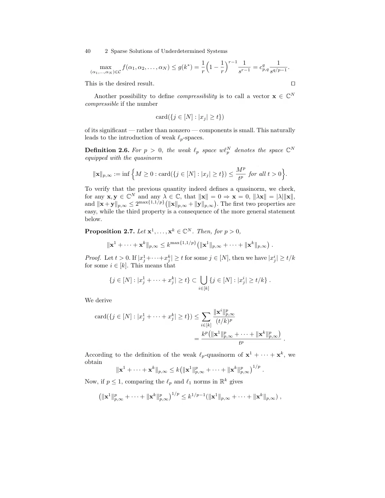

~~~text
40       2 Sparse Solutions of Underdetermined Systems

                                                            1    1 r−1 1             1
       max          f (α1 , α2 , . . . , αN ) ≤ g(k ∗ ) =      1−        r−1
                                                                             = cqp,q q/p−1 .
  (α1 ,...,αN )∈C                                           r     r     s           s
This is the desired result.                                                                     t
                                                                                                u

   Another possibility to define compressibility is to call a vector x ∈ CN
compressible if the number

                                    card({j ∈ [N ] : |xj | ≥ t})

of its significant — rather than nonzero — components is small. This naturally
leads to the introduction of weak `p -spaces.

Definition 2.6. For p > 0, the weak `p space w`N     p denotes the space C
                                                                           N

equipped with the quasinorm
                 n                                      Mp             o
   kxkp,∞ := inf M ≥ 0 : card({j ∈ [N ] : |xj | ≥ t}) ≤ p for all t > 0 .
                                                        t
To verify that the previous quantity indeed defines a quasinorm, we check,
for any x, y ∈ CN and any λ ∈ C, that kxk = 0 ⇒ x = 0, kλxk = |λ|kxk,
and kx + ykp,∞ ≤ 2max{1,1/p} kxkp,∞ + kykp,∞ . The first two properties are
easy, while the third property is a consequence of the more general statement
below.

Proposition 2.7. Let x1 , . . . , xk ∈ CN . Then, for p > 0,

          kx1 + · · · + xk kp,∞ ≤ k max{1,1/p} kx1 kp,∞ + · · · + kxk kp,∞ .
                                                                          

Proof. Let t > 0. If |x1j +· · ·+xkj | ≥ t for some j ∈ [N ], then we have |xij | ≥ t/k
for some i ∈ [k]. This means that
                                                 [
         {j ∈ [N ] : |x1j + · · · + xkj | ≥ t} ⊂    {j ∈ [N ] : |xij | ≥ t/k} .
                                                        i∈[k]

We derive
                                                            X kxi kpp,∞
     card({j ∈ [N ] : |x1j + · · · + xkj | ≥ t}) ≤
                                                                    (t/k)p
                                                            i∈[k]
                                                                                          
                                                        k p kx1 kpp,∞ + · · · + kxk kpp,∞
                                                      =                                     .
                                                                       tp
According to the definition of the weak `p -quasinorm of x1 + · · · + xk , we
obtain                                                            1/p
          kx1 + · · · + xk kp,∞ ≤ k kx1 kpp,∞ + · · · + kxk kpp,∞      .
Now, if p ≤ 1, comparing the `p and `1 norms in Rk gives
                                          1/p
       kx1 kpp,∞ + · · · + kxk kpp,∞             ≤ k 1/p−1 (kx1 kp,∞ + · · · + kxk kp,∞ ) ,
~~~

## Page 53

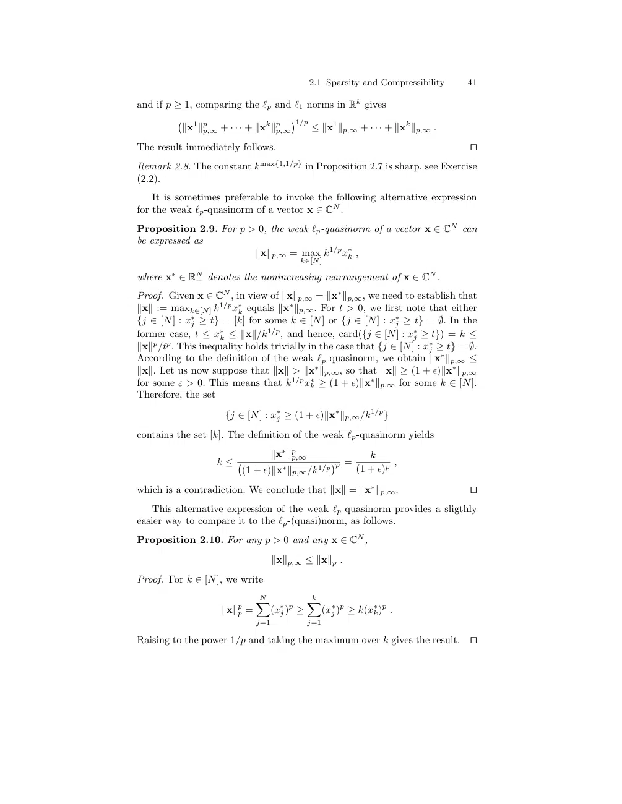

~~~text
                                                 2.1 Sparsity and Compressibility      41

and if p ≥ 1, comparing the `p and `1 norms in Rk gives
                                        1/p
          kx1 kpp,∞ + · · · + kxk kpp,∞      ≤ kx1 kp,∞ + · · · + kxk kp,∞ .
The result immediately follows.                                                         t
                                                                                        u
                               max{1,1/p}
Remark 2.8. The constant k                       in Proposition 2.7 is sharp, see Exercise
(2.2).
    It is sometimes preferable to invoke the following alternative expression
for the weak `p -quasinorm of a vector x ∈ CN .
Proposition 2.9. For p > 0, the weak `p -quasinorm of a vector x ∈ CN can
be expressed as
                        kxkp,∞ = max k 1/p x∗k ,
                                            k∈[N ]

where x∗ ∈ RN                                                 N
            + denotes the nonincreasing rearrangement of x ∈ C .

Proof. Given x ∈ CN , in view of kxkp,∞ = kx∗ kp,∞ , we need to establish that
kxk := maxk∈[N ] k 1/p x∗k equals kx∗ kp,∞ . For t > 0, we first note that either
{j ∈ [N ] : x∗j ≥ t} = [k] for some k ∈ [N ] or {j ∈ [N ] : x∗j ≥ t} = ∅. In the
former case, t ≤ x∗k ≤ kxk/k 1/p , and hence, card({j ∈ [N ] : x∗j ≥ t}) = k ≤
kxkp /tp . This inequality holds trivially in the case that {j ∈ [N ] : x∗j ≥ t} = ∅.
According to the definition of the weak `p -quasinorm, we obtain kx∗ kp,∞ ≤
kxk. Let us now suppose that kxk > kx∗ kp,∞ , so that kxk ≥ (1 + )kx∗ kp,∞
for some ε > 0. This means that k 1/p x∗k ≥ (1 + )kx∗ kp,∞ for some k ∈ [N ].
Therefore, the set
                      {j ∈ [N ] : x∗j ≥ (1 + )kx∗ kp,∞ /k 1/p }
contains the set [k]. The definition of the weak `p -quasinorm yields
                                     kx∗ kpp,∞                   k
                    k≤                           p =          ,
                          (1 + )kx∗ kp,∞ /k 1/p      (1 + )p

which is a contradiction. We conclude that kxk = kx∗ kp,∞ .                             t
                                                                                        u
    This alternative expression of the weak `p -quasinorm provides a sligthly
easier way to compare it to the `p -(quasi)norm, as follows.
Proposition 2.10. For any p > 0 and any x ∈ CN ,
                                     kxkp,∞ ≤ kxkp .
Proof. For k ∈ [N ], we write
                               N
                               X                 k
                                                 X
                     kxkpp =         (x∗j )p ≥     (x∗j )p ≥ k(x∗k )p .
                               j=1               j=1

Raising to the power 1/p and taking the maximum over k gives the result. t
                                                                         u
~~~

## Page 54

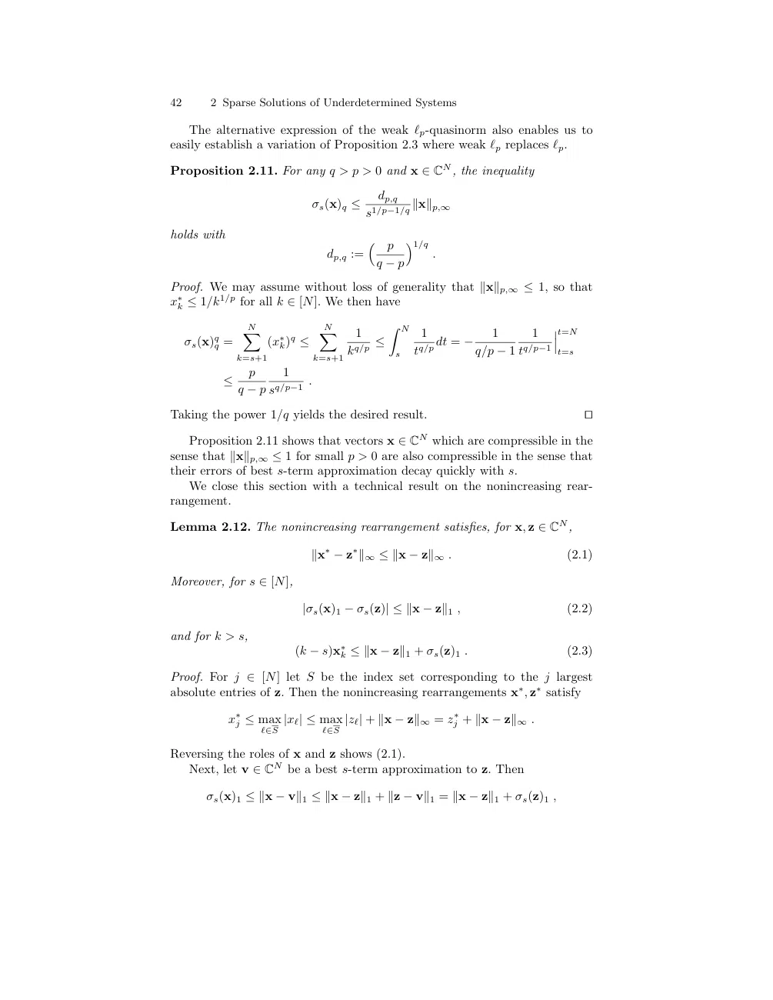

~~~text
42        2 Sparse Solutions of Underdetermined Systems

    The alternative expression of the weak `p -quasinorm also enables us to
easily establish a variation of Proposition 2.3 where weak `p replaces `p .

Proposition 2.11. For any q > p > 0 and x ∈ CN , the inequality
                                                     dp,q
                                   σs (x)q ≤                kxkp,∞
                                                   s1/p−1/q
holds with                                          p 1/q
                                     dp,q :=                .
                                                    q−p
Proof. We may assume without loss of generality that kxkp,∞ ≤ 1, so that
x∗k ≤ 1/k 1/p for all k ∈ [N ]. We then have
                   N                N                  Z N                                   t=N
                   X                X          1              1                 1        1
     σs (x)qq =        (x∗k )q ≤               q/p
                                                   ≤                dt = −
                  k=s+1            k=s+1
                                           k            s    tq/p            q/p − 1 t q/p−1 t=s

                    p      1
            ≤                  .
                  q − p sq/p−1

Taking the power 1/q yields the desired result.                                                    t
                                                                                                   u

   Proposition 2.11 shows that vectors x ∈ CN which are compressible in the
sense that kxkp,∞ ≤ 1 for small p > 0 are also compressible in the sense that
their errors of best s-term approximation decay quickly with s.
   We close this section with a technical result on the nonincreasing rear-
rangement.

Lemma 2.12. The nonincreasing rearrangement satisfies, for x, z ∈ CN ,

                                   kx∗ − z∗ k∞ ≤ kx − zk∞ .                                   (2.1)

Moreover, for s ∈ [N ],

                              |σs (x)1 − σs (z)| ≤ kx − zk1 ,                                 (2.2)

and for k > s,
                            (k − s)x∗k ≤ kx − zk1 + σs (z)1 .                                 (2.3)

Proof. For j ∈ [N ] let S be the index set corresponding to the j largest
absolute entries of z. Then the nonincreasing rearrangements x∗ , z∗ satisfy

              x∗j ≤ max |x` | ≤ max |z` | + kx − zk∞ = zj∗ + kx − zk∞ .
                      `∈S           `∈S

Reversing the roles of x and z shows (2.1).
   Next, let v ∈ CN be a best s-term approximation to z. Then

         σs (x)1 ≤ kx − vk1 ≤ kx − zk1 + kz − vk1 = kx − zk1 + σs (z)1 ,
~~~

## Page 55

~~~text
                                   2.2 Minimal Number of Measurements        43

and again by symmetry this establishes (2.2). Also (2.3) follows from this
estimate by noting that
                                k
                                X               X
                 (k − s)x∗k ≤           x∗j ≤           x∗j = σs (x)1 .
                                j=s+1           j≥s+1

This completes the proof.                                                     t
                                                                              u

2.2 Minimal Number of Measurements
The compressive sensing problem consists in reconstructing an s-sparse vector
x from
                                 y = Ax
where A ∈ Cm×N is the so-called measurement matrix, and m < N . Then
the above system of linear equations is underdetermined, but the hope is that
the sparsity assumption helps in identifying the original sparse x.
    In this section, we examine the question on the minimal number of lin-
ear measurements needed to reconstruct s-sparse vectors from these mea-
surements, regardless of the practicality of the reconstruction scheme. This
question can in fact take two meanings, depending on whether we require
that the measurement scheme allows the reconstruction of all s-sparse vectors
x ∈ CN simultaneously, or whether we require that, given an s-sparse vector
x ∈ CN , the measurement scheme allows the reconstruction of this specific
vector. While the second scenario seems to be unnatural at first sight because
the vector x is unknown a priori, it will become important later when aiming
at recovery guarantees when the matrix A is chosen at random and the sparse
vector x is fixed (so called nonuniform recovery guarantees).
    The minimal number m of measurements depends on the setting consid-
ered, namely it equals 2s in the first case and s+1 in the second case. However,
we will see in Chapter 11 that if we also require the reconstruction scheme to
be stable (the meaning will be made precise later), then the minimal number
of required measurements additionally involves a factor of ln(N/s), so that
recovery will never be stable with only 2s measurements.
    Before separating the two settings discussed above, it is worth pointing
out the equivalence of the following properties.
(a) the s-sparse vector x ∈ CN is the unique s-sparse solution of Az = y with
    y = Ax, that is, {z ∈ CN : Az = Ax, kzk0 ≤ s} = {x},
(b) the s-sparse vector x ∈ CN can be reconstructed as the unique solution of
                      minimize kzk0         subject to Az = y.             (P0 )
                         z∈CN

Indeed, if an s-sparse x ∈ CN is the unique s-sparse solution of Az = y with
y = Ax, then a solution x] of (P0 ) is s-sparse and satisfies Ax] = y, so that
x] = x. This shows (a) ⇒ (b). The implication (b) ⇒ (a) is clear.
~~~

## Page 56

~~~text
44     2 Sparse Solutions of Underdetermined Systems

Recovery of all sparse vectors

Before stating the main result for this case, we observe that the uniqueness
of sparse solutions of underdetermined linear systems can be reformulated in
several ways. For a matrix A ∈ Cm×N and a subset S ⊂ [N ], we use the
notation AS to indicate the column submatrix of A consisting of the columns
indexed by S. Similarly, for x ∈ CN we denote by xS either the sub-vector in
CS consisting of the entries indexed by S, that is, (xS )` = v` for ` ∈ S, or the
vector in CN which coincides with x on the entries in S and is zero on the
entries outside S, that is,
                                     
                                       x` if ` ∈ S ,
                            (xS )` =                                        (2.4)
                                       0 if ` ∈/S.

It should always become clear from the context, which of the two options
apply.
Theorem 2.13. Given A ∈ Cm×N , the following properties are equivalent.
(a) Every s-sparse vector x ∈ CN is the unique s-sparse solution of Az = Ax,
    that is, if Ax = Az and both x and z are s-sparse then x = z.
(b) The null space ker A does not contain an 2s-sparse vector other than the
    zero vector, that is, ker A ∩ {z ∈ CN : kzk0 ≤ 2s} = {0}.
(c) For every S ⊂ [N ] with card(S) ≤ 2s, the submatrix AS is injective.
(d) Every set of 2s columns of A is linearly independent.
Proof. (a)⇔(b) Let x and z be s-sparse with Ax = Az. Then x − z is 2s-
sparse and A(x − z) = 0. If the kernel does not contain any 2s-sparse vector
different from the zero vector then x = z.
    Conversely, assume that for every s-sparse vector x ∈ CN we have {z ∈
  N
C : Az = Ax, kzk0 ≤ s} = {x}. Let v ∈ ker A be 2s-sparse. We can write
v = x − z for s-sparse vectors x, z with supp x ∩ supp z = ∅. Then Ax = Az,
and by assumption x = z. Since the supports of x and z are disjoint it follows
that x = z = 0 and v = 0.
    For the equivalence of (b), (c) and (d) we observe that for a 2s-sparse
vector v with S = supp v we have Av = AS vS . Noting that S = supp v
ranges through all possible subsets of [N ] of cardinality card(S) ≤ 2s when
v ranges through all possible 2s-sparse vectors completes the proof by basic
linear algebra.                                                              t
                                                                             u
    We observe, in particular, that if it is possible to reconstruct every s-sparse
vector x ∈ CN from the knowledge of its measurement vector y = Ax ∈ Cm ,
then (i) holds, and consequently so does (iv). This implies rank(A) ≥ 2s. We
also have rank(A) ≤ m, because the rank is at most equal to the number
of rows. Therefore, the number of measurements needed to reconstruct every
s-sparse vector always satisfies

                                     m ≥ 2s.
~~~

## Page 57

~~~text
                                     2.2 Minimal Number of Measurements          45

We are now going to see that m = 2s measurements suffice to reconstruct
every s-sparse vector — at least in theory.

Theorem 2.14. For any integer N ≥ 2s, there exists a measurement matrix
A ∈ Cm×N with m = 2s rows such that every s-sparse vector x ∈ CN can be
recovered from its measurement vector y = Ax ∈ Cm as a solution of (P0 ).

Proof. Let us fix tN > · · · > t2 > t1 > 0 and consider the matrix A ∈ Cm×N
with m = 2s defined by
                                                          
                                    1      1 ··· 1
                                t1        t2 · · · tN 
                        A= .                           ..  .          (2.5)
                               
                                            ..
                                                           
                                ..          . ··· . 
                                 t12s−1 t22s−1 · · · tN
                                                      2s−1

Let S = {j1 < · · · < j2s } be an index set of cardinality 2s. The square matrix
AS ∈ C2s×2s is (the transpose of) a Vandermonde matrix. Theorem A.25
yields
                            1     1 ··· 1
                           tj1 tj2 · · · tj2s      Y
           det(AS ) =       ..    ..        ..   =    (tj` − tjk ) > 0.
                             .     . ··· .           k<`
                         t2s−1
                          j1   tj2s−1
                                  2
                                      · · · tj2s−1
                                               2s

This shows that AS is invertible, in particular injective. Since the condi-
tion (iii) of Theorem 2.13 is fulfilled, every s-sparse vector x ∈ CN is the
unique s-sparse vector satisfying Az = Ax, so it can be recovered as the
unique solution of (P0 ).                                                  t
                                                                           u

    Many other matrices meet the condition (iii) of Theorem 2.13. As an
example, the integer powers of t1 , . . . , tN in the matrix of (2.5) do not need to
be the consecutive integers 0, 1, . . . , 2s−1. Instead of the N ×N Vandermonde
matrix associated with tN > · · · > t1 > 0, we can start with any matrix
M ∈ RN ×N that is totally positive, i.e., that satisfies det MI,J > 0 for any
sets I, J ⊂ [N ] of same cardinality, where MI,J represents the submatrix of
M with rows indexed by I and columns indexed by J. We then select any
m = 2s rows of M, indexed by a set I, say, to form the matrix A. Then, for
an index S ⊂ [N ] of cardinality 2s, the matrix AS reduces to MI,S , hence it
is invertible. As another example, the numbers tN , . . . , t1 do not need to be
positive nor real, as long as det(AS ) 6= 0 instead of det(AS ) > 0. In particular,
with t` = ei2π(`−1)/N for ` ∈ [N ], Theorem A.25 guarantees that the partial
Fourier matrix
                                                                        
                  1        1               1       ···         1
                1      ei2π/N         ei2π2/N     ···   ei2π(N −1)/N 
           A = .
                                                                        
                           .               .        .          ..
                 ..       ..              ..       ..                   
                                                                .        
                  1 ei2π(2s−1)/N ei2π(2s−1)2/N · · · ei2π(2s−1)(N −1)/N
~~~

## Page 58

~~~text
46      2 Sparse Solutions of Underdetermined Systems

allows the reconstruction of every s-sparse vector x ∈ CN from y = Ax ∈ C2s .
In fact, an argument similar to the one the we will use for Theorem 2.16
below shows that the set of (2s) × N matrices such that det(AS ) = 0 for
some S ⊂ [N ] with card(S) ≤ 2s has Lebesgue measure zero, hence most
(2s) × N matrices allow the reconstruction of every s-sparse vector x ∈ CN
from y = Ax ∈ C2s . In general, the reconstruction procedure consisting
in solving (P0 ) is not feasible in practice, as will be shown in Section 2.3.
However, in the case of Fourier measurements, a better reconstruction scheme
based on the Prony method can be used.

Theorem 2.15. For any N ≥ 2s, there exists a practical procedure for the
reconstruction of every 2s-sparse vector from its first m = 2s discrete Fourier
measurements.

Proof. Let x ∈ CN be an s-sparse vector, which we interpret as a function x
from {0, 1, . . . , N −1} into C supported on an index set S ⊂ {0, 1, . . . , N −1} of
size s. We suppose that this vector is observed via its first 2s discrete Fourier
coefficients x̂(0), . . . , x̂(2s − 1), where
                                N
                                X −1
                    x̂(j) :=           x(k)e−i2πjk/N ,      0 ≤ j ≤ N − 1.
                                k=0

We consider the trigonometric polynomial of degree s defined by
                             Y
                                 1 − e−i2πk/N ei2πt/N .
                                                     
                     p(t) :=
                                        k∈S

This polynomial vanishes exactly for t ∈ S, so we aim at finding the unknown
set S by determining p, or equivalently its Fourier transform p̂. We note that,
since x vanishes on the complementary set S of S in {0, 1, . . . , N − 1}, we
have p(t)x(t) = 0 for all 0 ≤ t ≤ N − 1. By discrete convolution, we obtain
p̂ ∗ x̂ = pd
           · x = 0, that is to say
                   N
                   X −1
 (p̂ ∗ x̂)(j) :=          p̂(k) · x̂(j − k    mod N ) = 0     for all 0 ≤ j ≤ N − 1. (2.6)
                   k=0

We also note that, since N1 p̂(k) is the coefficient of p(t) on the monomial
ei2πkt/N and since p has degree s, we have p̂(0) = 1 and p̂(k) = 0 for all k > s.
It remains to determine the s discrete Fourier coefficients p̂(1), . . . , p̂(s). For
this purpose, we write the s equations (2.6) in the range s ≤ j ≤ 2s − 1 in the
form
                x̂(s) + p̂(1)x̂(s − 1) + · · · + p̂(s)x̂(0) = 0,
             x̂(s + 1) + p̂(1)x̂(s) + · · · + p̂(s)x̂(1) = 0,
                   ..           ..        ..           ..         ..
                    .            .           .          .          .
               x̂(2s − 1) + p̂(1)x̂(2s − 2) + · · · + p̂(s)x̂(s − 1) = 0.
~~~

## Page 59

~~~text
                                        2.2 Minimal Number of Measurements             47

This translates into the system
                                                                       
          x̂(s − 1) x̂(s − 2) · · ·      x̂(0)        p̂(1)          x̂(s)
         x̂(s)      x̂(s − 1) · · ·     x̂(1)      p̂(2)     x̂(s + 1) 
                                                     ..  = −            .
                                                                       
              ..         ..    ..          ..                          ..
               .          .       .         .      .                .  
           x̂(2s − 2) x̂(2s − 3) · · · x̂(s − 1)      p̂(s)       x̂(2s − 1)
Because x̂(0), . . . , x̂(2s − 1) are known, we solve for p̂(1), . . . , p̂(s). Since the
Toeplitz matrix above is not always invertible — take e.g. x = [1, 0, . . . , 0]> ,
so that x̂ = [1, 1, . . . , 1]> — we obtain a solution q̂(1), . . . , q̂(s) not guaranteed
to be p̂(1), . . . , p̂(s). Appending the values q̂(0) = 1 and q̂(k) = 0 for all k > s,
the linear system reads
                     (q̂ ∗ x̂)(j) = 0     for all s ≤ j ≤ 2s − 1.
Therefore, the s-sparse vector q · x has a Fourier transform qd  · x = q̂ ∗ x̂
vanishing on a set of s consecutive indices. Writing this in matrix form and
using Theorem A.25, we derive that q · x = 0, so that the trigonometric
polynomial q vanishes on S. Since the degree of q is at most s, the set of
zeros of q coincide with the set S, which can thus be found by solving a
polynomial equation — or simply by identifying the s smallest values of |p(j)|,
0 ≤ j ≤ N − 1. Finally, the values of x(j), j ∈ S, are obtained by solving
the overdetermined system of 2s linear equations imposed by the knowledge
of x(0), . . . , x(2s − 1).                                                  t
                                                                             u
    Despite its appeal, the reconstruction procedure just described hides some
important drawbacks. Namely, it is not stable with respect to sparsity defects
nor is it robust with respect to measurement errors. The reader is invited
to verify this statement numerically in Exercise 2.8. In fact, we will prove in
Chapter 11 that any stable scheme for s-sparse reconstruction requires at least
m ≈ c s ln(eN/s) linear measurements, where c > 0 is a constant depending
on the stability requirement.

Recovery of individual sparse vectors

In the next setting, the s-sparse vector x ∈ CN is fixed before the measurement
matrix A ∈ Cm×N is chosen. The conditions for the vector x to be the unique
s-sparse vector consistent with the measurements depend on A as well as on
x itself. While this seems to be unnatural at first sight because x is unknown
a-priori, the philosophy is that the conditions will be met for most (s + 1) × N
matrices. This setup is relevant because the measurement matrices are often
chosen at random.
Theorem 2.16. For any N ≥ s + 1, given an s-sparse vector x ∈ CN , there
exists a measurement matrix A ∈ Cm×N with m = s + 1 rows such that the
vector x can be reconstructed from its measurement vector y = Ax ∈ Cm as
a solution of (P0 ).
~~~

## Page 60

~~~text
48       2 Sparse Solutions of Underdetermined Systems

Proof. Let A ∈ C(s+1)×N be a matrix for which the s-sparse vector x cannot
be recovered from y = Ax (via `0 -minimization). This means that there exists
a vector z ∈ CN distinct from x, supported on a set S = supp(z) = {j1 , . . . , js }
of size at most s (if kzk0 < s we fill up S with arbitrary elements j` ∈ [N ]),
and such that Az = Ax. If supp(x) ⊂ S, then the equality A(z − x) [s] = 0
shows that the square matrix A[s],S is noninvertible, hence

              f (a1,1 , . . . , a1,N , . . . , am,1 , . . . , am,N ) := det(A[s],S ) = 0.

If supp(x) 6⊂ S, then the space V := {u ∈ CN : supp(u) ⊂ S} + Cx has
dimension s + 1, and the linear map G : V → Cs+1 , v 7→ Av is noninvertible,
since G(z−x) = 0. The matrix of the linear map G in the basis (ej1 , . . . , ejs , x)
of V takes the form
                                             P
                        a1,j1 · · · a1,js     j∈supp(x) xj a1,j
                                                                

             Bx,S :=  ...     ..       ..          ..
                                                                 ,
                                                                
                                   .     .           .
                                            P
                       as+1,j1 · · · as+1,js j∈supp(x) xj as+1,j

and we have

              gS (a1,1 , . . . , a1,N , . . . , am,1 , . . . , am,N ) := det(Bx,S ) = 0.

This shows that the entries of the matrix A satisfy
                                                                               [
      (a1,1 , . . . , a1,N , . . . , am,1 , . . . , am,N ) ∈ f −1 ({0}) ∪               gS−1 ({0}).
                                                                            card(S)=s

But since f and all gS , card(S) = s, are nonzero polynomial functions of the
variables (a1,1 , . . . , a1,N , . . . , am,1 , . . . , am,N ), the sets f −1 ({0}) and gS−1 ({0}),
card(S) = s, have Lebesgue measure zero, and so does their union. It remains
to choose the entries of the matrix A outside of this union of measure zero to
ensure that the vector x can be recovered from y = Ax.                                           t
                                                                                                 u

2.3 NP-Hardness of `0 -Minimization
As mentioned in Section 2.2, reconstructing an s-sparse vector x ∈ CN from its
measurement vector y ∈ Cm amounts to solving the `0 -minimization problem

                           minimize kzk0           subject to Az = y.                                 (P0 )
                              z∈CN

Since a minimizer has sparsity at most s, the straightforward approach for
finding it consists in solving every rectangular system AS u = y, or rather
every square system A∗S AS u = A∗S y, for u ∈ Cs where S runs through        all
the possible subsets of [N ] with size s. However, since the number Ns of these
                                                                      

subsets is prohibitively large, such a straightforward approach is completely
~~~

## Page 61

~~~text
                                      2.3 NP-Hardness of `0 -Minimization       49

unpractical. By way of illustration, for small problem sizes N = 1000 and
                                                10
s = 10, we would have to solve 1000      ≥ 1000
                                       
                                    10       10      = 1020 linear systems of
size 10 × 10. Even if each such system could be solved in 10−10 seconds, the
time required to solve (P0 ) with this approach would still be 1010 seconds,
i.e., more than 300 years. We are going to show that solving (P0 ) in fact is
intractable for any possible approach. Precisely, for any fixed η ≥ 0, we are
going to show that the more general problem

                 minimize kzk0      subject to kAz − yk2 ≤ η.               (P0,η )
                    z∈CN

is N P -hard.
    We start by introducing the necessary terminology from computational
complexity. First, a polynomial-time algorithm is an algorithm performing its
task in a number of steps bounded by a polynomial expression in the size
of the input. Next, let us describe in a rather informal way a few classes of
decision problems.
•   The class P of P -problems consists of all decision problems for which there
    exists a polynomial-time algorithm finding a solution.
•   The class NP of N P -problems consists of all decision problems for which
    there exists an polynomial-time algorithm certifying a solution. Note that
    the class P is clearly contained in the class NP.
•   The class NP-hard of N P -hard problems consist of all problems (not nec-
    essarily decision problems) for which a solving algorithm could be trans-
    formed in polynomial time into a solving algorithm for any N P -problem.
    Roughly speaking, this is the class of problems at least as hard as any
    N P -problem. Note that the class NP-hard is not contained in the class
    NP.
•   The class NP-complete of N P -complete problems consist of all problems
    that are both N P and N P -hard; in other words, it consists of all the N P
    problems at least as hard as any other N P -problem.
The situation can be summarized with as in Figure 2.3. It is a common belief
that P is strictly contained in NP, that is to say that there are problems which
can be verified, but not solved, in polynomial time. However, this remains a
major open question to this day. There is a vast catalog of N P -complete
problems, the most famous of which being perhaps the traveling salesman
problem. The one we are going to use is exact cover by 3-sets.

Exact cover by 3-sets problem:
Given a collection {Ci , i = 1, . . . , N } of 3-element subsets of [m], does there
exist an exact cover (a partition) of [m], i.e., a set J ∈ [N ] such that ∪j∈J Cj =
[m] and Cj ∩ Cj 0 = ∅ for all j, j 0 ∈ J with j 6= j 0 ?

Taking for granted that this problem is N P -complete, we can now prove the
main result of this section.
~~~

## Page 62

~~~text
50      2 Sparse Solutions of Underdetermined Systems

                   NP

        '                        $
                                 NP-complete                       NP-hard

                   P

        &                        %

Fig. 2.1. Schematic representation of P , N P , N P -complete and N P -hard problems

Theorem 2.17. For any η ≥ 0, the `0 -minimization problem (P0,η ) for gen-
eral A ∈ Cm×N and y ∈ Cm is N P -hard.
Proof. By rescaling, we may and do assume that η < 1. According to the
previous considerations, it is enough to show that the exact cover by 3-sets
problem can be reduced in polynomial time to the `0 -minimization problem.
Let then {Ci , i = 1, . . . , N } be a collection of 3-element subsets of [m]. We
define vectors a1 , a2 , . . . , aN ∈ Cm by
                                            
                                              1 if j ∈ Ci ,
                                   (ai )j =
                                              0 if j 6∈ Ci .

We then define a matrix A ∈ Cm×N and a vector y ∈ Cm by
                                

                A = a1 a2 · · · aN  ,         y = [1, 1, . . . , 1]> .

Since N ≤ m
              
             3 , this construction can be done in polynomial time. If a vector
z ∈ CN obeys kAz − yk2 ≤ η, then all the m components of the vector Az
are distant to 1 by at most η, so they are nonzero and kAzk0 = m. But since
                                                                   PN
each vector ai has exactly 3 nonzero components, the vector Az = j=1 zj aj
has at most 3kzk0 nonzero components, kAzk0 ≤ 3kzk0 . Therefore, a vector
z ∈ CN obeying kAz − yk2 ≤ η must satisfy kzk0 ≥ m/3. Let us now run
the `0 -minimization problem, and let x ∈ CN denote the output. We separate
two cases:
 1. if kxk0 = m/3, then the collection {Cj , j ∈ supp(x)} forms an exact cover
                                                      PN
    of [m], for otherwise the m components of Ax = j=1 xj aj would not all
    be nonzero;
~~~

## Page 63

~~~text
                                     2.3 NP-Hardness of `0 -Minimization      51

 2. if kxk0 > m/3, then no exact cover {Cj , j ∈ J} can exist, for otherwise
    the vector z ∈ CN defined by zj = 1 if j ∈ J and zj = 0 if j 6∈ J would
    satisfy Az = y and kzk0 = m/3, contradicting the `0 -minimality of x.
This shows that solving the `0 -minimization problem enables one to solve the
exact cover by 3-sets problem.                                              t
                                                                            u

    Theorem 2.17 seems rather pessimistic at first sight. However, it concerns
the intractability of the problem (P0 ) for general matrices A and vectors y.
In other words, any algorithm that is able to solve (P0 ) for any choice of A
and any choice of y must necessarily be intractable (unless P = N P ). In
compressed sensing, we will rather consider special choices of A and choose
y = Ax for some sparse x. We will see that a variety of tractable algorithms
will then provably recover x from y and thereby solve (P0 ) for such specifically
designed matrices A. However, to emphasize this point once more, such algo-
rithms will not successfully solve the `0 -minimization problem for all possible
choices of A and y due to N P -hardness. A selection of tractable algorithms
is introduced in the coming chapter.

Notes
Proposition 2.3 is an observation due to S. Stechkin. In the case p = 1 and
q = 2, the optimal constant c1,2 = 1/2 was obtained by A. Gilbert, M. Strauss,
J. Tropp, and R. Vershynin in [195]. Theorem 2.5 with optimal constants cp,q
for all q > p > 0 is a particular instance of a more general result, which also
contains the shifting inequality of Exercise 6.14, see [181].
    The weak `p -spaces are weak Lp -spaces for purely atomic measures. The
weak Lp -spaces are also denoted Lp,∞ and generalize to Lorentz spaces Lp,q
[245]. Thus, weak `p -spaces are a particular instance of more general spaces
equipped with the norm
                                    N
                                   X                      1/q
                        kxkp,q =         k q/p−1 (x∗k )q
                                   k=1

    The result of Theorem 2.16 is due to M. Wakin in [440]. Theorem 2.13
can be found in the article by A. Cohen, W. Dahmen, and R. DeVore [102].
One can also add an equivalent proposition expressed in terms of spark or
in terms of Kruskal rank. The spark sp(A) of a matrix A was defined by
D. Donoho and M. Elad in [133] as the minimal size of a linearly dependent
set of columns of A. It is related to the Kruskal rank kr(A) of A, defined
in [271] as the maximal integer k such that any k columns of A are linearly
independent, via sp(A) = kr(A) + 1. Thus, according to Theorem 2.13, every
s-sparse vector x ∈ CN is the unique s-sparse solution of Az = Ax if and
only if kr(A) ≥ 2s, or if sp(A) > 2s.
~~~

## Page 64

~~~text
52      2 Sparse Solutions of Underdetermined Systems

    Totally positive matrices were extensively studied by S. Karlin in [258].
One can also consult the more recent book [336] by A. Pinkus.
    The reconstruction procedure of Theorem 2.15 based on a discrete version
of the Prony method was known long before the development of compressive
sensing. It is also related to Reed–Solomon decoding [42, 199]. The general
Prony method [347] is designed for recovering a nonharmonic Fourier series
of the form
                                      s
                                      X
                              f (t) =   xk e2πiωk t
                                       k=1

from equidistant samples f (0), f (k/α), f (2k/α), . . . , f (2s/α). Here both the
ωk ∈ R and the xk are unknown. First the ωk are found by solving an eigen-
value problem for a Hankel matrix associated to the samples of f . In the
second step, the xk are found by solving a linear system of equations. The
difference to the method of Theorem 2.15 is due to the fact that the ωk are
not assumed to lie on a grid anymore. We refer to [308, 296] for more details.
The Prony method has the disadvantage of being unstable. Several approaches
have been proposed to stabilize it [11, 12, 36, 37, 346], although there seems
to be a limit of how stable it can get when the number s of terms gets larger.
The recovery methods in so-called theory of finite rate of innovation are also
related to the Prony method [45].
    For an introduction to computational complexity, one can consult [15]. The
N P -hardness of the `0 -minimization problem was proved by B. Natarajan in
[310]. It was later proved by D. Ge, X. Jiang, and Y. Ye in [190] that the
`p -minimization problem is N P -hard also for any p < 1, see Exercise 2.10.

Exercises
2.1. For 0 < p < 1, prove that the pth power of the `p -quasinorm satisfies the
triangle inequality

                    kx + ykpp ≤ kxkpp + kykpp ,       x, y ∈ CN .

Deduce the inequality

kx1 + · · · + xk kp ≤ k max{0,1/p−1} kx1 kp + · · · + kxk kp ,      x1 , . . . , xk ∈ C N .
                                                            

2.2. Show that the constant k max{1,1/p} in Proposition 2.7 is sharp.

2.3. If u, v ∈ CN are disjointly supported, prove that

           max(kuk1,∞ , kvk1,∞ ) ≤ ku + vk1,∞ ≤ kuk1,∞ + kvk1,∞ ,

and show that these inequalities are sharp.
~~~

## Page 65

~~~text
                                          2.3 NP-Hardness of `0 -Minimization           53

2.4. As a converse to Proposition 2.10, prove that for any p > 0 and any
x ∈ CN ,
                        kxkp ≤ ln(eN )1/p kxkp,∞ .
2.5. Given q > p > 0 and x ∈ CN , modify the proof of Proposition 2.3 to
                    1−p/q  p/q
obtain σs (x)q ≤ kxkp,∞ kxkp /s1/p−1/q .
2.6. Let (B0n , B1n , . . . , Bnn ) be the Bernstein polynomials of degree n defined
by                                          
                                            n i
                                Bin (x) :=     x (1 − x)n−i .
                                            i
For 0 < x0 < x1 < · · · < xn < 1, prove that the matrix [Bin (xj )]ni,j=0 is totally
positive.
2.7. Prove that the product of two totally positive matrices is totally positive.
2.8. Implement the reconstruction procedure based on 2s discrete Fourier
measurements as was described in Section 2.2. Test it on a few random ex-
amples. Then incorporate small sparsity defect and small measurement error
in further tests of the procedure.
2.9. Let us assume that the vectors x ∈ RN are no longer observed via linear
measurements y = Ax ∈ Rm , but rather via measurements y = f (x) where
f : RN → Rm is a continuous map satisfying f (−x) = −f (x) for all x ∈ RN .
Prove that the minimal number of measurements needed to reconstruct every
s-sparse vector equals 2s.
2.10. NP-Hardness of `p -minimization for 0 < p < 1.
Given A ∈ Cm×N and y ∈ Cm , the `p -minimization problem consists in
computing a vector x ∈ CN with minimal `p -quasinorm subject to Ax = y.
Assuming the N P -completeness of the partition problem, which     P consists,      P given
integers a1 , . . . , an , in finding two sets I, J ⊂ [n] such that i∈I ai = j∈J aj ,
prove that the `p -minimization problem is N P -hard. It will be helpful to
introduce the matrix A and the vector y defined by
                                               
              a1 a2 · · · an a1 a2 · · · an
            1 0 ··· 0 1 0 ··· 0 
                                               
     A :=  0 1 · · · 0 0 1 · · · 0                  and      y = [0, 1, 1, . . . , 1]> .
                                               
            ..           .        .
                            . . 0 ..     . .. 0 
                                                
           .
               0 ··· 0 1 0 ··· 0 1
2.11. NP-Hardness of rank minimization.
Show that the rank-minimization problem
                    minimize
                       n ×n
                             rank(Z)        subject to A(X) = y .
                    Z∈R 1     2

is NP-hard on the set of linear measurement maps A : Rn1 ×n2 → Rm and
vectors y ∈ Rm .
~~~

## Page 66

*Page blanche.*

## Page 67

~~~text
3
Basic Algorithms

In this chapter, a selection of popular algorithms used in Compressive Sensing
is presented. The algorithms are divided into three categories: optimization
methods, greedy methods, and thresholding-based methods. Their rigorous
analyses are postponed until later, when appropriate tools such as coherence
and restricted isometry constants become available. Only intuitive justification
is given for now.

3.1 Optimization Methods
An optimization problem is a problem of the type
              minimize F0 (x)      subject to Fi (x) ≤ bi , 1 ≤ i ≤ n,
                 x∈RN

where the function F0 : RN → R is called objective function and the functions
F1 , . . . , Fn : RN → R are called constraint functions . This general framework
also encompasses equality constraints of the type Gi (x) = ci , since the equality
Gi (x) = ci is equivalent to the inequalities Gi (x) ≤ ci and −Gi (x) ≤ −ci . If
F0 , F1 , . . . , Fn are all convex functions, then the problem is called a convex op-
timization problem — see Appendix B.5 for more information. If F0 , F1 , . . . , Fn
are all linear functions, then the problem is called a linear program. Our sparse
recovery problem is in fact an optimization problem, since it translates into
                        minimize kzk0     subject to Az = y.                     (P0 )
This is a nonconvex problem, and we even have seen in Theorem 2.17 that it
is N P -hard in general. However, keeping in mind that kzkqq approaches kzk0
as q > 0 tends to zero, we can approximate (P0 ) by the problem
                        minimize kzkq     subject to Az = y.                     (Pq )
For q > 1, even 1-sparse vectors are not solutions of (Pq ) — see Exercise 3.1.
For 0 < q < 1, (Pq ) is again a nonconvex problem, which is also N P -hard in
~~~

## Page 68

~~~text
56      3 Basic Algorithms

general — see Exercise 2.10. But for the critical value q = 1, it becomes the
following convex problem (interpreted as the convex relaxation of (P0 ), see
Section B.3 for the definition of convex relaxation)
                       minimize kzk1          subject to Az = y.                 (P1 )
The associated method is usually called `1 -minimization or basis pursuit.
There are several specific algorithms to solve this optimization problem, and
some of them are presented in Chapter 15.

                                     Basis pursuit

 Input: measurement matrix A, measurement vector y.
 Instruction:
                x] = argmin kzk1    subject to Az = y.                          (BP)
                        ]
 Output: the vector x .

    Let us complement the previous intuitive justification by the observation
that `1 -minimizers are sparse, at least in the real setting. In the complex
setting, this is not necessarily true, see Exercise 3.2.
Theorem 3.1. Let A ∈ Rm×N be a measurement matrix with columns
a1 , . . . , aN . Assuming the uniqueness of a minimizer x] of
                       minimize kzk1          subject to Az = y,
                            z∈RN

the system {aj , j ∈ supp x] } is linearly independent, and in particular
                             kx] k0 = card(supp x] ) ≤ m.
Proof. By way of contradiction, let us assume that the system {aj , j ∈ S} is
linearly dependent, where S = supp x] . This means that there exists a nonzero
vector v ∈ RN supported on S such that Av = 0. Then, for any t 6= 0,
                            X ]              X
      kx] k1 < kx] + tvk1 =    |xj + tvj | =    sgn(x]j + tvj )(x]j + tvj ).
                                   j∈S                   j∈S

If |t| is small enough, namely |t| < minj∈S |xj |/kvk∞ , we have

                   sgn(x]j + tvj ) = sgn(x]j )             for all j ∈ S.
It follows that, for t 6= 0 with |t| < minj∈S |xj |/kvk∞ ,
                 X                           X                  X
        kx] k1 <     sgn(x]j )(x]j + tvj ) =   sgn(x]j )x]j + t   sgn(x]j )vj
                 j∈S                               j∈S                j∈S
                             X
              = kx] k1 + t         sgn(x]j )vj .
                             j∈S
~~~

## Page 69

~~~text
                                                    3.1 Optimization Methods       57

 P is a contradiction, because we can always choose a small t 6= 0 such that
This
t j∈S sgn(x]j )vj ≤ 0.                                                    t
                                                                          u

    In the real setting, it is also worth pointing out that (P1 ) can be recast as
a linear program by introducing slack variables z+ , z− ∈ RN . Given z ∈ RN ,
these are defined, for j ∈ [N ], by
                                                
                         z if zj > 0,               0 if zj > 0,
                zj+ = j                    zj− =
                         0 if zj ≤ 0,              −zj if zj ≤ 0.

The problem (P1 ) is thus equivalent to a linear program with optimization
variables z+ , z− ∈ RN , namely to
              N
                                                    z+
                                                                     +
              X                                                        z
                    (zj+ + zj− )                                           ≥ 0. (P01 )
                                              
 minimize                          subject to A −A      = y,
 z+ ,z− ∈RN                                          z−                z−
              j=1

Given the solution (x+ )∗ , (x− )∗ of this program, the solution of (P1 ) is recov-
ered by x∗ = (x+ )∗ − (x− )∗ .
    These considerations do not make sense in the complex setting. In this case,
we directly consider a more general `1 -minimization that takes measurement
error into account, namely

                      minimize kzk1       subject to kAz − yk2 ≤ η.            (P1,η )

This variation is natural because in general the measurement vector y ∈ Cm
is not exactly equal to Ax ∈ Cm , but rather to Ax + e for some measurement
error e ∈ Cm that can be estimated in `2 -norm, say, by kek2 ≤ η for some
η ≥ 0. Then, given a vector z ∈ CN , we introduce its realqand imaginary
parts u, v ∈ RN and a vector c ∈ RN such that cj ≥ |zj | = u2j + vj2 for all
j ∈ [N ]. The problem (P1,η ) is then equivalent to the following problem with
optimization variables c, u, v ∈ RN :
              N                                         
              X               Re(A) − Im(A) u          Re(y)
 minimize     cj subject to                         −          ≤ η, (P01,η )
 c,u,v∈RN                     Im(A) Re(A) v            Im(y) 2
          j=1
                            p
                               u21 + v12 ≤ c1 ,
                                     ..
                            p         .
                               2
                              uN + vN   2 ≤c .
                                            N

This is an instance of a second-order cone program, see Appendix B.5 for
more details. Given its solution (c∗ , u∗ , v∗ ), the solution to (P1,η ) is given
by x∗ = u∗ + iv∗ . Note that the choice η = 0 yields the second-order cone
formulation of (P1 ) in the complex case.
   The associated method, called quadratically-constrained basis pursuit (or
sometimes noise-aware `1 -minimization), reads as follows.
~~~

## Page 70

~~~text
58      3 Basic Algorithms

                Quadratically-constrained basis pursuit

 Input: measurement matrix A, measurement vector y, noise level η.
 Instruction:

               x] = argmin kzk1        subject to kAz − yk2 ≤ η.         (BPη )

 Output: the vector x] .

     The solution x] of

                 minimize kzk1        subject to kAz − yk2 ≤ η             (3.1)
                   z∈CN

is strongly linked to the output of the basis pursuit denoising algorithm, which
consists in solving, for some parameter λ ≥ 0,

                          minimize λkzk1 + kAz − yk22 .                    (3.2)
                            z∈CN

The solution of (3.1) is also related to the output of the LASSO, which consists
in solving, for some parameter τ ≥ 0,

                 minimize kAz − yk2         subject to kzk1 ≤ τ.           (3.3)
                   z∈CN

Precisely, the link between the three algorithms is given in the Proposition
below, which follows from Theorem B.28.

Proposition 3.2. (a) If x is a minimizer of (3.2), then there exists η = ηx
    such that x is a minimizer of the quadratically constraint basis pursuit
    problem (3.1).
(b) If x is a minimizer of quadratically constraint basis pursuit (3.1), then
    there is τ = τx such that x is a minimizer of the LASSO (3.3).
(c) If x is a minimizer of the LASSO (3.3), then there is λ = λx such that x
    is a minimizer of (3.2).

     Another type of `1 -minimization problem is the Dantzig selector,

              minimizekzk1         subject to kA∗ (Az − y)k∞ ≤ τ .         (3.4)
                z∈CN

This is again a convex optimization problem. The intuition for the constraint
is that the residual r = Az − y should have small correlation with all columns
aj of the matrix A – indeed, kA∗ (Az − y)k∞ = maxj∈[N ] |hr, aj i|. A similar
theory as will be developed for the `1 -minimization problems (BP) and (BPη )
later in the book is valid for the Dantzig selector as well, but we will not go
into details.
~~~

## Page 71

~~~text
                                                   3.2 Greedy Methods       59

3.2 Greedy Methods
In this section, we introduce two iterative greedy algorithms commonly used in
compressive sensing. The first algorithm, called orthogonal matching pursuit,
adds one index to a target support S n at each iteration, and update a target
vector xn as the vector supported on the target support S n that best fits the
measurements. The algorithm is formally described as follows.

                      Orthogonal matching pursuit

 Input: measurement matrix A, measurement vector y.
 Initialization: S 0 = ∅, x0 = 0.
 Iteration: repeat the following steps until a stopping criterion is met at
 n = n̄

    S n+1 = S n ∪ jn+1 := argmax{|(A∗ (y − Axn ))j |, j ∈ [N ]} , (OMP1 )
                   

    xn+1 = argmin ky − Azk2 , supp(z) ⊆ S n+1 .
                     
                                                                    (OMP2 )

 Output: the n̄-sparse vector x] = xn̄ .

    The projection step (OMP2 ) is the most costly part of the orthogo-
nal matching pursuit algorithm. It can be accelerated by using the QR-
decomposition of ASn . In fact, efficient methods exist for updating the QR-
decomposition when a column is added to the matrix. If available one may
alternatively exploit fast matrix-vector multiplications for A (like the Fast
Fourier Transform, see Section C.1). We refer to the discussion at the end
of Section A.3 for details. In the case that fast matrix-vector multiplication
routines are available for A and A∗ , they should also be used for speed up of
the computation of A∗ (y − Axn ).
    The choice of the index jn+1 is dictated by a greedy strategy where one
aims to reduce the `2 -norm of the residual y − Axn as much as possible at
each iteration. The following lemma (refined in Exercise 3.10) applied with
S = S n and u = xn gives some insight as to why an index j maximizing
|(A∗ (y − Axn ))j | is a good candidate for a large decrease of the `2 -norm of
the residual.

Lemma 3.3. Let A ∈ Cm×N be a matrix with `2 -normalized columns. Given
S ⊆ [N ] and j ∈ [N ], if
                           
                v := argmin ky − Azk2 , supp(z) ⊆ S ,
                           
               w := argmin ky − Azk2 , supp(z) ⊆ S ∪ {j} ,

then
               ky − Awk22 ≤ ky − Avk22 − |(A∗ (y − Av))j |2 .
~~~

## Page 72

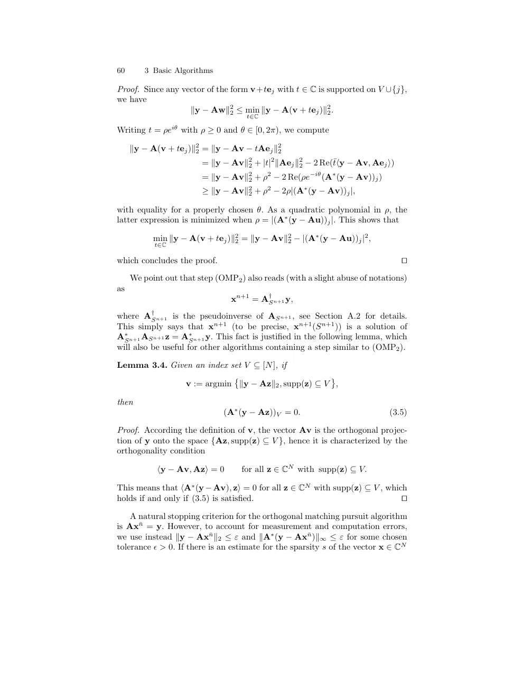

~~~text
60       3 Basic Algorithms

Proof. Since any vector of the form v+tej with t ∈ C is supported on V ∪{j},
we have
                   ky − Awk22 ≤ min ky − A(v + tej )k22 .
                                       t∈C
                 iθ
Writing t = ρe        with ρ ≥ 0 and θ ∈ [0, 2π), we compute

     ky − A(v + tej )k22 = ky − Av − tAej k22
                           = ky − Avk22 + |t|2 kAej k22 − 2 Re(t̄hy − Av, Aej i)
                           = ky − Avk22 + ρ2 − 2 Re(ρe−iθ (A∗ (y − Av))j )
                           ≥ ky − Avk22 + ρ2 − 2ρ|(A∗ (y − Av))j |,

with equality for a properly chosen θ. As a quadratic polynomial in ρ, the
latter expression is minimized when ρ = |(A∗ (y − Au))j |. This shows that

           min ky − A(v + tej )k22 = ky − Avk22 − |(A∗ (y − Au))j |2 ,
           t∈C

which concludes the proof.                                                         t
                                                                                   u

     We point out that step (OMP2 ) also reads (with a slight abuse of notations)
as
                                  xn+1 = A†S n+1 y,
where A†S n+1 is the pseudoinverse of AS n+1 , see Section A.2 for details.
This simply says that xn+1 (to be precise, xn+1 (S n+1 )) is a solution of
A∗S n+1 AS n+1 z = A∗S n+1 y. This fact is justified in the following lemma, which
will also be useful for other algorithms containing a step similar to (OMP2 ).

Lemma 3.4. Given an index set V ⊆ [N ], if
                           
               v := argmin ky − Azk2 , supp(z) ⊆ V ,

then
                                (A∗ (y − Az))V = 0.                           (3.5)

Proof. According the definition of v, the vector Av is the orthogonal projec-
tion of y onto the space {Az, supp(z) ⊆ V }, hence it is characterized by the
orthogonality condition

            hy − Av, Azi = 0         for all z ∈ CN with supp(z) ⊆ V.

This means that hA∗ (y − Av), zi = 0 for all z ∈ CN with supp(z) ⊆ V , which
holds if and only if (3.5) is satisfied.                                   t
                                                                           u

    A natural stopping criterion for the orthogonal matching pursuit algorithm
is Axn̄ = y. However, to account for measurement and computation errors,
we use instead ky − Axn̄ k2 ≤ ε and kA∗ (y − Axn̄ )k∞ ≤ ε for some chosen
tolerance  > 0. If there is an estimate for the sparsity s of the vector x ∈ CN
~~~

## Page 73

~~~text
                                                     3.2 Greedy Methods       61

to be recovered, another possible stopping criterion can simply be n̄ = s, since
then the target vector xn̄ is s-sparse. For instance, if A is a square orthogonal
matrix, then the algorithm with this stopping criterion successfully recovers
an s-sparse vector x ∈ CN from y = Ax, since it can be seen that the vector
xn produced at the nth iteration equals the n-sparse vector consisting of n
largest entries of x. More generally, the success of recovery of s-sparse vectors
via s iterations of the orthogonal matching pursuit algorithm is determined
by the following result.
Proposition 3.5. Given a matrix A ∈ Cm×N , every nonzero vector x ∈
CN supported on a set S of size s is recovered from y = Ax after at most
s iterations of orthogonal matching pursuit if and only if the matrix AS is
injective and
                        max |(A∗ r)j | > max |(A∗ r)` |                (3.6)
                         j∈S              `∈S
                    
for all nonzero r ∈ Az, supp(z) ⊆ S .
Proof. Let us assume that the orthogonal matching pursuit algorithm recovers
all vectors supported on a set S in at most s = card(S) iterations. Then, since
two vectors supported on S which have the same measurement vector must
be equal, the matrix AS is injective. Moreover, since the index chosen at
the first iteration always stays in the target support, if y = Ax for some
x ∈ CN exactly supported on S, then an index ` ∈ S cannot be chosen
at the first iteration, i.e., maxj∈S |(A∗ y)j | > |(A∗ y)` |. Therefore, we have
maxj∈S |(A∗ y)j | > max`∈S |(A∗ y)` | for all nonzero y ∈ Az, supp(z) ⊆ S .
This shows the necessity of the two conditions given in the proposition.
    To prove their sufficiency, assuming that Ax1 6= y, . . . , Axs−1 6= y (oth-
erwise there is nothing to do), we are going to prove that S n is a sub-
set of S of size n for any 0 ≤ n ≤ s. This will imply S s = S, hence
Axs = y by (OMP2 ), and finally xs = x by the injectivity of AS . To es-
tablish our claim, given
                           0 ≤ n ≤ s − 1, we first notice that S n ⊆ S yields
 n              n
r := y − Ax ∈ Az, supp(z) ⊆ S , so that the index jn+1 lies in S by
(3.6), and S n+1 = S n ∪ {jn+1 } ⊆ S by (OMP1 ). This inductively proves that
S n is a subset of S for any 0 ≤ n ≤ s. Next, given 1 ≤ n ≤ s − 1, Lemma 3.4
implies that (A∗ rn )S n = 0. Therefore, according to its definition in (OMP1 ),
the index jn+1 does not lie in S n , since this would mean that A∗ rn = 0, and
in turn that rn = 0 by (3.6). This inductively proves that S n is a set of size
n. The proof is now complete.                                                   t
                                                                                u
Remark 3.6. A more concise way to formulate the necessary and sufficient
condition of Proposition 3.5 is the exact recovery condition, which reads

                               kA†S AS k1→1 < 1,                            (3.7)

see Section A.1 for the definition of matrix norms. Implicitly, the existence of
the pseudoinverse A†S = (A∗S AS )−1 A∗S is equivalent to the injectivity of AS .
Moreover, (3.6) is then equivalent to
~~~

## Page 74

~~~text
62       3 Basic Algorithms

                kA∗S AS uk∞ > kA∗S AS uk∞     for all u ∈ Cs \ {0}.
Making the change v = A∗S AS u, this can be written as
     kvk∞ > kA∗S AS (A∗S AS )−1 vk∞ = kA∗S (A†S )∗ vk∞    for all v ∈ Cs \ {0}.
The latter reads kAS∗ (A†S )∗ k∞→∞ < 1, that is to say kA†S AS k1→1 < 1.
    A weakness of the orthogonal matching pursuit algorithm is that, once
an incorrect index has been selected in a target support S n , it remains in all
                                     0
the subsequent target supports S n for n0 ≥ n — see Section 6.4 where this
issue is illustrated on a detailed example. Hence, if an incorrect index has
been selected, s iterations of the orthogonal matching pursuit are not enough
to recover a vector with sparsity s. A possible way out is to increase the
number of iterations. The following algorithm, called compressive sampling
matching pursuit algorithm, proposes another way out when an estimation of
the sparsity s is available. To describe it, it is convenient to introduce the
notations Hs (z) for the best s-term approximation to z ∈ CN and Ls (z) for
the support of the latter, i.e.,
          Ls (z) := index set of s largest entries of z ∈ CN in modulus ,
          Hs (z) := zLs (z) .
The nonlinear operator Hs is called hard thresholding operator of order s.
Given the vector z ∈ CN , the operator Hs keeps its s largest absolute entries
and sets the other ones to zero. Note that it may not be uniquely defined. To
resolve this issue, we choose the index set Ls (z) out of all possible candidates
according to a predefined rule, for instance the lexicographic order.

                   Compressive sampling matching pursuit

 Input: measurement matrix A, measurement vector y, sparsity level s.
 Initialization: s-sparse vector x0 , typically x0 = 0.
 Iteration: repeat the following steps until a stopping criterion is met at
 n = n̄

           U n+1 = supp(xn ) ∪ L2s (A∗ (y − Axn )) ,                  (CoSaMP1 )
           un+1 = argmin ky − Azk2 , supp(z) ⊆ U n+1 ,
                          
                                                                      (CoSaMP2 )
             n+1          n+1
           x       = Hs (u      ).                                    (CoSaMP3 )

 Output: the s-sparse vector x] = xn̄ .

3.3 Thresholding-Based Methods
In this section, we describe further algorithms involving the hard thresholding
operator Hk . The intuition for these algorithms, which justifies categorizing
~~~

## Page 75

~~~text
                                         3.3 Thresholding-Based Methods       63

them in a different family, relies on the approximate inversion of the action
on sparse vectors of the measurement matrix A by the action of its conjugate
A∗ . Thus, the basic thresholding algorithm consists in determining the support
of the s-sparse vector x ∈ CN to be recovered from the measurement vector
y = Ax ∈ Cm as the indices of s largest absolute entries of A∗ y, and then
to find the vector with this support that best fits the measurement. Formally,
the algorithm reads as follows.

                               Basic thresholding

 Input: measurement matrix A, measurement vector y, sparsity level s.
 Instruction:

                  S ] = Ls (A∗ y),                                      (BT1 )
                  x] = argmin ky − Azk2 , supp(z) ⊆ S ] .
                                
                                                                        (BT2 )

 Output: the s-sparse vector x] .                                            t
                                                                             u

   A necessary and sufficient condition resembling (3.6) can be given for the
success of s-sparse recovery using this simple algorithm.

Proposition 3.7. A vector x ∈ CN supported on a set S is recovered from
y = Ax via basic thresholding if and only if

                         min |(A∗ y)j | > max |(A∗ y)` |.                   (3.8)
                         j∈S              `∈S

Proof. It is clear that the vector x is recovered if and only if the index set
S ] defined in (BT1 ) coincides with the set S, that is to say if and only if any
entry of A∗ y on S is greater than any entry of A∗ y on S. This is property
(3.8).                                                                          t
                                                                                u

    The more elaborate iterative hard thresholding algorithm is an iterative
algorithm to solve the rectangular system Az = y, knowing that the solution
is s-sparse. We shall solve the square system A∗ Az = A∗ y instead, which can
be interpreted as the fixed-point equation z = (Id − A∗ A)z + A∗ y. Classical
iterative methods suggest the fixed-point iteration xn+1 = (Id − A∗ A)xn +
A∗ y. Since we target s-sparse vectors, we only keep the s largest (in modulus)
entries of (Id − A∗ A)xn + A∗ y = xn + A∗ (y − Axn ) at each iteration. The
resulting algorithm reads as follows.
~~~

## Page 76

~~~text
64     3 Basic Algorithms

                       Iterative hard thresholding

 Input: measurement matrix A, measurement vector y, sparsity level s.
 Initialization: s-sparse vector x0 , typically x0 = 0.
 Iteration: repeat the following step until a stopping criterion is met at
 n = n̄:
                       xn+1 = Hs (xn + A∗ (y − Axn )).               (IHT)
 Output: the s-sparse vector x] = xn̄ .                                    t
                                                                           u

   The iterative hard thresholding algorithm does not require to compute
any orthogonal projection. If we are willing to pay the price of the orthogonal
projections, like in the greedy methods, it makes sense to look at the vector
with the same support as xn+1 that best fits the measurements. This leads to
the hard thresholding pursuit algorithm defined below.

                       Hard thresholding pursuit

 Input: measurement matrix A, measurement vector y, sparsity level s.
 Initialization: s-sparse vector x0 , typically x0 = 0.
 Iteration: repeat the following step until a stopping criterion is met at
 n = n̄:

           S n+1 = Ls (xn + A∗ (y − Axn )),                          (HTP1 )
           xn+1 = argmin ky − Azk2 , supp(z) ⊆ S n+1 .
                           
                                                                     (HTP2 )

 Output: the s-sparse vector x] = xn̄ .

Notes
More background on convex optimization can be found in in Appendix B, and
in the books [59, 318] by S. Boyd and L. Vandenberghe and by J. Nocedal
and S. Wright, respectively.
    Basis Pursuit was introduced by S. Chen, D. Donoho and M. Saunders
in [94]. The LASSO (Least Absolute Shrinkage and Selection Operator) al-
gorithm is more popular in the statistics literature than the quadratically-
constrained basis pursuit or basis pursuit denoising algorithms. It was intro-
duced by R. Tibshirani in [411]. The Dantzig selector (3.4) was introduced by
E. Candés and T. Tao in [83]. Like the LASSO, it is more popular in statistics
than in signal processing.
    A greedy strategy that does not involve any orthogonal projection consists
in updating xn as xn+1 = xn + tej , where t ∈ C and j ∈ [N ] are chosen to
~~~

## Page 77

~~~text
                                           3.3 Thresholding-Based Methods        65

minimize ky − Axn+1 k. The argument of Lemma 3.3 imposes the choice of
j as a maximizer of |(A∗ (y − Axn ))j | and then t = (A∗ (y − Axn ))j . This
corresponds to the matching pursuit algorithm, introduced in signal processing
by S. Mallat and Z. Zhang in [294] and by S. Qian and D. Chen in [349],
and in statistics as the projection pursuit regression by J. H. Friedman and
W. Stuetzle in [186]. In approximation theory, it is known as pure greedy
algorithm, see for instance the surveys [408, 409] and the monograph [410]
by V. Temlyakov. There, the orthogonal matching pursuit algorithm is also
known as orthogonal greedy algorithm. Just like matching pursuit, it was
introduced independently by several researchers in different fields, e.g. by G.
Davis, S. Mallat, and Z. Zhang in [121], by Y. C. Pati, R. Rezaiifar, and P. S.
Krishnaprasad in [327], by S. Chen, S. A. Billings, and W. Luo in [93], or in
[239] by J. Högborn, where it was called CLEAN in the context of astronomical
data processing. The orthogonal matching pursuit algorithm was analyzed in
terms of sparse recovery by J. Tropp in [414].
    The compressive sampling matching pursuit algorithm was devised by
D. Needell and J. Tropp in [312]. It was inspired by the earlier regularized
orthogonal matching pursuit developed and analyzed by D. Needell and R. Ver-
shynin in [313, 314].
    The subspace pursuit algorithm, introduced by W. Dai and O. Milenkovic
in [110], is another algorithm in the greedy family, but it will not be analyzed
in this book. It bears some resemblance with compressive sampling matching
pursuit, except that, instead of 2s, only s indices of largest (in modulus)
entries of the residual vector are selected, and that an additional orthogonal
projection step is performed at each iteration. Its description is given below.

                                   Subspace pursuit

 Input: measurement matrix A, measurement vector y, sparsity level s.
 Initialization: s-sparse vector x0 , typically x0 = 0, S 0 = supp(x0 ).
 Iteration: repeat the following steps until a stopping criterion is met at
 n = n̄

               U n+1 = S n ∪ Ls (A∗ (y − Axn )),                            (SP1 )
               un+1 = argmin ky − Azk2 , supp(z) ⊆ U n+1 ,
                               
                                                                            (SP2 )
                   n+1         n+1
               S         = Ls (u
                             ),                                             (SP3 )
               xn+1 = argmin ky − Azk2 , supp(z) ⊆ S n+1 ,
                            
                                                                            (SP4 )

 Output: the s-sparse vector x] = xn̄ .

   The thresholding-based family also contains algorithms that do not require
an estimation of the sparsity s. In such algorithms, the hard thresholding
operator gives way to a soft thresholding operator with threshold τ > 0. This
~~~

## Page 78

~~~text
66     3 Basic Algorithms

operator, also encountered in (15.20) and (B.17), acts componentwise on a
vector z ∈ CN by sending the entry zj to
                             
                               sgn(zj )(|zj | − τ ) if |zj | ≥ τ ,
                  Sτ (zj ) =
                               0                    otherwise .

Another important method for sparse recovery is the message-passing algo-
rithm studied by D. Donoho, A. Maleki, and A. Montanari in [128]. The soft
thresholding algorithms will not be analyzed in this book.
    Which algorithm should one choose? In principle, all the introduced
algorithms work reasonably well in practice (with the possible exception of
basic thresholding on which we comment below). In the end it depends on the
precise situation, that is, on the specific measurement matrix A and on the
values of the parameters s, m, N , which algorithm is the best for the given
requirements. The minimal number of needed measurements m in terms of
the sparsity s and the signal length N may vary slightly for the different
algorithms. It is a matter of numerical tests to compare the recovery rates
and to identify the best algorithm for this criterion.
    The second criterion is the speed of the algorithm. Comparing this param-
eter is also a matter of numerical tests, but one can give at least the following
rough guidelines. If the sparsity s is very small then orthogonal matching
pursuit is very fast because the speed essentially depends on the number of
iterations, which is s if the algorithm succeeds. However, if the sparsity s
is of rather medium size compared to N then orthogonal matching pursuit
may require significant time. The same consideration applies to the homo-
topy method for `1 -minimization studied in Chapter 15, which builds up the
support set of the minimizer iteratively.
    Also compressive sampling matching pursuit and hard thresholding pursuit
are fast for small s because in each step the orthogonal projections have to be
computed for AS with small S ⊂ [N ]. The number of iterations may rather
be independent of s. The runtime of iterative hard thresholding is not very
much influenced by the sparsity s at all.
    Basis Pursuit is not an algorithm per se, and its runtime depends on
the used recovery algorithm. Chambolle and Pock’s primal dual algorithm to
be studied in Chapter 15 constructs a sequence xn , which converges to the
`1 -minimizer. Here, the sparsity s has no significant influence on the speed.
Hence, for mildly large s this algorithm can be significantly faster than for
instance orthogonal matching pursuit (we emphasize this point here because
one often reads in the literature that greedy algorithms are always faster than
`1 -minimization, which however is only true for very small sparsity). Also, the
iteratively reweighted least squares method studied in Chapter 15 may be a
good alternative for mildly large sparsity.
    As an important additional aspect one should consider whether the al-
gorithms allow to easily exploit fast matrix vector multiplication routines if
such are available for A and A∗ . In principle, one can speed up any of the
~~~

## Page 79

~~~text
                                          3.3 Thresholding-Based Methods          67

proposed methods in this case, but if an orthogonal projection step is involved
then this task may not be completely trivial. For the iterative hard thresh-
olding algorithm and for Chambolle and Pock’s primal dual algorithm for
`1 -minimization, it is however very easy to exploit fast matrix vector multi-
plication. The acceleration achieved by the various algorithms in this context
may actually differ, and again the fastest algorithm should be determined by
numerical tests in the specific scenario.
    Finally, basic thresholding is the fastest among all algorithms because it
identifies the support in only one step, but its recovery performance is usually
significantly worse than for the other algorithms.

Exercises
3.1. Let q > 1, and let A be an m × N matrix with m < N . Prove that there
exists a 1-sparse vector which is not a minimizer of (Pq ).
                                    
                              1 0 −1
3.2. Using the matrix A =              and the vector x = [1, ei2π/3 , ei4π/3 ]> ,
                              0 1 −1
prove that in the complex case a unique minimizer of kzk1 subject to Az = y
is not necessarily m-sparse, where m is the number of rows of A.

3.3. Let A ∈ Rm×N and y ∈ Rm . Assuming the uniqueness of the mini-
mizer x] of
              minimize kzk1 subject to kAz − yk ≤ η,
                     z∈RN

where η ≥ 0 and k · k is an arbitrary norm on Rm , prove that x] is necessarily
m-sparse.

3.4. Given A ∈ Rm×N , suppose that every m×m submatrix of A is invertible.
For x ∈ RN , let x] be the unique minimizer of kzk1 subject to Az = Ax.
Prove that either x] = x or supp(x) 6⊆ supp(x] ).

3.5. For A ∈ Rm×N and x ∈ RN , prove that there is no ambiguity between
z ∈ RN and z ∈ CN when one says that the vector x is the unique minimizer
of kzk1 subject to Az = Ax.

3.6. Carefully check the equivalences of (P1 ) with (P01 ) and (P1,η ) with (P01,η ).

3.7. Given A ∈ Cm×N and τ > 0, show that the solution of

                          minimize kAz − yk22 + τ kzk22
                             z∈CN

is given by
                            z] = (A∗ A + τ Id)−1 A∗ y.
~~~

## Page 80

~~~text
68     3 Basic Algorithms

3.8. Given A ∈ Cm×N , suppose that there is a unique minimizer f (y) ∈ CN
of kzk1 subject to kAz − yk2 ≤ η whenever y belongs to some set S. Prove
that the map f is continuous on S.

3.9. Prove that any 1-sparse vector x ∈ C3 is recovered with one iteration of
the orthogonal matching pursuit algorithm for the measurement matrix
                                               
                                1√−1/2 −1/2
                                          √
                          A=                      .
                                0 3/2 − 3/2

We now add a measurement by appending the row [1 3 3] to A, thus forming
the matrix                                
                              −1/2 −1/2
                             1√      √
                      Ab = 0 3/2 − 3/2 .
                             1 3       3
Prove that the 1-sparse vector x = [1 0 0]> cannot be recovered via the
orthogonal matching pursuit algorithm with the measurement matrix A.
                                                                  b

3.10. Given a matrix A ∈ Cm×N with `2 -normalized columns a1 , . . . , aN and
given a vector y ∈ Cm , we consider an iterative algorithm where the index set
S n is updated via S n+1 = S n ∪{j n+1 } for an unspecified index j n+1 and where
the output vector is updated via xn+1 = argmin{ky −Azk2 , supp(z) ∈ S n+1 }.
Prove that the `2 -norm of the residual decreases according to

                      ky − Axn+1 k22 ≤ ky − Axn k22 − ∆n ,

where the quantity ∆n satisfies
                                               ∗
             ∆n = kA(xn+1 − xn )k22 = xn+1             n
                                       j n+1 (A (y − Ax ))j
                                                            n+1

                         |(A∗ (y − Axn ))j n+1 |2
                 =
                     dist(aj n+1 , span{aj , j ∈ S n })2
                 ≤ |(A∗ (y − Axn ))j n+1 |2 .
~~~

## Page 81

~~~text
4
Basis Pursuit

Recall that the intuitive approach to the compressive sensing problem of re-
covering a sparse vector x ∈ CN from its measurement vector y = Ax ∈ Cm ,
where m < N , consists in the `0 -minimization problem

                     minimize kzk0     subject to Az = y.                  (P0 )
                       z∈CN

We have seen in Chapter 2 that this problem is unfortunately NP-hard in
general. Chapter 3 has therefore outlined several tractable strategies to solve
the compressive sensing problem. In the current chapter, we focus on the
basis pursuit (`1 -minimization) strategy, which consists in solving the convex
optimization problem

                     minimize kzk1     subject to Az = y.                  (P1 )
                       z∈CN

We investigate conditions on the matrix A which ensure exact or approximate
reconstruction of the original sparse or compressible vector x. In Section 4.1,
we start with a necessary and sufficient condition for the exact reconstruction
of every sparse vector x ∈ CN as a solution of (P1 ) with the vector y ∈ Cm
obtained as y = Ax. This condition is called the null space property. In
Sections 4.2 and 4.3, we strengthen this null space property to make the
reconstruction via basis pursuit stable with respect to sparsity defect and
robust with respect to measurement error. In Section 4.4, we discuss other
types of necessary and sufficient conditions for the success of recovery via
basis pursuit, which also take into account the given individual sparse vector.
While this may seem useless at first sight because the vector x is unknown
a-priori, such conditions will become nevertheless useful later to establish so-
called nonuniform recovery guarantees in situations, where the matrix A is
random. We close this Chapter with a short digression to the low-rank recovery
problem, and its approach via nuclear norm minimization. Again, a version
of the null space property is equivalent to recovery of every low-rank matrix.
~~~

## Page 82

~~~text
70     4 Basis Pursuit

4.1 Null Space Property
In this section, we introduce the null space property and we prove that it is
a necessary and sufficient condition for exact recovery of sparse vectors via
basis pursuit. The arguments are valid in the real and complex settings alike,
so we first state the results for a field K that can either be R or C. Then we
establish the equivalence of the real and complex null space properties. We
recall that for a vector v ∈ CN and a set S ⊂ [N ] we denote by vS either the
vector in CS , which is the restriction of v to the indices in S, or the vector in
CN which coincides with v on the indices in S and is extended to zero outside
S, see also (2.4). It should always become clear from the context which variant
of vS is meant (and sometimes both variants lead to the same quantity, such
as in expressions like kvS k1 ).
Definition 4.1. A matrix A ∈ Km×N is said to satisfy the null space prop-
erty relative to a set S ⊂ [N ] if

                   kvS k1 < kvS k1    for all v ∈ ker A \ {0}.              (4.1)

It is said to satisfy the null space property of order s if it satisfies the null
space property relative to any set S ⊂ [N ] with card(S) ≤ s.
Remark 4.2. It is important to observe that, for a given v ∈ ker A \ {0}, the
condition kvS k1 < kvS k1 holds for any set S ⊆ [N ] with card(S) ≤ s as soon
as it holds for an index set of s largest (in modulus) entries of v.
Remark 4.3. There are two convenient reformulations of the null space prop-
erty. The first one is obtained by adding kvS k1 to both sides of the inequality
kvS k1 < kvS k1 . Thus, the null space property relative to S reads

                   2 kvS k1 < kvk1    for all v ∈ ker A \ {0}.              (4.2)

The second one is obtained by choosing S as an index set of s largest (in
modulus) entries of v and this time by adding kvS k1 to both sides of the
inequality. Thus, the null space property of order s reads

                   kvk1 < 2 σs (v)1   for all v ∈ ker A \ {0},              (4.3)

where we recall from Definition 2.2 that, for p > 0, the `p -error of best s-term
approximation to x ∈ KN is defined by

                           σs (x)p = inf kx − zkp .
                                      kzk0 ≤s

    We now indicate the link between null space property and exact recovery
of sparse vectors via basis pursuit.
Theorem 4.4. Given a matrix A ∈ Km×N , every vector x ∈ KN supported
on a set S is the unique solution of (P1 ) with y = Ax if and only if A satisfies
the null space property relative to S.
~~~

## Page 83

~~~text
                                                 4.1 Null Space Property        71

Proof. Given a fixed index set S, let us first assume that every vector x ∈
KN supported on S is the unique minimizer of kzk1 subject to Az = Ax.
Thus, for any v ∈ ker A \ {0}, the vector vS is the unique minimizer of kzk1
subject to Az = AvS . But we have A(−vS ) = AvS and −vS 6= vS , because
A(vS + vS ) = Av = 0 and v 6= 0. We conclude that kvS k1 < kvS k1 . This
establishes the null space property relative to S.
    Conversely, let us assume that the null space property relative to S holds.
Then, given a vector x ∈ KN supported on S and a vector z ∈ KN , z 6= x,
satisfying Az = Ax, we consider the vector v := x − z ∈ ker A \ {0}. In view
of the null space property, we obtain

  kxk1 ≤ kx − zS k1 + kzS k1 = kvS k1 + kzS k1
                              < kvS k1 + kzS k1 = k − zS k1 + kzS k1 = kzk1 .

This establishes the required minimality of kxk1 .                              t
                                                                                u
   Letting the set S vary, we immediately obtain the following result as a
consequence of Theorem 4.4.
Theorem 4.5. Given a matrix A ∈ Km×N , every s-sparse vector x ∈ KN is
the unique solution of (P1 ) with y = Ax if and only if A satisfies the null
space property of order s.
Remark 4.6. (a) This theorem shows that for every y = Ax with s-sparse
    x the `1 -minimization strategy (P1 ) actually solves the `0 -minimization
    problem (P0 ) when the null space property of order s holds. Indeed, assume
    that every s-sparse vector x is recovered via `1 -minimization from y = Ax.
    Let z be the minimizer of the `0 -minimization problem (P0 ) with y = Ax
    then kzk0 ≤ kxk1 so that also z is s-sparse. But since every s-sparse vector
    is the unique `1 -minimizer it follows that x = z.
(b) It is desirable for any reconstruction scheme to preserve sparse recovery
    if some measurements are rescaled, reshuffled, or added. Basis Pursuit
    actually features such properties. Indeed, mathematically speaking, these
    operations consist in replacing the original measurement matrix A by new
    measurement matrices A,  b or A e defined by

            A
            b := GA,       where G is some invertible m × m matrix,
                  
                  A
            A :=
            e        ,     where B is some m0 × N matrix.
                  B

   We observe that ker Ab = ker A and ker A e ⊆ ker A, hence the null space
   property for the matrices A A remains fulfilled if it is satisfied for the
                              b  e
   matrix A. It is not true that the null space property remains valid if we
   multiply on the right by an invertibe matrix — see Exercise 4.2.
   We close this section by inspecting the influence of the underlying field.
Unifying the arguments by using K for either R or C had the advantage of
~~~

## Page 84

~~~text
72      4 Basis Pursuit

brevity, but it results in a potential ambiguity about null space properties.
Indeed, we often encounter real-valued measurement matrices, and they can
also be regarded as complex-valued matrices. Thus, for such A ∈ Rm×N , the
distinction between the real null space kerR A and the complex null space
kerC A = kerR A + i kerR A leads, on the one hand, to the real null space
property relative to a set S, namely
                 X           X
                     |vj | <   |v` | for all v ∈ kerR A, v 6= 0,       (4.4)
                  j∈S        `∈S

and on the other hand, to the complex null space property relative to S,
namely
 Xq                Xq
       vj2 + wj2 <    v`2 + w`2 for all v, w ∈ kerR A, (v, w) 6= (0, 0). (4.5)
 j∈S                  `∈S

We are going to show below that the real and complex versions are in fact
equivalent. Therefore, there is no ambiguity when we say that a real measure-
ment matrix allows the exact recovery of all sparse vectors via basis pursuit:
these vectors can be interpreted as real or as complex vectors. This explains
why we usually work in the complex setting.

Theorem 4.7. Given a matrix A ∈ Rm×N , the real null space property (4.4)
relative to a set S is equivalent to the complex null space property (4.5) relative
to this set S.
    In particular, the real null space property of order s is equivalent to the
complex null space property of order s.

Proof. We notice first that (4.4) immediately follows from (4.5) by setting
w = 0. So let us assume that (4.4) holds. We consider v, w ∈ kerR A
with (v, w)q 6= (0, 0). IfPv and p
                                     w are linearly dependent, then the inequal-
ity j∈S vj + wj < `∈S v`2 + w`2 is clear, so we may suppose that they
               2     2
    P

are linearly independent. Then u := cos θ v + sin θ w ∈ kerR A is nonzero, and
(4.4) yields, for any θ ∈ R,
                 X                            X
                    | cos θ vj + sin θ wj | <   | cos θ v` + sin θ w` |.   (4.6)
                j∈S                        `∈S

For each k ∈ [N ], we define θk ∈ [−π, π] by the equalities
                    q                          q
              vk = vk2 + wk2 cos θk , wk = vk2 + wk2 sin θk ,

so that (4.6) reads
          Xq                                 Xq
                 vj2 + wj2 | cos(θ − θj )| <    v`2 + w`2 | cos(θ − θ` )|.
          j∈S                              `∈S
~~~

## Page 85

~~~text
                                                               4.1 Null Space Property       73

We now integrate over θ ∈ [−π, π] to obtain
  Xq            Z π                     Xq          Z π
         2
       vj + wj2     | cos(θ − θj )|dθ <      2    2
                                            v` + w`     | cos(θ − θ` )|dθ.
  j∈S                −π                                                  −π
                                                     `∈S
                                q                          p
                                    vj2 + wj2 <                v`2 + w`2 , it remains to observe
                     P                            P
For the inequality        j∈S                        `∈S
that                                 Z π
                                            | cos(θ − θ0 )|dθ
                                       −π

is a positive constant independent of θ0 ∈ [−π, π] — namely 4. The proof is
now complete.                                                            t
                                                                         u

Nonconvex Minimization

Recall that the number of nonzero entries of a vector z ∈ CN is approximated
by the qth power of its `q -quasinorm,
                           N
                           X                  N
                                              X
                                 |zj |q −→          1{zj 6=0} = kzk0 .
                                        q→0
                           j=0                j=1

This observation suggests to replace the `0 -minimization problem (P0 ) by the
optimization problem

                      minimize kzkq               subject to Az = y.                       (Pq )
                           z∈CN

This optimization problem fails to recover even 1-sparse vectors for q > 1,
see Exercise 3.1. For 0 < q < 1, on the other hand, the optimization problem
becomes nonconvex, and is even N P -hard, see Exercise 2.10. Thus, the case
q = 1 might appear as the only important one. Nonetheless, the properties of
the `q -minimization for 0 < q < 1 can prove useful on theoretical questions.
Our goal here is merely to justify the intuitive prediction that the problem
(Pq ) does not provide a worse approximation of the original problem (P0 )
when q gets smaller. For this purpose, we need an analog of the null space
property for 0 < q < 1. The proof of our next result, left as Exercise 4.11,
duplicates the proof of Theorem 4.4. It relies on the fact that the qth power
of the `q -quasinorm satisfies the triangle inequality, see Exercise 2.1.

Theorem 4.8. Given a matrix A ∈ Cm×N and 0 < q ≤ 1, every s-sparse
vector x ∈ CN is the unique solution of (Pq ) with y = Ax if and only if, for
any set S ⊆ [N ] with card(S) ≤ s,

                     kvS kq < kvS kq          for all v ∈ ker A \ {0}.

   We can now prove that sparse recovery via `q -minimization implies sparse
recovery via `p -minimization whenever 0 < p < q ≤ 1.
~~~

## Page 86

~~~text
74       4 Basis Pursuit

Theorem 4.9. Given a matrix A ∈ Cm×N and 0 < p < q ≤ 1, if every s-
sparse vector x ∈ CN is the unique solution of (Pq ) with y = Ax, then every
s-sparse vector x ∈ CN is also the unique solution of (Pp ) with y = Ax.

Proof. According to Theorem 4.8, it is enough to prove that, if v ∈ ker A\{0}
and if S is an index set of s largest absolute entries of v, then
                              X            X
                                  |vj |p <   |v` |p ,                    (4.7)
                               j∈S             `∈S

as soon as (4.7) holds with q in place of p. Indeed, if (4.7) holds for p then
necessarily vS 6= 0 since S is an index of largest absolute entries and v 6= 0.
The desired inequality (4.7) can therefore be rewritten as
                             X              1
                                   P                   p < 1.               (4.8)
                                         (|v` |/|vj |)
                             j∈S
                                   `∈S

Now observe that |v` |/|vj | ≤ 1 for ` ∈ S and j ∈ S. This makes the left-hand
side of (4.8) a nondecreasing function of 0 < p ≤ 1. Hence, its value at p < q
does not exceed its value at q, which is less than one by hypothesis. This
shows the validity of (4.7) and concludes the proof.                         t
                                                                             u

4.2 Stability

The vectors we aim to recover via basis pursuit — or other schemes, for that
matter — are sparse only in idealized situations. In more realistic scenarios,
we can only claim that they are close to sparse vectors. In such cases, we
would like to recover a vector x ∈ CN with an error controlled by its distance
to s-sparse vectors. This property is usually referred to as the stability of the
reconstruction scheme with respect to sparsity defect. We shall prove that the
basis pursuit is stable under a slightly strengthened version of the null space
property.

Definition 4.10. A matrix A ∈ Cm×N is said to satisfy the stable null space
property with constant 0 < ρ < 1 relative to a set S ⊂ [N ] if

                      kvS k1 ≤ ρ kvS k1        for all v ∈ ker A.

It is said to satisfy the stable null space property of order s with constant
0 < ρ < 1 if it satisfies the stable null space property with constant 0 < ρ < 1
relative to any set S ⊂ [N ] with card(S) ≤ s.

     The main stability result of this section reads as follows.
~~~

## Page 87

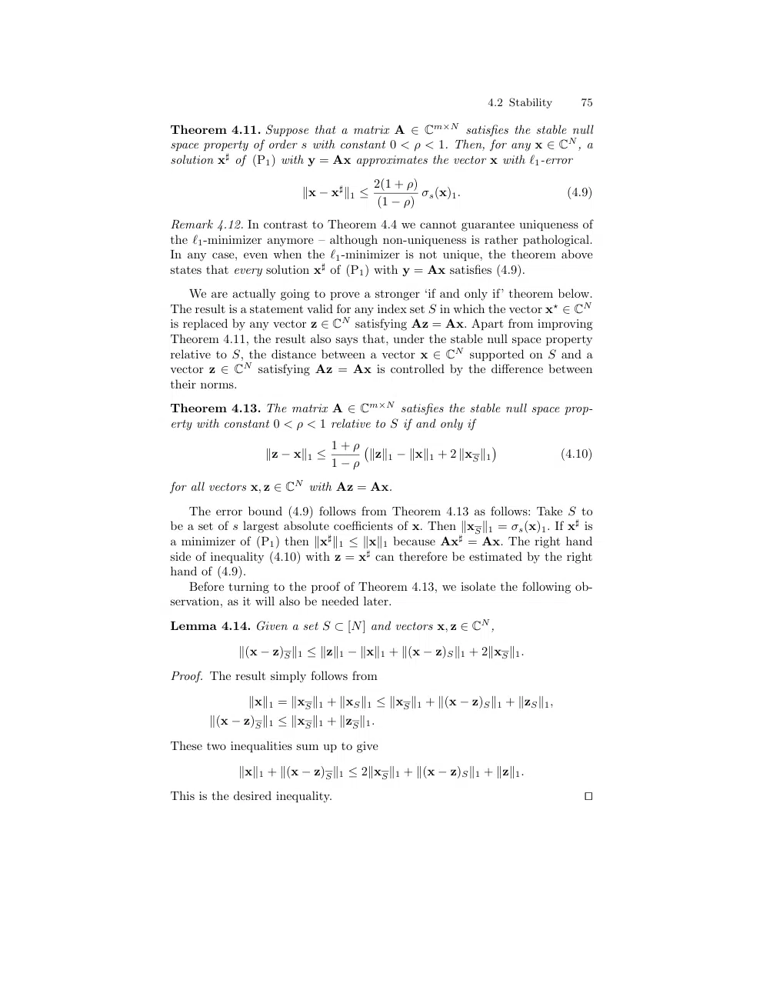

~~~text
                                                             4.2 Stability      75

Theorem 4.11. Suppose that a matrix A ∈ Cm×N satisfies the stable null
space property of order s with constant 0 < ρ < 1. Then, for any x ∈ CN , a
solution x] of (P1 ) with y = Ax approximates the vector x with `1 -error
                                        2(1 + ρ)
                         kx − x] k1 ≤            σs (x)1 .                    (4.9)
                                        (1 − ρ)
Remark 4.12. In contrast to Theorem 4.4 we cannot guarantee uniqueness of
the `1 -minimizer anymore – although non-uniqueness is rather pathological.
In any case, even when the `1 -minimizer is not unique, the theorem above
states that every solution x] of (P1 ) with y = Ax satisfies (4.9).
    We are actually going to prove a stronger ‘if and only if’ theorem below.
The result is a statement valid for any index set S in which the vector x? ∈ CN
is replaced by any vector z ∈ CN satisfying Az = Ax. Apart from improving
Theorem 4.11, the result also says that, under the stable null space property
relative to S, the distance between a vector x ∈ CN supported on S and a
vector z ∈ CN satisfying Az = Ax is controlled by the difference between
their norms.
Theorem 4.13. The matrix A ∈ Cm×N satisfies the stable null space prop-
erty with constant 0 < ρ < 1 relative to S if and only if
                               1+ρ                        
                  kz − xk1 ≤       kzk1 − kxk1 + 2 kxS k1                    (4.10)
                               1−ρ
for all vectors x, z ∈ CN with Az = Ax.
    The error bound (4.9) follows from Theorem 4.13 as follows: Take S to
be a set of s largest absolute coefficients of x. Then kxS k1 = σs (x)1 . If x] is
a minimizer of (P1 ) then kx] k1 ≤ kxk1 because Ax] = Ax. The right hand
side of inequality (4.10) with z = x] can therefore be estimated by the right
hand of (4.9).
    Before turning to the proof of Theorem 4.13, we isolate the following ob-
servation, as it will also be needed later.
Lemma 4.14. Given a set S ⊂ [N ] and vectors x, z ∈ CN ,

             k(x − z)S k1 ≤ kzk1 − kxk1 + k(x − z)S k1 + 2kxS k1 .

Proof. The result simply follows from

               kxk1 = kxS k1 + kxS k1 ≤ kxS k1 + k(x − z)S k1 + kzS k1 ,
       k(x − z)S k1 ≤ kxS k1 + kzS k1 .

These two inequalities sum up to give

             kxk1 + k(x − z)S k1 ≤ 2kxS k1 + k(x − z)S k1 + kzk1 .

This is the desired inequality.                                                  t
                                                                                 u
~~~

## Page 88

~~~text
76       4 Basis Pursuit

Proof (of Theorem 4.13). Let us first assume that the matrix A satisfies (4.10)
for all vectors x, z ∈ CN with Az = Ax. Given a vector v ∈ ker A, since
AvS = A(−vS ), we can apply (4.10) with x = −vS and z = vS . It yields
                                    1+ρ                
                           kvk1 ≤       kvS k1 − kvS k1 .
                                    1−ρ
This can be written as
                                                               
               (1 − ρ) kvS k1 + kvS k1 ≤ (1 + ρ) kvS k1 − kvS k1 .
After rearranging the terms we obtain
                               2kvS k1 ≤ 2ρkvS k1 ,
and simplifying by 2, we recognize the stable null space property with constant
0 < ρ < 1 relative to S.
   Conversely, let us now assume that the matrix A satisfies the stable null
space property with constant 0 < ρ < 1 relative to S. For x, z ∈ CN with
Az = Ax, since v := z − x ∈ ker A, the stable null space property yields
                                kvS k1 ≤ ρkvS k1 .                      (4.11)
Moreover, Lemma 4.14 gives
                    kvS k1 ≤ kzk1 − kxk1 + kvS k1 + 2kxS k1 .           (4.12)
Substituting (4.11) into (4.12), we obtain
                   kvS k1 ≤ kzk1 − kxk1 + ρkvS k1 + 2kxS k1 .
Since ρ < 1, this can be rewritten as
                                1                       
                    kvS k1 ≤       kzk1 − kxk1 + 2kxS k1 .
                               1−ρ
Using (4.11) once again, we derive
                                                1+ρ                      
     kvk1 = kvS k1 + kvS k1 ≤ (1 + ρ)kvS k1 ≤       kzk1 − kxk1 + 2kxS k1 ,
                                                1−ρ
which is the desired inequality.                                              t
                                                                              u
Remark 4.15. Given the matrix A ∈ Cm×N , let us consider, for each index set
S ⊂ [N ] with card(S) ≤ s, the operator RS defined on ker A by RS (v) = vS .
The formulation (4.2) of the null space property says that
               µ := max{kRS k1→1 : S ⊂ [N ], card(S) ≤ s} < 1/2.
We conclude that A satisfies then the stable null space property with constant
ρ := µ/(1 − µ) < 1. Thus, the stability of the basis pursuit comes for free if
sparse vectors are exactly recovered. However, the constant 2(1 + ρ)/(1 − ρ)
in (4.9) may be very large if ρ is close to one.
~~~

## Page 89

~~~text
                                                           4.3 Robustness       77

4.3 Robustness
In realistic situations, it is also inconceivable to measure a signal x ∈ CN with
infinite precision. This means that the measurement vector y ∈ Cm is only an
approximation of the vector Ax ∈ Cm , with

                                  kAx − yk ≤ η

for some η ≥ 0 and for some norm k · k on Cm — usually the `2 -norm, but the
`1 -norm will also be considered in Chapter 14. In this case, the reconstruction
scheme should be required to output a vector x? ∈ CN whose distance to the
original vector x ∈ CN is controlled by the measurement error η ≥ 0. This
property is usually referred to as the robustness of the reconstruction scheme
with respect to measurement error. We are going to show that if the problem
(P1 ) is replaced by the convex optimization problem

                  minimize kzk1     subject to kAz − yk ≤ η,                (P1,η )
                    z∈CN

then the robustness of the basis pursuit algorithm is guaranteed by the fol-
lowing additional strengthening of the null space property.

Definition 4.16. The matrix A ∈ Cm×N is said to satisfy the robust null
space property (with respect to k · k) with constants 0 < ρ < 1 and τ > 0
relative to a set S ⊆ [N ] if

                 kvS k1 ≤ ρ kvS k1 + τ kAvk      for all v ∈ CN .           (4.13)

It is said to satisfy the robust null space property of order s with constants
0 < ρ < 1 and τ > 0 if it satisfies the robust null space property with constants
ρ, τ relative to any set S ⊂ [N ] with card(S) ≤ s.

Remark 4.17. Observe that the above definition does not require that v is
contained in ker A. In fact, if v ∈ ker A then the term kAvk in (4.13) vanishes,
and we see that the robust null space property implies the stable null space
property in Definition 4.10.

    The following theorem constitutes the first main result of this section. It
incorporates Theorem 4.11 as the special case η = 0. The special case of an
s-sparse vector x ∈ CN is also worth a separate look.

Theorem 4.18. Suppose that a matrix A ∈ Cm×N satisfies the robust null
space property of order s with constants 0 < ρ < 1 and τ > 0. Then, for any
x ∈ CN , a solution x] of (P1,η ) with y = Ax + e and kek ≤ η approximates
the vector x with `1 -error
                                  2(1 + ρ)            4τ
                   kx − x] k1 ≤            σs (x)1 +     η.
                                   (1 − ρ)           1−ρ
~~~

## Page 90

~~~text
78     4 Basis Pursuit

     In the spirit of Theorem 4.13, we are going to prove a stronger ‘if and only
if’ statement valid for any index set S.
Theorem 4.19. The matrix A ∈ Cm×N satisfies the robust null space prop-
erty with constants 0 < ρ < 1 and τ > 0 relative to S if and only if
                   1+ρ                          2τ
     kz − xk1 ≤        kzk1 − kxk1 + 2 kxS k1 +     kA(z − x)k            (4.14)
                   1−ρ                          1−ρ
for all vectors x, z ∈ CN .
Proof. We basically follow the same steps as in the proof of Theorem 4.13.
First, we assume that the matrix A satisfies (4.14) for all vectors x, z ∈ CN .
Thus, for v ∈ CN taking x = −vS and z = vS yields
                            1+ρ                   2τ
                  kvk1 ≤        kvS k1 − kvS k1 +     kAvk.
                            1−ρ                   1−ρ
Rearranging the terms gives
                                                       
       (1 − ρ) kvS k1 + kvS k1 ≤ (1 + ρ) kvS k1 − kvS k1 + 2τ kAvk,
that is to say
                            2kvS k1 ≤ 2ρkvS k1 + 2τ kAvk.
Except for the factor 2, this is the robust null space property with constants
0 < ρ < 1 and τ > 0 relative to S.
    Conversely, we assume that the matrix A satisfies the robust null space
property with constant 0 < ρ < 1 and τ > 0 relative to S. For x, z ∈ CN ,
setting v := z − x, the robust null space property and Lemma 4.14 yield
                     kvS k1 ≤ ρkvS k1 + τ kAvk,
                     kvS k1 ≤ kzk1 − kxk1 + kvS k1 + 2kxS k1 .
Combining these two inequalities gives
                             1                                
                 kvS k1 ≤       kzk1 − kxk1 + 2kxS k1 + τ kAvk .
                            1−ρ
Using the robust null space property once again, we derive
            kvk1 = kvS k1 + kvS k1 ≤ (1 + ρ)kvS k1 + τ kAvk1
                  1+ρ                              2τ
                ≤       kzk1 − kxk1 + 2kxS k1 +         kAvk,
                  1−ρ                              1−ρ
which is the desired inequality.                                               t
                                                                               u
    We now turn to the second main result of this section. It enhances the
previous robustness result by replacing the `1 -error estimate by an `p -error
estimate for p ≥ 1. A final strengthening of the null space property is required.
The corresponding property could be defined relative to any fixed set S ⊂ [N ],
but it is not introduced as such because this is not be needed later.
~~~

## Page 91

~~~text
                                                               4.3 Robustness      79

Definition 4.20. Given q ≥ 1, the matrix A ∈ Cm×N is said to satisfy the
`q -robust null space property of order s (with respect to k · k) with constants
0 < ρ < 1 and τ > 0 if, for any set S ⊂ [N ] with card(S) ≤ s,
                              ρ
               kvS kq ≤             kvS k1 + τ kAvk     for all v ∈ CN .
                           s1−1/q
   In view of the inequality kvS kp ≤ s1/p−1/q kvS kq for 1 ≤ p ≤ q, we observe
that the `q -robust null space property with constants 0 < ρ < 1 and τ > 0
implies that, for any set S ⊂ [N ] with card(S) ≤ s,
                       ρ
          kvS kp ≤            kvS k1 + τ s1/p−1/q kAvk      for all v ∈ CN .
                     s1−1/p
Thus, for 1 ≤ p ≤ q, the `q -robust null space property implies the `p -robust
null space property with identical constants, modulo the change of norms
k · kp ← s1/p−1/q k · kq . This justifies in particular that the `q -robust null space
property is a strengthening of the previous robust null space property. In Sec-
tion 6.2, we will establish the `2 -robust null space property for measurement
matrices with small restricted isometry constants. The robustness of the ba-
sis pursuit with noise algorithm is then deduced according to the following
theorem.

Theorem 4.21. Suppose that the matrix A ∈ Cm×N satisfies the `2 -robust
null space property of order s with constants 0 < ρ < 1 and τ > 0. Then, for
any x ∈ CN , a solution x] of (P1,η ) with k · k = k · k2 , y = Ax + e, and
kek2 ≤ η approximates the vector x with `p -error

                          C
       kx − x] kp ≤               σs (x)1 + D s1/p−1/2 η,     1 ≤ p ≤ 2,        (4.15)
                      s1−1/p
for some constants C, D > 0 depending only on ρ and τ .

   The estimates for the extremal values p = 1 and p = 2 are the most
familiar. They read
                                               √
                     kx − x] k1 ≤ C σs (x)1 + D s η,
                                   C
                     kx − x] k2 ≤ √ σs (x)1 + D η.              (4.16)
                                    s

One should remember
                  √     that the coefficient of σs (x)1 is a constant for √p = 1
and scales like 1/ s for p = 2, while the coefficient of η scales like s for
p = 1 and is a constant for p = 2. We then retrieve the correct powers of s
appearing in Theorem 4.21 for any 1 ≤ p ≤ 2 via interpolating the powers of
s with linear functions in 1/p.

Remark 4.22. Let us shortly comment on the fact that the best s-term ap-
proximation error σs (x)1 is always with respect to the `1 -norm regardless of
~~~

## Page 92

~~~text
80       4 Basis Pursuit

the `p -space in which we measure the error. For instance, one may wonder why
the error estimate
            √       in `2 does not feature σs (x)2 on the right hand side instead
of σs (x)1 / s. In fact, we will see later in Theorem 11.5 that such a type of
estimate is impossible in parameter regimes of (m, N ) which are interesting
for compressive sensing. On the other hand, we have seen in Chapter 2 that
unit balls in `q with q < 1 provide good models for compressible vectors by
Theorem 2.3 and its refinement Theorem 2.5. Indeed, if kxkq ≤ 1 for q < 1
then, for p ≥ 1,
                               σs (x)p ≤ s1/p−1/q .
Assuming noiseless measurements (that is, η = 0) the error bound (4.15) reads
then
                            C
            kx − x] kp ≤ 1−1/p σs (x)1 ≤ Cs1/p−1/q , 1 ≤ p ≤ 2 .
                          s
Therefore, the reconstruction error in `p obeys the same rate of decay in s as
the s-term approximation error in `p for all p ∈ [1, 2]. From this point of view,
the term s1/p−1 σs (x)1 is not significantly worse than σs (x)p .

   For the proof of Theorem 4.21, we in fact establish the following stronger
result.

Theorem 4.23. Given 1 ≤ p ≤ q, suppose that the matrix A ∈ Cm×N satis-
fies the `q -robust null space property of order s with constants 0 < ρ < 1 and
τ > 0. Then, for any x, z ∈ CN ,
                     C
                            kzk1 − kxk1 + 2σs (x)1 + D s1/p−1/q kA(z − x)k,
                                                  
      kz − xkp ≤
                   s1−1/p
where C := (1 + ρ)2 /(1 − ρ) and D := (3 + ρ)τ /(1 − ρ).

Proof. Let us first remark that the `q -robust null space properties implies the
`1 -robust and `p -robust null space property (p ≤ q) in the forms

                    kvS k1 ≤ ρ kvS k1 + τ s1−1/q kAvk,                      (4.17)
                                ρ
                    kvS kp ≤ 1−1/p kvS k1 + τ s1/p−1/q kAvk,                (4.18)
                             s
for all v ∈ CN and all S ⊂ [N ] with card(S) ≤ s. Thus, in view of (4.17),
applying Theorem 4.19 with S chosen as an index set of s largest (in modulus)
entries of x leads to
               1+ρ                           2τ 1−1/q
 kz − xk1 ≤        kzk1 − kxk1 + 2 σs (x)1 +     s     kA(z − x)k. (4.19)
               1−ρ                           1−ρ

Then, choosing S as an index set of s largest (in modulus) entries of z − x,
we use Proposition 2.5 to notice that
                                                  1
     kz − xkp ≤ k(z − x)S kp + k(z − x)S kp ≤          kz − xk1 + k(z − x)S kp .
                                                s1−1/p
~~~

## Page 93

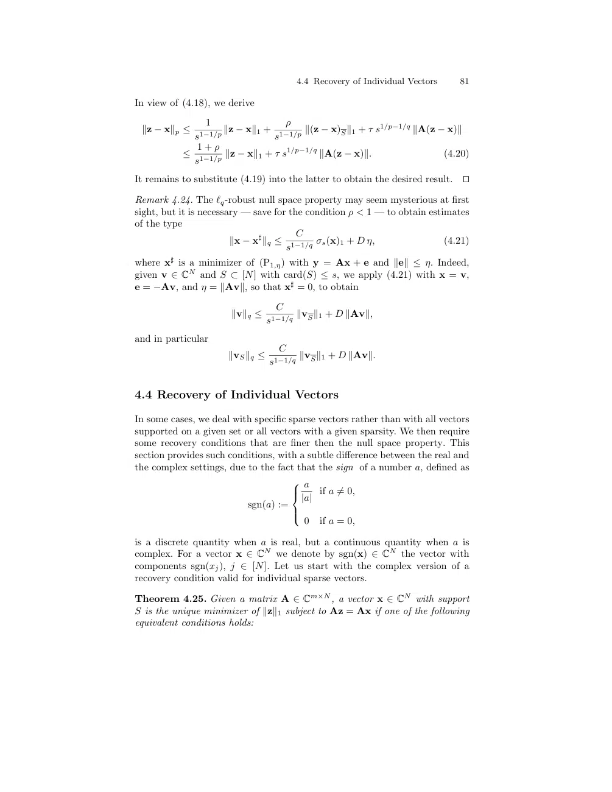

~~~text
                                          4.4 Recovery of Individual Vectors   81

In view of (4.18), we derive
              1                  ρ
 kz − xkp ≤        kz − xk1 + 1−1/p k(z − x)S k1 + τ s1/p−1/q kA(z − x)k
            s1−1/p            s
             1+ρ
           ≤ 1−1/p kz − xk1 + τ s1/p−1/q kA(z − x)k.                (4.20)
            s
It remains to substitute (4.19) into the latter to obtain the desired result. t
                                                                              u

Remark 4.24. The `q -robust null space property may seem mysterious at first
sight, but it is necessary — save for the condition ρ < 1 — to obtain estimates
of the type
                                        C
                        kx − x] kq ≤ 1−1/q σs (x)1 + D η,                 (4.21)
                                     s
where x] is a minimizer of (P1,η ) with y = Ax + e and kek ≤ η. Indeed,
given v ∈ CN and S ⊂ [N ] with card(S) ≤ s, we apply (4.21) with x = v,
e = −Av, and η = kAvk, so that x] = 0, to obtain

                                   C
                       kvkq ≤          kv k1 + D kAvk,
                                 s1−1/q S
and in particular
                                   C
                      kvS kq ≤            kvS k1 + D kAvk.
                                 s1−1/q

4.4 Recovery of Individual Vectors

In some cases, we deal with specific sparse vectors rather than with all vectors
supported on a given set or all vectors with a given sparsity. We then require
some recovery conditions that are finer then the null space property. This
section provides such conditions, with a subtle difference between the real and
the complex settings, due to the fact that the sign of a number a, defined as
                                      a
                                       |a| if a 6= 0,
                                      
                          sgn(a) :=
                                      
                                      
                                         0 if a = 0,

is a discrete quantity when a is real, but a continuous quantity when a is
complex. For a vector x ∈ CN we denote by sgn(x) ∈ CN the vector with
components sgn(xj ), j ∈ [N ]. Let us start with the complex version of a
recovery condition valid for individual sparse vectors.

Theorem 4.25. Given a matrix A ∈ Cm×N , a vector x ∈ CN with support
S is the unique minimizer of kzk1 subject to Az = Ax if one of the following
equivalent conditions holds:
~~~

## Page 94

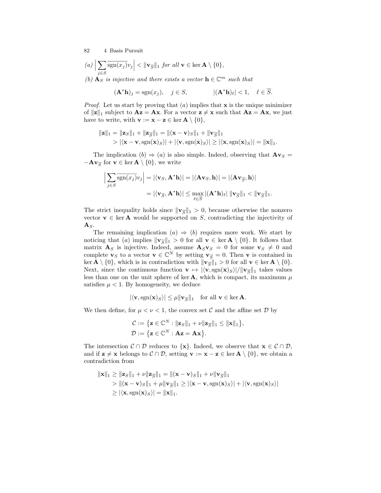

~~~text
82      4 Basis Pursuit
      X
(a)         sgn(xj )vj < kvS k1 for all v ∈ ker A \ {0},
      j∈S
(b) AS is injective and there exists a vector h ∈ Cm such that

              (A∗ h)j = sgn(xj ),   j ∈ S,           |(A∗ h)` | < 1,   ` ∈ S.

Proof. Let us start by proving that (a) implies that x is the unique minimizer
of kzk1 subject to Az = Ax. For a vector z 6= x such that Az = Ax, we just
have to write, with v := x − z ∈ ker A \ {0},

      kzk1 = kzS k1 + kzS k1 = k(x − v)S k1 + kvS k1
             > |hx − v, sgn(x)S i| + |hv, sgn(x)S i| ≥ |hx, sgn(x)S i| = kxk1 .

  The implication (b) ⇒ (a) is also simple. Indeed, observing that AvS =
−AvS for v ∈ ker A \ {0}, we write
      X
          sgn(xj )vj = |hvS , A∗ hi| = |hAvS , hi| = |hAvS , hi|
            j∈S
                          = |hvS , A∗ hi| ≤ max |(A∗ h)` | kvS k1 < kvS k1 .
                                             `∈S

The strict inequality holds since kvS k1 > 0, because otherwise the nonzero
vector v ∈ ker A would be supported on S, contradicting the injectivity of
AS .
    The remaining implication (a) ⇒ (b) requires more work. We start by
noticing that (a) implies kvS k1 > 0 for all v ∈ ker A \ {0}. It follows that
matrix AS is injective. Indeed, assume AS vS = 0 for some vS 6= 0 and
complete vS to a vector v ∈ CN by setting vS = 0. Then v is contained in
ker A \ {0}, which is in contradiction with kvS k1 > 0 for all v ∈ ker A \ {0}.
Next, since the continuous function v 7→ |hv, sgn(x)S i|/kvS k1 takes values
less than one on the unit sphere of ker A, which is compact, its maximum µ
satisfies µ < 1. By homogeneity, we deduce

                    |hv, sgn(x)S i| ≤ µkvS k1   for all v ∈ ker A.

We then define, for µ < ν < 1, the convex set C and the affine set D by

                  C := z ∈ CN : kzS k1 + νkzS k1 ≤ kxk1 ,
                       

                 D := z ∈ CN : Az = Ax .
                       

The intersection C ∩ D reduces to {x}. Indeed, we observe that x ∈ C ∩ D,
and if z 6= x belongs to C ∩ D, setting v := x − z ∈ ker A \ {0}, we obtain a
contradiction from

      kxk1 ≥ kzS k1 + νkzS k1 = k(x − v)S k1 + νkvS k1
             > k(x − v)S k1 + µkvS k1 ≥ |hx − v, sgn(x)S i| + |hv, sgn(x)S i|
             ≥ |hx, sgn(x)S i| = kxk1 .
~~~

## Page 95

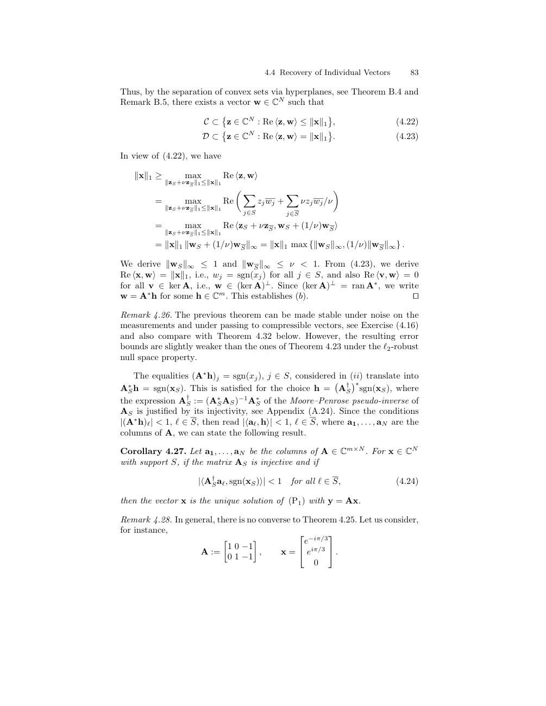

~~~text
                                            4.4 Recovery of Individual Vectors      83

Thus, by the separation of convex sets via hyperplanes, see Theorem B.4 and
Remark B.5, there exists a vector w ∈ CN such that

                     C ⊂ z ∈ CN : Re hz, wi ≤ kxk1 ,
                          
                                                                      (4.22)
                                N
                          
                     D ⊂ z ∈ C : Re hz, wi = kxk1 .                   (4.23)

In view of (4.22), we have

    kxk1 ≥         max           Re hz, wi
             kzS +νzS k1 ≤kxk1
                                    X            X           
         =         max           Re       zj wj +   νzj wj /ν
             kzS +νzS k1 ≤kxk1
                                      j∈S          j∈S
         =         max           Re hzS + νzS , wS + (1/ν)wS i
             kzS +νzS k1 ≤kxk1

         = kxk1 kwS + (1/ν)wS k∞ = kxk1 max {kwS k∞ , (1/ν)kwS k∞ } .

We derive kwS k∞ ≤ 1 and kwS k∞ ≤ ν < 1. From (4.23), we derive
Re hx, wi = kxk1 , i.e., wj = sgn(xj ) for all j ∈ S, and also Re hv, wi = 0
for all v ∈ ker A, i.e., w ∈ (ker A)⊥ . Since (ker A)⊥ = ran A∗ , we write
w = A∗ h for some h ∈ Cm . This establishes (b).                           t
                                                                           u

Remark 4.26. The previous theorem can be made stable under noise on the
measurements and under passing to compressible vectors, see Exercise (4.16)
and also compare with Theorem 4.32 below. However, the resulting error
bounds are slightly weaker than the ones of Theorem 4.23 under the `2 -robust
null space property.

    The equalities (A∗ h)j = sgn(xj ), j ∈ S, considered in (ii) translate into
                                                            ∗
AS h = sgn(xS ). This is satisfied for the choice h = A†S sgn(xS ), where
  ∗

the expression A†S := (A∗S AS )−1 A∗S of the Moore–Penrose pseudo-inverse of
AS is justified by its injectivity, see Appendix (A.24). Since the conditions
|(A∗ h)` | < 1, ` ∈ S, then read |ha` , hi| < 1, ` ∈ S, where a1 , . . . , aN are the
columns of A, we can state the following result.

Corollary 4.27. Let a1 , . . . , aN be the columns of A ∈ Cm×N . For x ∈ CN
with support S, if the matrix AS is injective and if

                       |hA†S a` , sgn(xS )i| < 1    for all ` ∈ S,               (4.24)

then the vector x is the unique solution of (P1 ) with y = Ax.

Remark 4.28. In general, there is no converse to Theorem 4.25. Let us consider,
for instance,                                   −iπ/3 
                                               e
                            1 0 −1
                    A :=             ,    x =  eiπ/3  .
                            0 1 −1
                                                   0
~~~

## Page 96

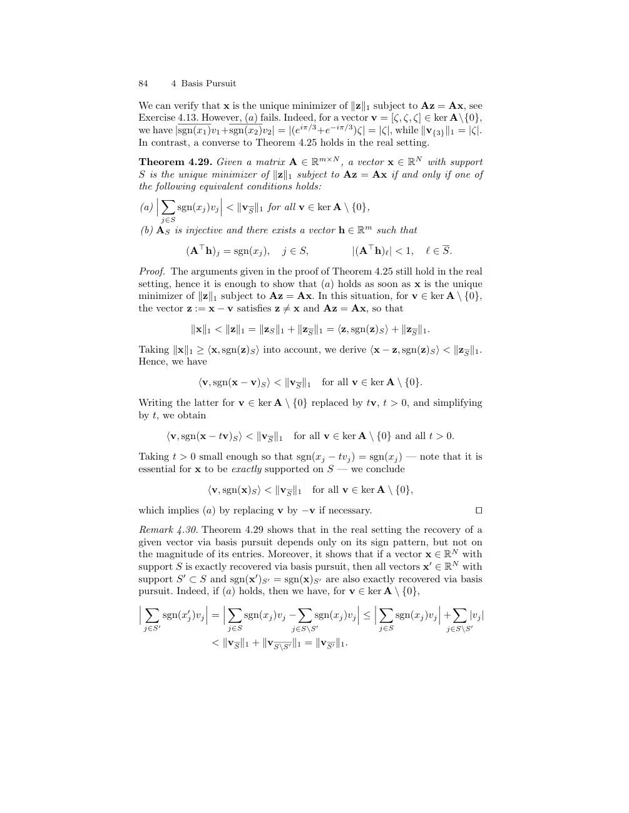

~~~text
84         4 Basis Pursuit

We can verify that x is the unique minimizer of kzk1 subject to Az = Ax, see
Exercise 4.13. However, (a) fails. Indeed, for a vector v = [ζ, ζ, ζ] ∈ ker A\{0},
we have |sgn(x1 )v1 +sgn(x2 )v2 | = |(eiπ/3 +e−iπ/3 )ζ| = |ζ|, while kv{3} k1 = |ζ|.
In contrast, a converse to Theorem 4.25 holds in the real setting.
Theorem 4.29. Given a matrix A ∈ Rm×N , a vector x ∈ RN with support
S is the unique minimizer of kzk1 subject to Az = Ax if and only if one of
the following equivalent conditions holds:
     X
(a)      sgn(xj )vj < kvS k1 for all v ∈ ker A \ {0},
         j∈S
(b) AS is injective and there exists a vector h ∈ Rm such that

               (A> h)j = sgn(xj ),   j ∈ S,              |(A> h)` | < 1,     ` ∈ S.

Proof. The arguments given in the proof of Theorem 4.25 still hold in the real
setting, hence it is enough to show that (a) holds as soon as x is the unique
minimizer of kzk1 subject to Az = Ax. In this situation, for v ∈ ker A \ {0},
the vector z := x − v satisfies z 6= x and Az = Ax, so that

                kxk1 < kzk1 = kzS k1 + kzS k1 = hz, sgn(z)S i + kzS k1 .

Taking kxk1 ≥ hx, sgn(z)S i into account, we derive hx − z, sgn(z)S i < kzS k1 .
Hence, we have

                 hv, sgn(x − v)S i < kvS k1       for all v ∈ ker A \ {0}.

Writing the latter for v ∈ ker A \ {0} replaced by tv, t > 0, and simplifying
by t, we obtain

          hv, sgn(x − tv)S i < kvS k1   for all v ∈ ker A \ {0} and all t > 0.

Taking t > 0 small enough so that sgn(xj − tvj ) = sgn(xj ) — note that it is
essential for x to be exactly supported on S — we conclude

                   hv, sgn(x)S i < kvS k1     for all v ∈ ker A \ {0},

which implies (a) by replacing v by −v if necessary.                                       t
                                                                                           u
Remark 4.30. Theorem 4.29 shows that in the real setting the recovery of a
given vector via basis pursuit depends only on its sign pattern, but not on
the magnitude of its entries. Moreover, it shows that if a vector x ∈ RN with
support S is exactly recovered via basis pursuit, then all vectors x0 ∈ RN with
support S 0 ⊂ S and sgn(x0 )S 0 = sgn(x)S 0 are also exactly recovered via basis
pursuit. Indeed, if (a) holds, then we have, for v ∈ ker A \ {0},
 X                   X                X                 X                X
     sgn(x0j )vj =       sgn(xj )vj −    sgn(xj )vj ≤       sgn(xj )vj +     |vj |
 j∈S 0                  j∈S             j∈S\S 0                j∈S               j∈S\S 0

                    < kvS k1 + kvS\S 0 k1 = kvS 0 k1 .
~~~

## Page 97

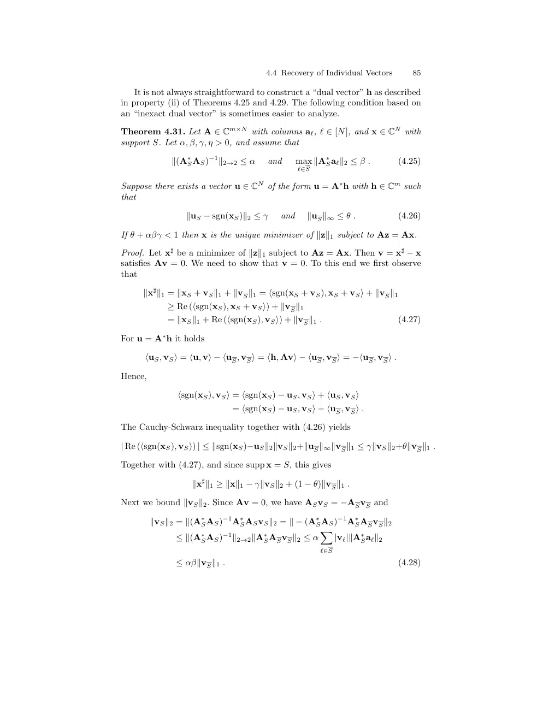

~~~text
                                         4.4 Recovery of Individual Vectors        85

    It is not always straightforward to construct a “dual vector” h as described
in property (ii) of Theorems 4.25 and 4.29. The following condition based on
an “inexact dual vector” is sometimes easier to analyze.

Theorem 4.31. Let A ∈ Cm×N with columns a` , ` ∈ [N ], and x ∈ CN with
support S. Let α, β, γ, η > 0, and assume that

              k(A∗S AS )−1 k2→2 ≤ α      and       max kA∗S a` k2 ≤ β .         (4.25)
                                                   `∈S

Suppose there exists a vector u ∈ CN of the form u = A∗ h with h ∈ Cm such
that

                  kuS − sgn(xS )k2 ≤ γ       and      kuS k∞ ≤ θ .              (4.26)

If θ + αβγ < 1 then x is the unique minimizer of kzk1 subject to Az = Ax.

Proof. Let x] be a minimizer of kzk1 subject to Az = Ax. Then v = x] − x
satisfies Av = 0. We need to show that v = 0. To this end we first observe
that

      kx] k1 = kxS + vS k1 + kvS k1 = hsgn(xS + vS ), xS + vS i + kvS k1
             ≥ Re (hsgn(xS ), xS + vS i) + kvS k1
             = kxS k1 + Re (hsgn(xS ), vS i) + kvS k1 .                         (4.27)

For u = A∗ h it holds

      huS , vS i = hu, vi − huS , vS i = hh, Avi − huS , vS i = −huS , vS i .

Hence,

                hsgn(xS ), vS i = hsgn(xS ) − uS , vS i + huS , vS i
                               = hsgn(xS ) − uS , vS i − huS , vS i .

The Cauchy-Schwarz inequality together with (4.26) yields

| Re (hsgn(xS ), vS i) | ≤ ksgn(xS )−uS k2 kvS k2 +kuS k∞ kvS k1 ≤ γkvS k2 +θkvS k1 .

Together with (4.27), and since supp x = S, this gives

                    kx] k1 ≥ kxk1 − γkvS k2 + (1 − θ)kvS k1 .

Next we bound kvS k2 . Since Av = 0, we have AS vS = −AS vS and

         kvS k2 = k(A∗S AS )−1 A∗S AS vS k2 = k − (A∗S AS )−1 A∗S AS vS k2
                                                      X
                ≤ k(A∗S AS )−1 k2→2 kA∗S AS vS k2 ≤ α     |v` |kA∗S a` k2
                                                         `∈S
                ≤ αβkvS k1 .                                                    (4.28)
~~~

## Page 98

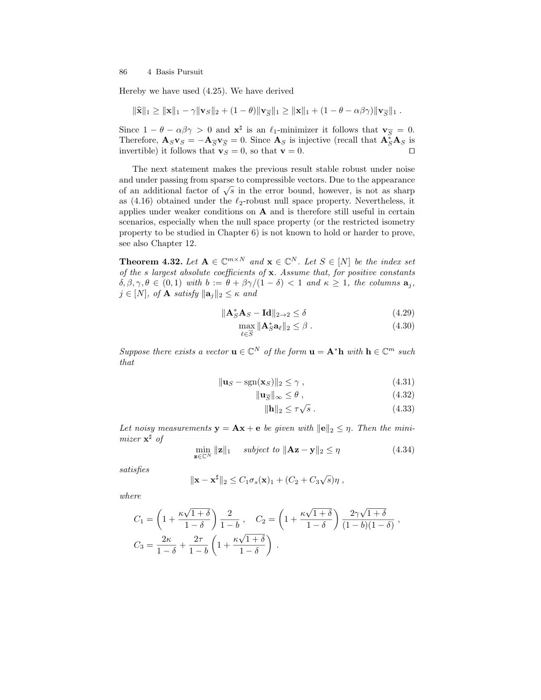

~~~text
86      4 Basis Pursuit

Hereby we have used (4.25). We have derived

      xk1 ≥ kxk1 − γkvS k2 + (1 − θ)kvS k1 ≥ kxk1 + (1 − θ − αβγ)kvS k1 .
     kb

Since 1 − θ − αβγ > 0 and x] is an `1 -minimizer it follows that vS = 0.
Therefore, AS vS = −AS vS = 0. Since AS is injective (recall that A∗S AS is
invertible) it follows that vS = 0, so that v = 0.                       t
                                                                         u

    The next statement makes the previous result stable robust under noise
and under passing from sparse
                           √ to compressible vectors. Due to the appearance
of an additional factor of s in the error bound, however, is not as sharp
as (4.16) obtained under the `2 -robust null space property. Nevertheless, it
applies under weaker conditions on A and is therefore still useful in certain
scenarios, especially when the null space property (or the restricted isometry
property to be studied in Chapter 6) is not known to hold or harder to prove,
see also Chapter 12.

Theorem 4.32. Let A ∈ Cm×N and x ∈ CN . Let S ∈ [N ] be the index set
of the s largest absolute coefficients of x. Assume that, for positive constants
δ, β, γ, θ ∈ (0, 1) with b := θ + βγ/(1 − δ) < 1 and κ ≥ 1, the columns aj ,
j ∈ [N ], of A satisfy kaj k2 ≤ κ and

                           kA∗S AS − Idk2→2 ≤ δ                          (4.29)
                                max kA∗S a` k2 ≤ β .                     (4.30)
                                `∈S

Suppose there exists a vector u ∈ CN of the form u = A∗ h with h ∈ Cm such
that

                           kuS − sgn(xS )k2 ≤ γ ,                        (4.31)
                                      kuS k∞ ≤ θ ,                       (4.32)
                                                √
                                        khk2 ≤ τ s .                     (4.33)

Let noisy measurements y = Ax + e be given with kek2 ≤ η. Then the mini-
mizer x] of
                  min kzk1 subject to kAz − yk2 ≤ η               (4.34)
                    z∈CN

satisfies                                            √
                   kx − x] k2 ≤ C1 σs (x)1 + (C2 + C3 s)η ,
where
              √                      √         √
              κ 1+δ     2              κ 1+δ     2γ 1 + δ
     C1 = 1 +               , C2 = 1 +                        ,
               1−δ     1−b              1−δ    (1 − b)(1 − δ)
                          √    
           2κ    2τ       κ 1+δ
     C3 =     +       1+          .
          1−δ   1−b        1−δ
~~~

## Page 99

~~~text
                                         4.4 Recovery of Individual Vectors      87

Remark 4.33. The statement of the above theorem can be made more specific
by choosing concrete constants, for instance, κ = τ = 2, δ = β = γ = 1/2,
θ = 1/4 resulting in b = 3/4 and C1 ≈ 47.19, C2 ≈ 57.79, C3 ≈ 102.38.

Proof. The vector x is feasible for the optimization program (4.34) by the
assumption on the noise level. Therefore, kxk1 ≥ kx] k1 and writing x] = x+v
we have

            kxk1 ≥ kx + vk1 = k(x + v)S k1 + k(x + v)S k1
                  ≥ Re (h(x + v)S , sgn(x)S i) + kvS k1 − kxS k1
                  = kxS k1 + Re (hvS , sgn(x)S i) + kvS k1 − kxS k1 .

Rearranging and using that kxk1 = kxS k1 + kxS k1 yields

                      kvS k1 ≤ |hvS , sgn(x)S i| + 2kxS k1 .                  (4.35)

The triangle inequality and the Cauchy-Schwarz inequality together with
(4.31) yield

              |hvS , sgn(xS )i| ≤ |hvS , sgn(x)S − uS i| + |hvS , uS i|
                               ≤ γkvS k2 + |hv, ui| + |hvS , uS i| .

It follows from the assumption on the noise vector e and from the constraint
of the optimization problem (4.34) that

      kAvk2 = kA(x] − x)k2 ≤ kAx] − yk2 + ky − Axk2 ≤ 2η .                    (4.36)

The
√ well-conditionedness     assumption in (4.29) implies that kAS k2→2 ≤
  1 + δ and k(A∗S AS )−1 k2→2 ≤ (1 − δ)−1 , see Theorem A.13 and Proposi-
tion A.16, so that
               1                   1                1
     kvS k2 ≤     kA∗S AS vS k2 ≤      kA∗S Avk2 +     kA∗S AS vS k2
             1−δ                  1−δ              1−δ
               √
                 1+δ       β
            ≤2       η+        kv k1 ,
                1−δ      1−δ S
where the inequality kA∗S AS vS k2 ≤ βkvS k1 follows from (4.30) in the same
way as in (4.28). Condition (4.33) gives
                                                            √
      |hv, ui| = |hv, A∗ hi| = |hAv, hi| ≤ kAvk2 khk2 ≤ 2τ η s ,       (4.37)

while (4.32) implies |hvS , uS i| ≤ θkvS k1 . We plug these estimates into (4.35)
to find that
                √
                                   √
                                                     
                      1+δ                          βγ
      kvS k1 ≤ 2γ            + 2τ s η + θ +              kvS k1 + 2kxS k1 .
                     1−δ                          1−δ

Since θ + βγ/(1 − δ) = b < 1 and kxS k1 = σs (x)1 a rearrangement yields
~~~

## Page 100

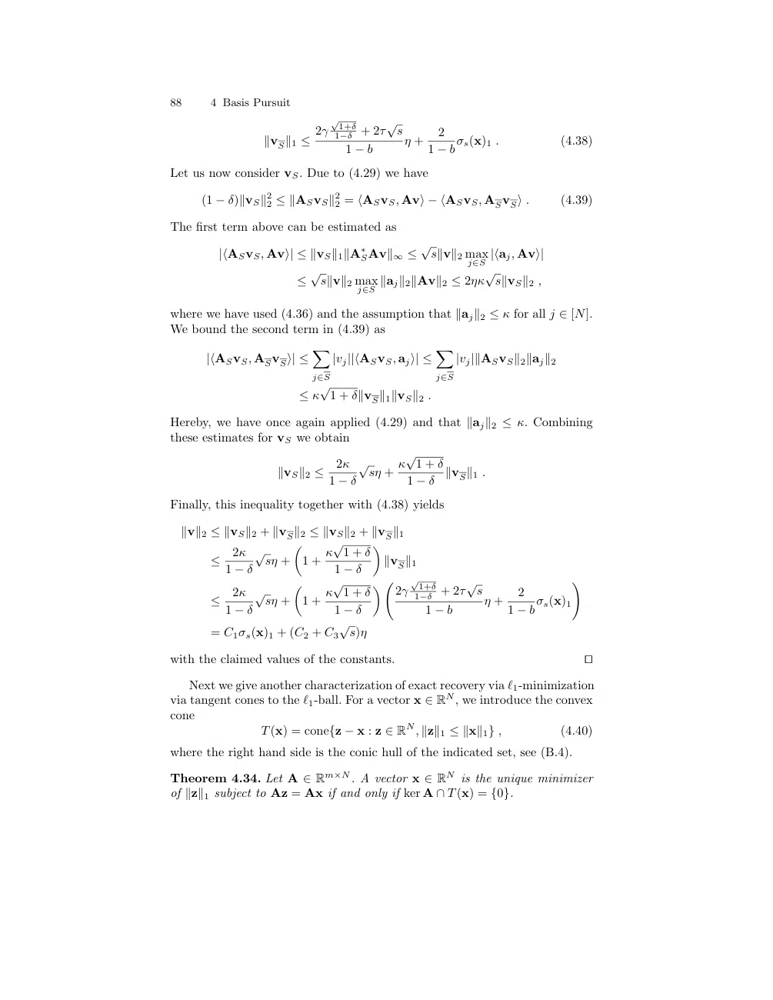

~~~text
88     4 Basis Pursuit
                              √         √
                                1+δ
                            2γ 1−δ  + 2τ s         2
                 kvS k1 ≤                    η+       σs (x)1 .           (4.38)
                                  1−b             1−b
Let us now consider vS . Due to (4.29) we have

     (1 − δ)kvS k22 ≤ kAS vS k22 = hAS vS , Avi − hAS vS , AS vS i .      (4.39)

The first term above can be estimated as
                                            √
         |hAS vS , Avi| ≤ kvS k1 kA∗S Avk∞ ≤ skvk2 max |haj , Avi|
                                                    j∈S
                          √                            √
                        ≤ skvk2 max kaj k2 kAvk2 ≤ 2ηκ skvS k2 ,
                                   j∈S

where we have used (4.36) and the assumption that kaj k2 ≤ κ for all j ∈ [N ].
We bound the second term in (4.39) as
                           X                        X
      |hAS vS , AS vS i| ≤   |vj ||hAS vS , aj i| ≤   |vj |kAS vS k2 kaj k2
                            j∈S                     j∈S
                            √
                         ≤ κ 1 + δkvS k1 kvS k2 .

Hereby, we have once again applied (4.29) and that kaj k2 ≤ κ. Combining
these estimates for vS we obtain
                                         √
                              2κ √      κ 1+δ
                    kvS k2 ≤       sη +        kvS k1 .
                             1−δ         1−δ
Finally, this inequality together with (4.38) yields

  kvk2 ≤ kvS k2 + kvS k2 ≤ kvS k2 + kvS k1
                             √
          2κ √
                                   
                            κ 1+δ
       ≤         sη + 1 +             kvS k1
         1−δ                 1−δ
                             √             √         √                 !
                                             1+δ
          2κ √                          2γ 1−δ   + 2τ s
                                   
                            κ 1+δ                           2
       ≤         sη + 1 +                               η+     σs (x)1
         1−δ                 1−δ              1−b          1−b
                              √
       = C1 σs (x)1 + (C2 + C3 s)η

with the claimed values of the constants.                                      t
                                                                               u

    Next we give another characterization of exact recovery via `1 -minimization
via tangent cones to the `1 -ball. For a vector x ∈ RN , we introduce the convex
cone
                 T (x) = cone{z − x : z ∈ RN , kzk1 ≤ kxk1 } ,             (4.40)
where the right hand side is the conic hull of the indicated set, see (B.4).

Theorem 4.34. Let A ∈ Rm×N . A vector x ∈ RN is the unique minimizer
of kzk1 subject to Az = Ax if and only if ker A ∩ T (x) = {0}.
~~~

## Page 101

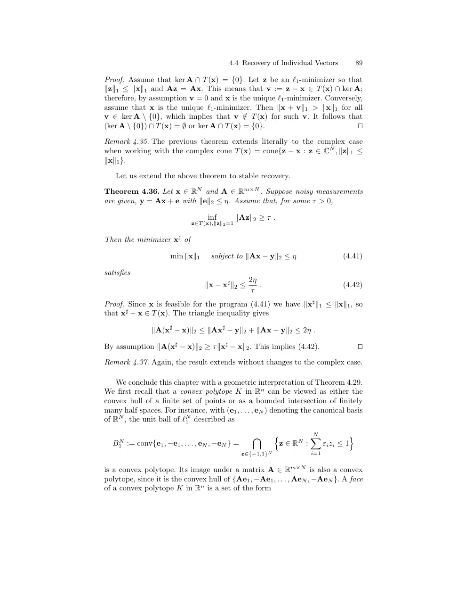

~~~text
                                         4.4 Recovery of Individual Vectors          89

Proof. Assume that ker A ∩ T (x) = {0}. Let z be an `1 -minimizer so that
kzk1 ≤ kxk1 and Az = Ax. This means that v := z − x ∈ T (x) ∩ ker A;
therefore, by assumption v = 0 and x is the unique `1 -minimizer. Conversely,
assume that x is the unique `1 -minimizer. Then kx + vk1 > kxk1 for all
v ∈ ker A \ {0}, which implies that v ∈    / T (x) for such v. It follows that
(ker A \ {0}) ∩ T (x) = ∅ or ker A ∩ T (x) = {0}.                           t
                                                                            u

Remark 4.35. The previous theorem extends literally to the complex case
when working with the complex cone T (x) = cone{z − x : z ∈ CN , kzk1 ≤
kxk1 }.

   Let us extend the above theorem to stable recovery.

Theorem 4.36. Let x ∈ RN and A ∈ Rm×N . Suppose noisy measurements
are given, y = Ax + e with kek2 ≤ η. Assume that, for some τ > 0,

                                  inf         kAzk2 ≥ τ .
                            z∈T (x),kzk2 =1

Then the minimizer x] of

                     min kxk1      subject to kAx − yk2 ≤ η                   (4.41)

satisfies
                                                  2η
                                 kx − x] k2 ≤        .                        (4.42)
                                                  τ
Proof. Since x is feasible for the program (4.41) we have kx] k1 ≤ kxk1 , so
that x] − x ∈ T (x). The triangle inequality gives

               kA(x] − x)k2 ≤ kAx] − yk2 + kAx − yk2 ≤ 2η .

By assumption kA(x] − x)k2 ≥ τ kx] − xk2 . This implies (4.42).                      t
                                                                                     u

Remark 4.37. Again, the result extends without changes to the complex case.

    We conclude this chapter with a geometric interpretation of Theorem 4.29.
We first recall that a convex polytope K in Rn can be viewed as either the
convex hull of a finite set of points or as a bounded intersection of finitely
many half-spaces. For instance, with (e1 , . . . , eN ) denoting the canonical basis
of RN , the unit ball of `N
                          1 described as

                                                   \        n         N
                                                                      X          o
  B1N := conv{e1 , −e1 , . . . , eN , −eN } =                z ∈ RN :   εi zi ≤ 1
                                                ε∈{−1,1}N             i=1

is a convex polytope. Its image under a matrix A ∈ Rm×N is also a convex
polytope, since it is the convex hull of {Ae1 , −Ae1 , . . . , AeN , −AeN }. A face
of a convex polytope K in Rn is a set of the form
~~~

## Page 102

~~~text
90     4 Basis Pursuit

                              F = {z ∈ K : hz, hi = c}

for some h ∈ Rn and some c ∈ R, where hz, hi ≤ c holds for all z ∈ C. Note
that c > 0 if F is a proper face of a symmetric convex polytope K, so we may
always assume c = 1 in this case. A face F of K is called a k-face if its affine
hull has dimension k. The 0-, 1-, (n − 2)-, and (n − 1)-faces are called vertices,
                                           0 ≤ k ≤ N − 1, it can be verified
edges, ridges, and facets, respectively. For
                                        N
that the k-faces of B1N are the 2k+1 k+1    sets
               n          X          o
                z ∈ B1N :   εk zk = 1 = conv{εk ek , k ∈ K} ,
                          k∈K

where K is a subset of [N ] with size k+1 and (εk )k∈K is a sequence in {−1, 1}.
Thus, if a vector x ∈ RN with kxk1 = 1 is exactly s-sparse, it is contained in
one and only one (s − 1)-face of B1N , namely conv{sgn(xj )ej , j ∈ S}. We are
now ready to give the final necessary and sufficient condition for the recovery
of individual vectors via basis pursuit.

Theorem 4.38. For a matrix A ∈ Rm×N , a vector x ∈ RN with support S
of size s ≥ 1 is the unique minimizer of kzk1 subject to Az = Ax if and only
if the (s − 1)-face of B1N containing x/kxk1 maps to an (s − 1)-face of AB1N .

Proof. With S := supp(x), the desired necessary and sufficient condition says
                                                                  N
that F := A(conv{sgn(xj )ej , j ∈ S}) is an P  (s − 1)-face of
                                                             PAB1 . We notice
that its affine hull Ax + V , where V := { j∈S tj Aej , j∈S tj = 0}, has
dimension s − 1 if and only if the matrix AS is injective. This can be seen by
considering, for a fixed j0 ∈ S, the surjective linear map
                                       X              X 
        Rs−1 → V : (tj )j∈S\{j0 } 7→        tj Aej −           tj Aej0 .
                                      j∈S\{j0 }          j∈S\{j0 }

We then notice that F is a face of AB1N if and only if there exists h ∈ Rm
such that

       z ∈ B1N ⇒ hAz, hi ≤ 1 ,       with equality if and only if Az ∈ F .

The latter is equivalent to

                              z ∈ B1N ⇒ hz, A> hi ≤ 1

with equality if and only if z ∈ conv{sgn(xj )ej , j ∈ S}. This translates into

         (A> h)j = sgn(xj ),     j ∈ S,           |(A> h)` | < 1,    `∈S.

The desired necessary and sufficient condition is recognized as Condition (b)
of Theorem 4.29, which completes the proof.                                t
                                                                           u
~~~

## Page 103

~~~text
                                           4.5 Low-Rank Matrix Recovery          91

   In view of the equivalence between recovery of all vectors x ∈ RN with
sparsity at most s and with sparsity exactly s mentioned in Remark 4.30, we
conclude with the following alternative to the null space property.

Corollary 4.39. Given a matrix A ∈ Rm×N , every s-sparse vector x ∈ RN
is the unique solution of (P1 ) with y = Ax if and only if every (s − 1)-face
of B1N maps to an (s − 1)-face of AB1N .

4.5 Low-Rank Matrix Recovery

In this section we shortly digress on the problem of recovering matrices of low
rank from incomplete linear measurements, which was already mentioned in
Section 1.2 (p. 18). In this context, the number of nonzero singular values —
the rank of matrix — replaces the number of nonzero entries — the sparsity
of a vector.
    We suppose that a matrix X ∈ Cn1 ×n2 of rank at most r is observed
via the measurement vector y = A(X) ∈ Cm where A is a linear map from
Cn1 ×n2 to Cm . As in the vector case the first approach to this problem that
probably comes to mind is to solve the rank-minimization problem

                  minimize
                     n ×n
                           rank(Z)      subject to A(X) = y .
                  Z∈C 1     2

Unfortunately, like `0 -minimization this problem is NP-hard, see Exercise 2.11.
Motivated by the vector case where `1 -minimization is a good strategy, we
relax the minimization of the rank to the nuclear norm minimization problem

                    minimize
                       n ×n
                             kZk∗      subject to A(Z) = y .                 (4.43)
                    Z∈C 1       2

This is convex optimization problem. Here, the nuclear norm, see (A.28), is
defined by
                          n
                          X
                 kZk∗ :=     σj (Z) ,   n := min{n1 , n2 },
                                j=1

is the `1 -norm of the vector [σ1 (Z), . . . , σn (Z)]> of singular values of Z, see
also (A.28) and Appendix A.2 in general for the fact that k · k∗ is indeed a
norm.
    The analysis of the nuclear norm minimization strategy (4.43) is analogous
to the vector case. In particular, the success of the strategy is equivalent to a
null space property.

Theorem 4.40. Given a linear map A from Cn1 ×n2 to Cm , every matrix
X ∈ Cn1 ×n2 of rank at most r is the unique solution of (4.43) with y = A(X)
if and only if, for all M ∈ ker A \ {0} with singular values σ1 (M) ≥ · · · ≥
σn (M) ≥ 0, n := min{n1 , n2 },
~~~

## Page 104

~~~text
92      4 Basis Pursuit
                                r
                                X                 n
                                                  X
                                      σj (M) <           σj (M) .                      (4.44)
                                j=1              j=r+1

Proof. Let us first assume that every matrix X ∈ Cn1 ×n2 of rank at most r is
the unique solution of (4.43) with y = AX. We consider the singular value de-
composition of a matrix M ∈ ker A\{0} and write M = Udiag(σ1 , . . . , σn )V∗
for σ1 ≥ · · · ≥ σn ≥ 0 and U ∈ Cn1 ×n1 , V ∈ Cn2 ×n2 unitary. Setting M1 =
Udiag(σ1 , . . . , σr , 0, . . . , 0)V∗ and M2 = Udiag(0, . . . , 0, −σr+1 , . . . , −σn )V∗ ,
we have M = M1 − M2 . Thus, A(M) = 0 translates into A(M1 ) = A(M2 ).
Since the rank of M1 is at most r, its nuclear norm must be smaller than the
nuclear norm of M2 . This means that σ1 + · · · + σr < σr+1 + · · · + σn , as
desired.                                         Pr                   Pn
    Conversely, let us now assume that             j=1 σj (M) <         j=r+1 σj (M) for
every M ∈ ker A \ {0} with singular values σ1 (M) ≥ · · · ≥ σn (M) ≥ 0.
Consider a matrix X ∈ Cn1 ×n2 of rank at most r and a matrix Z ∈ Cn1 ×n2 ,
Z 6= X, satisfying A(Z) = A(X). We aim at proving that kZk∗ > kXk∗ . Let
us set M := X − Z ∈ ker A \ {0}. Lemma A.20 insures that the singular values
σj (M), σj (Z), σj (M) satisfy
                           n
                           X                       n
                                                   X
                 kZk∗ =          σj (X − M) ≥            |σj (X) − σj (M)| .
                           j=1                     j=1

For j ∈ [r], we have |σj (X) − σj (M)| ≥ σj (X) − σj (M), and for r + 1 ≤ j ≤ n,
it holds |σj (X) − σj (M)| = σj (M). In view of our hypothesis, we derive
              r
              X                 r
                                X                n
                                                 X                  r
                                                                    X
     kZk∗ ≥          σj (X) −         σj (M) +           σj (M) >         σj (X) = kXk∗ .
               j=1              j=1              j=r+1              j=1

This establishes the desired inequality.                                                    t
                                                                                            u

    Like in the vector case, one can introduce stable and robust versions of
the rank null space property (4.44) and show corresponding error estimates
for reconstruction via nuclear norm minimization, see Exercises 4.17 and 4.18.
Also, recovery conditions for individual low-rank matrices can be shown, anal-
ogously to the results for the vector case in Section 4.4, see Exercise 4.19.
    In the remainder of the book, the low-rank recovery problem will only be
treated via exercises, see e.g. Exercises 6.24 and 9.12. The reader is, of course,
very welcome to work through them.

Notes
Throughout the chapter, we have insisted on sparse vectors to be unique
solutions of (P1 ). If we dropped the uniqueness requirement, then a necessary
and sufficient condition for every s-sparse vector to be a solution of (P1 ) would
~~~

## Page 105

~~~text
                                          4.5 Low-Rank Matrix Recovery         93

be a weak null space property where the the strict inequality is replaced by a
weak inequality sign.
    The null space property is somewhat folklore in the compressive sensing
literature. It appeared implicitly in works of D. Donoho and M. Elad [133],
of D. Donoho and X. Huo [136], and of M. Elad and A. Bruckstein [158]. R.
Gribonval and M. Nielsen also isolated the notion in [206]. The name was first
used by A. Cohen, W. Dahmen, and R. DeVore in [102], albeit for a property
slightly more general than (4.3), namely kvk1 ≤ C σs (v)1 for all v ∈ ker A,
where C ≥ 1 is an unspecified constant. We have coined the terms stable and
robust null space properties for some notions that are implicit in the literature.
    The equivalence between the real and complex null space properties was
established by S. Foucart and R. Gribonval in [183] using a different argument
than the one of Theorem 4.7. The result was generalized by M.-J. Lai and L.
Liu in [273]. The proof of Theorem 4.7 follows their argument.
    Given a measurement matrix A ∈ Km×N and a vector x ∈ KN , one can
rephrase the optimization problem (P1 ) with y = Ax as the problem of best
approximation to x ∈ KN from the subspace ker A of KN in the `1 -norm. Some
of the results of this chapter can be derived using known characterizations of
best `1 -approximation. The book [335] by A. Pinkus is a good source on the
subject, although it does not touch the complex setting.
    The term instance optimality is sometimes also used for what we called
stability in this chapter. Chapter 11 gives more details on this topic.
    The stability and robustness of sparse reconstruction via basis pursuit, as
stated after Theorem 4.21, were established by E. Candès, J. Romberg, and T.
Tao in [80] under a restricted isometry property — see Chapter 6 — condition
on the measurement matrix.
    The fact that sparse recovery via `q -minimization implies sparse recovery
via `p -minimization whenever 0 < p < q ≤ 1 was proved by R. Gribonval and
M. Nielsen in [207].
    The sufficient condition (ii) of Theorems 4.25 and 4.29, as well as Corollary
4.27, can be found in works of J.-J. Fuchs [187] and of J. Tropp [415]. E.
Candès, J. Romberg, and T. Tao stated in [72] that it is also a necessary
condition if the measurement matrix is a partial Fourier matrix. The reasoning
was slightly incorrect, for it would generalize to other measurement matrices
and contradict Remark 4.28.
    The success of sparse recovery via basis pursuit was characterized in terms
of faces of polytopes by Donoho in [129], where the condition of Corollary 4.39
was also interpreted in terms of neighborliness of the polytope AB1N — see
Exercise 4.15.
~~~

## Page 106

~~~text
94     4 Basis Pursuit

Exercises
4.1. Suppose that A ∈ Cm×N satisfies the null space property of order s.
Theorems 4.5 and 2.13 guarantee that ker A does not contain any 2s-sparse
vectors other than the zero vector. Give a direct proof of this fact.
4.2. Find a 2 × 3 matrix A and a nonsingular 3 × 3 diagonal matrix D such
that A has the first order null space property, but AD does not.
4.3. Prove that an individual s-sparse vector can be recovered via basis pursuit
with a number of measurements m < 2s.
4.4. Suppose that the null space of a real matrix A is a two-dimensional space
with basis (v, w). Prove that A has the null space property of order s if and
only if
X           X        X          X          X                     X
    |vj | <   |v` |,    |wj | <    |w` |,      |vi wj −vj wi | <   |vi w` −v` wi |,
j∈S       `∈S         j∈S        `∈S         j∈S                 `∈S

for all i ∈ [N ] and all S ⊂ [N ] with card(S) ≤ s.
4.5. Prove the equivalence between the real and complex stable null space
properties with constant 0 < ρ < 1 relative to a set S.
4.6. Given 0 < c < 1, prove the equivalence of the properties:
(i) kvS k1 ≤ kvS k1 − c kvk1 for all v ∈ ker A and S ⊆ [N ] with card(S) ≤ s,
(ii)kxk1 ≤ kzk1 − c kx − zk1 for all s-sparse x ∈ KN and z ∈ KN with
Az = Ax.
4.7. Given S ⊂ [N ], prove that a minimizer x] of kzk1 subject to a constraint
met by x ∈ CN satisfies
                    x − x] S 1 ≤ x − x] S 1 + 2 kxS k1 .
                                         

4.8. Given A ∈ Rm×N , prove that every nonnegative s-sparse vector x ∈ RN
is the unique solution of
                 minimize kzk1    subject to Az = Ax and z ≥ 0
                   z∈RN

if and only if
                                          N
                                          X
                             vS ≥ 0 =⇒          vj > 0
                                          j=1

for all v ∈ ker A \ {0} and all S ⊆ [N ] with card(S) ≤ s.
                                             PN
4.9. Let A ∈ Rm×N be a matrix for which j=1 vj = 0 whenever v ∈ ker A,
and let S ⊂ [N ] be a fixed index set. Suppose that every nonnegative vector
supported on S is uniquely recovered by `1 -minimization. Prove that every
nonnegative vector x supported on S is in fact the unique vector in the set
{z ∈ RN : z ≥ 0, Az = Ax}.
~~~

## Page 107

~~~text
                                            4.5 Low-Rank Matrix Recovery       95

4.10. Given matrices A ∈ Cm×N and M ∈ Cm×m , suppose that M A satisfies
the `2 -robust null space property of order s with constants 0 < ρ < 1 and
τ > 0. Prove that there exist constants C, D > 0 depending only on ρ, τ , and
kM k2→2 such that, for any x ∈ CN ,

                            C
           kx − x] kp ≤          σs (x)1 + D s1/p−1/2 η ,     1≤p≤2,
                          s1−1/p
where x] ∈ CN is a solution of (P1,η ) with k · k = k · k2 , y = Ax + e, and
kek2 ≤ η.

4.11. Prove Theorem 4.8, and generalize other results of Sections 4.1, 4.2, and
4.3 when the `1 -norm is replaced by the `q -quasinorm for 0 < q < 1.

4.12. Given an integer s ≥ 1 and an exponent q ∈ (0, 1), find a measurement
matrix that allows reconstruction of s-sparse vectors via `p -minimization for
p < q, but not for p > q.

4.13. With A and x given in Remark 4.28, verify the statement that x is the
unique minimizer of kzk1 subject to Az = Ax.

4.14. Given a matrix A ∈ Cm×N and a vector x ∈ CN with support S, prove
that x is a minimizer of kzk1 subject to Az = Ax if one of the following
equivalent conditions holds:
     X
 (i)     sgn(xj )vj ≤ kvS k1 for all v ∈ ker A,
     j∈S
(ii) there exists a vector h ∈ Cm such that

            (A∗ h)j = sgn(xj ),    j∈S,             |(A∗ h)` | ≤ 1,   `∈S.

4.15. A symmetric convex polytope K is called centrally k-neighborly if any
set of k + 1 of its vertices, not containing an antipodal pair, spans a k-face of
K. Given a matrix A ∈ Rm×N , prove that every s-sparse vector x ∈ RN is
the unique solution of (P1 ) with y = Ax if and only if the convex polytope
AB1N has 2N vertices and is s-neighborly.

4.16. Stable recovery via dual certificate.
Let x ∈ CN and A ∈ Cm×N with `2 -normalized columns, kak k2 = 1, k ∈ [N ].
For s ≥ 1, let S ⊂ [N ] be the set of indices of the s largest absolute entries of
x. Assume that kAS k2→2 ≤ α, for some α > 0 and that there exists a dual
certificate u = A∗ h ∈ CN with h ∈ Cm such that
                                                             √
                uS = sgn(xS ) , kuS k∞ ≤ β , khk2 ≤ γ s .

for constants β ∈ (0, 1) and γ > 0. Suppose that noisy measurements y =
Ax + e are given with kek2 ≤ η. Show that the solution x] ∈ CN of the
`1 -minimization problem
~~~

## Page 108

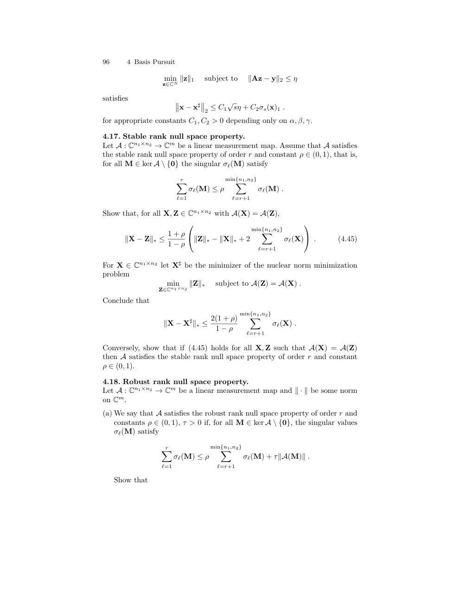

~~~text
96      4 Basis Pursuit

                   min kzk1         subject to        kAz − yk2 ≤ η
                   z∈CN

satisfies                              √
                          x − x] 2 ≤ C1 sη + C2 σs (x)1 .
for appropriate constants C1 , C2 > 0 depending only on α, β, γ.

4.17. Stable rank null space property.
Let A : Cn1 ×n2 → Cm be a linear measurement map. Assume that A satisfies
the stable rank null space property of order r and constant ρ ∈ (0, 1), that is,
for all M ∈ ker A \ {0} the singular σ` (M) satisfy

                          r                  min{n1 ,n2 }
                          X                     X
                                σ` (M) ≤ ρ                  σ` (M) .
                          `=1                  `=r+1

Show that, for all X, Z ∈ Cn1 ×n2 with A(X) = A(Z),
                                                              
                                            min{n1 ,n2 }
                    1+ρ                       X
      kX − Zk∗ ≤           kZk∗ − kXk∗ + 2               σ` (X) .          (4.45)
                    1−ρ
                                                            `=r+1

For X ∈ Cn1 ×n2 let X] be the minimizer of the nuclear norm minimization
problem
                  min kZk∗ subject to A(Z) = A(X) .
                 Z∈Cn1 ×n2

Conclude that
                                                  min{n1 ,n2 }
                                      2(1 + ρ)         X
                   kX − X] k∗ ≤                                  σ` (X) .
                                       1−ρ
                                                     `=r+1

Conversely, show that if (4.45) holds for all X, Z such that A(X) = A(Z)
then A satisfies the stable rank null space property of order r and constant
ρ ∈ (0, 1).

4.18. Robust rank null space property.
Let A : Cn1 ×n2 → Cm be a linear measurement map and k · k be some norm
on Cm .
(a) We say that A satisfies the robust rank null space property of order r and
    constants ρ ∈ (0, 1), τ > 0 if, for all M ∈ ker A \ {0}, the singular values
    σ` (M) satisfy

                  r                   min{n1 ,n2 }
                  X                      X
                        σ` (M) ≤ ρ                   σ` (M) + τ kA(M)k .
                  `=1                   `=r+1

     Show that
~~~

## Page 109

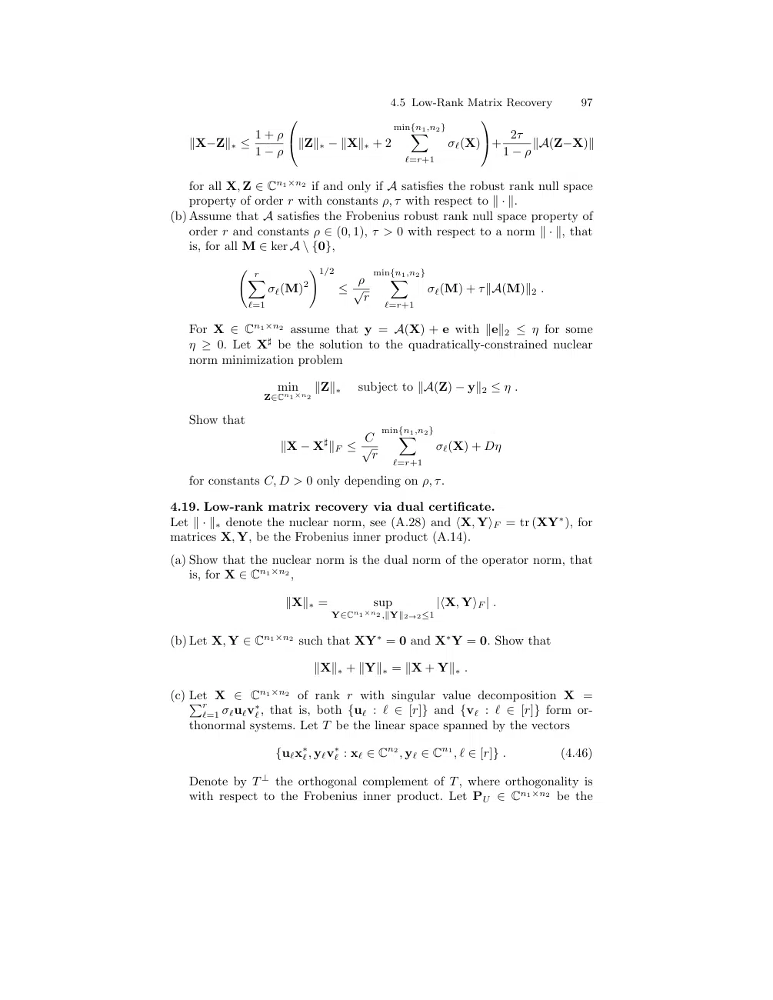

~~~text
                                                 4.5 Low-Rank Matrix Recovery          97
                                                   
                                 min{n1 ,n2 }
            1+ρ                    X                   2τ
   kX−Zk∗ ≤      kZk∗ − kXk∗ + 2              σ` (X)+     kA(Z−X)k
            1−ρ                                        1−ρ
                                                      `=r+1

    for all X, Z ∈ Cn1 ×n2 if and only if A satisfies the robust rank null space
    property of order r with constants ρ, τ with respect to k · k.
(b) Assume that A satisfies the Frobenius robust rank null space property of
    order r and constants ρ ∈ (0, 1), τ > 0 with respect to a norm k · k, that
    is, for all M ∈ ker A \ {0},

               r
                                !1/2          min{n1 ,n2 }
               X
                            2           ρ        X
                     σ` (M)            ≤√                    σ` (M) + τ kA(M)k2 .
                                          r
               `=1                              `=r+1

   For X ∈ Cn1 ×n2 assume that y = A(X) + e with kek2 ≤ η for some
   η ≥ 0. Let X] be the solution to the quadratically-constrained nuclear
   norm minimization problem

                      min       kZk∗       subject to kA(Z) − yk2 ≤ η .
                 Z∈Cn1 ×n2

   Show that
                                               min{n1 ,n2 }
                                  ]C                X
                       kX − X kF ≤ √                          σ` (X) + Dη
                                     r
                                                    `=r+1

   for constants C, D > 0 only depending on ρ, τ .

4.19. Low-rank matrix recovery via dual certificate.
Let k · k∗ denote the nuclear norm, see (A.28) and hX, YiF = tr (XY∗ ), for
matrices X, Y, be the Frobenius inner product (A.14).
(a) Show that the nuclear norm is the dual norm of the operator norm, that
    is, for X ∈ Cn1 ×n2 ,

                        kXk∗ =                sup             |hX, YiF | .
                                      Y∈Cn1 ×n2 ,kYk2→2 ≤1

(b) Let X, Y ∈ Cn1 ×n2 such that XY∗ = 0 and X∗ Y = 0. Show that

                                kXk∗ + kYk∗ = kX + Yk∗ .

    Let X ∈ Cn1 ×n2 of rank r with singular value decomposition X =
(c) P
      r          ∗
      `=1 σ` u` v` , that is, both {u` : ` ∈ [r]} and {v` : ` ∈ [r]} form or-
    thonormal systems. Let T be the linear space spanned by the vectors

                      {u` x∗` , y` v∗` : x` ∈ Cn2 , y` ∈ Cn1 , ` ∈ [r]} .           (4.46)

   Denote by T ⊥ the orthogonal complement of T , where orthogonality is
   with respect to the Frobenius inner product. Let PU ∈ Cn1 ×n2 be the
~~~

## Page 110

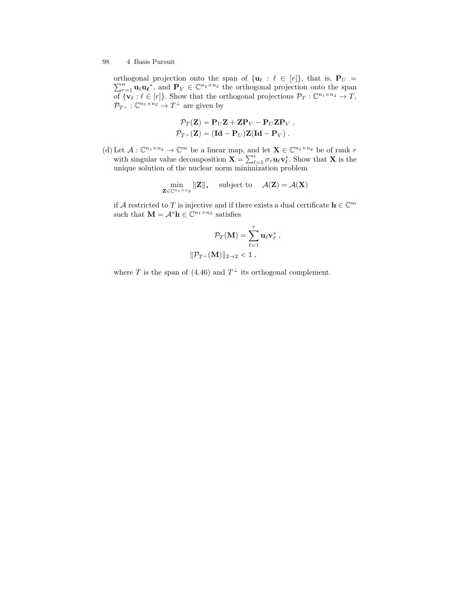

~~~text
98       4 Basis Pursuit

     orthogonal
     Pn            projection onto the span of {u` : ` ∈ [r]}, that is, PU =
                  ∗
        r=1 u` u`   , and PV ∈ Cn2 ×n2 the orthogonal projection onto the span
     of {v` : ` ∈ [r]}. Show that the orthogonal projections PT : Cn1 ×n2 → T ,
     PT ⊥ : Cn1 ×n2 → T ⊥ are given by

                            PT (Z) = PU Z + ZPV − PU ZPV ,
                           PT ⊥ (Z) = (Id − PU )Z(Id − PV ) .

(d) Let A : Cn1 ×n2 → Cm be a linear map, Pand let X ∈ Cn1 ×n2 be of rank r
                                             r
    with singular value decomposition X = `=1 σr u` v∗` . Show that X is the
    unique solution of the nuclear norm minimization problem

                       min      kZk∗    subject to      A(Z) = A(X)
                    Z∈Cn1 ×n2

     if A restricted to T is injective and if there exists a dual certificate h ∈ Cm
     such that M = A∗ h ∈ Cn1 ×n2 satisfies
                                                  r
                                                  X
                                       PT (M) =         u` v∗` ,
                                                  `=1
                               kPT ⊥ (M)k2→2 < 1 ,

     where T is the span of (4.46) and T ⊥ its orthogonal complement.
~~~

## Page 111

~~~text
5
Coherence

In compressive sensing, the analysis of recovery algorithms usually involves
a quantity that measures the suitability of the measurement matrix. The
coherence is a very simple such measure of quality. In general, the smaller
the coherence, the better the recovery algorithms perform. In Section 5.1, we
introduce the notion of coherence of a matrix and some of its generalizations.
In Section 5.2, we examine how small the coherence can be and we point out
some matrices with small coherence. In Sections 5.5, 5.3, and 5.4, we give some
sufficient conditions expressed in terms of the coherence that guarantee the
success of basic thresholding, orthogonal matching pursuit, and basis pursuit.

5.1 Definitions and Basic Properties
We start with the definition of the coherence of a matrix. We stress that the
columns of the matrix are always implicitly understood to be `2 -normalized.
Definition 5.1. Let A ∈ Cm×N be a matrix with `2 -normalized columns
a1 , . . . , aN , i.e., kai k2 = 1 for all 1 ≤ i ≤ N . The coherence µ = µ(A) of
the matrix A is defined as

                            µ :=    max       |hai , aj i| .                (5.1)
                                   1≤i6=j≤N

   Next we introduce the more general concept of `1 -coherence function,
which incorporates the usual coherence as the particular value s = 1 of its
argument.
Definition 5.2. Let A ∈ Cm×N be a matrix with `2 -normalized columns
a1 , . . . , aN . The `1 -coherence function µ1 of the matrix A is defined for
1 ≤ s ≤ N − 1 by
                               nX                                               o
          µ1 (s) := max max         |hai , aj i| , S ⊆ [N ], card(S) = s, i 6∈ S .
                i∈[N ]
                            j∈S
~~~

## Page 112

~~~text
100      5 Coherence

      It is straightforward to observe that, for 1 ≤ s ≤ N − 1,

                                 µ ≤ µ1 (s) ≤ s µ,                            (5.2)

and more generally that, for 1 ≤ s, t ≤ N − 1 with s + t ≤ N − 1,

                 max{µ1 (s), µ1 (t)} ≤ µ1 (s + t) ≤ µ1 (s) + µ1 (t).          (5.3)

We remark that the coherence, and more generally the `1 -coherence function,
is invariant under multiplication on the left by a unitary matrix U, for the
columns of UA are the `2 -normalized vectors Ua1 , . . . , UaN and they satisfy
hUai , Uaj i = hai , aj i. Moreover, because of the Cauchy–Schwarz inequality
|hai , aj i| ≤ kai k2 kaj k2 , it is clear that the coherence of a matrix is bounded
above by one, i.e.,
                                            µ ≤ 1.
Let us consider for a moment a matrix A ∈ Cm×N with m ≥ N . We observe
that µ = 0 if and only if the columns of A form an orthonormal system. In
particular, in the case of a square matrix, we have µ = 0 if and only if A is
a unitary matrix. From now on, we concentrate on the situation occurring in
compressive sensing, i.e., we only consider matrices A ∈ Cm×N with m < N .
In this case, there are limitations on how small the coherence can be. These
limitations are given in Section 5.2. For now, we simply point out that a
small coherence implies that column-submatrices of moderate size are well
conditioned. Let us recall that the notation AS denotes the matrix formed by
the columns of A ∈ Cm×N indexed by a subset S of [N ].

Theorem 5.3. Let A ∈ Cm×N be a matrix with `2 -normalized columns, and
let 1 ≤ s ≤ N . For all s-sparse vectors x ∈ CN ,

             1 − µ1 (s − 1) kxk22 ≤ kAxk22 ≤ 1 + µ1 (s − 1) kxk22 ,
                                                          

or equivalently, for each set S ⊆ [N ] with card(S) ≤ s, the eigenvalues   of the
matrix A∗S AS lie in the interval 1 − µ1 (s − 1) , 1 + µ1 (s − 1) . In particular,
                                                                 

if µ1 (s − 1) < 1, then A∗S AS is invertible.

Proof. For a set S ⊆ [N ] with card(S) ≤ s, since the matrix A∗S AS is positive
semidefinite, it has an orthonormal basis of eigenvectors associated with real,
positive eigenvalues. We denote the minimal eigenvalue by λmin and the max-
imal eigenvalue by λmax . Then, since Ax = AS xS for any x ∈ CN supported
on S, it is easy to see that the maximum of

                    kAxk22 = hAS xS , AS xS i = hA∗S AS xS , xS i

over the set {x ∈ CN , supp x ⊆ S, kxk2 = 1} is λmax and that its minimum
is λmin . This explains the equivalence mentioned in the theorem. Now, due
to the normalizations kaj k2 = 1 for all 1 ≤ j ≤ N , the diagonal entries of
A∗S AS all equal one. By Gershgorin’s disc theorem, see Theorem A.12, the
~~~

## Page 113

~~~text
                                              5.2 Matrices with Small Coherence   101

eigenvalues of A∗S AS are contained in the union of the discs centered at 1
with radii
            X                       X
     rj :=        |(A∗S AS )j,` | =    |ha` , aj i| ≤ µ1 (s − 1), j ∈ S.
           `∈S,`6=j                      `∈S,`6=j
                                                                         
Since these eigenvalues are real, they must lie in 1−µ1 (s−1) , 1+µ1 (s−1) ,
as announced.                                                             t
                                                                          u

Corollary 5.4. Given a matrix A ∈ Cm×N with `2 -normalized columns and
an integer s ≥ 1, if
                        µ1 (s) + µ1 (s − 1) < 1,
then, for each set S ⊆ [N ] with card(S) ≤ 2s, the matrix A∗S AS is invertible
and the matrix AS injective. In particular, the conclusion holds if
                                                 1
                                         µ<          .
                                              2s − 1
Proof. In view of (5.3), the condition µ1 (s) + µ1 (s − 1) < 1 implies that
µ1 (2s−1) < 1. For a set S ⊆ [N ] with card(S) ≤ 2s, according to Theorem 5.3,
the smallest eigenvalue of the matrix A∗S AS satisfies λmin ≥ 1−µ1 (2s−1) > 0,
which shows that A∗S AS is invertible. To see that AS is injective, we simply
observe that AS z = 0 yields A∗S AS z = 0, so that z = 0. This proves the first
statement. The second one simply follows from µ1 (s)+µ1 (s−1) ≤ (2s−1)µ < 1
if µ < 1/(2s − 1).                                                           t
                                                                             u

5.2 Matrices with Small Coherence
In this section, we give lower bounds for the coherence and for the `1 -coherence
function of a matrix A ∈ Cm×N with m < N . We also study the feasibility of
achieving these lower bounds. We then give an example of a matrix with an
almost minimal coherence. The analysis is carried out for matrices A ∈ Km×N ,
where the field K can either be R or C, because the matrices achieving the
lower bounds have different features in the real and complex settings. In both
cases, however, their columns are equiangular tight frames, which are defined
below.

Definition 5.5. A system of `2 -normalized vectors (a1 , . . . , aN ) in Km is
called equiangular if there is a constant c ≥ 0 such that

                      |hai , aj i| = c     for all i, j ∈ [N ], i 6= j .

Definition 5.6. A system of vectors (a1 , . . . , aN ) in Km is called a tight
frame if there exists a constant λ > 0 such that one of the following equivalent
conditions holds:
~~~

## Page 114

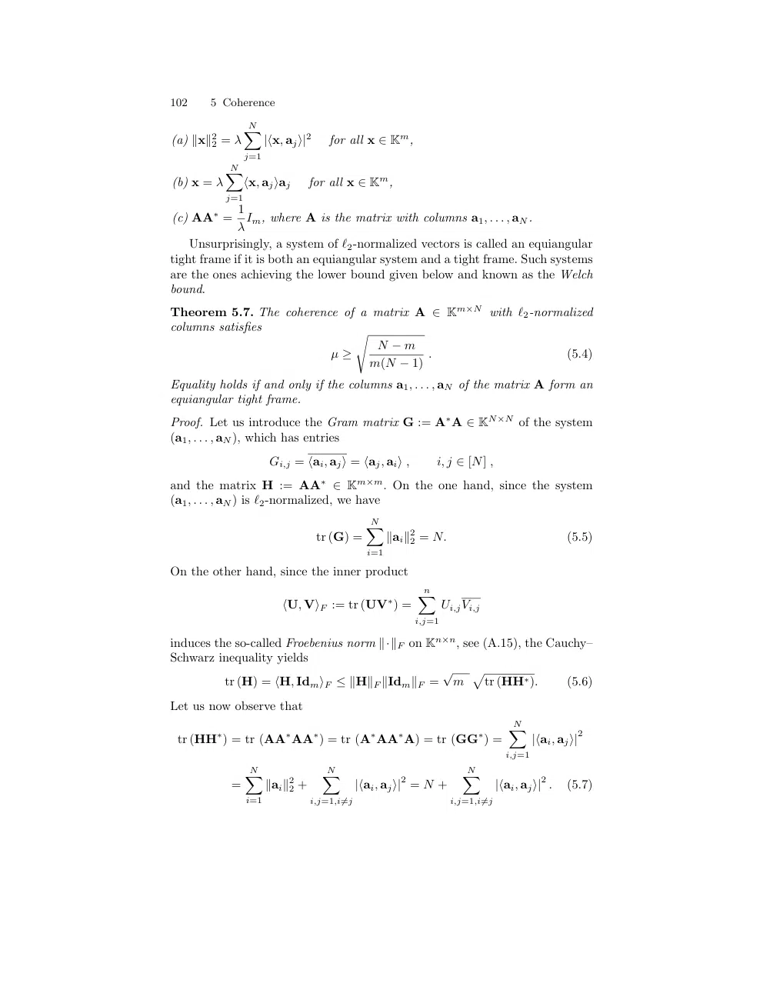

~~~text
102    5 Coherence
                  N
                  X
(a) kxk22 = λ           |hx, aj i|2           for all x ∈ Km ,
                  j=1
            N
            X
(b) x = λ         hx, aj iaj        for all x ∈ Km ,
            j=1
             1
(c) AA∗ =       Im , where A is the matrix with columns a1 , . . . , aN .
             λ
    Unsurprisingly, a system of `2 -normalized vectors is called an equiangular
tight frame if it is both an equiangular system and a tight frame. Such systems
are the ones achieving the lower bound given below and known as the Welch
bound.
Theorem 5.7. The coherence of a matrix A ∈ Km×N with `2 -normalized
columns satisfies            s
                                N −m
                         µ≥             .                     (5.4)
                               m(N − 1)
Equality holds if and only if the columns a1 , . . . , aN of the matrix A form an
equiangular tight frame.
Proof. Let us introduce the Gram matrix G := A∗ A ∈ KN ×N of the system
(a1 , . . . , aN ), which has entries
                         Gi,j = hai , aj i = haj , ai i ,            i, j ∈ [N ] ,
                                          ∗        m×m
and the matrix H := AA ∈ K                    . On the one hand, since the system
(a1 , . . . , aN ) is `2 -normalized, we have
                                                    N
                                                    X
                                      tr (G) =             kai k22 = N.                                    (5.5)
                                                     i=1

On the other hand, since the inner product
                                                                 n
                                                                 X
                            hU, ViF := tr (UV∗ ) =                       Ui,j Vi,j
                                                                 i,j=1

induces the so-called Froebenius norm k·kF on Kn×n , see (A.15), the Cauchy–
Schwarz inequality yields
                                                √      p
          tr (H) = hH, Idm iF ≤ kHkF kIdm kF = m         tr (HH∗ ).     (5.6)
Let us now observe that
                                                                                           N
                                                                                           X
        ∗                    ∗        ∗              ∗       ∗                   ∗                           2
 tr (HH ) = tr (AA AA ) = tr (A AA A) = tr (GG ) =                                                |hai , aj i|
                                                                                          i,j=1
                  N
                  X                       N
                                          X                                   N
                                                                              X
                                                             2                                      2
            =           kai k22 +                 |hai , aj i| = N +                    |hai , aj i| .     (5.7)
                  i=1               i,j=1,i6=j                             i,j=1,i6=j
~~~

## Page 115

~~~text
                                        5.2 Matrices with Small Coherence               103

In view of tr (G) = tr (H), combining (5.5), (5.6), and (5.7) yields
                                        N
                                         X                         
                        2                                      2
                      N ≤m N+                       |hai , aj i|       .               (5.8)
                                       i,j=1,i6=j

Taking into account that

                    |hai , aj i| ≤ µ    for all 1 ≤ i 6= j ≤ N,                        (5.9)

we obtain
                            N 2 ≤ m N + (N 2 − N )µ2 ,
                                                    

which is a simple rearrangement of (5.4). Moreover, equality holds in (5.4)
exactly when equalities hold in (5.6) and in (5.9). Equality in (5.6) says that
H = λIdm for some — necessarily nonnegative — constant λ, i.e., that the
system (a1 , . . . , aN ) is a tight frame. Equality in (5.9) says that this system
is equiangular.                                                                   t
                                                                                  u

   The Welch bound can be extended to the `1 -coherence function for small
values of its argument.

Theorem 5.8. The `1 -coherence function of a matrix A ∈ Km×N with `2 -
normalized columns satisfies
                      s
                          N −m                     √
            µ1 (s) ≥ s               whenever s < N − 1.       (5.10)
                        m(N − 1)

Equality holds if and only if the columns a1 , . . . , aN of the matrix A form an
equiangular tight frame.

  The proof is based on the following lemma.
                     √
Lemma 5.9. For k < n, if the finite sequence (α1 , α2 , . . . , αn ) satisfies
                                                                                n
        α1 ≥ α2 ≥ · · · ≥ αn ≥ 0       and          α12 + α22 + · · · + αn2 ≥      ,
                                                                                k2
then
                              α1 + α2 + · · · + αk ≥ 1,
with equality if and only if α1 = α2 = · · · = αn = 1/k.

Proof. We are going to show the equivalent statement
                                   
         α1 ≥ α2 ≥ · · · ≥ αn ≥ 0                                 n
                                     =⇒ α12 + α22 + · · · + αn2 ≤ 2 ,
          α1 + α2 + · · · + αk ≤ 1                               k

with equality if and only if α1 = α2 = · · · = αn = 1/k. This is the problem of
maximizing the convex function
~~~

## Page 116

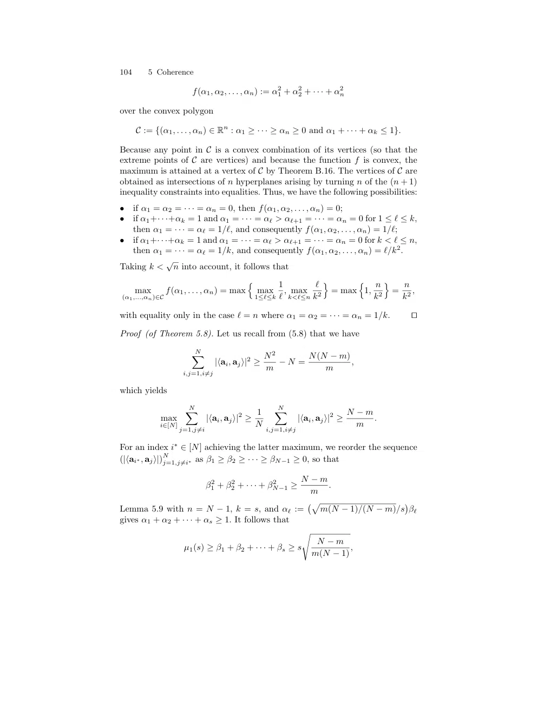

~~~text
104      5 Coherence

                          f (α1 , α2 , . . . , αn ) := α12 + α22 + · · · + αn2

over the convex polygon

      C := {(α1 , . . . , αn ) ∈ Rn : α1 ≥ · · · ≥ αn ≥ 0 and α1 + · · · + αk ≤ 1}.

Because any point in C is a convex combination of its vertices (so that the
extreme points of C are vertices) and because the function f is convex, the
maximum is attained at a vertex of C by Theorem B.16. The vertices of C are
obtained as intersections of n hyperplanes arising by turning n of the (n + 1)
inequality constraints into equalities. Thus, we have the following possibilities:
•  if α1 = α2 = · · · = αn = 0, then f (α1 , α2 , . . . , αn ) = 0;
•  if α1 +· · ·+αk = 1 and α1 = · · · = α` > α`+1 = · · · = αn = 0 for 1 ≤ ` ≤ k,
   then α1 = · · · = α` = 1/`, and consequently f (α1 , α2 , . . . , αn ) = 1/`;
• if α1 +· · ·+αk = 1 and α1 = · · · = α` > α`+1 = · · · = αn = 0 for k < ` ≤ n,
   then α1 = · · · = α` = 1/k, and consequently f (α1 , α2 , . . . , αn ) = `/k 2 .
              √
Taking k < n into account, it follows that
                                               n         1        ` o   n no    n
      max         f (α1 , . . . , αn ) = max       max     , max 2 = max 1, 2 = 2 ,
(α1 ,...,αn )∈C                                    1≤`≤k ` k<`≤n k         k   k

with equality only in the case ` = n where α1 = α2 = · · · = αn = 1/k.                         t
                                                                                               u

Proof (of Theorem 5.8). Let us recall from (5.8) that we have
                          N
                          X                            N2      N (N − m)
                                    |hai , aj i|2 ≥       −N =           ,
                                                       m           m
                       i,j=1,i6=j

which yields
                        N                                N
                        X                          1     X                            N −m
             max                 |hai , aj i|2 ≥                    |hai , aj i|2 ≥        .
             i∈[N ]                                N                                    m
                      j=1,j6=i                         i,j=1,i6=j

For an index i∗ ∈ [N ] achieving the latter maximum, we reorder the sequence
               N
(|hai∗ , aj i|)j=1,j6=i∗ as β1 ≥ β2 ≥ · · · ≥ βN −1 ≥ 0, so that

                                                  N −m
                                 β12 + β22 + · · · + βN
                                                      2
                                                       .−1 ≥
                                                    m
                                                    p                   
Lemma 5.9 with n = N − 1, k = s, and α` :=            m(N − 1)/(N − m)/s β`
gives α1 + α2 + · · · + αs ≥ 1. It follows that
                                                  s
                                                     N −m
                 µ1 (s) ≥ β1 + β2 + · · · + βs ≥ s           ,
                                                    m(N − 1)
~~~

## Page 117

~~~text
                                                5.2 Matrices with Small Coherence               105

as announced. Let us now assume that equality holds in (5.10), so that all the
previous inequalities are in fact equalities. As in the proof of Theorem 5.7,
equality in (5.8) implies that the system (a1 , . . . , aNp) is a tight frame. The case
of equality in Lemma 5.9 implies that |hai∗ , aj i| = (N − m)/(m(N − 1)) for
all j ∈ [N ], j 6= i∗ . Since the index i∗ can be arbitrarily chosen in [N ], the
system (a1 , . . . , aN ) is also equiangular. Conversely, the proof that equiangular
tight frames yields equality in (5.10) follows easily from Theorem 5.7 and (5.2).
                                                                                     t
                                                                                     u

    In compressive sensing, we are not only interested in small coherence, but
also in m×N matrices where N is much larger than m. This restriction makes
it impossible to meet the Welch bound. Indeed, the next theorem shows that
the number of vectors in an equiangular tight frame — or in an equiangular
system, for that matter — cannot be arbitrarily large.

Theorem 5.10. The cardinality N of an equiangular system (a1 , . . . , aN ) of
`2 -normalized vectors in Km satisfies

                        m(m + 1)
                    N≤                                        when K = R ,
                           2
                    N ≤ m2                                    when K = C .

If equality is achieved, then the system (a1 , . . . , aN ) is a also tight frame.

    We will use the following simple lemma twice in the proof of this theorem.

Lemma 5.11. For any z ∈ C, the n × n matrix
                                            
                           1 z z ··· z
                         z 1 z · · · z 
                                            
                          .. . . . . . . .. 
                         . . . . .
                                            
                         z · · · z 1 z 
                           z ··· z z 1

admits 1 + (n − 1)z as a single eigenvalue and 1 − z as a multiple eigenvalue
of multiplicity n − 1.

Proof. Summing the columns of the matrix, we see that the vector [1, . . . , 1]>
is an eigenvector for the eigenvalue 1 + (n − 1)z. Then, subtracting from
the first column each subsequent column, we also see that the (n − 1) linearly
independent vectors [1, −1, 0, . . . , 0]> , [1, 0, −1, 0, . . . , 0]> , . . ., [1, 0 . . . , 0, −1]>
are eigenvectors for the eigenvalue 1 − z. The proof is now complete.                               t
                                                                                                    u

Proof (of Theorem 5.10). The key point is to lift our considerations from the
space Km to a subspace Sm of operators on Km . In the case K = R, Sm is the
space of symmetric operators on Rm , and in the case K = C, Sm is simply the
space of operators on Cm . (it is tempting to consider hermitian operators, but
~~~

## Page 118

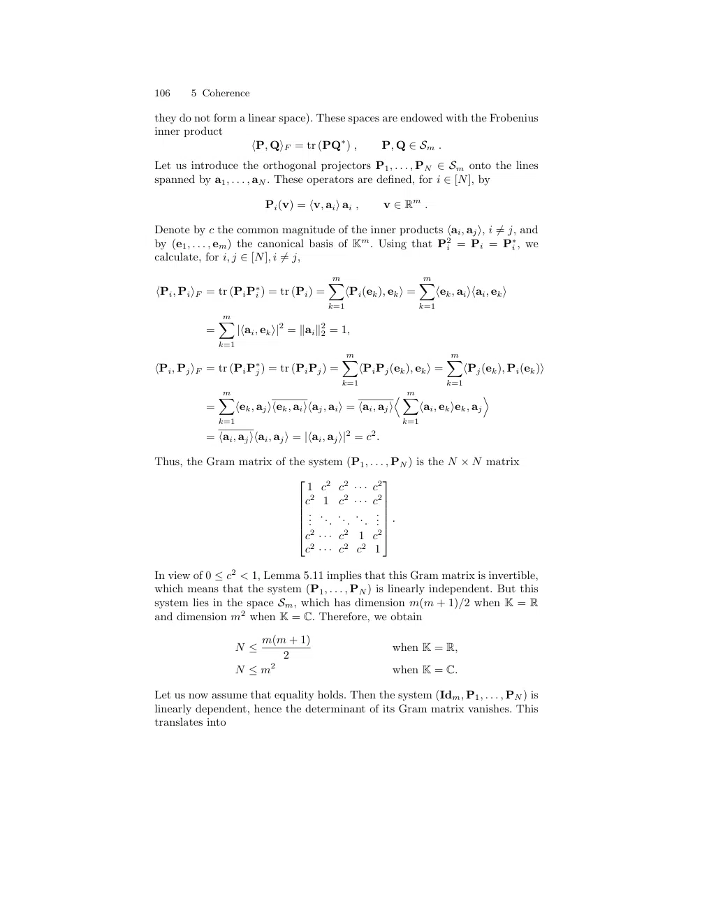

~~~text
106     5 Coherence

they do not form a linear space). These spaces are endowed with the Frobenius
inner product
                    hP, QiF = tr (PQ∗ ) ,      P, Q ∈ Sm .
Let us introduce the orthogonal projectors P1 , . . . , PN ∈ Sm onto the lines
spanned by a1 , . . . , aN . These operators are defined, for i ∈ [N ], by

                            Pi (v) = hv, ai i ai ,         v ∈ Rm .

Denote by c the common magnitude of the inner products hai , aj i, i 6= j, and
by (e1 , . . . , em ) the canonical basis of Km . Using that P2i = Pi = P∗i , we
calculate, for i, j ∈ [N ], i 6= j,
                                            m
                                            X                       m
                                                                    X
hPi , Pi iF = tr (Pi P∗i ) = tr (Pi ) =         hPi (ek ), ek i =       hek , ai ihai , ek i
                                            k=1                     k=1
               m
               X
           =         |hai , ek i|2 = kai k22 = 1,
               k=1
                                                m
                                                X                          m
                                                                           X
hPi , Pj iF = tr (Pi P∗j ) = tr (Pi Pj ) =          hPi Pj (ek ), ek i =       hPj (ek ), Pi (ek )i
                                                k=1                        k=1
               m
               X                                                 m
                                                                DX                   E
           =         hek , aj ihek , ai ihaj , ai i = hai , aj i   hai , ek iek , aj
               k=1                                             k=1

           = hai , aj ihai , aj i = |hai , aj i|2 = c2 .

Thus, the Gram matrix of the system (P1 , . . . , PN ) is the N × N matrix

                             1 c2 c2 · · · c2
                                              
                           c2 1 c2 · · · c2 
                                              
                            .. . . . . . . .. 
                           .      . . . .       .
                                              
                           c2 · · · c2 1 c2 
                            c2 · · · c2 c2 1

In view of 0 ≤ c2 < 1, Lemma 5.11 implies that this Gram matrix is invertible,
which means that the system (P1 , . . . , PN ) is linearly independent. But this
system lies in the space Sm , which has dimension m(m + 1)/2 when K = R
and dimension m2 when K = C. Therefore, we obtain

                       m(m + 1)
                   N≤                                        when K = R,
                          2
                   N ≤ m2                                    when K = C.

Let us now assume that equality holds. Then the system (Idm , P1 , . . . , PN ) is
linearly dependent, hence the determinant of its Gram matrix vanishes. This
translates into
~~~

## Page 119

~~~text
                                         5.2 Matrices with Small Coherence   107

                            m 1 1 1 ··· 1
                            1 1 c2 c2 · · · c2
                            1 c2 1 c2 · · · c2
                            .. .. . . . . . . .. = 0 .
                             . .     . . . .
                             1 c2 · · · c2 1 c2
                             1 c2 · · · c2 c2 1
Subtracting the first row divided by m from all the other rows and expanding
with respect to the first column, we derive the N × N identity

                1 b b ··· b
                b 1 b ··· b
                .. . . . . . . .. = 0,                       mc2 − 1
                 . . . . .                  where     b :=           .
                                                              m−1
                b ··· b    1 b
                b ··· b    b 1

Since 1−b = m(1−c2 )/(m−1) 6= 0, Lemma 5.11 implies that 1+(N −1)b = 0,
which reads after simplification
                                          N −m
                                 c2 =             .
                                         m(N − 1)

This shows that the `2 -normalized system (a1 , . . . , aN ) meets the Welch
bound. Thus, according to Theorem 5.7, it is an equiangular tight frame. t u

   The upper bounds on the number of vectors in an equiangular systems are
sharp. For instance, equiangular systems of 6 vectors in R3 and of 28 vectors
in R7 are given in Exercise 5.5, while equiangular systems of 4 vectors in C2
and of 9 vectors in C3 are given in Exercise 5.6. In contrast with Cm , where
systems of m2 equiangular vectors in Cm seem to exist for all m, systems of
m(m + 1)/2 equiangular vectors in Rm do not exist for all m, as shown below.
They are known to exist when m is equal to 2, 3, 7, and 23, but the cases of
other allowed values are not settled.

Theorem 5.12. For m ≥ 3, if there is an equiangular system of m(m + 1)/2
vectors in Rm , then m + 2 is necessarily the square of an odd integer.

Proof. Let (a1 , . . . , aN ) be a system of N = m(m + 1)/2 equiangular `2 -
normalized vectors. According to Theorem 5.10, this system is a tight frame,
hence the matrix A with columns a1 , . . . , aN satisfies AA∗ = λIdm for some
λ > 0. Since the matrix G := A∗ A has the same nonzero eigenvalues as AA∗ ,
i.e., λ with multiplicity m, it also has zero as an eigenvalue of multiplicity
N − m. Moreover, since G is the Gram matrix of the system (a1 , . . . , aN ), its
diagonal entries all equal one, while its off-diagonal entries all have the same
absolute value c. Consequently, the matrix B := (G − IdN )/c has the form
~~~

## Page 120

~~~text
108     5 Coherence
                                         
                      0 b1,2   ··· b1,N
                              ..    .. 
               b2,1 0            .   . 
            B= .
                                         ,            where bi,j = ±1,
               ..   . ..      ..         
                                  .
                                  bN −1,N 
               bN,1 · · · bN,N −1    0

and has −1/c as an eigenvalue of multiplicity N − m. Thus, its characteristic
polynomial PB (x) := 0≤k≤N βk (−x)k , βN = 1, has integer coefficients βk
                     P
and vanishes at x = −1/c. Given that
        s              s                      r
            N −m          (m + 1)/2 − 1           m−1             1
    c=               =                     =                =√         ,
          m(N − 1)       m(m + 1)/2 − 1         m2 + m − 2       m+2
             √
we have PB (− m + 2) = 0, i.e,
                          !                                                       !
      X
                        k
                             √                      X
                                                                              k
            b2k (m + 2)     + m+2                             b2k+1 (m + 2)           = 0.
      0≤k≤N/2                                  0≤k≤(N −1)/2

Noticing that the two sums above, denoted by Σ1 and Σ2 , are both integers,
we obtain the equality Σ12 = (m + 2)Σ22 , which shows that m + 2 is a square,
since any prime factor of m + 2 must appear an even number of times      √      in
its prime factor decomposition. We now need to show that n := m + 2
is odd. Let us introduce the N × N matrix JN whose entries are all equal
to one. Its null space has dimension N − 1, so it intersects the (N − m)-
dimensional eigenspace of B corresponding to the eigenvalue −1/c = −n, since
N − 1 + N − m > N for m ≥ 3, i.e., N = m(m + 1)/2 > m + 1. Consequently,
the matrix C := (B − IdN + JN )/2 admits −(n + 1)/2 as an eigenvalue. Its
diagonal entries are all equal to zero, while its off-diagonal entries
                                                                   PNare all equal
to zero or one. Thus, its characteristic polynomial PC (x) := k=0 γk (−x)k ,
γN = 1, has integer coefficients γk and vanishes at x = −(n + 1)/2. The
equality PC (−(n + 1)/2) = 0 can be rewritten as
                                      N
                                      X −1
                       (n + 1)N = −          2N −k γk (n + 1)k .
                                      k=0

                       N
This shows that (n +
                   √ 1) is an even integer, hence so is n + 1. This completes
the proof that n = m + 2 is an odd integer.                                t
                                                                           u

   In the complex setting, it seems plausible that equiangular systems of
N = m2 vectors exists for all                                      2
                           √values of m. This would yield m × m matrices
with coherence equal to 1/ m + 1, but no construction of such systems is
                                                               2
known at the moment. √ We present below an explicit m × m matrix   √   with
coherence equal to 1/ m instead. Let us incidentally notice that 1/ m is the
limit of the Welch bound when N goes to infinity.
~~~

## Page 121

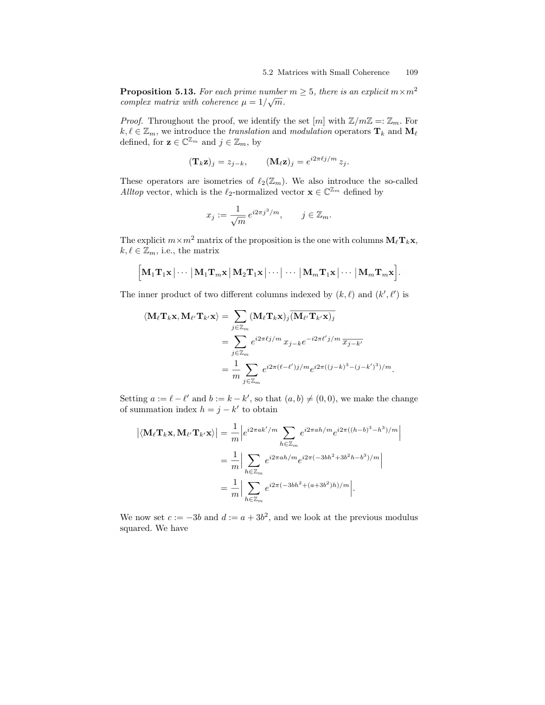

~~~text
                                          5.2 Matrices with Small Coherence    109

Proposition 5.13. For each prime number
                                    √   m ≥ 5, there is an explicit m×m2
complex matrix with coherence µ = 1/ m.

Proof. Throughout the proof, we identify the set [m] with Z/mZ =: Zm . For
k, ` ∈ Zm , we introduce the translation and modulation operators Tk and M`
defined, for z ∈ CZm and j ∈ Zm , by

                   (Tk z)j = zj−k ,        (M` z)j = ei2π`j/m zj .

These operators are isometries of `2 (Zm ). We also introduce the so-called
Alltop vector, which is the `2 -normalized vector x ∈ CZm defined by
                               1     3
                        xj := √ ei2πj /m ,          j ∈ Zm .
                               m

The explicit m×m2 matrix of the proposition is the one with columns M` Tk x,
k, ` ∈ Zm , i.e., the matrix
     h                                                               i
      M1 T1 x · · · M1 Tm x M2 T1 x · · · · · · Mm T1 x · · · Mm Tm x .

The inner product of two different columns indexed by (k, `) and (k 0 , `0 ) is
                             X
      hM` Tk x, M`0 Tk0 xi =     (M` Tk x)j (M`0 Tk0 x)j
                                j∈Zm
                                X                          0
                            =          ei2π`j/m xj−k e−i2π` j/m xj−k0
                                j∈Zm
                                1 X i2π(`−`0 )j/m i2π((j−k)3 −(j−k0 )3 )/m
                            =      e             e                         .
                                m
                                  j∈Zm

Setting a := ` − `0 and b := k − k 0 , so that (a, b) 6= (0, 0), we make the change
of summation index h = j − k 0 to obtain
                              1 i2πak0 /m X i2πah/m i2π((h−b)3 −h3 )/m
     hM` Tk x, M`0 Tk0 xi =     e             e      e
                              m
                                         h∈Zm
                              1 X i2πah/m i2π(−3bh2 +3b2 h−b3 )/m
                            =        e       e
                              m
                                h∈Zm
                              1 X i2π(−3bh2 +(a+3b2 )h)/m
                            =        e                    .
                              m
                                   h∈Zm

We now set c := −3b and d := a + 3b2 , and we look at the previous modulus
squared. We have
~~~

## Page 122

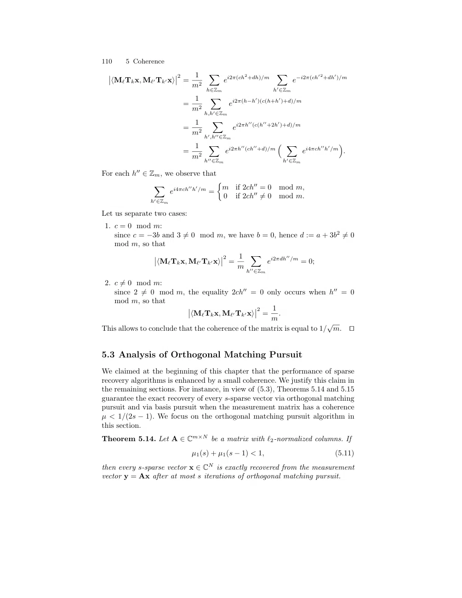

~~~text
110    5 Coherence

                          2     1 X i2π(ch2 +dh)/m X −i2π(ch0 2 +dh0 )/m
   hM` Tk x, M`0 Tk0 xi       =        e                       e
                               m2
                                  h∈Zm                  h0 ∈Zm
                                1  X             0         0
                              = 2        ei2π(h−h )(c(h+h )+d)/m
                               m    0 h,h ∈Zm
                                1        X              00   00   0
                              = 2                   ei2πh (c(h +2h )+d)/m
                               m
                                      h0 ,h00 ∈Zm
                                  1 X i2πh00 (ch00 +d)/m  X i4πch00 h0 /m 
                              =         e                    e               .
                                  m2 00                    0
                                      h ∈Zm                           h ∈Zm

For each h00 ∈ Zm , we observe that
                                         m if 2ch00 = 0
                                       
                X
                       i4πch00 h0 /m                              mod m,
                     e               =
                0
                                         0 if 2ch00 6= 0          mod m.
                h ∈Zm

Let us separate two cases:
 1. c = 0 mod m:
    since c = −3b and 3 6= 0 mod m, we have b = 0, hence d := a + 3b2 6= 0
    mod m, so that
                                    2  1 X i2πdh00 /m
                hM` Tk x, M`0 Tk0 xi =         e         = 0;
                                       m 00
                                                        h ∈Zm

 2. c 6= 0 mod m:
    since 2 6= 0 mod m, the equality 2ch00 = 0 only occurs when h00 = 0
    mod m, so that
                                                2    1
                           hM` Tk x, M`0 Tk0 xi = .
                                                    m
                                                                       √
This allows to conclude that the coherence of the matrix is equal to 1/ m. t
                                                                           u

5.3 Analysis of Orthogonal Matching Pursuit
We claimed at the beginning of this chapter that the performance of sparse
recovery algorithms is enhanced by a small coherence. We justify this claim in
the remaining sections. For instance, in view of (5.3), Theorems 5.14 and 5.15
guarantee the exact recovery of every s-sparse vector via orthogonal matching
pursuit and via basis pursuit when the measurement matrix has a coherence
µ < 1/(2s − 1). We focus on the orthogonal matching pursuit algorithm in
this section.
Theorem 5.14. Let A ∈ Cm×N be a matrix with `2 -normalized columns. If
                                  µ1 (s) + µ1 (s − 1) < 1,                    (5.11)
then every s-sparse vector x ∈ CN is exactly recovered from the measurement
vector y = Ax after at most s iterations of orthogonal matching pursuit.
~~~

## Page 123

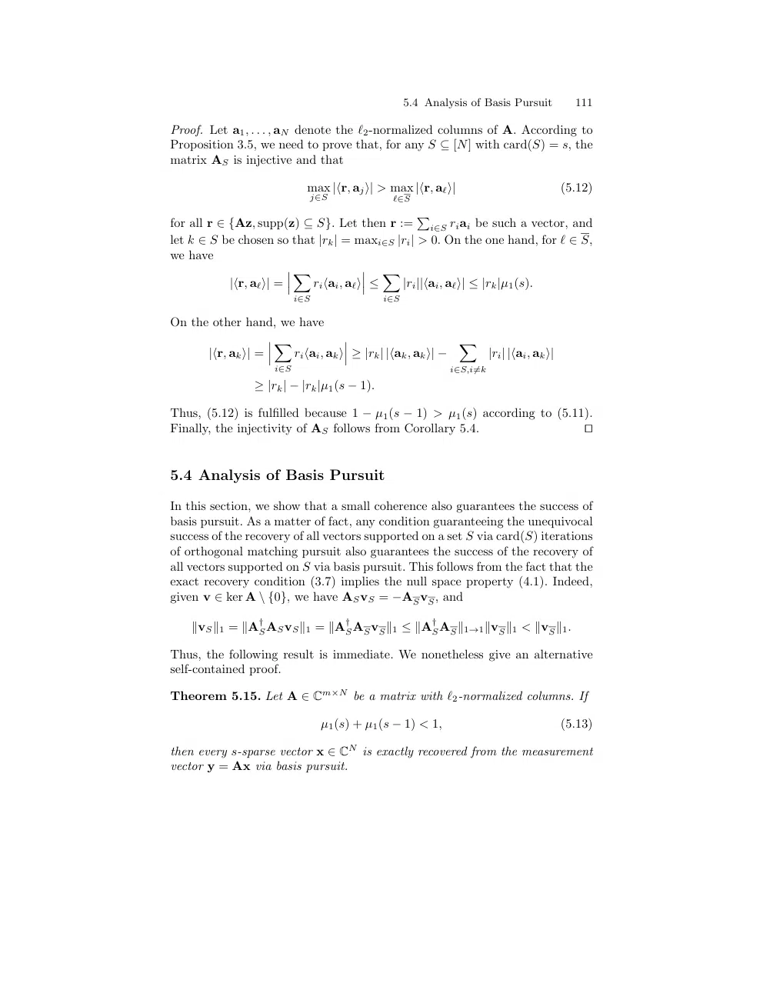

~~~text
                                                    5.4 Analysis of Basis Pursuit     111

Proof. Let a1 , . . . , aN denote the `2 -normalized columns of A. According to
Proposition 3.5, we need to prove that, for any S ⊆ [N ] with card(S) = s, the
matrix AS is injective and that

                             max |hr, aj i| > max |hr, a` i|                        (5.12)
                             j∈S               `∈S
                                                 P
for all r ∈ {Az, supp(z) ⊆ S}. Let then r := i∈S ri ai be such a vector, and
let k ∈ S be chosen so that |rk | = maxi∈S |ri | > 0. On the one hand, for ` ∈ S,
we have
                         X                 X
            |hr, a` i| =   ri hai , a` i ≤   |ri ||hai , a` i| ≤ |rk |µ1 (s).
                           i∈S                i∈S

On the other hand, we have
                   X                                      X
      |hr, ak i| =   ri hai , ak i ≥ |rk | |hak , ak i| −   |ri | |hai , ak i|
                     i∈S                                     i∈S,i6=k
                 ≥ |rk | − |rk |µ1 (s − 1).

Thus, (5.12) is fulfilled because 1 − µ1 (s − 1) > µ1 (s) according to (5.11).
Finally, the injectivity of AS follows from Corollary 5.4.                  t
                                                                            u

5.4 Analysis of Basis Pursuit
In this section, we show that a small coherence also guarantees the success of
basis pursuit. As a matter of fact, any condition guaranteeing the unequivocal
success of the recovery of all vectors supported on a set S via card(S) iterations
of orthogonal matching pursuit also guarantees the success of the recovery of
all vectors supported on S via basis pursuit. This follows from the fact that the
exact recovery condition (3.7) implies the null space property (4.1). Indeed,
given v ∈ ker A \ {0}, we have AS vS = −AS vS , and

    kvS k1 = kA†S AS vS k1 = kA†S AS vS k1 ≤ kA†S AS k1→1 kvS k1 < kvS k1 .

Thus, the following result is immediate. We nonetheless give an alternative
self-contained proof.

Theorem 5.15. Let A ∈ Cm×N be a matrix with `2 -normalized columns. If

                                 µ1 (s) + µ1 (s − 1) < 1,                           (5.13)

then every s-sparse vector x ∈ CN is exactly recovered from the measurement
vector y = Ax via basis pursuit.
~~~

## Page 124

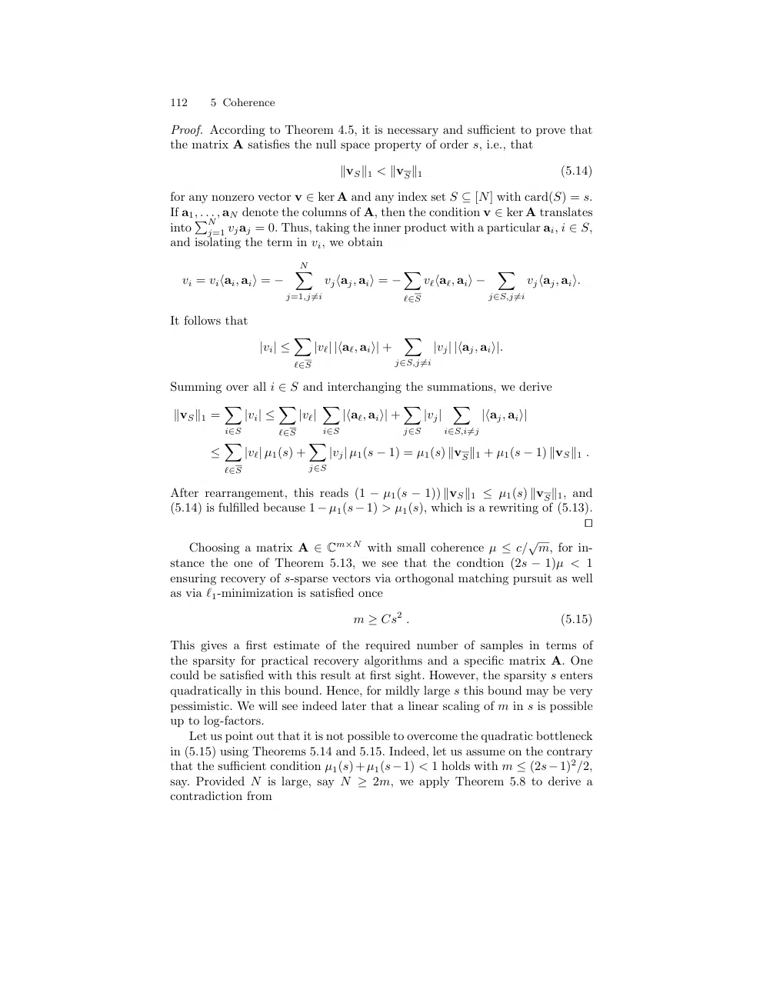

~~~text
112     5 Coherence

Proof. According to Theorem 4.5, it is necessary and sufficient to prove that
the matrix A satisfies the null space property of order s, i.e., that

                                             kvS k1 < kvS k1                                            (5.14)

for any nonzero vector v ∈ ker A and any index set S ⊆ [N ] with card(S) = s.
       . . . , aN denote the columns of A, then the condition v ∈ ker A translates
If a1 ,P
          N
into j=1 vj aj = 0. Thus, taking the inner product with a particular ai , i ∈ S,
and isolating the term in vi , we obtain
                               N
                               X                             X                          X
  vi = vi hai , ai i = −               vj haj , ai i = −           v` ha` , ai i −              vj haj , ai i.
                           j=1,j6=i                          `∈S                     j∈S,j6=i

It follows that
                               X                              X
                     |vi | ≤         |v` | |ha` , ai i| +              |vj | |haj , ai i|.
                               `∈S                          j∈S,j6=i

Summing over all i ∈ S and interchanging the summations, we derive
         X         X        X                X       X
kvS k1 =   |vi | ≤    |v` |   |ha` , ai i| +   |vj |   |haj , ai i|
            i∈S          `∈S           i∈S                   j∈S         i∈S,i6=j
            X                      X
        ≤         |v` | µ1 (s) +         |vj | µ1 (s − 1) = µ1 (s) kvS k1 + µ1 (s − 1) kvS k1 .
            `∈S                    j∈S

After rearrangement, this reads (1 − µ1 (s − 1)) kvS k1 ≤ µ1 (s) kvS k1 , and
(5.14) is fulfilled because 1 − µ1 (s − 1) > µ1 (s), which is a rewriting of (5.13).
                                                                                  t
                                                                                  u
                                                                       √
    Choosing a matrix A ∈ Cm×N with small coherence µ ≤ c/ m, for in-
stance the one of Theorem 5.13, we see that the condtion (2s − 1)µ < 1
ensuring recovery of s-sparse vectors via orthogonal matching pursuit as well
as via `1 -minimization is satisfied once

                                               m ≥ Cs2 .                                                (5.15)

This gives a first estimate of the required number of samples in terms of
the sparsity for practical recovery algorithms and a specific matrix A. One
could be satisfied with this result at first sight. However, the sparsity s enters
quadratically in this bound. Hence, for mildly large s this bound may be very
pessimistic. We will see indeed later that a linear scaling of m in s is possible
up to log-factors.
    Let us point out that it is not possible to overcome the quadratic bottleneck
in (5.15) using Theorems 5.14 and 5.15. Indeed, let us assume on the contrary
that the sufficient condition µ1 (s) + µ1 (s − 1) < 1 holds with m ≤ (2s − 1)2 /2,
say. Provided N is large, say N ≥ 2m, we apply Theorem 5.8 to derive a
contradiction from
~~~

## Page 125

~~~text
                                       5.5 Analysis of Thresholding Algorithms                         113
                                            s                        r                         r
                                                  N −m                   2(N − m)                   N
 1 > µ1 (s) + µ1 (s − 1) ≥ (2s − 1)                       ≥                       ≥                     .
                                                 m(N − 1)                  N −1                    N −1

In the following chapters we will reduce the number of required measurements
below the order s2 by introducing new tools for the analysis of sparse recovery
algorithms.

5.5 Analysis of Thresholding Algorithms
In this final section, we show that thresholding algorithms can also be analyzed
using the coherence. For instance, under the same condition as before, even
the basis thresholding algorithm will successfully recover sparse vectors that
are flat on their support.
Theorem 5.16. Let A ∈ Cm×N be a matrix with `2 -normalized columns and
let x ∈ CN be a vector supported on a set S of size s. If
                                                         mini∈S |xi |
                         µ1 (s) + µ1 (s − 1) <                        ,                              (5.16)
                                                         maxi∈S |xi |
then the vector x ∈ CN is exactly recovered from the measurement vector
y = Ax via basic thresholding.
Proof. Let a1 , . . . , aN denote the `2 -normalized columns of A. According to
Proposition 3.7, we need to prove that, for any j ∈ S and any ` ∈ S,
                                 |hAx, aj i| > |hAx, a` i| .                                         (5.17)
We observe that
                        X                        X
      |hAx, a` i| = |         xi hai , a` i| ≤         |xi ||hai , a` i| ≤ µ1 (s) max |xi |,
                                                                                         i∈S
                        i∈S                      i∈S
                        X                                    X
      |hAx, aj i| = |         xi hai , aj i| ≥ |xj | −               |xi ||hai , aj i|
                        i∈S                               i∈S,i6=j
                  ≥ min |xi | − µ1 (s − 1) max |xi |.
                     i∈S                               i∈S

Thus, taking (5.16) into account, we obtain
    |hAx, aj i| − |hAx, a` i| ≥ min |xi | − (µ(s) + µ1 (s − 1)) max |xi | > 0.
                                      i∈S                                          i∈S

This shows (5.17) and concludes the proof.                                                                  t
                                                                                                            u
    We now turn to the more involved hard thresholding pursuit algorithm.
Just as for orthogonal matching pursuit, we show that s iterations are enough
for the recovery of s-sparse vectors under a condition rather similar to (5.11).
In view of (5.2), we observe that the condition in question is met when the
coherence of the measurement matrix satisfies µ < 1/(3s − 1).
~~~

## Page 126

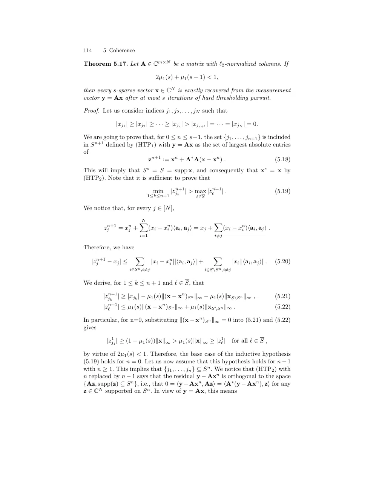

~~~text
114     5 Coherence

Theorem 5.17. Let A ∈ Cm×N be a matrix with `2 -normalized columns. If

                                     2µ1 (s) + µ1 (s − 1) < 1,

then every s-sparse vector x ∈ CN is exactly recovered from the measurement
vector y = Ax after at most s iterations of hard thresholding pursuit.

Proof. Let us consider indices j1 , j2 , . . . , jN such that

             |xj1 | ≥ |xj2 | ≥ · · · ≥ |xjs | > |xjs+1 | = · · · = |xjN | = 0.

We are going to prove that, for 0 ≤ n ≤ s−1, the set {j1 , . . . , jn+1 } is included
in S n+1 defined by (HTP1 ) with y = Ax as the set of largest absolute entries
of
                        zn+1 := xn + A∗ A(x − xn ) .                            (5.18)
This will imply that S s = S = supp x, and consequently that xs = x by
(HTP2 ). Note that it is sufficient to prove that

                                   min      |zjn+1
                                                k
                                                   | > max |z`n+1 | .                                (5.19)
                              1≤k≤n+1                   `∈S

We notice that, for every j ∈ [N ],
                          N
                          X                              X
        zjn+1 = xnj +       (xi − xni )hai , aj i = xj +  (xi − xni )hai , aj i .
                          i=1                                      i6=j

Therefore, we have
                        X                                          X
   |zjn+1 − xj | ≤                 |xi − xni ||hai , aj i| +                   |xi ||hai , aj i| .   (5.20)
                     i∈S n ,i6=j                               i∈S\S n ,i6=j

We derive, for 1 ≤ k ≤ n + 1 and ` ∈ S, that

        |zjn+1
            k
               | ≥ |xjk | − µ1 (s)k(x − xn )S n k∞ − µ1 (s)kxS\S n k∞ ,                              (5.21)
        |z`n+1 | ≤ µ1 (s)k(x − xn )S n k∞ + µ1 (s)kxS\S n k∞ .                                       (5.22)

In particular, for n=0, substituting k(x − xn )S n k∞ = 0 into (5.21) and (5.22)
gives

         |zj11 | ≥ (1 − µ1 (s))kxk∞ > µ1 (s)kxk∞ ≥ |z`1 | for all ` ∈ S ,

by virtue of 2µ1 (s) < 1. Therefore, the base case of the inductive hypothesis
(5.19) holds for n = 0. Let us now assume that this hypothesis holds for n − 1
with n ≥ 1. This implies that {j1 , . . . , jn } ⊆ S n . We notice that (HTP2 ) with
n replaced by n − 1 says that the residual y − Axn is orthogonal to the space
{Az, supp(z) ⊆ S n }, i.e., that 0 = hy − Axn , Azi = hA∗ (y − Axn ), zi for any
z ∈ CN supported on S n . In view of y = Ax, this means
~~~

## Page 127

~~~text
                                    5.5 Analysis of Thresholding Algorithms     115

                               (A∗ A(x − xn ))S n = 0 .                       (5.23)

Hence, for any j ∈ S n , the definition (5.18) of zn+1 implies that zjn+1 = xnj ,
and then (5.20) yields

         |xnj − xj | ≤ µ1 (s − 1)k(x − xn )S n k∞ + µ1 (s − 1)kxS\S n k∞ .

Taking the maximum over j ∈ S n and rearranging gives
                                            µ1 (s − 1)
                     k(x − xn )S n k∞ ≤                  kxS\S n k∞ .         (5.24)
                                          1 − µ1 (s − 1)
Substituting the latter into (5.21) and (5.22), we obtain, for 1 ≤ k ≤ n + 1
and ` ∈ S,
                                          µ1 (s)   
                    |zjn+1 | ≥   1 −                  |xjn+1 | ,
                        k
                                     1 − µ1 (s − 1)
                                    µ1 (s)
                    |z`n+1 | ≤                  |xj | .
                               1 − µ1 (s − 1) n+1
Since µ1 (s)/(1 − µ1 (s − 1)) < 1/2, this shows that (5.19) holds for n, too. The
proof by induction is now complete.                                             t
                                                                                u

Notes
The analysis of sparse recovery algorithms could be carried out using merely
the coherence. For instance, the conclusion of Theorem 5.15 can be achieved
under the sufficient condition µ < 1/(2s−1), as obtained by R. Gribonval and
M. Nielsen in [206]. Theorems 5.14 and 5.15 in their present form were estab-
lished by J. Tropp in [414]. What we call `1 -coherence function here is called
cumulative coherence function there. This concept also appears under the
name Babel function. A straightforward extension to any p > 0 would be the
`p -coherence function of a matrix A with `2 -normalized columns a1 , . . . , aN
defined by
                       n X                 1/p                                o
                                          p
    µp (s) := max max         |hai , aj i|       , S ⊆ [N ], card(S) = s, i 6∈ S .
            i∈[N ]
                             j∈S

   Theorem 5.8 on the Welch-type lower bound for the `1 -coherence function
appeared in [384]. The matrix considered in Proposition
                                              √          5.13, with m rows,
m2 columns and whose coherence equal to 1/ m, is taken from [9, 395]. In
[216], S. Gurevich, R. Hadani, and N. Sochen uncovered a matrix with p rows,
p being a prime number, roughly p5 columns, and whose coherence is bounded
             √
above by 4/ p. Another number theoretic construction of p × pk matrices,
p > k being a prime, with coherence µ ≤ k−1√
                                             p can be found, for instance, in
[410, Chapter 5.7.4].
~~~

## Page 128

~~~text
116      5 Coherence

    There is a vast literature dedicated to frames. The notion is not restricted
to the finite-dimensional setting, although this is the only one we considered.
Good starting places to learn about the subject are O. Christensen’s books [98]
and [99]. As mentioned in the text, not everything is known about equiangular
tight frames. In particular, whether equiangular systems of m2 vectors in Cm
exist for all values of m is not known — the numerical experiments performed
for m ≤ 45 by J. M. Renes, R. Blume-Kohout, A. J. Scott, and C. M. Caves in
[363] seem to indicate that they do. More details on the subject of equiangular
tight frames, and more generally tight frames in finite dimension, can be found
in S. Waldron’s book [441].

Exercises
5.1. The mutual coherence between two orthonormal bases U = (u1 , . . . , um )
and V = (v1 , . . . , vm ) of Cm is defined as
                                      √
                          µ(U, V) := m max |hui , vj i|.
                                            1≤i,j≤m

Establish the inequalities
                                                    √
                                   1 ≤ µ(U, V) ≤        m.

and prove that they are sharp.

5.2. Prove the equivalence of the three conditions of Definition 5.6, and find
the value of the constant λ when the vectors a1 , . . . , aN are `2 -normalized.

5.3. Establish the alternative expressions for the `1 -coherence function

      µ1 (s) =      max        kA∗S AS − Ik1→1 =        max      kA∗S AS − Ik∞→∞ .
                 card(S)≤s+1                       card(S)≤s+1

5.4. Prove that the m + 1 vertices of a regular simplex in Rm centered at the
origin form an equiangular tight frame.
                √
5.5. With c := ( 5 − 1)/2, prove that the columns of the matrix
                                                
                              1 0 c 1 0 −c
                            c 1 0 −c 1 0 
                              0 c 1 0 −c 1

form an equiangular system of 6 vectors in R3 . Prove also that the vectors
obtained by unit cyclic shifts on four vectors [1, ±1, 0, ±1, 0, 0, 0]> form an
equiangular system of 28 vectors in R7 .
~~~

## Page 129

~~~text
                                            5.5 Analysis of Thresholding Algorithms        117
                            p        √
5.6. With c := eiπ/4            2−       3, prove that the columns of the matrix
                                                        
                                               1 c 1 −c
                                               c 1 −c 1

form an equiangular system of 4 vectors in C2 . With ω := ei2π/3 , prove also
that the columns of the matrix
                   −2 1 1 −2 ω 2 ω −2 ω ω 2
                                                       
                  1 −2 1 ω −2 ω 2 ω 2 −2 ω 
                     1 1 −2 ω 2 ω −2 ω ω 2 −2

form an equiangular system of 9 vectors in C3 .

5.7. Prove that the columns of the matrix considered in Proposition 5.13 form
a tight frame.

5.8. Suppose that a known vector is an s-sparse linear combination of vectors
from the canonical and Fourier bases E = (e1 , . . . , em ) and F = (f 1 , . . . , f m ),
defined as
                                                       1
                     1 , 0, . . . , 0]> ,
ek = [0, . . . , 0, |{z}                        f k = √ [1, ei2πk/m , . . . , ei2πk(m−1)/m ]> .
                                                       m
                  index k

Prove that the unknown coefficients
                                 √    can be found by orthogonal matching
pursuit or basis pursuit if s < ( m + 1)/2.

5.9. Given ν < 1/2, suppose that a matrix A ∈ Cm×N satisfies

                                              µ1 (s) ≤ ν

Prove that, for any x ∈ CN and y = Ax + e with kek2 ≤ η, a minimizer x?
of kzk1 subject to kAz − yk2 ≤ η approximates the vector x with `1 -error

                                kx − x? k1 ≤ C σs (x)1 + D s η,

for some positive constants C and D depending only on ν.
~~~

## Page 130

*Page blanche.*

## Page 131

~~~text
6
Restricted Isometry Constants

The coherence is a simple and useful measure of the quality of a measurement
matrix. However, the lower bound on the coherence in Theorem 5.7 limits the
performance analysis of recovery algorithms to rather small sparsity levels.
A finer measure of the quality of a measurement matrix is needed to over-
come this limitation. This is provided by the concept of restricted isometry
property, also known as uniform uncertainty principle. It ensures the success
of the sparse recovery algorithms presented in this book. Restricted isome-
try constants are introduced in Section 6.1. The success of sparse recovery is
the established under some conditions on these constants for basis pursuit in
Section 6.2, for thresholding-based algorithms in Section 6.3, and for greedy
algorithms in Section 6.4.

6.1 Definitions and Basic Properties
Unlike the coherence, which only takes pairs of columns of a matrix into
account, the restricted isometry constant of order s involves all s-tuples of
columns and is therefore more suited to assess the quality of the matrix. As
with the coherence, small restricted isometry constants are desired. Here is
their formal definition.
Definition 6.1. The sth restricted isometry constant δs = δs (A) of a matrix
A ∈ Cm×N is the smallest δ ≥ 0 such that
                     (1 − δ)kxk22 ≤ kAxk22 ≤ (1 + δ)kxk22                 (6.1)
for all s-sparse vectors x ∈ CN . Equivalently, it is given by
                    δs =        max           kA∗S AS − Idk2→2 .          (6.2)
                           S⊆[N ],card(S)≤s

    We say that A satisfies the restricted isometry property if δs is small for
reasonably large s — the meaning of small δs and large s will be made precise
later.
~~~

## Page 132

~~~text
120     6 Restricted Isometry Constants

    We make a few remarks before establishing the equivalence of these two
definitions. The first one is that the sequence of restricted isometry constants
is nondecreasing, i.e.,

                      δ1 ≤ δ2 ≤ · · · ≤ δs ≤ δs+1 ≤ · · · ≤ δN .

The second one is that, although δs ≥ 1 is not forbidden, the relevant situation
occurs for δs < 1. Indeed, (6.2) says that each column-submatrix AS , S ⊆ [N ]
with card(S) ≤ s, has all its singular values in the interval [1 − δs , 1 + δs ],
and is therefore injective when δs < 1. In fact, δ2s < 1 is more relevant, since
the inequality (6.1) yields kA(x − x0 )k22 > 0 for all distinct s-sparse vectors
x, x0 ∈ CN , hence distinct s-sparse vectors have distinct measurement vectors.
The third and final remark is that, if the entries of the measurement matrix
A are real, then δs could also be defined as the smallest δ ≥ 0 such that (6.1)
holds for all real vectors x ∈ RN . This is because the operator norms of the
real symmetric matrix A∗S AS − Id relative `2 (R) and to `2 (C) are equal —
both to its largest eigenvalues in modulus — and because the two definitions
of restricted isometry constants would be equivalent in the real setting, too.
Here is the argument for (6.2) to be adapted from the complex setting. We
start by noticing that (6.1) is equivalent to

  kAS xk22 − kxk22 ≤ δkxk22      for all S ⊆ [N ], card(S) ≤ s, and all x ∈ CS .

We then observe that, for x ∈ CS ,

        kAS xk22 − kxk22 = hAS x, AS xi − hx, xi = h(A∗S AS − Id)x, xi.

Since the matrix (A∗S AS − Id) is Hermitian, we have

                        h(A∗S AS − Id)x, xi
                max                         = kA∗S AS − Idk2→2 ,
              x∈CS \{0}        kxk2

so that (6.1) is equivalent to

                           max           kA∗S AS − Idk2→2 ≤ δ.
                      S⊆[N ],card(S)≤s

This proves the identity (6.2), as δs is the smallest such δ.
   It is now possible to compare the restricted isometry constants of a matrix
with its coherence µ and coherence function µ1 , see Definition 5.1 and 5.2.
Proposition 6.2. If the matrix A has `2 -normalized columns a1 , . . . , aN , i.e.,
kaj k2 = 1 for all j ∈ [N ], then

         δ1 = 0,       δ2 = µ,       δs ≤ µ1 (s − 1) ≤ (s − 1)µ,   s ≥ 2.

Proof. The `2 -normalization of the columns means that kAej k22 = kej k22 for
all j ∈ [N ], that is to say δ1 = 0. Next, with a1 , . . . , aN denoting the columns
of the matrix A, we have
~~~

## Page 133

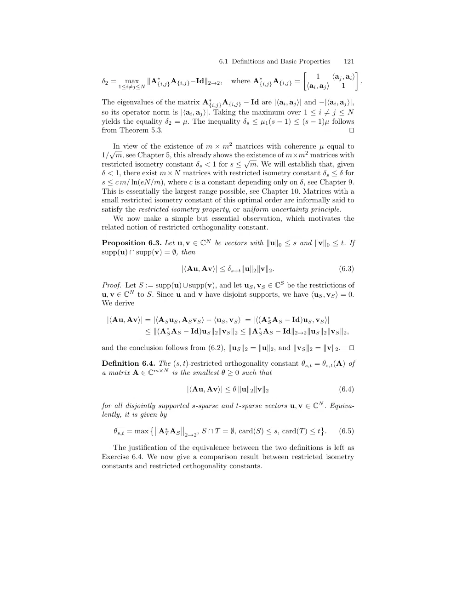

~~~text
                                         6.1 Definitions and Basic Properties          121
                                                                                           
                                                                           1      haj , ai i
δ2 =    max       kA∗{i,j} A{i,j} −Idk2→2 ,   where A∗{i,j} A{i,j} =                          .
       1≤i6=j≤N                                                        hai , aj i    1

The eigenvalues of the matrix A∗{i,j} A{i,j} − Id are |hai , aj i| and −|hai , aj i|,
so its operator norm is |hai , aj i|. Taking the maximum over 1 ≤ i 6= j ≤ N
yields the equality δ2 = µ. The inequality δs ≤ µ1 (s − 1) ≤ (s − 1)µ follows
from Theorem 5.3.                                                                  t
                                                                                   u
                                         2
   √In view of the existence of m × m matrices with coherence       µ equal to
1/ m, see Chapter 5, this already shows the√existence of m×m2 matrices with
restricted isometry constant δs < 1 for s ≤ m. We will establish that, given
δ < 1, there exist m × N matrices with restricted isometry constant δs ≤ δ for
s ≤ c m/ ln(eN/m), where c is a constant depending only on δ, see Chapter 9.
This is essentially the largest range possible, see Chapter 10. Matrices with a
small restricted isometry constant of this optimal order are informally said to
satisfy the restricted isometry property, or uniform uncertainty principle.
    We now make a simple but essential observation, which motivates the
related notion of restricted orthogonality constant.

Proposition 6.3. Let u, v ∈ CN be vectors with kuk0 ≤ s and kvk0 ≤ t. If
supp(u) ∩ supp(v) = ∅, then

                             |hAu, Avi| ≤ δs+t kuk2 kvk2 .                          (6.3)

Proof. Let S := supp(u) ∪ supp(v), and let uS , vS ∈ CS be the restrictions of
u, v ∈ CN to S. Since u and v have disjoint supports, we have huS , vS i = 0.
We derive

 |hAu, Avi| = |hAS uS , AS vS i − huS , vS i| = |h(A∗S AS − Id)uS , vS i|
              ≤ k(A∗S AS − Id)uS k2 kvS k2 ≤ kA∗S AS − Idk2→2 kuS k2 kvS k2 ,

and the conclusion follows from (6.2), kuS k2 = kuk2 , and kvS k2 = kvk2 .               t
                                                                                         u

Definition 6.4. The (s, t)-restricted orthogonality constant θs,t = θs,t (A) of
a matrix A ∈ Cm×N is the smallest θ ≥ 0 such that

                               |hAu, Avi| ≤ θ kuk2 kvk2                             (6.4)

for all disjointly supported s-sparse and t-sparse vectors u, v ∈ CN . Equiva-
lently, it is given by

    θs,t = max A∗T AS 2→2 , S ∩ T = ∅, card(S) ≤ s, card(T ) ≤ t .
                 
                                                                         (6.5)

   The justification of the equivalence between the two definitions is left as
Exercise 6.4. We now give a comparison result between restricted isometry
constants and restricted orthogonality constants.
~~~

## Page 134

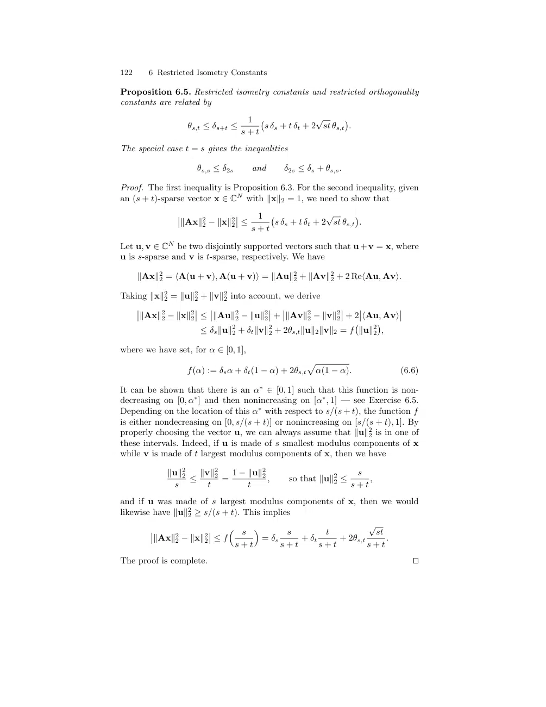

~~~text
122     6 Restricted Isometry Constants

Proposition 6.5. Restricted isometry constants and restricted orthogonality
constants are related by
                                   1                 √       
                  θs,t ≤ δs+t ≤       s δs + t δt + 2 st θs,t .
                                  s+t
The special case t = s gives the inequalities

                    θs,s ≤ δ2s       and     δ2s ≤ δs + θs,s .

Proof. The first inequality is Proposition 6.3. For the second inequality, given
an (s + t)-sparse vector x ∈ CN with kxk2 = 1, we need to show that
                                      1                 √
                kAxk22 − kxk22 ≤
                                                                
                                         s δs + t δt + 2 st θs,t .
                                     s+t

Let u, v ∈ CN be two disjointly supported vectors such that u + v = x, where
u is s-sparse and v is t-sparse, respectively. We have

      kAxk22 = hA(u + v), A(u + v)i = kAuk22 + kAvk22 + 2 RehAu, Avi.

Taking kxk22 = kuk22 + kvk22 into account, we derive

      kAxk22 − kxk22 ≤ kAuk22 − kuk22 + kAvk22 − kvk22 + 2 hAu, Avi
                     ≤ δs kuk22 + δt kvk22 + 2θs,t kuk2 kvk2 = f kuk22 ,
                                                                      

where we have set, for α ∈ [0, 1],
                                                       p
                  f (α) := δs α + δt (1 − α) + 2θs,t    α(1 − α).          (6.6)

It can be shown that there is an α∗ ∈ [0, 1] such that this function is non-
decreasing on [0, α∗ ] and then nonincreasing on [α∗ , 1] — see Exercise 6.5.
Depending on the location of this α∗ with respect to s/(s + t), the function f
is either nondecreasing on [0, s/(s + t)] or nonincreasing on [s/(s + t), 1]. By
properly choosing the vector u, we can always assume that kuk22 is in one of
these intervals. Indeed, if u is made of s smallest modulus components of x
while v is made of t largest modulus components of x, then we have

             kuk22   kvk22   1 − kuk22                             s
                   ≤       =           ,        so that kuk22 ≤       ,
              s        t         t                                s+t
and if u was made of s largest modulus components of x, then we would
likewise have kuk22 ≥ s/(s + t). This implies
                             s                                √
              2       2                     s        t            st
         kAxk2 − kxk2 ≤ f             = δs     + δt     + 2θs,t      .
                              s+t          s+t      s+t         s+t
The proof is complete.                                                        t
                                                                              u
~~~

## Page 135

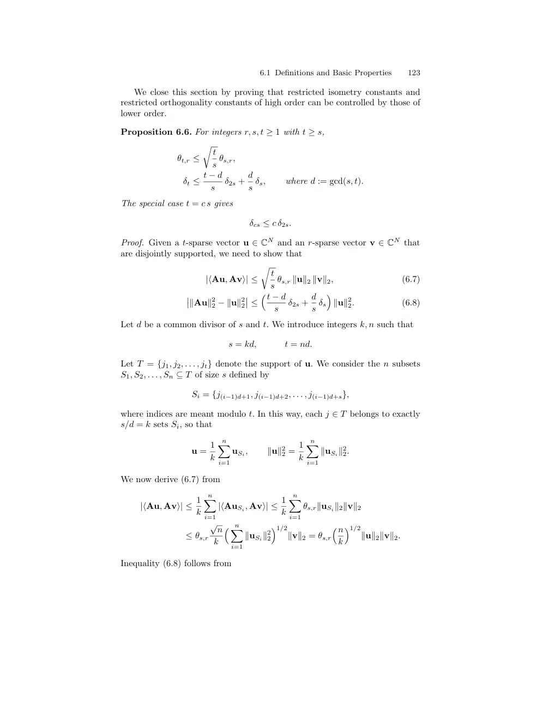

~~~text
                                          6.1 Definitions and Basic Properties   123

    We close this section by proving that restricted isometry constants and
restricted orthogonality constants of high order can be controlled by those of
lower order.

Proposition 6.6. For integers r, s, t ≥ 1 with t ≥ s,
                   r
                      t
            θt,r ≤      θs,r ,
                     s
                   t−d         d
              δt ≤       δ2s + δs ,       where d := gcd(s, t).
                     s         s
The special case t = c s gives

                                     δcs ≤ c δ2s .

Proof. Given a t-sparse vector u ∈ CN and an r-sparse vector v ∈ CN that
are disjointly supported, we need to show that
                                    r
                                       t
                      |hAu, Avi| ≤       θs,r kuk2 kvk2 ,           (6.7)
                                       s
                                    t − d         d 
                  kAuk22 − kuk22 ≤          δ2s + δs kuk22 .        (6.8)
                                        s          s
Let d be a common divisor of s and t. We introduce integers k, n such that

                                s = kd,         t = nd.

Let T = {j1 , j2 , . . . , jt } denote the support of u. We consider the n subsets
S1 , S2 , . . . , Sn ⊆ T of size s defined by

                   Si = {j(i−1)d+1 , j(i−1)d+2 , . . . , j(i−1)d+s },

where indices are meant modulo t. In this way, each j ∈ T belongs to exactly
s/d = k sets Si , so that
                            n                           n
                        1X                           1X
                   u=        uS ,          kuk22 =         kuSi k22 .
                        k i=1 i                      k i=1

We now derive (6.7) from
                      n                        n
                  1X                       1X
     |hAu, Avi| ≤        |hAuSi , Avi| ≤         θs,r kuSi k2 kvk2
                  k i=1                    k i=1
                       √ X  n           1/2              n 1/2
                         n
                ≤ θs,r          kuSi k22      kvk2 = θs,r          kuk2 kvk2 .
                        k i=1                               k

Inequality (6.8) follows from
~~~

## Page 136

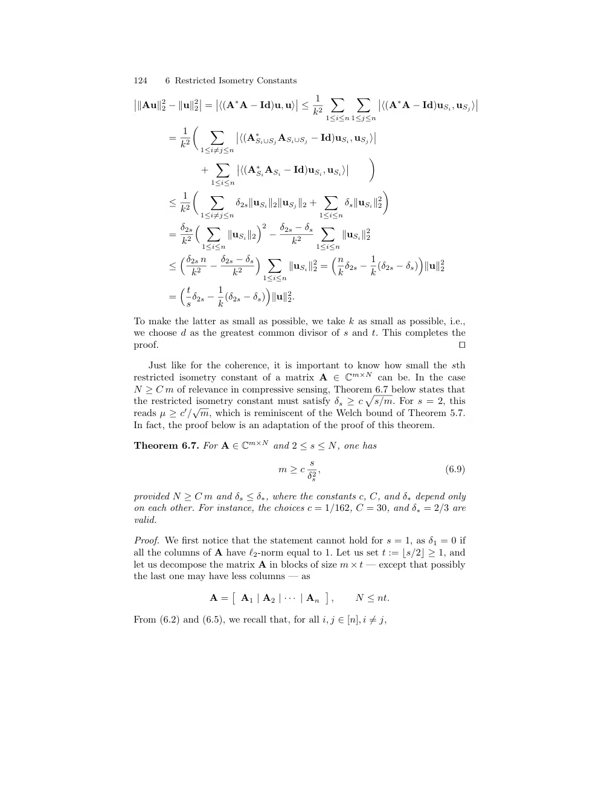

~~~text
124     6 Restricted Isometry Constants

                                                      1 X            X
kAuk22 − kuk22 = h(A∗ A − Id)u, ui ≤                                         h(A∗ A − Id)uSi , uSj i
                                                      k2
                                                            1≤i≤n 1≤j≤n
                  
           1              X
         = 2                      h(A∗Si ∪Sj ASi ∪Sj − Id)uSi , uSj i
          k
                      1≤i6=j≤n
                           X                                             
                      +            h(A∗Si ASi − Id)uSi , uSi i
                          1≤i≤n
                                                                               
             1            X                                 X
         ≤                        δ2s kuSi k2 kuSj k2 +           δs kuSi k22
             k2
                      1≤i6=j≤n                            1≤i≤n
           δ2s  X              2 δ − δ X
                                      2s    s
         = 2            kuSi k2 −                    kuSi k22
           k                            k2
                 1≤i≤n                         1≤i≤n
           δ n δ − δ  X                         n          1              
              2s       2s     s               2                                2
         ≤         −                   ku   k
                                          Si 2  =     δ2s −     (δ 2s − δ s kuk2
                                                                           )
              k2         k2                         k         k
                                 1≤i≤n
           t        1            
         =    δ2s − (δ2s − δs ) kuk22 .
            s        k
To make the latter as small as possible, we take k as small as possible, i.e.,
we choose d as the greatest common divisor of s and t. This completes the
proof.                                                                      t
                                                                            u

    Just like for the coherence, it is important to know how small the sth
restricted isometry constant of a matrix A ∈ Cm×N can be. In the case
N ≥ C m of relevance in compressive sensing, Theorem  p 6.7 below states that
the restricted√isometry constant must satisfy δs ≥ c s/m. For s = 2, this
reads µ ≥ c0 / m, which is reminiscent of the Welch bound of Theorem 5.7.
In fact, the proof below is an adaptation of the proof of this theorem.

Theorem 6.7. For A ∈ Cm×N and 2 ≤ s ≤ N , one has
                                                     s
                                             m≥c        ,                                   (6.9)
                                                    δs2

provided N ≥ C m and δs ≤ δ∗ , where the constants c, C, and δ∗ depend only
on each other. For instance, the choices c = 1/162, C = 30, and δ∗ = 2/3 are
valid.

Proof. We first notice that the statement cannot hold for s = 1, as δ1 = 0 if
all the columns of A have `2 -norm equal to 1. Let us set t := bs/2c ≥ 1, and
let us decompose the matrix A in blocks of size m × t — except that possibly
the last one may have less columns — as
                                           
                 A = A1 | A2 | · · · | An ,        N ≤ nt.

From (6.2) and (6.5), we recall that, for all i, j ∈ [n], i 6= j,
~~~

## Page 137

~~~text
                                           6.1 Definitions and Basic Properties        125

      kA∗i Ai − Idk2→2 ≤ δt ≤ δs ,              kA∗i Aj k2→2 ≤ θt,t ≤ δ2t ≤ δs ,
so that the eigenvalues of A∗i Ai and the singular values of A∗i Aj satisfy
             1 − δs ≤ λk (A∗i Ai ) ≤ 1 + δs ,             σk (A∗i Aj ) ≤ δs .
Let us introduce the matrices
     H := A A∗ ∈ Cm×m ,                G := A∗ A = A∗i Aj 1≤i,j≤n ∈ CN ×N .
                                                        

On the one hand, we have the lower bound
                     n
                     X                     n X
                                           X t
   tr(H) = tr(G) =         tr(A∗i Ai ) =             λk (A∗i Ai ) ≥ n t (1 − δs ).   (6.10)
                     i=1                   i=1 k=1

On the other hand, writing hM1 , M2 iF = tr(M∗2 M1 ) for the Frobenius inner
product of two matrices M1 and M2 , see Appendix A, we have
             tr(H)2 = hIdm , Hi2F ≤ kIdm k2F kHk2F = m tr(H∗ H).
Then, by cyclicity of the trace,
          tr(H∗ H) = tr(A A∗ A A∗ ) = tr(A∗ A A∗ A) = tr(G G∗ )
                     Xn    Xm               
                   =     tr    A∗i Aj A∗j Ai
                        i=1      j=1

                           X       t
                                   X                      n X
                                                          X t
                    =                  σk (A∗i Aj )2 +              λk (A∗i Ai )2
                        1≤i6=j≤n k=1                      i=1 k=1

                    ≤ n (n − 1) t δs2 + n t (1 + δs )2 ,
we derive the upper bound
                    tr(H)2 ≤ m n t (n − 1) δs2 + (1 + δs )2 .
                                                           
                                                                                     (6.11)
Combining the bounds (6.10) and (6.11) yields
                                       n t (1 − δs )2
                              m≥                            .
                                   (n − 1) δs2 + (1 + δs )2
If (n − 1) δs2 < (1 + δs )2 /5, we would obtain, using δs ≤ 2/3,
                        n t (1 − δs )2   5(1 − δs )2     1
                  m>              2
                                       ≥             N≥    N,
                        6(1 + δs ) /5    6(1 + δs )2    30
which contradicts our assumption. We therefore have (n − 1) δs2 ≥ (1 + δs )2 /5,
which yields, using δs ≤ 2/3 again and s ≤ 3t,
                              n t (1 − δs )2    1 t     1 s
                     m≥                   2
                                             ≥     2
                                                     ≥         .
                              6(n − 1) δs      54 δs   162 δs2
This is the desired result.                                                              t
                                                                                         u
~~~

## Page 138

~~~text
126      6 Restricted Isometry Constants

      Let us compare the lower bound
                                         p
                                  δs ≥       cs/m                           (6.12)

of the previous Theorem on the restricted isometry constant with upper
                                  point. Choose a matrix A ∈ Cm×N with
bounds that are available at this √
coherence of optimal order µ ≤ c/ m, see Chapter 5. Then Proposition 6.2
implies that                                √
                         δs ≤ (s − 1)µ ≤ cs/ m .                  (6.13)
Clearly, there is a large gap between (6.12) and (6.13). In particular, (6.13)
requires the quadratic scaling

                                    m ≥ c0 s2                               (6.14)

in order to have small δs , while (6.12) indicates that the m ≥ cs is a necessary
condition for the RIP. At this point it is not yet clear, which of the two
conditions is closer to the optimal scaling of the restricted isometry constants,
but we will see later in Chapter 9 that certain random matrices A ∈ Rm×N
satisfy δs ≤ δ with high probability for some δ > 0 provided

                             m ≥ Cδ −2 s ln(eN/s) .                         (6.15)

We will see in Corollary 10.8 that δs ≤ δ indeed requires m ≥ Cδ s ln(eN/s),
Therefore, the lower bound (6.9) is optimal up to the log-factor. In particular,
Theorem 6.7 shows the optimality of the scaling Cδ = Cδ −2 .
    Difficulty of deterministic constructions of matrices satisfying
the RIP of optimal order. As just mentioned, random matrices will be
used in order to obtain the restricted isometry property in the optimal scaling
(6.15) of the number m of measurements in terms of the sparsity s and the
vector length N . It is open to date to provide deterministic, that is, explicit or
at least polynomial time, constructions of matrices whose restricted isometry
constants provably satisfy δs ≤ δ in the parameter regime (6.15). In fact, basi-
cally all available estimates of δs for deterministic matrices use the coherence
µ combined with Proposition 6.2 at some point (with one notable exception
on which we comment in the Notes). This leads then to bounds of the type
(6.13) (or even worse, depending on the value of the coherence). In particular,
we fall into the quadratic bottleneck. In fact, due to the lower bound on the
coherence of Theorem 5.7 this proof technique is not able in principle to arrive
at improved bounds.
    The intrinsic difficulty of estimating the restricted isometry constants for
explicit matrices lies in the fact that the basic tool for estimating the eigen-
values A∗S AS − Id for deterministic A is Gershgorin’s disc Theorem A.12.
Assuming `2 -normalization of the columns of A and taking the supremum
over all S ⊂ [N ] with card(S) = s leads to the `1 -coherence function µ1 (s − 1)
in this way. In fact, this is how we showed the bound δs ≤ µ1 (s−1) of Proposi-
tion 6.2, see also Theorem 5.3. Therefore, the lower bound for the `1 -coherence
~~~

## Page 139

~~~text
                                             6.2 Analysis of Basis Pursuit     127

function in Theorem 5.8 tells us that we cannot avoid the quadratic bottleneck
(6.14) when using Gershgorin’s disc theorem in order to estimate restricted
isometry constants. It seems that one should also take into account the signs
and not only the absolute values of the entries of the Gramian A∗ A (as in
Gershgorin’s theorem) in order to improve estimates for deterministic matri-
ces, but it is to date not very clear which tools can be used to achieve this goal
(although we will discuss a slight improvement over the quadratic bottleneck
in the Notes). In any case, one may conjecture that some of the matrices with
coherence of optimal order, for instance the one of Theorem 5.13, also satisfy
the restricted isometry property when m scales linear in s up to log-factors,
but this remains an open and probably very difficult problem.
    When passing to random matrices, however, a powerful set of tools be-
comes available that allow to estimate the restricted isometry constants in
the optimal regime (6.15).

6.2 Analysis of Basis Pursuit

In this section, we establish the success of sparse recovery via basis pursuit
for measurement matrices with small restricted isometry constants. We give
two proofs of this fact.. The first proof is simple and quite natural. It shows
that the condition δ2s < 1/3 is sufficient to guarantee exact recovery of all
s-sparse vectors via `1 -minimization. The second proof is more involved. It
shows that the weaker condition δ2s < 0.4931 is actually sufficient to guarantee
stable and robust recovery of all s-sparse vectors via `1 -minimization. We start
by presenting the simple argument which ignores stability and robustness
issues (although such issues can be treated with only a slight extension of the
argument).

Theorem 6.8. Suppose that the 2sth restricted isometry constant of the ma-
trix A ∈ Cm×N satisfies
                                      1
                               δ2s < .                               (6.16)
                                      3
Then every s-sparse vector x ∈ CN is the unique solution of

                    minimize kzk1       subject to Az = Ax.
                      z∈CN

   The following observation is recurring in our argument, so we isolate it
from the proof.

Lemma 6.9. Given q > p > 0, if u ∈ Cs and v ∈ Ct satisfy

                              max |ui | ≤ min |vj |,                         (6.17)
                               i∈[s]      j∈[t]

then
~~~

## Page 140

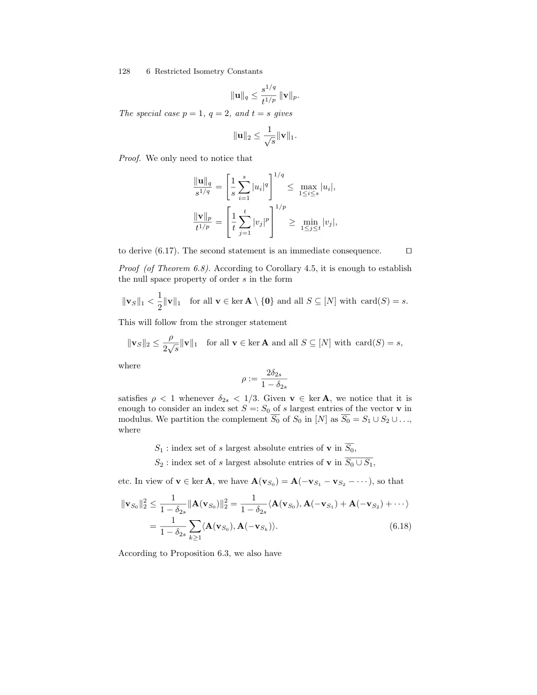

~~~text
128     6 Restricted Isometry Constants

                                      s1/q
                                    kukq ≤ kvkp .
                                      t1/p
The special case p = 1, q = 2, and t = s gives
                                           1
                                    kuk2 ≤ √ kvk1 .
                                            s
Proof. We only need to notice that
                                "      s
                                                   #1/q
                       kukq         1X
                            =             |ui |q          ≤ max |ui |,
                       s1/q         s i=1                   1≤i≤s
                                                  1/p
                                  t
                       kvkp   1
                                 X
                            =        |vj |p              ≥ min |vj |,
                       t1/p    t j=1                         1≤j≤t

to derive (6.17). The second statement is an immediate consequence.                t
                                                                                   u

Proof (of Theorem 6.8). According to Corollary 4.5, it is enough to establish
the null space property of order s in the form
             1
kvS k1 <       kvk1   for all v ∈ ker A \ {0} and all S ⊆ [N ] with card(S) = s.
             2
This will follow from the stronger statement
           ρ
  kvS k2 ≤ √ kvk1           for all v ∈ ker A and all S ⊆ [N ] with card(S) = s,
          2 s
where
                                               2δ2s
                                       ρ :=
                                              1 − δ2s
satisfies ρ < 1 whenever δ2s < 1/3. Given v ∈ ker A, we notice that it is
enough to consider an index set S =: S0 of s largest entries of the vector v in
modulus. We partition the complement S0 of S0 in [N ] as S0 = S1 ∪ S2 ∪ . . .,
where

           S1 : index set of s largest absolute entries of v in S0 ,
           S2 : index set of s largest absolute entries of v in S0 ∪ S1 ,

etc. In view of v ∈ ker A, we have A(vS0 ) = A(−vS1 − vS2 − · · · ), so that
             1                     1
kvS0 k22 ≤        kA(vS0 )k22 =         hA(vS0 ), A(−vS1 ) + A(−vS2 ) + · · · i
          1 − δ2s               1 − δ2s
             1    X
        =            hA(vS0 ), A(−vSk )i.                              (6.18)
          1 − δ2s
                      k≥1

According to Proposition 6.3, we also have
~~~

## Page 141

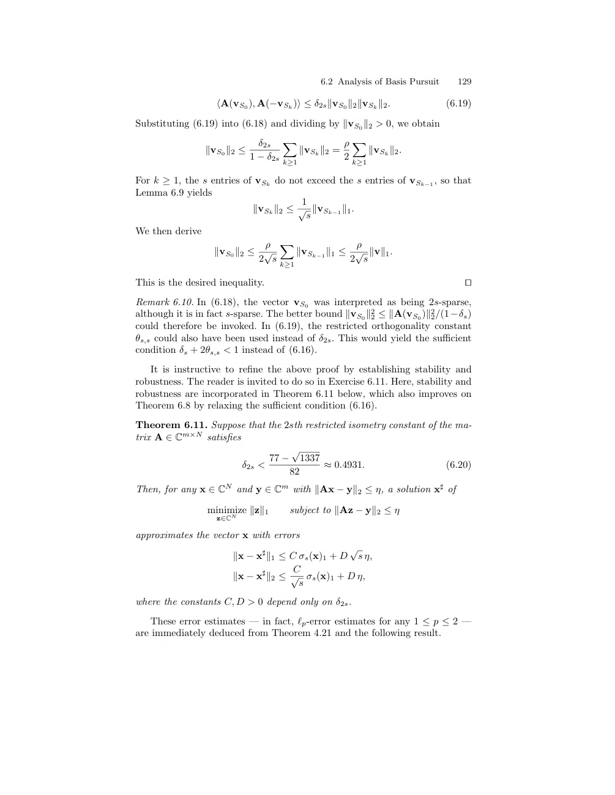

~~~text
                                             6.2 Analysis of Basis Pursuit     129

                    hA(vS0 ), A(−vSk )i ≤ δ2s kvS0 k2 kvSk k2 .              (6.19)

Substituting (6.19) into (6.18) and dividing by kvS0 k2 > 0, we obtain
                               δ2s X           ρX
                 kvS0 k2 ≤           kvSk k2 =    kvSk k2 .
                             1 − δ2s           2
                                    k≥1              k≥1

For k ≥ 1, the s entries of vSk do not exceed the s entries of vSk−1 , so that
Lemma 6.9 yields
                                      1
                           kvSk k2 ≤ √ kvSk−1 k1 .
                                       s
We then derive
                             ρ X             ρ
                   kvS0 k2 ≤ √   kvSk−1 k1 ≤ √ kvk1 .
                            2 s             2 s
                                   k≥1

This is the desired inequality.                                                  t
                                                                                 u
Remark 6.10. In (6.18), the vector vS0 was interpreted as being 2s-sparse,
although it is in fact s-sparse. The better bound kvS0 k22 ≤ kA(vS0 )k22 /(1 − δs )
could therefore be invoked. In (6.19), the restricted orthogonality constant
θs,s could also have been used instead of δ2s . This would yield the sufficient
condition δs + 2θs,s < 1 instead of (6.16).
   It is instructive to refine the above proof by establishing stability and
robustness. The reader is invited to do so in Exercise 6.11. Here, stability and
robustness are incorporated in Theorem 6.11 below, which also improves on
Theorem 6.8 by relaxing the sufficient condition (6.16).
Theorem 6.11. Suppose that the 2sth restricted isometry constant of the ma-
trix A ∈ Cm×N satisfies
                                  √
                              77 − 1337
                        δ2s <            ≈ 0.4931.                    (6.20)
                                  82
Then, for any x ∈ CN and y ∈ Cm with kAx − yk2 ≤ η, a solution x] of

                 minimize kzk1        subject to kAz − yk2 ≤ η
                    z∈CN

approximates the vector x with errors
                                                  √
                        kx − x] k1 ≤ C σs (x)1 + D s η,
                                      C
                        kx − x] k2 ≤ √ σs (x)1 + D η,
                                       s
where the constants C, D > 0 depend only on δ2s .
   These error estimates — in fact, `p -error estimates for any 1 ≤ p ≤ 2 —
are immediately deduced from Theorem 4.21 and the following result.
~~~

## Page 142

~~~text
130       6 Restricted Isometry Constants

Theorem 6.12. If the 2sth restricted isometry constant of A ∈ Cm×N obeys
(6.20), then the matrix A satisfies the `2 -robust null space property of order s
with constants 0 < ρ < 1 and τ > 0 depending only on δ2s .
    The argument makes use of the following lemma, called square root√lifting
inequality. It can be viewed as a counterpart of the inequality kak1 ≤ skak2
for a ∈ Cs .
Lemma 6.13. For a1 ≥ a2 ≥ · · · ≥ as ≥ 0,
                                                 √
                               a1 + · · · + as     s
           q
              2            2
             a1 + · · · + as ≤      √          +     (a1 − as ).
                                       s         4
Proof. We prove the equivalent statement
                                                             √
                                      
             a1 ≥ a2 ≥ · · ·√≥ as ≥ 0
                                                               s
                                          q
     a1 + a2 + · · · + as     s             2            2
                                        =⇒ a1 + · · · + as +     as ≤ 1.
            √             +     a1 ≤ 1                      4
              s              4
Thus, we aim at maximizing the convex function
                                                                 √
                                                                   s
                                            q
                f (a1 , a2 , . . . , as ) := a21 + · · · + a2s +     as
                                                                 4
over the convex polygon
                                                                                    √
                                                                  a1 + · · · + as     s
 C := {(a1 , . . . , as ) ∈ Rs : a1 ≥ · · · ≥ as ≥ 0 and               √          +     a1 ≤ 1}.
                                                                          s         4
Because any point in C is a convex combination of its vertices and because
the function f is convex, the maximum is attained at a vertex of C, see The-
orem B.16. The vertices of C are obtained as intersections of s hyperplanes
arising by turning s of the (s + 1) inequality constraints into equalities. We
have the following possibilities.
•     If α1 = · · · = αs√= 0,√then f (α1 , α2 , . . . , αs ) = 0.
•     If (a1 +· · ·+as )/ s+ s a1 /4 = 1 and a1 = · · · = ak > ak+1   √ = · · · = as = 0
      for some 1 ≤ k ≤ s − 1, then one     √ has a1 = · · · = ak = 4 s/(4k + s), and
                                    s ) = 4 ks/(4k + s) ≤ 1,
      consequently f (a1 ,√. . . , a√
•     If (a1 + · · · + as )/ s√+ s a1 /4 = 1 and a1 = · · · = as > 0, then one has
      a1 = · · · = as = 4/(5 s), and consequently f (a1 , . . . , as ) = 4/5 + 1/5 = 1.
We have obtained
                               max           f (a1 , a2 , . . . , as ) = 1,
                           (a1 ,...,as )∈C

which is the desired result.                                                                   t
                                                                                               u
    We are now ready to establish the robust null space property stated in
Theorem 6.12. To simplify the initial reading of the proof, the reader may
consider only the stable null space property by specifying v ∈ ker A in the
following argument.
~~~

## Page 143

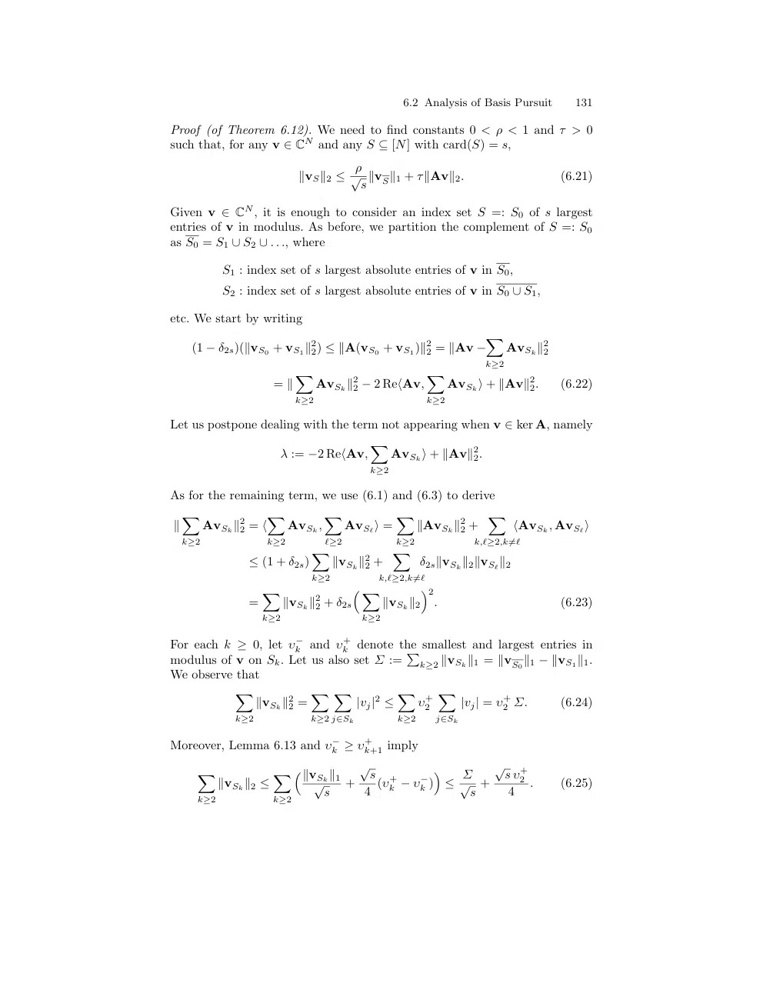

~~~text
                                                   6.2 Analysis of Basis Pursuit         131

Proof (of Theorem 6.12). We need to find constants 0 < ρ < 1 and τ > 0
such that, for any v ∈ CN and any S ⊆ [N ] with card(S) = s,
                                     ρ
                            kvS k2 ≤ √ kvS k1 + τ kAvk2 .                              (6.21)
                                      s

Given v ∈ CN , it is enough to consider an index set S =: S0 of s largest
entries of v in modulus. As before, we partition the complement of S =: S0
as S0 = S1 ∪ S2 ∪ . . ., where

          S1 : index set of s largest absolute entries of v in S0 ,
          S2 : index set of s largest absolute entries of v in S0 ∪ S1 ,

etc. We start by writing
                                                          X
   (1 − δ2s )(kvS0 + vS1 k22 ) ≤ kA(vS0 + vS1 )k22 = kAv −  AvSk k22
                                                                          k≥2
                            X                             X
                      =k          AvSk k22 − 2 RehAv,              AvSk i + kAvk22 .   (6.22)
                            k≥2                           k≥2

Let us postpone dealing with the term not appearing when v ∈ ker A, namely
                                    X
                   λ := −2 RehAv,      AvSk i + kAvk22 .
                                           k≥2

As for the remaining term, we use (6.1) and (6.3) to derive
  X                X        X            X                X
k     AvSk k22 = h   AvSk ,    AvS` i =     kAvSk k22 +     hAvSk , AvS` i
  k≥2              k≥2             `≥2            k≥2                   k,`≥2,k6=`
                              X                  X
               ≤ (1 + δ2s )     kvSk k22 +         δ2s kvSk k2 kvS` k2
                            k≥2           k,`≥2,k6=`
                   X                      X              2
               =         kvSk k22 + δ2s         kvSk k2        .                       (6.23)
                   k≥2                    k≥2

For each k ≥ 0, let υk− and υk+ denote the P smallest and largest entries in
modulus of v on Sk . Let us also set Σ := k≥2 kvSk k1 = kvS0 k1 − kvS1 k1 .
We observe that
           X             XX                X     X
              kvSk k22 =          |vj |2 ≤   υ2+    |vj | = υ2+ Σ.    (6.24)
             k≥2              k≥2 j∈Sk            k≥2          j∈Sk

Moreover, Lemma 6.13 and υk− ≥ υk+1
                                +
                                    imply

                      X  kvS k1 √                    √ +
    X                              s +           Σ    s υ2
          kvSk k2 ≤         √k +    (υk − υk− ) ≤ √ +       .                          (6.25)
                             s   4                 s    4
    k≥2               k≥2
~~~

## Page 144

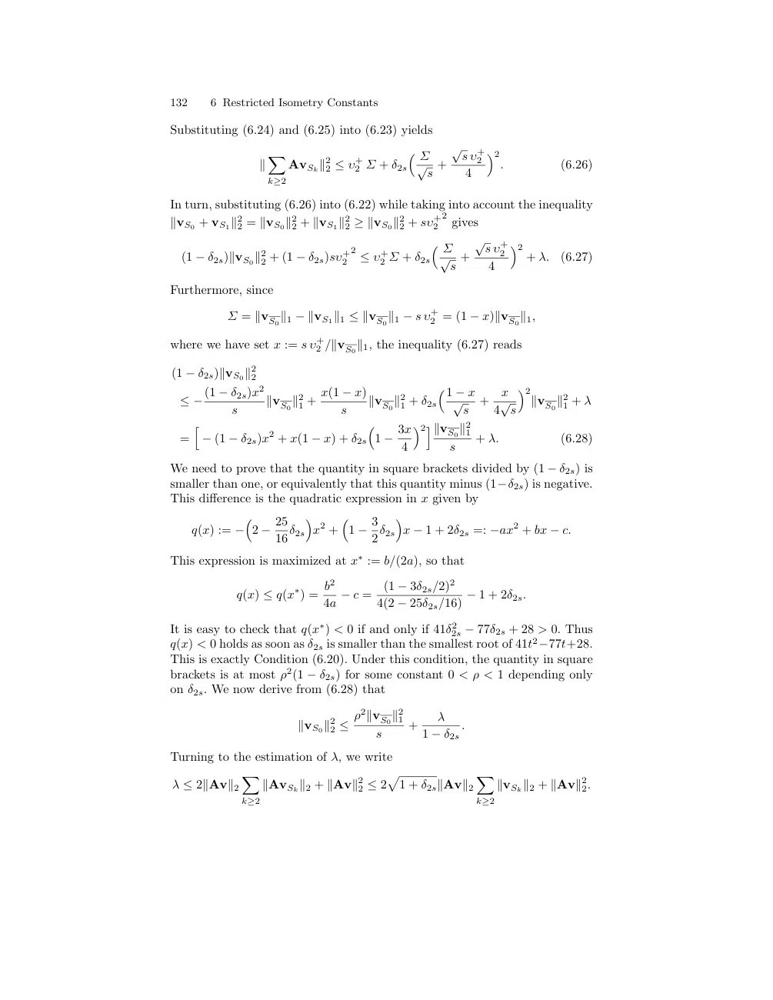

~~~text
132     6 Restricted Isometry Constants

Substituting (6.24) and (6.25) into (6.23) yields
                                                        Σ   √ + 2
                         X                                    s υ2
                     k         AvSk k22 ≤ υ2+ Σ + δ2s    √ +        .        (6.26)
                                                          s    4
                         k≥2

In turn, substituting (6.26) into (6.22) while taking into account the inequality
                                                      2
kvS0 + vS1 k22 = kvS0 k22 + kvS1 k22 ≥ kvS0 k22 + sυ2+ gives
                                                    Σ     √ + 2
                                     2                       s υ2
  (1 − δ2s )kvS0 k22 + (1 − δ2s )sυ2+ ≤ υ2+ Σ + δ2s √ +             + λ. (6.27)
                                                        s     4
Furthermore, since

           Σ = kvS0 k1 − kvS1 k1 ≤ kvS0 k1 − s υ2+ = (1 − x)kvS0 k1 ,

where we have set x := s υ2+ /kvS0 k1 , the inequality (6.27) reads

(1 − δ2s )kvS0 k22
    (1 − δ2s )x2            x(1 − x)                1 − x       x 2
 ≤−              kvS0 k21 +          kvS0 k21 + δ2s √ + √             kvS0 k21 + λ
         s                      s                        s     4 s
  h                                       3x 2 i kvS0 k21
 = − (1 − δ2s )x2 + x(1 − x) + δ2s 1 −                      + λ.            (6.28)
                                            4        s
We need to prove that the quantity in square brackets divided by (1 − δ2s ) is
smaller than one, or equivalently that this quantity minus (1−δ2s ) is negative.
This difference is the quadratic expression in x given by
                   25              3 
   q(x) := − 2 − δ2s x2 + 1 − δ2s x − 1 + 2δ2s =: −ax2 + bx − c.
                    16                2
This expression is maximized at x∗ := b/(2a), so that

                                     b2      (1 − 3δ2s /2)2
             q(x) ≤ q(x∗ ) =            −c=                  − 1 + 2δ2s .
                                     4a     4(2 − 25δ2s /16)

It is easy to check that q(x∗ ) < 0 if and only if 41δ2s
                                                      2
                                                         − 77δ2s + 28 > 0. Thus
q(x) < 0 holds as soon as δ2s is smaller than the smallest root of 41t2 −77t+28.
This is exactly Condition (6.20). Under this condition, the quantity in square
brackets is at most ρ2 (1 − δ2s ) for some constant 0 < ρ < 1 depending only
on δ2s . We now derive from (6.28) that

                                             ρ2 kvS0 k21      λ
                                kvS0 k22 ≤               +         .
                                                 s         1 − δ2s
Turning to the estimation of λ, we write
            X                          p            X
λ ≤ 2kAvk2      kAvSk k2 + kAvk22 ≤ 2 1 + δ2s kAvk2   kvSk k2 + kAvk22 .
              k≥2                                                      k≥2
~~~

## Page 145

~~~text
                                               6.2 Analysis of Basis Pursuit   133
                                                          √
We now call upon Lemma 6.9 to obtain kvSk k2 ≤ kvSk−1 k1 / s, hence
                             X                 kvS0 k1
                                   kvSk k2 ≤     √ ,
                                                  s
                             k≥2

rather than using the more involved inequality (6.25). Altogether, we deduce
that
                             √
          2
              ρ2 kvS0 k21      1 + δ2s       kvS0 k1   kAvk22
    kvS0 k2 ≤             +2           kAvk2 √       +
                   s          1 − δ2s            s     1 − δ2s
                             √
              ρ2 kvS0 k21      1 + δ2s       kv   k
                                                S0 1     1 + δ2s
            ≤             +2           kAvk2 √       + 2             kAvk22
                   s          1 − δ2s            s     ρ (1 − δ2s )2
                             √                2
                 ρkvS0 k1
              
                               1 + δ2s
            =      √      +             kAvk2 .
                     s      ρ(1 − δ2s )
                                                √
This is the desired inequality (6.21) with τ := 1 + δ2s /(ρ(1 − δ2s )).     t
                                                                            u
    We close this section by highlighting some limitations of the restricted
isometry property in the context of basis pursuit. We recall from Remark 4.6
that s-sparse recovery via basis pursuit is preserved if some measurements
are rescaled, reshuffled, or added. However, these operations may deteriorate
the restricted isometry constants. Reshuffling measurements corresponds to
replacing the measurement matrix A ∈ Cm×N by PA, where P ∈ Cm×m is a
permutation matrix. This operation leaves the restricted isometry constants
unchanged, since in fact δs (UA) = δs (A) for any unitary matrix U ∈ Cm×m .
Adding a measurement, however, which corresponds to appending a row to the
measurement matrix, may increase the restricted isometry constant. Consider
for instance a matrix A ∈ Cm×N with sth order restricted isometry constant
δs (A) < 1, and let δ > δs (A). We construct a matrix A  e by appending the row
         √                           >
 0 . . . 0 1 + δ . With x := 0 . . . 0 1 , it is easy to see that kAxk22 ≥ 1 + δ.
This implies that δ1 (A)e ≥ δ, and consequently that δs (A)e > δs (A). Likewise,
rescaling the measurements, which corresponds to replacing the measurement
matrix A ∈ Cm×N by DA, where D ∈ Cm×m is a diagonal matrix, may
also increase the restricted isometry constant. This is even the case for scalar
rescaling, i.e., replacing A by dA for d ∈ C. For instance, if A ∈ Cm×N has
an sth order restricted isometry constant δs (A) < 3/5, then the sth order
restricted isometry constant of 2A satisfies δs (2A) ≥ 3 − 4δs (A) > δs (A). In
order to circumvent the issue of scalar rescaling, one can work instead with
the sth restricted isometry ratio γs = γs (A), defined as the ratio
                                           βs
                                   γs :=      ≥ 1,
                                           αs
where αs and βs are the largest and smallest constants α, β ≥ 0 such that

                          α kxk22 ≤ kAxk22 ≤ β kxk22
~~~

## Page 146

~~~text
134    6 Restricted Isometry Constants

for all s-sparse vectors x ∈ CN . Note that this does not settle the issue
of general rescaling. Consider indeed the (2s) × (2s + 1) matrix A and the
(2s) × (2s) diagonal matrix Dε defined by
                                       
                   1 0 · · · 0 −1
                  0 1 . . . 0 −1
                                       
             A = .
                  
                                      .  , Dε = diag(ε, 1/ε, 1, . . . , 1).
                                        
                   .. . . . . . . 0 .. 
                   0 · · · 0 1 −1
                                                   >
Since ker Dε A = ker A is spanned by 1, 1, . . . , 1 , the matrices Dε A and A
both satisfy the sth order null space property, hence allow s-sparse recovery
via basis pursuit. However, the sth order restricted isometry ratio of Dε A
can be made arbitrarily large, since γs (Dε A) ≥ 1/ε4 . Incidentally, this shows
that there are matrices allowing s-sparse recovery via basis pursuit but whose
sth order restricted isometry constant are arbitrarily close to 1 — even after
scalar renormalization, see Exercise 6.2.

6.3 Analysis of Thresholding Algorithms
In this section, we establish the success of sparse recovery via iterative hard
thresholding and via hard thresholding pursuit for measurement matrices with
small restricted isometry constants. Again, we start with a simple and quite
natural proof of the success of s-sparse recovery via iterative hard thresholding
under the condition δ3s < 0.5. This is done in the ideal situation of exactly
sparse vectors acquired with perfect accuracy. We then cover the more realistic
situation of approximately sparse vectors measured with some errors. The
improved result only requires the weaker condition δ3s < 0.5773. It applies to
both iterative hard thresholding and hard thresholding pursuit, but its proof
is more involved. Before all this, we recall from Section 3 that the iterative
hard thresholding algorithm starts with an initial s-sparse vector x0 ∈ CN ,
typically x0 = 0, and produces a sequence (xn ) defined inductively by

                       xn+1 = Hs (xn + A∗ (y − Axn )).                    (IHT)

The hard thresholding operator Hs keeps the s largest modulus components of
a vector, so that Hs (z) is a (not necessarily unique) best s-term approximation
to z ∈ CN . For small restricted isometry constants, the success of iterative
hard thresholding is intuitively justified by the fact that A∗ A behaves like the
identity when its domain and range are restricted to small support sets. Thus,
if y = Ax for some sparse x ∈ CN , the contribution to xn+1 of A∗ (y−Axn ) =
A∗ A(x − xn ) is roughly x − xn , which sums with xn to the desired x. Here
is a formal statement of the success of iterative hard thresholding.
~~~

## Page 147

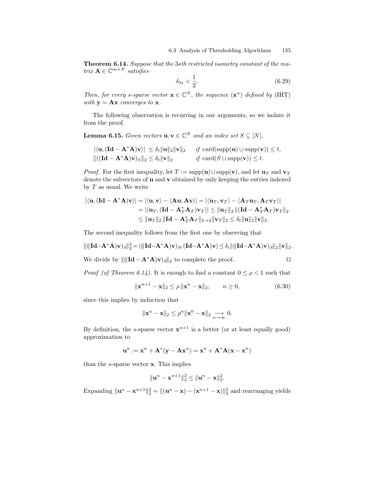

~~~text
                                6.3 Analysis of Thresholding Algorithms       135

Theorem 6.14. Suppose that the 3sth restricted isometry constant of the ma-
trix A ∈ Cm×N satisfies
                                      1
                               δ3s < .                                (6.29)
                                      2
Then, for every s-sparse vector x ∈ CN , the sequence (xn ) defined by (IHT)
with y = Ax converges to x.

   The following observation is recurring in our arguments, so we isolate it
from the proof.

Lemma 6.15. Given vectors u, v ∈ CN and an index set S ⊆ [N ],

   |hu, (Id − A∗ A)vi| ≤ δt kuk2 kvk2      if card(supp(u) ∪ supp(v)) ≤ t,
              ∗
   k((Id − A A)v)S k2 ≤ δt kvk2            if card(S ∪ supp(v)) ≤ t.

Proof. For the first inequality, let T := supp(u) ∪ supp(v), and let uT and vT
denote the subvectors of u and v obtained by only keeping the entries indexed
by T as usual. We write

|hu, (Id − A∗ A)vi| = |hu, vi − hAu, Avi| = |huT , vT i − hAT uT , AT vT i|
                    = |huT , (Id − A∗T AT )vT i| ≤ kuT k2 k(Id − A∗T AT )vT k2
                    ≤ kuT k2 kId − A∗T AT k2→2 kvT k2 ≤ δt kuk2 kvk2 .

The second inequality follows from the first one by observing that

k((Id−A∗ A)v)Sk22 = h((Id−A∗ A)v)S, (Id−A∗ A)vi ≤ δt k((Id−A∗ A)v)Sk2 kvk2 .

We divide by k((Id − A∗ A)v)Sk2 to complete the proof.                         t
                                                                               u

Proof (of Theorem 6.14). It is enough to find a constant 0 ≤ ρ < 1 such that

                   kxn+1 − xk2 ≤ ρ kxn − xk2 ,       n ≥ 0,               (6.30)

since this implies by induction that

                      kxn − xk2 ≤ ρn kx0 − xk2 −→ 0.
                                                 n→∞

By definition, the s-sparse vector xn+1 is a better (or at least equally good)
approximation to

              un := xn + A∗ (y − Axn ) = xn + A∗ A(x − xn )

than the s-sparse vector x. This implies

                         kun − xn+1 k22 ≤ kun − xk22 .

Expanding kun − xn+1 k22 = k(un − x) − (xn+1 − x)k22 and rearranging yields
~~~

## Page 148

~~~text
136    6 Restricted Isometry Constants

                   kxn+1 − xk22 ≤ 2 Rehun − x, xn+1 − xi.               (6.31)

We now use Lemma 6.15 to obtain

        Rehun − x, xn+1 − xi = Reh(Id − A∗ A)(xn − x), xn+1 − xi
                               ≤ δ3s kxn − xk2 kxn+1 − xk2 .            (6.32)

If kxn+1 − xk2 > 0, we derive from (6.31) and (6.32) that

                       kxn+1 − xk2 ≤ 2δ3s kxn − xk2 ,

which is obviously true if kxn+1 − xk2 = 0. Thus, the desired inequality (6.30)
holds with ρ = 2δ3s < 1.                                                     t
                                                                             u

Remark 6.16. Sufficient conditions for the success of s-sparse recovery via
basis pursuit were previously given in terms of δ2s . Such sufficient condi-
tions can also be given for iterative hard thresholding. For instance, since
δ3s ≤ 2δ2s + δs ≤ 3δ2s by Proposition 6.6, it is enough to assume δ2s < 1/6
to guarantee δ3s < 1/2, hence the success of s-sparse recovery via iterative
hard thresholding. This condition may be weakened to δ2s < 1/4 by refining
the previous argument — see Exercise 6.18. It can be further weakened to
δ2s < 1/3 with a slight modification of the algorithm — see Exercise 6.19.

    It is again instructive to refine the proof above for approximately sparse
vectors measured with some errors, and the reader is invited to do so in Exer-
cise 6.17. Theorem 6.17 below covers this case, while improving on Theorem
6.14 by relaxing the sufficient condition (6.29). As a consequence, we will ob-
tain in Theorem 6.20 error estimates similar to the ones for basis pursuit. We
underline that the arguments are valid for both iterative hard thresholding
and hard thresholding pursuit. As a reminder, this latter algorithm starts with
an initial s-sparse vector x0 ∈ CN , typically x0 = 0, and produces a sequence
(xn ) defined inductively by

           S n+1 = Ls (xn + A∗ (y − Axn )),                            (HTP1 )
           xn+1 = argmin ky − Azk2 , supp(z) ⊆ S n+1 .
                           
                                                                       (HTP2 )

We recall that Ls (z) denotes an index set of s largest absolute entries of a
vector z ∈ CN .

Theorem 6.17. Suppose that the 3sth restricted isometry constant of the ma-
trix A ∈ Cm×N satisfies
                                    1
                             δ3s < √ ≈ 0.5773.                          (6.33)
                                     3

Then, for x ∈ CN , e ∈ Cm , and S ⊆ [N ] with card(S) = s, the sequence (xn )
defined by (IHT) or by (HTP) with y = Ax + e satisfies, for any n ≥ 0,
~~~

## Page 149

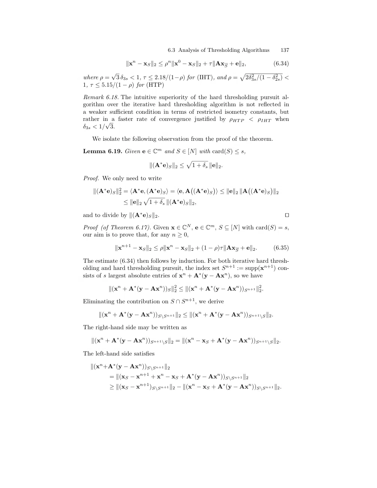

~~~text
                                 6.3 Analysis of Thresholding Algorithms       137

                kxn − xS k2 ≤ ρn kx0 − xS k2 + τ kAxS + ek2 ,         (6.34)
           √                                             p
                                                              2 /(1 − δ 2 ) <
where ρ = 3 δ3s < 1, τ ≤ 2.18/(1−ρ) for (IHT), and ρ = 2δ3s            2s
1, τ ≤ 5.15/(1 − ρ) for (HTP)

Remark 6.18. The intuitive superiority of the hard thresholding pursuit al-
gorithm over the iterative hard thresholding algorithm is not reflected in
a weaker sufficient condition in terms of restricted isometry constants, but
rather in√ a faster rate of convergence justified by ρHT P < ρIHT when
δ3s < 1/ 3.

   We isolate the following observation from the proof of the theorem.

Lemma 6.19. Given e ∈ Cm and S ∈ [N ] with card(S) ≤ s,
                                 p
                    k(A∗ e)S k2 ≤ 1 + δs kek2 .

Proof. We only need to write

   k(A∗ e)S k22 = hA∗ e, (A∗ e)S i = he, A (A∗ e)S i ≤ kek2 kA (A∗ e)S k2
                                                                     
                       p
                ≤ kek2 1 + δs k(A∗ e)S k2 ,

and to divide by k(A∗ e)S k2 .                                                   t
                                                                                 u

Proof (of Theorem 6.17). Given x ∈ CN , e ∈ Cm , S ⊆ [N ] with card(S) = s,
our aim is to prove that, for any n ≥ 0,

            kxn+1 − xS k2 ≤ ρkxn − xS k2 + (1 − ρ)τ kAxS + ek2 .             (6.35)

The estimate (6.34) then follows by induction. For both iterative hard thresh-
olding and hard thresholding pursuit, the index set S n+1 := supp(xn+1 ) con-
sists of s largest absolute entries of xn + A∗ (y − Axn ), so we have

          k(xn + A∗ (y − Axn ))S k22 ≤ k(xn + A∗ (y − Axn ))S n+1 k22 .

Eliminating the contribution on S ∩ S n+1 , we derive

      k(xn + A∗ (y − Axn ))S\S n+1 k2 ≤ k(xn + A∗ (y − Axn ))S n+1 \S k2 .

The right-hand side may be written as

   k(xn + A∗ (y − Axn ))S n+1 \S k2 = k(xn − xS + A∗ (y − Axn ))S n+1 \S k2 .

The left-hand side satisfies

  k(xn +A∗ (y − Axn ))S\S n+1 k2
          = k(xS − xn+1 + xn − xS + A∗ (y − Axn ))S\S n+1 k2
          ≥ k(xS − xn+1 )S\S n+1 k2 − k(xn − xS + A∗ (y − Axn ))S\S n+1 k2 .
~~~

## Page 150

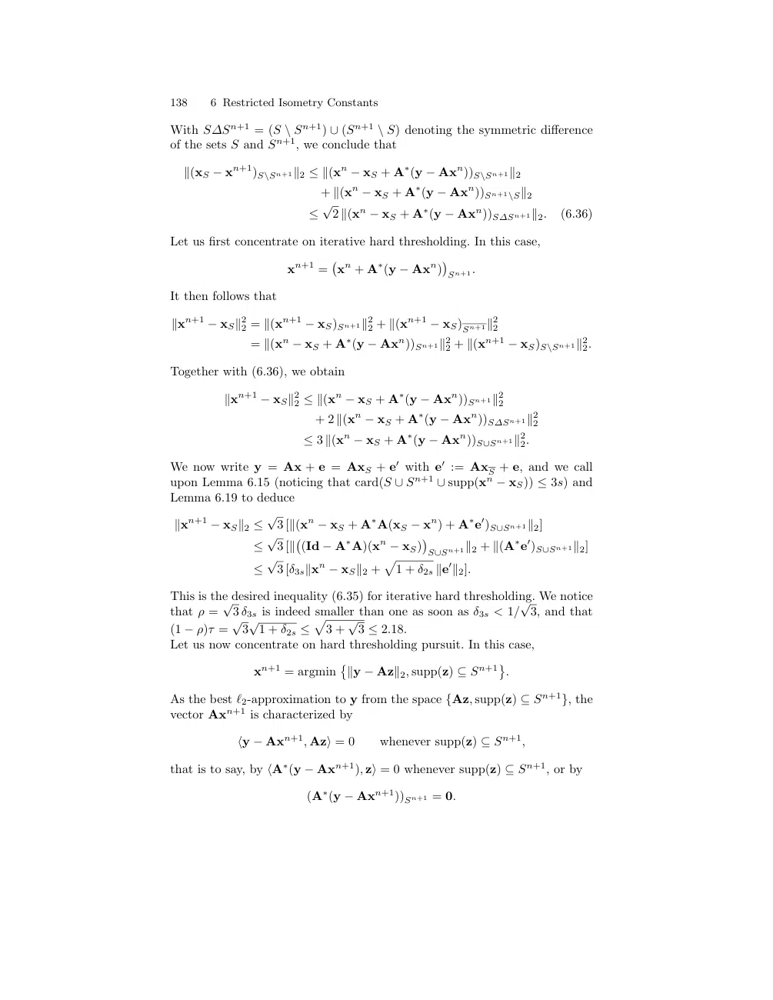

~~~text
138    6 Restricted Isometry Constants

With S∆S n+1 = (S \ S n+1 ) ∪ (S n+1 \ S) denoting the symmetric difference
of the sets S and S n+1 , we conclude that

  k(xS − xn+1 )S\S n+1 k2 ≤ k(xn − xS + A∗ (y − Axn ))S\S n+1 k2
                           + k(xn − xS + A∗ (y − Axn ))S n+1 \S k2
                           √
                          ≤ 2 k(xn − xS + A∗ (y − Axn ))S∆S n+1 k2 .      (6.36)

Let us first concentrate on iterative hard thresholding. In this case,

                      xn+1 = xn + A∗ (y − Axn ) S n+1 .
                                                   

It then follows that

kxn+1 − xS k22 = k(xn+1 − xS )S n+1 k22 + k(xn+1 − xS )S n+1 k22
               = k(xn − xS + A∗ (y − Axn ))S n+1 k22 + k(xn+1 − xS )S\S n+1 k22 .

Together with (6.36), we obtain

          kxn+1 − xS k22 ≤ k(xn − xS + A∗ (y − Axn ))S n+1 k22
                            + 2 k(xn − xS + A∗ (y − Axn ))S∆S n+1 k22
                         ≤ 3 k(xn − xS + A∗ (y − Axn ))S∪S n+1 k22 .

We now write y = Ax + e = AxS + e0 with e0 := AxS + e, and we call
upon Lemma 6.15 (noticing that card(S ∪ S n+1 ∪ supp(xn − xS )) ≤ 3s) and
Lemma 6.19 to deduce
                √
 kxn+1 − xS k2 ≤ 3 [k(xn − xS + A∗ A(xS − xn ) + A∗ e0 )S∪S n+1 k2 ]
                √
               ≤ 3 [k (Id − A∗ A)(xn − xS ) S∪S n+1 k2 + k(A∗ e0 )S∪S n+1 k2 ]
                                           
                √                    p
               ≤ 3 [δ3s kxn − xS k2 + 1 + δ2s ke0 k2 ].

This is the√desired inequality (6.35) for iterative hard thresholding.
                                                                   √ We notice
that ρ = 3 δ3s is indeed p  smaller than one as soon as δ3s < 1/ 3, and that
            √ √                    √
(1 − ρ)τ = 3 1 + δ2s ≤ 3 + 3 ≤ 2.18.
Let us now concentrate on hard thresholding pursuit. In this case,

                xn+1 = argmin ky − Azk2 , supp(z) ⊆ S n+1 .
                                 

As the best `2 -approximation to y from the space {Az, supp(z) ⊆ S n+1 }, the
vector Axn+1 is characterized by

            hy − Axn+1 , Azi = 0         whenever supp(z) ⊆ S n+1 ,

that is to say, by hA∗ (y − Axn+1 ), zi = 0 whenever supp(z) ⊆ S n+1 , or by

                          (A∗ (y − Axn+1 ))S n+1 = 0.
~~~

## Page 151

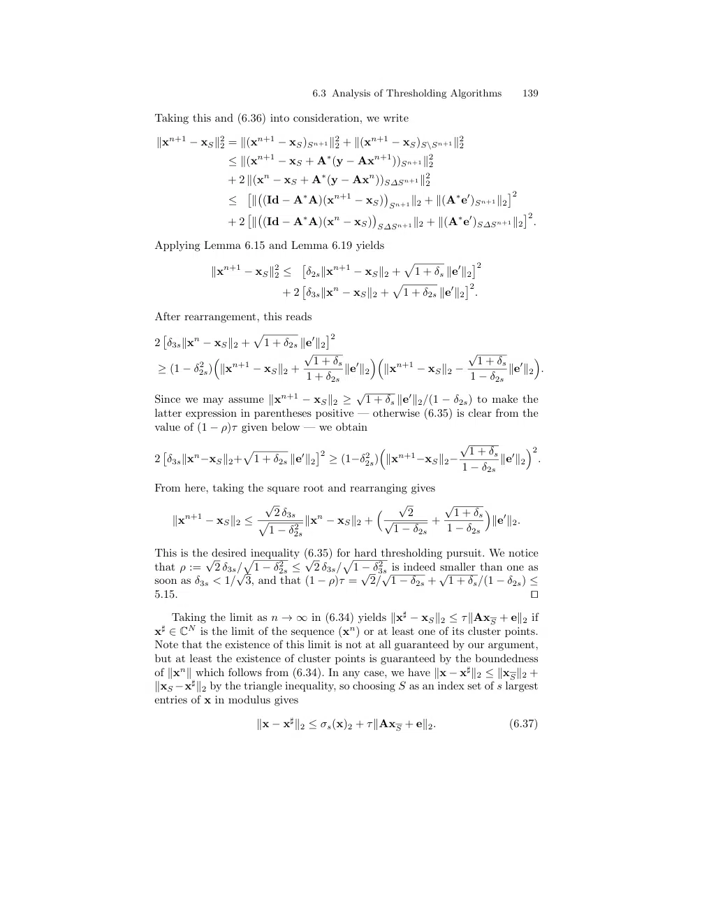

~~~text
                                 6.3 Analysis of Thresholding Algorithms        139

Taking this and (6.36) into consideration, we write

kxn+1 − xS k22 = k(xn+1 − xS )S n+1 k22 + k(xn+1 − xS )S\S n+1 k22
               ≤ k(xn+1 − xS + A∗ (y − Axn+1 ))S n+1 k22
               + 2 k(xn − xS + A∗ (y − Axn ))S∆S n+1 k22
                                                                        2
               ≤ k (Id − A∗ A)(xn+1 − xS ) S n+1 k2 + k(A∗ e0 )S n+1 k2
                                            
                                                                           2
               + 2 k (Id − A∗ A)(xn − xS ) S∆S n+1 k2 + k(A∗ e0 )S∆S n+1 k2 .
                                         

Applying Lemma 6.15 and Lemma 6.19 yields
                                                p             2
          kxn+1 − xS k22 ≤ δ2s kxn+1 − xS k2 + 1 + δs ke0 k2
                            
                                              p              2
                         + 2 δ3s kxn − xS k2 + 1 + δ2s ke0 k2 .
                            

After rearrangement, this reads
                     p              2
2 δ3s kxn − xS k2 + 1 + δ2s ke0 k2
  
                               √                                √
          2
             
                 n+1             1 + δs 0  n+1                  1 + δs 0 
 ≥ (1 − δ2s ) kx     − xS k2 +         ke k2 kx      − xS k2 −           ke k2 .
                               1 + δ2s                          1 − δ2s
                                          √
Since we may assume kxn+1 − xS k2 ≥ 1 + δs ke0 k2 /(1 − δ2s ) to make the
latter expression in parentheses positive — otherwise (6.35) is clear from the
value of (1 − ρ)τ given below — we obtain
                                                              √
                   p             2                            1 + δ s 0 2
2 δ3s kxn −xS k2 + 1 + δ2s ke0 k2 ≥ (1−δ2s 2
                                             ) kxn+1 −xS k2 −
  
                                                                       ke k2 .
                                                              1 − δ2s
From here, taking the square root and rearranging gives
                     √                          √2         √
      n+1              2 δ3s     n                            1 + δs  0
   kx     − xS k2 ≤ p         kx   − x S k 2 +  √         +           ke k2 .
                            2
                      1 − δ2s                     1 − δ2s   1 − δ2s

This is the√desiredpinequality (6.35)
                               √       for
                                        p hard thresholding pursuit. We notice
that ρ := 2 δ3s√         2 ≤
                 / 1 − δ2s                    2 is indeed smaller than one as
                                           − δ3s
                                 2 δ3s / 1 √   √          √
soon as δ3s < 1/ 3, and that (1 − ρ)τ = 2/ 1 − δ2s + 1 + δs /(1 − δ2s ) ≤
5.15.                                                                       t
                                                                            u

    Taking the limit as n → ∞ in (6.34) yields kx] − xS k2 ≤ τ kAxS + ek2 if
x ∈ CN is the limit of the sequence (xn ) or at least one of its cluster points.
 ]

Note that the existence of this limit is not at all guaranteed by our argument,
but at least the existence of cluster points is guaranteed by the boundedness
of kxn k which follows from (6.34). In any case, we have kx − x] k2 ≤ kxS k2 +
kxS −x] k2 by the triangle inequality, so choosing S as an index set of s largest
entries of x in modulus gives

                     kx − x] k2 ≤ σs (x)2 + τ kAxS + ek2 .                 (6.37)
~~~

## Page 152

~~~text
140      6 Restricted Isometry Constants

This estimate does not resemble the basis pursuit estimates of Theorem 6.11.
However, such estimates are available for thresholding algorithms, too, pro-
vided we replace the parameter s in (IHT) and (HTP) by 2s, say. The precise
statement is as follows.

Theorem 6.20. Suppose that the 6sth order    √ restricted isometry constant of
the matrix A ∈ Cm×N satisfies δ6s < 1/ 3. Then, for all x ∈ CN and
e ∈ Cm , the sequence (xn ) defined by (IHT) or by (HTP1 ) with y = Ax + e,
x0 = 0, and s replaced by 2s satisfies, for any n ≥ 0,
                                          √             √
             kx − xn k1 ≤ C σs (x)1 + D s kek2 + 2 ρn s kxk2 ,
                            C
             kx − xn k2 ≤ √ σs (x)1 + D kek2 + 2 ρn kxk2 .
                             s

where the constants C, D > 0 and 0 < ρ < 1 depend only on δ6s . In particular,
if the sequence (xn ) clusters around some x] ∈ CN , then
                                                √
                      kx − x] k1 ≤ C σs (x)1 + D s kek2 ,               (6.38)
                                    C
                      kx − x] k2 ≤ √ σs (x)1 + D kek2 .                 (6.39)
                                     s

Remark 6.21. (a) Error estimates of the type (6.38) and (6.39) are not only
                            ]                           n
  valid for cluster points
                      √ x , but can be extended to all x for n large enough
  when Cσs (x)1 + D skek2 > 0. Indeed, in this case we have, for all n ≥ n0
  with large enough n0 ,
                           √                    √
                      2ρn skxk2 ≤ Cσs (x)1 + D skek2 .

      Therefore, the general error estimates in the above theorem imply
                                                     √
                       kx − xn k1 ≤ 2C σs (x)1 + 2D s kek2 ,
                                      2C
                       kx − xn k2 ≤ √ σs (x)1 + 2D kek2
                                        s

    for all n ≥ n0 .
(b) A major drawback when running hard thresholding algorithms is that an
    estimation of the targeted sparsity s is needed. This estimation is not
    needed for the inequality-constrained `1 -minimization, but an estimation
    of the measurement error η is (a priori) needed instead. In fact, we will
    see in Chapter 11 that running the equality-constrained `1 -minimization
    (P1 ) on corrupted measurements may in some cases still have the benefit
    of stable and robust estimates (6.38)-(6.39).

   The auxiliary result below plays a central role when proving statements
such as Theorem 6.20.
~~~

## Page 153

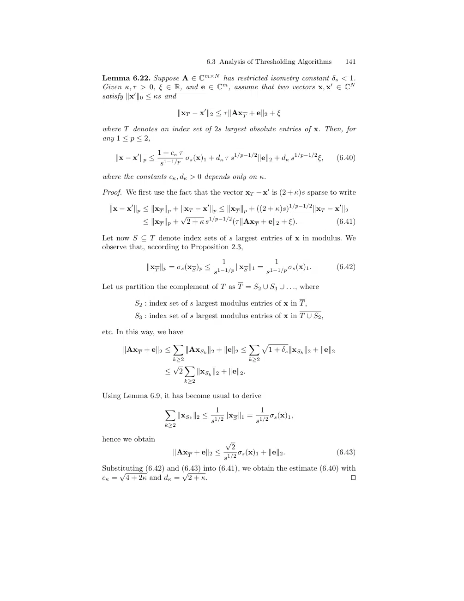

~~~text
                                   6.3 Analysis of Thresholding Algorithms            141

Lemma 6.22. Suppose A ∈ Cm×N has restricted isometry constant δs < 1.
Given κ, τ > 0, ξ ∈ R, and e ∈ Cm , assume that two vectors x, x0 ∈ CN
satisfy kx0 k0 ≤ κs and

                           kxT − x0 k2 ≤ τ kAxT + ek2 + ξ

where T denotes an index set of 2s largest absolute entries of x. Then, for
any 1 ≤ p ≤ 2,
                   1 + cκ τ
    kx − x0 kp ≤            σs (x)1 + dκ τ s1/p−1/2 kek2 + dκ s1/p−1/2 ξ,           (6.40)
                    s1−1/p
where the constants cκ , dκ > 0 depends only on κ.

Proof. We first use the fact that the vector xT − x0 is (2 + κ)s-sparse to write

  kx − x0 kp ≤ kxT kp + kxT − x0 kp ≤ kxT kp + ((2 + κ)s)1/p−1/2 kxT − x0 k2
                        √
             ≤ kxT kp + 2 + κ s1/p−1/2 (τ kAxT + ek2 + ξ).             (6.41)

Let now S ⊆ T denote index sets of s largest entries of x in modulus. We
observe that, according to Proposition 2.3,
                                            1                    1
             kxT kp = σs (xS )p ≤                 kxS k1 =              σs (x)1 .   (6.42)
                                       s1−1/p                  s1−1/p
Let us partition the complement of T as T = S2 ∪ S3 ∪ . . ., where

          S2 : index set of s largest modulus entries of x in T ,
          S3 : index set of s largest modulus entries of x in T ∪ S2 ,

etc. In this way, we have
                      X                     Xp
       kAxT + ek2 ≤       kAxSk k2 + kek2 ≤    1 + δs kxSk k2 + kek2
                       k≥2                           k≥2
                      √ X
                     ≤ 2  kxSk k2 + kek2 .
                             k≥2

Using Lemma 6.9, it has become usual to derive
                     X                  1                  1
                           kxSk k2 ≤          kxS k1 =          σs (x)1 ,
                     k≥2
                                       s1/2              s1/2

hence we obtain                               √
                                        2
                       kAxT + ek2 ≤        σs (x)1 + kek2 .             (6.43)
                                      s1/2
Substituting
     √       (6.42) and (6.43)
                        √      into (6.41), we obtain the estimate (6.40) with
cκ = 4 + 2κ and dκ = 2 + κ.                                                  t
                                                                             u
~~~

## Page 154

~~~text
142    6 Restricted Isometry Constants

Proof (of Theorem 6.20). Given x ∈ CN and e ∈ Cm , under the present
hypotheses, Theorem 6.17 implies that there exist 0 < ρ < 1 and τ > 0
depending only on δ6s such that, for any n ≥ 0,

                     kxT − xn k2 ≤ τ kAxT + ek2 + ρn kxT k2 ,

where T denotes an index set of 2s largest entries of x in modulus. Then
Lemma 6.22 with x0 = xn and ξ = ρn kxT k2 implies that, for any 1 ≤ p ≤ 2,

                       C
      kx − xn kp ≤          σs (x)1 + D s1/p−1/2 kek2 + ρn s1/p−1/2 kxT k2 ,
                     s1−1/p
where C, D > 0 depend only on τ , hence only on δ6s . The desired estimates
are the particular cases p = 1 and p = 2.                                t
                                                                         u

6.4 Analysis of Greedy Algorithms

In this final section, we establish the success of sparse recovery via the greedy
algorithms presented in Section 3.2, namely orthogonal matching pursuit and
compressive sampling matching pursuit. For the orthogonal matching pursuit
algorithm, we first remark that standard restricted isometry conditions are
not enough to guarantee the recovery     √ of all s-sparse vectors in at most s
iterations. Indeed, for a fixed 1 < η < s, consider the (s + 1) × (s + 1) matrix
with `2 -normalized columns defined by
                                               η   
                                                   s
                                           .. 
                                  Id        . 
                            A := 
                                           η
                                                 .
                                                                          (6.44)
                                         qs 
                                           s−η 2
                                  0 ··· 0     s

We calculate                                          η
                                                       s
                                                      .. 
                           A∗ A − Id = 
                                              0        ..
                                                      η
                                                       s
                                             η     η
                                             s ··· s   0
                               √     √
This matrix has eigenvalues −η/ s, η/ s, and 0 with multiplicity s−1. Thus,
                                                  η
                         δs+1 = kA∗ A − Idk2→2 = √
                                                   s.

However, the s-sparse vector x = [1, . . . , 1, 0]> is not recovered from y = Ax
after s iterations, since the wrong index s + 1 is picked at the first iteration.
Indeed,
~~~

## Page 155

~~~text
                                      6.4 Analysis of Greedy Algorithms        143
                                                    η         
                                                     s  1         1
                                                    ..   ..   .. 
            A∗ (y − Ax0 ) = A∗ Ax = 
                                            Id       . . = . .
                                                             
                                                     η 
                                    
                                                     s     1     1
                                           η     η
                                           s ··· s   1     0      η
There are two possibilities to bypass this issue: either perform more than s it-
erations, or find a way to reject the wrong indices by modifying the orthogonal
matching pursuit, which is the rationale behind compressive sampling match-
ing pursuit. In both cases, sparse recovery will be established under restricted
isometry conditions. In what follows, we do not separate the ideal situation
of exactly sparse vectors measured with perfect accuracy, but we directly give
the more cumbersome proofs for stable and robust s-sparse recovery under the
condition δ10s < 0.1666 for 6s iterations of orthogonal matching pursuit and
δ4s < 0.4782 for compressive sampling matching pursuit. Although the argu-
ment for compressive sampling matching pursuit are close to the argument
used in the previous section, we start with the orthogonal matching pursuit
algorithm.

Orthogonal Matching Pursuit

For the purpose of proving the main result, we consider the slightly more
general algorithm starting with an index set S 0 and with

                   x0 := argmin{ky − Azk, supp(z) ⊆ S 0 },                  (6.45)

and iterating the scheme

           S n+1 = S n ∪ L1 (A∗ (y − Axn )),                              (OMP’1 )
           xn+1 = argmin ky − Azk2 , supp(z) ⊆ S n+1 .
                           
                                                                          (OMP’2 )

The usual orthogonal matching pursuit algorithm corresponds to the default
choice of S 0 = ∅ and x0 = 0. The following proposition is the key.

Proposition 6.23. Suppose A ∈ Cm×N has restricted isometry constant
δ10s < 1/6. Then there is a constant C > 0 depending only on δ10s such
that the sequence (xn ) defined by (OMP’) with y = Ax + e for some s-sparse
x ∈ CN and some e ∈ Cm satisfies

            ky − Axn̄ k2 ≤ Ckek2 ,      n̄ := 6 card(supp(x) \ S 0 ).

   Note that if e = 0 and S 0 = ∅, this proposition implies exact s-sparse
recovery via (OMP) in 6s iterations. Indeed, we have A(x − x6s ) = 0, which
implies x − x6s = 0 since kx − x6s k0 ≤ 7s and δ7s ≤ δ10s < 1. Proposition
6.23 also implies stability and robustness results stated in a familiar form.
~~~

## Page 156

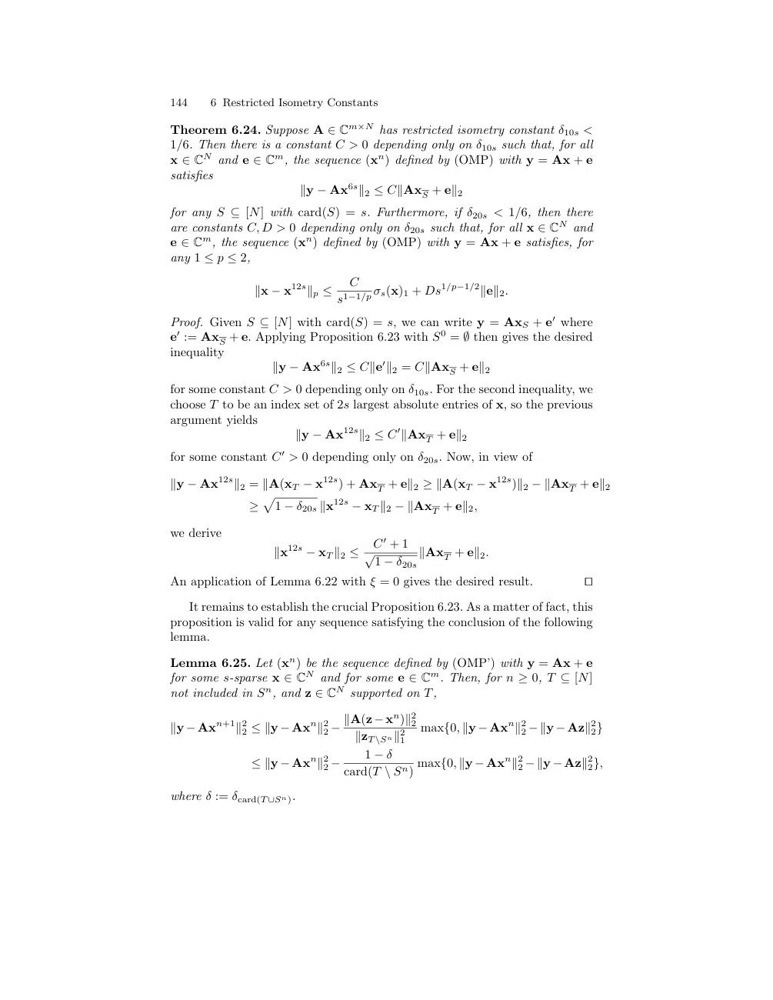

~~~text
144     6 Restricted Isometry Constants

Theorem 6.24. Suppose A ∈ Cm×N has restricted isometry constant δ10s <
1/6. Then there is a constant C > 0 depending only on δ10s such that, for all
x ∈ CN and e ∈ Cm , the sequence (xn ) defined by (OMP) with y = Ax + e
satisfies
                       ky − Ax6s k2 ≤ CkAxS + ek2
for any S ⊆ [N ] with card(S) = s. Furthermore, if δ20s < 1/6, then there
are constants C, D > 0 depending only on δ20s such that, for all x ∈ CN and
e ∈ Cm , the sequence (xn ) defined by (OMP) with y = Ax + e satisfies, for
any 1 ≤ p ≤ 2,
                                     C
                  kx − x12s kp ≤            σs (x)1 + Ds1/p−1/2 kek2 .
                                   s1−1/p
Proof. Given S ⊆ [N ] with card(S) = s, we can write y = AxS + e0 where
e0 := AxS + e. Applying Proposition 6.23 with S 0 = ∅ then gives the desired
inequality
                 ky − Ax6s k2 ≤ Cke0 k2 = CkAxS + ek2
for some constant C > 0 depending only on δ10s . For the second inequality, we
choose T to be an index set of 2s largest absolute entries of x, so the previous
argument yields
                      ky − Ax12s k2 ≤ C 0 kAxT + ek2
for some constant C 0 > 0 depending only on δ20s . Now, in view of

ky − Ax12s k2 = kA(xT − x12s ) + AxT + ek2 ≥ kA(xT − x12s )k2 − kAxT + ek2
                p
              ≥ 1 − δ20s kx12s − xT k2 − kAxT + ek2 ,

we derive
                                       C0 + 1
                      kx12s − xT k2 ≤ √          kAxT + ek2 .
                                        1 − δ20s
An application of Lemma 6.22 with ξ = 0 gives the desired result.               t
                                                                                u

   It remains to establish the crucial Proposition 6.23. As a matter of fact, this
proposition is valid for any sequence satisfying the conclusion of the following
lemma.

Lemma 6.25. Let (xn ) be the sequence defined by (OMP’) with y = Ax + e
for some s-sparse x ∈ CN and for some e ∈ Cm . Then, for n ≥ 0, T ⊆ [N ]
not included in S n , and z ∈ CN supported on T ,

                                  kA(z − xn )k22
ky − Axn+1 k22 ≤ ky − Axn k22 −                  max{0, ky − Axn k22 − ky − Azk22 }
                                    kzT \S n k21
                                      1−δ
                 ≤ ky − Axn k22 −                max{0, ky − Axn k22 − ky − Azk22 },
                                  card(T \ S n )
where δ := δcard(T ∪S n ) .
~~~

## Page 157

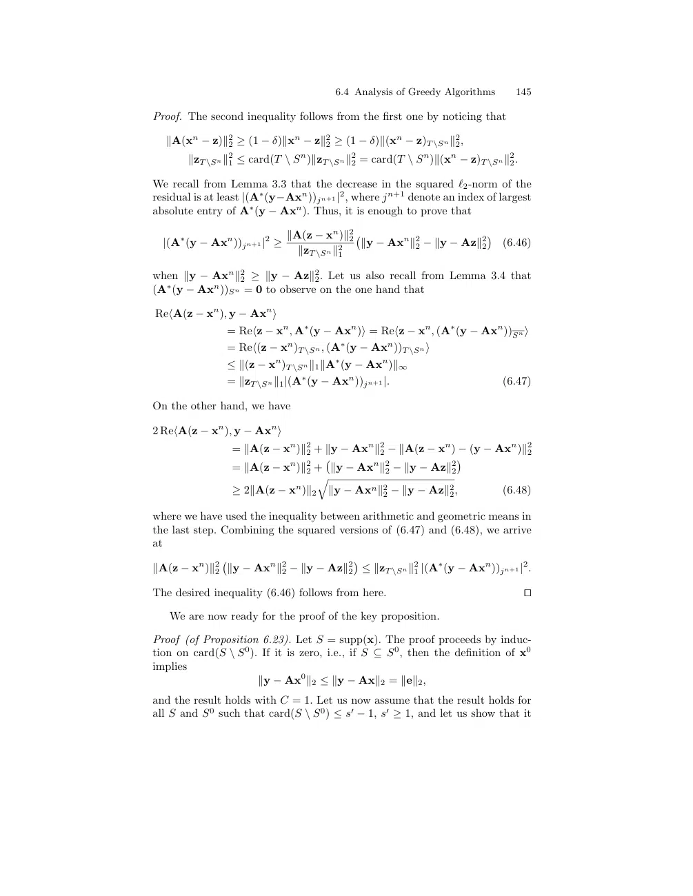

~~~text
                                          6.4 Analysis of Greedy Algorithms          145

Proof. The second inequality follows from the first one by noticing that

  kA(xn − z)k22 ≥ (1 − δ)kxn − zk22 ≥ (1 − δ)k(xn − z)T \S n k22 ,
       kzT \S n k21 ≤ card(T \ S n )kzT \S n k22 = card(T \ S n )k(xn − z)T \S n k22 .

We recall from Lemma 3.3 that the decrease in the squared `2 -norm of the
residual is at least |(A∗ (y−Axn ))j n+1 |2 , where j n+1 denote an index of largest
absolute entry of A∗ (y − Axn ). Thus, it is enough to prove that

                               kA(z − xn )k22
  |(A∗ (y − Axn ))j n+1 |2 ≥                  ky − Axn k22 − ky − Azk22 (6.46)
                                                                       
                                           2
                                 kzT \S n k1

when ky − Axn k22 ≥ ky − Azk22 . Let us also recall from Lemma 3.4 that
(A∗ (y − Axn ))S n = 0 to observe on the one hand that

RehA(z − xn ), y − Axn i
                = Rehz − xn , A∗ (y − Axn )i = Rehz − xn , (A∗ (y − Axn ))S n i
                = Reh(z − xn )T \S n , (A∗ (y − Axn ))T \S n i
                ≤ k(z − xn )T \S n k1 kA∗ (y − Axn )k∞
                = kzT \S n k1 |(A∗ (y − Axn ))j n+1 |.                            (6.47)

On the other hand, we have

2 RehA(z − xn ), y − Axn i
                 = kA(z − xn )k22 + ky − Axn k22 − kA(z − xn ) − (y − Axn )k22
                 = kA(z − xn )k22 + ky − Axn k22 − ky − Azk22
                                                              
                                  q
                 ≥ 2kA(z − xn )k2 ky − Axn k22 − ky − Azk22 ,          (6.48)

where we have used the inequality between arithmetic and geometric means in
the last step. Combining the squared versions of (6.47) and (6.48), we arrive
at

kA(z − xn )k22 ky − Axn k22 − ky − Azk22 ≤ kzT \S n k21 |(A∗ (y − Axn ))j n+1 |2 .
                                        

The desired inequality (6.46) follows from here.                                         t
                                                                                         u

   We are now ready for the proof of the key proposition.

Proof (of Proposition 6.23). Let S = supp(x). The proof proceeds by induc-
tion on card(S \ S 0 ). If it is zero, i.e., if S ⊆ S 0 , then the definition of x0
implies
                       ky − Ax0 k2 ≤ ky − Axk2 = kek2 ,
and the result holds with C = 1. Let us now assume that the result holds for
all S and S 0 such that card(S \ S 0 ) ≤ s0 − 1, s0 ≥ 1, and let us show that it
~~~

## Page 158

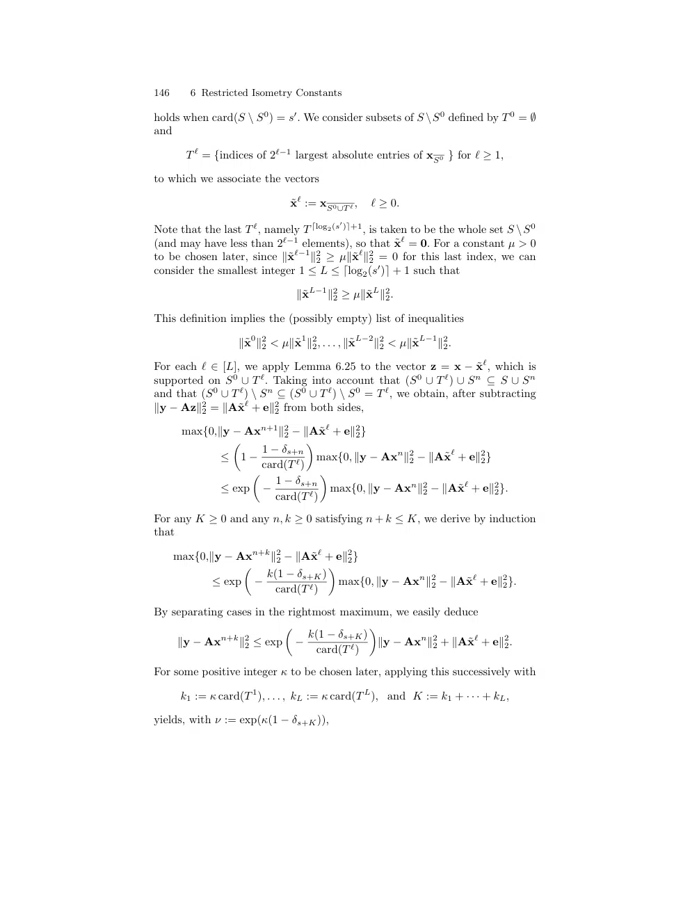

~~~text
146      6 Restricted Isometry Constants

holds when card(S \ S 0 ) = s0 . We consider subsets of S \ S 0 defined by T 0 = ∅
and

        T ` = {indices of 2`−1 largest absolute entries of xS 0 } for ` ≥ 1,

to which we associate the vectors

                                 x̃` := xS 0 ∪T ` ,    ` ≥ 0.
                                               0
Note that the last T ` , namely T dlog2 (s )e+1 , is taken to be the whole set S \ S 0
(and may have less than 2`−1 elements), so that x̃` = 0. For a constant µ > 0
to be chosen later, since kx̃`−1 k22 ≥ µkx̃` k22 = 0 for this last index, we can
consider the smallest integer 1 ≤ L ≤ dlog2 (s0 )e + 1 such that

                                   kx̃L−1 k22 ≥ µkx̃L k22 .

This definition implies the (possibly empty) list of inequalities

                    kx̃0 k22 < µkx̃1 k22 , . . . , kx̃L−2 k22 < µkx̃L−1 k22 .

For each ` ∈ [L], we apply Lemma 6.25 to the vector z = x − x̃` , which is
supported on S 0 ∪ T ` . Taking into account that (S 0 ∪ T ` ) ∪ S n ⊆ S ∪ S n
and that (S 0 ∪ T ` ) \ S n ⊆ (S 0 ∪ T ` ) \ S 0 = T ` , we obtain, after subtracting
ky − Azk22 = kAx̃` + ek22 from both sides,

       max{0,ky − Axn+1 k22 − kAx̃` + ek22 }
                               
                     1 − δs+n
              ≤ 1−                max{0, ky − Axn k22 − kAx̃` + ek22 }
                     card(T ` )
                                  
                        1 − δs+n
              ≤ exp −                max{0, ky − Axn k22 − kAx̃` + ek22 }.
                        card(T ` )
For any K ≥ 0 and any n, k ≥ 0 satisfying n + k ≤ K, we derive by induction
that

      max{0,ky − Axn+k k22 − kAx̃` + ek22 }
                                  
                     k(1 − δs+K )
             ≤ exp −                 max{0, ky − Axn k22 − kAx̃` + ek22 }.
                        card(T ` )
By separating cases in the rightmost maximum, we easily deduce
                                           
                               k(1 − δs+K )
    ky − Ax  n+k 2
                k2 ≤ exp −                    ky − Axn k22 + kAx̃` + ek22 .
                                card(T ` )
For some positive integer κ to be chosen later, applying this successively with

       k1 := κ card(T 1 ), . . . , kL := κ card(T L ), and K := k1 + · · · + kL ,

yields, with ν := exp(κ(1 − δs+K )),
~~~

## Page 159

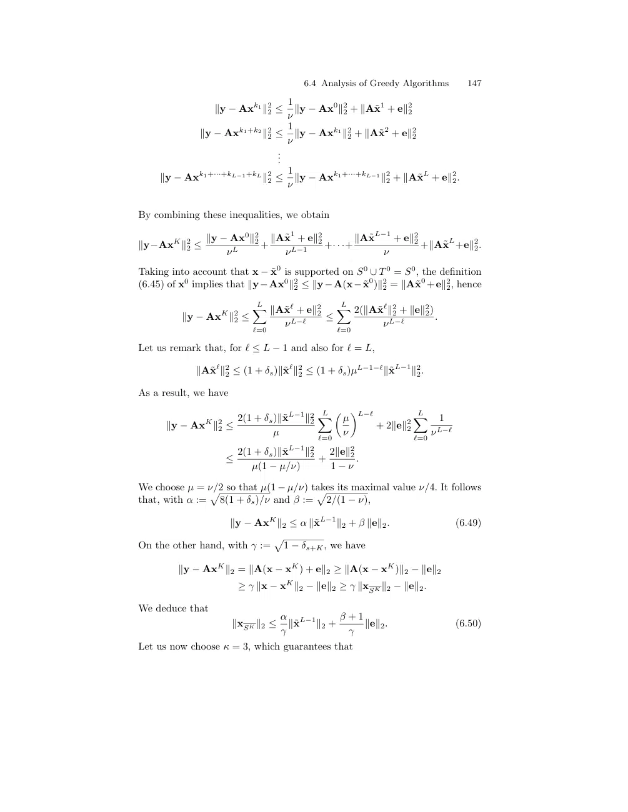

~~~text
                                          6.4 Analysis of Greedy Algorithms                147

                                   1
                  ky − Axk1 k22 ≤    ky − Ax0 k22 + kAx̃1 + ek22
                                   ν
                                   1
             ky − Axk1 +k2 k22 ≤ ky − Axk1 k22 + kAx̃2 + ek22
                                   ν
                                ..
                                 .
                                   1
     ky − Ax                 k2 ≤ ky − Axk1 +···+kL−1 k22 + kAx̃L + ek22 .
             k1 +···+kL−1 +kL 2
                                   ν

By combining these inequalities, we obtain

                ky − Ax0 k22 kAx̃1 + ek22         kAx̃L−1 + ek22
ky−AxK k22 ≤                +             +· · ·+                +kAx̃L +ek22 .
                    νL         ν L−1                    ν
Taking into account that x − x̃0 is supported on S 0 ∪ T 0 = S 0 , the definition
(6.45) of x0 implies that ky − Ax0 k22 ≤ ky − A(x − x̃0 )k22 = kAx̃0 + ek22 , hence
                            L                           L
                            X kAx̃` + ek2       2
                                                        X 2(kAx̃` k2 + kek2 )
                                                                    2        2
          ky − AxK k22 ≤                            ≤                            .
                                      ν L−`                       ν L−`
                            `=0                         `=0

Let us remark that, for ` ≤ L − 1 and also for ` = L,

             kAx̃` k22 ≤ (1 + δs )kx̃` k22 ≤ (1 + δs )µL−1−` kx̃L−1 k22 .

As a result, we have
                                             L  L−`
                                       L−1 2 X                             L
                     2(1 + δs )kx̃        k2    µ                          X         1
      ky − AxK k22 ≤                                            + 2kek22
                                  µ                      ν                       ν L−`
                                                `=0                        `=0

                         2(1 + δs )kx̃L−1 k22     2kek22
                     ≤                          +        .
                            µ(1 − µ/ν)            1−ν

               p so that µ(1 − µ/ν) takes
We choose µ = ν/2                    p its maximal value ν/4. It follows
that, with α := 8(1 + δs )/ν and β := 2/(1 − ν),

                   ky − AxK k2 ≤ α kx̃L−1 k2 + β kek2 .                                  (6.49)
                            p
On the other hand, with γ := 1 − δs+K , we have

         ky − AxK k2 = kA(x − xK ) + ek2 ≥ kA(x − xK )k2 − kek2
                         ≥ γ kx − xK k2 − kek2 ≥ γ kxS K k2 − kek2 .

We deduce that
                                      α L−1      β+1
                       kxS K k2 ≤       kx̃ k2 +     kek2 .                              (6.50)
                                      γ           γ
Let us now choose κ = 3, which guarantees that
~~~

## Page 160

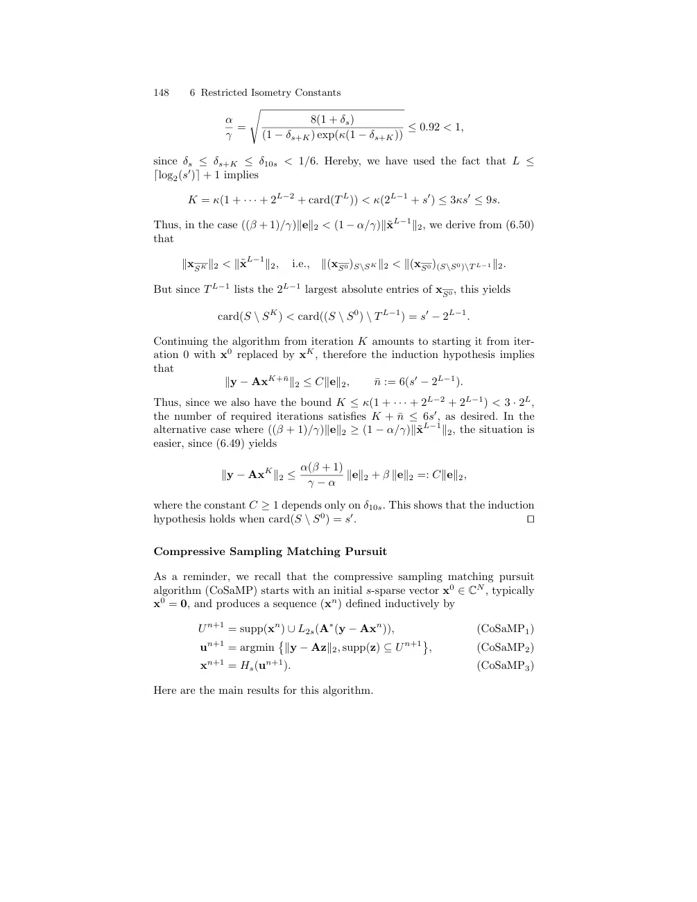

~~~text
148    6 Restricted Isometry Constants
                          s
                    α                   8(1 + δs )
                      =                                     ≤ 0.92 < 1,
                    γ         (1 − δs+K ) exp(κ(1 − δs+K ))

since δs ≤ δs+K ≤ δ10s < 1/6. Hereby, we have used the fact that L ≤
dlog2 (s0 )e + 1 implies

       K = κ(1 + · · · + 2L−2 + card(T L )) < κ(2L−1 + s0 ) ≤ 3κs0 ≤ 9s.

Thus, in the case ((β + 1)/γ)kek2 < (1 − α/γ)kx̃L−1 k2 , we derive from (6.50)
that

      kxS K k2 < kx̃L−1 k2 ,             i.e., k(xS 0 )S\S K k2 < k(xS 0 )(S\S 0 )\T L−1 k2 .

But since T L−1 lists the 2L−1 largest absolute entries of xS 0 , this yields

               card(S \ S K ) < card((S \ S 0 ) \ T L−1 ) = s0 − 2L−1 .

Continuing the algorithm from iteration K amounts to starting it from iter-
ation 0 with x0 replaced by xK , therefore the induction hypothesis implies
that
              ky − AxK+n̄ k2 ≤ Ckek2 ,      n̄ := 6(s0 − 2L−1 ).
Thus, since we also have the bound K ≤ κ(1 + · · · + 2L−2 + 2L−1 ) < 3 · 2L ,
the number of required iterations satisfies K + n̄ ≤ 6s0 , as desired. In the
alternative case where ((β + 1)/γ)kek2 ≥ (1 − α/γ)kx̃L−1 k2 , the situation is
easier, since (6.49) yields

                                           α(β + 1)
                ky − AxK k2 ≤                       kek2 + β kek2 =: Ckek2 ,
                                            γ−α
where the constant C ≥ 1 depends only on δ10s . This shows that the induction
hypothesis holds when card(S \ S 0 ) = s0 .                                 t
                                                                            u

Compressive Sampling Matching Pursuit

As a reminder, we recall that the compressive sampling matching pursuit
algorithm (CoSaMP) starts with an initial s-sparse vector x0 ∈ CN , typically
x0 = 0, and produces a sequence (xn ) defined inductively by

         U n+1 = supp(xn ) ∪ L2s (A∗ (y − Axn )),                                    (CoSaMP1 )
         un+1 = argmin ky − Azk2 , supp(z) ⊆ U n+1 ,
                        
                                                                                     (CoSaMP2 )
              n+1             n+1
          x         = Hs (u         ).                                               (CoSaMP3 )

Here are the main results for this algorithm.
~~~

## Page 161

~~~text
                                      6.4 Analysis of Greedy Algorithms     149

Theorem 6.26. Suppose that the 4sth restricted isometry constant of the ma-
trix A ∈ Cm×N satisfies
                            qp
                               11/3 − 1
                      δ4s <               ≈ 0.4782.                   (6.51)
                                 2
Then, for x ∈ CN , e ∈ Cm , and S ⊆ [N ] with card(S) = s, the sequence (xn )
defined by (CoSaMP) with y = Ax + e satisfies

                kxn − xS k2 ≤ ρn kx0 − xS k2 + τ kAxS + ek2 ,             (6.52)

where the constant 0 < ρ < 1 and τ > 0 depend only on δ4s .

    Note that, if x is s-sparse and if e = 0, then x is recovered as the limit
of the sequence (xn ). In a more general situation, there is no guarantee that
the sequence (xn ) converges. But (6.52) implies at least boundedness of the
sequence kxn k2 so that existence of cluster points is guaranteed. Stability and
robustness results can then be stated as follows.

Theorem 6.27. Suppose that the 8sth restricted isometry constant of the ma-
trix A ∈ Cm×N satisfies δ8s < 0.4782. Then, for x ∈ CN and e ∈ Cm , the
sequence (xn ) defined by (CoSaMP) with y = Ax + e, x0 = 0 and s replaced
by 2s satisfies, for any n ≥ 0,
                                        √             √
              kx − xn k1 ≤ C σs (x)1 + D s kek2 + 2 ρn s kxk2 ,
                            C
              kx − xn k2 ≤ √ σs (x)1 + D kek2 + 2 ρn kxk2 .
                             s

where the constants C, D > 0 and 0 < ρ < 1 depend only on δ8s . In particular,
if x] ∈ CN denotes a cluster point of the sequence (xn ), then
                                               √
                    kx − x] k1 ≤ C σs (x)1 + D s kek2 ,
                                  C
                    kx − x] k2 ≤ √ σs (x)1 + D kek2 .
                                    s

Remark 6.28. Similarly as in Remark 6.21(a), error estimates as for cluster
points x] apply actually to all iterates xn for n large enough provided that
the right hand side is non-trivial.

   Theorem 6.27 follows from Theorem 6.26 via Lemma 6.22 in the same way
as Theorem 6.20 follows from Theorem 6.17 for thresholding algorithms. We
therefore concentrate on establishing Theorem 6.26.

Proof (of Theorem 6.26). As in the proof of Theorem 6.17, we establish that
for any n ≥ 0,

            kxn+1 − xS k2 ≤ ρkxn − xS k2 + (1 − ρ)τ kAxS + ek2            (6.53)
~~~

## Page 162

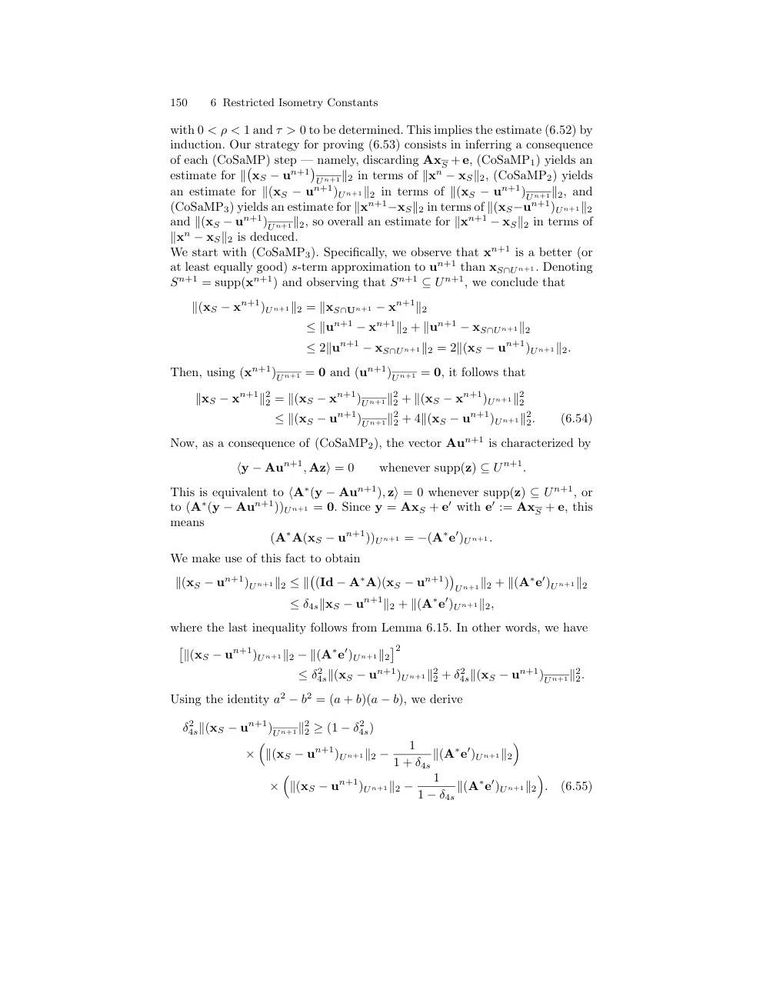

~~~text
150      6 Restricted Isometry Constants

with 0 < ρ < 1 and τ > 0 to be determined. This implies the estimate (6.52) by
induction. Our strategy for proving (6.53) consists in inferring a consequence
of each (CoSaMP) step — namely, discarding AxS + e, (CoSaMP1 ) yields an
estimate for k xS − un+1 U n+1 k2 in terms of kxn − xS k2 , (CoSaMP2 ) yields
an estimate for k(xS − un+1 )U n+1 k2 in terms of k(xS − un+1 )U n+1 k2 , and
(CoSaMP3 ) yields an estimate for kxn+1 −xS k2 in terms of k(xS −un+1 )U n+1 k2
and k(xS − un+1 )U n+1 k2 , so overall an estimate for kxn+1 − xS k2 in terms of
kxn − xS k2 is deduced.
We start with (CoSaMP3 ). Specifically, we observe that xn+1 is a better (or
at least equally good) s-term approximation to un+1 than xS∩U n+1 . Denoting
S n+1 = supp(xn+1 ) and observing that S n+1 ⊆ U n+1 , we conclude that
      k(xS − xn+1 )U n+1 k2 = kxS∩Un+1 − xn+1 k2
                           ≤ kun+1 − xn+1 k2 + kun+1 − xS∩U n+1 k2
                           ≤ 2kun+1 − xS∩U n+1 k2 = 2k(xS − un+1 )U n+1 k2 .
Then, using (xn+1 )U n+1 = 0 and (un+1 )U n+1 = 0, it follows that

      kxS − xn+1 k22 = k(xS − xn+1 )U n+1 k22 + k(xS − xn+1 )U n+1 k22
                     ≤ k(xS − un+1 )U n+1 k22 + 4k(xS − un+1 )U n+1 k22 .       (6.54)
Now, as a consequence of (CoSaMP2 ), the vector Aun+1 is characterized by
              hy − Aun+1 , Azi = 0         whenever supp(z) ⊆ U n+1 .
This is equivalent to hA∗ (y − Aun+1 ), zi = 0 whenever supp(z) ⊆ U n+1 , or
to (A∗ (y − Aun+1 ))U n+1 = 0. Since y = AxS + e0 with e0 := AxS + e, this
means
                  (A∗ A(xS − un+1 ))U n+1 = −(A∗ e0 )U n+1 .
We make use of this fact to obtain
k(xS − un+1 )U n+1 k2 ≤ k (Id − A∗ A)(xS − un+1 ) U n+1 k2 + k(A∗ e0 )U n+1 k2
                                                 

                        ≤ δ4s kxS − un+1 k2 + k(A∗ e0 )U n+1 k2 ,
where the last inequality follows from Lemma 6.15. In other words, we have
                                            2
  k(xS − un+1 )U n+1 k2 − k(A∗ e0 )U n+1 k2
 

                             2
                          ≤ δ4s k(xS − un+1 )U n+1 k22 + δ4s
                                                          2
                                                             k(xS − un+1 )U n+1 k22 .
Using the identity a2 − b2 = (a + b)(a − b), we derive
   2
  δ4s k(xS − un+1 )U n+1 k22 ≥ (1 − δ4s
                                     2
                                        )
                                            1                      
              × k(xS − un+1 )U n+1 k2 −           k(A∗ e0 )U n+1 k2
                                          1 + δ4s
                                                 1                     
                  × k(xS − un+1 )U n+1 k2 −            k(A∗ e0 )U n+1 k2 . (6.55)
                                               1 − δ4s
~~~

## Page 163

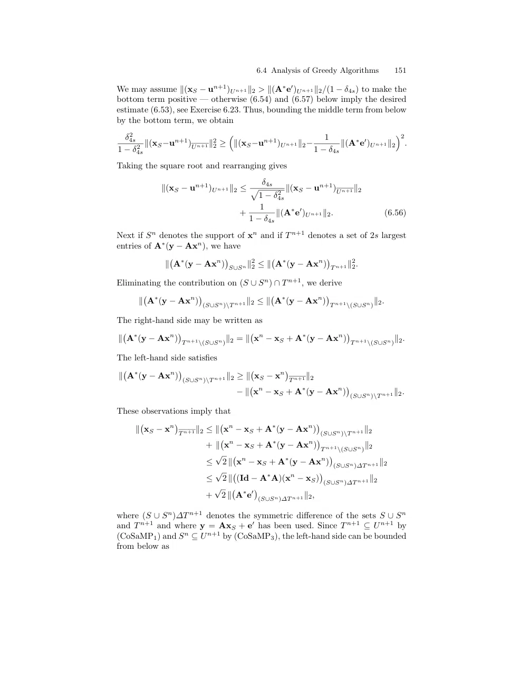

~~~text
                                        6.4 Analysis of Greedy Algorithms         151

We may assume k(xS − un+1 )U n+1 k2 > k(A∗ e0 )U n+1 k2 /(1 − δ4s ) to make the
bottom term positive — otherwise (6.54) and (6.57) below imply the desired
estimate (6.53), see Exercise 6.23. Thus, bounding the middle term from below
by the bottom term, we obtain
   2                                                                            2
  δ4s                                                    1
      2 k(xS −un+1 )U n+1 k22 ≥ k(xS −un+1 )U n+1 k2 −         k(A∗ e0 )U n+1 k2 .
1 − δ4s                                                1 − δ4s
Taking the square root and rearranging gives
                                       δ4s
            k(xS − un+1 )U n+1 k2 ≤ p       2
                                              k(xS − un+1 )U n+1 k2
                                      1 − δ4s
                                       1
                                  +         k(A∗ e0 )U n+1 k2 .                 (6.56)
                                    1 − δ4s
Next if S n denotes the support of xn and if T n+1 denotes a set of 2s largest
entries of A∗ (y − Axn ), we have

             k A∗ (y − Axn ) S∪S n k22 ≤ k A∗ (y − Axn ) T n+1 k22 .
                                                       

Eliminating the contribution on (S ∪ S n ) ∩ T n+1 , we derive

     k A∗ (y − Axn ) (S∪S n )\T n+1 k2 ≤ k A∗ (y − Axn ) T n+1 \(S∪S n ) k2 .
                                                        

The right-hand side may be written as

k A∗ (y − Axn ) T n+1 \(S∪S n ) k2 = k xn − xS + A∗ (y − Axn ) T n+1 \(S∪S n ) k2 .
                                                             

The left-hand side satisfies

k A∗ (y − Axn ) (S∪S n )\T n+1 k2 ≥ k xS − xn T n+1 k2
                                            

                                  − k xn − xS + A∗ (y − Axn ) (S∪S n )\T n+1 k2 .
                                                             

These observations imply that

    k xS − xn T n+1 k2 ≤ k xn − xS + A∗ (y − Axn ) (S∪S n )\T n+1 k2
                                                      

                       + k xn − xS + A∗ (y − Axn ) T n+1 \(S∪S n ) k2
                                                       
                         √
                       ≤ 2 k xn − xS + A∗ (y − Axn ) (S∪S n )∆T n+1 k2
                                                          
                         √
                       ≤ 2 k (Id − A∗ A)(xn − xS ) (S∪S n )∆T n+1 k2
                                                        
                         √
                       + 2 k A∗ e0 (S∪S n )∆T n+1 k2 ,
                                  

where (S ∪ S n )∆T n+1 denotes the symmetric difference of the sets S ∪ S n
and T n+1 and where y = AxS + e0 has been used. Since T n+1 ⊆ U n+1 by
(CoSaMP1 ) and S n ⊆ U n+1 by (CoSaMP3 ), the left-hand side can be bounded
from below as
~~~

## Page 164

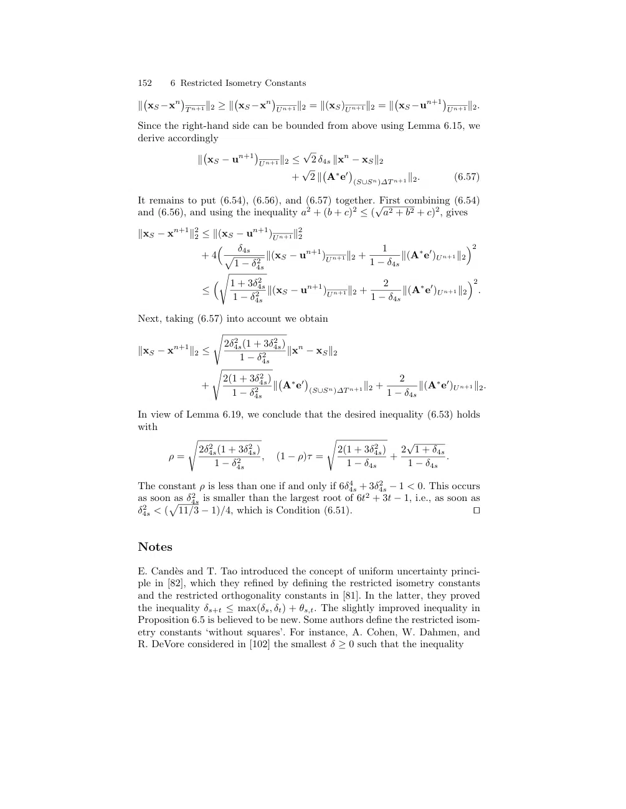

~~~text
152     6 Restricted Isometry Constants

k xS −xn T n+1 k2 ≥ k xS −xn U n+1 k2 = k(xS )U n+1 k2 = k xS −un+1 U n+1 k2 .
                                                                 

Since the right-hand side can be bounded from above using Lemma 6.15, we
derive accordingly
                                    √
              k xS − un+1 U n+1 k2 ≤ 2 δ4s kxn − xS k2
                          
                                    √
                                   + 2 k A∗ e0 (S∪S n )∆T n+1 k2 .
                                              
                                                                   (6.57)

It remains to put (6.54), (6.56), and (6.57) together.√First combining (6.54)
and (6.56), and using the inequality a2 + (b + c)2 ≤ ( a2 + b2 + c)2 , gives

kxS − xn+1 k22 ≤ k(xS − un+1 )U n+1 k22
                   δ                                       1                      2
                       4s               n+1                          ∗ 0
               +4 p           k(xS  − u     ) U n+1 k2 +         k(A  e  )U n+1 k2
                          2
                     1 − δ4s                             1 − δ4s
                  s
                  1 + 3δ 2                                 2                       2
                           4s           n+1                          ∗ 0
               ≤          2   k(x S −  u    )       k
                                              U n+1 2
                                                       +         k(A  e  ) U n+1 k2    .
                     1 − δ4s                             1 − δ4s

Next, taking (6.57) into account we obtain
                 s
                      2 (1 + 3δ 2 )
                   2δ4s
        n+1
kxS − x     k2 ≤              2
                                 4s
                                    kxn − xS k2
                        1 − δ4s
                 s
                   2(1 + 3δ4s2 )                                2
                                 k A∗ e0 (S∪S n )∆T n+1 k2 +         k(A∗ e0 )U n+1 k2 .
                                        
               +           2
                      1 − δ4s                                1 − δ4s

In view of Lemma 6.19, we conclude that the desired inequality (6.53) holds
with
           s
               2 (1 + 3δ 2 )
                                          s
                                                    2 )
                                                           √
             2δ4s       4s                  2(1 + 3δ4s    2 1 + δ4s
       ρ=            2       , (1 − ρ)τ =               +           .
                1 − δ4s                       1 − δ4s      1 − δ4s
                                                 4      2
The constant ρ is less than one if and only if 6δ4s + 3δ4s − 1 < 0. This occurs
            2                                        2
as soonpas δ4s is smaller than the largest root of 6t + 3t − 1, i.e., as soon as
 2
δ4s < ( 11/3 − 1)/4, which is Condition (6.51).                               t
                                                                              u

Notes
E. Candès and T. Tao introduced the concept of uniform uncertainty princi-
ple in [82], which they refined by defining the restricted isometry constants
and the restricted orthogonality constants in [81]. In the latter, they proved
the inequality δs+t ≤ max(δs , δt ) + θs,t . The slightly improved inequality in
Proposition 6.5 is believed to be new. Some authors define the restricted isom-
etry constants ‘without squares’. For instance, A. Cohen, W. Dahmen, and
R. DeVore considered in [102] the smallest δ ≥ 0 such that the inequality
~~~

## Page 165

~~~text
                                       6.4 Analysis of Greedy Algorithms      153

                     (1 − δ)kxk2 ≤ kAxk2 ≤ (1 + δ)kxk2

holds for all s-sparse vectors x ∈ CN . Up to transformation of the constants,
this is of course essentially equivalent to our definition.
    E. Candès and T. Tao showed in [81] that the condition δ2s + δ3s < 1 guar-
antees exact s-sparse recovery via `1 -minimization. E. Candès, J. Romberg,
and T. Tao further showed in [80] that the condition δ3s + 3δ4s < 2 guaran-
tees stable and robust s-sparse recovery via `1 -minimization. Later, a sufficient
condition for stable and robust s-sparse recovery
                                                √     involving only δ2s was ob-
tained by E. Candès in [70], namely δ2s < 2 − 1 ≈ 0.414. This sufficient
condition was improved several times, see [184, 69, 179, 68, 305]. Exercises
6.12 through 6.15 retrace some of these improvements. Central to some of
these improvements is the shifting inequality — see Exercise 6.14 — put for-
ward by T. Cai, L. Wang, and G. Xu in [69]. They also introduced the square
root lifting inequality of Lemma 6.13 in [68]. The condition δ2s < 0.4931 of
Theorem 6.11 is the best available so far. It is due to Q. Mo and S. Li in [305].
On the other hand, M. Davies and R. Gribonval constructed in     √ [120] matrices
with restricted isometry constant δ2s arbitrarily close to 1/ 2 ≈ 0.707 for
which some s-sparse vectors are not recovered via `1 -minimization. The nat-
ural proof of Theorem 6.8, with the sufficient condition δ2s < 1/3, does not
seem to have appeared before. We point out that other sufficient conditions
involving δk with k 6= 2s can also be found, see for instance Exercises 6.13,
6.15, and 6.16. As a matter of fact, J. Blanchard and A. Thompson argue
that the parameter 2s is not the best choice for Gaussian random matrices,
see [44]. Theorem 6.7, which appeared in [180], has to be kept in mind when
assessing such conditions.
    The use of the iterative hard thresholding algorithm in the context of
Compressive Sensing was initiated by T. Blumensath and M. Davies in [46].
In [47], they established
                √          stable and robust estimates under the sufficient con-
dition δ3s < 1/ 8. The weaker condition δ3s √   < 1/2 of Theorem 6.14 appeared
in [181]. The improved condition δ3s < 1/ 3 of Theorem 6.17 was estab-
lished in the paper [180] dedicated to the analysis of the hard thresholding
pursuit algorithm. There, Theorem 6.17 was in fact established for a family of
thresholding algorithms indexed by an integer k, with iterative hard thresh-
olding and hard thresholding pursuit corresponding to the cases k = 0 and
k = ∞, respectively. Exercise 6.19, which considers a variation of the iterative
hard thresholding algorithm where a factor µ 6= 1 is introduced in front of
A∗ (y − Axn ), is inspired by the paper [188] by R. Garg and R. Khandekar.
This factor µ may be dependent on n in some algorithms, notably in the
normalized iterative hard thresholding algorithm of T. Blumensath and M.
Davies [48].
    The impossibility of s-sparse recovery via s iterations of Orthogonal
Matching Pursuit under a standard restricted isometry condition was first
observed in [131, Section 7], see also [353]. The example given at the begin-
ning of Section 6.4 is taken from the article [306] by Q. Mo and Y. Shen,
~~~

## Page 166

~~~text
154    6 Restricted Isometry Constants

who also established the result of Exercise 6.21. The possibility of s-sparse
recovery via a number of iterations of orthogonal matching pursuit that is
proportional to s was shown in [451] by T. Zhang, who also proved the sta-
bility and robustness of the recovery by establishing Proposition 6.23 with
n̄ = 30 card(supp(x) \ S 0 ) under the condition δ31s < 1/3. Our proof follows
his argument, which is also valid in more general settings.
     In the original article [312] of D. Needell and J. Tropp introducing the
compressive sampling matching pursuit algorithm, stability and robustness
were stated under the condition δ4s ≤ 0.1, although the arguments actually
yield the condition δ4s < 0.17157. Theorem 6.26, which gives the condition
δ4s < 0.4782, appears here for the first time. The first analysis of a greedy
algorithm under the restricted isometry property appeared in [313, 314] for
the regularized orthogonal matching pursuit algorithm where, however, an
additional ln(N )-factor appeared in the condition on the restricted isometry
constant. The Subspace Pursuit algorithm of W. Dai and O. Milenkovic was
also proved to be stable and robust under some restricted isometry conditions.
We refer to the original paper [110] for details.
     We mentioned at the end of Section 6.1 that the most of the available
bounds of the restricted isometry property for explicit (deterministic) ma-
trix constructions are based on the coherence and therefore the number m of
required samples scales quadratically in the sparsity s, see also (6.14). A no-
table exception is a sophisticated explicit matrix construction by J. Bourgain,
S. Dilworth, K. Ford, S. Konyagin and D. Kutzarova [53], see also [54]. The
authors showed that their matrix A ∈ Cm×N has small restricted isometry
constants δs once m ≥ Cs2−ε and when s2−ε <≤ N ≤ s2+ε for some ε > 0.
While this slightly overcomes the quadratic bottleneck, this range of s, m, N
is too limited in order to make it relevant for practical purposes. Nevertheless,
it is certainly a very important contribution to the theory.

Exercises
6.1. Suppose that A ∈ Cm×N has an sth order restricted isometry constant
satisfying δs < 1. Prove that, for any S ⊆ [N ] with card(S) ≤ s,
  1                          1                       1                    1
       ≤ (A∗S AS )−1 2→2 ≤               and   √          ≤ A†S 2→2 ≤ √        .
1 + δs                     1 − δs                  1 + δs               1 − δs

6.2. Given A ∈ Cm×N , let αs and βs be the largest and smallest positive
constants α and β such that

                          α kxk22 ≤ kAxk22 ≤ β kxk22

for all s-sparse vectors x ∈ CN . Find the scaling factor t > 0 for which δs (tA)
takes its minimal value, and prove that this value equals (β − α)/(β + α).
~~~

## Page 167

~~~text
                                         6.4 Analysis of Greedy Algorithms       155

6.3. Find a matrix A ∈ R2×3 with minimal 2nd order restricted isometry
constant.
6.4. Prove the equivalence of the two definitions (6.4) and (6.5) of restricted
orthogonality constants.
6.5. Verify in details that the function f defined on [0, 1] as in (6.6) is first
nondecreasing, then nonincreasing.
6.6. Given x ∈ CN and A ∈ Cm×N with sth restricted isometry constant δs ,
prove that
                           p              kxk1 
                   kAxk2 ≤ 1 + δs kxk2 + √        .
                                               s
6.7. Let Ds,N = {x ∈ CN : kxk2 ≤ 1, kxk0 ≤ s} be the Euclidean unit ball
restricted to the s-sparse vectors. Show that
                                     √
             Ds,N ⊂ conv(Ds,N ) ⊂ sB1N ∩ B2N ⊂ 2 conv(Ds,N ) ,
where BpN = {x ∈ CN : kxkp ≤ 1} is the unit ball in `p and conv denotes the
convex hull, see Definition B.2.
6.8. Prove Proposition 6.3 directly from (6.1), without using (6.2) but rather
with the help of the polarization formula
                                  1
                     Rehx, yi = kx + yk22 − kx − yk22 .
                                                          
                                  4
6.9. In the case t = ns where t is a multiple of s, improve the second inequality
of Proposition 6.6 by showing that
                              δns ≤ (n − 1)θs,s + δs .
6.10. Suppose that the columns of the matrix A ∈ Cm×N are `2 -normalized.
Under the assumption N > s2 + 1, derive the result of Theorem 6.7 with
constants c = 1/2, C = 2, and without restriction on δ∗ . Use Theorem 5.8,
Exercise 5.3, and compare the matrix norms induced by the `2 and the `1
norms.
6.11. Refine the proof of Theorem 6.8 in order to establish the stability and
robustness of s-sparse recovery via basis pursuit when δ2s < 1/3.
6.12. Let A ∈ Cm×N , and let S0 , S1 , S2 , . . . denote index sets of size s ordered
by decreasing modulus of entries of a vector v ∈ ker A. Prove that
                                 2δ2s X
         kvS0 k22 + kvS1 k22 ≤               kvSk k2 (kvS0 k2 + kvS1 k2 ).
                               1 − δ2s
                                        k≥2

By interpreting this as the equation of a disk or by completing squares, deduce
that                                                    √
                        ρ                           1 + 2 δ2s
            kvS0 k2 ≤ √ kvS0 k1 ,       where ρ :=                 .
                         s                             2   1 − δ2s
Conclude that s-sparse recovery via basis pursuit is guaranteed if δ2s < 0.453.
~~~

## Page 168

~~~text
156     6 Restricted Isometry Constants

6.13. For an integer k ≥ 1,√suppose that A ∈ Cm×N has restricted isometry
constant δ(2k+1)s < 1 − 1/ 2k. Prove that every s-sparse vector x ∈ CN can
be recovered from y = Ax ∈ Cm via `1 -minimization. [Hint: to establish the
null space property, partition [N ] as S ∪ T1 ∪ T2 ∪ . . ., where S has size s and
T1 , T2 , . . . have size ks.]

6.14. Given a1 ≥ a2 ≥ · · · ≥ ak+` ≥ 0, prove the shifting inequality
q                                                                    1   1 
  a2`+1 + · · · + a2`+k ≤ ck,` (a1 + · · · + ak ), where ck,` := max √ , √    .
                                                                       k   4`

6.15. Suppose that s =: 4r is a multiple of 4. For a matrix A ∈ Cm×N ,
establish the success of s-sparse recovery via basis pursuit if p
                                                                δ5r + θ5r,s < 1.
Show in particular that this holds if δ9s/4 < 0.5, δ2s < 1/(1 + 5/4) ≈ 0.472,
                  p
or δ5s/4 < 1/(1 + 10/3) ≈ 0.353.

6.16. Using the square root lifting inequality of Lemma 6.13, find a condition
on δs that guarantees the exact recovery of every s-sparse vector via basis
pursuit.

6.17. Refine the proof of Theorem 6.14 in order to establish the stability and
robustness of s-sparse recovery via iterative hard thresholding when δ3s < 1/3.

6.18. Given A ∈ Cm×N , prove that every s-sparse vector x ∈ CN is exactly
recovered from y = Ax ∈ Cm via iterative hard thresholding if δ2s < 1/4. To
do so, return to the proof of Theorem 6.14 , precisely to (6.32), and separate
the contributions to the inner product from the index sets of size 2s given by

  (S ∪ S n ) ∩ (S ∪ S n+1 ),   (S ∪ S n ) \ (S ∪ S n+1 ),   (S ∪ S n+1 ) \ (S ∪ S n ),

where S := supp(x), S n := supp(xn ), and S n+1 := supp(xn+1 ).

6.19. Given A ∈ Cm×N and y = Ax ∈ Cm for some s-sparse x ∈ CN , we
define a sequence (xn ) inductively, starting with an initial s-sparse vector
x0 ∈ CN , by

                 xn+1 = Hs (xn + µ A∗ (y − Axn )),            n ≥ 0,

where the constant µ is to be determined later. Establish the identity

      kA(xn+1 − x)k22 − kA(xn − x)k22
                       = kA(xn+1 − xn )k22 + 2hxn − xn+1 , A∗ A(x − xn )i.

Prove also the inequality

        2µhxn − xn+1 , A∗ A(x − xn )i
                       ≤ kxn − xk22 − 2µkA(xn − x)k22 − kxn+1 − xn k22 .
~~~

## Page 169

~~~text
                                       6.4 Analysis of Greedy Algorithms      157

With δ2s denoting the 2sth order restricted isometry constant of A, derive
the inequality
                                        1      
            kA(xn+1 − x)k22 ≤ 1 −                 kA(xn+1 − xn )k22
                                    µ(1 + δ2s )
                                   1           
                            +               − 1 kA(xn − x)k22 .
                                µ(1 − δ2s )

Deduce that the sequence (xn ) converges to x when 1+δ2s < 1/µ < 2(1−δ2s ).
Conclude by justifying the choice µ = 3/4 under the condition δ2s < 1/3.

6.20. Verify the claims made at the beginning of Section 6.4 about the matrix
A defined in (6.44).

6.21. Prove that every s-sparse vector x ∈ CN can be recovered from
y = Ax ∈ Cm via s iterations of Orthogonal Matching Pursuit provided
the restricted isometry constant of A satisfies
                                             1
                                 δs+1 < √       .
                                            s+1
6.22. Improve Lemma 6.23 in the case e = 0 by reducing the number of
required iterations and by weakening the restricted isometry condition.

6.23. Verify that k(xS − un+1 )U n+1 k2 > k(A∗ e0 )U n+1 k2 /(1 − δ4s ) can indeed
be assumed after (6.55) in the proof of Theorem 6.26.

6.24. Rank Restricted Isometry Property.
Let A : Cn1 ×n2 → Cm be a linear map. For r ≤ min{n1 , n2 } the rank re-
stricted isometry constant δr = δr (A) is the defined as the smallest number
such that
                 (1 − δr )kXk2F ≤ kA(X)k22 ≤ (1 + δr )kXk2F
for all matrix X ∈ Cn1 ×n2 of rank at most r.
(a) Let X, Z ∈ Cn1 ×n2 with hX, ZiF = tr (XZ∗ ) = 0 and rank(X)+rank(Z) ≤
    r. Show that
                        |hA(X), A(Z)i| ≤ δr kXkF kZkF .
(b) Assume that δ2r < 1/3. Show that A possesses the rank null space property
    of order r defined by (4.44). In particular, every X ∈ Cn1 ×n2 of rank at
    most r is the unique solution to the nuclear norm minimization problem
    (see also Section 4.5)

                      min      kZk∗   subject to A(Z) = A(X) .
                   Z∈Cn1 ×n2

(c) Assume that δ2r < 0.4931. Let X ∈ Cn1 ×n2 and y = A(X) + e with
    kek2 ≤ 1. Let X] be the solution to the quadratically constraint nuclear
    norm minimization problem
~~~

## Page 170

~~~text
158      6 Restricted Isometry Constants

                      min      kZk∗   subject to kA(Z) − yk2 ≤ η .
                   Z∈Cn1 ×n2

      Show that
                                           min{n1 ,n2 }
                                   C1         X
                      kX − X] kF ≤ √                      σ` (X) + C2 η
                                     r
                                             `=r+1

      for appropriate constants C1 , C2 > 0 depending only on δ2r .
~~~

## Page 171

~~~text
7
Basic Tools from Probability Theory

The major breakthrough in proving recovery results in compressive sensing
is obtained using random matrices. Most parts of the remainder of this book
indeed requires tools from probability theory. This and the next chapter are
therefore somewhat exceptional in the sense that they do not deal directly with
compressive sensing. Instead, we rather collect the necessary background ma-
terial from probability theory. In this chapter we introduce a first set of tools
that will be sufficient to understand a large part of the theory in connection
with sparse recovery and random matrices. More advanced tools that will be
used only in parts of the remainder of the book are postponed to Chapter 8.
    We only assume that the reader has basic knowledge of probability theory
as can be found in most introductory textbooks on the subject. We recall
the most basic facts of probability in Section 7.1. The relation of moments of
random variables to their tails is presented in Section 7.2. Then in Section 7.3
we study deviation inequalities for sums of independent random variables by
means of moment generating function. Cramér’s theorem gives a very general
estimate from which we deduce Hoeffding’s inequality, and later in Section
7.5 Bernstein’s inequality for bounded and subgaussian random variables. We
introduce the latter in Section 7.4.
    The theory presented in this chapter will be sufficient to follow Sections
9.1 and 9.2, Chapter 11, and Chapter 14. For the remaining parts of Chapter
9 as well as for Chapters 12 and 13 more advanced tools from probability
theory will be required, which will be introduced in Chapter 8.

7.1 Essentials from Probability
In this section we recall some important facts from basic probability theory,
and prove simple statements that might not be found in all basic textbooks.
    Let (Ω, Σ, P) be a probability space, where Σ denotes a σ-algebra on the
sample space Ω and P a probability measure on (Ω, Σ). The probability of an
event B ∈ Σ is denoted by
~~~

## Page 172

~~~text
160    7 Basic Tools from Probability Theory
                             Z                  Z
                    P(B) =        dP(ω) =             IB (ω)dP(ω) ,
                              B                  Ω

where the characteristic function IB (ω) takes the value 1 if ω ∈ B and 0
otherwise. The union bound (or Bonferroni’s inequality, or Boole’s inequality)
states that for a collection of events B` ∈ Σ, ` = 1, . . . , n, we have
                                 n
                                      !    n
                                [         X
                            P      B` ≤      P(B` ) .                    (7.1)
                             `=1                `=1

    A random variable X is a real-valued measurable function on (Ω, Σ). Re-
call that X is called measurable if the preimage X −1 (A) = {ω ∈ Ω : X(Ω) ∈
A} is contained in Σ for all Borel measurable subsets A ⊂ R. Usually, every
reasonable function X will be measurable; in particular, all functions appear-
ing in this book. In what follows we will usually not mention the underlying
probability space (Ω, Σ, P) when speaking about random variables. The dis-
tribution function F = FX of X is defined as

                         F (t) = P(X ≤ t),             t∈R.

A random variable X possesses a probability density function φ : R → R+ if
                              Z b
              P(a < X ≤ b) =      φ(t)dt for all a < b ∈ R .          (7.2)
                                   a

            d
Then φ(t) = dt F (t). The expectation or mean of a random variable will be
denoted by                       Z
                           EX =            X(ω)dP(ω) .
                                       Ω
If X has probability density function φ then for a function g : R → R,
                                    Z ∞
                          Eg(X) =        g(t)φ(t)dt                    (7.3)
                                           −∞

whenever the integral exists. The quantities EX p , p > 0 are called moments
of X, while E|X|p are called absolute moments. (Sometimes we may omit
“absolute”.) The quantity E(X − EX)2 = EX 2 − (EX)2 is called variance.
                         1/p
For 1 ≤ p < ∞, (E|X|p )       defines a norm on the Lp (Ω, P)-space of all p-
integrable random variables, in particular, the triangle inequality

                 (E|X + Y |p )1/p ≤ (E|X|p )1/p + (E|Y |p )1/p           (7.4)

holds for all p-integrable random variables X, Y on (Ω, Σ, P).
   Hölder’s inequality states that, for random variables X, Y on a common
probability space and p, q ≥ 1 with 1/p + 1/q = 1, we have
                                             1/q            1/q
                      |EXY | ≤ (E|X|p )             (E|Y |q )     .
~~~

## Page 173

~~~text
                                                7.1 Essentials from Probability    161

The special case p = q = 2 is the Cauchy-Schwarz inequality,
                                    p
                          |EXY | ≤ E|X|2 E|Y |2 .

Since the constant (deterministic) random variable 1 has expectation E1 = 1,
                                                                  1/r
Hölder’s inequality shows that E|X|p = E[1 × |X|p ] ≤ (E|X|pr )      for all
p > 0, r ≥ 1 and therefore, for all 0 < p ≤ q < ∞,
                                       1/p                  1/q
                            (E|X|p )         ≤ (E|X|q )           .               (7.5)

   Let Xn , n ∈ N, be a sequence of random variables such that Xn converges
to X as n → ∞ in the sense that limn→∞ Xn (ω) = X(ω) for all ω. Lebesgue’s
dominated convergence theorem states that if there exists a random variable Y
with E|Y | < ∞ such that |Xn | ≤ |Y | a.s. then limn→∞ EXn = EX. Lebesgue’s
dominated convergence theorem has as well an obvious formulation for inte-
grals of sequences of functions.
   Fubini’s theorem on the integration of functions of two variables can be
formulated as follows. Let f : AR× B → C be measurable, where (A, ν) and
(B, µ) are measurable spaces. If A×B |f (x, y)|d(ν ⊗ µ)(x, y) < ∞ then
         Z Z                           Z Z                  
                 f (x, y)dµ(y) dν(x) =            f (x, y)dµ(x) dµ(y) .
         A    B                                 B       A

A formulation for expectations of functions of independent random vectors is
provided below in (7.15).
   Absolute moments can be computed by means of the following formula.
Proposition 7.1. The absolute moments of a random variable X can be ex-
pressed as               Z         ∞
                  E|X|p = p            P(|X| ≥ t)tp−1 dt,             p>0.
                               0

Proof. Recall that I{|X|p ≥x} is the random variable that takes the value 1 on
the event |X|p ≥ x and 0 otherwise. Using Fubini’s theorem we derive
                Z             Z Z |X|p           Z Z ∞
       E|X|p =     |X|p dP =            1dxdP =          I{|X|p ≥x} dxdP
                 Ω              Ω 0               Ω 0
                Z ∞Z                      Z ∞
             =          I{|X|p ≥x} dPdx =     P(|X|p ≥ x)dx
                 0
                  Z ∞Ω                     0
                                              Z ∞
                            p     p p−1
             =p       P(|X| ≥ t )t dt = p         P(|X| ≥ t)tp−1 dt ,
                  0                                     0

where we also applied a change of variables.                                         t
                                                                                     u
Corollary 7.2. For a random variable X the expectation satisfies
                     Z ∞              Z ∞
               EX =      P(X ≥ t)dt −      P(X ≤ −t)dt .
                        0                           0
~~~

## Page 174

~~~text
162      7 Basic Tools from Probability Theory

Proof. We can write X = XI{X∈[0,∞)} + XI{X∈(−∞,0)} so that

                  EX = EXI{X∈[0,∞)} − E(−XI{−X∈(0,∞)} ).

Both XI{X∈[0,∞)} and −XI{−X∈(0,∞)} are positive random variables, so that
an application of Proposition 7.1 shows the statement.

The function t 7→ P(|X| ≥ t) is called the tail of X. A simple but often
effective tool to estimate the tail by expectations and moments is the Markov
inequality.
Theorem 7.3. Let X be a random variable. Then
                                      E|X|
                       P(|X| ≥ t) ≤          for all t > 0 .
                                        t
Proof. Note that P(|X| ≥ t) = EI{|X|≥t} and tI{|X|≥t} ≤ |X|. Hence,
tP(|X| ≥ t) = EtI{|X|≥t} ≤ E|X| and the proof is complete.       t
                                                                 u

Remark 7.4. As an important consequence we note that for p > 0

             P(|X| ≥ t) = P(|X|p ≥ tp ) ≤ t−p E|X|p ,   for all t > 0 .

The special case p = 2 is referred to as the Chebyshev inequality. Similarly,
for θ > 0 we obtain

 P(X ≥ t) = P(exp(θX) ≥ exp(θt)) ≤ exp(−θt)E exp(θX),             for all t ∈ R .

The function θ 7→ E exp(θX) is usually called the Laplace transform or the
moment generating function of X.

      The median of a random variable X is a number M such that

                 P(X ≥ M ) ≥ 1/2      and    P(X ≤ M ) ≥ 1/2 .

   The binomial distribution is the discrete probability distribution counting
the number of successes in a sequence of N independent experiments where the
probability of each individual success is p. If X has the binomial distribution
then                                
                                     N
                      P(X = k) =          pk (1 − p)N −k .
                                     k
The expectation of X is given by EX = pN . If pN is an integer then the
median M = M (X) coincides with the expection,

                                 M (X) = pN .                                (7.6)

   A normal distributed random variable or Gaussian random variable X has
probability density function
~~~

## Page 175

~~~text
                                            7.1 Essentials from Probability       163

                                             (t − µ)2
                                                     
                                 1
                      ψ(t) = √         exp −            .                        (7.7)
                                 2πσ 2          2σ 2

It has mean EX = µ and variance E(X − µ)2 = σ 2 . A standard Gaussian
random variable (or standard normal or simply standard Gaussian), usually
denoted g, is a Gaussian random variable with Eg = 0 and Eg 2 = 1. Its tail
satisfies the following simple estimates.

Proposition 7.5. Let g be a standard Gaussian random variable. Then, for
all u > 0,

                 P(|g| ≥ u) ≤ exp(−u2 /2) ,                                      (7.8)
                              r          2
                                21           u
                 P(|g| ≥ u) ≤      exp −         ,                               (7.9)
                                πu            2
                              r                   2
                                21          1        u
                 P(|g| ≥ u) ≥        1 − 2 exp −         ,
                                πu        u          2
                                   r !           2
                                     2             u
                 P(|g| ≥ u) ≥ 1 −      u exp −         .
                                     π             2

Proof. By (7.7) we have
                                            Z ∞
                                    2                2
                      P(|g| ≥ u) = √              e−t /2 dt .                   (7.10)
                                     2π      u

Therefore, the stated estimates follow from Lemma C.8 and C.9.                      t
                                                                                    u

   Let us compute the moment generating function of a standard Gaussian.

Lemma 7.6. Let g be a standard Gaussian random variable. Then, for θ ∈ R,

                        E exp(θg) = exp θ2 /2 ,
                                             
                                                                   (7.11)

and more generally, for θ ∈ R, a < 1/2,

                                                            θ2
                                                                   
                                         1
                E exp(ag 2 + θg) = √          exp                       .
                                       1 − 2a           2(1 − 2a)

Proof. For θ, a ∈ R, we have
                                     Z ∞
                           1
       E exp(ag 2 + θg) = √                exp(ax2 + θx) exp −x2 /2 dx
                                                                  
                            2π       −∞

Noting the identity
                                                        2
            2    2          1 − 2a                θ                   θ
         ax − x /2 + θx = −                 x−                −             .
                               2               1 − 2a             2(1 − 2a)
~~~

## Page 176

~~~text
164    7 Basic Tools from Probability Theory

After a change of variable, the latter integral reduces to the integral of the
normal probability density function, so it equals one. We deduce that
                                    2
                                     θ
                E (exp(θg)) = exp               for all θ ∈ R ,         (7.12)
                                      2
which proves the statement.                                                                t
                                                                                           u
The proof of the next result should explain the terminology moment generating
function.
Corollary 7.7. The even moments of a standard Gaussian random variable
g are given by
                               (2n)!
                        Eg 2n = n , n ∈ N .
                                2 n!
Proof. On the one hand, by Taylor expansion we can write the moment gen-
erating function as
                                    ∞                   ∞
                                    X θj E[g j ]        X θ2n Eg 2n
                    E exp(θg) =                     =                     ,
                                    j=0
                                             j!         n=0
                                                                 (2n)!

where we have used that Eg j = 0 for all odd j. On the other hand, Lemma
7.6 gives
                                              ∞
                                             X   θ2n
                   E exp(θg) = exp(θ2 /2) =            .
                                             n=0
                                                 2n n!
Comparing coefficients gives
                                     Eg 2n   1
                                           = n ,
                                     (2n)!  2 n!
which is equivalent to the claim.                                                          t
                                                                                           u
    A random vector X = [X1 , . . . , Xn ]> ∈ Rn is a collection of n random
variables on a common probability space (Ω, Σ, P). Its expectation is the
vector EX = [EX1 , . . . , EXn ]> ∈ Rn , while its joint distribution function is
defined as

         F (t1 , . . . , tn ) = P(X1 ≤ t1 , . . . , Xn ≤ tn ),     t1 , . . . , tn ∈ R .

Similarly to the univariate case, the random vector X has a joint probability
density if there exists a function φ : Rn → [0, 1] such that for any measurable
domain D ⊂ Rn
                                  Z
                    P(X ∈ D) =       φ(t1 , . . . , tn )dt1 · · · dtn .
                                       D

A complex random vector Z = X + iY ∈ Cn is a special case of a 2n-
dimensional real random vector (X, Y) ∈ R2n .
~~~

## Page 177

~~~text
                                                 7.1 Essentials from Probability     165

   A collection of random variables X1 , . . . , Xn is (stochastically) indepen-
dent if, for all t1 , . . . , tn ∈ R,
                                                       n
                                                       Y
                  P(X1 ≤ t1 , . . . , Xn ≤ tn ) =            P(X` ≤ t` ) .
                                                       `=1

For independent random variables, we have
                         " n      #    n
                           Y          Y
                       E      X` =       E [X` ] .                                 (7.13)
                                 `=1            `=1

If they have a joint probability density function φ then the latter factorizes as

                      φ(t1 , . . . , tn ) = φ1 (t1 ) × · · · × φn (tn )

where the φ1 , . . . , φn are the probability density functions of X1 , . . . , Xn .
   In generalization, a collection X1 ∈ Rn1 , . . . , Xm ∈ Rnm of random vectors
are independent if for any collection of measurable sets A` ⊂ Rn` , ` ∈ [m],
                                                       m
                                                       Y
                P(X1 ∈ A1 , . . . , Xm ∈ Am ) =              P(X` ∈ A` ) .
                                                       `=1

If furthermore f` : Rn` → RN` , ` = 1, . . . , m, are measurable functions then
also the random vectors f1 (X1 ), . . . , fm (Xm ) are independent. A collection
X1 , . . . , Xm ∈ Rn of independent random vectors that all have the same
distribution is called independent identically distributed (i.i.d.).
    A random vector X0 will be called an independent copy of X if X and X0
are independent and have the same distribution.
    The sum X + Y of two independent random variables X, Y having proba-
bility density functions φX , φY , has probability density function φX+Y given
by the convolution
                                            Z ∞
                φX+Y (t) = (φX ∗ φY )(t) =      φX (u)φY (t − u)du .      (7.14)
                                                  −∞

   Fubini’s theorem for expectations takes the following form. Let X, Y ∈ Rn
be two independent random vectors (or simply random variables) and f :
Rn × Rn → R be a measurable function such that E|f (X, Y)| < ∞. Then the
functions

    f1 : Rn → R, f1 (x) = Ef (x, Y),              f2 : Rn → R, f2 (y) = Ef (X, y)

are measurable, E|f1 (X)| < ∞ and E|f2 (Y)| < ∞ and

                        Ef1 (X) = Ef2 (Y) = Ef (X, Y) .                            (7.15)

The random variable f1 (X) is also called conditional expectation or expecta-
tion conditional on X and will sometimes be denoted by EY f (X, Y).
~~~

## Page 178

~~~text
166     7 Basic Tools from Probability Theory

    A random vector g ∈ Rn is called a standard Gaussian vector if its com-
ponents are independent standard normal distributed random variables. More
generally, a random vector X ∈ Rn is said to be a Gaussian vector or mul-
tivariate normal distributed if there exists a matrix A ∈ Rn×k such that
X = Ag + µ, where g ∈ Rk is a standard Gaussian vector and µ ∈ Rn is the
mean of X. The matrix Σ = AA∗ is then the covariance matrix of X, i.e.,
Σ = E(X − µ)(X − µ)> . If Σ is non-degenerate, i.e., Σ is positive definite,
then X has a joint probability density function of the form
                                                          
                    1                1
    ψ(x) =          p        exp − hx − µ, Σ−1 (x − µ)i , x ∈ Rn .
             (2π)n/2 det(Σ)          2

In the degenerate case when Σ is not invertible X does not have a density.
It is easily deduced from the density that a rotated standard Gaussian Ug,
where U is an orthogonal matrix, has the same distribution as g itself.
    If X1 , . . . , Xn are independent and normal distributed random variables
                                                                                     >
with means µ1 , . . . , µn and variances σ12 , . . . , σn2 then
                                                             PnX = [X1 , . . . , Xn ] has a
multivariate normal distribution and P   its sum Z = `=1 X` has the            Punivariate
                                             n                                    n
normal distribution with mean µ = `=1 µ` and variance σ 2 = `=1 σ`2 , as
can be calculated from (7.14).
    The next statement is concerned with another important distribution de-
rived from the normal distribution.
Lemma 7.8. Let g = [g1 , . . . , gn ]> be a standard Gaussian vector. Then the
random variable
                                         Xn
                                    Z=       g`2
                                            `=1
           2
has the χ (n)-distribution whose probability density function φn is given by
                     1
  φn (u) =                  u(n/2)−1 exp(−u/2)I(0,∞) (u) ,       for all u ∈ R , (7.16)
               2n/2 Γ (n/2)
where Γ is the Gamma-function, see Appendix C.3.
Proof. We proceed by induction on n. The distribution function of a scalar
                                2
squared standard √   Gaussian g√  is given √by P(g 2 ≤√u) = 0 for u < 0 and
    2
P(g ≤ u) = P(− u ≤ g ≤ u) = F ( u) − F (− u) for u ≥ 0, where F
is the distribution function of g. If ψ denotes the corresponding probability
density function, it follows that the probability density φ1 of the random
variable g 2 is given for u < 0 by φ1 = 0 and, for u ≥ 0 by
              d      √           √  1              √    1  √
      φ1 (u) =    F ( u) − F (− u) = u−1/2 ψ( u) + u−1/2 ψ(− u)
             du                           2              2
               1 −1/2 −u/2
           =√ u         e      .
                2π
                                                       √
Hence, for n = 1, (7.16) is established since Γ (1/2) = π.
~~~

## Page 179

~~~text
                                            7.1 Essentials from Probability     167

    Now assume that the formula 7.16 has already been established for n ≥ 1.
For u ≤ 0 we have φn+1 (u) = 0, and for u > 0, since by (7.14), the probability
density function of the sum of independent random variables is the convolution
of their probability density functions, we have
                          Z ∞
φn+1 (u) = φn ∗ φ1 (u) =       φn (t)φ1 (u − t)dt
                           −∞
                            Z ∞
               1
 = n/2+1/2                       t(n/2)−1 e−t/2 (u − t)−1/2 e−(u−t)/2 I(0,∞) (u − t)dt
    2       Γ (n/2)Γ (1/2) 0
                                  Z u
               1
 = (n+1)/2                 e−u/2      t(n/2)−1 (u − t)−1/2 dt
    2       Γ (1/2)Γ (n/2)         0
                                             Z 1
               1            −u/2 (n/2)−1/2
 = (n+1)/2                 e     u               t(n/2)−1 (1 − t)−1/2 dt
    2       Γ (1/2)Γ (n/2)                    0
               1
 = (n+1)/2                 e−u/2 u(n+1)/2−1 B(n/2, 1/2)
    2       Γ (1/2)Γ (n/2)
              1
 = (n+1)/2                u(n+1)/2−1 e−u/2 ,
    2       Γ ((n + 1)/2)
where we used that the Beta function B satisfies
                Z 1
                                         Γ (x)Γ (y)
     B(x, y) :=     ux−1 (1 − u)y−1 du =            ,        x, y > 0 ,       (7.17)
                 0                       Γ (x + y)

see Exercise 7.1. Thus we proved the formula (7.16) for n + 1. This completes
the proof by induction.                                                    t
                                                                           u

   Jensen’s inequality reads as follows.
Theorem 7.9. Let f : Rn → R be a convex function, and let X ∈ Rn be a
random vector. Then
                         f (EX) ≤ Ef (X) .

Proof. Let v be an element of the subdifferential ∂f (EX), see Definition B.20.
(Note that the subdifferential of a convex function is always non-empty at
every point.) By definition of ∂f we have, for any realization of X,

                        f (EX) ≤ f (X) + hv, EX − Xi .

Taking expectations on both sides of this inequality gives the statement by
noting that E[EX − X] = 0                                                 t
                                                                          u

     Note that −f is convex if f is concave, so that that for concave functions
f , Jensen’s inequality reads

                                Ef (X) ≤ f (EX) .                             (7.18)

   Finally, we state the Borel-Cantelli lemma.
~~~

## Page 180

~~~text
168       7 Basic Tools from Probability Theory

Lemma 7.10. Let A1 , A2 , . . . ∈ Σ be events and let

                         A∗ = lim sup An = ∩∞    ∞
                                            n=1 ∪m=n Am .
                                   n→∞
     P∞                        ∗
If     n=1 P(An ) < ∞, then P(A ) = 0.
                 S∞                                  P∞
Proof. Since A∗ ⊂ P                             ∗
                  m=n Am for all n, it holds P(A ) ≤  m=n P(Am ) → 0
                    ∞
as n → ∞ whenever n=1 P(An ) < ∞.

      This concludes our outline of basic facts of probability theory.

7.2 Moments and Tails
Moment and tail estimates of random variables are intimately related. We
start with a simple statement in this direction.

Proposition 7.11. Suppose that Z is a random variable satisfying

                     (E|Z|p )1/p ≤ αβ 1/p p1/γ       for all p0 ≤ p ≤ p1           (7.19)

for some constants α, β, γ, p1 > p0 > 0. Then
                                                              γ
                              P(|Z| ≥ e1/γ αu) ≤ βe−u /γ
               1/γ     1/γ
for all u ∈ [p0 , p1 ].

Proof. By Markov’s inequality, Theorem 7.3, we obtain for an arbitrary κ > 0
                                                                          p
                                          E|Z|p                   αp1/γ
                                                          
                      P(|Z| ≥ eκ αu) ≤            ≤β                           .
                                         (eκ αu)p                 eκ αu
                                                          γ
Choosing p = uγ yields P(|Z| ≥ eκ αu) ≤ βe−κu and further setting κ = 1/γ
yields the claim.                                                       t
                                                                        u

Remark 7.12. Important special cases of Proposition 7.11 are γ = 1, 2. Indeed,
                       √
if (E|Z|p )1/p ≤ αβ 1/p p for all p ≥ 2 then
                                                 2                        √
                     P(|Z| ≥ e1/2 αu) ≤ βe−u /2         for all u ≥           2;   (7.20)

while if (E|Z|p )1/p ≤ αβ 1/p p for all p ≥ 2 then

                         P(|Z| ≥ eαu) ≤ βe−u          for all u ≥ 2 .              (7.21)

If one replaces β by β 0 = max{β, e2/γ }, γ = 1, 2, on the right hand sides√of
(7.21) and (7.20), then the inequalities hold for all u ≥ 0, since for u < 2
they become trivial, that is, the right hand sides becomes larger than 1.
~~~

## Page 181

~~~text
                                                          7.2 Moments and Tails     169

   Also a converse to Proposition 7.11 holds, which involves the Gamma
function Γ , see Appendix C.3.
Proposition 7.13. Suppose that a random variable Z satisfies, for some γ >
0,                                   γ
              P(|Z| ≥ e1/γ αu) ≤ βe−u /γ , for all u > 0 .
Then, for p > 0,
                                                               
                              p       p    p/γ           p
                       E|Z| ≤ βα (eγ)            Γ         +1       .             (7.22)
                                                         γ

As a consequence, for p ≥ 1,

               (E|Z|p )1/p ≤ C1 α(C2,γ β)1/p p1/γ          for all p ≥ 1 ,        (7.23)
                                                  q
                                                      2π γ/12
where C1 = e1/(2e) ≈ 1.2019 and C2,γ =                 γ e    . In particular, one has
C2,1 ≈ 2.7245, C2,2 ≈ 2.0939.

Proof. Using Proposition 7.1 and two changes of variables we obtain
             Z ∞                               Z ∞
   E|Z|p = p      P(|Z| > t)tp−1 dt = pαp ep/γ      P(|Z| ≥ e1/γ αu)up−1 du
              0                                 0
              Z ∞                               Z ∞
                        γ
   ≤ pαp ep/γ       βe−u /γ up−1 du = pβαp ep/γ      e−v (γv)p/γ−1 dv
                0                                 0
                       
         p    p/γ p    p
   = βα (eγ)        Γ       .                                            (7.24)
                  γ    γ

This shows (7.22) taking into account the functional equation for the Gamma
function. Applying Stirling’s formula (C.12) yields
                                      p/γ+1/2
                                 √     p
              E|Z|p ≤ βαp (eγ)p/γ 2π               e−p/γ eγ/(12p)
                                       γ
                      √
                    = 2πβαp eγ/(12p) pp/γ+1/2 γ −1/2 .

Using the assumption p ≥ 1 we obtain
                                  √               !1/p
                      p 1/p           2πeγ/12
                 (E|Z| )      ≤        √      β           αp1/γ p1/(2p) .
                                         γ

Finally, p1/(2p) takes its maximum value for p = e, i.e., p1/(2p) ≤ e1/(2e) . This
yields the statement of the proposition.                                        t
                                                                                u

    Next we consider the expectation E|Z| of a random variable Z satisfying
a subgaussian tail estimate (see (7.32) below), and improve on the general
estimate (7.23) for p = 1.
~~~

## Page 182

~~~text
170       7 Basic Tools from Probability Theory

Proposition 7.14. Let Z be a random variable satisfying
                                2                p
            P(|Z| ≥ αu) ≤ βe−u /2 for all u ≥ 2 ln(β) ,

for some constants α > 0, β ≥ 2. Then
                                     p
                          E|Z| ≤ Cβ α ln(4β)
         √        1
                          √
with Cβ = 2 + 4√2 ln(4β) ≤ 2 + 4√21ln(8) ≈ 1.499 < 3/2.
               p
Proof. Let κ ≥ 2 ln(β) be some number to be chosen later. By Proposition
7.11 the expectation can be expressed as
               Z ∞                   Z ∞
        E|Z| =      P(|Z| ≥ u)du = α      P(|Z| ≥ αu)du
                 0                     0
                  Z κ         Z ∞                         
                                       2                β  2
             ≤α        1du + β     e−u /2 du ≤ α κ + e−κ /2 .
                    0           κ                       κ

In the second line we used that any probability
                                           p is bounded by 1 and in the last
step we applied Lemma C.8. Choosing κ = 2 ln(4β) completes the proof. t   u

      Let us also provide a slight variation on Proposition 7.11.

Proposition 7.15. Suppose Z is a random variable satisfying
                                           √
             (E|Z|p )1/p ≤ β 1/p (α1 p + α2 p + α3 )   for all p ≥ p0 .

Then, for u ≥ p0 ,
                                        √
                     P |Z| ≥ e(α1 u + α2 u + α3 ) ≤ βe−u .
                                                 

Proof. The proof is basically the same as the one of Proposition 7.11 and left
as Exercise 7.15.                                                           t
                                                                            u

   Tail probabilities can also be bounded from below using moments. We start
with the classical Paley–Zygmund inequality.

Lemma 7.16. If a nonnegative random variable Z has finite second moment
then
                           (EZ − t)2
                P(Z > t) ≥           ,    0 ≤ t ≤ EZ.
                              EZ 2
Proof. For t ≥ 0, the Cauchy-Schwarz inequality yields

          EZ = E[ZI{Z>t} ] + E[ZI{Z≤t} ]
              ≤ (EZ 2 )1/2 E(I{Z>t} )1/2 + t = (EZ 2 )1/2 P(Z > t)1/2 + t .

With t ≤ EZ, this is a rearrangement of the claim.                            t
                                                                              u
~~~

## Page 183

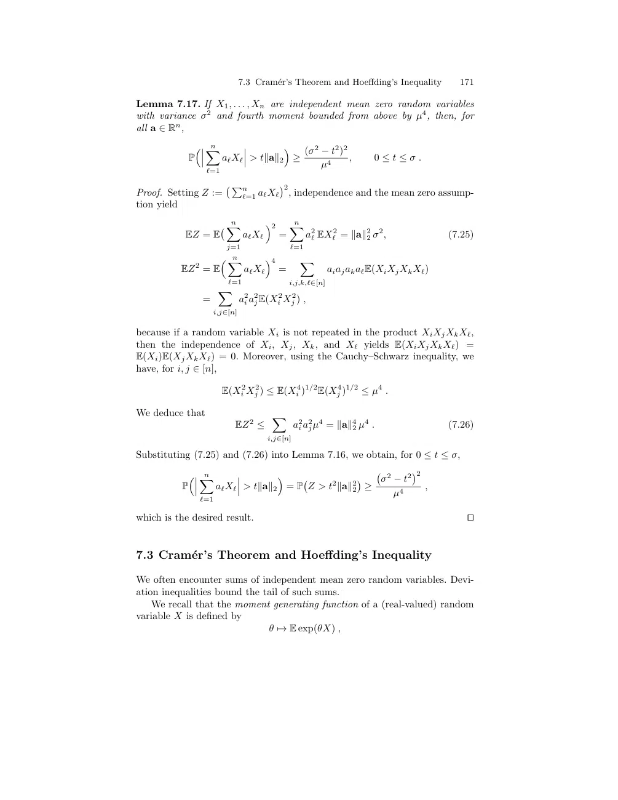

~~~text
                              7.3 Cramér’s Theorem and Hoeffding’s Inequality                 171

Lemma 7.17. If X1 , . . . , Xn are independent mean zero random variables
with variance σ 2 and fourth moment bounded from above by µ4 , then, for
all a ∈ Rn ,
                  n
                 X                  (σ 2 − t2 )2
            P          a` X` > tkak2 ≥             ,                       0≤t≤σ.
                                           µ4
                 `=1

                         Pn                 2
Proof. Setting Z :=            `=1 a` X`         , independence and the mean zero assump-
tion yield
                        n
                        X              2        n
                                                 X
           EZ = E              a` X`        =          a2` EX`2 = kak22 σ 2 ,                (7.25)
                        j=1                      `=1
                       Xn             4           X
          EZ 2 = E             a` X`        =                  ai aj ak a` E(Xi Xj Xk X` )
                        `=1                      i,j,k,`∈[n]
                      X
                =             a2i a2j E(Xi2 Xj2 ) ,
                    i,j∈[n]

because if a random variable Xi is not repeated in the product Xi Xj Xk X` ,
then the independence of Xi , Xj , Xk , and X` yields E(Xi Xj Xk X` ) =
E(Xi )E(Xj Xk X` ) = 0. Moreover, using the Cauchy–Schwarz inequality, we
have, for i, j ∈ [n],

                       E(Xi2 Xj2 ) ≤ E(Xi4 )1/2 E(Xj4 )1/2 ≤ µ4 .

We deduce that                          X
                          EZ 2 ≤                  a2i a2j µ4 = kak42 µ4 .                    (7.26)
                                       i,j∈[n]

Substituting (7.25) and (7.26) into Lemma 7.16, we obtain, for 0 ≤ t ≤ σ,
             n                                         2
            X              
                                      2   2
                                             σ 2 − t2
          P    a` X` > tkak2 = P Z > t kak2 ≥             ,
                                                  µ4
                `=1

which is the desired result.                                                                     t
                                                                                                 u

7.3 Cramér’s Theorem and Hoeffding’s Inequality
We often encounter sums of independent mean zero random variables. Devi-
ation inequalities bound the tail of such sums.
    We recall that the moment generating function of a (real-valued) random
variable X is defined by
                              θ 7→ E exp(θX) ,
~~~

## Page 184

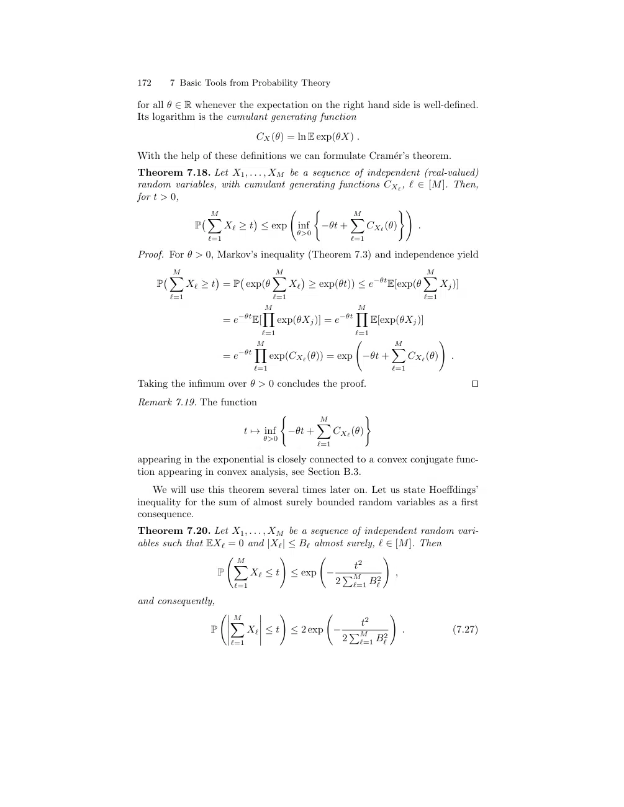

~~~text
172       7 Basic Tools from Probability Theory

for all θ ∈ R whenever the expectation on the right hand side is well-defined.
Its logarithm is the cumulant generating function
                                     CX (θ) = ln E exp(θX) .
With the help of these definitions we can formulate Cramér’s theorem.
Theorem 7.18. Let X1 , . . . , XM be a sequence of independent (real-valued)
random variables, with cumulant generating functions CX` , ` ∈ [M ]. Then,
for t > 0,
               M
                                       (        M
                                                          )!
               X                              X
           P      X` ≥ t ≤ exp inf −θt +           CX` (θ)    .
                                                  θ>0
                    `=1                                           `=1

Proof. For θ > 0, Markov’s inequality (Theorem 7.3) and independence yield
          M
          X                      M
                                 X                              M
                                                                X
                                   X` ≥ exp(θt)) ≤ e−θt E[exp(θ
                                    
      P         X` ≥ t = P exp(θ                                  Xj )]
          `=1                              `=1                                           `=1
                                      M
                                      Y                             M
                                                                    Y
                          = e−θt E[         exp(θXj )] = e−θt             E[exp(θXj )]
                                      `=1                           `=1
                                     M                                        M
                                                                                               !
                                     Y                                        X
                               −θt
                          =e               exp(CX` (θ)) = exp −θt +                   CX` (θ)      .
                                     `=1                                      `=1

Taking the infimum over θ > 0 concludes the proof.                                                     t
                                                                                                       u
Remark 7.19. The function
                                             (           M
                                                                     )
                                                         X
                                t 7→ inf         −θt +         CX` (θ)
                                       θ>0
                                                         `=1

appearing in the exponential is closely connected to a convex conjugate func-
tion appearing in convex analysis, see Section B.3.
   We will use this theorem several times later on. Let us state Hoeffdings’
inequality for the sum of almost surely bounded random variables as a first
consequence.
Theorem 7.20. Let X1 , . . . , XM be a sequence of independent random vari-
ables such that EX` = 0 and |X` | ≤ B` almost surely, ` ∈ [M ]. Then
                      M
                                !                      !
                     X                           t2
                  P      X` ≤ t ≤ exp − PM                ,
                     `=1                    2 `=1 B`2
and consequently,
                           M
                                             !                                !
                           X                                         t2
                     P           X` ≤ t          ≤ 2 exp − PM                     .                (7.27)
                           `=1                            2 `=1 B`2
~~~

## Page 185

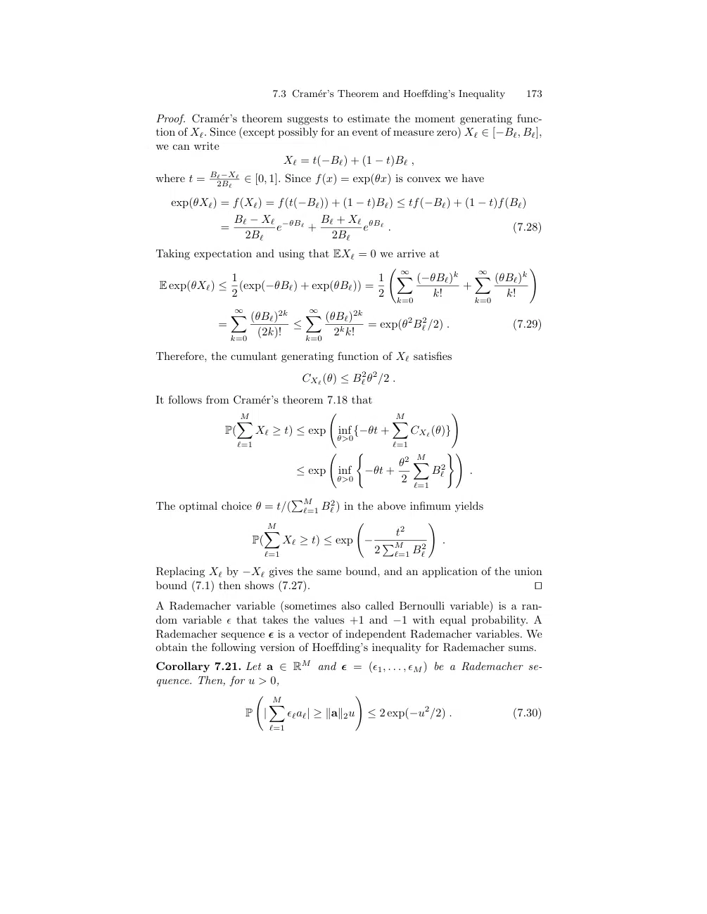

~~~text
                             7.3 Cramér’s Theorem and Hoeffding’s Inequality                      173

Proof. Cramér’s theorem suggests to estimate the moment generating func-
tion of X` . Since (except possibly for an event of measure zero) X` ∈ [−B` , B` ],
we can write
                            X` = t(−B` ) + (1 − t)B` ,
             −X`
where t = B`2B `
                 ∈ [0, 1]. Since f (x) = exp(θx) is convex we have

   exp(θX` ) = f (X` ) = f (t(−B` )) + (1 − t)B` ) ≤ tf (−B` ) + (1 − t)f (B` )
               B` − X` −θB` B` + X` θB`
             =           e     +           e    .                          (7.28)
                  2B`                2B`
Taking expectation and using that EX` = 0 we arrive at
                                                             ∞                          ∞
                                                                                                    !
             1                           1                   X (−θB` )k                 X (θB` )k
E exp(θX` ) ≤ (exp(−θB` ) + exp(θB` )) =                                           +
             2                           2                               k!                   k!
                                                             k=0                        k=0
                 ∞                   ∞
                 X     (θB` )2k      X     (θB` )2k
             =                  ≤                   = exp(θ2 B`2 /2) .                         (7.29)
                        (2k)!                2k k!
                 k=0                 k=0

Therefore, the cumulant generating function of X` satisfies
                                     CX` (θ) ≤ B`2 θ2 /2 .
It follows from Cramér’s theorem 7.18 that
                   M                                      M
                                                                               !
                   X                                      X
              P(         X` ≥ t) ≤ exp       inf {−θt +           CX` (θ)}
                                             θ>0
                   `=1                                    `=1
                                                   (               M
                                                                               )!
                                                         θ2 X 2
                                    ≤ exp    inf   −θt +     B`                     .
                                             θ>0         2
                                                                   `=1
                                   PM     2
The optimal choice θ = t/(           `=1 B` ) in the above infimum yields
                            M
                                                                       !
                            X                                t2
                       P(         X` ≥ t) ≤ exp − PM                       .
                            `=1                  2 `=1 B`2
Replacing X` by −X` gives the same bound, and an application of the union
bound (7.1) then shows (7.27).                                          t
                                                                        u
A Rademacher variable (sometimes also called Bernoulli variable) is a ran-
dom variable  that takes the values +1 and −1 with equal probability. A
Rademacher sequence  is a vector of independent Rademacher variables. We
obtain the following version of Hoeffding’s inequality for Rademacher sums.
Corollary 7.21. Let a ∈ RM and  = (1 , . . . , M ) be a Rademacher se-
quence. Then, for u > 0,
                      M
                                         !
                     X
                 P |     ` a` | ≥ kak2 u ≤ 2 exp(−u2 /2) .        (7.30)
                            `=1
~~~

## Page 186

~~~text
174    7 Basic Tools from Probability Theory

Proof. The random variable a` ` has mean zero and is bounded in absolute
value by |a` |. Therefore, the stated inequality follows immediately from Ho-
effding’s inequality 7.20.                                                 t
                                                                           u

Remark 7.22. Note that specializing (7.29) to a Rademacher variable  shows
that its moment generating function satisfies

                             E exp(θ) ≤ exp(θ2 /2) .                   (7.31)

7.4 Subgaussian Random Variables
A random variable X is called subgaussian if there exist constants β, κ > 0
such that                            2
                  P(|X| ≥ t) ≤ βe−κt     for all t > 0 .              (7.32)
It is called subexponential if

                      P(|X| ≥ t) ≤ βe−κt     for all t > 0 .

According to Proposition 7.5 a standard Gaussian random variable is subgaus-
sian with β = 1 and κ = 1/2. Furthermore, Bernoulli and bounded random
variables are subgaussian. According to Theorem 7.20, Rademacher sums are
subgaussian random variables as well.
    Clearly, a random variable X is subgaussian if and only if X 2 is subexpo-
nential. Setting α = (2eκ)−1/2 and γ = 2 in Proposition 7.13 shows that the
moments of a subgaussian variable X satisfy
                               e −1/2 β 1/p p1/2 for all p ≥ 1
                 (E|X|p )1/p ≤ Cκ                                     (7.33)
                       √                p
     e = e1/(2e) C2,2 / 2e = e1/(2e)+1/6 π/(2e) ≈ 1.0282, while the moments
with C
of a subexponential variable X satisfy (setting α = (eκ)−1 and γ = 1 in
Proposition 7.13)

                                  b −1 β 1/p p for all p ≥ 1
                   (E|X|p )1/p ≤ Cκ
                                         √
with Cb = e1/(2e) C2,1 e−1 = e1/(2e)+1/12 2π ≈ 3.1193. Proposition 7.11 pro-
vides a statement in the converse direction. Let us give an equivalent charac-
terization of subgaussian random variables.

Proposition 7.23. Let X be a random variable.
(a) If X is subgaussian, then there exist constants c > 0, C > 1 such that
    E[exp(cX 2 )] ≤ C.
(b) If E[exp(cX 2 )] ≤ C for some constants c, C > 0 then X is subgaussian.
                                                2
    More precisely, we have P(|X| ≥ t) ≤ Ce−ct .
~~~

## Page 187

~~~text
                                        7.4 Subgaussian Random Variables              175

Proof. (a) The moment estimate (7.22) with κ = 1/(2eα2 ) yields

                                EX 2n ≤ βκ−n n! .

Expanding the exponential function into its Taylor series and using Fubini’s
theorem shows that
                        ∞                         ∞
                        X cn E[X 2n ]             X cn κ−n n!                βcκ−1
  E[exp(cX 2 )] = 1 +                   ≤1+β                      =1+                .
                        n=1
                                n!                n=1
                                                           n!               1 − cκ−1

provided c < κ.
   (b) This statement follows from Markov’s inequality, Theorem 7.3,
                                                                        2         2
    P(|X| ≥ t) = P(exp(cX 2 ) ≥ exp(ct2 )) ≤ E[exp(cX 2 )]e−ct ≤ Ce−ct .

This completes the proof.                                                                t
                                                                                         u
Exercise 7.6 refines the statement of Proposition 7.23(a).
   Let us study the Laplace transform (or moment generating function) of a
mean zero subgaussian random variable.
Proposition 7.24. Let X be a random variable.
(a) If X is subgaussian with EX = 0 then there exists a constant c (depending
    only on β and κ) such that

                    E[exp(θX)] ≤ exp(cθ2 )            for all θ ∈ R .             (7.34)

(b) Conversely, if (7.34) holds then EX = 0 and X is subgaussian with pa-
                             1
    rameters β = 2 and κ = 4c  .
Remark 7.25. Any valid constant c in (7.34) is called subgaussian parameter
of X. Of course, one preferably chooses the minimal possible c.
Proof. For the easier part (b) we take θ, t > 0 and apply Markov’s inequality,
Theorem 7.3, to get
                                                                            2
      P(X ≥ t) = P(exp(θX) ≥ exp(θt)) ≤ E[exp(θX)]e−θt ≤ ecθ −θt .

The optimal choice θ = t/(2c) yields
                                              2
                              P(X ≥ t) ≤ e−t /(4c) .

Repeating the above computation with −X instead of X shows that
                                                  2
                              P(−X ≥ t) ≤ e−t /(4c) ,
                                                                                  2
and the union bound yields the desired estimate P(|X| ≥ t) ≤ 2e−t /(4c) .
In order to deduce that X has mean zero, we take the expectation in the
inequality 1 + θX ≤ exp(θX) to deduce, for |θ| < 1,
~~~

## Page 188

~~~text
176    7 Basic Tools from Probability Theory

        1 + θE(X) ≤ E[exp(θX)] ≤ exp(cθ2 ) ≤ 1 + (c/2)θ2 + O(θ4 ) .

Letting θ → 0 shows that EX = 0.
    Let us now turn to the converse implication (a). We note that it is enough
to consider θ ≥ 0, as the statement for θ < 0 follows from exchanging X with
−X. Expanding the exponential function into its Taylor series yields (together
with Fubini’s theorem),
                                        ∞                 ∞
                                        X θn EX n         X θn E|X|n
        E[exp(θX)] = 1 + θE(X) +                    =1+                  ,
                                        n=2
                                              n!          n=2
                                                                 n!

where we used the mean zero assumption. First suppose that 0 ≤ θ ≤ θ0
for some θ0 to be determined below.
                               √     Then the moment estimate (7.33) and
Stirling’s formula (C.13), n! ≥ 2πnn e−n , yield
                       ∞    e n κ−n/2 nn/2                 ∞
                                                           e n θn κ−n/2 nn/2
                       X θn C                      β XC
  E[exp(θX)] ≤ 1 + β                          ≤1+ √
                       n=2
                                   n!               2π n=2      nn e−n
                         e 2X ∞
                      β(Ce)       e 0 κ−1/2 )n
              ≤ 1 + θ2 √         (Ceθ
                         2πκ n=0
                          e 2
                       β(Ce)           1
              = 1 + θ2 √
                                    e 0 κ−1/2
                          2πκ 1 − Ceθ
              = 1 + c1 θ2 ≤ exp(c1 θ2 ) ,

         e 0 κ−1/2 < 1. The latter is satisfied by setting
provided Ceθ
                                           √
                                    e −1 κ ,
                            θ0 = (2Ce)
                √
                          e 2 /√π).
which gives c1 = 2βκ−1 ((Ce)
   Let us now assume that θ > θ0 . We aim at proving E[exp(θX − c2 θ2 )] ≤ 1.
Observe that
                                 √          X 2 X 2    X2
               θX − c2 θ2 = −        c2 θ − √   +     ≤     .
                                           2 c2   4c2   4c2

Let c̃ > 0, C̃ ≥ 1 be the constants from Proposition 7.23(a), and choose
c2 = 1/(4c̃). Then

                   E[exp(θX − c2 θ2 )] ≤ E[exp(c̃X 2 )] ≤ C̃ .

Defining ρ = ln(C̃)θ0−2 yields

          E[exp(θX)] ≤ C̃ exp(c2 θ2 ) = C̃ exp(−ρθ2 ) exp((c2 + ρ)θ2 )
                                               2           2
                       ≤ C̃ exp(−ρθ02 )e(c2 +ρ)θ ≤ e(c2 +ρ)θ .

Setting c = max{c1 , c2 + ρ} completes the proof.                              t
                                                                               u
~~~

## Page 189

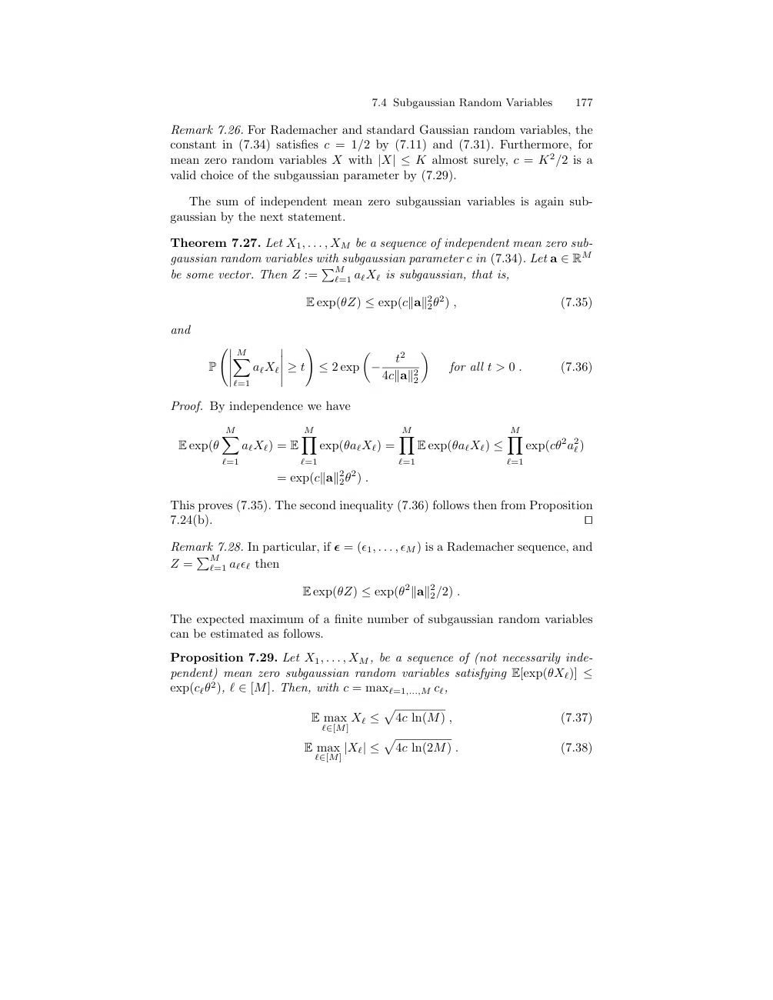

~~~text
                                                7.4 Subgaussian Random Variables               177

Remark 7.26. For Rademacher and standard Gaussian random variables, the
constant in (7.34) satisfies c = 1/2 by (7.11) and (7.31). Furthermore, for
mean zero random variables X with |X| ≤ K almost surely, c = K 2 /2 is a
valid choice of the subgaussian parameter by (7.29).

   The sum of independent mean zero subgaussian variables is again sub-
gaussian by the next statement.

Theorem 7.27. Let X1 , . . . , XM be a sequence of independent mean zero sub-
gaussian random variables with subgaussian parameter c in (7.34). Let a ∈ RM
                            PM
be some vector. Then Z := `=1 a` X` is subgaussian, that is,

                               E exp(θZ) ≤ exp(ckak22 θ2 ) ,                                (7.35)

and
            M
                               !
                                                 t2
            X                                              
       P           a` X` ≥ t         ≤ 2 exp −                   for all t > 0 .            (7.36)
                                               4ckak22
            `=1

Proof. By independence we have
           M
           X                   M
                               Y                      M
                                                      Y                        M
                                                                               Y
 E exp(θ         a` X` ) = E         exp(θa` X` ) =         E exp(θa` X` ) ≤         exp(cθ2 a2` )
           `=1                 `=1                    `=1                      `=1
                       = exp(ckak22 θ2 ) .

This proves (7.35). The second inequality (7.36) follows then from Proposition
7.24(b).                                                                     t
                                                                             u

Remark 7.28. In particular, if  = (1 , . . . , M ) is a Rademacher sequence, and
   PM
Z = `=1 a` ` then

                               E exp(θZ) ≤ exp(θ2 kak22 /2) .

The expected maximum of a finite number of subgaussian random variables
can be estimated as follows.
Proposition 7.29. Let X1 , . . . , XM , be a sequence of (not necessarily inde-
pendent) mean zero subgaussian random variables satisfying E[exp(θX` )] ≤
exp(c` θ2 ), ` ∈ [M ]. Then, with c = max`=1,...,M c` ,
                                         p
                            E max X` ≤ 4c ln(M ) ,                       (7.37)
                              `∈[M ]
                                         p
                           E max |X` | ≤ 4c ln(2M ) .                    (7.38)
                                 `∈[M ]
~~~

## Page 190

~~~text
178       7 Basic Tools from Probability Theory

Proof. Since (7.37) is obvious for M = 1, we assume M ≥ 2. Let β > 0 be
a number to be chosen later. Using concavity of the logarithm in connection
with Jensen’s inequality we obtain
                                          M
                                                       !       M
                                         X                    X
βE max X` = E ln max exp(βX` ) ≤ E ln        exp(βX` ) ≤ ln(      E exp(βX` ))
      `∈[M ]          `∈[M ]
                                                `=1                   `=1
               ≤ ln(M exp(cβ 2 )) = cβ 2 + ln(M ) .
                 p
Choosing β =      c−1 ln(M ) yields
                   p
                      c−1 ln(M )E max X` ≤ ln(M ) + ln(M )
                                    `∈[M ]

                             p
so that E max`∈[M ] ≤ 4c ln(M ).
    For (7.38) we write E max`∈[m] |X` | = E max{X1 , . . . , Xm , −X1 , . . . , −Xm }
and apply (7.37).                                                                   t
                                                                                    u

The example of a sequence of standard Gaussian random variables shows
that the estimates in the previous Proposition are optimal up to possibly the
constants, see Proposition 8.1(c) below.

7.5 Bernstein Inequalities
Bernstein’s inequality provides a useful generalization of Hoeffding’s inequal-
ity (7.30) to sums of bounded or even unbounded independent random vari-
ables, which also takes into account the variance or higher moments. We start
with the version below, and then derive variations as consequences.

Theorem 7.30. Let X1 , . . . , XM be independent mean zero random variables
such that, for all integers n ≥ 2,

                      E|X` |n ≤ n!Rn−2 σ`2 /2   for all ` ∈ [M ]               (7.39)

for some constants R > 0 and σ` > 0, ` ∈ [M ]. Then, for all t > 0,
                      M
                                !
                                                t2 /2
                     X                               
                 P       X` ≥ t ≤ 2 exp − 2              ,                     (7.40)
                                               σ + Rt
                             `=1

               PM
where σ 2 :=           2
                  `=1 σ` .

    Before providing the proof we give two consequences. The first is the Bern-
stein inequality for bounded random variables.
~~~

## Page 191

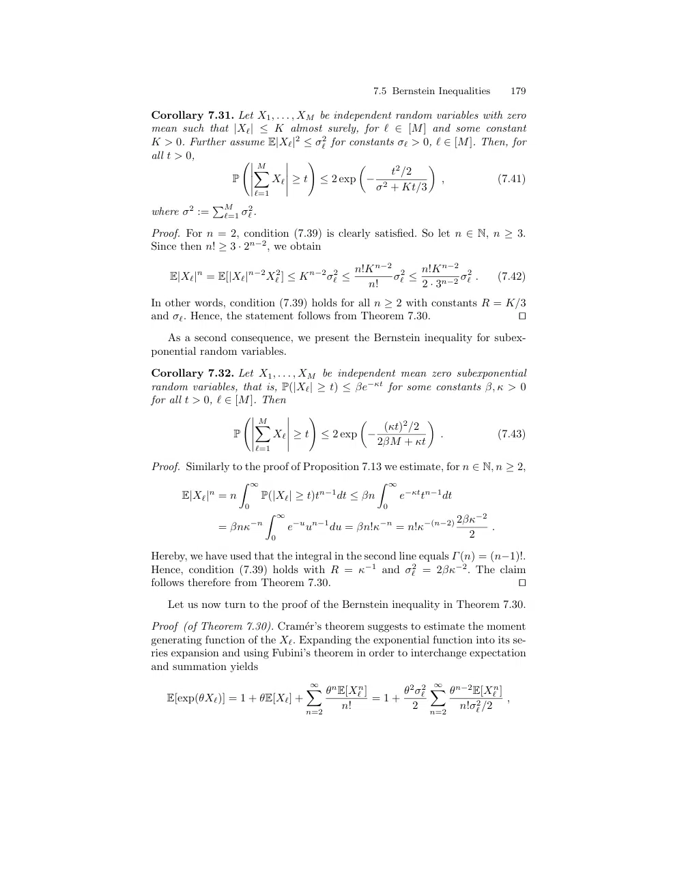

~~~text
                                                   7.5 Bernstein Inequalities      179

Corollary 7.31. Let X1 , . . . , XM be independent random variables with zero
mean such that |X` | ≤ K almost surely, for ` ∈ [M ] and some constant
K > 0. Further assume E|X` |2 ≤ σ`2 for constants σ` > 0, ` ∈ [M ]. Then, for
all t > 0,                        !
                       M
                                                  t2 /2
                     X                                  
                P        X` ≥ t ≤ 2 exp − 2                ,           (7.41)
                                               σ + Kt/3
                     `=1
            PM
where σ 2 := `=1 σ`2 .
Proof. For n = 2, condition (7.39) is clearly satisfied. So let n ∈ N, n ≥ 3.
Since then n! ≥ 3 · 2n−2 , we obtain
                                               n!K n−2 2   n!K n−2 2
    E|X` |n = E[|X` |n−2 X`2 ] ≤ K n−2 σ`2 ≤          σ` ≤         σ .          (7.42)
                                                 n!        2 · 3n−2 `
In other words, condition (7.39) holds for all n ≥ 2 with constants R = K/3
and σ` . Hence, the statement follows from Theorem 7.30.                  t
                                                                          u
   As a second consequence, we present the Bernstein inequality for subex-
ponential random variables.
Corollary 7.32. Let X1 , . . . , XM be independent mean zero subexponential
random variables, that is, P(|X` | ≥ t) ≤ βe−κt for some constants β, κ > 0
for all t > 0, ` ∈ [M ]. Then
                        M
                                  !
                                                (κt)2 /2
                       X                                
                   P       X` ≥ t ≤ 2 exp −                .          (7.43)
                                               2βM + κt
                      `=1

Proof. Similarly to the proof of Proposition 7.13 we estimate, for n ∈ N, n ≥ 2,
                  Z ∞                             Z ∞
            n
      E|X` | = n        P(|X` | ≥ t)t n−1
                                          dt ≤ βn     e−κt tn−1 dt
                    0                              0
                         Z ∞
                      −n                                           2βκ−2
              = βnκ          e−u un−1 du = βn!κ−n = n!κ−(n−2)            .
                          0                                          2
Hereby, we have used that the integral in the second line equals Γ (n) = (n−1)!.
Hence, condition (7.39) holds with R = κ−1 and σ`2 = 2βκ−2 . The claim
follows therefore from Theorem 7.30.                                          t
                                                                              u
   Let us now turn to the proof of the Bernstein inequality in Theorem 7.30.
Proof (of Theorem 7.30). Cramér’s theorem suggests to estimate the moment
generating function of the X` . Expanding the exponential function into its se-
ries expansion and using Fubini’s theorem in order to interchange expectation
and summation yields
                                  ∞                             ∞
                                  X θn E[X n ] `         θ2 σ`2 X θn−2 E[X`n ]
   E[exp(θX` )] = 1 + θE[X` ] +                    =1+                         ,
                                  n=2
                                          n!               2 n=2 n!σ`2 /2
~~~

## Page 192

~~~text
180         7 Basic Tools from Probability Theory

where we additionally used that E[X` ] = 0. Defining
                                              ∞
                                              X θn−2 E[X n ]       `
                                   F` (θ) =
                                              n=2
                                                        n!σ`2 /2

we obtain

                E[exp(θX` )] = 1 + θ2 σ`2 F` (θ)/2 ≤ exp(θ2 σ`2 F` (θ)/2) .
                                                                                 PM
Introducing F (θ) = max`∈[M ] F` (θ) and recalling that σ 2 =                           2
                                                                                   `=1 σ` we ob-
tain from Cramér’s theorem
      M
      X
            X` ≥ t ≤ inf exp(θ2 σ 2 F (θ)/2 − θt) ≤                      exp(θ2 σ 2 F (θ)/2 − θt).
                  
P                                                                  inf
                       θ>0                                     0<Rθ<1
      `=1

Since E[X`n ] ≤ E[|X` |n ] the assumption (7.39) yields
                             ∞                          ∞
                             X θn−2 E[|X` |n ]          X                      1
                 F` (θ) ≤                           ≤         (Rθ)n−2 =
                             n=2
                                       n!σ`2 /2         n=2
                                                                            1 − Rθ

provided Rθ < 1. Therefore, F (θ) ≤ (1 − Rθ)−1 and
                      M
                                                                θ2 σ2
                      X                                                    
                                   
                  P         X` ≥ t ≤        inf     exp                 − θt .
                                          0<θR<1              2(1 − Rθ)
                      `=1

Now we choose θ = t/(σ 2 + Rt), which clearly satisfies Rθ < 1. This yields
           M
                                                                 !
          X                       t2 σ 2       1            t2
        P     X` ≥ t ≤ exp                              − 2
                               2(σ 2 + Rt)2 1 − σ2Rt
                                                  +Rt
                                                          σ + Rt
          `=1
                                    2
                                         
                                   t /2
                      = exp − 2             .
                                 σ + Rt

Exchanging X` with −X` yields the same estimate, and applying the union
bound completes the proof.                                            t
                                                                      u

Notes
Good sources for background on basic probability theory are for instance the
monographs [209, 369]. The relation of tails and moments is well-known, see
e.g. [280], although the refinement with the parameter β in (7.19) seems to
have appeared only recently [355]. Cramér proved the theorem named after
him in [107]. We refer to [432] for more information on large deviation results in
this spirit. Hoeffding’s inequality (7.30) was derived in [238]. In the special case
~~~

## Page 193

~~~text
                                                  7.5 Bernstein Inequalities   181

of random variables that take only values in {0, 1} with probabilities p and 1−
p, so-called Chernoff bounds refine the Hoeffding inequalities, see for instance
[95, 220]. Bernstein’s inequality was first proved in [34, 35], and refined later
by Bennett [31]. For further reading on scalar deviation inequalities the reader
is referred to [300, 432].
    The notion of subgaussian random variables may be refined to strictly
subgaussian random variables, for which the constant in (7.34) satisfies
c = E|X|2 /2. Gaussian and Bernoulli random variables, as well as random
variables that are uniformly distributed on [−1, 1] are strictly subgaussian,
see Exercise 7.5. More information on subgaussian random variables can be
found, for instance, in [65, 438].

Exercises
7.1. Show the relation (7.17) of the Beta function B to the Gamma function.
7.2. Prove Proposition 7.15.
7.3. Let p > 1. Generalize Lemma 7.16 by showing that any nonnegative
random variable Z with finite pth moment satisfies
                             (EZ − t)p/(p−1)
                P(Z > t) ≥                   ,        0 ≤ t ≤ EZ.
                              (EZ p )1/(p−1)
Prove also that if X1 , . . . , XM are independent mean zero random variables
with variance σ 2 and 2pth absolute moment bounded above by µ2p , then, for
all a ∈ RM ,
               M
             X                    (σ 2 − t2 )2
           P      a` X` > tkak2 ≥ cp 2p/(p−1) ,             0 ≤ t ≤ σ,
              `=1
                                    µ

for some constant cp to be determined.
7.4. Let X be a subgaussian random variable with E exp(θX) ≤ exp(cθ2 ) for
some constant c > 0. Show that its variance satisfies EX 2 ≤ 2c. (A subgaus-
sian variable for which equality holds, is called strictly subgaussian).
7.5. Let X be a random variable that is uniformly distributed on [−1, 1]. Show
that E|X|2 = 1/3 and that
                 E exp(θX) ≤ exp(θ2 /6) = exp(θ2 E|X|2 /2) ,
so that X is strictly subgaussian.
7.6. Let X be a subgaussian random variable with parameter c > 0, that is,
E exp(θX) ≤ exp(cθ2 ) for all θ ∈ R. Show that, for t ∈ [0, 1/2],
                                                   1
                          E exp(tX 2 /c2 ) ≤ √          .
                                                 1 − 2t
~~~

## Page 194

*Page blanche.*

## Page 195

~~~text
8
Advanced Tools from Probability Theory

This chapter introduces further probabilistic tools that will be required for
some of the more advanced results in the remainder of the book.
    In Section 8.1, we compute the expectation of the `p -norm of a standard
Gaussian vector for p = 1, 2, ∞ (required in Section 9.3). Section 8.2 presents
simple results for Rademacher sums as well as the symmetrization technique,
which randomizes a sum of random vectors by introducing additional (ran-
dom) Rademacher vectors. This simple technique turns out to be powerful in
various setups and will be needed in Section 12.5 and Chapter 13. Khintchine
inequalities, treated in Section 8.3, estimate the moments of a Rademacher
sum and allow to deduce Hoeffding type inequalities for Rademacher sums in
a different way than via moment generating functions (required for Section
12.5 and Chapter 13). Decoupling inequalities to be introduced in Section 8.6
replace one sequence of random variables in a double sum by an indepen-
dent copy (required for Section 9.4 and Chapter 13). The scalar Bernstein
inequality for bounded random variables (Corollary 7.31) will be extended
in Section 8.5 to a powerful deviation inequality for the operator norm of
sums of random matrices (required for Sections 12.3, 12.4, and 13.1). Sec-
tion 8.6 deals with Dudley’s inequality, which is a crucial tool to estimate
the expectation of a supremum of a subgaussian process by an integral over
covering numbers of the index set of the process (required for the estimate of
the restricted isometry constants in Section 12.5). The Slepian and Gordon
lemmas compare expectations of functions of two Gaussian random vectors
in terms of the covariances of the two vectors. In particular, maxima as well
as minima of maxima are important choices of such functions. These will be
treated in Section 8.7 and will be used in Sections 9.2 and 9.3. Section 8.8
treats the concentration of measure phenomenon which states that a Lipschitz
function of a Gaussian random vector concentrates around its mean (required
in Sections 9.2 and 9.3). The final section of this chapter deals with a devia-
tion inequality for the supremum of an empirical process, which is sometimes
called Talagrand’s inequality. It will be required in Chapter 12.
~~~

## Page 196

~~~text
184      8 Advanced Tools from Probability Theory

8.1 Expectation of Standard Gaussians in Norm
We state simple results on the expectation of the norms of standard Gaussian
random vectors in `1 , `2 and `∞ .
Proposition 8.1. Let g = (g1 , . . . , gn ) be a vector of (not necessarily inde-
pendent) standard Gaussian random variables. Then
              r
                 2
(a) Ekgk1 =        n;
                 π r
                        2√                 √
(b) Ekgk22 = n and         n ≤ Ekgk2 ≤ n .
                        π
    If the entries of g are independent then
                     n             √ Γ ((n + 1)/2) √
                      √  ≤ Ekgk2 = 2              ≤ n,                              (8.1)
                    n+1                 Γ (n/2)
                            √
    and consequently Ekgk2 ∼ n as n → ∞.
(c) It holds
                        p                         p
              E max g` ≤ 2 ln(n) , and Ekgk∞ ≤ 2 ln(2n) .                           (8.2)
                  `∈[n]

      If the entries of g are independent then, for n ≥ 2,
                                              p
                                  Ekgk∞ ≥ C ln(n)                                   (8.3)
      with C ≈ 0.265.
Proof. (a) By the formula for the density of a standard Gaussian random
variable, we have
                 Z ∞                           r Z ∞                        r
              1                     2             2               2            2
   E|g` | = √          |u| exp(−u /2)du =               u exp(−u /2)du =         .
              2π −∞                              π 0                           π
                                         Pn              p
By linearity of expectation      Ekgk1 = `=1 E|g` | = 2/π n.
                                 n
    (b) Clearly, Ekgk22 = `=1 Eg`2 = n for standard Gaussian random vari-
                              P
ables g` . The Cauchy-Schwarz
                      p            inequality
                                     √        for expectations (or Jensen’s inequal-
ity) yields Ekgk2 ≤ Ekgk22 = n, while the Cauchy-Schwarz              inequality for
                                                           p     √
the inner product on Rn gives Ekgk2 ≥ E √1n kgk1 = 2/π n.
    If the entries of g are independent, then kgk22 has the χ2 (n)-distribution
with probability density function given by (7.16). Therefore,
                        n
                                !1/2 Z
                      X                  ∞
          Ekgk2 = E         g`2      =      u1/2 φn (u)du
                          `=1              0
                                    Z ∞
                           1
                 =                        u1/2 u(n/2)−1 e−u/2 du
                     2n/2 Γ (n/2)   0
                                    Z ∞                         √ Γ ((n + 1)/2)
                   2n/2+1/2
                 = n/2                    t(n/2)−1/2 e−t dt =    2              ,
                  2 Γ (n/2)         0                                Γ (n/2)
~~~

## Page 197

~~~text
                               8.1 Expectation of Standard Gaussians in Norm   185

where we used the√definition of the Gamma function in (C.9). The estimate
En := Ekgk2 ≤ n for Gaussian vector g of length n was already shown
above. Furthermore,
                                            Γ (n/2 + 1)
                              En+1 En = 2               =n,
                                              Γ (n/2)

by the functional
              √     equation (C.11) for the Gamma function so that En =
n/En+1 ≥ n/ n + 1 (compare also Lemma C.4).
   (c) The inequalities in (8.2) follow from Proposition 7.29 by noting that
due to Lemma 7.6 E exp(βg) = exp(β 2 /2) so that the subgaussian parameter
c = 1/2 for Gaussian random variables.
   If the g` are independent then by Corollary 7.2
               Z ∞                       Z ∞                        
    Ekgk∞ =         P max |g` | > u du =           1 − P(max |g` | ≤ u) du
                0      `∈[n]                 0           `∈[n]
        Z ∞        n
                                  !      Z δ
                   Y
     =        1−      P(|g` | ≤ u) du ≥      (1 − (1 − P(|g| > u))n ) du
           0         `=1                        0
                                      n
     ≥ δ (1 − (1 − P(|g| > δ)) ) .

Further,

                      2 ∞ −t2 /2
                        Zr              r Z 2δ              r
                                          2     −t2 /2        2 −2δ2
     P(|g| > δ) =           e     dt ≥         e       dt ≥     δe     .
                     π δ                  π δ                 π
                     p
Now, we choose δ = ln n/2. Then, for n ≥ 2,
           r                  r        !n ! r                      r      !!
              ln n              ln n 1         ln n                  ln n
 Ekgk∞ ≥            1− 1−                   ≥          1 − exp −
               2                 π n             2                    π
           1 − exp(− (ln 2)/π) √
                      p
        ≥           √              ln n ,
                       2
                                               p             √
which establishes the claim with C = (1 − exp(− (ln 2)/π))/ 2 ≈ 0.265. t    u

   Next we extend part (c) of the previous proposition to the maximum
squared `2 -norm of a sequence of standard Gaussian random vectors.

Proposition 8.2. Let g1 , . . . , gM ∈ Rn be a sequence of (not necessarily in-
dependent) standard Gaussian random vectors. Then, for any κ > 0,

               E max kg` k22 ≤ (2 + 2κ) ln(M ) + n(1 + κ) ln(1 + κ−1 ) .
                `∈[M ]

Consequently,                             p          √
                         E max kg` k22 ≤ ( 2 ln(M ) + n)2 .
                             `∈[M ]
~~~

## Page 198

~~~text
186    8 Advanced Tools from Probability Theory

Proof. By concavity of the logarithm and Jensen’s inequality we have, for
θ > 0,
   E max kg` k22 = θ−1 E ln max exp θkg` k22 ≤ θ−1 ln E max exp θkg` k22
                                                                        
     `∈[M ]                 `∈[M ]                      `∈[M ]
                    −1                2
                                         
                 ≤ θ ln M E exp(θkgk2 ) ,
where g denotes a standard Gaussian random
                                         PMvector in Rn . In the last step
we have used that max`∈[M ] exp θkg` k2 ≤ `=1 exp θkg` k22 . By the inde-
                                      2

pendence of the components of g and Lemma 7.6,
                             n
                             X           n
                                         Y              n
                                                        Y
      E exp(θkgk22 = E exp(θ   gj2 ) = E   exp(θgj2 ) =   E exp(θgj2 )
                  
                                  j=1              j=1    j=1
                                  −n/2
                       = (1 − 2θ)        ,
provided that θ < 1/2. Therefore,
                                               n              
          E max kg` k22 ≤       inf   θ−1 ln M + ln (1 − 2θ)−1    .
            `∈[M ]            0<θ<1/2           2
Substituting θ = (2+2κ)−1 yields the first claim. Using that ln(1+κ−1 ) ≤ κ−1 ,
we further get
                E max kg` k22 ≤ 2(1 + κ) ln(M ) + n(1 + κ−1 ) .           (8.4)
                     `∈[M ]
             p
Choosing κ =     n/(2 ln(M )) gives
                                  p                 p          √
      E max kg` k22 ≤ 2 ln(M ) + 2 2n ln(M ) + n = ( 2 ln(M ) + n)2 .
       `∈[M ]

This concludes the proof.                                                    t
                                                                             u

8.2 Rademacher Sums and Symmetrization
A Rademacher variable (sometimes called Bernoulli random variable) is pre-
sumably the simplest random variable. It takes the values +1 or −1, each
with probability 1/2. A sequence  of independent Rademacher variables
` , ` ∈ [M ], is called a Rademacher sequence. In the sequel we will often
consider Rademacher sums of the form
                                        M
                                        X
                                              ` x` ,
                                        `=1

where the x` are scalars, vectors or matrices.
   Below we present the contraction principle for Rademacher sums and the
symmetrization principle, which allows to replace a sum of independent ran-
dom vectors by its randomized Rademacher sum in moment estimates. Al-
though rather simple, this tool will prove very effective later.
   Let us first present the contraction principle .
~~~

## Page 199

~~~text
                                      8.2 Rademacher Sums and Symmetrization               187

Theorem 8.3. Let x` , ` ∈ [M ], be vectors in a (finite-dimensional) vector
space endowed with a norm k · k and α` ∈ R, ` ∈ [M ], be scalars satisfying
|α` | ≤ 1. If  ∈ RM is a Rademacher sequence, then for any 1 ≤ p < ∞,
                               M
                               X                         M
                                                         X
                         Ek           α` ` x` kp ≤ Ek         ` x` kp .                 (8.5)
                                `=1                      `=1

                                            PM
Proof. The function (α1 , . . . , αM ) 7→ Ek `=1 α` ` x` kp is convex. Therefore,
on [−1, 1]M it attains its maximum at an extreme point, i.e., a point α =
(α` )M
     `=1 such that α` = ±1, see Theorem B.16. For such values of α` , both
α` ` and ` have the same distribution and in this case both terms in (8.5)
are equal.                                                                      t
                                                                                u

    Symmetrization is a simple yet powerful technique to pass from a sum
of arbitrary independent random variables to a Rademacher sum. A random
vector X ∈ Cn is called symmetric, if X and −X have the same distribution.
Clearly, EX = 0 for a symmetric random vector X. The crucial observation
for symmetrization is that a symmetric random vector X and the random
vector X, where  is a Rademacher random variable independent of X, have
the same distribution.

Lemma 8.4. Assume that ξ = (ξ ` )M   `=1 is a sequence of independent random
vectors in a finite-dimensional vector space X with norm k · k. Let F : X → R
be a convex function. Then, with x` = Eξ ` ,
                          M
                          X                    M
                                               X
                                                      
                       EF   (ξ ` − x` ) ≤ EF 2   ` ξ ` ,                                 (8.6)
                               `=1                             `=1

where  = (` )N
               `=1 is a Rademacher sequence independent of ξ. In particular,
for 1 ≤ p < ∞,
                       M                                     M
                       X                     1/p            X                 1/p
                  Ek         (ξ ` − x` )kp          ≤ 2 Ek         ` ξ ` kp          ,   (8.7)
                       `=1                                   `=1

Proof. Let ξ 0 = (ξ 01 , . . . , ξ 0M ) denote an independent copy of the sequence of
random vectors (ξ 1 , . . . , ξ M ). An application of Jensen’s inequality yields
                M
                X                  M
                                   X                     M
                                                         X
                                     (ξ ` − Eξ 0` ) ≤ EF   (ξ ` − ξ 0` ) .
                                                                      
    E := EF       (ξ ` − x` ) = EF
                `=1                           `=1                                `=1

Now observe that (ξ ` − ξ 0` )` is a sequence of independent symmetric random
variables; hence, it has the same distribution as (` (ξ ` − ξ 0` ))` . Convexity of
F gives
~~~

## Page 200

~~~text
188      8 Advanced Tools from Probability Theory
                 M                                             M                  M
                                                                                                !
                 X                                    1     X        1    X
                       ` (ξ` − ξ`0 )                                        (−` )ξ 0`
                                                                                       
      E ≤ EF                                  ≤E        F 2   ` ξ ` + F 2
                                                      2               2
                 `=1                                           `=1                `=1
                  M
                  X              
        = EF 2          ` ξ `
                  `=1

because  is symmetric and ξ 0 has the same distribution as ξ. Inequality (8.7)
follows from taking the convex function F (x) = kxkp for p ∈ [1, ∞).         t
                                                                             u

The lemma will be very useful because there are powerful techniques for esti-
mating Rademacher sums as we will see in the next section.

8.3 Khintchine Inequalities
Khintchine inequalities provide estimates of the moments of Rademacher and
related sums.

Theorem 8.5. Let a ∈ CM and  = (1 , . . . , M ) be a Rademacher sequence.
Then, for all n ∈ N,
                                          M
                                          X                   (2n)!
                                     E|         ` a` |2n ≤         kak2n
                                                                       2 .                      (8.8)
                                                              2n n!
                                          `=1

Proof. First assume that the a` are real-valued. Expanding the expectation
on the left hand side of (8.8) with the multinomial theorem, see Appendix
C.4, yields
                 M
                 X
       E := E|         ` a` |2n
                 `=1
                  X                   (2n)!
          =                                           |a1 |2j1 · · · |aM |2jM E2j        2jM
                                                                                1 · · · EM
                                                                                  1

              j1 +···+jM   =n
                              (2j 1 )! · · · (2j M )!
                   ji ≥0
                  X                   (2n)!
          =                                           |a1 |2j1 · · · |aM |2jM .
              j1 +···+jM   =n
                              (2j 1 )! · · · (2j M )!
                   ji ≥0

Hereby we used the independence of the ` and the fact that Ek` = 0 if k is
an odd integer. For integers satisfying j1 + · · · + jM = n we have

       2n j1 ! × · · · × jM ! = 2j1 j1 ! × · · · × 2jM jM ! ≤ (2j1 )! × · · · × (2jM )! .

This implies
~~~

## Page 201

~~~text
                                                                8.3 Khintchine Inequalities               189

                          (2n)!     X            n!
                  E≤       n
                                                           |a1 |2j1 · · · |aM |2jM
                          2 n! j +···+j =n j1 ! · · · jn !
                                  1         M
                                        ji ≥0
                                M
                          (2n)! X        n (2n)!
                      =    n
                                   |aj |2 = n kak2n
                                                  2 .
                          2 n! j=1          2 n!

The complex case is derived by splitting into real and imaginary parts and
applying the triangle inequality as follows,
          M
          X                                         1/2n
     E|         ` (Re(a` ) + i Im(a` ))|2n
          `=1
           M                  M
         X                   X              n 1/2n
     = E |   ` Re(a` )|2 + |   ` Im(a` )|2
                `=1                       `=1
                M                                      M
                X                     1/n             X                      1/n 1/2
     ≤     E|         ` Re(a` )|2n             + E|          ` Im(a` )|2n
                `=1                                    `=1
                       1/n                                      !1/2                  1/2n
                (2n)!                                                            (2n)!
     ≤                         (k Re(a)k22 + k Im(a)k22 )                =                       kak2 .
                2n n!                                                            2n n!

This concludes the proof.                                                                                  t
                                                                                                           u

Remark 8.6. (a) The constant in Khintchine’s inequality can be expressed as
  a double factorial,

                  (2n)!
                        = (2n − 1)!! := 1 × 3 × 5 × 7 × · · · × (2n − 1) .
                  2n n!
(b) If g = (g1 , . . . , gM ) is a standard Gaussian random vector, then the sum
    PM
       `=1 a` g` with real a` is a Gaussian random variable with mean zero and
    variance kak22 . By Corollary 7.7 its moments are given by
                                        M
                                        X                     (2n)!
                                   E|           a` g` |2n =         kak2n
                                                                       2 .
                                                              2n n!
                                        `=1

   In other words, if the Rademacher sequence is replaced by independent
   standard normal variables then (8.8) holds with equality. Therefore, the
   central limit theorem shows that the constants in (8.8) are optimal. More-
                                PM                 PM
   over, it also follows that E| `=1 ` a` |2n ≤ E| `=1 g` a` |2n , compare also
   Exercise 8.2.

  Based on Theorem 8.5, we can also estimate the general absolute pth
moment of a Rademacher sum.
~~~

## Page 202

~~~text
190      8 Advanced Tools from Probability Theory

Corollary 8.7. Let a ∈ CM and  = (1 , . . . , M ) be a Rademacher sequence.
Then, for all p > 0,
                               M
                               X                1/p                  √
                          E|         ` a` |p          ≤ 23/(4p) e−1/2 pkak2 .                (8.9)
                               `=1

Proof. We first assume that p ≥ 2. Stirling’s formula (C.13) for the factorial
gives                   √
                (2n)!     2π2n(2n/e)2n eR2n     √
                 n
                      =     √                 ≤ 2 (2/e)n nn .           (8.10)
                2 n!      n
                        2 2πn(n/e) e nn  R

where 1/(12n + 1) ≤ Rn ≤ 1/(12n). An application of Hölder’s inequality
yields, for θ ∈ [0, 1], and an arbitrary random variable Z,

      E|Z|2n+2θ = E[|Z|(1−θ)2n |Z|θ(2n+2) ] ≤ (E|Z|2n )1−θ (E|Z|2n+2 )θ .                    (8.11)

Without loss of generality we may assume kak2 = 1. Combining the two
estimates above yields
             M
             X                           M
                                         X                            M
                                                                      X
        E|         ` a` |2n+2θ ≤ (E|            ` a` |2n )1−θ (E|         ` a` |2n+2 )θ
             `=1                          `=1                         `=1
                                   √                 √
                                ≤ ( 2(2/e)n nn )1−θ ( 2(2/e)n+1 (n + 1)n+1 )θ
                                  √
                                = 2(2/e)n+θ n(1−θ)n (n + 1)θ(n+1)
                                                                         θ(1−θ)
                                  √
                                                                 
                                         n+θ    1−θ        θ n+θ   n+1
                                = 2(2/e)     (n (n + 1) )
                                                                     n
                                                                 θ(1−θ)
                                  √
                                                         
                                                           n+1
                                ≤ 2(2/e)n+θ (n + θ)n+θ
                                                             n
                                ≤ 23/4 (2/e)n+θ (n + θ)n+θ .                                 (8.12)

In the second line from below the inequality between the geometric and
arithmetic mean was applied. The last step used that (n + 1)/n ≤ 2 and
θ(1 − θ) ≤ 1/4. Replacing n + θ by p/2 completes the proof of (8.9) for p ≥ 2.
    For the case 0 < p ≤ 2 we observe that Hölder’s inequality gives
                              M
                              X                             M
                                                            X
                        (E|         ` a` |p )1/p ≤ (E|           ` a` |2 )1/2 = 1 .
                              `=1                           `=1

                                                                            √
It is an elementary exercise to show that the function f (p) = 23/(4p) e−1/2 p
takes its minimum at the point p0 = (3(ln 2)/2)2/3 and f (p0 ) ≈ 1.0197 > 1.
Therefore, we have (8.9) also for p < 2.                                     t
                                                                             u

  We obtain the following version of Hoeffding’s inequality for complex
Rademacher sums.
~~~

## Page 203

~~~text
                                                                     8.3 Khintchine Inequalities              191

Corollary 8.8. Let a ∈ CM and  = (1 , . . . , M ) be a Rademacher sequence.
Then, for u > 0,
                                  M
                                  X
                                        ` a` | ≥ kak2 u ≤ 2 exp(−u2 /2) .
                                                        
                            P |                                                                           (8.13)
                                  `=1

Proof. We combine (8.9) with Proposition 7.11 to obtain
                       M
                       X
                 P(|         ` a` | ≥ kak2 u) ≤ 23/4 exp(−u2 /2) ,                  u>0,
                       `=1

which is even slightly better (but less appealing) than the claimed estimate.
                                                                            t
                                                                            u
    A complex random variable which is uniformly distributed on the torus
T = {z ∈ C, |z| = 1} is called a Steinhaus variable. A sequence  = (1 , . . . , N )
of independent Steinhaus variables is called a Steinhaus sequence. There is also
a version of Khintchine’s inequality for Steinhaus sequences.
Theorem 8.9. Let a ∈ CM and  = (1 , . . . , M ) be a Steinhaus sequence.
Then, for all n ∈ N,
                         M
                         X
                      E|   ` a` |2n ≤ n!kak2n2 .
                                            `=1

Proof. We expand the moments of the Steinhaus sum using the multinomial
theorem,
     M
                   " M          M
                                           #
     X
              2n
                     X       n X       n
  E|   ` a` | = E     ` a`      ` a`
      `=1                         `=1               `=1
        
                X                   n!
                                              aj11 · · · ajMM j11 · · · jMM
     
  = E
     
            j1 +···+jM   =n
                            j 1 ! · · · j M !
                 j` ≥0
                                                                           
              X                 n!
                                         ak11 · · · akMM k11 · · · kMM 
                                                                         
    ×
                         k1 ! · · · kM !                                 
        k1 +···kM =n
            k` ≥0
            X                n!               n!
  =                                                     aj11 ak11 · · · ajMM akMM E[j11 k11 · · · jMM kMM ] .
      j1 +···+jM  =n
                     j 1 ! · · · j M ! k1 ! · · · k M !
      k1 +···+kM =n
          j` ,k` ≥0

Since the j are independent and uniformly distributed on the torus it holds

 E[j11 k11 · · · jMM kMM ] = E[j11 k11 ] × · · · × E[jMM kMM ] = δj1 ,k1 × · · · × δjM ,kM .
~~~

## Page 204

~~~text
192         8 Advanced Tools from Probability Theory

This yields
                  M                                                         2
                  X
                               2n
                                                 X                n!
             E|         ` a` |     =                                             |a1 |2k1 · · · |aM |2kM
                                                           k1 ! · · · kM !
                  `=1                   k1 +···kM =n
                                            k` ≥0
                             X                    n!
              ≤ n!                                         |a1 |2k1 · · · |aM |2kM
                                           k1 ! · · · kM !
                     k1 +···+kM =n
                          k` ≥0
                        M
                        X              2n
              = n!            |a` |2         ,
                        `=1

where the multinomial theorem was applied in the last step.                                                     t
                                                                                                                u

   The above moment estimate leads to a Hoeffding type inequality for Stein-
haus sums.

Corollary 8.10. Let a ∈ CM and  = (1 , . . . , M ) be a Steinhaus sequence.
Assume 0 < λ < 1. Then
                         M
                         X                                  1 −λu2
                   P(|         ` a` | ≥ ukak2 ) ≤             e                   for all u > 0 .          (8.14)
                                                           1−λ
                         `=1

In particular, using the optimal choice λ = 1 − u−2 ,
            M
            X
                  ` a` | ≥ ukak2 ≤ exp(−u2 + ln(u2 ) + 1)
                                 
      P |                                                                             for all u ≥ 1 .       (8.15)
            `=1

Proof. Without loss of generality we assume that kak2 = 1. Markov’s inequal-
ity gives
            M
            X                            M
                                         X
                                           ` a` |2 ) ≥ exp(λu2 )
                                                                
      P |         ` a` | ≥ u = P exp(λ|
            `=1                                      `=1
                         M                                       ∞       PM
                         X
                                       2               2
                                                                X   λn E| `=1 ` a` |2n
                                                                              2
      ≤ E[exp(λ|               ` a` | )] exp(−λu ) = exp(−λu )
                                                                n=0
                                                                          n!
                         `=1
                            ∞
                         2
                           X                  1 −λu2
      ≤ exp(−λu )                   λn =         e   .
                            n=0
                                             1−λ

In the second line Fubini’s theorem and in the third line Theorem 8.9 was
applied.                                                               t
                                                                       u
~~~

## Page 205

~~~text
                                                                     8.4 Decoupling     193

8.4 Decoupling
Decoupling is a technique that reduces stochastic dependencies in certain
sums of random
             P variables, called chaos variables. A typical example is a sum
of the form j6=k j k xj,k where the xj,k are some vectors and  = (j ) is a
Rademacher sequence. Such a sum is called a homogeneous Rademacher chaos
of order 2. The term homogeneous refers to the fact that the diagonal terms
in this double sum are missing so that its expectation is zero. The following
statement provides a way of “decoupling” the sum.

Theorem 8.11. Let ξ = (ξ1 , . . . , ξM ) be a sequence of independent random
variables with Eξj = 0 for all j ∈ [M ]. Let xj,k , j, k ∈ [M ], be a double
sequence of elements in a finite-dimensional vector space X. If F : X → R is
a convex function, then
                                   
                                                               
                      M                          M
                  X                            X
                                                    ξj ξk0 xj,k  ,
                                    
               EF                   ≤ EF 4
                         ξj ξk xj,k                                    (8.16)
                                            
                  
                     j,k=1                             j,k=1
                      j6=k

where ξ 0 denotes an independent copy of ξ.

Proof. Introduce a sequence δ = (δj )M
                                     j=1 of independent random variables δj
taking the values 0 and 1 with probability 1/2. Then, for j 6= k,

                                  Eδk (1 − δj ) = 1/4 .                               (8.17)

This gives
                                                                    
               XM                        M
                                         X
      E := EF    ξj ξk xj,k  = Eξ F 4   Eδ [δj (1 − δk )]ξj ξk xj,k 
                  j6=k                              j6=k
                                                    
                         M
                         X
         ≤ Eξ Eδ F 4           δj (1 − δk )ξj ξk xj,k  ,
                         j6=k

where Jensen’s inequality was applied in the last step. Now let

                           σ(δ) := {j ∈ [M ] : δj = 1}.

Then, by Fubini’s theorem,
                                                                   
                                          X       X
                   E ≤ Eδ Eξ F 4                          ξj ξk xj,k  .
                                         j∈σ(δ) k∈σ(δ)
                                                 /

For fixed δ the sequences (ξj )j∈σ(δ) and (ξk )k∈σ(δ)
                                                /     are independent, hence, we
                   / σ(δ), by an independent copy ξk0 and obtain
can replace ξk , k ∈
~~~

## Page 206

~~~text
194     8 Advanced Tools from Probability Theory
                                                                        
                                                  X    X
                   E ≤ Eδ Eξ Eξ0 F 4                          ξj ξk0 xj,k  .
                                               j∈σ(δ) k∈σ(δ)
                                                       /

This implies the existence of a δ ∗ ∈ {0, 1}M , and hence a σ = σ(δ ∗ ) such that
                                                           
                                       XX
                     E ≤ Eξ Eξ0 F 4            ξj ξk0 xj,k  .
                                                j∈σ k∈σ
                                                     /

Since Eξj = Eξj0 = 0, an application of Jensen’s inequality yields
                                                    !                        
             X X                     X                    X        M
                                                                   X
  E ≤ EF 4            ξj ξk0 xj,k +   ξj E[ξk0 ]xj,k + 4   E[ξj ]   ξk0 xj,k 
                j∈σ   k∈σ
                       /                    k∈σ                        j ∈σ
                                                                         /         k=1
                                     
                M X
                X M
      ≤ EF 4             ξj ξk0 xj,k  ,
                j=1 k=1

and the proof is complete.                                                     t
                                                                               u

The sum j,k ξj ξk0 xj,k on the right hand side of (8.16) is called a decoupled
          P
chaos. It is important that the double sum on the left hand side of (8.16)
runs only over indices j 6= k. Moreover, since the left hand side of (8.16) is
independent of the diagonal entries xj,j , they can be chosen arbitrarily on the
right hand side. Sometimes it is convenient to choose them as xj,j = 0, but
other choices may simplify computations.
    An important special case of the above theorem is F (x) = kxkp with p ≥ 1
and some (semi-)norm k · k. Then (8.16) implies
                                     p 1/p                                 p 1/p
                  X                                       X
            E           ξj ξk xj,k           ≤ 4 E           ξj ξk0 xj,k           .
                  j6=k                                    j,k

    The mean-zero assumption above for the random variables ξj can be re-
moved after possibly adjusting constants. We will exemplify this for the follow-
ing special case involving the operator norm where, additionally, the constant
can be improved.
Theorem 8.12. Let H   b ∈ CM ×M be self-adjoint, and H the matrix H        b with
the diagonal entries put to zero. Let ξj , j ∈ [M ], be a sequence of independent
random variables. Introduce the random diagonal matrix Dξ = diag(ξj , j ∈
[M ]). If F : R+ → R is a convex nondecreasing function, then

                 EF (kDξ HDξ k2→2 ) ≤ EF (2kDξ HD
                                               b ξ0 k2→2 ) ,                               (8.18)

where ξ 0 denotes an independent copy of ξ.
~~~

## Page 207

~~~text
                                                                         8.4 Decoupling     195

Proof. Let Hjk ∈ CM ×M be the matrix with entry H        b jk in position (j, k)
and zero elsewhere. Let δj , j ∈ [M ], be independent Bernoulli random vari-
ables taking the values 0 and 1 both with probability 1/2. The function
x 7→ F (kxk2→2 ) is convex by Proposition B.10(b) so that Jensen’s inequality
and (8.17) yield
                               X                          
   EF kDξ HDξ k2→2 = EF k           ξj ξk (Hjk + Hkj )k2→2
                                         j<k
                X                                                    
    = Eξ F 2kEδ  [δj (1 − δk ) + δk (1 − δj )]ξj ξk (Hjk + Hkj )k2→2
                      j<k
                      X                                                        
    ≤ Eξ Eδ F 2k            [δj (1 − δk ) + δk (1 − δj )]ξj ξk (Hjk + Hkj )k2→2 .         (8.19)
                      j<k

Therefore, there exists a vector δ ∗ with entries in {0, 1} such that
                               X
                                  [δj∗ (1−δk∗ )+δk∗ (1−δj∗ )]ξj ξk (Hjk +Hkj )k2→2 .
                                                                                 
EF kDξ HDξ k2→2 ≤ EF 2k
                                        j<k
               ∗
Let σ = σ(δ        ) = {j ∈ [M ], δj∗ = 1}. Then
                               X                       
        EF kDξ HDξ k2→2 ≤ EF 2k   ξj ξk (Hjk + Hkj )k2→2 .
                                                  j∈σ,k∈σ

By rearranging the index set, we may assume that σ = {1, . . . , card(σ)} and
σ = {card(σ) + 1, . . . , M }. Then we can write
                                                         
                          X                           0 B
                               ξj ξk (Hjk + Hkj ) =
                                                     B∗ 0
                            j∈σ,k∈σ

            card(σ)×card(σ)
                                                                  P
with B ∈ C                        being the restriction of            j∈σ,k∈σ = ξj ξk Hjk to the
indices in σ × σ. Using
                                             
                                       0 B
                                                        = kBk2→2
                                       B∗ 0       2→2
we arrive at
                                      X                
               EF kDξ HDξ k2→2 ≤ EF 2k   ξj ξk Hjk k2→2
                                                        j∈σ,k∈σ
                                                          X
                                                                  ξj ξk0 Hjk k2→2 ,
                                                                                 
                                          = EF 2k
                                                        j∈σ,k∈σ
        0
where ξ is an independent copy of ξ. Since the operator norm of a submatrix
is bounded by the operator norm of the full matrix, see Lemma A.10, we
reinsert the missing entries to get
                                 X
                                    ξj ξk0 Hjk k2→2 = EF 2kDξ HD
                                                                     
  EF kDξ HDξ k2→2 ≤ EF 2k                                     b ξ0 k2→2 ,
                                          j,k

where we used that F is nondecreasing. This completes the argument.                           t
                                                                                              u
~~~

## Page 208

~~~text
196       8 Advanced Tools from Probability Theory

   We finish this section with an application to tail bounds for scalar
Rademacher chaos. Let  = (1 , . . . , M ) be a Rademacher vector. For a self-
adjoint matrix A ∈ CM ×M with zero diagonal we consider the homogeneous
Rademacher chaos                           X
                        X := ∗ A =           j k Ajk .               (8.20)
                                                j6=k

Note that by self-adjointness, X is real-valued even if A is complex-valued.
This fact allows to reduce our considerations to real-valued symmetric ma-
trices A ∈ RM ×M since X = Re(X) = ∗ Re(A). The next result states
that a homogeneous Rademacher chaos obeys a mixture of subgaussian and
subexponential tail behavior, similar to Bernstein inequalities. The subgaus-
sian part is determined by the Frobenius norm kAk2F = tr (A∗ A), see (A.15),
while the operator norm kAk2→2 controls the subexponential part.

Proposition 8.13. Let A ∈ RM ×M be a symmetric matrix with zero diago-
nal, and  a Rademacher vector. Then the homogeneous Rademacher chaos
X defined in (8.20) satisfies, for t > 0,
                            
                                                   3t2
                                                                    
         X                                                      t
    P |
             j k Ajk | ≥ t ≤ 2 exp − min
                                                         ,
                                               128kAk2F 32kAk2→2
         j6=k
                                 
                                                                   4kAk2F
                                                  
                                  2 exp − 3t2 2       if 0 < t ≤ 3kAk2→2 ,
                                           128kAk
                               =                 F 
                                                                   2
                                                               4kAkF
                                  2 exp −     t
                                           32kAk2→2    if t > 3kAk2→2 .

Proof. The proof is based on an estimate of the moment generating function
of X. For θ > 0, convexity of x 7→ exp(θx) combined with the decoupling
inequality (8.16) yields
                         X                        X
   E exp(θX) = E exp(θ     j k Ajk ) ≤ E exp(4θ   j 0k Ajk )
                              j6=k                           j,k
                         X         X                             XX
                             0k                             2
                                                                    j Ajk )2 .
                                                                            
       = E E0 exp 4θ                 j Ajk ≤ E exp 8θ          (               (8.21)
                         k         j                             k   j

In the last step we have applied Theorem 7.27 conditionally on , using that
c = 1/2 for Rademacher variables, see Remark 7.26. Observe that by symme-
try of A
  XX                  XX          X           X       X
     (    j Ajk )2 =      j Ajk    ` A`k =   j `   Ajk Ak` = ∗ A2  .
   k      j              k     j           `           j,`           k

Set B = A2 . The moment generating function of the positive semidefinite
chaos ∗ B can be estimated by
~~~

## Page 209

~~~text
                                                                   8.4 Decoupling      197
                                     X             X
           E exp(κ∗ B) = E exp(κ       Bjj + κ          j k Bjk )
                                     j             j6=k
                                                     X
                                                               j 0k Bjk
                                                                            
                        ≤ exp(κtr (B))E exp 4κ
                                                      j,k
                                                          XX
                                                     2
                                                             j Bj,k )2 ,
                                                                       
                        ≤ exp(κtr (B))E exp 8κ             (
                                                           k      j

where we have again applied the decoupling inequality (8.16) together with
Theorem 7.27 conditionally on . Now, positive semidefiniteness of B = A∗ A
allows to take the square root of B so that
       XX
          (    j Bj,k )2 = ∗ B2  = (B1/2 )∗ B(B1/2 ) ≤ kBk2→2 ∗ B .
       k     j

If 8κkBk2→2 < 1 then Hölder’s (or Jensen’s) inequality yields
            E exp(κ∗ B) ≤ exp(κtr (B))E exp(8κ2 kBk2→2 ∗ B)
                                                                      8κkBk2→2
                         ≤ exp(κtr (B)) (E exp(κ∗ B))                          .
After rearranging we deduce that
                                    
           ∗               κtr (B)
  E exp(κ B) ≤ exp                   ,           0 < κ < (8kBk2→2 )−1 .            (8.22)
                        1 − 8κkBk2→2
Setting κ = 8θ2 and plugging into (8.21) yields, for 0 < θ < (8kAk2→2 )−1 ,
                          8θ2 tr (A2 )                   8θ2 kAk2F
                                                                   
     E exp(θX) ≤ exp                        = exp                       .
                       1 − 64θ2 kA2 k2→2             1 − 64θ2 kAk22→2
Next we use Markov’s inequality to deduce, for 0 < θ ≤ (16kAk2→2 )−1
   P(X ≥ t) = P(exp(θX) ≥ exp(θt)) ≤ exp(−θt)E exp(θX)
                             8θ2 kAk2F                    8θ2 kAk2F
                                                                 
            ≤ exp −θt +                     ≤ exp   −θt +
                         1 − 64θ2 kAk22→2                  1 − 1/4
                           2      2
                                     
            = exp −θt + 32θ kAkF /3 .
The optimal choice θ = 3t/(64kAk2F ) satisfies θ ≤ (16kAk2→2 )−1 provided
that t ≤ 4kAk2F /(3kAk2→2 ). In this regime, we therefore obtain
                                             3t2
                                                  
                     P(X ≥ t) ≤ exp −                 .
                                          128kAk2F
In the other regime where t > 4kAk2F /(3kAk2→2 ) we set θ = (16kAk2→2 )−1
so that θ < 3t/(64kAk2F ). Then
   P(X ≥ t) ≤ exp −θt + 32θ2 kAk2F /3 ≤ exp (−θt + θt/2) = exp(−θt/2)
                                      

              = exp(−t/(32kAk2→2 )) .
Since X has the same distribution as −X, we get the same bounds for P(X ≤
−t), and the union bound completes the proof.                           t
                                                                        u
~~~

## Page 210

~~~text
198       8 Advanced Tools from Probability Theory

8.5 Noncommutative Bernstein Inequality
The scalar Bernstein inequalities from the previous section have a powerful
extension to sums of random matrices. We present one version below. An-
other version is treated in Exercise 8.8. We denote by λmax (X) the maximal
eigenvalue of a selfadjoint square matrix X. Furthermore, we introduce the
function
                        h(x) := (1 + x) ln(1 + x) − x .               (8.23)

Theorem 8.14. Let X1 , . . . , XM ∈ Cd×d be independent mean-zero self-
adjoint random matrices. Assume that the largest eigenvalue of X` satisfies

                 λmax (X` ) ≤ K      almost surely for all ` ∈ [M ] ,           (8.24)

and set
                                         M
                                         X
                            σ 2 :=             E(X2` )         .
                                         `=1             2→2
Then, for t > 0,
                          M
                                     !        !
                                                           σ2
                                                                    
                          X                                        Kt
               P λmax           X`       ≥t       ≤ d exp − 2 h                 (8.25)
                                                           K       σ2
                          `=1
                                                             t2 /2
                                                                   
                                                  ≤ d exp − 2          .        (8.26)
                                                           σ + Kt

The inequality (8.25) may also be referred to as matrix Bennett inequality.
Although it is slightly stronger than the matrix Bernstein inequality (8.26),
the latter is usually more convenient to use. Clearly, the difference with re-
spect to the scalar Bernstein inequalities of the previous chapter is only the
appearance of the dimensional factor d in front of the exponential. In general,
this factor cannot be avoided.
    Since for a self-adjoint matrix kAk2→2 = max{λmax (A), λmax (−A)}, we
obtain the next statement as a simple consequence.

Corollary 8.15. Let X1 , . . . , XM ∈ Cd×d be independent mean-zero self-
adjoint random matrices. Assume that

                    kX` k2→2 ≤ K         almost surely,            ` ∈ [M ] ,   (8.27)

and set
                                         M
                                         X
                            σ 2 :=             E(X2` )         .                (8.28)
                                         `=1             2→2
Then, for t > 0,
~~~

## Page 211

~~~text
                               8.5 Noncommutative Bernstein Inequality     199
                    M
                                 !
                                               σ2
                                                         
                    X                                  Kt
               P           X` ≥ t    ≤ 2d exp − 2 h                      (8.29)
                                               K        σ2
                     `=1
                                                  t2 /2
                                                          
                                     ≤ 2d exp − 2            .           (8.30)
                                               σ + Kt/3
An extension to rectangular (and not necessarily self-adjoint) matrices is de-
veloped in Exercise 8.7.
    The essential steps of the proof proceed in the same way as the ones of
the scalar Bernstein inequality, but since we are dealing with matrices, we
encounter some additional complications. We will use an extension of the
Laplace transform method (or moment generating function method) to ma-
trices. A crucial ingredient is Lieb’s concavity Theorem B.31.
    We start with a simple consequence of the Markov inequality. It uses the
matrix exponential A 7→ exp(A) defined in (A.45). We refer to Appendix A.5
for basic facts on matrix functions.
Proposition 8.16. Let Y ∈ Cd×d be a self-adjoint random matrix. Then, for
t ∈ R,
               P(λmax (Y) ≥ t) ≤ inf e−θt Etr exp(θY)
                                    
                                                                   (8.31)
                                      θ>0

Proof. For any θ > 0 Markov’s inequality, Theorem 7.3, yields
                                                h           i
     P(λmax (Y) ≥ t) = P eλmax (θY) ≥ eθt ≤ e−θt E eλmax (θY) .          (8.32)

By the spectral mapping theorem (A.42) (or by the definition of a matrix
function), and positivity of the exponential function, we have
                                            d
                                            X
               eλmax (θY) = λmax (eθY ) ≤         λj (eθY ) = tr eθY ,
                                            j=1

where λj (eθY ) ≥ 0, j ∈ [d], are the eigenvalues of eθY (possibly with repeti-
tions). Combined with the previous estimate we reach

                       P(λmax (Y) ≥ t) ≤ e−θt Etr eθY .

Taking the infimum over all positive θ concludes the proof.                  t
                                                                             u
   The previous proposition suggests to study the expectation of the trace
exponential θ 7→ Etr eθY . The next result provides a useful tool for analyz-
ing it, and is a consequence of Lieb’s theorem B.31. We will use the matrix
logarithm introduced in Appendix A.5, see (A.50).
Proposition 8.17. Let H ∈ Cd×d be a fixed self-adjoint matrix, and let Y ∈
Cd×d be a self-adjoint random matrix. Then

                 Etr exp(H + Y) ≤ tr exp H + ln EeY .
                                                      
                                                                     (8.33)
~~~

## Page 212

~~~text
200     8 Advanced Tools from Probability Theory

Proof. With X = eY we have Y = ln(X) by (A.50). By Lieb’s Theorem B.31
the function X 7→ tr exp(H + ln(X)) is concave. Jensen’s inequality (7.18)
therefore gives
        Etr exp(H + Y) = Etr exp(H + ln(X)) ≤ tr exp(H + ln(EX))
                       = tr exp H + ln EeY .
                                           

This concludes the proof.                                                                   t
                                                                                            u
   The next tool extends the previous inequality to a sequence of independent
random matrices.
Proposition 8.18. Let X1 , . . . , XM ∈ Cd×d be independent, self-adjoint ran-
dom matrices. Then, for θ ∈ R,
                       M
                               !            M
                                                             !
                      X                    X
           Etr exp θ      X` ≤ tr exp          ln E exp(θX` ) .         (8.34)
                          `=1                            `=1

Proof. Without loss of generality we may assume that θ = 1. We denote
                                Z` := ln E exp(X` ) .
Since the X` are independent, we are in the position to write EX` for the
expectation with respect to X` (or in other words, the expectation conditional
on X1 , . . . , X`−1 , X` , . . . , XM ). Using Fubini’s theorem and Proposition 8.17
we arrive at
                                                         −1
                  M
                         !                             M
                                                                    !
                 X                                      X
    Etr exp           X` = EX1 · · · EXM tr exp             X` + XM
               `=1                                         `=1
                                                                 −1
                                                               M
                                                                                        !
                                                               X
                        ≤ EX1 · · · EXM −1 tr exp                     X` + ln E exp(XM )
                                                               `=1
                                                                 −2
                                                               M
                                                                                        !
                                                               X
                        = EX1 · · · EXM −1 tr exp                     X` + ZM + XM −1
                                                               `=1
                                                                 −2
                                                               M
                                                                                        !
                                                               X
                        ≤ EX1 · · · EXM −2 tr exp                     X` + ZM + ZM −1
                                                               `=1
                                      M
                                                 !
                                      X
                     · · · ≤ tr exp         Z`       .
                                      `=1

The application of Proposition 8.17 at step k ∈ [M ] with the matrices
                                      k−1
                                      X                  M
                                                         X
                             Hk =           X` +               Z`
                                      `=1            `=k+1

is permitted since Hk does not depend on Xk .                                               t
                                                                                            u
~~~

## Page 213

~~~text
                                   8.5 Noncommutative Bernstein Inequality                201

    Before giving the next intermediate result, we recall that a self-adjoint
square matrix A ∈ Cd×d is called positive semidefinite if hAx, xi ≥ 0 for
all x ∈ Cd . Equivalently, all eigenvalues of a positive semidefinite matrix A
are non-negative. Furthermore, we write A 4 B for two self-adjoint matrices
A, B ∈ Cd×d if B − A is positive semidefinite.
    Next we provide a matrix version of Cramér’s Theorem 7.18.

Proposition 8.19. Let X1 , . . . , XM ∈ Cd×d be independent, self-adjoint ran-
dom matrices. Assume that there exist a function g : (0, ∞) → [0, ∞) and
fixed self-adjoint matrices A1 , . . . , Ak such that

               E exp(θXk ) 4 exp(g(θ)Ak ),                 for all θ > 0 .              (8.35)
                     P        
                       M
Then, with ρ := λmax   `=1  A ` ,

                        M
                                   !        !
                        X
           P λmax             X`       ≥t       ≤ d inf e−θt+g(θ)ρ ,   t∈R.
                                                    θ>0
                        `=1

Proof. Plugging (8.34) into (8.31) yields
               M
                     !     !        (      M
                                                           !)
              X                            X
                                       −θt
    P λmax        X` ≥ t ≤ inf e tr exp      ln E exp(θX` )   .
                                       θ>0
                  `=1                                           `=1

By Proposition A.35, the matrix logarithm is matrix monotone, so that (8.35)
implies
                 ln E exp(θX` ) 4 g(θ)A` for all θ > 0 .
Since the trace exponential is monotone, see (A.48), a combination of the
above facts yields, for each θ > 0,
             M
                   !      !                  M
                                                  !
            X                               X
 P λmax         X` ≥ t ≤ e−θt tr exp g(θ)      A`
            `=1                                           `=1
                               M
                                            !!                               M
                                                                                        !!
                               X                                             X
  ≤ e−θt d λmax     exp g(θ)           A`        = d e−θt exp g(θ)λmax             A`        .
                               `=1                                           `=1

                    Pdis valid because, for a positive definite d × d matrix
The second inequality
B, we have tr B = j=1 λj (B) ≤ d λmax (B), where λj (B), j ∈ [d], denote
the eigenvalues of B (with possible repetitions). Taking the infimum over all
positive θ and using the definition of ρ, we arrive at the statement of the
proposition.                                                               t
                                                                           u

     Before we pass to the proof of the noncommutative Bernstein inequality, we
note the following deviation inequality for matrix-valued Rademacher sums,
i.e., the matrix-valued analog of Hoeffding’s inequality for scalar Rademacher
sums in Corollaries 7.21 and 8.8.
~~~

## Page 214

~~~text
202      8 Advanced Tools from Probability Theory

Proposition 8.20. Let  = (1 , . . . , M ) be a Rademacher sequence, and
B1 , . . . , BM ∈ Cd×d be self-adjoint matrices. Set
                                                  M
                                                  X
                                      σ 2 := k           B2` k2→2 .
                                                  `=1

Then, for t > 0,
                          M
                          X
                                ` B` k2→2 ≥ t ≤ 2d exp −t2 /(2σ 2 ) .
                                                                   
                    P k                                                              (8.36)
                          `=1

Proof. Proposition 8.19 requires to estimate E exp(θB) for a Rademacher
variable  and a self-adjoint matrix B. Similarly to the scalar case in (7.29)
we get
                                                                         ∞
                                    1                    X (θB)2k
               E exp(θB) =           exp(θB) + exp(−θB) =
                                    2                        (2k)!
                                                                         k=0
                                    ∞
                                    X (θB)2k
                                4                    = exp(θ2 B2 /2) ,
                                          2k k!
                                    k=0

because B2 is positive semidefinite. Therefore, (8.35) holds with g(θ) = θ2 /2
and A` = B2` . The paramter ρ in Proposition 8.19 is given by
                                            M
                                            X
                                     ρ=k          B2` k2→2 = σ 2
                                            `=1
             PM    2
because       `=1 B` is positive semidefinite. Therefore,

       M
       X                              XM                        M
                                                                X
                                                                           
 P k         ` B` k2→2 ≥ t ≤ P λmax (   ` B` ≥ t) + P λmax (−   ` B` ) ≥ t
       `=1                                    `=1                              `=1
               −θt+θ 2 σ 2 /2         −t2 /(2σ 2 )
 ≤ 2d inf e                     = 2d e               .
        θ>0

The optimal choice of θ above was θ = t/σ 2 .                                            t
                                                                                         u

The case d = 1 reduces to the Hoeffding type inequality of Corollary 8.8.
The same deviation inequality holds also for matrix-valued Gaussian sums,
see Exercise 8.6.

Proof (of Theorem 8.14). Proposition 8.19 requires to establish (8.35) for an
appropriate function g and appropriate matrices Ak . We may assume that
the bound K on the maximal eigenvalue of X` , ` ∈ [M ], satisfies K = 1. The
general case follows then from applying the result to the rescaled matrices
X
e ` = X` /K.
~~~

## Page 215

~~~text
                                    8.5 Noncommutative Bernstein Inequality     203

   We fix θ > 0, and define the smooth function f : R → R by

         f (x) = x−2 (eθx − θx − 1)         for x 6= 0,   and f (0) = θ2 /2 .
                      P∞ (θx)k−2
Clearly, f (x) = θ2    k=2       . The derivative is given by
                            k!
                        ∞
                        X θk−2 (k − 2)xk−3          (θx − 2)eθx + (θx + 2)
         f 0 (x) = θ2                           =                          .
                                     k!                       x3
                        k=3

We claim that f 0 (x) ≥ 0 for all x ∈ R, so that f is nondecreasing. Indeed,
for x ≥ 0 this follows from the power series expansion of f 0 as all coefficients
are positive. For x ∈ (−2/θ, 0) one verifies that the absolute values θk−2 (k −
2)|x|k−3 /k!, k ≥ 3, of the terms in the power series of f 0 are monotonically
decreasing in k, and the term for k = 3 is positive. Since the power series is
alternating, f 0 (x) ≥ 0 holds also in this case. For x ≤ −2/θ the nonnegativity
of f 0 follows from the explicit formula above, where both the nominator and
denominator are easily seen to be negative.
    In particular, we have proven that f (x) ≤ f (1) whenever x ≤ 1. All the
eigenvalues of X` are bounded by 1, so by the definition of the extension of f
to matrices (A.42) and by the rule (A.43), it follows that

                                    f (X` ) 4 f (1)Id .

The identity exp(θx) = 1 + θx + x2 f (x) and the fact that f (X) commutes
with X yield together with (A.43) that

         exp(θX` ) = Id + θX` + X` f (X` )X` 4 Id + θX` + f (1)X2` .

Hereby, we used additionally the elementary fact that A 4 B implies
HAH∗ 4 HBH∗ for any matrix H of matching dimension (Lemma A.32),
together with the self-adjointness of X` .
   Taking expectations in the above semidefinite bound, and using EXk = 0
we obtain

  E exp(θX` ) 4 Id + f (1)EX2` 4 exp(f (1)EX2` ) = exp (eθ − θ − 1)EX2` .
                                                                       

The second semidefinite bound follows from the general bound (A.46) for the
matrix exponential. Setting g(θ) = eθ − θ − 1, it follows from Proposition 8.19
that, for t ∈ R,
                         M
                               !     !
                         X                       n           2
                                                               o
               P λmax       X` ≥ t ≤ d inf e−θt+g(θ)σ            ,       (8.37)
                                                    θ>0
                              `=1
                               P         
                                  M     2     2
where we have used that λmax      `=1 EX` = σ by positive semidefiniteness
  PM
of `=1 EX2` . Then both the Bennett type inequality (8.25) and the Bernstein
type inequality (8.26) follow from Lemma (8.21) below.                     t
                                                                           u
~~~

## Page 216

~~~text
204     8 Advanced Tools from Probability Theory

Lemma 8.21. Let h(x) := (1 + x) ln(1 + x) − x be the function defined in
(8.23) and g(θ) = eθ − θ − 1. Then, for a > 0,

                  inf {−θx + g(θ)a} = −ah(x/a) ,                x≥0,
                  θ>0

and
                                    x2 /2
                         h(x) ≥                 for all x ≥ 0 .
                                  1 + x/3

Proof. The function r(θ) := g(θ)a − θx attains its minimal value for θ =
ln(1 + x/a), and

      r(ln(1 + x/a)) = (x/a − ln(1 + x/a))a − x ln(1 + x/a) = −ah(x/a).

For the second statement we first note that
                                          ∞                 ∞
                                          X θk           θ2 X 2θk−2
                 g(θ) = eθ − θ − 1 =                 =              .
                                                k!       2      k!
                                          k=2              k=2

By induction, it follows that 2/k! ≤ (1/3)k−2 for all k ≥ 2. Therefore, for
θ < 3,
                                 ∞
                              θ2 X            θ2 /2
                      g(θ) ≤       (θ/3)k =          .
                              2             1 − θ/3
                                    k=0
                                  x
Making the specific choice θ =          < 3 below shows that
                               1 + x/3
                                         2          
                                           θ /2
       −h(x) = inf (g(θ) − θx) ≤ inf             − θx
               θ>0               θ∈(0,3) 1 − θ/3

                         x2 /2               x2         x2 /2
             ≤                       −          =−          .          (8.38)
               (1 + x/3)2 1 − x/3         1 + x/3     1 + x/3
                                    1+x/3

This point completes the proof.                                               t
                                                                              u

8.6 Dudley’s Inequality

A stochastic process is a collection Xt , t ∈ T , of random variables indexed by
some set T . We are interested in bounding the expectation of the supremum
of a real-valued stochastic process. In order to avoid measurability issues (in
general, the supremum of an uncountable number of random variables might
not be measurable) we define the so called lattice supremum

                 E sup Xt := sup{E sup Xt , F ⊂ T, F finite} .           (8.39)
                   t∈T                t∈F
~~~

## Page 217

~~~text
                                                            8.6 Dudley’s Inequality     205

Note that for a countable index set T , where no measurability problems can
arise, E(supt∈T Xt ) equals the right hand side above (see Exercise 8.9), so
that this definition is consistent. Also, if t 7→ Xt is continuous on T for each
realization of Xt (as will always be the case in the situations we encounter),
and T is separable, then supt∈T Xt coincides with the supremum over a dense
countable subset of T , so that in this case the lattice supremum coincides with
E(supt∈T Xt ) as well.
    We always assume that the process is centered, that is,
                             EXt = 0      for all t ∈ T .                             (8.40)
Associated to the process Xt , t ∈ T , we define the pseudo-metric
                                           1/2
                  d(s, t) := E|Xs − Xt |2       , s, t ∈ T .                          (8.41)
We refer to Definition A.2 for the notion of pseudo-metric.
Definition 8.22. A centered stochastic process Xt , t ∈ T , is called subgaus-
sian if
       E exp(θ(Xs − Xt )) ≤ exp(θ2 d(s, t)2 /2) ,            s, t ∈ T , θ > 0 ,       (8.42)
with d being the pseudo-metric defined in (8.41).
Clearly, one may replace the constant 1/2 in (8.42) by a general constant c,
but for our purposes it is enough to consider c = 1/2.
    Examples of subgaussian processes include Gaussian and Rademacher pro-
cesses. A process Xt is called centered Gaussian process if for each finite collec-
tion t1 , . . . , tn ∈ T the random vector (Xt1 , . . . , Xtn ) is a mean zero Gaussian
random vector. This implies in particular that Xt − Xs is a univariate Gaus-
sian with E(Xt − Xs ) = 0 by (8.40) and variance E|Xs − Xt |2 . It follows
from (7.11) (or Remark 7.26 and Theorem 7.27) that a Gaussian process is
a subgaussian process in the sense of Definition 8.22. A typical example of a
Gaussian process takes the form
                                        M
                                        X
                                 Xt =         gj xj (t) ,
                                        j=1

where g = (g1 , . . . , gM ) is a standard Gaussian random vector and xj : T → R,
j ∈ [M ], are some functions.
   A Rademacher process has the form
                                        M
                                        X
                                 Xt =         j xj (t) ,                             (8.43)
                                        j=1

where  = (1 , . . . , M ) is a Rademacher sequence. Clearly, such a process
satisfies (8.40). By Remark 7.26 and Theorem 7.27, it is a subgaussian process.
Observe that
~~~

## Page 218

~~~text
206    8 Advanced Tools from Probability Theory
                    M
                    X                                M
                                                     X
E|Xt −Xs |2 = E|          j (xj (t)−xj (s))|2 =       (xj (t)−xj (s))2 = kx(t)−x(s)k22 ,
                    j=1                              j=1

where x(t) denotes the vector with components xj (t), j ∈ [M ]. Therefore, the
pseudo-metric associated to Xt is given by
                                               1/2
                d(s, t) = E|Xt − Xs |2                = kx(t) − x(s)k2 .           (8.44)

   It follows from Theorem 7.27 that the increments of a subgaussian process
Xt satisfy the tail estimate

                    P(|Xs − Xt | ≥ ud(s, t)) ≤ 2 exp(−u2 /2) .                     (8.45)

By Proposition (7.24)(b) this inequality could as well by taken for the defini-
tion of subgaussian processes.
    Dudley’s inequality below relates the stochastic quantity of the lattice
supremum (8.39) to the geometric concept of covering numbers. We recall
from Section C.2 that the covering number N (T, d, ε) is defined as the smallest
integer N such that there exists a subset F of T with card(F ) = N and
mins∈F d(t, s) ≤ ε for all t ∈ T . We denote the diameter of T by

                                  ∆(T ) = sup d(s, t) .                            (8.46)
                                             s,t∈T

Dudley’s inequality for subgaussian processes reads as follows.
Theorem 8.23. Let Xt , t ∈ T , be a centered subgaussian processes with as-
sociated pseudo-metric d. Then, for any t0 ∈ T ,
                                 Z ∆(T )/2 p
                  E sup Xt ≤ 12             ln(N (T, d, u))du ,      (8.47)
                          t∈T            0
                                        Z ∆(T )/2 q           √
            E sup |Xt − Xt0 | ≤ 12                         ln( 2N (T, d, u))du .   (8.48)
              t∈T                        0
                                                                            √
Remark 8.24. Inequality (8.48) with constant 24 (but without the factor 2
inside the logarithm) follows also directly from (8.47) in the case of symmetric
processes, see Exercise 8.10. It is known that these inequalities are sharp up
to log-factors if T is a subset of a finite-dimensional space, and d is induced
by a norm, see also the notes section.
Proof. We write ∆ = ∆(T ) for convenience. Let F be a finite subset of T .
We set εn := 2−n ∆ and Nn := N (T, d, εn ). By definition of the covering
numbers, we can find subsets Tn ⊂ T of cardinality at most Nn such that for
all t ∈ F ⊂ T there exists s ∈ Tn such that d(t, s) ≤ εn . We write s = φn (t)
for this particular s and set Xtn := Xφn (t) . Note that T0 consists only of one
point by definition of the diameter, and we can choose φ0 (t) = t0 , so that
Xt0 = Xt0 for all t ∈ T . By construction
~~~

## Page 219

~~~text
                                                            8.6 Dudley’s Inequality     207
                        1/2
     E(Xtn − Xtn−1 )2          = d(φn (t), φn−1 (t)) ≤ d(φn (t), t) + d(t, φn−1 (t))
                               ≤ (2−n + 2−(n−1) )∆ = 3 · 2−n ∆ .                      (8.49)

We claim that the following chaining identity holds almost surely,
                                         ∞
                                         X
                          Xt = Xt0 +          (Xtn − Xtn−1 ) .                        (8.50)
                                         n=1

Indeed, by (8.45) we have

      P(|Xtn − Xtn−1 | ≥ 2−n/2 )
                              2n/2
                                                                     
                n     n−1                                          1 n
       ≤ P |Xt − Xt | ≥            d(φn (t), φn−1 (t)) ≤ 2 exp − 2 .
                               3                                  18
                    P∞
This implies that n=1 P(|Xtn − Xtn−1 | ≥ 2−n/2 ) < ∞. It follows from the
Borel-Cantelli Lemma 7.10 that for almost all ω ∈ Ω there exists n0 (ω) such
that for all n ≥ n0 (ω) we have |Xtn − Xtn−1 | < 2−n/2 . Consequently, the series
on the right hand side of (8.50) converges almost surely. Therefore,
                                           X
                         sup Xt ≤ Xt0 +        sup(Xtn − Xtn−1 )
                           t∈F                        t∈F
                                                n≥1
                                       X
                 sup |Xt − Xt0 | ≤           sup |Xtn − Xtn−1 | .
                 t∈F                         t∈F
                                       n≥1

Since Xt is centered, that is, EXt0 = 0, we obtain
                                     X
                         E sup Xt ≤      E sup(Xtn − Xtn−1 ) ,
                               t∈F                 t∈F
                                          n≥1
                                          X
                 E sup |Xt − Xt0 | ≤            E sup |Xtn − Xtn−1 | .
                   t∈F                             t∈F
                                          n≥1

Observe that Xtn − Xtn−1 is a subgaussian random variable. Further, by defi-
nition of the pseudo-metric and by (8.49)
                                               1/2
                         E(Xtn − Xtn−1 )2             ≤ 3 · 2−n ∆ .

Note that supt∈F (Xtn − Xtn−1 ) is the supremum over at most Nn · Nn−1
subgaussian random variables satisfying E exp(θ(Xtn − Xtn−1 )) ≤ exp((3 ·
2−n ∆)2 θ2 /2). It follows from Proposition 7.29 and (8.49) that
                                       p
     E sup(Xtn − Xtn−1 ) ≤ 3 · 2−n ∆ 2 ln(Nn · Nn−1 )
       t∈F
                                       p                         p
                            ≤ 3 · 2−n ∆ 2 ln(Nn2 ) = 12 · 2−n−1 ∆ ln(Nn ) ,

where we have used that Nn−1 ≤ Nn by elementary properties of the covering
numbers. Similarly, we get from (7.38) that
~~~

## Page 220

~~~text
208    8 Advanced Tools from Probability Theory
                                                  p
               E sup |Xtn − Xtn−1 | ≤ 3 · 2−n ∆     2 ln(2Nn−1 Nn )
                 t∈F
                                                     q √
                                       = 12 · 2−n−1 ∆ ln( 2Nn ) .           (8.51)

We finally obtain
                           X                     p
              E sup Xt ≤         12 · 2−n−1 ∆        ln(N (T, d, 2−n ∆)
                t∈F
                           n≥1

                               X Z 2−n ∆ p
                        ≤ 12                      ln(N (T, d, u · ∆))du
                               n≥1     2−n−1 ∆
                               Z ∆/2 p
                        = 12              ln(N (T, d, u))du .
                                 0

Hereby, we have applied that N (T, d, 2−n ∆) ≤ N (T, d, u · ∆) for all u ∈
[2−n−1 , 2−n ]. Taking the supremum over all finite subsets of T completes the
proof of (8.47) by definition of the lattice supremum in (8.39). Inequality
(8.48) follows in the same way from (8.51).                                  t
                                                                             u

Remark 8.25. If 2N (T, d, 2t) ≤ N (T, d, t) for all t ≤ ∆(T ) then (8.51) can be
improved to
                                                       p
              E sup |Xtn − Xtn−1 | ≤ 3 · 2−n+1 ∆(T ) ln(Nn ) ,
                 t∈F
                               √
and consequently the factor        2 can be removed from (8.48).

8.7 Slepian and Gordon Lemmas
The Slepian lemma and its generalization due to Gordon compare extrema
of two families of Gaussian random variables. The basic idea is that the dis-
tribution of a mean-zero Gaussian vector is completely determined by its
covariance structure. This suggests to compare expectations of functions of
the two families by means of comparing the covariances.
    Slepian’s lemma reads as follows.

Lemma 8.26. Let X, Y be mean-zero Gaussian random vectors on Rm . If

               E|Xi − Xj |2 ≤ E|Yi − Yj |2           for all i, j ∈ [m] ,   (8.52)

then
                           E max Xj ≤ E max Yj .
                               j∈[m]             j∈[m]
~~~

## Page 221

~~~text
                                          8.7 Slepian and Gordon Lemmas       209

Remark 8.27. The L2 -distances above can be written in terms of the covari-
ances,
                 E|Xi − Xj |2 = EXi2 − 2EXi Xj + EXj2 .
Under the additional assumption that EXj2 = EYj2 , condition (8.52) reads
therefore EXj Xk ≤ EYj Yk . In particular, comparison of the covariance struc-
tures of X and Y allows to compare the expected maxima of the two Gaussian
vectors as claimed above.

  Gordon’s lemma stated next compares expected minima of maxima of
Gaussian vectors. Slepian’s lemma is the special case n = 1.

Lemma 8.28. Let Xi,j , Yi,j , i ∈ [n], j ∈ [m], be two finite families of mean-
zero Gaussian random variables. If

        E|Xi,j − Xk,` |2 ≤ E|Yi,j − Yk,` |2 for all i 6= k and j, ` ,      (8.53)
                        2                  2
         E|Xi,j − Xi,` | ≥ E|Yi,j − Yi,` | for i, j, ` ,                   (8.54)

then
                      E min max Xi,j ≥ E min max Yi,j .
                         i∈[n] j∈[m]           i∈[n] j∈[m]

Remark 8.29. Both Slepian’s and Gordon’s lemma extend to Gaussian pro-
cesses indexed by possibly infinite sets. In particular, if X = (Xt )t∈T , Y =
(Yt )t∈T , are Gaussian processes (which by definition means that any restric-
tion XT0 = (Xt )t∈T0 to a finite subset T0 ⊂ T yields a Gaussian random
vector) and if E|Xs − Xt |2 ≤ E|Ys − Yt |2 for all s, t ∈ T , then Slepian’s lemma
states that
                             E sup Xt ≤ E sup Yt ,
                                  t∈T          t∈T

where the supremum is understood in the sense of a lattice supremum (8.39).
Indeed, by the finite-dimensional version in Lemma 8.26 this relation holds
for the restriction to any finite subset T0 so that the above inequality holds.
    In a similar sense, Gordon’s lemma extends to doubly indexed Gaussian
processes.

   The proof of Slepian and Gordon’s lemma requires some preparation. We
say that a function F : Rm → R is of moderate growth if for each β > 0

                            lim   F (x) exp(−βkxk22 ) = 0 .                (8.55)
                        kxk2 →∞

    Our first technical tool is the Gaussian integration by parts formula and
its generalization to higher dimensions.

Proposition 8.30. Let F : Rm → R be a differentiable function such that F
together with its partial derivative is of moderate growth.
~~~

## Page 222

~~~text
210       8 Advanced Tools from Probability Theory

(a) Let g be a mean-zero Gaussian random variable and m = 1. Then
                                    E[gF (g)] = Eg 2 EF 0 (g) .                            (8.56)
(b) Let g = (g1 , . . . , gm ) be a Gaussian random vector and g̃ be a Gaussian
    random variable (not necessarily independent of g). Then
                                        m                    
                                       X               ∂F
                            Eg̃F (g) =     E(g̃gj )E       (g) .         (8.57)
                                       j=1
                                                       ∂xj

Proof. (a) Setting τ 2 = Eg 2 and using integration by parts yields
                          Z ∞
                       1
         EgF (g) = √            t exp(−t2 /(2τ 2 ))F (t)dt
                       2πτ −∞
                          Z ∞
                      τ2
                 =√             exp(−t2 /(2τ 2 ))F 0 (t)dt = Eg 2 EF 0 (g) .
                       2πτ −∞
The moderate growth condition ensures that all integrals are well-defined and
                       ∞
that exp(−τ 2 /2)F (t) −∞ = 0
                                                               Eg g̃
    (b) Consider the random variables gj0 = gj − g̃ Eg̃j2 . They satisfy Egj0 g̃ = 0,
and therefore, the Gaussian random vector g0 = (g10 , . . . , gm                 0
                                                                                   ) is independent
of g̃. (In fact, in the Gaussian case, independence follows from the random
variables being uncorrelated.) Using Fubini’s theorem and applying (8.56)
conditional on g0 yields
                                                                         
                               0       Eg̃g1            0       Eg̃gm
         Eg̃F (g) = Eg̃F g1 + g̃             , . . . , gm + g̃
                                       Eg̃ 2                      Eg̃ 2
                           m
                          X Eg̃g1 ∂F                                                        
                                                     0       Eg̃g1             0      Eg̃gm
                  = Eg̃ 2              E           g 1 +  g̃       , . . . , g m + g̃
                          j=1
                                 Eg̃ 2 ∂xj                   Eg̃ 2                     Eg̃ 2
                     m                          
                    X                  ∂F
                  =       E[g̃gj ]E         (g) .
                    j=1
                                       ∂xj

This completes the proof.                                                                        t
                                                                                                 u
      We will also require the following standard result in integration theory.
Proposition 8.31. Let ψ : J × Ω → R be a (random) function on an open
interval J ⊂ R. Let X be a random variable (or vector) such that t 7→ ψ(t, X)
is continuously differentiable in J for each realization of X. Assume that for
each compact subinterval I ⊂ J
                                   E sup |ψ 0 (t, X)| < ∞ .                                (8.58)
                                      t∈I

Then the function t 7→ φ(t) = Eψ(t, X) is continuously differentiable and
                                      φ0 (t) = Eψ 0 (t, X).                                (8.59)
~~~

## Page 223

~~~text
                                               8.7 Slepian and Gordon Lemmas         211

Proof. Let t be in the interior of J and consider a compact subinterval I ⊂ J
containing t in its interior. For h ∈ R \ {0} such that t + h ∈ I we consider
the difference quotients

                     φ(t + h) − φ(t)                     ψ(t + h, X) − ψ(t, X)
       φh (t) :=                     ,    ψh (t, X) :=                         .
                            h                                      h
By the mean value theorem there exists ξ ∈ [t, t + h] such that ψ 0 (ξ, X) =
ψh (t, X). Therefore, |ψh (t, X)| ≤ supt∈I |ψ 0 (t, X)| and by (8.58) ψh (t, X) has
an integrable majorant. By Lebesgue’s dominated convergence theorem we
have
                   lim φh (t) = E lim ψh (t, X) = Eψ 0 (t, X),
                       h→0               h→0

so that φ is continuously differentiable and (8.59) holds.                             t
                                                                                       u

   The crucial tool in the proof of Slepian’s and Gordon’s lemma is stated
next.

Proposition 8.32. Let F : Rm → R be a differentiable function such that F
together with all its partial derivatives of first order are of moderate growth.
Let X = (X1 , . . . , Xm ) and Y = (Y1 , . . . , Ym ) be two independent mean-zero
Gaussian vectors. For t ∈ [0, 1] we define the new random vector U(t) =
(U1 (t), . . . , Um (t)) with components
                                √     √
                        Ui (t) = tXi + 1 − tYi , i = 1, . . . , m .         (8.60)

Then the function
                                     φ(t) = EF (U(t))
has derivative
                                     m                   
                             0
                                     X
                                          0     ∂F
                           φ (t) =     E Ui (t)     (U(t)) .                       (8.61)
                                   i=1
                                                ∂xi
If, in addition, F is twice differentiable with all partial derivatives of second
order of moderate growth then
                         m                       2            
                 0   1 X                          ∂ F
             φ (t) =        (EXi Xj − EYi Yj )E          (U(t)) .                  (8.62)
                     2 i,j=1                     ∂xi ∂xj

Proof. We note that
                                          m
                           d             X           ∂F
                              F (U(t)) =     Ui0 (t)     (U(t)) ,
                           dt            i=1
                                                     ∂xi

where clearly
                                   d           1        1
                       Ui0 (t) =      Ui (t) = √ Xi − √    Yi .
                                   dt         2 t    2 1−t
~~~

## Page 224

~~~text
212    8 Advanced Tools from Probability Theory

By Proposition 8.31 it therefore suffices to verify (8.58). For a compact subin-
terval I = [a, b] ⊂ (0, 1), we have

                        ∂F                                  ∂F
       E sup |Ui0 (t)       (U(t))| ≤ E sup |Ui0 (t)| sup |     (U(t))|
         t∈I            ∂xi             t∈I           t∈I   ∂xi
                                                         s
                                      r                            ∂F
                                    ≤ E sup |Ui0 (t)|2 E sup |          (U(t))|2 ,
                                          t∈I                  t∈I ∂x i

where the last inequality follows from the Cauchy–Schwarz inequality. We
treat both expectations above separately. The triangle inequality gives
                                r          s
            r                      1              1
              E sup |Ui0 (t)|2 ≤ E Xi2 + E             Y2 <∞.
                t∈I               4a           4(1 − b) i

                                               ∂F
For the second expectation choose β > 0. Since ∂x i
                                                    is of moderate growth
there exists A > 0 such that
                     ∂F
                         (x) ≤ A exp(βkxk22 )        for all x ∈ Rm .
                     ∂xi

Furthermore,
                         √             √
          kU(t)k2 ≤          tkXk2 +       1 − tkYk2 ≤ 2 max{kXk2 , kYk2 } ,

and hence,

                   ∂F
           sup         (U(t)) ≤ A max{exp(4βkXk22 ), exp(4βkYk22 )} .
             t∈I   ∂xi

Since X and Y are mean-zero Gaussian vectors, there exist matrices Γ, Γ0 such
that X = Γg and Y = Γ0 g0 where g, g0 are independent standard Gaussian
vectors. Therefore,

           ∂F
               (U(t)) ≤ AE exp 4βkΓk22→2 kgk22 + 4βkΓ0 k22→2 kg0 k22
                                                                    
      E sup
       t∈I ∂xi
          m
          Y                       m
                                 Y
            E exp(4βkΓk22→2 gi2 )   E exp(4βkΓ0 k22→2 (gj0 )2 )
                                                             
      =A
           i=1                               j=1

      = A(1 − 8βkΓk22→2 )−m/2 (1 − 8βkΓ0 k22→2 )−m/2 < ∞ .

The last equality follows from Lemma 7.6 with θ = 0 and a choice of β > 0
such that 8β max{kΓk22→2 , kΓ0 k22→2 } < 1. (Recall that β > 0 can be chosen
arbitrarily and influences only the constant A). This completes the proof of
(8.61).
    For (8.62) we observe that EUi0 (t)Uj (t) = 21 (EXi Xj −EYi Yj ). The Gaussian
integration by parts formula (8.57) yields
~~~

## Page 225

~~~text
                                           8.7 Slepian and Gordon Lemmas      213
                                m
                                                        ∂2F
                         
          0     ∂F           1X
       E Ui (t)     (U(t)) =       (EXi Xj − EYi Yj )E         (U(t)) .
                ∂xi          2 j=1                     ∂xi ∂xj

This completes the proof.                                                       t
                                                                                u

    The next result is a generalized version of Gordon’s lemma. Since we will
require it also for not necessarily differentiable functions F , we work with
the distributional derivative, see Section C.9. In particular, we say that a
                                                                 2
function F has positive distributional derivatives and write ∂x∂i ∂x
                                                                   F
                                                                     j
                                                                       ≥ 0 if, for
all nonnegative twice differentiable functions g with compact support,

                                     ∂2g
                          Z
                              F (x)         (x)dx ≥ 0 .
                           Rd       ∂xi ∂xj

Integration by parts shows that this definition is consistent with positivity of
  ∂2F
∂xi ∂xj when F is twice differentiable.

Lemma 8.33. Let F : Rm → R be a Lipschitz function, |F (x) − F (y)| ≤
Lkx − yk2 for all x, y ∈ Rm and some constant L > 0. Let X = (X1 , . . . , Xm )
and Y = (Y1 , . . . , Ym ) be two mean-zero Gaussian vectors. Assume that (in
the distributional sense)

                                        ∂2F
      (E|Xi − Xj |2 − E|Yi − Yj |2 )           ≥0   for all i, j ∈ [m] ,   (8.63)
                                       ∂xi ∂xj

and
                   F (x + te) = F (x) + ct      for all x ∈ Rm             (8.64)
where e = (1, 1, . . . , 1) ∈ Rm and c is some constant. Then

                               EF (X) ≤ EF (Y) .

Proof. Observe that the Lipschitz assumption implies

                          |F (x)| ≤ Lkxk2 ,    x ∈ Rm ,                    (8.65)

so that F is of moderate growth.
    We first assume that F is twice continuously differentiable such that its
derivatives up to second order are of moderate growth. We note that (8.64)
implies
                  m
                X     ∂2F
                             (x) = 0 for all i ∈ [m], x ∈ Rm .         (8.66)
                 j=1
                     ∂xi ∂xj

(In fact, (8.66) and (8.64) are equivalent.) With this observation we write
~~~

## Page 226

~~~text
214         8 Advanced Tools from Probability Theory
        m
        X                             ∂2F
             (EXi Xj − EYi Yj )
      i,j=1
                                     ∂xi ∂xj
              m                        m
              X                        X         ∂2F      X                     ∂2F
      =−            (EXi2 − EYi2 )                      +   (EXi Xj − EYi Yj )
              i=1
                                                ∂xi ∂xj                        ∂xi ∂xj
                                     j=1,j6=i               i6=j

         1X                                                   ∂2F
      =−   (EXi2 − EYi2 + EXj2 − EYj2 − 2(EXi Xj − EYi Yj ))
         2                                                   ∂xi ∂xj
                 i6=j
                   m
              1   X                                   ∂2F
      =−              (E|Xi − Xj |2 − E|Yi − Yj |2 )         ≤0
              2 i,j=1                                ∂xi ∂xj

by (8.63). Therefore, the function φ of Proposition 8.32 has nonpositive deriva-
tive and therefore EF (X) ≤ EF (Y) (noting that we can assume without loss
of generality that the random vectors X and Y are independent).
    In the general case that F is not necessarily twice continuously differen-
tiable, we approximate F by twice continuously differentiable functions. To
this end we choose a nonnegative twice continuously differentiable   function ψ
with support in B1 = {x ∈ Rm : kxk2 ≤ 1} Rsuch that Rm ψ(x)dx = 1. Let
                                                          R

ψh = h−m ψ(x/h), h > 0, which also satisfies Rm ψh (x)dx = 1. We introduce
smoothed versions Fh of the function F via convolution,
                                        Z
                Fh (x) = F ∗ ψh (x) =       F (y)ψh (x − y)dy .           (8.67)
                                                    Rm

                 ψh (x)dx = 1 and supp ψh ⊂ B(0, h) = {x ∈ Rm : kxk2 ≤ h} we
        R
Since       Rm
have
                    Z
|Fh (x) − F (x)| =      (F (y) − F (x))ψh (x − y)dy
                     Rm
   Z                                     Z
 ≤         |F (y) − F (x)|ψh (x − y)dy ≤         Lky − xk2 ψh (x − y)dy ≤ Lh ,
      B(y,h)                                             B(y,h)

where we have also used the Lipschitz assumption. In particular, Fh converges
uniformly to F when h → 0. Moreover, Lebesgue’s dominated convergence
theorem allows to interchange the integral and derivatives, so that Fh is twice
continuously differentiable, and

                                          ∂ 2 Fh
                                                      2       
         ∂Fh            ∂ψh                                ∂ ψh
              =F∗              , and             =F∗                .
         ∂xi            ∂xi              ∂xi ∂xj         ∂xi ∂xj

By (8.65) and since ψh has compact support and is twice continuously differ-
entiable, it is straightforward to verify from the definition of the convolution
(8.67) that the partial derivatives of Fh up to second order are of moderate
growth. Furthermore, for any nonnegative twice continuously differentiable
function g on Rm with compact support, it follows from Fubini’s theorem
that
~~~

## Page 227

~~~text
                                         8.7 Slepian and Gordon Lemmas        215

                   ∂2g                                         ∂2g
      Z                           Z Z
           Fh (x)        (x)dx =            F (y)ψh (y − x)dy         (x)dx
       Rm        ∂xi ∂xj            Rm Rm                     ∂xi ∂xj
                                     ∂2g
        Z          Z
      =      F (y)      ψh (y − x)         (x)dxdy
          Rm        Rm             ∂xi ∂xj
                     ∂2
        Z
      =      F (y)         (ψh ∗ g)(y)dy .                                 (8.68)
          Rm       ∂xi ∂xj

The last identity, that is, the interchange of taking derivatives and convolution,
is justified again by Lebesgue’s dominated convergence theorem. Since both
ψh and g are nonnegative, the function ψh ∗ g is nonnegative as well. It follows
from (8.68) and from the assumption (8.63) on the distributional derivative
of F that (8.63) is valid also for Fh in place of F . Also the property (8.64)
extends to Fh by the following calculation,
                  Z                                Z
   Fh (x + te) =      F (x + te − y)ψh (y)dy =         (F (x − y) + ct)ψh (y)dy
                   Rm                               Rm
                              Z
               = Fh (x) + ct       ψh (x)dx = Fh (x) + ct .
                              Rm

From the already proven statement for twice continuously differentiable func-
tions it follows that EFh (X) ≤ EFh (Y) for all h > 0. By uniform convergence
of Fh to F we have

                EF (X) = lim Fh (X) ≤ lim Fh (Y) = EF (Y) .
                            h→0          h→0

This completes the proof.                                                       t
                                                                                u

Remark 8.34. The Lipschitz assumption in the previous Lemma is not essen-
tial but simplifies the proof. The result can also be shown under other condi-
tions on F – in particular, as used in the proof, for twice differentiable F such
that F together with all its derivatives up to second order are of moderate
growth.

   Now we are prepared for the proof of Gordon’s lemma, which in turn
implies Slepian’s lemma as a special case.

Proof (of Lemma 8.28). Let

                             F (x) = min max xij ,
                                     i∈[n] j∈[m]

where x = (xij )i∈[n],j∈[m] is a doubly indexed vector. Then F is a Lipschitz
function (with Lipschitz constant 1). We first aim at verifying (8.63). Since
this condition involves only derivatives in two variables at a time, we can fix
the other variables for the moment, which simplifies the notational burden.
Setting t = xij and s = xk` and fixing all other variables we realize that F
takes the form
~~~

## Page 228

~~~text
216      8 Advanced Tools from Probability Theory

                   F (x) = A(t, s) := max{α(t), β(s)}            if i = k ,

or
                   F (x) = B(t, s) := min{α(t), β(s)}            if i 6= k ,
where both α and β are functions of the form
                               
                                a if t < a ,
                        g(t) = t if a ≤ t ≤ b ,                                         (8.69)
                                  b if t > b .
                               

Here a ≤ b are some numbers that may possibly take the values a = −∞ and
b = +∞. We claim that the distributional derivatives of A, B are nonnegative.
To prove this for A we note that
                                  1
                      A(t, s) =     (α(t) + β(s) + |α(t) − β(s)|) .
                                  2
Therefore, a partial weak derivative of A is given by (see Exercise 8.12(a))
                   ∂           1
                      A(t, s) = (α0 (t) + α0 (t)sgn(α(t) − β(s))
                   ∂t          2
                               
                                           0           if t ∈
                                                            / [a, b] ,
                              = 1 1                                                     (8.70)
                                 2 +  2 sgn(t −  β(s)) if t ∈ [a, b] .

where α0 is a weak derivative of α, see Exercise 8.12(b), and a, b are the
numbers defining α, see (8.69). The function s 7→ sgn(t−β(s)) is nonincreasing
                                                  ∂2
in s and therefore the distributional derivative ∂s∂t A is nonpositive as claimed,
see also Exercise 8.12(c).
                        ∂2
    Nonnegativity of ∂s∂t  B follows similarly by writing

           B(s, t) = min{α(t), β(s)} = (α(t) + β(s) − |α(t) − β(s)|)/2 .

Therefore, we showed that (in the sense of distributional derivatives)

                                 ∂2F
                                         ≤0        if i = k ,
                               ∂xij ∂xk`
                                 ∂2F
                                         ≥0        if i 6= k .
                               ∂xij ∂xk`

It follows from Assumptions (8.53), (8.54) that

                                                ∂2F
     (E|Xi,j − Xk,` |2 − E|Yi,j − Yk,` |2 )             ≥0       for all i, j, k, ` .   (8.71)
                                              ∂xij ∂xk`

Moreover, the function F satisfies F (x + te) = F (x) + t. The conditions of
Lemma 8.33 are therefore satisfied and we conclude that EF (X) ≤ EF (Y).
                                                                          t
                                                                          u
~~~

## Page 229

~~~text
                                                 8.8 Concentration of Measure     217

8.8 Concentration of Measure
Concentration of measure describes the phenomenon that Lipschitz functions
on high-dimensional probability spaces concentrate well around their expec-
tation. We present a precise statement for Gaussian measures. The proof of
our first theorem uses the auxiliary tools developed in the previous section
and is rather short, but only gives the non-optimal constant 4 in the proba-
bility decay, see (8.73). With a somewhat more sophisticated technique using
semi-group tools we provide the optimal constant 2 in Theorem 8.38 below.
Theorem 8.35. Let f : Rn → R be a Lipschitz function, that is,
               |f (x) − f (y)| ≤ Lkx − yk2           for all x, y ∈ Rn ,        (8.72)
for a constant L > 0. Let g = (g1 , . . . , gn ) be a standard Gaussian random
vector. Then for all t > 0
                                                        t2
                                                          
                   P(f (g) − E[f (g)] > t) ≤ exp − 2 ,                    (8.73)
                                                       4L
and consequently
                   P(|f (g) − Ef (g)| ≥ t) ≤ 2 exp(−t2 /(4L2 )) .
Proof. We first assume that f is differentiable. Let X, Y be independent copies
of g. We use the Laplace transform method which, for a parameter λ ∈ R,
requires to bound
                      ψ(λ) := E exp(λ(f (X) − E[f (Y)])) ,
where Y denotes an independent copy of X. Using convexity of t 7→ exp(−λt)
and Jensen’s inequality yields
               ψ(λ) ≤ E exp(λ(f (X) − f (Y))) = EGλ (X, Y) ,
where we have set Gλ (x, y) = exp(λ(f (x) − f (y))). The concatenated vector
Z = (X, Y) is a standard Gaussian vector of length 2n. Let X0 denote an
independent
√      √     copy of X and put W = (X0 , X0 ). For 0 ≤ t ≤ 1 define U(t) =
  tZ + 1 − tW and φ(t) = EGλ (U(t)). Clearly, φ(0) = EGλ (X0 , X0 ) =
E exp(λ(f (X0 ) − f (X0 ))) = 1. As the next step, we use Proposition 8.32 to
compute the derivative of φ. To this end we note that EXi Xj = EXi0 Xj0 =
δij and EXi Yj = 0 for all i, j. Furthermore, it follows from the Lipschitz
assumption (8.72) that Gλ is of moderate growth, see (8.55). Therefore, (8.62)
yields
                                                   2            
              0      1 X                            ∂ Gλ
            φ (t) =           (EWi Wj − EZi Zj )E          (U(t))
                     2                             ∂zi ∂zj
                        i,j∈[2n]
                          n
                          X ∂ 2 Gλ
                   = −E                   (U(t)) .
                          i=1
                                ∂xi ∂yi
~~~

## Page 230

~~~text
218      8 Advanced Tools from Probability Theory

The partial derivatives of Gλ are given by

              ∂ 2 Gλ               ∂f      ∂f
                      (x, y) = −λ2     (x)     (y) Gλ (x, y),            x, y ∈ Rn .
              ∂xi ∂yi              ∂xi     ∂yi
Since we assumed f to be differentiable it follows from the Lipschitz assump-
tion (8.72) that
                                     m         2
                                    X   ∂f
                 k∇f (x)k22 =               (x) ≤ L2             for all x ∈ Rn ,
                                    i=1
                                        ∂xi

so that the Cauchy-Schwarz inequality yields
                      n
                      X ∂f              ∂f
      φ0 (t) = λ2 E               (X)       (Y) Gλ (U(t))
                      i=1
                            ∂xi         ∂yi
      ≤ λ Ek∇f (X)k2 k∇f (Y)k2 Gλ (U(t)) ≤ λ2 L2 EGλ (U(t)) = λ2 L2 φ(t) .
          2

Since φ(t) > 0 we may divide by it, and setting τ (t) := ln φ(t) shows that

                                             τ 0 (t) ≤ λ2 L2 .

Together with φ(0) = 1 this differential inequality implies by integration that
                                             Z 1
                                   τ (1) ≤         λ2 L2 dt = λ2 L2 ,
                                               0

and consequently,

                            ψ(λ) ≤ φ(1) = exp(τ (1)) ≤ exp(λ2 L2 ) .

For t, λ > 0, Markov’s inequality yields

               P(f (X) − Ef (X) ≥ t) ≤ ψ(λ)e−λt ≤ exp(λ2 L2 − λt) .

Choosing λ = t/(2L2 ) yields the claimed inequality (8.73).
    In the general case, where f is not necessarily differentiable, we can find
for each ε > 0 a differentiable Lipschitz function g with the same Lipschitz
constant L, such that |f (x) − g(x)| ≤  for all x ∈ Rn , see Theorem C.11. It
follows then that

                 P(f (X) − Ef (X) > t) ≤ P(g(X) − Eg(X) ≥ t − 2ε)
                                                   ≤ exp(−(t − 2ε)2 /(4L2 )) .

Since ε > 0 is arbitrary, (8.73) follows also for general, not necessarily differ-
entiable Lipschitz functions.                                                   t
                                                                                u
~~~

## Page 231

~~~text
                                              8.8 Concentration of Measure     219

   In order to improve on the constant 4 in (8.73) we will use an alternative
approach based on the Ornstein–Uhlenbeck semigroup Pt . For t ≥ 0 and a
measurable function f : Rn → R of moderate growth it is defined as
                              Z
                        1                                          2
        (Pt f )(x) =      n/2
                                  f (e−t x + (1 − e−2t )1/2 y)e−kyk2 /2 dy
                     (2π)      Rn
                   = Ef (e−t x + (1 − e−2t )1/2 Y) ,                         (8.74)
where Y is a standard Gaussian vector in Rn . We also require the Lp -space
with respect to the Gaussian measure γ,
  Lp (γ) =: {f measurable , kf kLp (γ) := (E|f (Y)|p )1/p < ∞} , 1 ≤ p < ∞ ,
and the obvious modification for the space L∞ (γ). We summarize some ba-
sic properties of the Ornstein–Uhlenbeck semigroup. Below when we speak
of smooth functions f , we mean that that f should have sufficiently many
continuous derivatives and that f together with these derivatives should be
bounded.
Proposition 8.36. Let f : Rn → R be of moderate growth and Pt , t ≥ 0, the
Ornstein–Uhlenbeck semigroup.
(a) (Positivity) If f (x) ≥ 0 for all x ∈ Rn then Pt f (x) ≥ 0 for all x ∈ Rn .
(b) (Semigroup property) For t, s ≥ 0 we have Pt Ps f = Pt+s f .
(c) (Boundedness) For f ∈ Lp (γ), 1 ≤ p ≤ ∞, it holds kPt f kLp (γ) ≤ kf kLp (γ) ,
     that is Pt is bounded on Lp (γ).
(d) (Continuity) The mapping t 7→ Pt f is strongly continuous in Lp (γ), 1 ≤
     p < ∞, i.e., limt→0 kPt f − f kp = 0 for all f ∈ Lp (γ).
(e) It holds limt→∞ Pt f (x) = Ef (Y) for all x ∈ Rn , and for all f ∈ L1 (γ).
(f ) (Infinitesimal generator) The differential operator L defined, for smooth
     enough f , via
                                         n
                                                                  !
                                        X    ∂2f            ∂f
      (Lf )(x) = ∆f (x) − x · ∇f (x) =           2 (x) − xj ∂x (x) ,    x ∈ Rn ,
                                        j=1
                                              ∂x j            j

   is the infinitesimal generator of the semigroup Pt , that is,
                          Pt f (x) − f (x)
                      lim                  = Lf (x) , x ∈ Rn .               (8.75)
                      t→0         t
(g) (Heat equation) Given a smooth enough f , the function
                        u(x, t) = Pt f (x),    x ∈ Rn , t ≥ 0 ,
   is the solution of the partial differential (heat) equation
                                      du
                                         = Lu
                                      dt
   with initial condition u(x, 0) = f (x).
~~~

## Page 232

~~~text
220       8 Advanced Tools from Probability Theory

(h) (Integration by parts) For smooth enough f, g it holds
                                 2                                       2
                            e−kxk2 /2                              e−kxk2 /2
      Z                                      Z
            f (x)(−Lg)(x)             dx =        ∇f (x) · ∇g(x)             dx . (8.76)
       Rn                   (2π)n/2          Rn                    (2π)n/2
(i) For smooth enough f it holds
                  1
                    L(k∇f k22 ) − ∇f · ∇(Lf ) ≥ k∇f k22       pointwise .
                  2
(j) For every t ≥ 0, it holds

                     k∇(Pt f )k22 ≤ e−2t Pt (k∇f k22 )     pointwise .

Proof. (a) Positivity follows immediately from the definition (8.74).
     (b) Let Y, Z be two independent standard Gaussian vectors on Rn . For
t, s ≥ 0 we have
                                                                             
      Pt Ps f (x) = EZ EY f e−s (e−t x + (1 − e−2t )1/2 Y) + (1 − e−2s )1/2 Z
                = Ef (e−(t+s) x + e−s (1 − e−2t )1/2 Y + (1 − e−2s )1/2 Z) .

The vector e−s (1−e−2t )1/2 Y+(1−e−2s )1/2 Z is a Gaussian random vector with
independent mean zero entries of variance σ 2 = e−2s (1 − e−2t ) + (1 − e−2s ) =
     −2(t+s)
√− e
1            , and therefore has the same distribution as the random vector
  1 − e−2(t+s) X, where X is a standard Gaussian vector. It follows that
                                      p
         Pt Ps f (x) = Ef (e−(t+s) x + 1 − e−2(t+s) X) = Pt+s f (x) .

This shows the semigroup property.
   (c) Denote by X, Y two independent standard Gaussian random variables.
For 1 ≤ p < ∞ and f ∈ Lp (γ) we have

E|Pt f (X)|p = E|Ef (e−t X+(1−e−2t )1/2 Y)|p ≤ E|f (e−t X+(1−e−2t )1/2 Y)|p .

Observe that for all t ≥ 0 the entries of the random vector W = e−t X +
(1 − e−2t )1/2 Y have mean zero and variance 1, so that it is again a standard
Gaussian random vector. Therefore,

                              E|Pt f (X)|p ≤ E|f (X)|p .

The case p = ∞ is even easier.
   (d) Assume first that f ∈ Lp (γ) is continuous and bounded. Then it follows
from Lebesgue’s dominated convergence theorem that limt→0 kPt f − f kpp = 0.
In the general case, we can find, for each  > 0 a bounded and continuous
function g such that kf −gkLp (γ) ≤ . Let further t such that kPt g −gkLp γ ≤ .
Then the triangle inequality together with (c) yields

kPt f − f k ≤ kPt f − Pt gk + kPt g − gk + kg − f k ≤ 2kf − gk + kPt g − gk ≤ 3 .
~~~

## Page 233

~~~text
                                               8.8 Concentration of Measure     221

This shows the claim.
   (e) For continuous and bounded f it follows from Lebesgue’s dominated
convergence theorem that

           lim Pt f (x) = lim Ef (e−t x + (1 − e−2t )1/2 Y)
           t→∞             t→∞

                        = E lim f (e−t x + (1 − e−2t )1/2 Y) = Ef (Y) .
                             t→∞

The general case follows from density of the continuous and bounded functions
in L1 (γ), similarly as in the proof of (d).
   (f) We use the Taylor expansion of f in x up to third order in the form
                                     1
   f (z) = f (x) + ∇f (x) · (z − x) + (z − x)> (Hf )(x)(z − x) + Rf (z, x) ,
                                     2
where Hf (x) denotes the Hessian matrix of f in x and the remainder satisfies
|Rf (x, z)| ≤ Ckz − xk32 due to the boundedness of the third order partial
derivates of f . (Recall that we agreed to call f smooth when it has sufficiently
many bounded derivatives.) Denoting by Y a standard Gaussian vector we
obtain, for t > 0,
                 Pt f (x) − f (x)
                                  = G1 (x, t) + G2 (x, t) + G3 (x, t) ,
                         t
where
                 h                                        i
G1 (x, t) = t−1 E ∇f (x) · ((e−t − 1)x + (1 − e−2t )1/2 Y) ,
G2 (x, t)                                                           (8.77)
    1    h                                                                i
= E ((e−t − 1)x + (1 − e−2t )1/2 Y)> Hf (x)((e−t − 1)x + (1 − e−2t )1/2 Y) ,
    2t     h                               i
G3 (x, t) = t−1 E Rf (e−t x + (1 − e−2t )1/2 Y, x) .

The third term satisfies

        | lim G3 (x, t)| ≤ C lim t−1 Ek(e−t − 1)x + (1 − e−2t )1/2 Yk32 = 0 .
         t→0                t→0

Lebesgue’s dominated convergence theorem justifies interchange of the limit
t → 0 and the expectation, which yields

                          lim t−1 G1 (x, t) = −∇f (x) · x .
                          t→0

For the term in (8.77) we similarly obtain
                              1 − e−2t >
                                                     
       lim G2 (x, t) = E (lim            Y) Hf (x)Y = EY> Hf (x)Y
       t→0                t→0    2t
                        n                           n
                       X              ∂f 2         X   ∂f 2
                     =     E[Yj Yk ]         (x) =          (x) = ∆f (x) .
                                     ∂xj ∂xk       j=1
                                                       ∂x2j
                        j,k=1
~~~

## Page 234

~~~text
222    8 Advanced Tools from Probability Theory

This shows the claimed relation (8.75).
   (g) Clearly, P0 f = f = u(·, 0). It follows from (b) and (c) that

         du              Pr f (x) − Ps f (x)         Ps+t f (x) − Ps f (x)
            (x, s) = lim                       = lim
         dt          r→s        r−s              t→0           t
                         Pt (Ps f ) − Ps f (x)
                   = lim                       = LPs f (x) = (Lu)(x, s).
                     t→0            t
This establishes the validity of the heat equation for u(x, t) = Pt f (x).
    (h) We start with the case n = 1 and assume that f, g are smooth with
                                                              2
compact support. Observe that the function h(x) = e−x /2 f 0 (x) has derivative
                                  2
h0 (x) = (−xf 0 (x) + f 00 (x))e−x /2 . Therefore, it follows from integration by
parts that
        Z                               Z
                              2                                          2
           (−Lf )(x)g(x)e−x /2 dx = (−f 00 (x) + xf 0 (x))g(x)e−x /2 dx
         R                               R
           Z                      Z                  Z
                 0                         0
        = (−h (x))g(x)dx =           h(x)g (x)dx =       f 0 (x)g 0 (x)e−x/2 dx.
           R                      R                   R

This establishes the claim for n = 1. For general n and smooth f, g with
compact support we observe that
   Z
                             2
        (−Lf )(x)g(x)e−kxk2 /2 dx
     Rn
        n Z
                                         !       n
      X            ∂f 2          ∂f             Y      2
    =           − 2 (x) + xj         (x) g(x)       e−x` /2 dx
      j=1 R
             n     ∂x j         ∂x j
                                                `=1
        n Z                                   Z
      X        ∂f       ∂g           2                                2
    =              (x)      (x)e−kxk2 /2 dx =      ∇f (x) · ∇g(x)e−kxk2 /2 dx ,
             n ∂xj      ∂xj                    Rn
      j=1 R

where the second equality follows from the case n = 1. General smooth func-
tions f with Ek∇f (Y)k22 < ∞ can be approximated arbitrarily well by smooth
functions with compact support in the sense that for given  one can find a
smooth function f˜ with compact support such that Ek∇f (Y)−∇f˜(Y)k22 < .
This extends the relation (8.76) for general smooth functions f for which both
sides of (8.76) are well-defined.
    (i) It is straightforward to verify the following identities,
~~~

## Page 235

~~~text
                                                 8.8 Concentration of Measure     223
                                      n          2      n
                                     X     ∂2f           X     ∂ 3 f ∂f
                     ∆k∇f k22 = 2                    +2                    ,
                                    i,j=1
                                          ∂xi ∂xj       i,j=1
                                                              ∂xi ∂x2j ∂xi
                                    n
                                    X           ∂ 2 f ∂f
             x · ∇k∇f k22 (x) = 2         xi               ,
                                  i,j=1
                                               ∂xi ∂xj ∂xj
                                  n
                                  X   ∂f ∂ 3 f
                ∇f · ∇(∆f ) =                      ,
                                i,j=1
                                      ∂xi ∂xi ∂x2j
                                  n      2       n
                                X      ∂f        X       ∂f ∂ 2 f
      ∇f (x) · (∇(x · f ))(x) =               +       xj             .
                                i=1
                                      ∂xi       i,j=1
                                                         ∂xi ∂xi ∂xj

It follows that the pointwise inequality
            1
              L(k∇f k22 ) − ∇f · ∇(Lf ) = kHf k2F + k∇f k22 ≥ k∇f k22
            2
holds, where Hf is the Hessian matrix of f .
   (j) For fixed r ≥ 0 we set ψ(s) = e−2s Ps (k∇Pr−s f k22 ) for 0 ≤ s ≤ r. The
derivative of ψ is given as
                                                     ∂
       ψ 0 (s) = −2e−2s Ps (k∇Pr−s f k22 ) + e−2s       Ps (k∇Pr−s f k22 ).     (8.78)
                                                     ∂s
Using the semigroup property (b), continuity (d), the infinitesimal generator
L in (e), and the heat equation for Pt in (f) we obtain for the second term,
  ∂
     Ps (k∇Pr−s f k22 ) = lim t−1 Ps+t (k∇Pr−s−t f k22 ) − Ps (k∇Pr−s f k22 )
                                                                             
  ∂s                      t→0
                                                 k∇Pr−s−t f k22 − k∇Pr−s f k22
                                                                              
          Ps+t − Ps               2
  = lim              (k∇Pr−s−t f k2 ) + lim Ps
     t→0      t                         t→0                     t
                                                       
                                                d
  = Ps L(k∇Pr−s f k22 ) + 2Ps ∇Pr−s f · ∇         Pr−s f
                                               ds
  = Ps (L(k∇Pr−s f k22 ) − 2∇Pr−s f · ∇L(Pr−s f )) .

Using positivity (a) together with (h) applied to Pr−s f shows that
                                                                         
 0          −2s                2   1              2
ψ (s) = −2e Ps k∇Pr−s f k2 − L(k∇Pr−s f k2 ) + ∇Pr−s f · L(∇Pr−s f )
                                   2
                                                                       
            −2s              2   1             2
      ≥ −2e       k∇Pr−s f k2 − L(k∇Pr−s f k2 ) + ∇Pr−s f · L(∇Pr−s f )
                                 2
      ≥0.

This implies that

                    kPr f k22 = ψ(0) ≤ ψ(r) = e−2r Pr (k∇f k22 ) ,

which is the claimed inequality.                                                    t
                                                                                    u
~~~

## Page 236

~~~text
224     8 Advanced Tools from Probability Theory

Remark 8.37. The semigroup property of Pt and L being the infinitesimal
generator allows to write Pt = etL , where the latter is an operator valued
exponential function.

With this preparation we are ready to provide an alternative proof of concen-
tration of measure for Lipschitz functions with an improved constant.

Theorem 8.38. Let f : Rn → R be a Lipschitz function with Lipschitz con-
stant L, see (8.72). Let X = (X1 , . . . , Xn ) be a vector of independent standard
Gaussian random variables. Then for all t > 0

                                                           t2
                                                              
                   P(f (X) − E[f (X)] > t) ≤ exp − 2 ,                        (8.79)
                                                          2L

and consequently

                 P(|f (X) − Ef (X)| ≥ t) ≤ 2 exp(−t2 /(2L2 )) .

Proof. We may assume that f is differentiable, so that the Lipschitz condition
implies k∇f (x)k2 ≤ L for all x ∈ Rn . The general case follows then with
the same approximation argument as in the proof of Theorem (8.35). The
Lipschitz condition implies as well that f is of moderate growth, see (8.55),
in particular f ∈ L1 (γ). We may furthermore assume that Ef (X) = 0 –
otherwise, we subtract the mean. For a parameter λ ∈ R, we set

                       ψλ (t) = E exp(λPt f (X)),    t≥0.

It follows from the moderate growth condition and from the contraction prop-
erty of Pt on L1 (γ) in Proposition 8.36(c) that the expectation defining ψλ
exists for all t ≥ 0 and λ ∈ R. Furthermore, it follows from Proposition 8.36(e)
that
           lim ψλ (t) = E exp(λ lim Pt f (X)) = E(exp(λEf (Y))) = 1
          t→∞                    t→∞

by the mean-zero assumption on f . Now parts (f), (h) and (j) of Proposition
8.36 yield, for t ≥ 0,
                   Z ∞                     Z ∞
                          0
     ψλ (t) = 1 −       ψ (s)ds = 1 − λ        EL(Ps f )(X) exp(λPs f (Y))ds
                    t                       t
                      Z ∞
            = 1 + λ2        E [∇(Ps f )(Y) · ∇ exp(λPs f (Y))] ds
                       t
                      Z ∞
            = 1 + λ2        E k∇(Ps f )Yk22 exp(λPs f (Y)) ds
                                                          

                      Zt ∞
            ≤ 1 + λ2        e−2s E k∇f (Y)k22 exp(λPs f (Y)) ds
                                                            
                       t
                         Z ∞
            ≤1+λ L  2 2
                               e−2s ψλ (s)ds .                             (8.80)
                          t
~~~

## Page 237

~~~text
             8.9 Bernstein Inequality for Suprema of Empirical Processes                  225

Set H(t) as the logarithm of the last term above, that is,
                                       Z ∞             
                                   2 2       −2s
                  H(t) = ln 1 + λ L         e ψλ (s)ds .
                                             t

Then the estimate (8.80) yields

                 −λ2 L2 e−2t ψλ (t)   −λ2 L2 e−2t exp(H(t))
     H 0 (t) =                      ≥                       = −λ2 L2 e−2t .
                   exp(H(t))               exp(H(t))
Therefore,
                              Z ∞                           Z ∞
                                                                              1 2 2
      ln ψλ (0) ≤ H(0) = −          H 0 (s)ds ≤ λ2 L2             e−2t dt =     λ L ,
                               0                            0                 2

and we deduced that ψλ (0) = E exp(λf (Y)) ≤ exp(λ2 L2 /2). It follows from
Markov’s inequality that, for t, λ > 0,

                     P(f (Y) ≥ t) ≤ exp(−λt) exp(λ2 L2 /2) .

Choosing λ = t/L2 completes the proof.                                                      t
                                                                                            u
   We close this section with the useful special case of the Lipschitz function
k·k2 , which has Liptschitz constant 1. If g ∈ Rn is a standard Gaussian vector
then it follows from Theorem 8.38 and Proposition 8.1 that
                       √                                       2
             P(kgk2 ≥ n + t) ≤ P(kgk2 ≥ Ekgk2 + t) ≤ e−t /2 .            (8.81)

8.9 Bernstein Inequality for Suprema of Empirical
Processes
In this section we present a deviation inequality for suprema of empirical pro-
cesses above their mean, which will become very useful in Chapter 12. Let
Y1 , . . . , YM be independent random vectors in Cn and let F be a countable
                                 n
collection of functions
                     PM from C into R. We are interested in the random vari-
able Z = supF∈F `=1 F(Y` ), that is, the supremum of an empirical process.
In particular, we study its deviation from its mean EZ.
Theorem 8.39. Let F be a countable set of functions F : Cn → R. Let
Y1 , . . . , YM be independent random vectors on Cn such that EF(Y` ) = 0 and
F(Y` ) ≤ K for ` ∈ [M ] and for all F ∈ F for some constant K > 0. Introduce
                                           M
                                           X
                               Z = sup           F(Y` ) .                               (8.82)
                                     F∈F
                                           `=1
                              
Let σ`2 > 0 such that E F(Y` )2 ≤ σ`2 for all F ∈ F and ` ∈ [M ]. Then, for all
t > 0,
~~~

## Page 238

~~~text
226    8 Advanced Tools from Probability Theory

                                                 t2 /2
                                                             
               P(Z ≥ EZ + t) ≤ exp −        2
                                                                  ,          (8.83)
                                           σ + 2KEZ + tK/3
              PM
where σ 2 =         2
               `=1 σ` .

Remark 8.40. (a) If F consists only of a single function, then inequality (8.83)
    reduces to the standard Bernstein inequality in Corollary 7.31. It is re-
    markable that Theorem 8.39 reproduces the same constants in this more
    general setting.
(b) The deviation inequality (8.83) can be extended to a concentration in-
    equality, which is sometimes refered to as Talagrand’s inequality, see the
    Notes section.
(c) Theorem 8.39 holds without change if Z is replaced by
                                           M
                                           X
                              Z
                              e = sup             F(Y` ) .
                                    F∈F
                                            `=1

    Before turning to the proof of the theorem, we present the following Bern-
stein type inequality for the sum of independent mean zero random vectors
in a normed space. Its formulation uses the dual norm, see Definition A.4 and
in particular (A.5).

Corollary 8.41. Let Y1 , . . . , YM be independent copies of a random vector
Y on Cn satisfying EY = 0. Assume kYk ≤ K for some K > 0 and some
norm k · k on Cn . Let
                                       M
                                       X
                                  Z=      Y`
                                          `=1

and
                            σ 2 = sup E|hx, Yi|2 ,                           (8.84)
                                  x∈B ∗

where B ∗ = {x ∈ Cn , kxk∗ ≤ 1} denotes the unit ball in the dual norm k · k∗ .
Then, for t > 0,

                                              t2 /2
                                                            
             P(Z ≥ EZ + t) ≤ exp −                              .      (8.85)
                                     M σ 2 + 2KEZ + tK/3

Proof. Introduce the random functions Fx (Y) := Re(hx, Yi), x ∈ Bf∗ . By the
characterization (A.5) of a norm by its dual norm we have
                 * M        +!          M                      M
                     X                 X                       X
  Z = sup Re      x,     Y`     = sup      Re (hx, Y` i) = sup   Fx (Y` ) .
      x∈B ∗                        x∈B ∗                     x∈B ∗
                      `=1                  `=1                        `=1

    f∗ be a dense countable subset of B ∗ . Then Z = sup f∗           PM
Let B                                                   x∈B             `=1 Fx (Y ` )
and
~~~

## Page 239

~~~text
              8.9 Bernstein Inequality for Suprema of Empirical Processes             227

                    sup EFx (Y` )2 = sup E|hx, Yi|2 = σ 2 .
                      f∗
                    x∈B                           x∈B ∗

                                               f∗ satisfy EFx (Y) = 0, and
The random variables Fx (Y) := Re(hx, Yi), x ∈ B
are almost surely bounded, |Fx (Y)| ≤ kxk∗ kYk ≤ K. The conclusion follows
therefore from Theorem 8.39.                                             t
                                                                         u
   We specialize to the case of the `2 -norm in the next statement.
Corollary 8.42. Let Y1 , . . . , YM be independent copies of a random vector
Y on Cn satisfying EY = 0. Assume kYk2 ≤ K for some K > 0. Let
                              M
                              X
                     Z=             Y`        ,       EZ 2 = M EkYk22 ,             (8.86)
                              `=1         2

and
                               σ 2 = sup E|hx, Yi|2 .
                                         kxk2 ≤1

Then, for t > 0,
                                                                           !
              √                               t2 /2
      P(Z ≥       EZ 2 + t) ≤ exp −            √                                .   (8.87)
                                    M σ 2 + 2K EZ 2 + tK/3

Proof. The formula for EZ 2 in (8.86) follows from independence and since
EY` = 0,
                      M
                      X                             M
                                                    X
             EZ 2 =           EhY` , Yk i =               EkY` k22 = M EkYk22 .
                      `,k=1                         `=1
                                    √
By Hölder’s inequality EZ ≤            EZ 2 . Therefore, the claim is a consequence of
Corollary 8.41.                                                                      t
                                                                                     u
   The so-called weak variance σ 2 in (8.84) can be estimated by

             σ 2 = sup E|hx, Yi|2 ≤ E sup |hx, Yi|2 = EkYk2 .                       (8.88)
                    x∈B ∗                           x∈B ∗

Hence, the variance term σ 2 can be replaced by EkYk2 in Theorem 8.39
and Corollaries 8.41 and 8.42. Usually, however, σ 2 provides better estimates
that EkYk2 . In any case, noting that kYk ≤ K almost surely implies σ 2 ≤
EkYk2 ≤ K 2 yields the next statement.
Corollary 8.43. Let Y1 , . . . , YM be independent copies of a random vector
Y on Cn satisfying EY = 0. Assume kYk ≤ K for some constant K > 0 and
                                   PM
some norm k · k on Cn . Let Z =       `=1 Y ` . Then, for t > 0,

                                                            t2 /2
                                                                           
            P(Z ≥ EZ + t) ≤ exp −                                               .   (8.89)
                                                   M K 2 + 2KEZ + Kt/3
~~~

## Page 240

~~~text
228      8 Advanced Tools from Probability Theory

    We will derive the Bernstein type inequality for suprema of empirical pro-
cesses as a consequence of a more general deviation inequality for functions
in independent random variables. Its formulation needs some notation.
    For a sequence X = (X1 , . . . , Xn ) of independent random variables (or
random vectors) we will write X(i) = (X1 , . . . , Xi−1 , Xi+1 , . . . , Xn ). We recall
the notation
                                                               h           i
       EXi f (X) = EXi [f (X1 , . . . , Xi , . . . , Xn )] := E f (X)|X(i)       (8.90)

for the conditional expectation, which is still a function of the random vari-
ables X1 , . . . , Xi−1 , Xi+1 , . . . , Xn . In other words, EXi f (X) “integrates out”
the dependence in Xi , and is constant with respect to Xi . Further, we recall
the function h defined in (8.23), that is,

                          h(x) := (1 + x) ln(1 + x) − x.

Then the Bernstein type inequality for functions in independent random vari-
ables reads as follows.

Theorem 8.44. Let X = (X1 , . . . , Xn ) be a sequence of independent random
variables (or vectors). Let f , gi , i = 1, . . . , n, be measurable functions of X
and fi , i ∈ [n], be measurable functions of X(i) . Assume that

                            gi (X) ≤ f (X) − fi (X(i) ) ≤ 1 ,    i ∈ [n] ,       (8.91)
              and     EXi [gi (X)] ≥ 0 ,     i ∈ [n] ,                           (8.92)

as well as
                          n
                          X
                                (f (X) − fi (X(i) )) ≤ f (X) .                   (8.93)
                          i=1

Suppose further that there exists B, σ > 0 such that
                                              n
                                           1X
                                                 EXi gi (X)2 ≤ σ 2 .
                                                           
          gi (X) ≤ B , i ∈ [n]     and                                           (8.94)
                                           n i=1

Set v = (1 + B)E [f (X)] + nσ 2 . Then, for all λ > 0,
                       h                 i
                   ln E eλ(f (X)−E[f (X)] ≤ v(eλ − λ − 1) .                      (8.95)

As a consequence, for t > 0,

                                                          t2
                                                           
                                          t
      P (f (X) ≥ E[f (X)] + t) ≤ exp −vh      ≤ exp −             .
                                          v           2v + 2t/3
                                                                 (8.96)

Before we prove this theorem, we show how it implies the Bernstein type
inequality (8.83) for suprema of empirical processes.
~~~

## Page 241

~~~text
              8.9 Bernstein Inequality for Suprema of Empirical Processes                      229

Proof (of Theorem 8.39). We assume that K = 1. The general case is deduced
via replacing F by F/K.
    Suppose first that F is a finite set. Let Y = (Y1 , . . . , YM ). We define
                                                 M
                                                 X
                             f (Y) := sup              F(Y` ) = Z
                                          F∈F
                                                 `=1

and, for i ∈ [M ] we set
                                          X
                    fi (Y(i) ) := sup            F(Y` ) ,
                                   F∈F
                                          `6=i
                                     M
                                                       !
                                     X
              and      gi (Y) :=           Fi (Y` )        − fi (Y(i) ) = Fi (Yi ) ,
                                     `=1

where Fi is the function for which the supremum is attained in the definition
of fi (recall that F is assumed to be finite). Note that Fi may depend on Y(i) ,
but not on Yi . Further, F0 denotes the function for which the supremum is
attained in the definition of f . We obtain
                                     M
                                     X                      X
       gi (Y) ≤ f (Y) − fi (Y) ≤            F0 (Y` ) −             F0 (Y` ) = F0 (Yi ) ≤ 1 .
                                     `=1                    `6=i

This verifies Condition (8.91) and the first condition in (8.94) with B = 1.
Moreover, since Fi is independent of Yi and E[Fi (Yi )] = 0
                     "M                      #
                       X                        X
   EYi gi (Y) = EYi       Fi (Y` ) − fi (Yi ) =   Fi (Y` ) − fi (Y(i) ) = 0 ,
                          `=1                                 `6=i

which shows (8.92). Moreover,
                                    M X
                                    X                              M
                                                                   X
                (M − 1)f (X) =                    F0 (Yk ) ≤               fi (Y(i) ),
                                    i=1 k6=i                         i=1

so that also (8.93) is satisfied. Finally,
                 M
                 X                        M
                                          X                                 M
                                                                            X
                       EYi [gi (Y)2 ] =          EYi [Fi (Yi )2 ] ≤               σi2 ,
                 i=1                      i=1                               i=1

which shows that we can choose σ as desired noting that B = 1 in (8.94). An
application of Theorem 8.44 yields (8.83) for finite F.
   To conclude the proof for countably infinite F, we let Gn ⊂ F, n ∈ N be a
sequence of finite subsets, such that Gn ⊂ Gn+1 and ∪n∈N Gn = F. Introduce
the random variables
~~~

## Page 242

~~~text
230     8 Advanced Tools from Probability Theory
                                              M
                                              X
                               Zn := sup            F(Y` )
                                     F∈Gn
                                              `=1

and, for t > 0, the characteristic random variables χn := I{Zn −EZn >t} . We
have the pointwise limit
                                 lim χn = χ,
                                   n→∞

where χ is the characteristic random variable of the event {Z − EZ > t}.
Clearly, χn ≤ 1, so that the sequence χn has the integrable majorant 1. It
follows from Lebesgue’s dominated convergence theorem that
                                               h        i
     P(Z > EZ + t) = P(sup(Zn − EZn ) > t) = E lim χn = lim Eχn
                         n                       n→∞        n→∞
                                   M
                                                 "     M
                                                                #    !
                                   X                   X
                   = lim P sup        F(Y` ) > E sup      F(Y` ) + t
                       n→∞       F∈Gn                        F∈Gn
                                        `=1                         `=1
                                    2
                                              
                               t /2
                    ≤ exp −                         ,
                            vM + tK/3

where we have used the just established estimate for finite sets of functions in
the last step.                                                                 t
                                                                               u

   The proof of Theorem 8.44 uses the concept of entropy (not to be confused
with the entropy numbers defined in Section C.2). We introduce the convex
function
                        φ(x) := x ln(x) , x > 0 .
For a nonnegative random variable X on some probability space (Ω, Σ, P) we
then define the entropy as

        E (X) := E[φ(X)] − φ(EX) = E[X ln X] − EX ln(EX) .                 (8.97)

If the first term is infinite then we set E (X) = ∞. By convexity of φ, it follows
from Jensen’s inequality that E (X) ≥ 0. The entropy is homogeneous, that
is, for a scalar t > 0,

      E (tX) = E[tX ln(tX)] − E[tX] ln(tEX)
            = tE[X ln X] + tE[X ln t] − tEX ln t + EX ln(EX) = tE (X) .

The basic idea of the entropy method is to derive a bound on the entropy of
the random variable eλX , for λ > 0, of the form

                               E (eλX ) ≤ g(λ)E[eλX ]

for some appropriate function g. Setting F (λ) := E[eλX ] such an inequality is
equivalent to

                E (eλX ) = λF 0 (λ) − F (λ) ln F (λ) ≤ g(λ)F (λ).
~~~

## Page 243

~~~text
              8.9 Bernstein Inequality for Suprema of Empirical Processes      231

Setting further G(λ) = λ−1 ln F (λ) yields then

                                  G0 (λ) ≤ λ2 g(λ) .

Noting that G(0) = limλ→0 λ−1 ln F (λ) = F 0 (0)/F (0) = E[X] this shows by
                              Rλ
integration that G(λ) − E[X] ≤ 0 t2 g(t)dt, or
                                                 !
                                     Z         λ
               E[eλ(X−E[X]) ] ≤ exp λ              t2 g(t)dt   ,   λ>0.      (8.98)
                                           0

Then one uses Markov’s inequality to derive a tail bound.
   Below, a slight variation of this idea is worked out in our specific situation.
To this end we first provide the following dual characterizations of entropy.

Lemma 8.45. Let X be a strictly positive and integrable random variable.
Then
               E (X) = sup {E(XY ) : E[exp(Y )] ≤ 1} .           (8.99)

Proof. By homogeneity of the entropy we may and do assume EX = 1.
Young’s inequality (B.10) yields for Y satisfying E[exp(Y )] ≤ 1,

       E[XY ] ≤ E[X ln X] − E[X] + E[exp(Y )] ≤ E[X ln X] = E (X) .

This shows that the right hand side in (8.99) is smaller or equal to the left
hand side. For the converse direction choose Y = ln X − E[ln X], so that
E (X) = E[XY ]. This choice satisfies

                     E exp(Y ) = E[X] exp (−E ln X) = 1 ,

by Jensen’s inequality. Therefore, the right hand side in (8.99) majorizes
E (X).                                                                  t
                                                                        u

Remark 8.46. Substituting Y = ln(Z/EZ) for a positive random variable Z in
(8.99) shows that

          E (X) = sup {E[X ln(Z)] − E[X] ln(E[Z]) : Z > 0} ,                (8.100)

where the supremum is taken over all positive integrable random variables Z.

   Next, we provide another characterization of entropy.
Lemma 8.47. Let X be a strictly positive and integrable random variable.
Then
            E (X) = inf E[φ(X) − φ(u) − (X − u)φ0 (u)] ,
                            u>0

where φ0 (x) = ln(x) + 1.
~~~

## Page 244

~~~text
232      8 Advanced Tools from Probability Theory

Proof. Convexity of φ implies that, for u > 0,

                         φ(EX) ≥ φ(u) + φ0 (u)(EX − u) .

By definition of the entropy this yields

         E (X) = E[φ(X)] − φ(EX)] ≤ E[φ(X)] − φ(u) − φ0 (u)(EX − u)
               = E[φ(X) − φ(u) − φ0 (u)(X − u)] .                               (8.101)

Choosing u = EX yields an equality above, which proves the claim.                    t
                                                                                     u

   For a sequence X = (X1 , . . . , Xn ) and a function f on X we recall the
conditional expectation EXi f (X) in (8.90). Then we define the conditional
entropy of f (X), for any i ∈ [n], as
                                   
     EXi (f (X)) := E f (X)|X(i) := EXi (φ(f (X))) − φ (EXi (f (X)))
                    = EXi [f (X) ln f (X)] − EXi [f (X)] ln (EXi [f (X)]) .

Clearly, EXi (f (X)) is still a random variable that depends on X (i) , that is,
entropy is taken only with respect to Xi . The tensorization inequality for
entropy reads as follows.
Proposition 8.48. Let X = (X1 , . . . , Xn ) be a vector of independent random
variables and let f be an integrable function of X. Then
                                      " n              #
                                       X
                       E (f (X)) ≤ E       EXi (f (X)) .                 (8.102)
                                            i=1

Proof. We introduce the conditional expectation operator Ei ,

             Ei [f (X)] := EX1 ,...,Xi−1 [f (X)] = E[f (X)|Xi , . . . , Xn ],

which “integrates out” the dependence on the first i − 1 random variables
X1 , . . . , Xi−1 . Clearly, E1 [f (X)] = f (X) and En+1 [f (X)] = E[f (X)]. We have
the following decomposition by a telescoping sum,
                                  m
                                  X
      ln(f (X)) − ln(E[f (X)] =     (ln(Ei [f (X)]) − ln(Ei+1 [f (X)])) .       (8.103)
                                   i=1

Multiplying by f (X), the duality formula (8.100) with Z = Ei [f (X)] yields

       EXi f (X) ln(Ei [f (X)]) − ln(EXi [Ei [f (X)]] ≤ EXi (f (X)) .
                                                    

Observe that by independence and Fubini’s theorem

             EXi [Ei [f (X)]] = EXi EX1 ,...,Xi−1 [f (X)] = Ei+1 [f (X)] .
~~~

## Page 245

~~~text
              8.9 Bernstein Inequality for Suprema of Empirical Processes         233

Taking expectations on both sides of (8.103) yields

      E (f (X)) = E[f (X)(ln(f (X)) − ln(E[f (X)])]
                  Xm
                       E EXi f (X)(ln(Ei [f (X)]) − ln(EXi [Ei [f (X)]]))
                                                                       
                =
                    i=1
                    m
                    X
               ≤          E [EXi (f (X))] .
                    i=1

This completes the proof.                                                          t
                                                                                   u

   We will need the following consequence of the tensorization inequality.

Corollary 8.49. Let X = (X1 , . . . , Xn ) be a sequence of independent random
vectors. Let f be a measurable function of X and fi , i ∈ [n], be measurable
functions of X(i) (that is, constant in Xi ). Then, for any λ ∈ R such that
E[exp(λf (X))] < ∞,
    h              i   h         i Xn  h                                i
  λE f (X)e λf (X)
                     −E e λf (X)
                                  ≤   E eλf (X) ψ − λ(f (X) − fi (X(i) ) ,
                                         i=1

                x
where ψ(x) := e − x − 1.

Proof. Suppose g is a positive measurable function of X and gi are positive
measurable functions of X(i) , i ∈ [n]. Taking the entropy conditionally with
respect to Xi in Lemma 8.47 (i.e., choosing u = gi (X (i) ) in (8.101), so that u
does not depend on Xi ) yields
                   h                                                            i
  EXi (g(X)) ≤ EXi φ(g(X)) − φ(gi (X(i) )) − (g(X) − gi (X(i) ))φ0 (gi (X(i) ))
         h                                                    i
   = EXi g(X)(ln(g(X)) − ln(gi (X(i) ))) − (g(X) − gi (X(i) ) .           (8.104)

                                                                            (i)
We apply the above inequality to g(X) = eλf (X) and gi (X) = eλfi (X ) to
obtain
                      h           i        h        i        h        i
   EXi (g(X)) = λEXi f (X)eλf (X) − EXi eλf (X) ln EXi eλf (X)
                    h                                                   (i)
                                                                            i
              ≤ EXi eλf (X) (λf (X) − λfi (X(i) )) − (eλf (X) − eλfi (X ) )
                    h                                 i
              = EXi eλf (X) ψ(−λ(f (X) − fi (X(i) )) .

An application of the tensorization inequality (8.102) shows that
~~~

## Page 246

~~~text
234      8 Advanced Tools from Probability Theory
                  h            i     h       i      h        i
                 E f (X)eλf (X) − EXi eλf (X) ln EXi eλf (X)
                                 "m            #
                                  X
                 = E (g(X)) ≤ E     EXi (g(X))
                                           i=1
                         "                                                  #
                             X        h                                 i
                    ≤E             EXi eλf (X) ψ(−λ(f (X) − fi (X(i) )))
                             i=1
                      X h                                 i
                    =  E eλf (X) ψ(−λ(f (X) − fi (X(i) ))) .
                      i=1

This completes the proof.                                                            t
                                                                                     u
      As the next auxiliary tool we need the following decoupling inequality.
Lemma 8.50. Let Y, Z be random variables on a probability space (Ω, Σ, P)
and λ > 0 such that eλY , eλZ are P-integrable. Then,
     λE Y eλZ ≤ λE ZeλZ − E eλZ ln E eλZ + E eλZ ln E eλY .
                                                      

                                                                                λY
                                                          e
Proof. Let Q be the probability measure defined via dQ = E[e λY ] dP , and

associated expectation given by
                                                   E[XeλZ ]
                                       EQ [X] :=            ,
                                                    E[eλZ ]
where E is the expectation with respect to P. Jensen’s inequality yields
                              h            i        h         i
            λEQ [Y − Z] = EQ ln(eλ(Y −Z) ) ≤ ln EQ eλ(Y −Z) .

By definition of EQ this translates into
                      λE[(Y − Z)eλZ ]
                                      ≤ ln E[eλY ] − ln E[eλZ ] ,
                          E[eλZ ]
which is equivalent to the claim.                                                    t
                                                                                     u
      The next statement is a consequence of Lemma 8.50 and Corollary 8.49.
Lemma 8.51. Let X = (X1 , . . . , Xn ) be a sequence of independent random
variables (vectors). Let f be a measurable function of X and fi , i ∈ [n], be
measurable functions of X(i) . Let further g be a measurable function of X such
that
                        Xn                    
                             f (X) − fi (X(i) ) ≤ g(X) .                 (8.105)
                               i=1
Then, for all λ > 0,
              n      h                     i h       i    h      i
              X                        (i)
                    E eλf (X) − eλfi (X ) ≤ E eλf (X) ln E eλg(X) .
              i=1
~~~

## Page 247

~~~text
                   8.9 Bernstein Inequality for Suprema of Empirical Processes      235
                                                        
Proof. Denote F (λ) = E eλf (X) and G(λ) = E eλg(X) . Observe that
F 0 (λ) = E f (X)eλf (X) . We apply Corollary 8.49 to f (X) and fei (X(i) ) =
                          

fi (X(i) ) + nλ
              1
                ln G(λ), i = 1, . . . , n, to obtain

λF 0 (λ) − F (λ) ln F (λ)
   X n    h                                             i
≤       E eλf (X) ψ −λ(f (X) − fi (X(i) ) − ln(G(λ))/(nλ)
   i=1
   n                                                                           
  X                    (i)                                            1
=     E G(λ)1/n eλfi (X ) − eλf (X) + eλf (X) (λ(f (X) − fi (X(i) )) − ln G(λ)
  i=1
                                                                      n
            n
                                !               "        n
                                                                              #
                 h             i
                   λfi (X(i) )
           X                                             X
       1/n                                        λf (X)                  (i)
≤ G(λ)        E e                 − nF (λ) + λE e           (f (X) − fi (X ))
                   i=1                                                   i=1
  − F (λ) ln G(λ)
                   n
                                   !
                   X  h       (i)
                                  i               h            i
≤ G(λ)1/n            E eλfi (X )     − nF (λ) + λE eλf (X) g(X) − F (λ) ln G(λ)
                   i=1
                    n
                                               !
                           h                  i                 h             i
                                λfi (X(i) )
                   X
             1/n
≤ G(λ)                    E e                      − nF (λ) + λE f (X)eλf (X)
                   i=1
         h            i  h         i       h      i     h        i
             λf (X)
  −E e              ln E eλf (X) + E eλf (X) ln E eλg(X) − F (λ) ln G(λ)
                   n
                                         !
                        h              i
                           λfi (X(i) )
                   X
= G(λ)1/n             E e                  − nF (λ) + λF 0 (λ) − F (λ) ln F (λ) .
                   i=1

Hereby, we used the assumption (8.105) in the sixth line, and Lemma 8.50 in
the last inequality. We rewrite this as
                                                        n  h           i
                                                        X          (i)
                                nF (λ) ≤ G(λ)1/n          E eλfi (X ) ,
                                                         i=1

which in turn is equivalent to
                   n  h                     i
                   X                    (i)
                     E eλf (X) − eλfi (X ) ≤ nF (λ)(1 − G(λ)−1/n ) .
                   i=1

The inequality ex ≥ 1 + x implies then that n(1 − G(λ)−1/n ) = n(1 −
   1
e− n ln G(λ) ) ≤ ln G(λ) , so that
                          n  h                     i
                          X                    (i)
                            E eλf (X) − eλfi (X ) ≤ F (λ) ln G(λ) .
                          i=1

This completes the proof.                                                            t
                                                                                     u
   Based on this preparation we can now prove Theorem 8.44.
~~~

## Page 248

~~~text
236       8 Advanced Tools from Probability Theory

Proof (of Theorem 8.44). We define α(x) := 1−(1+x)e−x , β(x) := e−x −1+x,
and for τ > 0 to be specified later,
                                          α(−x)
                              γ(x) :=              .
                                        β(−x) + λτ
Step 1: We prove that, for x ≤ 1, λ, τ > 0,

                       β(λx) ≤ γ(x) α(λx) + λτ x2 e−λx .
                                                      
                                                                           (8.106)

To this end we introduce the function

                   b(x) := β(λx) − γ(x) α(λx) + λτ x2 e−λx .
                                                          

Note that α(0) = β(0) = α0 (0) = β 0 (0) = 0 so that b(0) = b0 (0) = 0.
Furthermore,

        α(−λ) + λτ = eλ (1 − e−λ − λe−λ + λτ e−λ ) = eλ (β(λ) + τ λe−λ ) ,

which implies that b(1) = 0. Furthermore,

          b0 (x) = λ 1 − e−λx − f (λ)(λxe−λx + 2τ xe−λx − τ λx2 e−λx ) .
                                                                      

Therefore, limx→+∞ b0 (x) = λ and limx→−∞ b0 (x) = +∞. Next, observe that
we can write b00 (x) = e−λx p(x) with a second degree polynomial p with leading
term −λ3 γ(λ)τ . If follows that b00 (x) = 0 has at most two solutions. If there is
no solution then b0 is decreasing, which is a contradiction to limx→−∞ b0 (x) =
+∞, b0 (0) = 0 and limx→+∞ b0 (x) = λ. So let x1 , x2 with x1 ≤ x2 be the
(possibly equal) solutions. Then b0 is decreasing in (−∞, x1 ) ∪ (x2 , ∞) and
increasing in (x1 , x2 ). Since limx→+∞ b0 (x) = λ > 0, the equation b0 (x) = 0
can have at most two solutions, one in (−∞, x1 ) and one in [x1 , x2 ). Recall
that b0 (0) = 0, so denote by x3 the other solution to b0 (x) = 0. If x3 ≤ 0
then b is increasing in (0, ∞), which is a contradiction to b(0) = b(1) = 0 and
λ > 0. Therefore, x3 > 0 and b is increasing in (−∞, 0), decreasing in (0, x3 )
and increasing in (x3 , ∞). Since b(0) = b(1) = 0 this shows that b(x) ≤ 0 for
x ≤ 1, which implies the claim inequality (8.106).
    Step 2: Next we use (8.106) with x = f (X) − fi (X(i) ) to obtain

      β(λ(f (X) − f (X(i) ))eλf (X)
                                                                
      ≤ γ(λ) β(−λ(f (X) − fi (X(i) )) + λτ (f (X) − fi (X(i) ))2
                                (i)
                                     
      = γ(λ) eλf (X) − eλfi (X )
                      (i)
                                                                    
        + λγ(λ)eλf (X ) τ (f (X) − fi (X(i) ))2 − (f (X) − f (X(i) )) .    (8.107)

Now we choose τ = 1/(1 + B). Note that if y ≤ x ≤ 1 and y ≤ B then

                                τ x2 − x ≤ τ y 2 − y .                     (8.108)
~~~

## Page 249

~~~text
             8.9 Bernstein Inequality for Suprema of Empirical Processes      237

Indeed, under these assumptions,
         τ (x2 − y 2 ) = τ (x + y)(x − y) ≤ τ (1 + B)(x − y) = x − y .

Using the assumption gi (X) ≤ f (X) − fi (X(i) ) ≤ 1 and gi (X) ≤ B in (8.107)
and exploiting (8.108) we get
                                                             (i)
                                                                    
         β λ(f (X) − f (X(i) ) eλf (X) ≤ γ(λ) eλf (X) − eλfi (X )
                        (i)
          + λγ(λ)eλfi (X ) τ gi2 (X) − gi (X) .
                                             
                                                                       (8.109)

Since fi (X(i) ) does not depend on Xi , the assumption EXi gi (X) ≥ 0 yields
      h       (i)
                       i     h           (i)
                                                 i    h      (i)
                                                                          i
    E eλfi (X ) gi (X) = E EXi eλfi (X ) gi (X) = E eλfi (X ) EXi gi (X)
                             h      (i)
                                        i
                         ≥ E eλfi (X ) .

Further note that (8.91) and (8.92) imply that

               EXi [f (X)] ≥ EXi [fi (X(i) ) − gi (X)] ≥ fi (X(i) ) ,
and by Jensen’s inequality this yields
                              (i)
                                                           h       i
                    eλfi (X         )
                                        ≤ eλEXi f (X) ≤ EXi eλf (X) .

By taking expectations in (8.109) we therefore reach
        h                            i
      E β λ(f (X) − fi (X(i) ) eλf (X)
               h                 (i)
                                     i λγ(λ) h        (i)
                                                                 i
       ≤ γ(λ)E eλf (X) − eλfi (X ) +         E eλfi (X ) gi2 (X)
                                       1+B
               h                 (i)
                                     i λγ(λ) h        (i)             i
       = γ(λ)E eλf (X) − eλfi (X ) +         E eλfi (X ) EXi gi2 (X)
                                                               
                                       1+B
               h                 (i)
                                     i λγ(λ) h                     i
       ≤ γ(λ)E eλf (X) − eλfi (X ) +         E eλf (X) EXi gi2 (X) .
                                                            
                                       1+B
Hereby, we used twice that E[·] = EEXi [·]. Now denote F (λ) = E[eλf (X) ].
Then Corollary 8.49 together with (8.94) implies that
                                        n
                                        X  h                            i
   λF 0 (λ) − F (λ) ln F (λ) ≤            E β λ(f (X) − f (X(i) ) eλf (X)
                                        i=1
            n
                                                "        n
                                                                         #
           X     h                (i)
                                      i λγ(λ)           X
               E eλf (X) − eλfi (X ) +        E eλf (X)     EXi gi2 (X)
                                                                       
    ≤ γ(λ)
           i=1
                                          1+B           i=1
             h       i     h      i λγ(λ)nσ 2 h         i
    ≤ γ(λ)E eλf (X) ln E eλg(X) +              E eλf (X) ,
                                         1+B
                            λγ(λ)nσ 2
    = γ(λ)F (λ) ln F (λ) +            F (λ) ,                         (8.110)
                             1+B
~~~

## Page 250

~~~text
238    8 Advanced Tools from Probability Theory
                                            Pn
where we used in the last inequality that i=1 (f (X) − fi (X(i) )) ≤ f (X) in
combination with Lemma 8.51.
   Step 3: Set G(λ) = E eλ(f (X)−E[f (X)]) = F (λ)e−λE[f (X)] . Then
                                          

                       G0 (λ) = e−λE[f (X)] (F 0 (λ) − E[f (X)]F (λ)) ,
                     ln G(λ) = ln F (λ) − λE[f (X)] ,
                       G0 (λ)   F 0 (λ)
               and            =         − E[f (X)] .
                       G(λ)     F (λ)

Therefore, (8.110) can be rewritten as

            G0 (λ)                                          nσ 2 λγ(λ)
        λ          − ln G(λ) ≤ γ(λ) (ln G(λ) + λE[f (X)]) +            .
            G(λ)                                             1+B

Introducing L(λ) = ln G(λ) the above inequality is in turn equivalent to

                                 nσ 2 + (1 + B)E[f (X)]          v
  λL0 (λ) − (1 + γ(λ))L(λ) ≤                            λγ(λ) =     λγ(λ) .
                                          1+B                   1+B
Recall that we have set τ = 1/(1 + B) in the definition of the function γ, so
that
                                     α(−λ)
                         γ(λ) =
                                β(−λ) + λ/(1 + B)
We claim that L0 (λ) := vβ(−λ) = v(eλ − 1 − λ) is a solution to the associated
differential equation
                                                    v
                     λL0 (λ) − (1 + γ(λ))L(λ) =        λγ(λ) ,
                                                   1+B
with initial conditions L0 (0) = L00 (0) = 0. Indeed,

        v −1 (λL00 (λ) − (1 + γ(λ))L0 (λ))
                                   α(−λ)β(−λ)
        = λ(eλ − 1) − eλ + λ + 1 −
                               β(−λ) + λ/(1 + B)
                  α(−λ)(β(−λ) + λ/(1 + B)    α(−λ)λ/(1 + B)
        = α(−λ) −                         +
                    β(−λ) + λ/(1 + B))      β(−λ) + λ/(1 + B)
          λγ(λ)
        =       .
          1+B
It follows from Lemma (C.12) that L(λ) ≤ L0 (λ), that is,

                      ln E[eλ(f (X)−E[f (X)]) ] ≤ v(eλ − 1 − λ) .

This completes the proof of (8.95).
   Step 4: To deduce the tail inequalities in (8.96) we use Markov’s inequality
(Theorem 7.3) to obtain, for λ > 0,
~~~

## Page 251

~~~text
             8.9 Bernstein Inequality for Suprema of Empirical Processes      239
                                                                
            P(f (X) ≥ E[f (X)] + x) = P eλ(f (X)−E[f (X)]) ≥ eλx
                                                    λ
             ≤ e−λx E[eλ(f (X)−E[f (X)]) ] ≤ e−λx ev(e −1−λ)
                   λ
             = ev(e −1−λ)−λx .                                             (8.111)
It follows from Lemma 8.21 that
                       inf (v(eλ − λ − 1) − λx) = −vh(x/v) ,
                    λ>0

where we recall that h(x) = (1 + x) ln(1 + x) − x. Together with (8.111) this
shows the first estimate in (8.96). The second part of Lemma 8.21 implies that
               x2
vh(x/v) ≥ 2v+2x/3   , which yields the second inequality in (8.96).         t
                                                                            u

Notes
Many results of this chapter also hold in infinite dimensional Banach spaces.
Introducing random vectors in general Banach spaces, however, requires addi-
tional technicalities that we prefered to avoid here. For such details and many
more results on probability in Banach spaces we refer to the monograph [280]
by M. Ledoux and M. Talagrand, and to the collection of articles in [257]. In
particular, the relation between moments and tails as well as an introduction
to Rademacher sums and to symmetrization are contained in [280].
    The Khintchine inequalities are named after the Russian mathematician A.
Khintchine (also spelled Khinchin) who was the first to show Theorem 8.5 in
[260]. Our proof essentially follows his ideas. We have only provided estimates
from above for the absolute moments of a Rademacher sum. Estimates from
below have also been investigated and the optimal constants for both lower
and upper estimates for all p > 0 have been derived in [219], see also [311] for
simplified proofs. We have already noted that, for p = 2n, n ∈ N, the constant
C2n = (2n)!/(2n n!) for the upper estimate provided in Theorem 8.5 is optimal.
In case of general p ≥ 2 (which is much harder than the even integer case)
                               p−1
the best constant is Cp = 2 2 Γ (p/2)/Γ (3/2). This value is very close to the
estimate in (8.9).
    The proof of Khintchine’s inequality for Steinhaus sums in Theorem 8.9
is slightly shorter than the one given in [328]. The technique for the proof of
Corollary 8.10 for Steinhaus sums was taken from [328, 419]. An overview on
(scalar) Khintchine and related inequalites can be found in [329]. An extension
of the Khintchine inequalities to sums of independent random vectors that are
uniformly distributed on spheres is provided in [264]. Using a similar technique
as in Corollary 8.10 the following Hoeffding type inequality has been deduced
in [160] for X1 , . . . , XM ∈ Rn being independent random vectors, uniformly
distributed on the unit sphere S n−1 = {x ∈ Rn , kxk2 = 1},
        M
                              !
       X                               n                    
 P k       a` X` k2 ≥ kak2 u ≤ exp − (u2 − log(u2 ) − 1)         for all u > 1 .
                                         2
      `=1
~~~

## Page 252

~~~text
240      8 Advanced Tools from Probability Theory

    The noncommutative version of Bernstein’s inequality was proven by
J. Tropp in [424] by refining an approach to the Laplace transform method
for matrices due to R. Ahlswede and A. Winter [5], see also [322, 323].
Based on the method of exchangeable pairs, a different approach to its
proof, which does not require Lieb’s concavity theorem (nor a similar re-
sult on matrix convexity), is presented in [292]. The more traditional ap-
proach for studying tail bounds for random matrices uses the noncommutative
Khintchine inequality, which first appeared in the work of F. Lust-Piquard
[289], see also [290]. These inequalities work with the Schatten 2n-norms
kAkS2n = kσ(A)k2n = (tr ((A∗ A)n ))1/(2n) , n ∈ N, where σ(A) is the vector
of singular values of A, and provide bounds for matrix-valued Rademacher
sums,
        M
        X
   Ek         j Bj k2n
                     S2n
        j=1
                        1/2 2n              1/2 2n 
                 M                    M                
       (2n)!    X
                        ∗
                                      X
                                           ∗
                                                        
      ≤ n max      Bj Bj         ,      Bj Bj          .              (8.112)
        2 n!  
               j=1                   j=1
                                                        
                                                        
                                       S2n                      S2n

The optimal constants for these inequalities for p = 2n match the scalar case
in Theorem 8.5, and were derived by A. Buchholz in [61, 62], see also [355].
As a consequence of the noncommutative Khintchine inequality, M. Rudelson
showed a lemma now named after him in [371], see also [323, 355], which al-
lows to derive tail bounds and moment bounds for sums of random rank-one
matrices. The approach to random matrices via the noncommutative Khint-
chine inequality has the drawback that one needs significant practice in order
to apply them, see for instance [437, 355]. In contrast, the noncommutative
Bernstein inequality of Theorem 8.14 is easy to apply and provides very good
constants.
    The decoupling inequality of Theorem 8.11, including its proof, is essen-
tially taken from [55]. The variant Theorem 8.12 for the operator norm was
shown by J.Tropp in [418, 419]. Decoupling techniquesP      can be extended to
higher order chaos and also to sums of the form j6=k hj,k (Xj , Xk ), where
the Xk are independent random vectors and the hj,k are vector-valued func-
tions. Moreover, decoupling inequalities do not only apply for expectations
and moments. Also, a probability estimate of the form
             X                               X
         P(k    hj,k (Xj , Xk )k ≥ t) ≤ CP(k   hj,k (Xj , X0k )k ≥ t/C) ,
                j6=k                         j6=k

can be shown, where X0k is an independent copy of Xk and C > 1 is an appro-
priate constant. We refer the interested reader to [123] for further information.
    The tail bounds for Rademacher chaos (Theorem 8.13) and quadratic
forms in more general subgaussian random vectors have first been obtained
~~~

## Page 253

~~~text
                8.9 Bernstein Inequality for Suprema of Empirical Processes       241

by D. Hanson and F. Wright in [225]. The proof given here follows arguments
from a not yet published work of Rauhut and Tropp. For Gaussian chaos bet-
ter constants are available in [27], and yet another proof of the tail inequality
appears in [404, Section 2.5].
    Dudley’s Theorem 8.23 is named after R. Dudley who proved his inequality
in [152]. The proof in Section 8.6 follows the argument in Pisier’s book [339].
Further proofs can be found in [18, 168, 169, 355, 404]. In particular for the
                                                                             √
Gaussian case, X. Fernique’s book [169] contains the better constant 4 2
instead of 12 in (8.47). The nice exposition in M. Talagrand’s book [404] leads
to more powerful generic chaining inequalities, also called majorizing measure
inequalities. These use the so called γ2 -functional of a metric space (T, d),
which is defined as
                                                  ∞
                                                  X
                         γ2 (T, d) = inf sup          2r/2 d(t, Tr ),
                                         t∈T r=0

where the infimum is taken over all sequences Tr , r ∈ N0 , of subsets
                                                            r
of T with cardinalities card(T0 ) = 1, card(Tr ) ≤ 22 , r ≥ 1. Further,
d(t, Tr ) = inf s∈Tr d(t, s). Given a subgaussian processes Xt , t ∈ T , with as-
sociated pseudo-metric d defined by (8.41), Talagrand’s majorizing measures
[400, 403, 404] theorem states that

                        C1 γ2 (T, d) ≤ E sup Xt ≤ C2 γ2 (T, d) ,
                                         t∈T

for universal constants C1 , C2 > 0. In particular, the lower bound is remark-
able. Since γ2 (T, d) is bounded by a constant times the Dudley type integral
in (8.47), see [404], the above inequality implies also Dudley’s inequality (with
possibly a different constant). In general, γ2 (T, d) may provide sharper bounds
than Dudley’s integral. However, if T is a subset of RN and d is induced by
a norm, then one looses at most a factor of ln(N ) when passing from the
γ2 (T, d) functional to Dudley’s integral. The latter has the advantage that
it is usually easier to estimate. Another type of lower bound for Gaussian
processes is Sudakov’s minoration, see e.g. [280, 299].
    Dudley’s inequality extends to moments, see for instance [355]. Indeed, one
also has the following inequality (using the same notation as Theorem 8.23)
                              1/p          Z ∆(T )/2 p
                                        √
                E sup |Xt |p          ≤C p                  ln(N (T, d, u))du .
                  t∈T                         0

P Estimates for suprema of Gaussian chaos processes of the form Xt =
  j6=k gj gk xj,k (t), where g = (g1 , . . . , gN ) is a standard Gaussian vector, can
be found in [404].
    A generalization of Dudley’s inequality [265, 338, 280] holds in the frame-
work of Orlicz spaces. A Young function is a positive convex function ψ that
satisfies ψ(0) = 0 and limx→∞ ψ(x) = ∞. The Orlicz space Lψ consists of all
random variables X for which Eψ(|X|/c) < ∞ for some c > 0. The norm
~~~

## Page 254

~~~text
242    8 Advanced Tools from Probability Theory

                      kXkψ = inf{c > 0, Eψ(|X|/c) ≤ 1}

turns Lψ into a Banach space [270]. Suppose that Xt , t ∈ T , is a stochastic
process indexed by a (pseudo-)metric d of diameter ∆ such that

                             kXs − Xt kψ ≤ d(s, t) .

Then the generalization of Dudley’s inequality [280, Theorem 11.1] states that
                                        Z ∆
                 E sup |Xs − Xt | ≤ 8         ψ −1 (N (T, d, u))du ,
                    s,t                  0

where ψ −1 is the inverse function of ψ. Taking ψ(x) = exp(x2 ) − 1 yields
Theorem 8.23 (up to the constant). Further important special cases are ψ(x) =
exp(x) − 1 (exponential tail of the increments) and ψ(x) = xp (resulting in
Lp -spaces of random variables).
    In slightly different form, Slepian’s lemma appeared for the first time in
[388], see also X. Fernique’s notes [168]. Other references on Slepian’s lemma
include [280, Corollary 3.14], [299, Theorem 3.14], [295]. Gordon’s Lemma
8.28 appeared in [200, 201].
    Many more details and references on the general theory of concentration of
measure such as connections to isoperimetric inequalities are provided in the
expositions by A. Barvinok [26] and M. Ledoux [279]. The proof of Theorem
8.38 follows [279], while the proof of Theorem 8.35 follows [405, Theorem
1.3.4]. An alternative proof of Theorem 8.38 based on the concept of entropy,
see Section 8.9, can be found in [299, Chapter 3]. Indeed, L. Gross’ logarithmic
Sobolev inequality, which may be derived using the tensorization inequality
(8.102) for entropy, states that

                          E (u2 (X)) ≤ 2E[k∇u(X)k2 ],

for a standard Gaussian random vector X ∈ Rn , and any continuously dif-
ferentiable function u : Rn → R [299, Theorem 3.9], [213]. Setting u = eλF
shows the inequality E [eλF (X) ] ≤ λ2 L2 /2E[eλF (X) ]. Following the arguments
leading to (8.98) (the so-called Herbst argument [299, Proposition 2.14]), and
applying Markov’s inequality leads then to Theorem 8.38. By using rotation
invariance of the Gaussian distribution, concentration of measure for the uni-
form distribution on the sphere (or on the ball) can be deduced from the
Gaussian case (and vice versa), see for instance [26, 280, 279].
    Concentration of measure inequalities are valid also for independent ran-
dom variables X1 , . . . , Xn with values in [−1, 1]. However, one has to impose
the assumption that the function F : [0, 1]n → R is convex, in addition to
being L-Lipschitz. Denoting by M a median, that is, a number such that
P(F (X1 , . . . , Xn ) ≥ M ) = 1/2, then [279, 399]

              P(|F (X1 , . . . , Xn ) − M | ≥ t) ≤ 4 exp(−t2 /(4L)2 ) .
~~~

## Page 255

~~~text
               8.9 Bernstein Inequality for Suprema of Empirical Processes                           243

The median can replace the mean via general principles outlined in [279].
    Deviation inequalities for suprema of empirical processes were already in-
vestigated in the 1980ies by P. Massart and others, see e.g. [297, 8]. M. Tala-
grand achieved major breakthroughs in [398, 401]. In particular, he showed a
concentration inequality similar to (8.83) in [401], see also [279, Theorem 7.6].
M. Ledoux noticed in [278] that deviation and concentration inequalities may
be deduced using entropy. The constants in the deviation and concentration
inequalities were successfully improved in [298, 364, 365, 57, 58, 263]. The
proof of Theorem 8.39 follows [57], see also [58]. Background on the entropy
method can be found e.g. in [299]. Concentration below the expected supre-
mum of an empirical can be shown as well [401, 278, 58]. A version for not
necessarily identically distributed random vectors is presented in [263], and
collections F of unbounded functions are treated in [2, 277].
    Versions of Corollary 8.43 can already be found in the monograph by M.
Ledoux and M. Talagrand [280, Theorems 6.17 and 6.19] , however, with non-
optimal constants. More general deviation and concentration inequalities for
suprema of empirical processes and other functions of independent variables
are derived for instance in [50, 49, 279], in particular, a version for Rademacher
chaos processes is stated in [50].

Exercises
8.1. Let X = (X1 , . . . , Xn ) be a vector of mean zero Gaussians with variances
σ`2 = Eg`2 , ` ∈ [n]. Show that
                                         p
                           E max X` ≤ 2 ln(n) max σ`2 .
                               `∈[n]                         `∈[n]

8.2. Comparison principle.
Let  = (1 , . . . , M ) be a Rademacher sequence and g = (g1 , . . . , gN ) be a
standard Gaussian vector. Let x1 , . . . , xM be vectors in a normed space.
(a) Let ξ = (ξ1 , . . . , ξM ) be a sequence of independent and symmetric real-
    valued random variables with E|ξ` | < ∞ for all ` ∈ [M ]. Show that, for
    p ∈ [1, ∞),

                                   M
                                                  !1/p                    M
                                                                                          !1/p
                                     X                                    X
                                                p                                     p
                min       E|ξ` |  Ek   ` x ` k        ≤             Ek         ξ` x` k          .
              `=1,...,M
                                          `=1                             `=1

   Conclude that
                                   N                 r         N
                                   X                     π    X
                              Ek         ` x` k ≤         Ek   g` x` k .
                                                         2
                                   `=1                        `=1

(b) Show that
~~~

## Page 256

~~~text
244       8 Advanced Tools from Probability Theory
                            M
                            X                 p              M
                                                             X
                       Ek         g` x` k ≤    2 log(2M ) Ek   ` x` k.
                            `=1                              `=1

      Find an example which shows that the log-factor above cannot be removed
      in general.
8.3. Let a ∈ CN and  = (1 , . . . , N ) be a Steinhaus sequence. Show a mo-
ment estimate of the form
                     N
                                 !1/p
                     X
                               p               √
                  E|    ` a` |        ≤ αβ 1/p pkak2 , p ≥ 2,
                        `=1

in two ways; (a) by using the method of Corollary 8.7; (b) by using Proposition
7.13. Provide small values of α and β.
8.4. Hoeffdings’s inequality for complex random variables.
Let X = (X1 , . . . , XN ) be a vector of complex-valued mean-zero symmetric
random variables, that is, X` has the same distribution as −X` . Assume that
|X` | ≤ 1, ` ∈ [M ], almost surely. Let a ∈ CM be a complex vector. Show that,
for u > 0,
                           M
                           X
                              aj Xj | ≥ u ≤ 2 exp(−u2 /2) .
                                         
                       P |
                              j=1

Provide a version of this inequality when the symmetry assumption is re-
moved.
8.5. Let A ∈ Cm×N .
(a) Let g be a standard Gaussian random vector. Show that, for t > 0,
                                                                    2
                      P(kAgk2 ≥ kAkF + tkAk2→2 ) ≤ e−t /2 .

(b) Let  be a Rademacher vector. Show that, for t > 0,
                                                                        2
                    P(kAk2 ≥ c1 kAkF + c2 tkAk2→2 ) ≤ e−t /2 .

      Provide appropriate values of the constants c1 , c2 > 0.
8.6. Deviation for matrix-valued Gaussian sums.
(a) Let g be a standard Gaussian variable and B ∈ Cd×d a self-adjoint matrix.
    Show that E exp(gθB) = exp(θ2 B2 /2).
(b) Let g = (g1 , . . . , gM ) be a vector of independent standard Gaussian
                                       d×d
     2
           PMand 2B1 , . . . , BM ∈ C
    variables,                             be self-adjoint matrices. Introduce
    σ = k j=1 Bj k2→2 . Show that
                           M
                           X
                E exp(θk         gj Bj k2→2 ) ≤ 2d exp(θ2 σ 2 /2)       for θ > 0
                           j=1
~~~

## Page 257

~~~text
               8.9 Bernstein Inequality for Suprema of Empirical Processes                  245

   and
                           M
                           X                          −t2
                     P k       gj Bj k2→2 ≥ t ≤ 2d exp( 2 ) ,               t>0.
                           j=1
                                                       2σ

(c) For a random variable X, show that EX ≤ inf θ>0 θ−1 ln E[exp(θX)].
(d) Show that
                     M                          M
                                                        1/2
                     X              p          X
                 Ek     gj Bj k2→2 ≤ 2 ln(2d)k     B2j k2→2 ,      (8.113)
                            j=1                                  j=1

   and, for a Rademacher sequence  = (1 , . . . , M ),
                            M                                    M
                                                                           1/2
                            X                    p               X
                      Ek          j Bj k2→2 ≤       2 ln(2d)k         B2j k2→2 .        (8.114)
                            j=1                                  j=1

                                                              p
(e) Give an example that shows that the factor                 ln(2d) cannot be removed
    from (8.113) in general.

8.7. Deviation inequalities for sums of rectangular random matrices.
(a) The self-adjoint dilation of a matrix A ∈ Cd1 ×d2 is defined as
                                               
                                           0 A
                                 S(A) =           .
                                           A∗ 0

    Then S(A) ∈ C(d1 +d2 )×(d1 +d2 ) is self-adjoint and kS(A)k2→2 = kAk2→2 .
(b) Let X1 , . . . , XM be a sequence of d1 × d2 random matrices with

                               kX` k2→2 ≤ K          for all ` ∈ [M ] ,

   and set
                      M                    M
                    X                     X
         σ 2 := max k   E(X` X∗` )k2→2 , k   E(X∗` X` )k2→2 .                            (8.115)
                             `=1                        `=1

   Show that, for t > 0,
               M
                                                                    t2 /2
               X                                                                
         P(k         X` k2→2 ≥ t) ≤ 2(d1 + d2 ) exp −             2
                                                                                     .   (8.116)
                                                                 σ + Kt/3
               `=1

8.8. Noncommutative Bernstein inequality, subexponential version.
Let X1 , . . . , XM ∈ Cd×d be independent mean-zero self-adjoint random ma-
trices. Assume that

                           E[Xn` ] 4 n!Rn−2 σ`2 B2` /2 ,      ` ∈ [M ]

for some self-adjoint matrices B` and set
~~~

## Page 258

~~~text
246    8 Advanced Tools from Probability Theory
                                                 M
                                                 X
                                        σ 2 :=            B2`         .
                                                  `=1           2→2

Show that, for t > 0,
                                  M
                                             !        !
                                                                    t2 /2
                                  X                                              
                P λmax                  X`       ≥t       ≤ d exp − 2                 .
                                                                   σ + Rt
                                  `=1

8.9. Let T be a countable index set. Show the consistency of the definition
(8.39) of the lattice supremum in this case, that is, show that

                 E(sup Xt ) = sup{E(sup Xt ), F ⊂ T, F finite} .
                      t∈T                        t∈F

8.10. Let Xt , t ∈ T , be a symmetric random process, i.e., Xt has the same
distribution as −Xt for all t ∈ T . Show that, for an arbitrary t0 ∈ T ,

        E sup Xt ≤ E sup |Xt − Xt0 | ≤ 2E sup Xt = E sup |Xs − Xt | .
          t∈T               t∈T                             t∈T           s,t∈T

8.11. Derive the following generalization of Dudley’s inequality: Let Xt , t ∈ T ,
be a subgaussian process with associated psuedo-metric d, i.e.,
                                                                          2
                            P(|Xs − Xt | ≥ ud(s, t)) ≤ 2e−cu .

Then, for some arbitrary t0 ∈ T and p ≥ 1,
                              1/p      Z ∞p
                                      √
            E sup |Xt − Xt0 |p      ≤C p      log(N (T, d, u))du,
                t∈T                                             0

for some appropriate constant C > 0 depending only on c.
8.12. Weak and distributional derivatives.
Recall the notion of weak and distributional derivative in Section C.9.
(a) Show that the function f (t) = |t| has weak derivative
                                          
                                           −1 if t < 0 ,
                        f 0 (t) = sgn(t) = 0 if t = 0 ,
                                            1 if t > 0 .
                                          

(b) Let g be a function of the form (8.69). Show that a weak derivative is given
    by                                         
                                                 1 if t ∈ [a, b] ,
                        g 0 (t) = χ[a,b] (t) =
                                                 0 if t ∈
                                                        / [a, b] .
(c) Let f be nondecreasing and differentiable except at possibly a finite num-
    ber of points. Show that f has a positive distributional derivative.
(d) Assume that f has a positive weak derivative. Show that f is non-
    decreasing.
~~~

## Page 259

~~~text
9
Sparse Recovery with Random Matrices

It was shown in Chapter 6 that recovery of s-sparse vectors by various recovery
algorithms including `1 -minimization is guaranteed if the restricted isometry
constants of the measurement matrix satisfy δκs ≤ δ ∗ for an appropriate small
integer κ and some δ ∗ ∈ (0, 1) both depending only on the algorithm. The
derived condition for `1 -minimization is, for instance, δ2s < 0.4931. In Chap-
ter 5 we have seen explicit m × m2 matrices that satisfy such a condition
once m ≥ Cs2 , see also the discussion at the end of Section 6.1. But it is not
clear at this point whether m × N matrices exist that have small δs when m
is significantly smaller than Cs2 . The purpose of this chapter is to show the
existence of m × N matrices with δs ≤ δ provided m ≥ Cδ s ln(N/s) using
probabilistic arguments. We use subgaussian random matrices, where all en-
tries are drawn independently according to a subgaussian distribution. This
includes Gaussian, Bernoulli, and random variables that are uniformly dis-
tributed on [−1, 1]. For such matrices, the restricted isometry property holds
with high probability in the stated parameter regime. We refer to Theorem
9.11 for an exact statement.
    For `1 -minimization, we also show that a fixed s-sparse vector x can be
recovered from y = Ax via `1 -minimization using a random draw of a sub-
gaussian matrix. This nonuniform setting has the advantage of a simple proof
that provides good constants (although however, the term ln(N/s) is replaced
by ln N in our first result). Then we restrict our considerations to Gaussian
matrices. Using the Slepian and Gordon lemma as well as concentration of
measure, we derive in the nonuniform setting “roughly” (that is, for large
dimensions) the sufficient condition

                              m ≥ 2s ln(N/s) .

We further obtain bounds for the conditioning of Gaussian random matrices,
and as a consequence for the restricted isometry property. Again, constants
are given explicitly. The Gaussian case also allows to directly show the null
space property without passing to the restricted isometry property.
~~~

## Page 260

~~~text
248      9 Sparse Recovery with Random Matrices

    Finally, we make a small detour to the Johnson-Lindenstrauss lemma,
which states that a finite set of points in a high-dimensional space can be
mapped to a lower-dimensional space via a linear map without significantly
perturbing their mutual distances. A subgaussian random matrix can be cho-
sen as this linear mapping. This fact follows immediately from a concentra-
tion inequality that is crucial for the proof of the restricted isometry property
for subgaussian matrices, see (9.6). In this sense, the Johnson-Lindenstrauss
lemma implies the restricted isometry property. We will also show the converse
statement that a matrix satisfying the restricted isometry property provides
a Johnson-Lindenstrauss mapping when the column signs are randomized.

9.1 Restricted Isometry Property for Subgaussian
Matrices
We consider a matrix A ∈ Rm×N having random variables as their entries.
Such A is called random matrix or random matrix ensemble.
Definition 9.1. Let A be an m × N random matrix.
(a) If the entries of A are independent Rademacher variables (i.e., taking
    values ±1 with equal probability) then A is called a Bernoulli random
    matrix.
(b) If the entries of A are independent standard normal distributed random
    variables then A is called a Gaussian random matrix.
(c) If all entries of A are independent mean-zero subgaussian random vari-
    ables of variance 1 with the same constants β, θ in the definition (7.32) of
    subgaussian random variables, that is,
                                    2
           P(|Aj,k | ≥ t) ≤ βe−κt       for all t > 0,   j ∈ [m], k ∈ [N ] ,   (9.1)
      than A is called a subgaussian random matrix.
Clearly, Gaussian and Bernoulli random matrices are subgaussian. Also note
that the entries of a subgaussian matrix do not necessarily have to be identi-
cally distributed. Equivalently to (9.1) we may require that
        E[exp(θAj,k )] ≤ exp(cθ2 ),     for all θ ∈ R,   j ∈ [m], k ∈ [N ] ,   (9.2)
for some constant c that is independent of j, k and N , see Proposition 7.24.
    We start with our main result on the restricted isometry property of sub-
gaussian random matrices.
Theorem 9.2. Let A be an m × N subgaussian random matrix. Then there
exists a constant C > 0 (depending only on the subgaussian parameters β, κ)
such that the restricted isometry constant of √1m A satisfies δs ≤ δ with prob-
ability at least 1 − ε provided
                       m ≥ Cδ −2 s ln(eN/s) + ln(2ε−1 ) .
                                                       
                                                                          (9.3)
~~~

## Page 261

~~~text
               9.1 Restricted Isometry Property for Subgaussian Matrices    249

Setting ε = exp(−δ 2 m/(2C)) yields the condition

                           m ≥ 2Cδ −2 s ln(eN/s) ,
                                                                              
which guarantees that δs ≤ δ with probability at least 1−2 exp −δ 2 m/(2C) .
This is the statement often found in the literature.
    The normalization √1m A is natural because Ek √1m Axk22 = kxk22 for a fixed
vector x and a subgaussian random matrix A (where by convention all entries
have variance 1). Therefore, the restricted isometry constant δs measures the
deviation of k √1m Axk22 from its mean, uniformly over all s-sparse vectors x.
    As the entries of Gaussian and Bernoulli random matrices are subgaussian
(see Proposition 7.5) with variance 1, we obtain as an immediate consequence
that they satisfy the restricted isometry property under Condition (9.3).

Corollary 9.3. Let A be an m × N Gaussian or Bernoulli random matrix.
Then there exists a universal constants C > 0 such that the restricted isometry
constant of √1m A satisfies δs ≤ δ with probability at least 1 − ε provided

                     m ≥ Cδ −2 s ln(eN/s) + ln(2ε−1 ) .
                                                     
                                                                           (9.4)

    For Gaussian matrices we will slightly improve on (9.4) in Section 9.3 by
making the constants explicit.
    Subgaussian matrices fall into an even larger class of random matrices that
we introduce now. Theorem 9.2 will then follow from its generalization to this
larger class. We start with some definitions.
Definition 9.4. Let Y be a random vector on RN .
(a) If E|hY, xi|2 = kxk22 for all x ∈ RN then Y is called isotropic.
(b) If, for all x ∈ RN with kxk2 = 1, the random variable hY, xi is sub-
    gaussian with subgaussian parameter c being independent of x (and ideally
    independent of N ), that is,

        E[exp(λhY, xi)] ≤ exp(cλ2 ) ,     for all λ ∈ R,   kxk2 = 1 ,      (9.5)

   then Y is called a subgaussian random vector.
Note that isotropic subgaussian random vectors do not necessarily have inde-
pendent entries. We consider random matrices A ∈ Rm×N with independent
subgaussian and isotropic rows Y1 , . . . , Ym , that is, matrices of the form.
                                            
                                         Y1
                               A =  ...  .
                                            

                                        Ym

The following result settles the restricted isometry property for such matrices.
~~~

## Page 262

~~~text
250    9 Sparse Recovery with Random Matrices

Theorem 9.5. Let A be an m×N random matrix with independent, isotropic,
and subgaussian rows with the same subgaussian parameter c in (9.5). If

                    m ≥ Cδ −2 s ln(eN/s) + ln(2ε−1 )
                                                     

then the restricted isometry constant of √1m A satisfies δs ≤ δ with probability
at least 1 − ε.

   The proof of this theorem is given in the next section. Theorem 9.2 follows
then from a combination with the following lemma.

Lemma 9.6. Let Y ∈ RN be a random vector with independent, mean-zero
and subgaussian entries with variance 1 and the same subgaussian parame-
ter c in (9.5). Then Y is an isotropic and subgaussian random vector with
subgaussian parameters independent of N .

Proof. Let x ∈ RN with kxk2 = 1. Since the Y` are independent, zero-mean
and of variance 1 we have
                               N
                               X                           N
                                                           X
              E|hY, xi|2 =              x` x`0 EY` Y`0 =         x2` = kxk22 .
                              `,`0 =1                      `=1

Therefore, Y is isotropic.
                        PFurthermore, according to Theorem 7.27 the random
                           N
variable Z = hY, xi = `=1 x` Y` is subgaussian with parameters β = 2 and
θ = 1/(4ckxk22 ) = 1/(4c). Hence, Y is a subgaussian random vector with
parameters independent of N .                                            t
                                                                         u

Concentration Inequality

The proof of Theorem 9.5 on the restricted isometry property of random
matrices relies heavily on the following concentration inequality. The latter
in turn is a consequence of Bernstein’s inequality for subexponential random
variables, which arise when forming the `2 -norm by summing up squares of
subgaussian random variables.

Lemma 9.7. Let A be an m × N random matrix with independent, isotropic,
and subgaussian rows with the same subgaussian parameter c in (9.5). Then,
for all x ∈ RN and every t ∈ (0, 1),

             P m−1 kAxk22 − kxk22 ≥ tkxk22 ≤ 2 exp(−c̃t2 m) ,
                                           
                                                                      (9.6)

where c̃ depends only on c.

Proof. Let x ∈ RN . Without loss of generality we may assume that kxk2 = 1.
Denote the rows of A by Y1 , . . . , Ym ∈ RN and consider the random variables

                       Z` = |hY` , xi|2 − kxk22 , ` ∈ [m] .
~~~

## Page 263

~~~text
                 9.1 Restricted Isometry Property for Subgaussian Matrices    251

Since Y` is isotropic we have EZ` = 0. Further, Z` is subexponential because
hY` , xi is subgaussian, that is, P(|Z` | ≥ t) ≤ β exp(−κt) for some parameters
β, κ depending only on c. Observe now that
                                    m                             m
                                 1 X                       1 X
         m−1 kAxk22 − kxk22 =        |hY` , xi|2 − kxk22 =
                                                        
                                                               Z` .
                                 m                         m
                                    `=1                          `=1

By assumption the Z` are independent. Therefore, it follows from Bernstein’s
inequality for subexponential random variables, Corollary 7.32, that
                m
                           !         m
                                                 !        2 2 2 
            −1
               X                    X                       κ m t /2
     P |m          Z` | ≥ t = P |       Z` | ≥ tm ≤ 2 exp −
                                                            2βm + κt
               `=1                  `=1
                                             κ2
                                                   
                             ≤ 2 exp −           mt2 ,
                                         4β + 2κ

where we used that t ∈ (0, 1) in the last step. Hence, the claim follows with
       κ2
c̃ = 4β+2κ .                                                                t
                                                                            u

   We note that the normalized random matrix A  e = √1 A, with A satisfying
                                                     m
the assumptions of the previous lemma, satisfies

                     e 2 − kxk2 ≥ tkxk2 ≤ 2 exp(−c̃t2 m) .
                                        
                  P kAxk2     2       2                                      (9.7)

This will be the starting point of the proof of the restricted isometry property.

Proof of the RIP

Next we show that a random matrix satisfying the concentration inequality
(9.7) also satisfies the sth order restricted isometry property, provided that
its number of rows scales at least like s times a log factor. We first show that
a single column submatrix of a random matrix is well-conditioned under an
appropriate condition on its size.

Theorem 9.8. Let S ⊂ [N ] with card(S) = s. Suppose that an m × N ran-
dom matrix A is drawn according to a probability distribution for which the
concentration inequality (9.7) holds, that is, for t ∈ (0, 1),

  P kAxk22 − kxk22 > tkxk22 ≤ 2 exp −c̃t2 m              for all x ∈ RN . (9.8)
                                                   

If, for ε, δ ∈ (0, 1),
                           m ≥ Cδ −2 (7s + 2 ln(2ε−1 )) ,                    (9.9)
where C = 2/(3c̃), then with probability at least 1 − ε

                             kA∗S AS − Idk2→2 ≤ δ .
~~~

## Page 264

~~~text
252    9 Sparse Recovery with Random Matrices

Proof. According to Proposition C.3, for ρ ∈ (0, 1/2), there exists a subset U
of the unit sphere S = {x ∈ RN , supp x ⊂ S, kxk2 = 1} which satisfies
                      s
                     2
     card(U) ≤ 1 +            and      min kz − uk2 ≤ ρ for all z ∈ S .
                     ρ                 u∈U

The concentration inequality (9.8) gives, for t ∈ (0, 1) depending on δ and ρ
to be determined later,

       P kAuk22 − kuk22 > t kuk22 for some u ∈ U
                                                      
           X
              P kAuk22 − kuk22 > t kuk22 ≤ 2 card(U) exp −c̃t2 m
                                                                    
        ≤
          u∈U
               s
              2
                   exp −c̃t2 m .
                              
        ≤2 1+
              ρ
Let us assume now that the realization of the random matrix A yields

                     kAuk22 − kuk22 ≤ t           for all u ∈ U.              (9.10)

By the above, this occurs with probability exceeding
                                   s
                                  2
                                       exp −c̃t2 m .
                                                   
                       1 − 2 1+                                               (9.11)
                                  ρ

We are going to prove that (9.10) implies kAxk22 − kxk22 ≤ δ for all x ∈ S,
i.e., kA∗S AS −Idk2→2 ≤ δ once ρ, t are chosen appropriately. Let B = A∗S AS −
Id. Then (9.10) means that |hBu, ui| ≤ t for all u ∈ U. Now consider a vector
x ∈ S, for which we choose another vector u ∈ U satisfying kx − uk2 ≤ ρ <
1/2. We obtain

|hBx, xi| = |hBu, ui + hB(x + u), x − ui| ≤ |hBu, ui| + |hB(x + u), x − ui|
          ≤ t + kBk2→2 kx + uk2 kx − uk2 ≤ t + 2 kBk2→2 ρ.

Taking the supremum over all x ∈ S, we deduce that
                                                                      t
        kBk2→2 ≤ t + 2 kBk2→2 ρ,          i.e.,        kBk2→2 ≤           .
                                                                   1 − 2ρ
We therefore choose t := (1−2ρ)δ, so that kBk2→2 ≤ δ. By (9.11) we conclude
that
                                         s
                                        2
   P (kA∗S AS − Idk2→2 > δ) ≤ 2 1 +          exp −c̃(1 − 2ρ)2 δ 2 m .
                                                                   
                                                                      (9.12)
                                        ρ
Yet another reformulation states that kA∗S AS − Idk2→2 ≤ δ with probability
at least 1 − ε provided
                           1
                                  δ −2 ln(1 + 2/ρ)s + ln(2ε−1 ) .
                                                               
                m≥              2
                                                                              (9.13)
                     c̃(1 − 2ρ)
~~~

## Page 265

~~~text
               9.1 Restricted Isometry Property for Subgaussian Matrices     253

We now choose ρ = 2/(e3/2 − 1), so that ln(1 + 2/ρ)/(1 − 2ρ)2 ≤ 14/3 and
1/(1 − 2ρ)2 ≤ 4/3. Thus, (9.13) is fulfilled when
                              2 −2
                                    7s + 2 ln(2ε−1 ) .
                                                    
                        m≥        δ                                        (9.14)
                              3c̃
This concludes the proof.                                                      t
                                                                               u
Remark 9.9. (a) The attentive reader may have noticed that the above proof
    applies without changes if one passes from coordinate subspaces indexed
    by S to restrictions of A to arbitrary s-dimensional subspaces of RN .
(b) On a similar note, the statement (and proof) does not depend on the
    columns of A outside S. Therefore, one could as well state the previous
    theorem for a m × s subgaussian random matrix B. Indeed, for such a
    matrix,
                                1
                              k B∗ B − Idk2→2 ≤ δ
                                m
    with probability at least 1 − ε provided that (9.9) holds, or equivalently,
                                                               
                                                   3c̃       7
          P(km−1 B∗ B − Idk2→2 ≥ δ) ≤ 2 exp − δ 2 m − s .                 (9.15)
                                                   4         2
   We now turn to the main result of this section.
Theorem 9.10. Suppose that an m×N random matrix A is drawn according
to a probability distribution for which the concentration inequality

                P kAxk22 − kxk22 > tkxk22 ≤ 2 exp −c̃t2 m
                                                              

holds for all t ∈ (0, 1) and x ∈ RN . If, for δ, ε ∈ (0, 1),

                   m ≥ Cδ −2 s (9 + 2 ln(N/s)) + 2 ln(2ε−1 )
                                                            

where C = 2/(3c̃), then with probability at least 1 − ε the restricted isometry
constant δs of A satisfies δs ≤ δ.
Proof. The event that a single submatrix AS with card(S) = s is well-
conditioned is investigated in Theorem 9.8. We use the same notation as in its
proof. Recall that δs = supS⊂[N ],card(S)=s kA∗S AS − Idk2→2 , see (6.2). Taking
the union bound over all Ns subsets S ⊂ [N ] of cardinality s and using (9.12)
                             

yields
                              X
          P(δs > δ) ≤                   P (kA∗S AS − Idk2→2 ≥ δ)
                       S⊂[N ],card(S)=s
                                   s
                         N          2
                                         exp −c̃δ 2 (1 − 2ρ)2 m
                                                                
                     ≤2        1+
                          s         ρ
                             s        s
                          eN           2
                                            exp −c̃δ 2 (1 − 2ρ)2 m ,
                                                                  
                     ≤2            1+
                            s          ρ
~~~

## Page 266

~~~text
254    9 Sparse Recovery with Random Matrices

where we have additionally applied Lemma C.5 in the last step. Making the
choice ρ = 2/(e3/2 − 1) as before yields that δs ≤ δ with probability at least
1 − ε provided
                                                          
                       1   4               14    4      −1
                m≥ 2         s ln(eN/s) + s + ln(2ε )
                     c̃δ   3                3    3

which is a reformulation of the desired condition.                           t
                                                                             u

By possibly adjusting constants, the above theorem in combination with
Lemma 9.7 and 9.6 clearly implies Theorem 9.2, Corollary 9.3 and Theorem
9.5.
    We now gather the results of this chapter to conclude with the major
theorem about sparse reconstruction by `1 -minimization from random mea-
surements.

Theorem 9.11. Let A be an m × N subgaussian random matrix. Let s <
N, ε ∈ (0, 1) such that

                      m ≥ C1 s ln(eN/s) + C2 ln(2ε−1 )

for some constants C1 , C2 > 0 only depending on the subgaussian parameters
β, θ. Then with probability at least 1 − ε every s-sparse vector x is recovered
from y = Ax via `1 -minimization.

Proof. The statement follows from a combination of Theorem 9.2 and The-
orem 6.8 (or alternatively, Theorem 6.11) by additionally noting that exact
sparse recovery is independent of the normalization of the matrix.       t
                                                                         u

Remark 9.12. Setting ε = 2 exp(−m/(2C2 )) shows recovery of all s-sparse
vectors via `1 -minimization with probability at least 1 − 2 exp(−m/(2C2 ))
using a subgaussian random provided that

                            m ≥ 2C1 s ln(eN/s) .

We will see in Chapter 10 that this condition on the required number of
measurement cannot be improved.

    Once the restricted isometry property is established, recovery via `1 -
minimization is also stable under sparsity defect and robust under noise on
the measurements, see Theorem 6.11. We obtain the same type of uniform
recovery results also for the other algorithms which are guaranteed to suc-
ceed under conditions on the restricted isometry property, see Chapter 6.
This includes iterative hard thresholding, iterative hard thresholding pursuit,
orthogonal matching pursuit, and compressive sampling matching pursuit.
Moreover, such recovery guarantees hold as well for general random matrices
satisfying the concentration inequality (9.8), such as random matrices with
independent isotropic subgaussian rows.
~~~

## Page 267

~~~text
               9.1 Restricted Isometry Property for Subgaussian Matrices       255

Universality
Often sparsity is not with respect to the canonical basis, but rather with
respect to some other orthonormal basis. This means that the vector of interest
can be written as z = Ux with an N ×N orthogonal matrix U and an s-sparse
vector x ∈ RN . Taking measurements of z with a random matrix A can be
written as
                              y = Az = AUx.
In order to recover z, it clearly suffices to first recover the sparse vector x and
then forming z = Ux. Therefore, this more general problem reduces to the
standard compressive sensing problem with measurement matrix A0 = AU.
We therefore consider this model with a random m × N matrix A and a fixed
(deterministic) orthogonal matrix U ∈ RN ×N as a new measurement matrix
of interest in this context. It turns out that the analysis in the preceding
sections can easily be applied to this more general situation.
Theorem 9.13. Let U ∈ RN ×N be a (fixed) orthogonal matrix. Suppose that
an m × N random matrix A is drawn according to a probability distribution
for which the concentration inequality
               P kAxk22 − kxk22 > tkxk22 ≤ 2 exp −c̃t2 m
                                                        
                                                                   (9.16)
holds for all t ∈ (0, 1) and x ∈ RN . Let δ, ε ∈ (0, 1). Then the restricted
isometry constant δs of AU satisfies δs ≤ δ with probability at least 1 − ε
provided
                 m ≥ Cδ −2 s (9 + 2 ln(N/s)) + 2 ln(2ε−1 )
                                                          

with C = 2/(3c̃).
Proof. The crucial point of the proof is that the concentration inequality
(9.16) holds also with A replaced by AU. Indeed, let x ∈ RN and set x0 = Ux.
Orthogonality of U yields
  P kAUxk22 − kxk22 > tkxk22 = P kAx0 k22 − kU−1 x0 k22 > tkU−1 x0 k22
                                                                        

   = P kAx0 k22 − kx0 k22 > tkx0 k22 ≤ 2 exp −c̃t2 m .
                                                    

Therefore, the statement follows from Theorem 9.10.                              t
                                                                                 u
In particular, the above theorem implies that sparse recovery with subgaussian
matrices is universal with respect to the orthogonal basis in which the signal
is sparse. Indeed, the matrix U is arbitrary in the above theorem. It means
even that at the encoding step when measurements y = AUx are taken, the
orthogonal matrix U does not need to be known. Only at the decoding stage
when the `1 -minimization principle is applied it has to be used.
    We emphasize, however, that universality does not mean that a single
(fixed) measurement matrix A is able to deal with sparsity in any basis. It
is actually straightforward to see that this is impossible because once A is
given, one may construct a basis U for which sparse recovery is not possible.
The theorem only states that for a fixed orthogonal U, a random choice of A
will work well with high probability.
~~~

## Page 268

~~~text
256    9 Sparse Recovery with Random Matrices

9.2 Nonuniform Recovery
In this section we consider the probability that a fixed sparse vector x is recov-
ered via `1 -minimization from y = Ax using a random draw of a subgaussian
matrix A. We first discuss differences between uniform and nonuniform re-
covery. Then we give a first simple estimate for subgaussian matrices with
good constants and then an improved version for the special case of Gaussian
matrices.

Uniform versus Nonuniform Recovery
One may pursue different strategies in order to come up with rigorous recovery
results. We distinguish between uniform and nonuniform recovery guarantees.
A uniform recovery guarantee means that once the random matrix is chosen,
then with high probability all sparse signals can be recovered using the same
matrix. The bounds for the restricted isometry property that we have just
derived, indeed imply uniform recovery for subgaussian random matrices. A
nonuniform recovery result only states that a fixed sparse signal can be recov-
ered with high probability using a random draw of the matrix. In particular,
such weaker nonuniform results allow in principle that the small exceptional
set of matrices for which recovery is not necessarily guaranteed may depend
on the signal, in contrast to a uniform statement. Clearly, uniform recovery
implies nonuniform recovery, but the converse is not true. In mathematical
terms, a uniform recovery guarantee provides a lower probability estimate of
the form
            P(∀s-sparse x recovery is sucessful using A) ≥ 1 − ε ,
while non-uniform recovery provides a statement of the form
          ∀s-sparse x : P(recovery of x using A succeeds) ≥ 1 − ε ,
where in both cases the probability is over the random draw of A. Due to the
appearance of the quantifier ∀x at different places, the two types of statements
are clearly different.
   For subgaussian random matrices, nonuniform analysis is able to provide
explicit and good constants – although the asymptotic analysis is essentially
the same in both type of recovery guarantees. The advantage of the nonuni-
form approach will become more apparent later in Chapter 12, where we will
see that such type of results will be easier to prove for structured random
matrices and will provide better estimates both in terms of the constants and
the asymptotic behavior.

Subgaussian Random Matrices
Our first nonuniform recovery results for `1 -minimization applies to subgaus-
sian random matrices.
~~~

## Page 269

~~~text
                                                     9.2 Nonuniform Recovery       257

Theorem 9.14. Let x ∈ CN be an s-sparse vector. Let A ∈ Rm×N be a
randomly drawn subgaussian matrix with parameter c in (9.5). If, for some
ε ∈ (0, 1),
                   hp              p                  i2
             m≥s      4c ln(4N/ε) + C(7 + 2 ln(2/(εs)) ,            (9.17)

then with probability at least 1 − ε the vector x is the unique solution to the
`1 -minimization problem minz∈CN kzk1 subject to Az = Ax.
    The constant C = 2/(3c̃) depends only on the subgaussian parameter
through c̃ in (9.6).
                         p
Remark 9.15. The term C(7 + 2 ln(2/(εs)) in (9.17) becomes negligible for
large N and mildly large s, so that roughly speaking sparse recovery is suc-
cessful provided m ≥ 4cs ln(4N/ε). In the Gaussian and Bernoulli case where
c = 1/2, we roughly obtain the sufficient condition

                                 m ≥ 2s ln(4N/ε) .                             (9.18)

Below we will replace the ln N -factor by ln(N/s) in the Gaussian case.
Proof. Set S := supp x and note that card(S) = s. By Corollary 4.27 it is
sufficient to show that

      |h(AS )† a` , sgn(xS )i| = |ha` , (A†S )∗ sgn(xS )i| < 1   for all ` ∈ S .

Therefore, the probability of failure of recovery is bounded by
                                                  
   P := P ∃` ∈ / S : |ha` , (A†S )∗ sgn(xS )i| ≥ 1
                                                                       
    ≤ P ∃` ∈ / S : |h(AS )† a` , sgn(xS )i| ≥ 1 k(A†S )∗ sgn(xS )k2 < α        (9.19)

    + P(k(A†S )∗ sgn(xS )k2 ≥ α) .                                             (9.20)

The first term above is estimated using Theorem 7.27. Hereby, we additionally
use the independence of all the entries of A so that, in particular, a` and AS
are independent for ` ∈ / S. Conditioning on the event that k(A†S )∗ sgn(xS )k2 <
α we obtain
                                                                            
                                            m
                                              (a` )j [(A† )∗ sgn(xS )]j | ≥ 1
                                           X
     P |h(AS )† a` , sgn(xS )i| ≥ 1 = P |
                                   
                                                             S
                                               j=1
                   
                 1
     ≤ 2 exp −        .
               4cα2

By the union bound the term in (9.19) can be estimated by 2N exp(−1/(4cα2 )),
which in turn is no larger than ε/2 provided
                               p
                           α ≤ 1/(4c ln(4N/ε)) .                      (9.21)
~~~

## Page 270

~~~text
258    9 Sparse Recovery with Random Matrices

For the term in (9.20), we observe that

          k(A†S )∗ sgn(xS )k22 ≤ σmin
                                  −2                       −2
                                      (AS )ksgn(xS )k22 = σmin (AS ) s ,

where σmin denotes the smallest singular value, see also (A.22). Therefore,
                                                              √ 
                                                  √
                                       
                                                           1     s
        P(k(A†S )∗ sgn(xS )k2 ≥ α) ≤ P σmin (AS / m) ≤ √            .
                                                            m α
                                      √
By Theorem 9.8 the matrix B = AS / m satisfies, for δ ∈ (0, 1),
                                     √
P(σmin (B) < 1 − δ) < P(σmin (B) < 1 − δ) < P(kB∗ B − Idk2→2 ≥ δ) ≤ ε/2

provided
     √
         m ≥ Cδ −2 (7s + 2 ln(2ε−1 )) with C = 2/(3c̃). We next choose δ =
       s
1 − α√m and α such that equality holds in (9.21). Combining the above
arguments, we can bound the failure probability by ε provided
                         p               !−2
                            4cs ln(4N/ε)
            m≥C 1−             √             (7s + 2 ln(2ε−1 )) .    (9.22)
                                  m

Solving for m yields the condition
                    hp               p                    i2
             m≥s        4c ln(4N/ε) + C(7 + 2 ln(2ε−1 )/s) .

This condition also implies δ ∈ (0, 1).                                      t
                                                                             u

Gaussian Random Matrices

Next we improve on the log-factor in (9.17), and make recovery also stable
under noise. For technical reasons we restrict to recovery of real vectors, but
note that extensions to the complex case are possible.
Theorem 9.16. Let x ∈ RN be an s-sparse vector, and A ∈ Rm×N be a
random drawn from the Gaussian matrix ensemble. Let ε ∈ (0, 1). If
                                             r          !2
                m2         p                   ln(ε−1 )
                     ≥ 2s    ln (2.34 N/s) +                       (9.23)
               m+1                                s

then with probability at least 1 − ε, x is the unique minimizer of kzk1 subject
to Ax = Az.
Remark 9.17. The proof actually allows to deduce even a slightly more precise
(but more complicated) condition, see Remark 9.23. Roughly speaking, for
mildly large N, s, condition (9.23) requires
                                               
                                         2.34 N
                            m ≥ 2s ln             .                    (9.24)
                                            s
~~~

## Page 271

~~~text
                                                9.2 Nonuniform Recovery   259

   The previous result can be extended to robust recovery.
Theorem 9.18. Let x ∈ RN be an s-sparse vector, and A ∈ Rm×N be a
random drawn of a Gaussian matrix. Assume that noisy measurements are
taken, y = Ax + e with kek2 ≤ η. If, for ε ∈ (0, 1), τ > 0,
                                            r               !2
              m2         p                     ln(ε−1 )
                   ≥ 2s     ln (2.34 N/s) +             +τ     ,
            m+1                                    s

then with probability at least 1 − ε, every minimizer x] of

                    min kzk1     subject to kAz − yk2 ≤ η
                      z

satisfies
                                            2η
                                kx − x] k2 ≤   .
                                             τ
   We develop the proof of these theorems in several steps. Our basic ingre-
dients are the recovery conditions of Theorem 4.34 and 4.36 based on the
tangent cone T (x) of the `1 -norm defined in (4.40).
   We start our analysis with a general concentration of measure result for
Gaussian random matrices. We recall from Proposition 8.1(b) that for a stan-
dard Gaussian random vector g ∈ Rm
                                        √ Γ ((m + 1)/2)
                      Em := Ekgk2 =      2
                                             Γ (m/2)
        √           √
with m/ m + 1 ≤ Em ≤ m. For a set T ⊂ RN we introduce its Gaussian
width by
                     `(T ) := E sup hx, gi ,                (9.25)
                                        x∈T
            N
where g ∈ R is a standard Gaussian random vector. The following result is
known as Gordon’s escape through the mesh theorem.
Theorem 9.19. Let A ∈ Rm×N be a Gaussian random matrix, and T be a
subset of the unit sphere S N −1 = {x ∈ RN , kxk2 = 1}. Then, for t > 0,
                                                
                                                         2
                 P inf kAxk2 ≤ Em − `(T ) − t ≤ e−t /2 .
                    x∈T

Proof. Our first aim is to estimate the expectation E inf x∈T kAxk2 via Gor-
don’s lemma (Lemma 8.28). For x ∈ T and y ∈ S m−1 we define the Gaussian
process

                          Xx,y := hAx, yi = tr (Axy∗ ) .

Then inf x∈T kAxk2 = inf x∈T maxy∈S m−1 Xx,y . The key idea is to compare
Xx,y to another Gaussian process Yx,y . To this end, we let g ∈ RN , h ∈ Rm
be independent standard Gaussian vectors and introduce
~~~

## Page 272

~~~text
260       9 Sparse Recovery with Random Matrices
                             N
                             X               m
                                             X
                   Yx,y :=         gj xj +         hj yj = hx, gi + hy, hi .
                             j=1             k=1

Note that, for x, x0 ∈ T , y, y0 ∈ S N −1 ,

        E|Xx,y − Xx0 ,y0 |2 = Etr (A(xy∗ − x0 (y0 )∗ )2 = kxy∗ − x0 (y0 )∗ k2F .

and, by independence,

 E|Yx,y − Yx0 ,y0 |2 = Ehg, x − x0 i2 + Ehh, y − y0 i2 = kx − x0 k22 + ky − y0 k22 .

For x ∈ S N −1 , y, y0 ∈ S m−1 , we have
                           X
     kxy∗ − x(y0 )∗ k2F =      x2` (yk − yk0 )2 = kxk22 ky − y0 k22 = ky − y0 k22 ,
                              k,`

so that
                        E|Xx,y − Xx,y0 |2 = E|Yx,y − Yx,y0 |2 .                      (9.26)
Furthermore, for arbitrary x, x0 ∈ S N −1 , y, y0 ∈ S m−1 , we have by cyclicity
of the trace

       kxy∗ − x0 (y0 )∗ k2F = k(x − x0 )y∗ + x0 (y − y0 )∗ k2F
        = k(x − x0 )y∗ k2F + kx0 (y − y0 )∗ k2F + 2h(x − x0 )y∗ , x0 (y − y0 )∗ iF
        = k(x − x0 )y∗ k2F + kx0 (y − y0 )∗ k2F + 2tr ((x − x0 )y∗ (y − y0 )(x0 )∗ )
        = k(x − x0 )y∗ k2F + kx0 (y − y0 )∗ k2F + 2hx − x0 , x0 ihy − y0 , yi
        = kx − x0 k22 + ky − y0 k22 + 2 hx, x0 i − kx0 k22 kyk22 − hy, y0 i
                                                                             

        ≤ kx − x0 k22 + ky − y0 k22 .

The inequality in the last step follows from hx, x0 i ≤ 1 = kx0 k22 and hy, y0 i ≤
1 = kyk22 using the Cauchy-Schwarz inequality. Therefore, we have shown that

                       E|Xx,y − Xx0 ,y0 |2 ≤ E|Yx,y − Yx0 ,y0 |2 .                   (9.27)

It follows from Gordon’s Lemma 8.28 and Remark 8.29 that

      E inf kAxk2 = E inf      max Xx,y ≥ E inf              max Yx,y
       x∈T               x∈T y∈S m−1                   x∈T y∈S m−1

                    = E inf    max {hg, xi + hh, yi} = E inf {hg, xi + khk2 }
                         x∈T y∈S m−1                                 x∈T

                    = Ekhk2 − E sup hg, xi = Em − `(T ) ,
                                     x∈T

where we have once applied the symmetry of a standard Gaussian vector.
   Similarly to the proof of Proposition A.17 we argue that the function
F (A) := inf x∈T kAxk2 is Lipschitz with respect to the Frobenius norm. In-
deed, for two matrices A, B ∈ Rm×N ,
~~~

## Page 273

~~~text
                                                      9.2 Nonuniform Recovery             261

  inf kAxk2 ≤ inf (kBxk2 + k(A − B)xk2 ) ≤ inf (kBxk2 + kA − Bk2→2 )
  x∈T            x∈T                                       x∈T
              ≤ inf kBxk2 + kA − BkF .
                 x∈T

Hereby, we have used that T ⊂ S N −1 and that the operator norm is bounded
by the Frobenius norm, see (A.16). Replacing the role of A and B we conclude
that |F (A) − F (B)| ≤ kA − BkF . It follows from concentration of measure,
Theorem 8.38, that
                                                                      2
                 P( inf kAxk2 ≤ E inf kAxk2 − t) ≤ e−t /2 .
                    x∈T                    x∈T

A combination with the estimate on the expectation E inf x∈T kAxk2 derived
above concludes the proof.                                               t
                                                                         u

Clearly, the estimate in the above theorem is only non-trivial if `(T ) < Em .
Considering the recovery condition of Theorem 4.34 we are led to bounding
the Gaussian widths of T := T (x) ∩ S N −1 , where

                 T (x) = cone{z − x : z ∈ RN , kzk1 ≤ kxk1 } .

Indeed, if
                                    inf      kAxk2 > 0
                               x∈T ∩S N −1

then T ∩ ker A = ∅ and T (x) ∩ ker A = {0}, so that Theorem 4.34 implies
exact recovery of x from Ax via `1 -minimization.
   Recall the notion of polar cone in (B.3). The polar of T (x) is the normal
cone of the `1 -norm at x,

   N (x) = T (x)◦
         = z ∈ RN : hz, w − xi ≤ 0 for all w such that kwk1 ≤ kxk1
           
                                                                                          .
                                                                                        (9.28)

The next result bounds the Gaussian widths of T in terms of an expression
in the normal cone N (x).

Proposition 9.20. Let g ∈ RN be a standard Gaussian random vector. Then

                       `(T (x) ∩ S N −1 ) ≤ E min kg − zk2 .                            (9.29)
                                                 z∈N (x)

Proof. It follows from (B.39) that

        `(T (x) ∩ S N −1 ) = E       max         hg, zi ≤ E          max       hg, zi
                                 z∈T (x),kzk2 =1                 z∈T (x),kzk2 ≤1

                           ≤ E min ◦ kg − zk2 .
                                 z∈T (x)

By definition of the normal cone, this establishes the claim.                               t
                                                                                            u
~~~

## Page 274

~~~text
262      9 Sparse Recovery with Random Matrices

    The previous result suggests to compute the normal cone of the `1 -norm
at a sparse vector.

Lemma 9.21. Let x ∈ RN with supp x = S ⊂ [N ]. Then

N (x) = z ∈ RN , z` = t sgn(x` ) for ` ∈ S, |z` | ≤ t for ` ∈ S, for some t ≥ 0 .
       

                                                                           (9.30)

Proof. If z is contained in the right hand side of (9.30) then, for w such that
kwk1 ≤ kxk1 ,

hz, w−xi = hz, wi−hz, xi ≤ kzk∞ kwk1 −kzk∞ kxk1 = kzk∞ (kwk1 −kxk) ≤ 0 ,

hence, z ∈ N (x).
    Now assume that z ∈ N (x). If there would exist ` ∈ S such that z` 6=
kzk∞ sgn(x` ), then hz, xi ≤ κkzk∞ kxk1 for some κ < 1 and we can find a
vector w with kwk1 = kxk1 such that wj = tsgn(zj ) for an appropriate t > 0
for those j ∈ [N ] such that |zj | = kzk∞ and wj = 0 for the remaining j ∈ [N ].
Then

         hz, w − xi ≥ kzk∞ kwk1 − κkzk∞ kxk1 = kzk∞ kxk1 (1 − κ) > 0

gives a contradiction to z ∈ N (x), so that necessarily z` = kzk∞ sgn(x` ) for
all ` ∈ S. Obviously, |z` | ≤ kzk∞ for all ` ∈ [N ]. Setting t = kzk∞ , we see
that z is contained in the right hand side of (9.30).                       t
                                                                            u

      Now we are equipped to estimate the desired Gaussian widths.
Proposition 9.22. Let x ∈ RN be s-sparse. Then
                                           2
                      `(T (x) ∩ S N −1 )        ≤ 2s ln(2.34N/s) .       (9.31)

Proof. It follows from Proposition 9.20 and Hölder’s inequality that
                                          2
                N −1 2
   (`(T (x) ∩ S     )) ≤ E min kg − zk2        ≤ E min kg − zk22 .       (9.32)
                              z∈N (x)                       z∈N (x)

Let S = supp x. Then card(S) = s and the normal cone N (x) is given by
(9.30). We have
                            X                     X
     min kg − zk22 = min      (g` − tsgn(x` ))2 +   (g` − z` )2 . (9.33)
      z∈N (x)               t≥0
                       |z` |≤t,`∈S `∈S                        `∈S

A straightforward computation shows that (see also Exercise 15.1)

                            min (g` − z` )2 = St (g` )2 ,
                           |z` |≤t

where St is the soft-thresholding operator (B.17),
~~~

## Page 275

~~~text
                                                      9.2 Nonuniform Recovery     263
                                    
                                     u − t if u ≥ t ,
                            St (u) = 0      if |u| ≤ t ,
                                      u + t if u ≤ −t .
                                    

Hence, for fixed t > 0 independent of g,
                       "              #                
                    X                       X
  min kg − zk22 ≤ E  (g` − tsgn(x` ))2 + E   St (g` )2 
 z∈N (x)
                           `∈S                           `∈S
                                     X
                                 2
                  = sE(g + t) +            ESt (g` ) = s(1 + t2 ) + (N − s)ESt (g)2 ,
                                                  2

                                     `∈S

where g is a standard (univariate) normal distributed random variable. It
remains to estimate ESt (g)2 . Applying symmetry of g and St as well as inte-
gration by parts we get
                   Z ∞                         r Z ∞
              2                      2            2                  2
 ESt (g)2 = √             St (u)2 e−u /2 du =           (u − t)2 e−u /2 du
               2π 0                               π t
    r Z ∞                                Z ∞                   
       2                    −u2 /2                     −u2 /2
  =             (u − t)ue          du − t      (u − t)e       du
       π    t                              t
    r 
                              u=∞
                                     Z ∞                  Z ∞                       
       2                2                      2                   2            2
  =        (u − t)e−u /2           +       e−u /2 du + t2       e−u /2 du − te−t /2
       π                      u=t      t                    t
    r               Z ∞                         
       2                        2            2
  =        (1 + t2 )       e−u /2 du − te−t /2 .
       π              t

We apply Lemma C.8 to reach
                r                             r
             2    2 1 + t2 −t2 /2      −t2 /2       2 −1 −t2 /2
      ESt (g) ≤            e      − te         =      t e       .   (9.34)
                  π     t                           π
                  p
Now we choose t = 2 ln(N/s). This choice gives
                                               r
               2                                 π       1      s
  min kg − zk2 ≤ s(1 + 2 ln(N/s)) + (N − s)        p
 z∈N (x)                                         2 2 ln(N/s) N
                                  r                               !
                                    π                  1
                 = s 2 ln(N/s) +      (1 − s/N ) p            + 1 . (9.35)
                                    2              2 ln(N/s)

This is already a slightly better (but more complicated) bound than claimed.
   Let β ∈ (0, 1) be a parameter to be determined later. If s ≤ βN then the
second term in (9.35) is bounded by
             r                             r
                π                  1              π
                  (1 − s/N ) p           ≤                =: c1 (β) .
                2              2 ln(N/s)      4 ln(β −1 )
~~~

## Page 276

~~~text
264      9 Sparse Recovery with Random Matrices

                                           −1
If βN ≤ s ≤ N we setp α := N/s−1∈ [1,  pβ ]. Then the term on the right hand
side takes the form π/2(1 − α )/ 2 ln(α). By concavity of the logarithm,
setting α = t + (1 − t)β −1 for t ∈ [0, 1], we have
                                                        α−1
               ln(α) ≥ t ln(1) + (1 − t) ln(β −1 ) =            ln(β −1 ) .
                                                       β −1 − 1
This implies
                                           s               s
      1 − α−1     1 − α−1            √       β −1 − 1    1   β −1 − 1
              ≤q                = α−1 α − 1            ≤              ,
                                             ln(β −1 )   2 ln(β −1 )
      p
        ln(α)    α−1
                 −1   ln(β −1 )
                    β    −1

                              √
where we have used that α−1 α − 1 ≤ 1/2 for all α ≥ 1. We obtain, for
s ≥ βN ,
          r                            √ s −1
            π                  1         π β −1
              (1 − s/N ) p           ≤               =: c2 (β) .
            2              2 ln(N/s)    4  ln(β −1 )
                                         p
Choosing β = 1/5 gives c1p(β) = c2 (β) = π/(4 ln(5)) ≈ 0.6986. Therefore,
with c3 = 1 + c1 (β) = 1 + π/(4 ln(5)) ≈ 1.6986 we obtain

                min kg − zk22 ≤ 2s(ln(N/s) + c3 /2) = 2s ln(cN/s)
               z∈N (x)
                    p
with c = exp(1/2 +    π/(4 ln(5))/2) ≈ 2.3380 < 2.34 . We arrived at the
desired estimate.                                                       tu
                                 p
Proof (of Theorem
          √       9.16). Set t = 2 ln(ε−1 ). By Proposition 9.22 and since
Em ≥ m/ m + 1, see Proposition 8.1(b), the conditions in Theorem 9.16
ensure that
                     Em − `(T (x) ∩ S N −1 ) − t ≥ 0 .
It follows from Theorem 9.19 that
                                 
             P       min kAxk2 > 0
                 T (x)∩S N −1
                                                               
              ≥P        min kAxk2 > Em − `(T (x) ∩ S N −1 ) − t
                     T (x)∩S N −1
                         2
               ≥ 1 − e−t /2 = 1 − ε .                                         (9.36)

This implies that T (x) ∩ ker A = {0} with probability at least 1 − ε. An
application of Theorem 4.34 concludes the proof.                        t
                                                                        u

Proof (of Theorem 9.18). With the same notation as in the previous proof,
the assumptions of Theorem 9.18 imply

                         Em − `(T (x) ∩ S N −1 ) − τ − t ≥ 0 .
~~~

## Page 277

~~~text
                                             9.3 Gaussian Random Matrices     265

As in (9.36) we conclude that
                                                    
                   P       min           kAzk2 ≥ τ       ≤1−ε.
                        z∈T (x)∩S N −1

The claim follows then from Theorem 4.36.                                 t
                                                                          u
                                         p
Remark 9.23. The alternative choice t = 2 ln((N − s)/s) − 1 — valid if s <
(1 + e)−1 N — in the proof of Proposition 9.22 allows to deduce the slightly
more precise estimate
                                                                !
                 N −1             N −s                2e
     `(T (x) ∩ S      ) ≤ 2s ln          +√ p                         .
                                    s       2π ln((N − s)/s) − 1

Therefore, the recovery condition (9.23) can in this case be refined to
                s                                            r           !2
   m2                                                            ln(ε−1 )
                            
                      N −s                  2e
        ≥ 2s      ln           +√ p                        +                 ,
 m+1                     s         2π ln((N − s)/s) − 1             s

to ensure nonuniform recovery via `1 -minimization with probability at least
1 − ε. Roughly speaking for large N , mildly large s and large ratio N/s we
therefore get the “asymptotic” recovery condition
                                m ≥ 2s ln(N/s) .                            (9.37)
This is the general rule of thumb for compressive sensing, and reflects well
empirical tests for sparse recovery using Gaussian matrices, but also different
random matrices. However, our proof of this result is restricted to the Gaussian
case.

9.3 Gaussian Random Matrices
We return now to uniform recovery and specialize to Gaussian matrices, where
we can provide explicit constants. We treat again the restricted isometry prop-
erty, but also give a direct estimate for the null space property of Gaussian
matrices. For the latter, the constants turn out to be very reasonable.

Restricted Isometry Property
In this section we give an alternative proof of the restricted isometry property
for Gaussian matrices, that provides explicit constants (which are better than
the ones the previous analysis would provide when specializing to Gaussian
matrices). The approach of this section is based on concentration of measure,
Theorem 8.38, and on the Slepian-Gordon lemmas, and therefore does not
generalize to subgaussian matrices.
    We start with estimates for the extremal singular values of a Gaussian
random matrix.
~~~

## Page 278

~~~text
266    9 Sparse Recovery with Random Matrices

Theorem 9.24. Let A be an m×s Gaussian matrix with m > s, and let σmin ,
σmax be the smallest resp. largest singular value of the renormalized matrix
√1 A. Then, for t > 0,
 m
                                        p                       2
                    P(σmax ≥ 1 +            s/m + t) ≤ e−mt /2 ,                       (9.38)
                                                            −mt2 /2
                                        p
                    P(σmin ≤ 1 −            s/m − t) ≤ e                    .          (9.39)

Proof. By Proposition A.17 the extremal singular values are 1-Lipschitz func-
tions with respect to the Frobenius norm (which corresponds to the `2 -norm
by identifying Rm×s with Rms ). Therefore, it follows from concentration of
measure for Gaussian vectors, Theorem 8.38, that in particular, the largest
singular value of the non-normalized matrix A satisfy
                                                                        2
                  P(σmax (A) ≥ E[σmax (A)] + r) ≤ e−r /2 .                             (9.40)

Let us estimate the expectation above. For this task we will use the Slepian
Lemma 8.26.
   Let S s−1 = {x ∈ Rs , kxk2 = 1} denote the sphere in Rs . Observe that

                        σmax (A) = sup               sup hAx, yi .                     (9.41)
                                     x∈S s−1 y∈S m−1

As in the proof of Theorem 9.19 we introduce two Gaussian processes by

               Xx,y := hAx, yi = tr (Axy∗ ) ,
                          N
                          X               m
                                          X
                Yx,y :=         gj xj +         hj yj = hx, gi + hy, hi ,              (9.42)
                          j=1             k=1

where g ∈ Rm , h ∈ Rs are two independent standard Gaussian vectors. Then
σmax (A) = supx∈S s−1 supy∈S m−1 Xx,y . By (9.27) we have

                   E|Xx,y − Xx0 ,y0 |2 ≤ E|Yx,y − Yx0 ,y0 |2 .                         (9.43)

Slepian’s Lemma 8.26 (see also Remark 8.29) implies that

         E σmax (A) = E           sup           Xx,y ≤ E            sup         Yx,y
                          x∈S s−1 ,y∈S m−1                  x∈S s−1 ,y∈S m−1

         = E sup hg, xi + E sup hh, yi = Ekgk2 + Ekhk2
              x∈S s−1              y∈S m−1
          q        q        √   √
         ≤ Ekgk22 + Ekhk22 = s + m .

The inequality on the third line is Cauchy-Schwarz and the last equality fol-
lows from Proposition 8.1(b). Plugging this estimate into (9.40) shows that
                                     √           √                  2
                   P(σmax (A) ≥           m+         s + r) ≤ e−r /2 .
~~~

## Page 279

~~~text
                                              9.3 Gaussian Random Matrices      267

Rescaling by √1m shows the estimate (9.38) for the largest singular value of
√1 A.
  m
    The smallest singular value σmin (A) = inf x∈S s−1 kAxk2 can be estimated
with the help of Theorem 9.19 (which used concentration of measure for Lips-
chitz functions in its proof as well). The required Gaussian width of T = S s−1
is given, for a standard Gaussian vector g in Rs , by

                  `(S s−1 ) = E sup hx, gi = Ekgk2 = Es .
                                 x∈S s−1

By Proposition 8.1(c) and Lemma C.4 we further obtain
                        √ Γ ((m + 1)/2) √ Γ ((s + 1)/2) √  √
     Em − `(S s−1 ) =    2             − 2             ≥ m− s.
                             Γ (m/2)         Γ (s/2)

Together with Theorem 9.19 this concludes the proof.                              t
                                                                                  u

   With this tool at hand we can easily show the restricted isometry property
of Gaussian matrices.

Theorem 9.25. Let A be an m × N Gaussian matrix with m < N . For
η, ε ∈ (0, 1) assume that

                      m ≥ 2η −2 s ln(eN/s) + ln(2ε−1 ) .
                                                      
                                                          (9.44)

Then with probability at least 1−ε the restricted isometry constant δs of √1m A
satisfies
                                     !                            !2
                            1                           1
       δs ≤ 2 1 + p                      η+   1+ p                     η2 .   (9.45)
                        2 ln(eN/s)                   2 ln(eN/s)

Remark 9.26.
         p Note that (9.45)
                     p      implies the simpler inequality δs ≤ Cη with
C = 2(1 + 1/2) + (1 + 1/2)2 ≈ 6.3284. In other words, the condition

                        m ≥ C̃δ −2 s ln(eN/s) + ln(2ε−1 )
                                                         

with C̃ = 2C 2 ≈ 80.1 implies δs ≤ δ. In most situations, that is, if s 
N , the statement of the theorem provides better constants. For instance, if
2 ln(eN/s) ≥ 8, that is, N/s ≥ e3 ≈ 20.08 and η = 0.16 then δs ≤ 0.48 <
0.4931 (compare Theorem 6.11 concerning `1 -minimization) provided

                    m ≥ 78.13 s ln(eN/s) + ln(2ε−1 ) .
                                                    

Further, in the limit, as N/s → ∞ we get δs ≤ C1 η + C2 η 2 with C1 = 2
and C2 = 1. Then the choice η = 0.22 yields δs ≤ 0.4884 under the condition
m ≥ 41.32 s ln(eN/s) + ln(2ε−1 ) in this asymptotic regime.
~~~

## Page 280

~~~text
268    9 Sparse Recovery with Random Matrices

Proof (of Theorem 9.25). We proceed similarly as in Theorem 9.10. Let
S ⊂ [N ] be of cardinality s. Clearly, AS is an m × s Gaussian matrix and
the eigenvalues of m1
                      A∗S AS − Id are contained in [σmin
                                                     2         2
                                                         − 1, σmax − 1] where
σmin , σmax are the extremal singular values of √1m AS . Denote Ae S = √1 A.
                                                                         m
Theorem 9.24 implies that

   e∗A
                            n     p                          p            o
 kA    e S − Idk2→2 ≤ max (1 + s/m + η)2 − 1, 1 − (1 − ( s/m + η))2
     S
                          p             p
                     = 2( s/m + η) + ( s/m + η)2 .
                                           2
    probability at least 1 − 2 exp(−mη /2). Taking the union bound over all
with
 N
 s   and in  view  of  the  definition of the restricted isometry constant, δs =
                      ∗
maxS⊂[N ],card(S) kA
                   e A
                    S
                        e S − Idk2→2 we obtain
                                             
                p            p              N −mη2 /2
        P δs > 2( s/m + η) + ( s/m + η)2 ≤ 2       e
                                               s
                                                  s
                                               eN         2
                                          ≤2          e−mη /2 .
                                                 s

In the second inequality we have applied Lemma C.5. Thep last term is dom-
inated by ε due to condition (9.44), which also implies s/m ≤ √ η        .
                                                                           2 ln(eN/s)
The conclusion of the theorem follows.                                                  t
                                                                                        u

Null Space Property

Our next theorem states stable uniform recovery with Gaussian random ma-
trices via `1 -minimization. It is established by directly showing the stable
null space property in Definition 4.10 rather than by relying on the restricted
isometry property.

Theorem 9.27. Let A ∈ Rm×N be a random draw of a Gaussian matrix.
Assume that
                                        s            !2
       m2                  −1               ln(ε−1 )
            ≥ 2s ln(eN/s) ρ + D(s/N ) +                 .  (9.46)
     m+1                                  s ln(eN/s)

where, for α ∈ (0, 1),
               (s                                                          1/4 )
                             (1 + κ) ln(1 + κ−1 )
                                                      
                                                            2(1 − α)
  D(α) := inf      (1 + κ) +                      +                                 .
           κ>0                   2 ln(eα−1 )              πe ln3 (eα−1 )
                                                            2

                                                                          (9.47)
Then with probability at least 1−ε the following holds for every vector x ∈ RN .
Let x] be the minimizer of kzk1 subject to Ax = Az. Then
~~~

## Page 281

~~~text
                                            9.3 Gaussian Random Matrices        269

                                         2(1 + ρ)
                          kx − x] k1 ≤            σs (x)1 .
                                          1−ρ
The function D satisfies D(α) ≤ 2.05 for all α ∈ (0, 1) and
                                 lim D(α) = 1 .
                                 α→0

Remark 9.28. (a) Roughly speaking, for large N , mildly large s and small quo-
  tient s/N (which is the situation of most interest in compressive sensing)
  then Condition (9.46) turns into
                            m ≥ 2(1 + ρ−1 )2 s ln(eN/s) .
(b) The proof proceeds by establishing the null space property of order s with
    constant ρ. Letting ρ = 1 yields therefore uniform exact recovery of all
    s-sparse vectors under roughly the condition
                                 m ≥ 8s ln(eN/s) .                            (9.48)
(c) The claims on D above can be seen as follows. The choise κ = 0.35,
    bounding the term (1 − α) by 1, and then setting α = 1 gives the
    bound D(α) ≤ 2.05. When α → 0 we may choose for instance κ =
         p              −1
      exp( ln(eα−1 )) − 1    in the definition of D so that also κ → 0, and
     we conclude that limα→0 D(α) = 1.
The proof proceeds with a similar strategy as in the previous section. In
particular, we use Gordon’s escape through the mesh Theorem 9.19. For ρ ∈
(0, 1] we introduce the set
    Tρ,s := w ∈ RN : kwS k1 ≥ ρkwS k1 for some S ⊂ [N ], card(S) = s .
            

If
                     min{kAwk2 : w ∈ Tρ,s ∩ S N −1 } > 0                      (9.49)
then
       kvS k1 < ρkvS k1    for all v ∈ ker A \ {0}, S ⊂ [N ], card(S) = s ,
so that the stable null space property holds. This implies that we have stable
recovery of all (approximately) s-sparse vectors by Theorem 4.11. Following
Theorem 9.19 we are led to study the Gaussian widths of the set Tρ,s ∩ S N −1 .
As a first step we relate this problem to the following simpler set
             (                                  s          N
                                                                 )
                                               X          X
    Kρ,s := u ∈ RN : u` ≥ 0 for all ` ∈ [N ],      u` ≥ ρ      u` ,     (9.50)
                                                  `=1         `=s+1

which is a convex cone. Our next result is similar to Proposition 9.20. We recall
that the nonincreasing rearrangement g∗ of a vector g has entries gj∗ = |g`j |
with a permutation j 7→ `j of [N ] such that g1∗ ≥ g2∗ ≥ · · · ≥ gN  ∗
                                                                        ≥ 0, see
Definition 2.4.
~~~

## Page 282

~~~text
270    9 Sparse Recovery with Random Matrices

Proposition 9.29. Let g ∈ RN be a standard Gaussian vector and g∗ its
non-increasing rearrangement. Then

                         `(Tρ,s ∩ S N −1 ) ≤ E min∗ kg∗ + zk2 ,
                                                      z∈Kρ,s

       ∗
where Kρ,s is the dual cone of Kρ,s , see (B.2).

Proof. Consider the maximization problem maxw∈Tρ,s ∩S N −1 hg, wi appearing
in the definition of the Gaussian widths (9.25) (since Tρ,s ∩ S N −1 is compact
the maximum is attained). Changing the sign of any entry of a vector w ∈ Tρ,s
preserves membership in this set, as well as any permutation of the entries of
w. It follows that

                          max        hg, wi =           max          hg∗ , w∗ i .
                   w∈Tρ,s ∩S N −1                   w∈Tρ,s ∩S N −1

Now if w ranges through all vectors in Tρ,s then w∗ ranges through Kρ,s .
Therefore,

            max          hg, wi =             max       hg∗ , ui ≤ min∗ kg∗ + zk2 ,
        w∈Tρ,s ∩S N −1               u∈Kρ,s ∩S N −1                   z∈Kρ,s

where the inequality follows from (B.38). By definition of the Gaussian widths
(9.25) the claim follows.                                                    t
                                                                             u
                                                        ∗
The previous results suggests to compute the dual cone Kρ,s .

Lemma 9.30. The dual cone of Kρ,s defined in (9.50) is given by
    ∗
        = z ∈ RN : z` = t, ` ∈ [s], z` ≥ −ρt, ` = s + 1, . . . , N, t ≥ 0
         
   Kρ,s                                                                                  .

Proof. Take a vector z in the right hand set. Then, for any u ∈ Kρ,s ,
                  s
                  X               N
                                  X                   s
                                                      X                N
                                                                       X
       hz, ui =         z` u` +           z` u` ≥ t         u` − tρ           u` ≥ 0 .   (9.51)
                  `=1             `=s+1               `=1             `=s+1

                ∗
Therefore, z ∈ Kρ,s . The converse inclusion is shown in a similar way as in
the proof of Lemma 9.21.                                                   t
                                                                           u

With this preparation we estimate the Gaussian widths of Tρ,s ∩ S N −1 .

Proposition 9.31. It holds
                                          p
              `(Tρ,s ∩ S N −1 ) ≤             2s ln(eN/s) ρ−1 + D(s/N ) ,
                                                                       

where D is the function in (9.47).
~~~

## Page 283

~~~text
                                                        9.3 Gaussian Random Matrices                    271

Proof. By Proposition (9.29) it remains to estimate

            E := E min∗ kg∗ + zk2 ≤ E min∗ kg∗ + zk2
                      z∈Kρ,s                        z∈Kρ,s
                                              v              v
                                              u s            u N
                                              uX             u X
              =E                 min          t (g ∗ + t)2 + t   (g ∗ + z` )2 .
                              t≥0                       `                         `
                      z` ≥−ρt,`=s+1,...,N       `=1                      `=s+1

Consider a fixed t ≥ 0. Then
                     " s              #1/2    "                                N
                                                                                                      #1/2
                      X                                                        X
               ∗            ∗       2                                                             2
 E min∗ kg + zk2 ≤ E     (|g` | + t)       + E min                                    (|g` | + z` )
   z∈Kρ,s                                                           z` ≥−ρt
                                    `=1                                       `=s+1
                              v                   " N             #1/2
                              u s
                              uX           √        X
                                                                2
                           ≤ Et (g`∗ )2 + t s + E     Sρt (g` )        ,                              (9.52)
                                        `=1                       `=s+1

where g is a (univariate) standard Gaussian and Sρt is the soft-thresholding
operator (B.17). It follows from Hölder’s inequality and (9.34) that the last
term above can be estimated by
        "   N
                                 #1/2     "    N
                                                                  #1/2
            X                                  X                             q
                             2                                2
    E               Sρt (g` )           ≤ E           Sρt (g` )          =    (N − s)ESρt (g)2
            `=s+1                             `=s+1
         s               r
                             2 e−(ρt)2 /2
     ≤       (N − s)                      .
                             π    ρt

It remains to estimate the first term in (9.52). By Hölder’s inequality and
Proposition 8.2, for any κ > 0,
      v
      u s                                    r
      uX
     Et (g`∗ )2 = E        max      kgS k2 ≤ E       max        kgS k22 .
                                 S⊂[N ],card(S)=s                    S⊂[N ],card(S)=s
            `=1
         s                 
                           N
     ≤        (2 + 2κ) ln     + (1 + κ) ln(1 + κ−1 )s
                           s
         p
     ≤        (2 + 2κ)s ln(eN/s) + (1 + κ) ln(1 + κ−1 )s .                                            (9.53)

Altogether we have estimated
               p                                             √
           E ≤ (2 + 2κ)s ln(eN/s) + (1 + κ) ln(1 + κ−1 )s + t s
                 s         r
                             2 e−(ρt)2 /2
               + (N − s)                  .                                                           (9.54)
                             π    ρt
                 p
We choose t = ρ−1 2 ln(eN/s) to obtain
~~~

## Page 284

~~~text
272     9 Sparse Recovery with Random Matrices
        p                                                 p
   E≤    (2 + 2κ)s ln(eN/s) + (1 + κ) ln(1 + κ−1 )s + ρ−1 2s ln(eN/s)
       s        r
          N −s 2           1
      + s             p
             N     π e 2 ln(eN/s)
       p
      = 2s ln(eN/s)
               s                                                   1/4 !
                           (1 + κ) ln(1 + κ−1 )
                                                  
          −1                                         2(1 − s/N )
      × ρ + (1 + κ) +                           +                         .
                               2 ln(eN/s)           πe2 ln3 (eN/s)
Taking the infimum over κ > 0 shows that
                       p
                  E ≤ 2s ln(eN/s) ρ−1 + D(s/N ) .
                                               

This completes the proof.                                                          t
                                                                                   u
   In view of Theorem 4.11, the uniform recovery result of Theorem 9.27 is
now an immediate consequence of the following statement.
Corollary 9.32. Let A ∈ Rm×N be a random draw of a Gaussian matrix.
Let s < N, ρ ∈ (0, 1], ε ∈ (0, 1) such that
                                             s            !2
           m2                        −1          ln(ε−1 )
                 ≥ 2s ln(eN/s) ρ + D(s/N ) +                 .
         m+1                                   s ln(eN/s)

Then with probability at least 1 − ε the matrix A satisfies the stable null space
property of order s with constant ρ.
Proof. Taking into account the preceding results, the proof is a variation of
the one of Theorem 9.16, see also Exercise 9.8.                            t
                                                                           u

9.4 Relation to Johnson-Lindenstrauss Embeddings
The Johnson-Lindenstrauss Lemma is not a statement connected with spar-
sity per se, but it is closely related to the concentration inequality (9.6) for
subgaussian matrices leading to the restricted isometry property. Assume that
we are given a finite set {x1 , . . . , xM } ⊂ RN of points. If N is large then it is
usually computationally expensive to process these points. Therefore, it is of
interest to project these points into a lower dimensional space while preserv-
ing essential geometrical properties such as mutual distances. The Johnson-
Lindenstrauss lemma states that such lower dimensional embeddings exist.
For simplicity we state our results for the real case, but note that it has im-
mediate extensions to CN (for instance, simply by identifying CN with R2N ).
Lemma 9.33. Let x1 , . . . , xM ∈ RN be an arbitrary set of points and η > 0.
If m > Cη −2 ln(M ), then there exists a matrix B ∈ Rm×N such that
            (1 − η)kxj − x` k22 ≤ kB(xj − x` )k22 ≤ (1 + η)kxj − x` k22
for all j, ` ∈ [M ]. The constant C > 0 is universal.
~~~

## Page 285

~~~text
                      9.4 Relation to Johnson-Lindenstrauss Embeddings        273

Proof. Considering the set

                       E = {xj − x` : 1 ≤ j < ` ≤ M }

of cardinality card(E) ≤ M (M − 1)/2, it is enough to show that

            (1 − η)kxk22 ≤ kBxk22 ≤ (1 + η)kxk22      for all x ∈ E .      (9.55)

We take B = √1m A ∈ Rm×N , where A is a random draw of a subgaussian
matrix. Then (9.6) implies that for any fixed x ∈ E and an appropriate
constant c̃
             P kBxk22 − kxk22 ≥ ηkxk22 ≤ 2 exp(−c̃mη 2 ) .
                                        

By the union bound (9.55) holds simultaneously for all x ∈ E with probability
at least                                    2
                              1 − M 2 e−c̃mη .
Setting ε = M 2 exp(−c̃mη 2 ) so that m = c̃−1 η −2 ln(M 2 /ε) inequality (9.55)
holds with probability at least 1 − ε, and existence of a map with the desired
property is established when ε < 1. This gives the claim with C = 2c̃−1 . t   u

This proof shows that the concentration inequality (9.6) is closely related
to the Johnson-Lindenstrauss lemma. As (9.6) implies the restricted isom-
etry property by Theorem 9.10, one may even say that in this sense the
Johnson-Lindenstrauss lemma implies the restricted isometry property. We
will show next that in some sense also the converse holds: Given a matrix
A satisfying the restricted isometry, randomization of the column signs of
A provides a Johnson-Lindenstrauss embedding. For a Rademacher sequence
 = (1 , . . . , N ) we denote D = diag() the diagonal matrix with  on the
diagonal.

Theorem 9.34. Let E ⊂ RN be a finite point set of cardinality card(E) = M .
Fix η, ε ∈ (0, 1). Let A ∈ Rm×N , and assume that its restricted isometry
constant satisfies δ2s ≤ η/4 for some s ≥ 16 ln(4M/ε). Then with probability
exceeding 1 − ε

          (1 − η)kxk22 ≤ kAD xk22 ≤ (1 + η)kxk22      for all x ∈ E .

Remark 9.35. (a) Without randomization of the column signs, the theorem is
    false. Indeed, there is no assumption on the point set E. Therefore, if we
    choose the points of E to be in the kernel of the matrix A (which is not
    assumed random here), there is no chance that the lower bound can hold.
    Randomization of the column signs ensures that the probability, that E
    falls in the kernel of AD (or close to it) is very small.
(b) There is no direct condition on the embedding dimension m in the previous
    theorem, but of course, the requirement δ2s ≤ η/4 for A ∈ Rm×n poses
    an indirect condition on m. For “good” matrices one expects that this
    requires m ≥ Cη −2 s lnα (N ), say, so that the condition on s in the previous
~~~

## Page 286

~~~text
274       9 Sparse Recovery with Random Matrices

    result turns into m ≥ Cη −2 lnα (N ) ln(M/ε). In comparison to the original
    Johnson-Lindenstrauss Lemma 9.33 we only observe an additional factor
    of lnα (N ).
(c) The theorem allows to derive Johnson-Lindenstrauss embeddings also for
    other types of matrices rather than just subgaussian random matrices.
    In Chapter 12 we will see indeed different types of matrices A satisfying
    the restricted isometry property, so that AD will provide a Johnson-
    Lindenstrauss embedding; for instance partial random Fourier matrices.
    It seems presently not known how to show the Johnson-Lindenstrauss
    embedding directly for such type of matrices.

Proof. Without loss of generality we may assume that all x ∈ E are normal-
ized, kxk2 = 1. Consider a fixed x ∈ E. Similarly as in the proof of Theorem
6.8 we partition x into blocks of size s according to its non-increasing re-
arrangement. More precisely, S1 ⊂ [N ] is an index set of s largest absolute
entries of the vector x, S2 ⊂ [N ]\S1 is an index set of s largest absolute entries
of x in [N ] \ S1 , and so on. Note that as usual, xS (and similar expressions
below) can both have the meaning of restricting the vector x to the indices in
S as well as being the vector whose entries are set to zero out S.
    We write
                         X
   kAD xk22 = kAD         xSj k22
                           j
          X                                                X
      =       kAD xSj k22 + 2hAD xS1 , AD xS1 i +               hAD xSj , AD xS` i .
          j                                                j,`≥2
                                                            j6=`
                                                                                      (9.56)

As A possesses the restricted isometry property, δs ≤ η/4, and since kD xSj k2 =
kxSj k2 the first term satisfies
                                  X                 X
 (1 − η/4)kxk22 = (1 − η/4)            kxSj k22 ≤       kAD xSj k22 ≤ (1 + η/4)kxk22 .
                                   j                j

To estimate the second term in (9.56) we consider
                                                                    X
                  X := hAD xS1 , AD xS1 i = hv, S1 i =                   ` v`
                                                                    `∈S
                                                                     / 1

with v ∈ RS1 given by

                               v = DxS A∗S1 AS1 DxS1 S1 .
                                        1

Hereby, we exploited that D x = Dx . Observe that v and S1 are stochasti-
cally independent. We aim at applying Hoeffding’s inequality, Corollary 7.21,
which requires to estimate the 2-norm of the vector v,
~~~

## Page 287

~~~text
                         9.4 Relation to Johnson-Lindenstrauss Embeddings            275
                                          X
         kvk2 = sup hz, vi = sup                 hzSj , DxSj A∗Sj AS1 DS1 xS1 i
                 kzk2 ≤1           kzk2 ≤1 j≥2
                           X
              ≤ sup            kzSj k2 kDxSj A∗Sj AS1 DS1 k2→2 kxS1 k2
                 kzk2 ≤1 j≥2
                           X
              ≤ sup            kA∗Sj AS1 k2→2 kzSj k2 kxSj k∞ kxS1 k2 ,
                 kzk2 ≤1 j≥2

where we have used that kDx k2→2 = kxk∞ and kk∞ = 1. It follows from
Lemma 6.9 and by construction of the partitioning S1 , S2 , . . . that kxSj k∞ ≤
s−1/2 kxSj−1 k2 . Moreover, kA∗Sj AS1 k2→2 ≤ δ2s for j ≥ 2 by Proposition 6.3,
and kxS1 k2 ≤ kxk2 ≤ 1. We continue our estimation with

                    δ2s         X
             kvk2 ≤ √ sup         kzSj k2 kxSj−1 k2
                      s kzk2 ≤1
                                   j≥2
                     δ2s         X1                       δ2s
                   ≤ √ sup          kzSj k22 + kxSj−1 k22 ≤ √ ,
                       s kzk2 ≤1  2                          s
                                   j≥2

where we have used that j kxSj k22 = kxk22 = 1. By Hoeffding’s inequality
                               P
(7.30) and independence of v and S1 we have, for t > 0,

                                   t2 s            8 st2
                                                      
               P(|X| ≥ t) ≤ 2 exp − 2     ≤ 2 exp − 2      .                       (9.57)
                                   2δ2s             η

Next we consider the third term in (9.56), which can be written as
               X                            X
         Y :=      hAD xSj , AD xS` i =        j ` Bj,` = ∗ B ,
                 j,`≥2                             j,`∈[N ]
                  j6=`

where B ∈ RN ×N is a symmetric matrix with zero diagonal given entrywise
by

          xi a∗i a` x` if i, ` ∈ S1 and i, ` are contained in different blocks Sk ,
        
 Bi,` =
          0            otherwise .

Here, the aj , j ∈ [N ], denote the columns of A as usual. We are thus lead to
estimating the tail of a Rademacher chaos, which by Proposition 8.13 requires
to bound the spectral and Frobenius norm of B. By symmetry the spectral
norm can be estimated similarly as above by
~~~

## Page 288

~~~text
276    9 Sparse Recovery with Random Matrices
                                                 X
      kBk2→2 = sup hBz, zi = sup                       hzSj , DxSj A∗Sj AS` DxS` zS` i
                   kzk2 ≤1               kzk2 ≤1 j,`≥2
                                                  j6=`
                             X
               ≤ sup               kzSj k2 kzS` k2 kxSj k∞ kxS` k∞ kA∗Sj AS` k2→2
                   kzk2 ≤1 j,`≥2
                            j6=`
                                 X
               ≤ δ2s sup              kzSj k2 kzS` k2 s−1/2 kxSj−1 k2 s−1/2 kxS`−1 k2
                      kzk2 ≤1 j,`≥2
                               j6=`
                   δ2s        X
                                kxSj−1 k22 + kzSj k22 kxS`−1 k22 + kzS` k22
                                                                           
               ≤       sup
                   4s kzk2 ≤1
                                 j,`≥2
                                  j6=`

               ≤ δ2s /s .

The Frobenius norm obeys the bound
             X X X                         X X         X
    kBk2F =             (xi a∗i a` x` )2 =     x2i a∗i   a` x2` a∗` ai
               j,k≥2 i∈Sj `∈Sk                      j,k≥2 i∈Sj            `∈Sk
                j6=k                                 j6=k
               X X                                       X X
           =                 x2i kDxSk A∗Sk ai k22 ≤                  x2i kxSk k2∞ kA∗Sk ai k22
               j,k≥2 i∈Sj                                j,k≥2 i∈Sj
                j6=k                                      j6=k
                                                      2
                    X                                δ2s
              2
           ≤ δ2s           kxSj k22 s−1 kxSk k22 ≤       .
                                                      s
                   j,k≥2
                    j6=k

Hereby, we have used that kA∗Sk ai k2 = kA∗Sk ai k2→2 ≤ δs+1 ≤ δ2s by Proposi-
tion 6.5. It follows from Proposition 8.13 that the tail of the third term (9.56)
can be estimated by

                                             3 r2
                                                                
                                                            r
             P(|Y | ≥ r) ≤ 2 exp − min               ,
                                          128 kBk2F 32 kBk2→2
                                           3 sr2
                                                        
                                                     sr
                         ≤ 2 exp − min            ,           .
                                          128 δ 2 32 δ2s
                                         2 2s 
                                           3r      t
                         ≤ 2 exp −s min       2
                                                ,        .
                                           8η 8η

Now we choose t = η/8 and r = η/2. Then plugging into the previous estimate
and into (9.57), and combining with (9.56) shows that

                      (1 − η)kxk22 ≤ kAD xk22 ≤ (1 + η)kxk22                                (9.58)

for a single x ∈ E with probability at least

      1 − 2 exp(−s/8) − 2 exp(−s min{3/32, 1/16}) ≥ 1 − 4 exp(−s/16) .
~~~

## Page 289

~~~text
                      9.4 Relation to Johnson-Lindenstrauss Embeddings        277

Taking the union bound over all x ∈ E shows that (9.58) holds for all x ∈ E
simultaneously with probability at least
                         1 − 4M exp(−s/16) ≥ 1 − ε ,
under the condition s ≥ 16 ln(4M/ε). This concludes the proof.                  t
                                                                                u

Notes
Section 9.1 follows the general idea of the paper [302] by S. Mendelson, A.
Pajor and N. Tomczak-Jaegermann, and independently developed in [24] by
R. Baraniuk, M. Davenport, R. DeVore, and M. Wakin. There, however, the
restricted isometry property is considered without squares on the `2 -norms. As
a result, the proof given here is slightly different. Similar techniques were also
used in extensions [358], including the D-RIP [71] covered in Exercise 9.11,
and the corresponding notion of the restricted isometry property in low-rank
matrix recovery [75, 362], see Exercise 9.12. E. Candés and T. Tao have been
the first to show the restricted isometry property for Gaussian matrices in
[82]. They essentially followed the approach given in Section 9.3. They relied
on the condition number estimate for Gaussian random matrices of Theorem
9.24. The proof method of the latter based on Slepian’s and Gordon’s lemma
as well as on concentration of measure follows [118].
    The nonuniform recovery result of Theorem 9.14 has been shown in [17],
see also [77] for a very similar approach. The accurate estimate of the required
number of samples in the Gaussian case, Theorem 9.16, appeared in slightly
different form in [92], where also far reaching extension to other situations
such as low rank matrix recovery are treated. The estimate of the null space
property for Gaussian random matrices, Theorem 9.27, has not appeared else-
where in this form. Similar ideas, however, were used in [374, 393].
    The escape through the mesh theorem 9.19 is essentially due to Gordon
[202], where it appeared with slightly worse constants. It was used first in
compressed sensing by M. Rudelson and R. Vershynin in [374], see also [393,
92].
    The Johnson-Lindenstrauss-Lemma appeared in [256] for the first time.
A different proof was given in [113]. Theorem 9.34 on the relation of the
restricted isometry property to the Johnson-Lindenstrauss lemma was shown
by F. Krahmer and R. Ward in [268].
    Random matrices were initially introduced in the context of mathematical
physics by E. Wigner. There is a large body of literature on the asymptotic
analysis of the spectrum of random matrices when the matrix dimension tends
to infinity. A well-known result in this context states that the empirical dis-
tribution of Wigner random matrices (Hermitian random matrices with inde-
pendent entries up to symmetries) converges to the famous semi-circle law.
We refer to the monographs [10, 21] for further information on asymptotic
random matrix theory.
~~~

## Page 290

~~~text
278      9 Sparse Recovery with Random Matrices

    The methods employed in this chapter fall into the area of nonasymp-
totic random matrix theory [438, 376], which considers spectral properties of
random matrices in fixed (but usually large) dimension. M. Rudelson and R.
Vershynin [375] exploited methods developed in compressive sensing (among
other techniques) and established an open conjecture on the smallest singu-
lar value of square Bernoulli random matrices. By distinguishing the action
of the matrix on compressible and incompressible vectors they were able to
achieve their breakthrough. The action on compressible vectors is handled in
the same way as the restricted isometry property is shown for rectangular
random matrices in Section 9.1.
     Sparse recovery with Gaussian matrices via polytope geometry.
D. Donoho and J. Tanner [144, 143, 132, 145] approach the analysis of sparse
recovery via `1 -minimization using Gaussian random matrices via the geomet-
ric characterization of Corollary 4.39. They consider an asymptotic scenario
where the dimension N tends to infinity, and m = mN and s = sN are such
that
                         mN                           sN
                    lim      =δ       and        lim       =ρ
                   N →∞ N                       N →∞ mN

for some δ, ρ ∈ [0, 1]. They show that there exist thresholds that separate
regions in the plane [0, 1]2 of parameters (δ, ρ), where recovery succeeds and
recovery fails with probability tending to 1 as N → ∞. In other words, a phase
transition phenomenon is happening for high dimensions N . They distinguish
a strong threshold ρS = ρS (δ), and a weak threshold ρW = ρW (δ).
     In our terminology, the strong threshold corresponds to uniform recovery
via `1 -minimization. In the limit as N → ∞, if ρ < ρS (δ) with δ = m/N
then s < ρm implies recovery of all s-sparse vectors with high probability.
Moreover, if ρ > ρS (δ) and s < ρm then recovery of all s-sparse recovery fails
with high probability.
     The weak threshold corresponds to nonuniform recovery. (The formulation
in [144, 143, 132, 145] is slightly different than our notion of nonuniform
recovery, but for Gaussian random matrices both notions are equivalent.) In
the limit as N → ∞, if ρ < ρW (δ) with δ = m/N then s < ρm implies that a
fixed s-sparse vector is recovered from y = Ax via `1 -minimization with high
probability using a draw of an m×N Gaussian random matrix A. Conversely,
if ρ > ρW (δ) and s > ρm then `1 -minimization fails to recover a given s-sparse
vector from y = Ax with high probability.
     Unfortunately, no closed forms for the functions ρW and ρS are available.
Nevertheless, D. Donoho and J. Tanner [132, 145] provide complicated im-
plicit expressions and compute these functions numerically, see Figure 9.1.
Moreover, they derive the asymptotic behavior of ρW (δ), ρS (δ) when δ → 0,
that is, in the relevant scenario when m is significantly smaller than N :
                        1                                  1
      ρS (δ) ∼          √ −1      and       ρW (δ) ∼                 δ→0.
                 2e ln(( πδ) )                         2 ln(δ −1 )
As consequence we roughly obtain the following statements for large N :
~~~

## Page 291

~~~text
                              9.4 Relation to Johnson-Lindenstrauss Embeddings       279

                1

              0.9

              0.8

              0.7

              0.6

          s/m 0.5

              0.4

              0.3

              0.2

              0.1

                0
                    0   0.1     0.2   0.3    0.4   0.5   0.6   0.7   0.8   0.9   1
                                                   m/N

Fig. 9.1. Strong threshold ρS = ρS (δ) (dashed curve - -), weak threshold ρW (δ)
(solid curve –), δ = m/N , ρ = s/m.

•   Uniform recovery. If
                                                    √
                                      m > 2es ln(N/( πm))

    then with high probability on the draw of a Gaussian random matrix,
    every s-sparse vector x is recovered
                                   √     from y = Ax via `1 -minimization.
    Conversely, if m < 2es ln(N/( πm)) then recovery of all s-sparse vectors
    x fails with high probability.
•   Nonuniform recovery. If

                                            m > 2s ln(N/m)
~~~

## Page 292

~~~text
280       9 Sparse Recovery with Random Matrices

                   Fig. 9.2. Weak threshold observed empirically.

      then a fixed s-sparse vector x is recovered from y = Ax via `1 -minimization
      with high probability on the draw of a Gaussian random matrix A. Con-
      versely, if m < 2s ln(N/m) then with high probability `1 -minimization fails
      to recover a fixed s-sparse vector x using a random draw of a Gaussian
      matrix.
    The rather involved analysis of D. Donoho and J. Tanner builds on the
characterization of sparse recovery in Corollary 4.39. Stated in slightly dif-
ferent notation, s-sparse recovery is equivalent to s-neighborliness of the pro-
jected polytope AB1N : every set of s vertices of AB1N (not containing antipo-
dal points) spans an s − 1-face of AB1N , see also Exercise 4.15. This property
is investigated directly using work by F. Affentranger and R. Schneider [3],
and by A. Vershik and P. Sporyshev [435] on random polytopes. Additionally,
Donoho and Tanner provide thresholds for the case that it is known a priori
that the sparse vector has only nonnegative entries [145, 143]. This informa-
tion can be used as an additional constraint in the `1 -minimization problem
and in this case one has to analyze the projected simplex AS N , where S N
is the standard simplex, that is, the convex hull of the canonical unit vectors
and the zero vector.
    It is presently unclear whether this approach can be extended to other
types of random matrices than Gaussian, for instance, Bernoulli matrices,
although the same weak threshold is observed empirically for a variety of
random matrices [146]. For illustration, an empirical phase diagram is shown
~~~

## Page 293

~~~text
                       9.4 Relation to Johnson-Lindenstrauss Embeddings     281

in Figure 9.2. The polytope approach does not seem to cover stability and
robustness of reconstruction.
    The fact that this analysis also provides precise statements about the
failure of recovery via `1 -minimization, allows to deduce that the constant 2
in our nonuniform recovery analysis for Gaussian random matrices in Section
9.2 is optimal, see (9.23) and (9.37). Moreover, the constant 8 appearing in
our analysis of the null space property in Theorem 9.27, see also (9.48), is
not optimal but at least not too far from the optimal value 2e. In contrast
to the polytope approach however, Theorem 9.27 covers also the stability of
reconstruction.
    A similar precise phase transition analysis of the restricted isometry con-
stants of Gaussian random matrices has been performed in [20, 43].
    Message passing algorithms [128] in connection with Gaussian random
matrices also allow a precise asymptotic analysis.

Exercises

9.1. Let q ∈ (0, 1) and let S be the unit sphere of Rn with respect to the
`q -quasinorm. Prove that, for each ρ > 0, there exists a subset U of S such
that
                     min kz − ukqq ≤ ρ     for all z ∈ S
                      u∈U

and                                          n/q
                                            2
                            card(U) ≤    1+        .
                                            ρ
9.2. Coherence of a Bernoulli random matrix.
Let A = (a1 |a2 | · · · |aN ) be an m×N Bernoulli matrix. Let µ be the coherence
of m−1/2 A, i.e., µ = m−1 maxj6=k |haj , ak i|. Show that
                                        r
                                          ln(N/ε)
                                    µ≤2
                                             m
with probability at least 1 − ε2 .

9.3. Concentration inequality for Gaussian matrices. Let A be an m ×
N standard Gaussian random matrix. Show that, for x ∈ RN and t ∈ (0, 1),

     P m−1 kAxk22 − kxk22 ≥ tkxk22 ≤ 2 exp −m(t2 /4 − t3 /6) .
                                                           
                                                                  (9.59)

Show that this concentration inequality holds as well for a Bernoulli random
matrix.
~~~

## Page 294

~~~text
282    9 Sparse Recovery with Random Matrices

9.4. Smallest singular value of a subgaussian matrix.
Let B be an m × s subgaussian random matrix, and let σmin be the smallest
singular value of √1m B. Show that, for t ∈ (0, 1),
                               r      
                                  s
                P σmin ≤ 1 − c1     − t ≤ 2 exp(−c2 mt2 ) .
                                  m

Provide values for the constants c1 , c2 > 0, possibly in terms of c̃ in (9.6).

9.5. Extremal singular values of complex Gaussian matrices.

9.6. Nonuniform recovery for Gaussian matrices.
Let x ∈ CN be an s-sparse vector. Let A be an m × N Gaussian random
matrix. Show that if, for some ε ∈ (0, 1)
                      hp                            p              i2
               m≥s         2 ln(2(N − s)/ε) + 1 +       2 ln(2/ε)/s

then with probability at least 1 − ε the vector x is the unique solution to the
`1 -minimization problem minz∈CN kzk1 subject to Az = Ax.

9.7. Suppose that A is an m × N Gaussian random matrix. For 0 < δ < 1,
prove that the mixed-norm restricted isometry property
         √                           √
  (1 − δ) mkxk2 ≤ kAxk1 ≤ (1 + δ) mkxk2           for all s-sparse x ∈ RN

is fulfilled with high probability, provided that

                              m ≥ c(δ) s ln(eN/s).

9.8. Verify Corollary 9.32 in detail.

9.9. Let A ∈ Rm×N be a random matrix satisfying the concentration inequal-
ity (9.7). Given δ > 0, prove that the matrix A satisfies the homogeneous
restricted isometry property
 rr                         rr 
               2         2
  1−      δ kxk2 ≤ kAxk2 ≤ 1+        δ kxk22 for all r-sparse x ∈ CN , r ≤ s,
        s                          s

with probability at least 1 − N −c1 provided m ≥ c2 δ −2 s ln(N ).

9.10. Let A ∈ Rm×N be a random matrix, for which all columns are indepen-
dent and uniformly distributed on the sphere S m−1 . Show that its restricted
isometry constant satisfies δs ≤ δ with probability at least 1 − ε provided

                    m ≥ Cδ −2 s ln(eN/s) + ln(2ε−1 ) ,
                                                       

where C > 0 is an appropriate universal constant.
~~~

## Page 295

~~~text
                     9.4 Relation to Johnson-Lindenstrauss Embeddings        283

9.11. D-RIP
Let D ∈ RN ×M (the dictionary) with M ≥ N and A ∈ Rm×N (the measure-
ment matrix). The restricted isometry constants δs adapted to D are defined
to be the smallest constants such that
                   (1 − δs )kzk22 ≤ kAzk22 ≤ (1 + δs )kzk22
for all z ∈ RN of the form z = Dx for some s-sparse x ∈ RM . (This no-
tion appears in the recovery of vectors that are sparse with respect to an
overcomplete D.)
    Let A be an m × N subgaussian random matrix. Show that the restricted
isometry constants adapted to D of m−1/2 A satisfy δs ≤ δ with probability
at least 1 − ε provided that
                     m ≥ Cδ −2 s ln(M/s) + ln(2ε−1 ) .
                                                    

9.12. Rank-RIP for subgaussian measurement maps.
For a measurement map A : Rn1 ×n2 → Rm the rank-restricted isometry
constant δs is defined as the smallest number such that
 (1 − δs )kXk2F ≤ kA(X)k22 ≤ (1 + δs )kXk2F       for all X of rank at most s .
A measurement map A is called subgaussian if all the entries Ajk` in the
representation                  X
                       A(X)j =      Ajk` Xk`
                                       k,`

are independent mean-zero subgaussian random variables of variance 1 with
the same subgaussian
            √         parameter c. Show that the restricted isometry con-
stants of 1/ mA satisfy δs ≤ δ with probability at least 1 − ε provided that
                   m ≥ Cδ −2 s(n1 + n2 ) + ln(2ε−1 ) .
                                                     

(Why is this bound optimal?)
   As a first step show that the covering numbers of the set Ds = {X ∈
Rn1 ×n2 : kXkF ≤ 1, rank(X) ≤ s} satisfy
                  N (Ds , k · kF , ρ) ≤ (1 + 6/ρ)(n1 +n2 +1)s .
Hint: Use the (reduced) singular value decomposition X = UDV∗ , where
U ∈ Rn1 ×s , V ∈ Rn2 ×s have orthonormal columns and D ∈ Rs×s is diagonal.
Cover the sets of the three components U, V, D separately with respect to
suitable norms.
9.13. Largest singular value via Dudley’s inequality.
Let A be an m × s (unnormalized) subgaussian random matrix. Use Dudley’s
inequality, Theorem 8.23, to show that
                                       √    √
                        EkAk2→2 ≤ C( m + s) .
~~~

## Page 296

*Page blanche.*

## Page 297

~~~text
10
Gelfand Widths of `1 -Balls

In this chapter, we make a detour via the geometry of `N1 in order to underline
the optimality of random sensing in terms of the number of measurements. In
Section 10.1, we introduce several notions of widths, and show that Gelfand
widths are closely to the worst case reconstruction error of compressive sens-
ing methods over classes of vectors. In Section 10.2, we establish upper and
lower bounds for the Gelfand widths of `1 -balls. In fact, methods from com-
pressive sensing turn out to be appropriate tools to tackle this venerable prob-
lem originating from pure mathematics. We give further instances of methods
from compressive sensing being used successfully in Banach space geometry
in Section 10.3, where we establish lower and upper bounds of certain Kol-
mogorov widths as well as Kashin’s decomposition theorem. Although this is
not mandatory, we only consider vector spaces over the field of real numbers
in this chapter.

10.1 Definitions and Relation to Compressive Sensing
We introduce in this section several notions of widths. We start with the
classical notion of Gelfand widths.

Definition 10.1. The Gelfand m-width of a subset K of a normed space X
is defined as
                                                                   
 dm (K, X) := inf   sup kxk, Lm subspace of X with codim(Lm ) ≤ m .
                    x∈K∩Lm

    Since a subspace Lm of X is of codimension at most m if and only if there
exists linear functionals λ1 , . . . , λm ∈ X ∗ such that

              Lm = {x ∈ X : λi (x) = 0 for all i ∈ [m]} = ker A,

where A : X → Rm , x 7→ [λ1 (x), . . . , λm (x)]> , we also have the representation
~~~

## Page 298

~~~text
286     10 Gelfand Widths of `1 -Balls
                                                                    
            dm (K, X) = inf          sup       kxk, A : X → Rm linear .
                                   x∈K∩ker A

    We readily observe that the sequence (dm (K, X))m≥0 is nonincreasing.
Its first term is d0 (K, X) = supx∈K kxk. If N := dim(X) is finite, then
dm (K, X) = 0 for all m ≥ N , provided that C contains the zero vector.
If otherwise dim(X) is infinite, then limm→∞ dm (K, X) = 0 as soon as the set
C is compact — see Exercise 10.2.
    We now highlight the pivotal role of Gelfand widths in compressive sens-
ing. To do so, we show that they are comparable to quantities that measure
the worst-case reconstruction errors of optimal measurement/reconstruction
schemes. We call the first of these quantities the (nonadaptive) compressive
widths. Here comes their precise definition.

Definition 10.2. The compressive m-width of a subset K of a normed space
X is defined as
                                                                   
  m                                             m             m
 E (K, X) := inf sup kx − ∆(Ax)k, A : X → R linear, ∆ : R → X .
                       x∈K

    In this definition, the measurement scheme associated to the linear map
A is nonadaptive, in the sense that the m linear functionals λ1 , . . . , λm ∈ X ∗
given by Ax = [λ1 (x), . . . , λm (x)]> are chosen once and for all. In contrast,
we may also consider the adaptive setting, where the choice of a measurement
depends on the result of previous measurements according to a specific rule.
In this way, the measurement scheme is represented by the adaptive map
F : X → Rm defined by
                                                      
                                           λ1 (x)
                                       λ2;λ1 (x) (x)  
                        F (x) =                       ,                   (10.1)
                                                      
                                              ..
                                              .       
                                     λm;λ1 (x),...,λm−1 (x) (x)

where the functionals λ1 , λ2;λ1 (x) , . . . , λm;λ1 (x),...,λm−1 (x) are all linear. This
leads to the introduction of the adaptive compressive width.

Definition 10.3. The adaptive compressive m-width of a subset K of a
normed space X is defined as
                                                                     
 m
Eada (K, X) := inf sup kx − ∆(F (x))k, F : X → Rm adaptive, ∆ : Rm → X .
                       x∈K

   The intuitive expectation that adaptivity improves the performance of
the measurement/reconstruction scheme is invalid, at least when considering
worst cases over K. The following theorem indeed shows that, under some mild
conditions, the nonadaptive and the adaptive compressive sensing widths are
comparable, and that they are both comparable to the Gelfand width.
~~~

## Page 299

~~~text
                     10.1 Definitions and Relation to Compressive Sensing        287

Theorem 10.4. If K is a subset of a normed space X, then
                             m
                            Eada (K, X) ≤ E m (K, X).

If the subset K satisfies −K = K, then

                            dm (K, X) ≤ Eada
                                         m
                                             (K, X).

If the set K further satisfies K + K ⊆ a K for some positive constant a, then

                            E m (K, X) ≤ a dm (K, X).

Proof. The first inequality is straightforward, because any linear measurement
map A : X → Rm can be considered adaptive.
    Let us now assume that the set K satisfies −K = K. We consider
an adaptive map F : X → Rm of the form (10.1) and a reconstruc-
tion map ∆ : Rm → X. We define the linear map A : X → Rm by
A(x) = [λ1 (x), λ2;0 (x), . . . , λm;0,...,0 (x)]> and we set Lm := ker A. Since this
is a subspace of X satisfting codim(Lm ) ≤ m, the definition of Gelfand width
implies
                             dm (K, X) ≤          sup kvk.                     (10.2)
                                         v∈K∩ker A

We notice that, for v ∈ ker A, we have λ1 (v) = 0, then λ2;λ1 (v) (v) = λ2;0 (v),
and so on until λm;λ1 (v),...,λm−1 (v) (v) = λm;0,...,0 (v) = 0, so that F (v) = 0.
Thus, for any v ∈ K ∩ ker A, we observe that

             kv − ∆(0)k = kv − ∆(F (v))k ≤ sup kx − ∆(F (x))k,
                                                 x∈K

and likewise, since −v ∈ K ∩ ker A, that

         k − v − ∆(0)k = k − v − ∆(F (−v))k ≤ sup kx − ∆(F (x))k.
                                                     x∈K

We derive that, for any v ∈ K ∩ ker A,
         1             1             1            1
 kvk =     (v − ∆(0)) − (−v − ∆(0)) ≤ kv − ∆(0)k + k − v − ∆(0)k
         2             2             2            2
      ≤ sup kx − ∆(F (x))k.                                 (10.3)
         x∈K

According to (10.2) and (10.3), we have

                        dm (K, X) ≤ sup kx − ∆(F (x))k.
                                      x∈K

The inequality dm (K, X) ≤ Eada m
                                   (K, X) follows by taking the infimum over
all possible F and ∆.
    Let us finally also assume that K + K ⊆ a K for some positive constant a.
We consider a subspace Lm of the space X with codim(Lm ) ≤ m. We choose
~~~

## Page 300

~~~text
288    10 Gelfand Widths of `1 -Balls

a linear map A : X → Rm such that ker A = Lm , and we define a map
∆ : Rm → X in such a way that

                  ∆(y) ∈ K ∩ A−1 (y)       for all y ∈ A(K).

We then deduce that
                                                 h                         i
       E m (K, X) ≤ sup kx − ∆(Ax)k ≤ sup                sup        kx − zk .
                     x∈K                   x∈K       z∈K∩A−1 (Ax)

For x ∈ K and z ∈ K ∩ A−1 (Ax), we observe that the vector x − z belongs
to K + (−K) ⊆ a K and to ker A = Lm as well. Therefore, we obtain

                E m (K, X) ≤     sup     kuk = a       sup     kvk.
                               u∈aK∩Lm               v∈K∩Lm

Taking the infimum over Lm , we conclude that E m (K, X) ≤ a dm (K, X). t
                                                                        u

   In the next section, we give matching upper and lower bounds for the
Gelfand width dm (B1N , `N                    N
                         p ) of `1 -balls in `p when 1 < p ≤ 2, see Propositions
10.9 and 10.10. They provide the following result.

Theorem 10.5. For 1 < p ≤ 2 and m < N there exist absolute constants
c1 , c2 depending only on p such that
                   1−1/p                                        1−1/p
           ln(eN/m)                                       ln(eN/m)
 c1 min 1,                 ≤ dm (B1N , `N
                                        p ) ≤ c2 min   1,                 .
               m                                              m

   We immediately obtain corresponding estimates for the compressive widths,
where we recall that A  B means that there exist absolute constants c1 , c2
such that c1 A ≤ B ≤ c2 A.

Corollary 10.6. For 1 < p ≤ 2 and m < N , the nonadaptive and adaptive
compressive widths satisfy
                                                                  1−1/p
          m                                             ln(eN/m)
         Eada (B1N , `N      m  N N
                      p )  E (B1 , `p )  min       1,                     .
                                                            m

Proof. Since −B1N = B1N and B1N + B1N ⊆ 2B1N , Theorem 10.4 implies

       dm (B1N , `N      m     N N         m  N N           m  N N
                  p ) ≤ Eada (B1 , `p ) ≤ E (B1 , `p ) ≤ 2 d (B1 , `p ).

Theorem 10.5 therefore concludes the proof.                                     t
                                                                                u

   The lower estimate is of particular significance in compressive sensing.
Indeed, under the condition
                                           
                                         eN
                            m ≥ c s ln        ,                      (10.4)
                                          s
~~~

## Page 301

~~~text
                    10.1 Definitions and Relation to Compressive Sensing     289

we have seen that there are matrices A ∈ Rm×N with small restricted isometry
constants and reconstruction maps providing the stability estimate
                                 C
             kx − ∆(Ax)kp ≤           σs (x)1        for all x ∈ RN .
                               s1−1/p
Such reconstruction maps include, for instance, basis pursuit, iterative hard
thresholding, or orthogonal matching pursuit, see Chapter 6. Conversely, we
can now show that the existence of ∆ and A — or ∆ and an adaptive F —
providing such a stability estimate forces the number of measurements to be
bounded from below as in (10.4).

Proposition 10.7. For 1 < p ≤ 2, suppose that there exist A ∈ RN ×m and
a map ∆ : Rm → RN such that, for all x ∈ RN ,
                                             C
                       kx − ∆(Ax)kp ≤             σs (x)1 .                (10.5)
                                           s1−1/p
Then, for some constant c1 , c2 > 0 depending only on C,
                                              
                                            eN
                              m ≥ c1 s ln        ,
                                             s

provided s > c2 .
The same statement holds true for an adaptive map F : RN → Rm in place
of a linear map A.

Proof. It is enough to prove the statement for an adaptive map F : RN → Rm .
We notice that (10.5) implies

                m                    C                    C
               Eada (B1N , `N
                            p )≤           sup σs (x)1 ≤ 1−1/p .
                                   s1−1/p x∈B1N         s

But, in view of Theorem 10.6, there is a constant c > 0 such that
                                      1−1/p
                         ln(eN/m)                  m
                c min 1,                        ≤ Eada (B1N , `N
                                                               p ).
                             m

Thus, for some constant c0 > 0,
                                         
                                 ln(eN/m)    1
                       c0 min 1,            ≤ .
                                     m       s

We derive either s ≤ 1/c0 or m ≥ c0 s ln(eN/m). The hypothesis s > c2 := 1/c0
allows to discard the first alternative. Calling upon Lemma C.6, the second
alternative gives m ≥ c1 s ln(eN/m) with c1 = c0 e/(1 + e). This is the desired
result.                                                                       t
                                                                              u
~~~

## Page 302

~~~text
290    10 Gelfand Widths of `1 -Balls

    The restrictions s > c2 and p > 1 will be removed in the nonadaptive
setting by Theorem 11.7. Accepting that this theorem is true for now, we can
state the following result on the minimal number of measurement needed to
enforce the restricted isometry property.
Corollary 10.8. A matrix A ∈ Cm×N with 2sth restricted isometry constant
δ2s < 1/3, say, must have a number of rows bounded below by
                                            
                                          eN
                             m ≥ c s ln
                                           s
for some constant c > 0 depending only on δ2s .
Proof. If δ2s < 1/3 and if ∆ is the `1 -minimization reconstruction map, we
know from Theorem 6.11 that (10.5) with p = 2 holds for some constant C
depending only on δ2s . The previous argument yields the result.          t
                                                                          u

10.2 Estimate for the Gelfand Widths of `1 -Balls
In this section, we establish the two-sided estimate of Theorem 10.6 for the
Gelfand widths of the unit `1 -balls in `N
                                         p when 1 ≤ p ≤ 2. We separate the
lower and upper estimates.

Upper Bound

With the results of compressive sensing that we have already established it is
rather simple to bound the Gelfand widths from above. For instance, recovery
theorems such as Theorems 6.11, 6.20, and 6.27, applied to matrices with the
restricted isometry property imply that
                                     C                    C
                E m (B1N , `N
                            p )≤           sup σs (x)1 ≤ 1−1/p
                                   s1−1/p x∈B1N         s

when m is of the order of s ln(eN/s), or equivalently (see Lemma C.6), of the
order of m/ ln(eN/m). Then, using Theorem 10.4, we get
                                                          1−1/p
             m   N N          m  N N         0 ln(eN/m)
            d (B1 , `p ) ≤ E (B1 , `p ) ≤ C                       .
                                                    m
A more rigorous and self-contained argument (not relying on any recovery
theorems) is given below. It is strongly inspired by the ideas of compressive
sensing.
Proposition 10.9. There is a constant C > 0 such that, for 1 < p ≤ 2 and
m < N,
                                               1−1/p
               m   N N                 ln(eN/m)
              d (B1 , `p ) ≤ C min 1,                   .
                                           m
~~~

## Page 303

~~~text
                          10.2 Estimate for the Gelfand Widths of `1 -Balls     291

Proof. Using the inequality kxkp ≤ kxk1 , x ∈ RN , in the definition of Gelfand
width immediately gives
                              dm (B1N , `N
                                         p ) ≤ 1.

As a result, if m ≤ c ln(eN/m) with c := 144(1 + e−1 ), then
                                                      1−1/p
                                            c ln(eN/m)
                  dm (B1N , `N
                             p ) ≤ min   1,                   .               (10.6)
                                                 m
On the other hand, if m > c ln(eN/m), we define s ≥ 1 to be the largest
integer smaller than m/(c ln(eN/m)), so that
                               m              m
                                     ≤s<            .
                         2c ln(eN/m)     c ln(eN/m)
Note that m > c s ln(eN/m) yields m > c0 s ln(eN/s) with c0 = 144, see
Lemma C.6. Then Theorem 9.25 with η = 1/6 and  = 2 exp(−m/144) guar-
antees the existence of a measurement matrix A ∈ Rm×N with restricted
isometry constant
                       δs (A) ≤ δ := 4η + 4η 2 = 1/9,
since m ≥ 72(s ln(eN/s) − m/144), i.e., m ≥ 144s ln(eN/s). (Instead of Theo-
rem 9.25, we could alternatively use the easier Theorem 9.2 or Theorem 9.10
on the restricted isometry property of subgaussian random matrices, which
however does not specify the constants.)
    Partitioning the index set [N ] as the union S0 ∪S1 ∪S2 ∪. . . of index sets of
size s in such a way that |xi | ≥ |xj | whenever i ∈ √
                                                     Sk−1 , j ∈ Sk , and k ≥ 1, we
recall from Lemma 6.9 that kxSk k2 ≤ kxSk−1 k1 / s for all k ≥ 1. Therefore,
for x ∈ Lm := ker A, we have
         X               X                     X s1/p−1/2
kxkp ≤       kxSk kp ≤       s1/p−1/2 kxSk k2 ≤      √     kA(xSk )k2
       k≥0            k≥0                      k≥0
                                                       1−δ
        s1/p−1/2
                        X             X                
      = √         kA(−       xSk )k2 +     kA(xSk )k2
           1−δ           k≥1           k≥1
                                          r
        s1/p−1/2 X
                                  
                                            1 + δ 1/p−1/2 X
      ≤ √         2     kA(xSk )k2 ≤ 2             s           kxSk k2
           1−δ                              1−δ
                    k≥1                                    k≥1
         r                                        r
            1 + δ 1/p−1/2 X               √          1+δ     1 X
      ≤2          s            kxSk−1 k1 / s = 2           1−1/p
                                                                     kxSk−1 k1
            1−δ                                      1−δ s
                           k≥1                                   k≥1
         r                       1−1/p
            1 + δ 2c ln(eN/m)
      ≤2                                 kxk1 .
            1−δ          m

Using δ = 7/9 and 21−1/p ≤ 2, it follows that, for all x ∈ B1N ∩ Lm ,
                              √ c ln(eN/m) 1−1/p
                                               
                    kxkp ≤ 8 2                          .
                                        m
~~~

## Page 304

~~~text
292      10 Gelfand Widths of `1 -Balls

This shows that, if m > c ln(eN/m), then
                                                                    1−1/p
                      m                                 c ln(eN/m)
                  d       (B1N , `N
                                  p ) ≤ 8 min        1,                       .   (10.7)
                                                             m

Combining (10.6) and (10.7), we conclude
                                                   1−1/p
                                           ln(eN/m)
               dm (B1N , `N
                          p ) ≤ C min   1,
                                               m
          √          √
with C = 8 2c = 1152 2(1 + e−1 ), which is the desired upper bound.                   t
                                                                                      u

Lower Bound

We now establish the lower bound for the Gelfand width of `1 -balls in `N p
for 1 < p ≤ ∞. This bound matches the previous upper bound up to a
multiplicative constant. We point out that a lower bound where the minimum
does not appear would be invalid, since the width dm (B1N , `N
                                                             p ) is bounded
above by one, hence cannot exceed c ln(eN/m)/m for large N .

Proposition 10.10. There is a constant c > 0 such that, for 1 < p ≤ ∞ and
m < N,
                                                  1−1/p
                                          ln(eN/m)
              dm (B1N , `N
                         p ) ≥ c min   1,                 .
                                              m
   The proof of this proposition relies again on the methods of compressive
sensing. In particular, it requires the important result stated next.

Theorem 10.11. Given a matrix A ∈ Rm×N , if every 2s-sparse vector x ∈
RN is a minimizer of kzk1 subject to Az = Ax, then
                                              
                                           N
                            m ≥ c1 s ln          ,
                                          c2 s

where c1 = 1/ ln 9 and c2 = 4.

      This is based on the key combinatorial lemma that follows.

Lemma 10.12. Given integers s < N , there exist
                                                     s/2
                                                 N
                                       n≥                                         (10.8)
                                                 4s

subsets S1 , . . . , Sn of [N ], such that each Sj has cardinality s and
                                             s
                          card(Si ∩ Sj ) <             whenever i 6= j.           (10.9)
                                             2
~~~

## Page 305

~~~text
                          10.2 Estimate for the Gelfand Widths of `1 -Balls      293

Proof. We may assume that s ≤ N/4, for otherwise it suffices to take n = 1
subset of [N ]. Let B denote the family of subsets of [N ] having cardinality s.
We draw an element S1 ∈ B and we collect in a family A1 all the sets S ∈ B
such that card(S1 ∩ S) ≥ s/2. We have
                  s                                                  
                 X      s   N −s                      N −s            N −s
  card(A1 ) =                        ≤ 2s max                  = 2s           ,
                        k    s−k          ds/2e≤k≤s   s−k             bs/2c
               k=ds/2e

where the last equality holds because bs/2c ≤ (N − s)/2 when s ≤ N/2. We
observe that any set S ∈ B \ A1 satisfies card(S1 ∩ S) < s/2. Next, we draw
an element S2 ∈ B \ A1 , provided that the latter is nonempty. As before, we
collect in a family A2 all the sets S ∈ B \ A1 such that card(S2 ∩ S) ≥ s/2,
we remark that                                   
                                            N −s
                           card(A2 ) ≤ 2s           ,
                                            bs/2c
and we observe that any set S ∈ B \ (A1 ∪ A2 ) satisfies card(S1 ∩ S) < s/2
and card(S2 ∩ S) < s/2. We repeat the procedure of selecting sets S1 , . . . , Sn
until B \ (A1 ∪ · · · ∪ An ) is empty. In this way, (10.9) is automaticall fulfilled.
Moreover,
                                    N
                                       
            card(B)                  s
 n≥                            ≥    N −s
                                          
       max1≤i≤n card(Ai )        2s bs/2c
     1         N (N − 1) · · · (N − s + 1)                        1
   =
    2s (N − s)(N − s − 1) · · · (N − s − bs/2c + 1) s(s − 1) · · · (bs/2c + 1)
     1 N (N − 1) · · · (N − ds/2e + 1)    1  N ds/2e  N s/2
   ≥ s                                 ≥ s             ≥             .
    2 s(s − 1) · · · (s − ds/2e + 1)     2    s            4s
This shows that (10.8) is fulfilled, too, and concludes the proof.                 t
                                                                                   u
   With this lemma at hand, we can turn to the proof of the theorem.
Proof (of Theorem 10.11). Let us consider the quotient space

              X := `N                                    N
                                
                    1 / ker A = [x] := x + ker A, x ∈ R    ,

which is normed with

                     k[x]k :=     inf     kx − vk1 ,   x ∈ RN .
                                v∈ker A

Given a 2s-sparse vector x ∈ RN , we notice that every vector z = x − v with
v ∈ ker A satisfies Az = Ax. Thus, our assumption gives k[x]k = kxk1 . Let
S1 , . . . , Sn be the sets introduced in Lemma 10.12, and let us define s-sparse
vectors x1 , . . . , xn ∈ RN with unit `1 -norms by
                                      
                                  i     1/s if k ∈ Si ,
                                 xk =                                     (10.10)
                                         0 if k 6∈ Si .
~~~

## Page 306

~~~text
294      10 Gelfand Widths of `1 -Balls

For 1 ≤ i 6= j ≤ n, we have k[xi ] − [xj ]k = k[xi − xj ]k = kxi − xj k1 , since
the vector xi − xj is 2s-sparse. We also have kxi − xj k1 > 1, since |xik − xjk |
equals 1/s if k ∈ Si ∆Sj and vanishes otherwise and since card(Si ∆Sj ) > s.
We conclude that

                    k[xi ] − [xj ]k > 1            for all 1 ≤ i 6= j ≤ n.

This shows that {[x1 ], . . . , [xn ]} is a 1-separating subset of the unit sphere of
X, which has dimension r := rank(A) ≤ m. According to Proposition C.3,
this implies that n ≤ 3r ≤ 3m . In view (10.8), we obtain
                                               s/2
                                           N
                                                       ≤ 3m .
                                           4s

Taking the logarithm on both sides gives the desired result.                       t
                                                                                   u

      We are now ready to prove the main result of this section.

Proof (of Proposition 10.10). With c0 := 2/(1 + 4 ln 9), we are going to show
that
                            µ1−1/p                            n c0 ln(eN/m) o
          dm (B1N , `N
                     p )≥          ,            where µ := min 1,            .
                            22−1/p                                    m

The result will then follow with c = min{1, c0 }1−1/p /22−1/p ≥ min{1, c0 }/4.
By way of contradiction, we assume that dm (B1N , `N
                                                   p ) < µ
                                                           1−1/p 2−1/p
                                                                /2     . This
implies the existence of a subspace Lm of RN with codim(Lm ) ≤ m such that,
for all v ∈ Lm \ {0},
                                     µ1−1/p
                              kvkp < 2−1/p kvk1 .
                                     2
Let us consider a matrix A ∈ Rm×N such that ker A = Lm . Let us also define
an integer s ≥ 1 by s := b1/µc, so that
                                        1    1
                                          <s≤ .
                                       2µ    µ

We have in this way, for all v ∈ ker A \ {0},
                                       1−1/p
                                     1 1
                              kvkp <           kvk1 .
                                     2 2s

The inequality kvk1 ≤ N 1−1/p kvkp ensures that 1 < (N/2s)1−1/p /2, hence
that 2s < N . Then, for S ⊆ [N ] with card(S) ≤ 2s and for v ∈ ker A \ {0},
we have
                                                        1
            kvS k1 ≤ (2s)1−1/p kvS kp ≤ (2s)1−1/p kvkp < kvk1 .
                                                        2
~~~

## Page 307

~~~text
                      10.3 Applications to the Geometry of Banach Spaces      295

This is the null space property (4.2) of order 2s. Thus, according to Theorem
4.5, every 2s-sparse vector x ∈ RN is uniquely recovered from y = Ax by
`1 -minimization. Theorem 10.11 now implies that
                                 N                       1
                  m ≥ c1 s ln              ,       c1 =        ,   c2 = 4.
                                   c2 s                   ln 9
Theorem 2.13 also implies that m ≥ 2(2s) = c2 s. It follows that
                      N                  eN               c1  eN  c1
        m ≥ c1 s ln          = c1 s ln             − c1 s >      ln    − m.
                       m                       m              2µ    m   4
After rearrangement, we deduce

            2c1        ln(eN/m)          2c1     ln(eN/m)
     m>             
                         0
                                     ≥         0
                                                           = m.
          4 + c1 min 1, c ln(eN/m)/m   4 + c1 c ln(eN/m)/m

This is the desired contradiction.                                             t
                                                                               u

10.3 Applications to the Geometry of Banach Spaces
Let us now make a slight detour and highlight two applications of the previous
results and their proofs in Banach space geometry. By relating the Gelfand
widths to their duals, the Kolmogorov widths, we obtain also lower and up-
per bounds for those. Moreover, we show that R2m can be splitted into two
orthogonal subspaces on which the `1 -norm and the `2 -norm are essentially
equivalent. This is called a Kashin splitting.

Kolmogorov widths

Let us start with the definition.
Definition 10.13. The Kolmogorov m-width of a subset K of a normed space
X is defined as
                                                                      
dm (K, X) := inf sup inf kx−zk, Xm subspace of X with dim(Xm ) ≤ m .
                   x∈K z∈Xm

   The Kolmogorov widths of `p -balls in `q are closely related to certain
Gelfand widths as shown by the following duality result.

Theorem 10.14. Let 1 ≤ p, q ≤ ∞ and p∗ , q ∗ such that 1/p∗ + 1/p = 1 and
1/q ∗ + 1/q = 1. Then

                             dm (BpN , `N      m  N N
                                        q ) = d (Bq ∗ , `p∗ ).

   The proof uses a classical observation about best approximation.
~~~

## Page 308

~~~text
296      10 Gelfand Widths of `1 -Balls

Lemma 10.15. Let Y be a finite-dimensional subspace of a normed space X.
Given x ∈ X \ Y and y? ∈ Y , the following properties are equivalent:
(a) y? is a best approximation to x from Y ,
(b) kx − y? k = λ(x) for some linear functional λ ∈ BX ∗ vanishing on Y .
Proof. Let us first assume that (b) holds. To derive (a), we simply observe
that λ(y) = 0 for all y ∈ Y , so that
      kx − y? k = λ(x) = λ(x − y) ≤ kλk kx − yk ≤ kx − yk                  for all y ∈ Y.

Conversely, let us assume that (a) holds. We define a linear functional λ
                                                                        e on
the space [Y ⊕ span(x)] by
                e + tx) = t kx − y? k
                λ(y                             for all y ∈ Y and t ∈ R.
                        e vanishes on Y . Besides, for y ∈ Y and t 6= 0, we have
It is readily seen that λ
              e + tx)| = |t| kx − y? k ≤ |t| kx − (−y/t)k = ky + txk.
             |λ(y

This inequality — which remains valid for t = 0 — allows to derive kλk
                                                                    e ≤ 1.
The linear functional λ required in (b) is the Hahn-Banach extension of the
linear functional λ
                  e to the whole space X.                                 t
                                                                          u
Proof (of Theorem 10.14). Given a subspace Xm of `N
                                                  q with dim(Xm ) ≤ m
and a vector x ∈ BpN , Lemma 10.15 shows that
                   inf kx − zkq =: kx − z? kq ≤             sup       hu, xi.
                   z∈Xm                                  u∈BqN∗ ∩Xm
                                                                  ⊥

                              ⊥
Moreover, for all u ∈ BqN∗ ∩ Xm , we have
               hu, xi = hu, x − z? i = kukq∗ kx − z? kq ≤ kx − z? kq .
We deduce the equality
                          inf kx − zkq =           sup      hu, xi.
                          z∈Xm                 u∈BqN∗ ∩Xm
                                                        ⊥

It follows that
       sup    inf kx − zkq = sup          sup       hu, xi =      sup           sup hu, xi
      x∈BpN z∈Xm                 x∈BpN u∈BqN∗ ∩Xm
                                                ⊥              u∈BqN∗ ∩Xm
                                                                        ⊥ x∈B N
                                                                             p

                            =       sup       kukp∗ .
                                 u∈BqN∗ ∩Xm
                                          ⊥

Taking the infimum over all subspaces Xm with dim(Xm ) ≤ m and noticing
                                                     ⊥
the one-to-one correspondence between the subspaces Xm and the subspaces
  m               m
L with codim(L ) ≤ m, we conclude
                            dm (BpN , `N      m  N N
                                       q ) = d (Bq ∗ , `p∗ ).

This is the desired identity.                                                                t
                                                                                             u
~~~

## Page 309

~~~text
                     10.3 Applications to the Geometry of Banach Spaces                  297

   Our estimate on the Gelfand widths in Theorem 10.5 immediately implies
now the following estimate of the Kolmogorov widths of `N            N
                                                        p -balls in `∞ for
p ∈ [2, ∞).

Theorem 10.16. Let 2 ≤ p < ∞ and m < N . Then there exist constants
c1 , c2 > 0 depending only on p such that
                        1/p                                                1/p
             ln(eN/m)                                              ln(eN/m)
   c1 min 1,                    ≤ dm (BpN , `N
                                             ∞ ) ≤ c2 min       1,                   .
                 m                                                     m

Kashin’s Decomposition Theorem

If we specify the upper estimate of the Gelfand width √
                                                      of the unit `1 -ball in
`N                                   m   2m 2m
 2 to the case N = 2m, we obtain d (B1 , `2 ) ≤ C/ m, which says that
there is a subspace E of R2m such that
                              C
                      kxk2 ≤ √ kxk1        for all x ∈ E.
                               m
                        √
Together with kxk1 ≤√ 2m kxk2 , which is valid for any x ∈ R2m , this says
that the norms k · k1 / m and k · k2 are comparable on E. In other words, as
a subspace of `2m
               1 , the m-dimensional space E is almost Euclidean. Kashin’s
decomposition theorem states something more, namely that one can find an
m-dimensional space E such that both E and its orthogonal complement E ⊥ ,
as subspaces of `2m
                 1 , are almost Euclidean.

Theorem 10.17. There exist universal constants α, β > 0 such that, for any
m ≥ 1, the space R2m contains two orthogonal subspaces E and E ⊥ of dimen-
sion m satisfying      √                    √
                     α m kxk2 ≤ kxk1 ≤ β m kxk2                     (10.11)
for all x ∈ E and all x ∈ E ⊥ .
                                                       √
Proof. The first inequality in (10.11) holds with β := 2 regardless of the
subspace E of R2m considered, so we focus on the second inequality. Let G be
an m × m matrix whose entries are independent Gaussian random variables
with mean zero and variance 1/m. We define two full-rank m × (2m) matrices
by
                                        B := G∗ − Id ,
                                                     
                  A := Id G ,
and we consider the m-dimensional space E := ker A. In view of BA∗ = 0,
we have E ⊥ = im A∗ ⊆ ker B, and E ⊥ = ker B follows from dimension
arguments. We are going to show that, given any t ∈ (0, 1) and any x ∈ R2m ,
the matrices M = A and M = B satisfy the concentration inequality

              P kMxk22 − kxk22 ≥ tkxk22 ≤ 2 exp − c̃t2 m
                                                           
                                                                     (10.12)
~~~

## Page 310

~~~text
298    10 Gelfand Widths of `1 -Balls
                                                    p
for some constant c̃ > 0. Fixing 0 < δ < 1, say δ := 2/3, Theorem 9.10 with
 = 2 exp(−c̃m/4) implies that δs (A) ≤ δ and δs (B) ≤ δ with probability at
least 1 − 4 exp(−c̃m/4) provided
        2
 m≥          [s(9 + 2 ln(2m/s)) + c̃m/2], i.e., c̃m ≥ 2s(9 + 2 ln(2m/s)). (10.13)
      3c̃δ 2
We take m > 8 ln(2)/c̃ to make the above probability positive, and we also
take m > 1/(2γ) for a constant γ small enough to have 4γ(9 + 2 ln(2/γ)) ≤ c̃.
In this way, the integer s := b2γmc ≥ 1 satisfies γm ≤ s ≤ 2γm, and (10.13)
is therefore fulfilled. Let now x ∈ E ∪ E ⊥ , i.e., x ∈ ker M for M = A or
M = B. Reproducing the argument in the proof of Proposition 10.9, starting
with the partition [N ] = S0 ∪ S1 ∪ S2 ∪ · · · , we arrive at
                            r                    √    √
                              1 + δ kxk1      2( 2 + 3)
                   kxk2 ≤ 2          √ ≤          √        kxk1 .
                              1−δ s                 γm
                                    √     √ √
This is the desired inequality with γ/(2( 2+ 3)) taking the role of α when
m > m∗ := max{8 ln(2)/c̃, 1/(2γ)}. When√     m ≤ m∗ , the desired inequality
                                                √
simply follows from kx1 k ≥ kxk√   2 ≥ √mkxk2 / m∗ . The result is therefore
                          √                    √
acquired with α := min{ γ/(2( 2 + 3)), 1/ m∗ }. It remains to establish
the concentration inequality (10.12). In the case M = A — the case M = B
being similar — we notice that, with x = [u, v]>

kAxk22 − kxk22 = ku + Gvk22 − kuk22 − kvk22 = 2hu, Gvi + kGvk22 − kvk22
                   ≤ 2 hu, Gvi + kGvk22 − kvk22 .

Thus, if kAxk22 − kxk22 ≥ tkxk22 , at least one of the following two alternatives
holds:
                t                                                          t
      2 hu, Gvi ≥ (kuk22 + kvk22 ),               in which case hu, Gvi ≥    kuk2 kvk2 ,
                2                                                          2
                t                                                                 t
kGvk22 − kvk22 ≥ (kuk22 + kvk22 ),                in which case kGvk22 − kvk22 ≥ kvk22 .
                2                                                                 2
In terms of probability, we have

        P kAxk22 − kxk22 ≥ tkxk22 ≤ P hu, Gvi ≥ tkuk2 kvk2 /2
                                                             

                                                 + P kGvk22 − kvk22 ≥ tkvk22 /2 .
                                                                               

For the first of these probabilities, we observe that
             m
             X          m
                        X                 m
                                          X
                                                ui N 0, kvk22 /m ∼ N 0, kuk22 kvk22 /m ,
                                                                                     
 hu, Gvi =         ui         gi,j vj ∼
             i=1        j=1               i=1

so that the standard tail estimate of Proposition 7.5 gives
~~~

## Page 311

~~~text
                        10.3 Applications to the Geometry of Banach Spaces        299
                                        √
     P hu, Gvi ≥ tkuk2 kvk2 /2 = P g ≥ t m/2 ≤ exp − t2 m/8 .
                                                         

For the second probability, we recall from Exercise 9.3 (see also Lemma 9.7,
where the constant is not specified) that

P kGvk22 −kvk22 ≥ tkvk22 /2 ≤ 2 exp −(t2 /16−t3 /48)m ≤ 2 exp −t2 m/24 ,
                                                                         

while this probability is also less than one. As a consequence of the previous
estimates, we obtain

 P kAxk22 − kxk22 ≥ tkxk22 ≤ exp − t2 m/8 + min 1, 2 exp − t2 m/24 .
                                                                        

To complete the proof, it remains to notice that the latter is smaller than
2 exp(−c̃t2 m) for the properly chosen constant c̃ = ln(4/3)/ ln(212 ).   t
                                                                          u

Notes
The definition of Gelfand widths sometimes appear with codim(Lm ) = m
instead of codim(Lm ) ≤ m, see for instance A. Pinkus’ book [334]. This is of
course equivalent to the definition we have used.
    We have coined the terms nonadaptive and adaptive compressive widths
for the quantity E m (C, X) and Eada m
                                         (C, X). In the compressive sensing lit-
erature, the nonadaptive compressive width appeared, along with the corre-
sponding part of Theorem 10.4, in [102], see also [130, 319, 185]. The other
part of Theorem 10.4 is an instance of general results from Information-Based
Complexity showing that ‘adaptivity does not help’, see [320].
    The lower estimate for Gelfand widths of `1 -balls given in Proposition 10.10
was obtained by A. Garnaev and E. Gluskin in [189]. Their original proof,
which is reproduced in Exercise 10.9, dealt with the dual Kolmogorov width.
The proof relying only on compressive sensing techniques presented here was
proposed in [185], where the case of `p -balls, 0 < p ≤ 1, was treated in a similar
way. The key combinatorial lemma, namely Lemma 10.12, follows [185, 301],
but it had also been used in other areas before, see e.g. [317, 64, 204].
    For 1 < q < p ≤ ∞, the order of the Gelfand widths of `q -balls in `N        p
is known; see [288, pages 481-482] and the references therein for the dual
statement about Kolmogorov widths. Precisely, for 1 ≤ m < N , we have
•   if 1 < q < p ≤ 2,
                                                                   1/q−1/p
                                                        N 1−1/q
                                                                   1/q−1/2
                         m
                        d    (BqN , `N
                                     p )  min       1,                       ,
                                                         m1/2
•   if 1 < q ≤ 2 < p ≤ ∞,
                                                     1/2
                                                                 N 1−1/q
                                                                      
        m                              1           m
       d    (BqN , `N
                    p )  max                 , 1−        min 1,            ,
                                    N 1/q−1/p      N              m1/2
~~~

## Page 312

~~~text
300       10 Gelfand Widths of `1 -Balls

•     if 2 ≤ q < p ≤ ∞,
                                                              1/q−1/p 
                  m                                 1        m 1−2/p
                 d    (BqN , `N
                              p )  max                 , 1−               .
                                              N 1/q−1/p      N

    Theorem 10.17 was first established by B. Kashin in [259]. S. Szarek then
gave a shorter proof in [396]. The argument presented here is close to a proof
given by G. Schechtman in [382], which implicitly contained a few ideas now
familiar in compressive sensing.

Exercises
10.1. Determine the Gelfand widths dm (B1N , `N
                                              2 ), 1 ≤ m < N , of the unit
`1 -ball in the Euclidean space `N
                                 2 when N = 2 and  N = 3.

10.2. For a compact subset K of an infinite-dimensional normed space K,
prove that limm→∞ dm (C, X) = 0.

10.3. Let K be the subset of L2 (T) defined by

                      K := g ∈ C 1 (T) : kg 0 k2 ≤ 1 .
                            

Prove that
                                                                       1
    d0 (K, L2 (T)) = ∞,       d2n−1 (K, L2 (T)) = d2n (K, L2 (T)) =        for n ≥ 1.
                                                                       n
Evaluate first the quantity

                                  sup         inf   kf − gk2 ,
                                f ∈L2 (T) g∈Tn−1

where

          Tn−1 := span[1, sin(x), cos(x), . . . , sin((n − 1)x), cos((n − 1)x)]

is the space of trigonometric polynomials of degree at most n − 1.

10.4. Prove that

    dm (BXn , X) = 1,     Xn an n-dimensional subspace of X,          m < n. (10.14)

Prove also that

    dm (BXn , X) = 1,     Xn an n-dimensional subspace of X,          m < n. (10.15)

For (10.15), use the so-called theorem of deviation of subspaces:
If U and V be two finite-dimensional subspaces of a normed space X with
~~~

## Page 313

~~~text
                     10.3 Applications to the Geometry of Banach Spaces     301

dim(V ) > dim(U ), then there exists a nonzero vector v ∈ V to which zero is
a best approximation from U , i.e.,

                      kvk ≤ kv − uk         for all   u ∈ U.

You should derive this theorem from Borsuk–Ulam theorem:
If a continuous map F from the sphere Sn — relative to an arbitrary norm
— of Rn+1 into Rn is antipodal, i.e.,

                      F (−x) = −F (x)        for all x ∈ Sn ,

then it vanishes at least once, i.e.,

                        F (x) = 0       for some x ∈ Sn .

10.5. Let K be a subset of a normed space X with 0 ∈ K. Prove that

                           dm (K, X) ≤ 2Eada
                                         m
                                             (K, X).
              N
10.6. Let B1,+  be the subset of the unit ball B1N consisting of all nonnegative
vectors, i.e.,
                    N
                  B1,+  = {x ∈ B1N : xj ≥ 0 for all j ∈ [N ]}.
Prove that
                        dm (B1N , `N       m  N      N
                                   2 ) ≤ 2E (B1,+ , `2 ),

and deduce that
                                                       1/2
                                               ln(eN/m)
                   E m (B1,+
                         N
                             , `N
                                2 )  min   1,               .
                                                   m

10.7. For 1 ≤ p < q ≤ ∞ and m < N , prove that
                                                1
                        dm (BpN , `N
                                   q )≥                  .
                                          (m + 1)1/p−1/q

10.8. For A ∈ Rm×N and s ≥ 2, show that if every s-sparse vector x ∈ RN
is a minimizer of kzk1 subject to Az = Ax, then m ≥ c s ln(eN/s) for some
constant c > 0, but that this does not hold for s = 1.

10.9. Original proof of the lower bound
This problem aims at establishing the lower bound of Proposition 10.10 by
way of the Kolmogorov width dm (BpN , `N
                                       ∞ ), 1 ≤ p ≤ ∞.
(a) Given a subset C of the normed space X, for ε > 2dm (C, X) and t > 0,
prove that the maximal number of points in C ∩ tBX with mutual distance in
X exceeding ε satisfies
                                                        m
                                           t + dm (C, X)
               P (ε, C ∩ tBX , X) ≤ 1 + 2                   .
                                          ε − 2dm (C, X)
~~~

## Page 314

~~~text
302    10 Gelfand Widths of `1 -Balls

(b) For 1 ≤ k ≤ N and 0 < ε < k −1/p , prove that
                                                         
                                                         N
                    P (ε, BpN ∩ k −1/p B∞
                                        N N
                                          , `∞ ) ≥ 2k       .
                                                         k

(c) Conclude that, for 1 ≤ m < N ,
                                                           1/p
                                  1              ln(3N/m)
                  dm (BpN , `N
                             ∞) ≥   min       1,                   .
                                  3                 6m

10.10. Observe that Kashin’s decomposition theorem also applies to `2mp with
1 < p ≤ 2 instead of `2m
                      1 , i.e., observe that there are orthogonal subspaces E
and E ⊥ of dimension m such that

                 α m1/p−1/2 kxk2 ≤ kxkp ≤ β m1/p−1/2 kxk2

for all x ∈ E and all x ∈ E ⊥ , where α, β > 0 are absolute constants.
~~~

## Page 315

~~~text
11
Instance Optimality and Quotient Property

This chapter investigates further properties of `1 -minimization as a recon-
struction map. In Section 11.1, which deals with general reconstruction maps,
the concept of instance optimality is introduced. The minimal number of
measurements to achieve `1 -instance optimality is determined, complement-
ing some results from Chapter 10. It is also revealed that `2 -instance opti-
mality is not a good concept for the range of parameters typical to compres-
sive sensing— this explains, in retrospect, the appearance of σs (x)1 instead
of σs (x)2 in estimates for the reconstruction error. It is nonetheless estab-
lished in Section 11.4 that the `1 -minimization allows for a weaker form of
the `2 -instance optimality. The tools needed for the analysis of this nonuni-
form instance optimality are developed in Sections 11.2 and 11.3. There, the
equality-constrained `1 -minimization is investigated in the presence of nonzero
measurement error. In Section 11.2, the concept of quotient property is in-
troduced, and it is proved to imply stability and robustness estimates for
the equality-constrained `1 -minimization. It is then shown in Section 11.3
that different versions of the quotient property hold with high probability for
Gaussian matrices and for subgaussian matrices.

11.1 Uniform Instance Optimality
When a measurement–reconstruction scheme is assessed for s-sparse recovery,
it is natural to compare the reconstruction error for a vector x ∈ CN to the
error of best s-term approximation

                 σs (x)p = inf kx − zkp , z ∈ CN is s-sparse .
                              

This motivates the introduction of the instance optimality concept.
Definition 11.1. Given p ≥ 1, a pair of measurement matrix A ∈ Cm×N
and reconstruction map ∆ : Cm → CN is called `p -instance optimal of order
s with constant C > 0 if
~~~

## Page 316

~~~text
304     11 Instance Optimality and Quotient Property

                kx − ∆(Ax)kp ≤ C σs (x)p             for all x ∈ CN .

    In Theorems 6.11, 6.20, and 6.24, we have seen examples of `1 -instance
optimal pairs, i.e., a matrix A with small restricted isometry constants δ2s , δ6s ,
or δ20s , together with a reconstruction map ∆ corresponding to basis pursuit,
iterative hard thresholding, or orthogonal matching pursuit, respectively. In
fact, more general statements have been established where the reconstruction
error was measured in `q for q ≥ 1. With the following terminology, the
previous pairs (A, ∆) are mixed (`q , `1 )-instance optimal.
Definition 11.2. Given q ≥ p ≥ 1, a pair of measurement matrix A ∈ Cm×N
and reconstruction map ∆ : Cm → CN is called mixed (`q , `p )-instance optimal
of order s with constant C > 0 if
                                   C
            kx − ∆(Ax)kq ≤                 σs (x)p      for all x ∈ CN .
                                s1/p−1/q
Remark 11.3. The term s1/p−1/q in this definition is not only motivated by
the results previously mentioned. Indeed, since we are mainly interested in the
reconstruction of compressible vectors, we want to compare the reconstruction
error kx − ∆(Ax)kq to the error of best approximation σs (x)q for vectors
x ∈ CN belonging to balls BrN or Br,∞   N
                                             with r < 1. By considering the
nonincreasing rearrangements of such vectors, we can easily observe that
                                 1         1
      sup sup σs (x)q                 1/p−1/q sup sup σs (x)p .            (11.1)
       N x∈Br,∞
            N                s1/r−1/q  s         N x∈Br,∞
                                                      N

This justifies that we should compare kx − ∆(Ax)kq to σs (x)p /s1/p−1/q .
    Our goal is to determine conditions on the number of measurements under
which instance optimality can be achieved for some pair of measurement ma-
trix and reconstruction map. We start with a useful characterization for the
existence of instance optimal pairs. We stress that the condition (11.2) below
reduces, when q = p = 1, to

                    kvk1 ≤ C σ2s (v)1         for all v ∈ ker A.

This is reminiscent of the null space property of order 2s for recovery via
`1 -minimization as formulated in (4.3), namely

                    kvk1 < 2 σ2s (v)1         for all v ∈ ker A.

The link between arbitrary instance optimal pairs (A, ∆) and the pair (A, ∆1 ),
where ∆1 denotes the `1 -minimization reconstruction map, will be further
investigated in Exercise 11.5.
Theorem 11.4. Let q ≥ p ≥ 1 and a measurement matrix A ∈ Cm×N be
given. If there exits a reconstruction map ∆ making the pair (A, ∆) mixed
(`q , `p )-instance optimal of order s with constant C, then
~~~

## Page 317

~~~text
                                          11.1 Uniform Instance Optimality     305

                            C
                kvkq ≤              σ2s (v)p     for all v ∈ ker A.          (11.2)
                         s1/p−1/q
Conversely, if (11.2) is fulfilled, then there exists a reconstruction map ∆
making the pair (A, ∆) mixed (`q , `p )-instance optimal of order s with constant
2C.

Proof. Let us first assume that (A, ∆) is a mixed (`q , `p )-instance optimal pair
of order s with constant C. Given v ∈ ker A, let S be an index set of s largest
entries of v in modulus. The instance optimality implies −vS = ∆(A(−vS )).
Since A(−vS ) = A(vS ), we have −vS = ∆(A(vS )). We now derive (11.2)
from

                 kvkq = kvS + vS kq = kvS − ∆(A(vS ))kq
                           C                  C
                      ≤ 1/p−1/q σs (vS )p = 1/p−1/q σ2s (v)p .
                        s                  s
Conversely, let us assume that (11.2) holds for some measurement matrix A.
We define a reconstruction map by

                 ∆(y) := argmin{σs (z)p subject to Az = y}.

For x ∈ CN , applying (11.2) to v := x − ∆(Ax) ∈ ker A yields

                        C
    kx − ∆(Ax)kq ≤            σ2s (x − ∆(Ax))p
                     s1/p−1/q
                        C                              2C
                    ≤ 1/p−1/q σs (x)p + σs (∆(Ax))p ≤ 1/p−1/q σs (x)p ,
                     s                               s
where we have used the triangle inequality σ2s (u + v)p ≤ σs (u)p + σs (v)p and
the definition of ∆(Ax). This proves that (A, ∆) is a mixed (`q , `p )-instance
optimal pair of order s with constant 2C.                                     t
                                                                              u

   Theorem 11.4 allows to prove that `2 -instance optimality is not a pertinent
concept in compressive sensing, since `2 -instance optimal pairs — even of order
1 — can only exist if the number m of measurements is comparable to the
dimension N . Note that this assertion will be moderated in Theorems 11.21
and 11.23, where we switch from a uniform point of view to a nonuniform
point of view.

Theorem 11.5. If a pair of measurement matrix and reconstruction map is
`2 -instance optimal of order s ≥ 1 with constant C, then

                                      m ≥ c N,                               (11.3)

for some constant c depending only on C.
~~~

## Page 318

~~~text
306      11 Instance Optimality and Quotient Property

Proof. According to Theorem 11.4, the measurement matrix A in the instance
optimal pair satisfies

                       kvk2 ≤ C σs (v)2           for all v ∈ ker A.

In particular, specifying this condition to s = 1 yields kvk22 ≤ C 2 (kvk22 −|vj |2 )
for all v ∈ ker A and all j ∈ [N ], i.e., C 2 |vj |2 ≤ (C 2 − 1)kvk22 . If (e1 , . . . , eN )
denotes the canonical basis of CN , this p  means that |hv, ej i| ≤ C 0 kvk2 for all
                                       0
v ∈ ker A and all j ∈ [N ], where C := (C 2 − 1)/C 2 . Thus, if P represents
the orthogonal projector onto ker A, we have
                                           N
                                           X                      N
                                                                  X
      N − m ≤ dim(ker A) = tr (P ) =             hP ej , ej i ≤         C 0 kP ej k2 ≤ N C 0 .
                                           j=1                    j=1
                                                                          p
This immediately implies the desired result with c = 1 −                   (C 2 − 1)/C 2 .       t
                                                                                                 u

    We now turn our attention to `1 -instance optimality and (`q , `1 )-instance
optimality for q ≥ 1. As already recalled, we have established in Chapter 6 that
several reconstruction algorithms give rise to mixed (`q , `1 )-instance optimal
pairs (A, ∆), provided the measurement matrix A has small restricted isome-
try constants. Moreover, Theorem 9.11 guarantees that this occurs with high
probability for subgaussian random matrices A provided m ≥ c s ln(eN/s)
for some constant c > 0. Theorems 11.6 and 11.7 below show that a smaller
number m of measurements is impossible. For 1 < q ≤ 2, this was already
derived using Gelfand width estimates in Proposition 10.7 with the proviso
that s is large. This proviso will be lifted shortly. In the case q = 1, Gelfand
width estimates can no longer be used, but the tools developed in Chapter 10
are still appropriate to deal with this more delicate case.

Theorem 11.6. If a pair of measurement matrix and reconstruction map is
`1 -instance optimal of order s with constant C, then

                                    m ≥ c s ln(eN/s)                                      (11.4)

for some constant c depending only on C.

Proof. We call upon Lemma 10.12 to construct n ≥ (N/4s)s/2 index sets
S1 , . . . , Sn of size s satisfying card(Si ∩ Sj ) < s/2 for all 1 ≤ i 6= j ≤ n. We
consider the s-sparse vectors x1 , . . . , xn already defined in 10.10 by
                                         
                                           1/s if k ∈ Si ,
                                   xik =
                                            0 if k 6∈ Si .

We notice that kxi k1 = 1 and that kxi − xj k1 > 1 for all 1 ≤ i 6= j ≤ n.
Let (A, ∆) denote the `1 -instance optimal pair of order s with constant C.
Setting ρ := 1/(2(C + 1)), we claim that {A(xi + ρB1N ), i ∈ [n]} is a disjoint
collection of subsets of A(CN ), which has dimension d ≤ m. Indeed, if there
~~~

## Page 319

~~~text
                                                11.1 Uniform Instance Optimality     307

existed indices i 6= j and vectors z, z0 ∈ ρB1N such that A(xi +z) = A(xj +z0 ),
then a contradiction would follow from

kxi − xj k1 = k xi + z − ∆(A(xi + z)) − xj + z0 − ∆(A(xj + z0 )) − z + z0 k1
                                                                    

    ≤ kxi + z − ∆(A(xi + z))k1 + kxj + z0 − ∆(A(xj + z0 ))k1 + kzk1 + kz0 k1
    ≤ C σs (xi + z)1 + C σs (xj + z0 )1 + kzk1 + kz0 k1
    ≤ C kzk1 + C kz0 k1 + kzk1 + kz0 k1 ≤ 2 (C + 1) ρ = 1.

Next, we readily observe that the collection {A(xi +ρB1N ), i ∈ [n]} is contained
in (1 + ρ)A(B1N ). Therefore, considering the volume of this collection, we
deduce         X
                    vol A(xi + ρB1N ) ≤ vol (1 + ρ)A(B1N ) .
                                                              

                   i∈[n]

Using homogeneity and translation invariance of the volume, we derive

               n ρd vol A(B1N ) ≤ (1 + ρ)d vol A(B1N ) .
                                                       

This yields
                      s/2                   d
                  N                        1
                              ≤n≤       1+          = (2C + 3)d ≤ (2C + 3)m .      (11.5)
                  4s                       ρ
Taking the logarithms in (11.5) on the one hand, and on the other hand,
remarking that the pair (A, ∆) allows exact recovery of s-sparse vectors, we
obtain
                    m      ln(N/4s)             m
                       ≥              ,            ≥ 2.
                    s    2 ln(2C + 3)           s
Combining these two inequalities leads to
                    m
     2 ln(2C + 3) + 2   ≥ ln(N/4s) + ln(e4 ) = ln(e4 N/4s) ≥ ln(eN/s).
                      s
This is the desired result where c = 1/(2(ln(2C + 3) + 1)).                            t
                                                                                       u
   With the help of Theorem 11.6, we can prove that the requirement (11.4)
on the number of measurements is also imposed by mixed (`q , `1 )-instance
optimality when q > 1. This is formally stated in the following theorem.
Theorem 11.7. Given q > 1, if a pair of measurement matrix and recon-
struction map is mixed (`q , `1 )-instance optimal of order s with constant C,
then
                               m ≥ c s ln(eN/s)
for some constant c depending only on C.
   The proof is omitted, since it is a simple consequence of Theorem 11.6
and of the following lemma, which roughly says that mixed (`q , `1 )-instance
optimality is preserved when decreasing q.
~~~

## Page 320

~~~text
308    11 Instance Optimality and Quotient Property

Lemma 11.8. Given q ≥ q 0 ≥ p ≥ 1, if a pair (A, ∆) is mixed (`q , `p )-
instance optimal of order s with constant C, then there is a reconstruction
map ∆0 making the pair (A, ∆0 ) mixed (`q0 , `p )-instance optimal of order s
with constant C 0 depending only on C.

Proof. Let us consider a vector v ∈ ker A. Since the pair (A, ∆) is mixed
(`q , `p )-instance optimal of order s with constant C, Theorem 11.4 yields
                                             C
                                kvkq ≤             σ2s (v)p .
                                          s1/p−1/q
Let S denote an index set of 3s largest entries of v in modulus. We have
                            0                          0
        kvS kq0 ≤ (3s)1/q −1/q kvS kq ≤ (3s)1/q −1/q kvkq
                                                                 0
                         1/q 0 −1/q      C                 31/q −1/q C
                ≤ (3s)                         σ2s (v) p =             σ2s (v)p
                                      s1/p−1/q              s1/p−1/q0
                      3C
                ≤                σ2s (v)p .
                    s1/p−1/q0
Moreover, we derive from Proposition 2.3 that
                                              1
                            kvS kq0 ≤               σ2s (v)p .
                                          s1/p−1/q0
Thus, we obtain
                                                      3C + 1
                kvkq0 ≤ kvS kq0 + kvS kq0 ≤                    σ2s (v)p .
                                                     s1/p−1/q0
In view of the converse part of Theorem 11.4, the desired result holds with
C 0 = 2(3 C + 1).                                                         t
                                                                          u

   In parallel with Lemma 11.8, it can be proved that mixed (`q , `p )-instance
optimality is also preserved when decreasing p instead of q, see Exercise 11.2.

11.2 Robustness and Quotient Property
Many reconstruction algorithms introduced in Chapter 3 have been proved
to be stable — instance optimal, to be using the terminology of the previous
section. In fact, Theorems 6.20, 6.24, and 6.27 showed that algorithms such
as iterative hard thresholding, orthogonal matching pursuit, and compressive
sampling matching pursuit are in addition robust, in the sense that estimates
of the type
                                         C
                   kx − ∆(Ax + e)k2 ≤ √ σs (x)1 + Dkek2                 (11.6)
                                          s
are valid for all x ∈ CN and all e ∈ Cm . The `2 -norm kek2 of the error be-
tween the ideal measurement Ax and the inaccurate measurement y = Ax+e
~~~

## Page 321

~~~text
                                  11.2 Robustness and Quotient Property         309

came into play in these results, but we will also investigate robustness esti-
mates (11.6) where other norms kek are used. We stress that running itera-
tive hard thresholding or compressive sampling matching pursuit presents the
drawback that an estimation of the targeted sparsity s is required. Running
the inequality-constrained `1 -minimization, on the other hand, necessitates
an estimation not of the targeted sparsity but of the measurement error. This
can also appear as a significant drawback. Moreover, it does not lead to ro-
bustness estimates exactly similar to (11.6). Precisely, let A be the realization
of a renormalized m × N subgaussian matrix with m ≥ c s ln(eN/m), and let
             ∆1,η (y) := argmin{kzk1 subject to kAz − yk2 ≤ η}                (11.7)
be the output of the inequality-constrained `1 -minimization. Then, with high
probability, for any 1 ≤ p ≤ 2, the robust estimate takes the form
                                          C
            kx − ∆1,η (Ax + e)kp ≤              σs (x)1 + Ds1/p−1/2 η,        (11.8)
                                       s1−1/p
valid for all x ∈ CN and e ∈ Cm with kek2 ≤ η. Thus, setting
                                                  m
                        s∗ := s∗ (m, N ) :=            ,
                                              ln(eN/m)
we derive that, for any 1 ≤ p ≤ 2, if s ≤ s∗ /c, then
                                          C                   1/p−1/2
            kx − ∆1,η (Ax + e)kp ≤              σs (x)1 + D0 s∗          η
                                       s1−1/p
holds for all x ∈ CN and e ∈ Cm with kek2 ≤ η. The purpose of this section
and the next one is to show that such robustness results are also achieved by
using the equality-constrained `1 -minimization given by
                 ∆1 (y) := argmin{kzk1 subject to Az = y},                    (11.9)
without the need to quantify the `2 -norm η of the measurement error before-
hand. The measurement process involves Gaussian and subgaussian matrices.
These matrices, introduced in Definition 9.1, are required to have entries with
variance 1. Here, the measurement matrices are renormalized to have entries
with variance 1/m. The first main result pertains to the Gaussian case.
Theorem 11.9. There exist absolute constants c1 , c2 , c3 , C, D > 0 such that,
for any 1 ≤ p ≤ 2, if Ae = √1 A where A is an m × N Gaussian matrix, then
                              m
with probability at least 1 − 3 exp(−c1 m), the `p -error estimates
                                   C                    1/p−1/2
        kx − ∆1 (Ax
                 e + e)kp ≤              σs (x)1 + Ds∗            kek2       (11.10)
                                s1−1/p
are valid for all x ∈ CN and e ∈ Cm , provided
                                                           c3 m
                N ≥ c2 m       and        s ≤ c3 s∗ =            .
                                                        ln(eN/m)
~~~

## Page 322

~~~text
310    11 Instance Optimality and Quotient Property

    The second main result concerns the more general subgaussian matrices.
In this case, the `2 -norm on the measurement error has to be slightly adjusted
to                  √         
               kek ln(eN/m) := max kek2 , ln(eN/m)kek∞ .
                                           p

Theorem 11.10. For any 1 ≤ p ≤ 2, if A             e = √1 A where A is an
                                                            m
m × N subgaussian matrix with symmetric entries, then there exist constants
c1 , c2 , c3 , C, D > 0 depending only on the subgaussian distributions such that,
with probability at least 1 − 5 exp(−c1 m), the `p -error estimates
                                                            √
                  e + e)kp ≤ C σs (x)1 + Ds1/p−1/2
                                                                       
                                                               ln(eN/m)
    kx − ∆1 (Ax                                  ∗      kek                (11.11)
                              s1−1/p
are valid for all x ∈ CN and e ∈ Cm , provided
                                                             c3 m
                N ≥ c2 m         and        s ≤ c3 s∗ =            .
                                                          ln(eN/m)
   The fundamental tool for establishing these theorems is a new property of
the measurement matrix called the quotient property. In this section, we show
that the estimates (11.10) and (11.11) are implied by the quotient property,
and in the next section we establish the quotient property for random matrices.
Definition 11.11. Given q ≥ 1, a measurement matrix A ∈ Cm×N is said to
have the `q -quotient property with constant d relative to a norm k · k on Cm
if, for all e ∈ Cm , there exits u ∈ CN with
                                                      1/q−1/2
                    Au = e      and       kukq ≤ d s∗           kek,

where s∗ := m/ ln(eN/m).
    We point out that the quotient property is a natural assumption to make,
since it is implied by the prospective robustness estimate
                                      C                   1/q−1/2
         kx − ∆1 (Ax + e)kq ≤              σs (x)1 + Ds∗            kek.   (11.12)
                                  s1−1/q
                                                             1/q−1/2
Indeed, setting x = 0 in (11.12) gives k∆1 (e)kq ≤ Ds∗          kek. This implies
— if q = 1, it is equivalent to — the `q -quotient property by taking u = ∆1 (e).
The `1 -quotient property asserts that the image under A of the `1 -ball of
         √
radius d s∗ covers the unit ball relative to k · k. The terminology quotient
property is explained by a reformulation involving the quotient norm of the
set [e] = u + ker A of preimages of a vector e = Au ∈ Cm , i.e.,
                                                         
       k[e]k`q / ker A := inf ku + vkq , v ∈ ker A = inf kzkq , Az = e .

Thus, the `q -quotient property is equivalent to
                                      1/q−1/2
                 k[e]k`q / ker A ≤ ds∗          kek   for all e ∈ Cm .
~~~

## Page 323

~~~text
                                 11.2 Robustness and Quotient Property       311

Another reformulation, used in Section 11.3 to establish the quotient property
for random matrices, involves the dual norm of the norm k · k, but is not
needed at this point. The rest of this section is of a deterministic nature, and
Theorems 11.9 and 11.10 will become simple consequences of Theorem 11.12
below as soon as we verify that its two hypotheses hold with high probability
for random matrices. Note that the first hypothesis — the robust null space
property— is already acquired. Incidentally, we point out that the robust null
space property is also a natural assumption to make, since it is necessary
for prospective estimate (11.12), as we can see by setting x = v ∈ CN and
e = −Av ∈ Cm — see also Remark 4.24.

Theorem 11.12. Given s∗ := m/ ln(eN/m), if a matrix A ∈ Cm×N satisfies
•   the `2 -robust null space property of order c s∗ with constants 0 < ρ < 1
    and τ > 0 relative to a norm k · k,
•   the `1 -quotient property with constant d relative to the norm k · k,
then, for all x ∈ CN and e ∈ Cm ,
                              C                1/q−1/2
    kx − ∆1 (Ax + e)kq ≤           σs (x)1 + Ds∗       kek,     1 ≤ q ≤ 2,
                            s1−1/q
whenever s ≤ c s∗ . The constants C and D depend only on ρ, τ , c, and d.

   The next two lemmas account for Theorem 11.12. The first lemma asserts
that the mixed instance optimality and the simultaneous quotient property—
to be defined below — together yield the desired robustness estimates. The
second lemma asserts that robust null space property and `1 -quotient property
together the yield simultaneous quotient property. Let us now introduce the
notion of simultaneous quotient property.

Definition 11.13. Given q ≥ 1, a matrix A ∈ Cm×N is said to have the
simultaneous (`q , `1 )-quotient property with constants d and d0 relative to a
norm k · k on Cm if, for all e ∈ Cm , there exits u ∈ CN with
                                     (
                                                  1/q−1/2
                                       kukq ≤ d s∗        kek,
                  Au = e and                      0 1/2
                                       kuk1 ≤ d s∗ kek.

    The two lemmas mentioned above formally read as follows.

Lemma 11.14. Given q ≥ 1, if a measurement matrix A ∈ Cm×N and a
reconstruction map ∆ are such that
•   (A, ∆) is a mixed (`q , `1 )-instance optimal pair of order s ≤ c s∗ with
    constant C,
•   A has the simultaneous (`q , `1 )-quotient property with constants d and d0
    relative to a norm k · k,
~~~

## Page 324

~~~text
312      11 Instance Optimality and Quotient Property

then, for all x ∈ CN and e ∈ Cm ,
                             C                1/q−1/2
    kx − ∆(Ax + e)kq ≤            σs (x)1 + Ds∗       kek,        D := Cd0 + d.
                           s1−1/q
Proof. For x ∈ CN and e ∈ Cm , the simultaneous (`q , `1 )-quotient property
ensures the existence of u ∈ CN satisfying
                                   (
                                               1/q−1/2
                                     kukq ≤ d s∗       kek,
                  Au = e and                   0 1/2
                                                                     (11.13)
                                     kuk1 ≤ d s∗ kek.

Using the instance optimality, we then derive

kx − ∆(Ax + e)kq = kx − ∆(A(x + u))kq ≤ kx + u − ∆(A(x + u))kq + kukq
                     C
                 ≤ 1−1/q σs (x + u)1 + kukq
                   s
                     C
                 ≤ 1−1/q (σs (x)1 + kuk1 ) + kukq .
                   s
Substituting the inequalities of (11.13) into the latter yields the result.           t
                                                                                      u
Lemma 11.15. Given q ≥ 1 and a norm k·k on Cm , if a measurement matrix
A ∈ Cm×N satisfies
•     the `q -robust null space property of order c s∗ with constants ρ > 0 and
                          1/q−1/2
      τ > 0 relative to s∗        k · k,
•     the `1 -quotient property with constant d relative to k · k,
then the matrix A also satisfies the simultaneous (`q , `1 )-quotient property
relative to k · k with constants D := (1 + ρ)d/c1−1/q + τ and D0 := d.
Proof. Let us consider a vector e ∈ Cm . By the `1 -quotient property, there
                                                     1/2
exists u ∈ CN such that Au = e and kuk1 ≤ ds∗ kek. Next, we establish
                           1/q−1/2
the estimate kukq ≤ Ds∗            kek for some constant D. For an index set S
of c s∗ largest entries of u in modulus, we first use Proposition 2.3 to derive
                                             1
                            kuS kq ≤                kuk1 .
                                       (c s∗ )1−1/q
We then use the `q -robust null space property of order c s∗ to write
                 ρ               1/q−1/2              ρ               1/q−1/2
kuS kq ≤               ku k1 +τ s∗       kAuk ≤              kuk1 +τ s∗       kek.
           (c s∗ )1−1/q S                       (c s∗ )1−1/q
It follows that
                                                   1+ρ                 1/q−1/2
    kukq = kuS + uS kq ≤ kuS kq + kuS kq ≤                   kuk1 + τ s∗       kek.
                                                (c s∗ )1−1/q
                          1/2
The estimate kuk1 ≤ ds∗ kek yields the desired result.                                t
                                                                                      u
~~~

## Page 325

~~~text
                               11.3 Quotient Property for Random Matrices         313

   Now that Lemmas 11.14 and 11.15 have been established, Theorem 11.12
can be derived with the help of results from Chapter 4.

Proof (of Theorem 11.12). We assume that A ∈ Cm×N satisfies the `2 -robust
null space property of order c s∗ with constant 0 < ρ < 1 and τ > 0 relative to
k · k, as well as the `1 -quotient property with constant d relative to k · k. Then,
for any 1 ≤ q ≤ 2, Definition 4.20 and the considerations afterwards ensure
that A satisfies the `q -robust null space property of order c s∗ with constant
                                             1/q−1/2
0 < ρ < 1 and τ c1/q−1/2 > 0 relative to s∗          k·k. Lemma 11.15 now implies
that A satisfies the simultaneous (`q , `1 )-quotient property with constants
D = (1 + ρ)d/c1−1/q + τ c1/q−1/2 ≤ (1 + ρ)d/ min{1, c}1/2 + τ max{1, c}1/2
and D0 = d. Next, for any 1 ≤ q ≤ 2, Theorem 4.23 ensures that the pair
(A, ∆1 ) is mixed (`q , `1 )-instance optimal of any order s ≤ c s∗ with constant
C = (1 + ρ)2 /(1 + ρ). Lemma 11.14 finally yields the desired estimate with
constants depending only on ρ, τ , c, and d.                                      t
                                                                                  u

11.3 Quotient Property for Random Matrices
In this section, we prove the `1 -quotient property for certain random matrices.
First, we focus on Gaussian matrices, where the `1 -quotient property holds
relative to the `2 -norm. Second, we analyze general subgaussian random ma-
trices, where the `1 -quotient property holds relative to a slight alteration of
the `2 -norm. The basis of both arguments is a convenient reformulation of the
quotient property involving the dual norm of a norm k · k (see Definition A.4),
i.e.,
                       kek∗ := sup |hy, ei|,      e ∈ Cm .
                                 kyk=1

Lemma 11.16. For q ≥ 1, a matrix A ∈ Cm×N has the `q -quotient property
with constant d relative to a norm k · k if and only if
                            1/q−1/2
                 kek∗ ≤ d s∗          kA∗ ekq∗    for all e ∈ Cm ,            (11.14)
                  m                      q
where s∗ :=            and where q ∗ :=     is the conjugate exponent of q.
              ln(eN/m)                  q−1
Proof. Let us assume that A has the `q -quotient property. For e ∈ Cm , we
have kek∗ = hy, ei for some y ∈ Cm with kyk = 1. The vector y can be
                                                       1/q−1/2
written as y = Au for some u ∈ CN with kukq ≤ ds∗              . We deduce
(11.14) from
                                                           1/q−1/2
      kek∗ = hAu, ei = hu, A∗ ei ≤ kukq kA∗ ekq∗ ≤ ds∗               kA∗ ekq∗ .

Conversely, let us assume that (11.14) holds. We consider the case q > 1 first.
For e ∈ Cm \{0} — the case e = 0 is clear — we let u ∈ CN \{0} be a minimizer
~~~

## Page 326

~~~text
314    11 Instance Optimality and Quotient Property
                                                                              1/q−1/2
of kzkq subject to Az = e. Our goal is to show that kukq ≤ ds∗           kek.
Let us fix a vector v ∈ ker A. Given τ = teiθ with t > 0 small enough to have
u + τ v 6= 0, we consider the vector wτ ∈ CN whose entries are given by
                        sgn(uj + τ vj ) |uj + τ vj |q−1
               wjτ :=                                   ,       j ∈ [N ].
                               ku + τ vkq−1q

We notice that hwτ , u + τ vi = ku + τ vkq with kwτ kq∗ = 1. We also notice
that the vector w := limτ →0 wτ is well-defined and independent of v, thanks
to the assumption q > 1. It satisfies hw, ui = kukq with kwkq∗ = 1. Then the
definition of u yields
             Rehwτ , ui ≤ kukq ≤ ku + τ vkq = Rehwτ , u + τ vi,
so that Rehwτ , eiθ vi ≥ 0. Taking the limit as t tends to zero, we obtain
Rehw, eiθ vi ≥ 0 independently of θ, hence hw, vi = 0. Since this is true for all
v ∈ ker A, we have w ∈ (ker A)⊥ = ran A∗ . Therefore, we can write w = A∗ y
                                                               1/q−1/2
for some y ∈ Cm . According to (11.14), we have kyk∗ ≤ ds∗             . It now
follows that
                                                                            1/q−1/2
  kukq = hw, ui = hA∗ y, ui = hy, Aui = hy, ei ≤ kyk∗ kek ≤ ds∗                       kek.
This establishes the `q -quotient property in the case q > 1. We use some
limiting arguments for the case q = 1. Precisely, let us consider a sequence of
numbers qn > 1 converging to 1. For each n, in view of kA∗ ek∞ ≤ kA∗ ekqn∗ ,
the property (11.14) for q = 1 implies a similar property for q = qn provided
                   1/q ∗
d is changed to ds∗ n . Given e ∈ Cm , the preceding argument yields a vector
                                             1/q ∗ 1/q −1/2         1/2
un ∈ CN with Aun = e and kun kqn ≤ ds∗ n s∗ n               kek = ds∗ kek. Since
the sequence (un ) is bounded in `∞ -norm, it has a convergent subsequence.
                                                                        1/2
Denoting by u ∈ CN its limit, we obtain Au = e and kuk1 ≤ ds∗ kek by
letting n tend to infinity. This settles the case q = 1.                      t
                                                                              u
Remark 11.17. In the case of a real matrix A, we can also consider a real
version of the quotient property, i.e., for all e ∈ Rm , there exits u ∈ RN with
                                                      1/q−1/2
                   Au = e        and     kukq ≤ d s∗            kek.
The real and complex versions are in fact equivalent, up to a possible change
of the constant d. A real version of Lemma 11.16 also holds. Exercise 11.6 asks
for a detailed verification of these statements. When we establish the quotient
property for random matrices, we actually prove the real analog of (11.14),
               1/q−1/2
i.e., kek∗ ≤ ds∗       kA∗ ekq∗ for all e ∈ Rm .

Gaussian Matrices
We are now in the position to prove the `1 -quotient property for Gaussian
matrices, and then to deduce Theorem 11.9. We point out that the numerical
constants in the following theorems have not been optimized, they have simply
been chosen for convenience.
~~~

## Page 327

~~~text
                               11.3 Quotient Property for Random Matrices       315

Theorem 11.18. For N ≥ 2m, if A is an m × N Gaussian matrix, then the
matrix Ae = √1 A has the `1 -quotient property with constant D = 34 relative
               m
to the `2 -norm with probability at least

                                    1 − exp(−m/100).

Proof. According to Lemma 11.16 and Remark 11.17, we need to prove that
               √     e ∗ ek∞ for all e ∈ Rm ≥ 1 − exp(−m/100).
                                           
    P kek2 ≤ D s∗ kA                                            (11.15)

To this end, we separate two cases: 2m ≤ N < Cm and N ≥ Cm, where
C = 1656 for reason that will become apparent     later. In the first case, by
                                          p        ∗        √
considering the renormalized matrix B := m/N A = A∗ / N ∈ RN ×m , we
                                                 e
                                                        √     e ∗ ek∞ implies
notice that the existence of e ∈ Rm such that kek2 > D s∗ kA
              r                  r
                s∗ N               s∗                D
    kek2 > D         kBek∞ ≥ D        kBek2 ≥ p             σmin (B)kek2 .
                 m                 m             ln(eN/m)
In view of N < Cm, we derive
                                      p                r
                                          ln(eC)           m
                     σmin (B) <                  =1−         − t,
                                           D               N
        p
If D ≥ 6 ln(eC) (which is satisfied for D = 34 and C = 1656 ), we have
                      r       p               r
                        m        ln(eC)         1 1      1
             t := 1 −      −            ≥1−       − ≥      .
                        N         D             2 6     10
Calling upon Theorem 9.24, we obtain
                                                           r     
            √    e ∗ ek∞ for some e ∈ Rm ≤ P σmin (B) < 1 − m − t
                                        
 P kek2 > 34 s∗ kA
                                                              N
                             2
                                                         
                            t N            N               m
                 ≤ exp −          = exp −       ≤ exp −        .
                              2           200             100
This establishes (11.15) in the case 2m ≤ N < Cm. The case N ≥ Cm is
more delicate. Here, with D = 8, we will prove the stronger statement
                  √     e ∗ e||| for some e ∈ Rm ≤ exp − m/3 .
                                                             
      P kek2 > D s∗ |||A                                             (11.16)

The norm appearing in this statement is defined by
                                      2h
                                    1 X
                      |||z||| :=        kzT` k∞ ,      z ∈ RN ,             (11.17)
                                   2h
                                      `=1

for some integer 1 ≤ h ≤ N/2 and some fixed partition T1 , . . . , T2h of [N ]. Each
set T` can be chosen to have size bN/hc or bN/hc + 1. The straightforward
~~~

## Page 328

~~~text
316      11 Instance Optimality and Quotient Property

inequality |||z||| ≤ kzk∞ explains why (11.16) implies (11.15). Another key
property of the norm defined in (11.17) is the existence, for any z ∈ RN , of a
subset L of [2h] of size h such that

                                  kzT` k∞ ≤ 2|||z|||       for all ` ∈ L.

Indeed, the inequality
                   1          X                          1
      |||z||| ≥                              kzT` k∞ ≥     card({` : kzT` k∞ > 2|||z|||}) |||z|||
                  2h                                     h
                       `:kzT` k∞ >2|||z|||

implies card({` : kzT` k∞ > 2|||z|||}) ≤ h, i.e., card({` : kzT` k∞ ≤ 2|||z|||}) ≥ h.
Therefore, for a fixed e ∈ Rm and with d := D/2, we have
          √      e ∗ e|||
                         
P kek2 > d s∗ |||A
                                                                      
                 ∗         2kek2
       ≤ P k(A e)T` k∞ < √ for all ` in some L ⊆ [2h], card(L) = h
               e
                           d s∗
                                                                  
                X                       ∗        2kek2
       ≤                   P max (A e)j < √ for all ` ∈ L
                                      e
                              j∈T`               d s∗
         L⊆[2h],card(L)=h
                                                                    
                                e ∗ e)j < 2kek   2
                X
       =                   P (A                √ for all j ∈ ∪`∈L T`
                                             d s∗
         L⊆[2h],card(L)=h
                                                        
                                        e ∗ e)j < 2kek 2
                X          Y
       =                         P (A               √      .
                                                   d s∗
              L⊆[2h],card(L)=h j∈∪`∈L T`

For each j ∈ ∪`∈L T` , we notice that (Ae ∗ e)j = Pm ai,j ei /√m is a zero-mean
                                                     i=1
Gaussian random variable with variance kek22 /m. Therefore, if g represents a
standard normal random variable, we obtain
                                                                    p        
              √         ∗           X              Y               2 m/s∗
   P kek2 > d s∗ |||A e||| ≤
                     e                                    P |g| <
                                                                          d
                               L⊆[2h],card(L)=h j∈∪`∈L T`
                                               p        card(∪`∈L T` )
                   X                            2 m/s∗
           =                    1 − P |g| ≥
                                                   d
             L⊆[2h],card(L)=h
                                 p         N/2
               2h                   2 m/s∗
           ≤           1 − P |g| ≥                    .                     (11.18)
                h                       d

At this point, we bound from below the tail of a standard normal variable as
~~~

## Page 329

~~~text
                              11.3 Quotient Property for Random Matrices           317
         p        r Z ∞
         2 m/s∗           2
 P |g| ≥            =                   exp(−t2 /2)dt
            d             π 2√m/s∗ /d
           r Z 4√m/s /d                        r p                           
                          ∗
              2                      2            2 2 m/s∗             8m/s∗
         ≥                    exp(−t   /2)dt ≥               exp     −
              π 2√m/s∗ /d                         π     d                d2
            p                          p             8/d2
              8/π           8      eN            8/π m
         ≥        exp − 2 ln                =                   .        (11.19)
              d             d       m            d     eN
                                                                    
                                                                  n        en k
Substituting (11.19) into (11.18), while using the inequalities        ≤
                                                                   k        k
(see Lemma C.5) and 1 − x ≤ exp(−x), we derive
                                           p        8/d2 N/2
            √      e ∗ e||| ≤ (2e)h exp
                                           8/π m
  P kek2 > d s∗ |||A                     −
                                             d     eN
                                           p                     
                                               2/π     2        2
                             = exp ln(2e)h − 8/d2 m8/d N 1−8/d .                (11.20)
                                            de

We now use covering arguments to deduce a probability estimate applied to
all e ∈ Rm simultaneously. According to Proposition C.3, with 0 < δ < 1 to
be chosen later, we can find a δ-covering {e1 , . . . , en } of the unit sphere of
`m                                m
 2 with cardinality n ≤ (1 + 2/δ) . Let us suppose that there exists e ∈ R
                                                                                m
               √      ∗
with kek2 > D s∗ |||Ae e|||. Without loss of generality, we may assume that
kek2 = 1, hence ke − ei k2 ≤ δ for some i ∈ [n]. It follows that
              √      e ∗ ei ||| ≤ D√s∗ |||A
                                          e ∗ e||| + D√s∗ |||A
                                                             e ∗ (e − ei )|||
             D s∗ |||A
                                        √ X     2h
                                           s∗         e ∗ (e − ei ))T k∞
                                <1+D                k(A              `
                                          2h
                                                 `=1
                                         √ 2h
                                      s∗ X e ∗
                           ≤1+D                k(A (e − ei ))T` k2
                                    2h
                                          `=1
                                   r
                                       s∗ e ∗
                           ≤1+D           kA (e − ei )k2 .
                                      2h
                                                                  √
Applying Theorem 9.24 to the renormalized matrix B = A∗ / N , we obtain
                                    r                     
                                         m                m
                 P σmax (B) > 1 + 2            ≤ exp −         .           (11.21)
                                         N                 2
                                               p                               √
Thus, in the likely case
                    √    σ max (B) ≤   1 +   2   m/N , whence    σ max (B)  ≤    2
provided C ≥ 12 + 8 2 (which is satisfied for C = 1656 ), we have
                                           r                            r
     ∗                     ∗                  N                            2N
  kA
   e (e − ei )k2 ≤ σmax (A
                         e )ke − ei k2 =         σmax (B)ke − ei k2 ≤         δ.
                                              m                             m
~~~

## Page 330

~~~text
318     11 Instance Optimality and Quotient Property

In turn, we deduce
                                                     r
        √        ∗        1 √        ∗
                                             1       s∗ N 
       d s∗ |||A ei ||| =
               e            D s∗ |||A ei ||| ≤
                                    e            1+D       δ ≤ kei k2
                          2                    2       hm
where the last equality holds because of the choice
                                        r
                                      1    h
                                δ :=
                                     D N
and the facts that s∗ ≤ m and that kei k2 = 1. Summarizing the previous
considerations yields
             √     e ∗ e||| for some e ∈ Rm
                                              
 P kek2 > D s∗ |||A
                                                                             r 
                   √         ∗                   m                               m
   = P kek2 > D s∗ |||A e||| for some e ∈ R and σmax (B) > 1 + 2
                           e
                                                                                 N
                                                                             r 
                  √          ∗
                           e e||| for some e ∈ Rm and σmax (B) ≤ 1 + 2           m
   + P kek2 > D s∗ |||A
                                                                                 N
                            r 
                                m                  √      e ∗ ei ||| for some i ∈ [n] .
                                                                                     
   ≤ P σmax (B) > 1 + 2              + P kei k2 > d s∗ |||A
                                N
By (11.21), the first term on the right-hand side is bounded by exp(−N/2).
Moreover, a union bound, the inequality n ≤ (1 + 2/δ)m ≤ exp(2m/δ), and
the probability estimate (11.20) applied to the fixed ei ∈ Rm show that the
second term is bounded by
                 r                       p                    
                         N                   2/π     2       2
            exp 2D         m + ln(2e)h − 8/d2 m8/d N 1−8/d .
                         h                de
We substitute the values d = 4 (corresponding to D = 8) and we make the
choice h = dm2/3 N 1/3 e (so that 1 ≤ h ≤ N/2 for the constant C = 1656 ) to
bound the second term by
                                                                
                                                  1
   exp 16 m2/3 N 1/3 + 2 ln(2e) m2/3 N 1/3 − √        m1/2 N 1/2
                                                 8πe
                              2 ln(2e9 )
                                                  
                     1                       1/2 1/2
       = exp − √           −               m    N
                     8πe (N/m)1/6
                             2 ln(2e9 )                           m1/2 N 1/2
                                                                        
                     1                      1/2 1/2
       ≤ exp − √           −             m     N      ≤ exp    −               .
                     8πe        C 1/6                               300
The choice C = 1656 accounts for the last inequality. Putting the two bounds
together, we obtain
                 √     e ∗ e||| for some e ∈ Rm
                                                
       P kek2 >8 s∗ |||A
                        m               m1/2 N 1/2        m
                 ≤ exp −           + exp −              ≤ exp −      .
                               2                300                3
This establishes (11.16) in the case N ≥ Cm, and concludes the proof.                t
                                                                                     u
~~~

## Page 331

~~~text
                              11.3 Quotient Property for Random Matrices           319

   We now prove the main robustness estimate for Gaussian matrices.
Proof (of Theorem 11.9). Under the assumption N ≥ c2 m with c2 := 2,
Theorem 11.18 guarantees that the matrix A     e has the `1 -quotient property
relative to the `2 -norm with probability at least 1 − exp(−m/100). Moreover,
the assumption s ≤ c3 s∗ with c3 := 1/1400 reads m ≥ 1400s ln(eN/m).
Lemma C.6, in view of 1400/ ln(1400e) ≥ 160 and ln(eN/s) ≥ ln(eN/(2s)),
implies the inequality m ≥ 80(2s) ln(eN/(2s)). This is equivalent to
  5m                 eN  m                     2         eN      2   2
       ≥ 80(2s) ln         + ,        i.e., m ≥ 2 (2s) ln        + 2 ln      ,
   4                  2s      4                 η           2s      η     
               √
where η := 1/ 32 and  := 2 exp(−m/320). Theorem 9.25 implies that, with
probability at least 1 − 2 exp(−m/320), the restricted isometry constant of
the matrix A e satisfies
                                                            2
                           1                           1
    δ2s ≤ 2 1 + p                    η+ 1+ p                      η2
                     2 ln(eN/(2s))               2 ln(eN/(2s))
                                                          2
                         1          1                 1          1
        ≤2 1+ p                    √ + 1+ p                         ≈ 0.489.
                     2 ln(1400e)    32            2 ln(1400e) 32

In this case, Theorem 6.12 ensures that the matrix A e has the `2 -robust null
space property of order s. Thus, with probability at least
   1 − exp(−m/100) − 2 exp(m/320) ≥ 1 − 3 exp(−c1 m),                 c1 := 1/320,

the matrix A e satisfies both the `1 -quotient property relative to the `2 -norm
and the `2 -robust null space property of order s ≤ c3 s∗ . The conclusion now
follows from Theorem 11.12.                                                    t
                                                                               u

Subgaussian Matrices

For renormalized Bernoulli matrices, the `1 -quotient property relative to the
`2 -norm, namely
                                            e = e and kuk1 ≤ d √s∗ kek2 ,
   for all e ∈ Cm , there exits u ∈ CN with Au

cannot be true. Indeed, since such a matrix Ae has entries ãi,j = ±1/√m, the
`1 -quotient property applied to the vectors ei = [0, . . . , 0, 1, 0, . . . , 0]> ∈ Cm
would give rise to vectors u ∈ CN for which
                        N                      √
                        X              kuk1   d s∗ kek2       d
         1 = (Au)
              e i=          ãi,j uj ≤ √    ≤   √       =p          .
                        j=1
                                         m        m        ln(eN/m)

Thus, to obtain robustness estimates, the strategy consists in eliminating these
troublesome vectors ei by clipping the `2 -ball around them. This explains the
introduction of the norm defined, for α ≥ 1, by
~~~

## Page 332

~~~text
320    11 Instance Optimality and Quotient Property

                 kyk(α) := max{kyk2 , αkyk∞ },          y ∈ Cm .         (11.22)

Then the `1 -quotient property relative to this norm applied to the vectors
ei = [0, . . . , 0, 1, 0, . . . , 0]> ∈ Cm yields
                                       √
                                      d s∗ kek(α)      dα
                                 1≤      √        =p         .
                                           m        ln(eN/m)
                                         p
This dictates the choice α = ln(eN/m) ≥ 1 for Bernoulli matrices. Here
is a precise statement about the `1 -quotient property for Bernoulli matrices,
among others.
Theorem 11.19. If A is an m × N matrix whose entries are independent
symmetric random variables with variance 1 and fourth moment bounded by
some µ4 ≥ 1, and if the concentration inequality

         P N −1 kA∗ yk22 − kyk22 > tkyk22 ≤ 2 exp(−c̃t2 N )
                                          
                                                                (11.23)

holds for all y ∈ Rm and t ∈ (0, 1), then there exist constants C, D > 0
depending only on µ and c̃ such that, with probability at least

                                1 − 3 exp(−m),
           e := √1 A has the `1 -quotient property with constant D relative
the matrix A        m      p
to the norm k · k(α) , α := ln(eN/m), provided N ≥ C m.
    The arguments follow the same lines as the Gaussian case. In particular,
estimates from below for tail probabilities involving the dual norm of k · k(α)
are needed. We start by comparing this dual norm to a more tractable norm.
                                                               √
Lemma 11.20. For an integer k ≥ 1, the dual norm of k · k( k) is comparable
with the norm | · |k defined by
                    ( k                                                    )
                      X
       |y|k := max        kyB` k2 , B1 , . . . , Bk form a partition of [m] ,
                      `=1

in the sense that
                                 √
                r                        r
                    1           ( k)         2
                      |y|k ≤ kyk∗    ≤         |y|k ,   y ∈ Cm .         (11.24)
                    k                        k
Proof. We define a norm on Cm × Cm by
                                            √     
                      k(u, v)k := max kuk2 , kkvk∞ .
                                               √
This makes the linear map T : z ∈ (Cm , k·k( k) ) 7→ (z, z) ∈ (Cm ×Cm , k(·, ·)k)
an isometry from Cm onto X := T (Cm ). Let us now fix a vector y ∈ Cm . We
have
~~~

## Page 333

~~~text
                                        11.3 Quotient Property for Random Matrices                                321
            √
           ( k)
      kyk∗        =      max
                          √            |hu, yi| =       max         |hT −1 ((u, u)), yi| = kλkX ∗ ,
                      kuk(     k) =1                 k(u,u)k=1

where we have defined the linear functional λ on X by λ(x) := hT −1 (x), yi.
The Hahn–Banach extension theorem now ensures the existence of a linear
functional λ    e defined on Cm × Cm such that λ(x)     e       = λ(x) for all x ∈ X and
kλk∗ = kλkX . This functional can be written, for some (y0 , y00 ) ∈ Cm × Cm ,
 e                 ∗

   e v) = h(u, v), (y0 , y00 )i = hu, y0 i + hv, y00 i for all (u, v) ∈ Cm × Cm .
as λ(u,
The identity λ(T    e (z)) = λ(T (z)), i.e., hz, y0 + y00 i = hz, yi, for all z ∈ Cm
          0        00
                                                                                √
yields y    +    y    =   y. Moreover,   the equality k e ∗ = ky0 k2 + ky00 k1 / k yields
                                                       λk
     √                             √
    ( k)
kyk∗        = ky0 k2 + ky00 k1 / k. Now, choosing optimal partitions B10 , . . . , Bk0
and B100 , . . . , Bk00 of [m], we observe that
                                                v
                             Xk              √
                                                u k
                                                uX                 √
                    |y0 |k =     ky0B 0 k2 ≤ k t      ky0B 0 k22 = kky0 k2 ,
                                          `                                `
                               `=1                           `=1
                               k
                               X                     k
                                                     X
                |y00 |k =            ky00B 00 k2 ≤         ky00B 00 k1 = ky00 k1 .
                                          `                     `
                               `=1                   `=1

It follows that
                                                     √  0               √  √     √
                                                                                  ( k)
 |y|k = |y0 + y00 |k ≤ |y0 |k + |y00 |k ≤             k ky k2 + ky00 k1 / k = kkyk∗ .

This proves the leftmost inequality of (11.24).
For the second inequality, given a fixed vector
                                              √
                                                 y ∈ Cm , we consider a vector
                    √
                                             (  k)
u ∈ √Cm with kuk( k) = 1 such that kyk∗            = hu, yi. The definition of
   ( k)
                                                     √
kuk      implies that kuk2 ≤ 1 and that kuk∞ ≤ 1/ k. Now we define — if
possible — the integer m1 > 1 as the smallest integer ≤ m such that
         m1                                     m1 −1                                m1
         X                1                     X                    1               X                2
               |ui |2 >     ,        so that            |ui |2 ≤       ,       and         |ui |2 ≤     .
         i=1
                          k                     i=1
                                                                     k               i=1
                                                                                                      k

Likewise, we define — if possible — the integer m2 > m1 + 1 as the smallest
integer ≤ m such that
      m2                                        m2 −1                                  m2
      X                  1                      X                     1                X                    2
              |ui |2 >     ,     so that                   |ui |2 ≤     ,      and              |ui |2 ≤      ,
    i=m1 +1
                         k                     i=m1 +1
                                                                      k              i=m1 +1
                                                                                                            k

the integer m3 > m2 + 1 as the smallest integer ≤ m such that
      m3                                        m3 −1                                  m3
      X                  1                      X                     1                X                    2
              |ui |2 >     ,     so that                   |ui |2 ≤     ,      and              |ui |2 ≤      ,
    i=m2 +1
                         k                     i=m2 +1
                                                                      k              i=m2 +1
                                                                                                            k

and so on. We notice that the last mh defined in this way has index h < k.
Indeed, if mk was defined, with m0 := 0, we would obtain a contradiction
from
~~~

## Page 334

~~~text
322      11 Instance Optimality and Quotient Property
                               k     m                      k
                               X     X̀                     X 1
                     kuk22 ≥                   |ui |2 >               = 1.
                                                                  k
                               `=1 i=m`−1 +1                `=1

We also notice that, because mh+1 is undefined, we have
                                   m
                                   X                  1
                                           |ui |2 ≤     .
                                 i=mh +1
                                                      k

We now set B` = {m`−1 +1, . . . , m` } for 1 ≤ ` ≤ h, Bph+1 := {mh +1, . . . , m},
and B` = ∅ for h + 2 ≤ ` ≤ k. In view of kuB` k2 ≤ 2/k for all 1 ≤ ` ≤ k,
we derive
      √                 k                 k                    r k
     ( k)
                      X                  X                      2X
  kyk∗    = hu, yi =      huB` , yB` i ≤     kuB` k2 kyB` k2 ≤        kyB` k2
                                                                k
                      `=1                `=1                      `=1
            r
               2
          ≤      |y|k .
               k
This proves the rightmost inequality of (11.24).                                 t
                                                                                 u

      We are now ready to carry on with the proof of Theorem 11.19.

Proof (of Theorem 11.19). Let us suppose that N ≥ C m, where the constant
C ≥ 1 has to meet three requirements determined below. We set
                               s
                                  ln(eN/m)
                          β :=              ≥ 1.
                                    ln(eC)

Since β ≤ α, hence kek(β) ≤ kek(α) , the `1 -quotient property relative to
k · k(β) implies the `1 -quotient property relative to k · k(α) , so we concentrate
on the `1 -quotient property relative to the norm k · k(β) . Precisely, according
to Lemma 11.16 and Remark 11.17, we need to prove that
               (β)      √    e ∗ ek∞ for all e ∈ Rm ≥ 1 − 3 exp − m .
                                                                         
         P kek∗ ≤ D s∗ kA

As in the proof of the Gaussian case, we prove the stronger statement
           (β)     √    e ∗ e||| for all e ∈ Rm ≥ 1 − 3 exp − m
                                                               
     P kek∗ ≤ D s∗ |||A                                                (11.25)
             p
with D := 16 ln(eC). The norm |||·||| ≤ k · k∞ is the norm defined in (11.17).
We therefore assume that there exists e ∈ Rm such that
                                  (β)      √   e ∗ e|||.
                            kek∗ > D s∗ |||A

Introducing the integer k := bβ 2 c ≥ 1, for which

                                    k ≤ β 2 < 2k,
~~~

## Page 335

~~~text
                                 11.3 Quotient Property for Random Matrices                    323
                √                                                             √
                                                                             ( k)        (β)
we have kyk( k) ≤ kyk(β) for all y ∈ Rm , and in turn kyk
                                                        √∗
                                                                                    ≥ kyk∗     for
                                                                 ( k)
all y ∈ Rm . Assuming without loss of generality that kek∗            = 1, we obtain
  √       ∗
D s∗ |||A e||| < 1. Moreover, for 0 < δ < 1 to be chosen√later, we consider a
        e
                                                               ( k)
δ-covering {e1 , . . . , en } of the unit sphere of (Rm , k · k∗ ) with √cardinality
                                                                        ( k)
n ≤ (1 + 2/δ)m . Selecting an integer i ∈ [n] such that ke − ei k∗           ≤ δ, it
follows that
    √     e ∗ ei ||| ≤ D√s∗ |||A
                               e ∗ e||| + D√s∗ |||A
                                                  e ∗ (e − ei )|||
  D s∗ |||A
               √ X      2h                                  √ X     2h
                    s∗       e ∗ (e − ei ))T k∞ ≤ 1 + D s∗               e ∗ (e − ei ))T k2
     <1+D                  k(A              `
                                                                       k(A              `
                2h                                           2h
                       `=1                                         `=1
               √                                  r
                    s∗ e ∗                           s∗ N
     ≤ 1 + D √ kA (e − ei )k2 ≤ 1 + D                     σmax (B)ke − ei k2 ,        (11.26)
                    2h                               2hm
                                                                                        √
                                                                           e ∗ = A∗ / N .
                                                                   p
where B ∈ RN ×m is the renormalized matrix B := m/N A
Let us observe that, if B1 , . . . , Bk is an optimal partition for |e − ei |k , then
                           k
                           X                                      √
            ke − ei k2 ≤         k(e − ei )B` k2 = |e − ei |k ≤       k δ,              (11.27)
                           `=1

where Lemma 11.20 was   √ used in the last inequality. Thus, under the assump-
tion that σmax (B) ≤ 2, (11.26) and (11.27) yield
                             r    r                      r
      √       ∗                ks∗ N                D       N       4
    D s∗ |||A ei ||| < 1 + D
            e                          δ ≤1+ p                δ ≤ √ |ei |k ,
                                m   h             ln(eC) m           k

where the last inequality holds because of the choice
                                    p        r
                                      ln(eC) h
                              δ :=
                                       D        N
                                  √             √
                                 ( k)
and of the fact that 1 = kei k∗        ≤ 2|ei |/ k. Summarizing the previous
considerations gives, with d := D/4,
                  √                                                     √ 
         (β)           e ∗ ek∞ for some e ∈ Rm ≤ P σmax (B) > 2
                                                    
   P kek∗ > D s∗ kA
                                            e ∗ ei ||| for some i ∈ [n] .
                                     p                                 
                      + P |ei |k > d ks∗ |||A                               (11.28)

For the first term on the right-hand side of (11.28), we call upon Theorem 9.8
to obtain
                     √          2
                                     (B) > 2 ≤ P kB∗ B − Idk2→2 > 1
                                                                      
      P σmax (B) > 2 = P σmax
                                          
                                       c̃N
                          ≤ 2 exp −
                                         2
~~~

## Page 336

~~~text
324     11 Instance Optimality and Quotient Property

provided                              
                          2                                       14
                   N≥          7m + c̃N ,         i.e.,     N≥        m.
                         3 c̃                                      c̃
The first requirement imposed on C is therefore C ≥ 14/c̃. In this case, we
have the bound                   √                
                    P σmax (B) > 2 ≤ 2 exp − 7m .                   (11.29)
For the first term on the right-hand side of (11.28), we begin by bounding the
                            √
                                    e ∗ e||| for fixed vectors e ∈ Rm . As in the proof
                                            
probability P |e|k > d ks∗ |||A
of Theorem 11.18, using the existence of a subset L of [N ] of size h such that
kzT` k∞ ≤ 2|||z||| for any z ∈ RN , we observe that

                       e ∗ e|||
            p                  
 P |e|k > d ks∗ |||A
                                                                                         
                     ∗               2|e|k
        ≤ P k(A e)T` k∞ < √
                   e                           for all ` in some L ⊆ [2h], card(L) = h
                                    d ks∗
                                                                                 
                   X                            ∗           2|e|k
        ≤                        P max |(A e)j | < √
                                              e                     for all ` ∈ L
           L⊆[2h],card(L)=h
                                    j∈T`                  d ks∗
                                                                       
                                                   e ∗ e)j | < 2|e|
                                                                  √ k
                   X                Y
        =                                   P |(A
           L⊆[2h],card(L)=h j∈∪`∈L T`
                                                                d ks∗
                                                                              
                                                            e ∗ e)j ≥ 2|e|
                                                                         √ k
                   X                Y
        =                                      1 − 2 P (A                          , (11.30)
           L⊆[2h],card(L)=h      j∈∪    T
                                                                       d   ks ∗
                                  `∈L    `

where the symmetry of the random variables ai,j was used in the last step.
                                                                  Pk
Let now B1 , . . . , Bk denote a partition of [m] such that |e|k = `=1 keB` k2 .
For each j ∈ ∪`∈L T` , we have
                        X  k X                    k           
        ∗     2|e|k                     ai,j       X    2keB` k2
   P (A e)j ≥ √
      e               =P                √ ei ≥             √
             d ks∗                        m               d ks∗
                            `=1 i∈B`                `=1
                          X                    r                              
                                              2     m
                      ≥P          ai,j ei ≥            keB` k2 for all ` ∈ [k]
                                              d ks∗
                            i∈B`
                                                    r              
                         Y        X                2     m
                      =       P         ai,j ei ≥           keB` k2
                                                   d ks∗
                        `∈[k]    i∈B`
                         Y 1                             r             
                                      X                 2    m
                      =         P           ai,j ei ≥           keB` k2 ,
                              2                         d ks∗
                                 `∈[k]        i∈B`

where the last step follows again from the symmetry of the random variables.
For each ` ∈ [k], we use Lemma 7.17 to obtain
~~~

## Page 337

~~~text
                                11.3 Quotient Property for Random Matrices          325
  X                   r                 
                                                     2                  2
                   2        m         1          4m        1           8m
P        ai,j ei ≥                 ≥ 4 1− 2
                               keB` k2                   ≥ 4 1− 2 2
                   d       ks∗       µ         d ks∗       µ        d β s∗
    i∈B`
                                                       2
                                      1        8 ln(eC)        1
                                   = 4 1−                  =      ,
                                     µ             d2        4µ4
                                              p
where we made use of the value d = D/4 = 4 ln(eC). It follows that
                              k          β 2
        ∗     2|e|k          1            1
                                                   = exp − β 2 ln(8µ4 )
                                                                       
  P (A e)j ≥ √
      e                ≥       4
                                    ≥       4
             d ks∗         8µ            8µ
                                                                1/2
                                        eN ln(8µ4 )
                                                    
                                                             m
                       = exp − ln                       ≥            . (11.31)
                                         m ln(eC)           eN
The last inequality holds by virtue of a second requirement on C, namely
C ≥ 64µ8 /e. Substituting (11.31) into (11.30), while using 1 − x ≤ exp(−x),
we obtain
                                                        1/2 card(∪`∈L T` )
           p        ∗           X                      m
P |e|k > d ks∗ |||A e||| ≤
                  e                        exp − 2
                                                       eN
                                L⊆[2h],card(L)=h
                             1/2 N/2                             
                2h             m                            1   1/2 1/2
        ≤            exp − 2               ≤ exp ln(2e)h − 1/2 m N        .
                 h            eN                          e
Thus, in view of n ≤ (1 + 2/δ)m ≤ exp(2m/δ), we derive
                      e ∗ ei ||| for some i ∈ [n] ≤ n P |e|k > d ks∗ |||A
                                                                        e ∗ e|||
              p                                                p               
  P |ei |k > d ks∗ |||A
                                                      
                   2                      1    1/2 1/2
           ≤ exp     m + ln(2e)h − 1/2 m N               .
                   δ                    e
We now choose h := dm2/3 N 2/3 e (so that 1 ≤ h ≤ N/2 when C ≥ 64µ8 /e).
We then have h ≤ 2 m2/3 N 2/3 and 2/δ = 32(N/h)1/2 ≤ 32(N/m)1/3 . It
follows that
                          e ∗ ei ||| for some i ∈ [n]
                  p                                    
      P |ei |k > d ks∗ |||A
                                                                       
                                                                      1
               ≤ exp 32m2/3 N 1/3 + 2 ln(2e)m2/3 N 1/3 − 1/2 m1/2 N 1/2
                                                                    e
                                        2 ln(2e17 )
                                                              
                              1
               ≤ exp − 1/2 −                          m1/2 N 1/2
                            e          (N/m)1/6
                                       2 ln(2e17 )
                                                             
                              1                        1/2 1/2
               ≤ exp − 1/2 −                         m    N       .
                            e              C 1/6
A third requirement on C, namely C 1/6 ≥ 4e1/2 ln(2e17 ), implies that
                                  e ∗ ei ||| for some i ∈ [n]
                          p                                   
              P |ei |k > d ks∗ |||A
                                  m1/2 N 1/2
                                                               
                                                                4
                       ≤ exp −                     ≤ exp − m .         (11.32)
                                      2e1/2                     e
~~~

## Page 338

~~~text
326      11 Instance Optimality and Quotient Property

In the last step, we simply used the second requirement C ≥ 64µ8 /e. Finally,
substituting (11.32) and (11.29) into (11.28), we conclude that
                 (β)       √   e ∗ ek∞ for some e ∈ Rm
                                                       
           P kek∗      > D s∗ kA
                                                          
                       ≤ 2 exp − 7m + exp − 4m/e ≤ 3 exp − m .

We have proved the desired estimate (11.25).                                            t
                                                                                        u

      We now prove the main robustness estimate for subgaussian matrices.

Proof (of Theorem 11.10). According to the definition of subgaussian matrices
and to the bound on moments in terms of tail probabilities, i.e., Definition 9.1
and Proposition 7.13, the symmetric entries of the subgaussian matrix A have
fourth moments bounded by some µ4 ≥ 1. Moreover, according to Lemma 9.7,
the concentration inequality (11.23) is satisfied. Thus, by choosing c2 properly,
Theorem 11.19 guarantees that, with probability at least 1 − 3 exp(−m), the
matrix A e = √1 A has the `1 -quotient property relative to the norm k · k(α) ,
      p         m
α := ln(eN/m). Furthermore, according to Theorem 9.10, there is a con-
stant c̃ > 0 such that δ2s (A)
                             e < 1/3 with probability at least 1−2 exp(−c̃m/15)
provided
          6h             N  2c̃ i                   60             N 
    m ≥ s 18 + 4 ln             + m , i.e., m ≥             s 9 + 2 ln        .
          c̃                2s     15                    c̃              2s
Since 9 + 2 ln(N/2s) ≤ 9 ln(eN/s), this follows from m ≥ (540/c̃)s ln(eN/s).
Using Lemma C.6, we observe that this condition is implied by the condition
s ≤ c3 s∗ — which is equivalent to m ≥ (1/c3 )s ln(eN/m) — provided c3 is
chosen small enough to have c3 ln(e/c3 ) ≤ c̃/540. Theorem 6.12 now ensures
that the matrix A    e satisfies the `2 -robust null space property of order s relative
to k · k2 . Since k · k2 ≤ k · k(α) , it also satisfies the `2 -robust null space property
of order s relative to k · k(α) . Thus, with probability at least

 1 − 3 exp(−m) − 2 exp(−c̃m/15) ≥ 1 − 5 exp(−c1 m),               c1 := min{1, c̃/15},

the matrix Ae satisfies both the `1 -quotient property and the `2 -robust null
space property of order s ≤ s∗ /c3 relative to the norm k · k(α) . The conclusion
now follows from Theorem 11.12.                                                 t
                                                                                u

11.4 Nonuniform Instance Optimality
In Section 11.1, we have established that the uniform `2 -instance optimality—
the property that kx − ∆(Ax)k2 ≤ Cσs (x)2 for all x ∈ CN — was only
possible in the case m ≥ cN which is irrelevant in compressive sensing. In this
section, we change the point of view, as we fix x ∈ CN at the start. We are
going to prove, for the `1 -minimization map, that the nonuniform `2 -instance
~~~

## Page 339

~~~text
                                      11.4 Nonuniform Instance Optimality      327

optimality — the property that kx − ∆1 (Ax)k2 ≤ Cσs (x)2 for this fixed
x ∈ CN — occurs with high probability on the draw of an m × N random
matrix A, provided m ≥ cs ln(eN/s). We notice that such estimates hold
for other algorithms such as iterative hard thresholding, hard thresholding
pursuit, orthogonal matching pursuit, and compressive sampling matching
pursuit: indeed, under some restricted isometry conditions, Theorems 6.20,
6.24, and 6.27 yield kx − ∆(Ax)k2 ≤ CkAxS k2 , where S denotes an index set
of s largest absolute entries of x, and the desired estimate follows from the
the concentration inequality kAxS k2 ≤ 2kxS k2 = 2σs (x)2 . However, these
algorithms (except perhaps orthogonal matching pursuit) necessitate s as an
input. Advantageously, the `1 -minimization does not. For the `1 -minimization,
the key to proving the nonuniform `2 -instance optimality lies in the stable and
robust estimates of Theorems 11.9 and 11.10. We begin with the easier case
of Gaussian matrices. The result also incorporates measurement error.

Theorem 11.21. There exist absolute constants c1 , c2 , c3 , C, D > 0 such that,
if x ∈ CN is a fixed vector and if Ae = √1 A where A is an m × N Gaussian
                                           m
matrix, then, with probability at least 1 − 5 exp(−c1 m), the `2 -error estimates

                   kx − ∆1 (Ax
                            e + e)k2 ≤ Cσs (x)2 + Dkek2                     (11.33)

are valid for all e ∈ Cm , provided
                                                       c3 m
                    N ≥ c2 m,         s ≤ c3 s∗ =            .
                                                    ln(eN/m)

Proof. Let S denote a set of s largest absolute entries of x. We have

       kx − ∆1 (Ax
                e + e)k2 ≤ kx k2 + kxS − ∆1 (Ax
                              S
                                               e + e)k2
                                               e S + e0 )k2 ,
                         = σs (x)2 + kxS − ∆1 (Ax                           (11.34)

where e0 := Ax
            e
               S + e. Taking the conditions N ≥ c2 m and s ≤ c3 s∗ into
account, Theorem 11.9 applied to xS ∈ CN and e0 ∈ Cm yields
                 e S + e0 )k2 ≤ Dke0 k2 ≤ DkAx
       kxS − ∆1 (Ax                         e k2 + Dkek2                    (11.35)
                                               S

with probability at least 1 − 3 exp(−c01 m) for some constant c01 > 0. Next, the
concentration inequality for Gaussian matrices (see Exercise 9.3) ensures that

                         kAxS k2 ≤ 2kxS k2 = 2σs (x)2                       (11.36)

with probability at least 1 − 2 exp(−m/12). We finally derive (11.33) by
combining (11.34), (11.35), and (11.36). The desired probability is at least
1 − 3 exp(−c01 m) − 2 exp(−m/12) ≥ 1 − 5 exp(−c1 m), c1 := min{c01 , 1/12}. t
                                                                            u

    In the same spirit, a nonuniform mixed (`q , `p )-instance optimality result
for Gaussian matrices can be proved for any 1 ≤ p ≤ q ≤ 2. It reads as follows.
~~~

## Page 340

~~~text
328     11 Instance Optimality and Quotient Property

Theorem 11.22. There exist absolute constants c1 , c2 , c3 , C, D > 0 such that,
                                                      e = √1 A, where A is
for 1 ≤ p ≤ q ≤ 2, if x ∈ CN is a fixed vector and if A         m
an m × N Gaussian matrix, then, with probability at least 1 − 5 exp(−c1 m),
the error estimates
                                         C                 1/q−1/2
           kx − ∆1 (Ax
                    e + e)kq ≤                 σs (x)p + Ds∗       kek2
                                      s1/p−1/q
are valid for all e ∈ Cm , provided
                                                        c3 m
                     N ≥ c2 m,         s ≤ c3 s∗ =            .
                                                     ln(eN/m)

Proof. If c01 , c02 , c03 , C 0 , D0 > 0 are the constants of Theorem 11.9, we define
c3 := c03 /3. Then, for s ≤ c3 s∗ , we consider an index set of S largest absolute
entries of x, and an index set T of t := dc3 s∗ e ≥ s next largest absolute entries
of x. We have

         kx−∆1 (Ax
                 e + e)kq ≤ kx
                              S∪T kq + kxS∪T − ∆1 (Ax + e)kq
                                                   e
                   1                       e S∪T + e0 )kq ,
            ≤ 1/p−1/q kxS kp + kxS∪T − ∆1 (Ax                                (11.37)
               t

where we have used Proposition 2.3 and set e0 := Ax e
                                                      S∪T + e in the last
inequality. Taking c2 = c02 and noticing that s + t ≤ c03 s∗ , Theorem 11.9
applied to xS∪T ∈ CN and e0 ∈ Cm yields

                           e S∪T + e0 )kq ≤ Ds∗        1/q−1/2
               kxS∪T − ∆1 (Ax                                    ke0 k2
                             1/q−1/2                    1/q−1/2
                       ≤ Ds∗           kAx
                                        e
                                           S∪T k2 + Ds∗            kek2
                             1/q−1/2
                          t                       1/q−1/2
                       ≤ D 1/q−1/2 kAx
                                    e
                                       S∪T k2 + Ds∗       kek2               (11.38)
                          c3

with probability at least 1 − 3 exp(−c01 m). The concentration inequality for
Gaussian matrices (see Exercise 9.3), in conjunction with Proposition 2.3,
gives
                                                2
                  kAx
                    e
                       S∪T k2 ≤ 2kxS∪T k2 ≤ 1/p−1/2 kxS kp           (11.39)
                                             t
with probability at least 1 − 2 exp(−m/12). Combining (11.37), (11.38), and
(11.39), we deduce
                                          1/2−1/q
               e + e)kq ≤ 1 + 2Dc3
        kx−∆1 (Ax
                                                        1/q−1/2
                                             kxS kp + Ds∗       kek2
                                 t1/p−1/2
                      −1/2
              1 + 2Dc3                  1/q−1/2
           ≤     1/p−1/2
                           σs (x)p + Ds∗        kek2 .
                s
The desired probability is 1−3 exp(−c01 m)−2 exp(−m/12) ≥ 1−5 exp(−c1 m),
c1 := min{c01 , 1/12}.                                                 t
                                                                       u
~~~

## Page 341

~~~text
                                       11.4 Nonuniform Instance Optimality           329

    The previous results extend to subgaussian matrices. We do not isolate
the `2 -instance optimality here, as we state the nonuniform mixed instance
optimality directly. As in Section 11.3, the `2 -norm on the measurement error
is replaced by
                   √         
              kek ln(eN/m) := max kek2 , ln(eN/m)kek∞ .
                                             p

Theorem 11.23. For any 1 ≤ p ≤ q ≤ 2, if x ∈ CN is a fixed vector and if
e = √1 A where A is an m × N subgaussian matrix with symmetric entries,
A      m
then there exist constants c1 , c2 , c3 , c4 , C, D > 0 depending only on the√sub-
gaussian distributions such that, with probability at least 1 − 9 exp(−c1 m),
the error estimates
                                  C                                  √         
                                                         1/q−1/2       ln(eN/m)
      kx − ∆1 (Ax
               e + e)kq ≤                  σ s (x) p + Ds∗       kek
                            s1/p−1/q
are valid for all e ∈ Cm , provided
                           m       √                               c4 m
            c2 m ≤ N ≤       exp(c3 m),           s ≤ c4 s∗ =            .
                           e                                    ln(eN/m)

Proof. The argument is similar to the one used in the proof of Theorem 11.22,
with the addition of step (11.42). If c01 , c02 , c03 , C 0 , D0 > 0 are the constants of
Theorem 11.10, we define c4 := c03 /3. Then, for s ≤ c4 s∗ , we consider an index
set of S largest absolute entries of x, and an index set T of t := dc4 s∗ e ≥ s
next largest absolute entries of x. We have

         kx−∆1 (Ax
                 e + e)kq ≤ kx
                              S∪T kq + kxS∪T − ∆1 (Ax + e)kq
                                                   e
                   1                       e S∪T + e0 )kq .
            ≤ 1/p−1/q kxS kp + kxS∪T − ∆1 (Ax                                   (11.40)
               t
Taking c2 = c02 and noticing that s + t ≤ c03 s∗ , Theorem 11.10 applied to
xS∪T ∈ CN and e0 ∈ Cm yields
                                                 √        
               e S∪T + e0 )kq ≤ Ds∗1/q−1/2 ke0 k ln(eN/m)
  kxS∪T − ∆1 (Ax
                          √                           √        
         1/q−1/2 e                         1/q−1/2
    ≤ Ds∗       kAxS∪T k ln(eN/m) + Ds∗             kek ln(eN/m)
        t1/q−1/2 e         √                           √        
                             ln(eN/m)       1/q−1/2
    ≤ D 1/q−1/2 kAx S∪T k              + Ds∗        kek ln(eN/m)    (11.41)
        c3

with probability at least 1 − 5 exp(−c01 m). By the concentration inequality of
Lemma 9.7, we have
                            kAx
                             e
                                 S∪T k2 ≤ 2kxS∪T k2

with probability at least 1 − 2 exp(−c̃m) for a constant c̃ depending only
on the subgaussian distributions. Moreover, for each i ∈ [m], Theorem 7.27
guarantees that the inequality
~~~

## Page 342

~~~text
330    11 Instance Optimality and Quotient Property

                                            2
                      |(Ax
                        e
                           S∪T )i | ≤ p              kxS∪T k2
                                          ln(eN/m)
                                                           
holds with probability at least 1 − 2 exp − cm/ ln(eN/m) for a constant c
depending only on the subgaussian distributions. It follows that
                                            2
                     kAx
                      e
                         S∪T k∞ ≤ p                  kxS∪T k2             (11.42)
                                          ln(eN/m)
                                                       
with probability at least 1 − 2m √  exp − cm/ ln(eN/m) . We
                                                         √ note that this
probability is at least 1 − 2 exp(− m) when N ≤ m exp(c3 m)/e, c3 := c/2,
since
       −cm                    −cm                  √          √ 
m exp                 ≤ m exp      √    = exp ln(m) − 2 m ≤ exp − m .
       ln(eN/m)                  c3 m

We have obtained
                  √         
                    ln(eN/m)
                                                  p
      kAx
       e
          S∪T  k              = max{kAx
                                      e
                                         S∪T k2 ,   ln(eN/m)kAx
                                                              e
                                                                S∪T k∞ }
                                                 2
                              ≤ 2kxS∪T k2 ≤ 1/p−1/2 kxS kp ,
                                            t
                                                      √                 √
with probability at least 1 − 2 exp(−c̃m) − 2 exp(− m) ≥ 1 − 4 exp(−c0 m),
c0 := min{c̃, 1}. Combining (11.37), (11.40), and (11.41), we deduce

                         1 + 2Dc3
                                   1/2−1/q                           √         
                                                        1/q−1/2        ln(eN/m)
   kx−∆1 (Ax + e)kq ≤
           e                               kxS kp + Ds∗          kek
                              t1/p−1/2
          1 + 2Dc3
                  −1/2                            √          
                                      1/q−1/2       ln(eN/m)
        ≤              σ s (x)p + Ds  ∗       kek              .
            s1/p−1/2
                                                           √
The desired probability
             √          is 1 − 5 exp(−c01 m) − 4 exp(−c0 m), which is at least
1 − 9 exp(−c1 m), c1 := min{c01 , c0 }.                                          t
                                                                                 u

Notes

The notions of instance optimality and mixed instance optimality were in-
troduced by A. Cohen, W. Dahmen, and R. DeVore in [102]. Theorems 11.4
and 11.5 are taken from this article. The other major theorem of Section 11.1,
namely Theorem 11.6 on the minimal number of measurements for `1 -instance
optimality, is taken from [185].
    The `1 -quotient property was introduced in the context of Compressive
Sensing by P. Wojtaszczyk in [446]. The content of Section 11.2 essentially
follows the ideas of this article, except that we replaced the restricted isometry
property by the weaker notion of robust null space property, and that we
gave error estimates in `q -norm for all 1 ≤ q ≤ 2. The `1 -quotient property
~~~

## Page 343

~~~text
                                    11.4 Nonuniform Instance Optimality       331

for Gaussian matrices was proved in [446], too, save for the extra requirement
that N ≥ cm lnξ (m) for some ξ > 0 — this issue was resolved here with the use
of the norm defined in (11.17). As a matter of fact, the `1 -quotient property
for Gaussian matrices had been established earlier in a different context by
E. Gluskin in [197], where a certain optimality of the probability estimate was
also proved [CHECK THIS!].
    Gaussian matrices are not the only random matrices that satisfy the `1 -
quotient property relative to the `2 -norm, and in turn the estimates of The-
orem 11.9. It was established in [182] that Weibull matrices also do. For ma-
trices satisfying the restricted isometry property, P. Wojtaszczyk also showed
in [447] that the estimates of Theorem 11.9 can be obtained with a modified
`1 -minimization in which one artificially adds columns to the matrix A.
    The `1 -quotient property relative to the norm max{k · k2 , αk · k∞ } was
introduced in the context of Compressive Sensing by R. DeVore, G. Petrova,
and P. Wojtaszczyk in [125], where it was proved for Bernoulli random ma-
trices. As for the Gaussian case, it had been established earlier in a different
context by A. Litvak, A. Pajor, M. Rudelson, and N. Tomczak-Jaegermann
in [284]. We followed the proof of [284], because of a slight flaw in the proof
of [125], namely that the vectors in their δ-covering depend on the random
matrix, hence the concentration inequality cannot be applied directly to them.
The key Lemma 11.20 was proved by S. Montgomery-Smith in [307].
    The results given in Section 11.4 on the nonuniform `2 -instance optimality
appeared (under a different terminology) in [446] and [125].

Exercises
11.1. Verify in details the observation made in (11.1).
11.2. For q ≥ p ≥ p0 ≥ 1, prove that if a pair (A, ∆) is mixed (`q , `p )-instance
optimal of order s with constant C, then it is also mixed (`q , `p0 )-instance
optimal of order ds/2e with constant C 0 depending only on C. Combine this
result with Theorem 11.7 to derive that mixed (`q , `p )-instance optimal pairs
(A, ∆) of order s, where A ∈ Cm×N and ∆ : Cm → CN , can only exist if
m ≥ c s ln(eN/s). For q > p > 1, improve this bound using the estimate for
the Gelfand width dm (BpN , `N
                             q ) given on page 299.

11.3. Prove that if the coherence of a matrix A ∈ Cm×N with `2 -normalized
columns satisfies µ(A) < 1/4, then the operator norm kAk2→2 cannot be
bounded by an absolute constant C > 0 unless m ≥ c N for some constant
c > 0 depending on C.
11.4. Let a measurement matrix A ∈ Cm×N be given and let 0 < p < 1. Prove
that if there is a reconstruction map ∆ such that kx − ∆(Ax)kp ≤ Cσ2s (x)p
for all x ∈ CN , then kvkp ≤ Cσ2s (v)p for all v ∈ ker A. Prove conversely that
if kvkp ≤ Cσ2s (v)p for all v ∈ ker A, then there is a reconstruction map ∆
such that kx − ∆(Ax)kp ≤ 21/p Cσ2s (x)p for all x ∈ CN .
~~~

## Page 344

~~~text
332    11 Instance Optimality and Quotient Property

11.5. Let a measurement matrix A ∈ Cm×N be given. Suppose that, for some
integer s ≥ 1 and some constant C ≥ 1, there exists a reconstruction map
∆ : Cm → CN such that
                               C
                kx − ∆(Ax)k2 ≤ √ kxk1            for all x ∈ CN .
                                s

Prove that the pair (A, ∆1 ) is mixed (`2 ,p `1 )-instance optimal of order t with
constant (2+ρ)/(1−ρ) provided ρ := 2C t/s < 1. Deduce that the existence
of a pair (A, ∆) which is mixed (`2 , `1 )-instance optimal of order d9C 2 te with
constant C implies that the pair (A, ∆1 ) is mixed (`2 , `1 )-instance optimal of
order t with constant 8.

11.6. Let A ∈ Rm×N and let k · k be a norm on Cm invariant by complex
conjugation, i.e., satisfying kyk = kyk for all y ∈ Cm . For q ≥ 1, prove that
the real and complex versions of the `q -quotient property, namely
                                                    1/q−1/2
         ∀e ∈ Rm , ∃u ∈ RN : Au = e, kukq ≤ d s∗              kek,         (11.43)
                                               1/q−1/2
         ∀e ∈ Cm , ∃u ∈ CN : Au = e, kukq ≤ d s∗       kek,                (11.44)

are equivalent, in the sense that (11.44) implies (11.43) with the same constant
d and (11.43) implies (11.44) with the constant d replaced by 2d.

11.7. Prove Lemma 11.16 in the case q = 1 without using limiting arguments.

11.8. Prove that the dual norm of the norm k · k(α) introduced in (11.22) can
be expressed as

             (α)
                        n        1                      o
         kyk∗      = inf ky0 k2 + ky00 k1 , y0 + y00 = y ,      y ∈ Cm .
                                 α
11.9. Let q ≥ 1 and let k · k be a norm on Cm . Given a matrix A ∈ Cm×N ,
suppose that there exist D > 0 and 0 < ρ < 1 such that, for each e ∈ Cm ,
                                                             1/q−1/2
one can find u ∈ CN with kAu − ek ≤ ρkek and kukq ≤ Ds∗              kek. Prove
that the matrix A satisfies the `q -quotient property with constant D/(1 − ρ)
relative to the norm k · k.

11.10. Let q ≥ 1 and let k · k be a norm on Cm . Suppose that a pair of mea-
surement matrix A ∈ Cm×N and reconstruction map ∆ : CN → Cm is mixed
(`q , `1 )-instance optimal of order s ≤ cs∗ and that A has the simultaneous
(`q , `1 )-quotient property relative to k·k. Prove that there is a constant D > 0
such that
                                                   1/q−1/2
                    kx − ∆(Ax)kq ≤ kxS kq + Ds∗            kAxS k
for any x ∈ CN and any index set S ⊆ [N ] of size s.
~~~

## Page 345

~~~text
12
Random Sampling in Bounded Orthonormal
Systems

We have seen in the previous chapters that subgaussian random matrices
provide optimal measurement matrices for compressive sensing. While this is
a very important insight for the theory, the use of such type of “completely
random” matrices, where all entries are independent, is limited for practical
purposes. Indeed, subgaussian random matrices do not possess any structure.
However, structure is important for several reasons:
•   Applications may impose certain structure on the measurement matrix
    due to physical or other constraints.
•   Structure of the measurement matrix often allows to have fast matrix-
    vector multiplication algorithms — exploiting for instance the fast Fourier
    transform (FFT) — for both the matrix itself and its adjoint. This is crucial
    for speed-ups in any recovery algorithm (including `1 -minimization), and
    only in this situation can large scale problems be treated with compressive
    sensing techniques.
•   For large unstructured matrices difficulties in storing the matrix entries
    arise, while a structured matrix is usually generated by a number of pa-
    rameters much smaller than the number of matrix entries, so that it is
    much easier to store.
From this point of view, it is important to investigate whether certain struc-
tured random matrices may provide similar recovery guarantees as the ones
for subgaussian random matrices. By a structured random matrix, we mean
a structured matrix that is generated by a random choice of parameters.
    An important setup at the core and the origin of the field, that we will
study exclusively below, arises from random sampling of functions whose ex-
pansion into a bounded orthonormal system (see the precise definition below)
is sparse or compressible. Special cases consist in sampling of sparse trigono-
metric polynomials and in recovery of sparse vectors from random samples
of its Fourier transform. The associated random sampling matrix is then a
random partial Fourier matrix, and it has a fast matrix vector multiplication
routine using the FFT. The analysis of the resulting random measurement ma-
~~~

## Page 346

~~~text
334    12 Random Sampling in Bounded Orthonormal Systems

trices becomes more involved than the one for subgaussian random matrices
because the entries are not independent anymore. In this context nonuniform
recovery results are simpler to derive than uniform recovery results based on
the restricted isometry property. We will proceed by increasing difficulty of
the proofs.
    Other types of structured random matrices, including partial random cir-
culant matrices, will be discussed briefly in the Notes section.

12.1 Bounded Orthonormal Systems
An important class of structured random matrices is connected with random
sampling of functions in certain finite-dimensional function spaces. We require
an orthonormal basis of functions that are uniformly bounded in the L∞ -
norm. The most prominent example consists of the trigonometric system. In
a discrete setup, the resulting matrix is a random partial Fourier matrix, which
was the first structured random matrix investigated in compressive sensing.
    Let D ⊂ Rd be endowed with a probability measure ν. Further, let Φ =
{φ1 , . . . , φN } be an orthonormal system of complex-valued functions on D,
that is, for j, k ∈ [N ],
                      Z                             
                                                      0 if j 6= k ,
                         φj (t)φk (t)dν(t) = δj,k =                        (12.1)
                       D                              1 if j = k .

Definition 12.1. We call Φ = {φ1 , . . . , φN } a bounded orthonormal system
(BOS) with constant K if it satisfies (12.1) and if

                 kφj k∞ := sup |φj (t)| ≤ K            for all j ∈ [N ] .   (12.2)
                           t∈D

The smallest value that the constant K can take is K = 1. Indeed,
                 Z                                  Z
            1=      |φj (t)|2 dν(t) ≤ sup |φj (t)|2   dν(t) ≤ K 2 .
                   D                      t∈D              D

In the extreme case K = 1 we necessarily have |φj (t)| = 1 for ν-almost all
t ∈ D as revealed by the same chain of inequalities.
    Note that some bound K can be found for most reasonable sets of functions
{φj , j ∈ [N ]}. The crucial point of the boundedness condition (12.2) is that
K should ideally be independent of N . Intuitively, such a condition excludes
for instance that the functions φj are very localized in small regions of D.
    We consider functions of the form
                                   N
                                   X
                         f (t) =         xk φk (t) ,    t ∈ D.              (12.3)
                                   k=1

   Let t1 , . . . , tm ∈ D be some sampling points and suppose we have given
the sample values
~~~

## Page 347

~~~text
                                             12.1 Bounded Orthonormal Systems        335
                                          N
                                          X
                      y` = f (t` ) =            xk φk (t` ) ,   ` ∈ [m] .
                                          k=1

Introducing the sampling matrix A ∈ Cm×N with entries

                       A`,k = φk (t` ) ,            ` ∈ [m], k ∈ [N ] ,          (12.4)

the vector y = [y1 , . . . , ym ]> of sample values (measurements) can be written
in the form
                                        y = Ax ,                           (12.5)
where x = [x1 , . . . , xN ]> is the vector of coefficients in (12.3).
     Our task is to reconstruct the function f , or equivalently its vector x of
coefficients, from the vector of samples y. We wish to perform this task with
as few samples as possible. Without further assumptions, this is impossible if
m < N . As common in this book we therefore introduce sparsity.
     A function f of the form (12.3) is called s-sparse with respect to (φ1 , . . . , φN )
if its coefficient vector x is s-sparse. . The problem of recovering an s-sparse
function from m sample values, reduces to the compressive sensing problem
with measurement matrix given by the sampling matrix A in (12.4).
     Since it is to date open to derive good compressive sensing results for
deterministic matrices, we now introduce randomness. We assume that the
sampling points t1 , . . . , tm are selected independently at random according
to the probability measure ν. This means that P(t` ∈ B) = ν(B), ` ∈ [m],
for a measurable subset B ⊂ D. We call the associated matrix (12.4) then
the random sampling matrix associated to a BOS with constant K ≥ 1. Note
that this matrix has stochastically independent rows, but the entries within
each row are not independent. Indeed, for fixed ` the entries A`,k , k ∈ [N ], all
depend on the single random sampling point t` .
     Before continuing with the general theory, we give some important exam-
ples of bounded orthonormal systems.

 1. Trigonometric Polynomials. Let D = [0, 1] and for k ∈ Z set

                                          φk (t) = e2πikt .

    The probability measure ν is the Lebesgue measure on [0, 1]. Then for all
    j, k ∈ Z,              Z          1
                                          φk (t)φj (t)dt = δj,k .                (12.6)
                                  0

    The constant in (12.2) is K = 1. For a subset Γ ⊂ Z of size N we then
    consider the trigonometric polynomials of the form
                               X              X
                       f (t) =    xk φk (t) =   xk e2πikt .
                                  k∈Γ                     k∈Γ
~~~

## Page 348

~~~text
336      12 Random Sampling in Bounded Orthonormal Systems

      The common choice Γ = {−q, −q + 1, . . . , q − 1, q} results in trigonometric
      polynomials of degree at most q (then N = 2q + 1). We emphasize, how-
      ever, that an arbitrary choice of Γ ⊂ Z of size card(Γ ) = N is possible.
      Introducing sparsity on the coefficient vector x ∈ CN then leads to the
      notion of s-sparse trigonometric polynomials.
      The sampling points t1 , . . . , tm will be chosen independently and uniformly
      at random from [0, 1]. The entries of the associated structured random
      matrix A are given by

                          A`,k = e2πikt` ,     ` ∈ [m] ,   k∈Γ .               (12.7)

   Such a matrix A is a Fourier type matrix, sometimes also called nonequi-
   spaced Fourier matrix.
   This example extends to multivariate trigonometric polynomials on [0, 1]d ,
   d ∈ N. Indeed, the monomials φk (t) = e2πihk,ti , k ∈ Zd , t ∈ [0, 1]d , form
   an orthonormal system on [0, 1]d . For readers familiar with abstract har-
   monic analysis we mention that this example can be further generalized to
   characters of a compact commutative group. The corresponding measure
   will be the Haar measure of the group.
2. Real Trigonometric Polynomials. Instead of the complex exponentials
   above, we may also take the real functions
                           √
                  φ2k (t) = 2 cos(2πkt) , k ∈ N , φ0 (t) = 1 ,
                           √
                φ2k−1 (t) = 2 sin(2πkt) , k ∈ N .                         (12.8)

   They also form an orthonormal system on D = [0, 1] with    √ respect to the
   Lebesgue measure and the constant in (12.2) is K = 2. The sampling
   points t1 , . . . , tm are chosen again according to the uniform distribution
   on [0, 1].
3. Discrete Orthonormal Systems.  √          Let U ∈ CN ×N be a unitary matrix.
   The normalized columns N uk ∈ CN , k ∈ [N ], form an orthonormal
   system with respect to the discrete uniform measure on [N ], ν(B) =
   card(B)/N for B ⊂ [N ], i.e.,
                 N
              1 X√          √
                    N uk (t) N u` (t) = huk , u` i = δk,` ,    k, ` ∈ [N ] .
              N t=1

      Here, uk (t) := Ut,k denotes the tth entry of the kth column of U. The
      boundedness condition (12.2) requires that the normalized entries of U
      are bounded, i.e.,
                      √                        √
                         N max |Utk | = max | N uk (t)| ≤ K .          (12.9)
                           k,t∈[N ]          k,t∈[N ]

      Choosing the points t1 , . . . , tm independently and uniformly at random
      from [N ] corresponds then to creating the random matrix A by selecting
~~~

## Page 349

~~~text
                                     12.1 Bounded Orthonormal Systems          337
                                                                           √
   its rows independently and uniformly at random from the rows of             NU,
   that is,                         √
                               A = N RT U ,
   where T = {t1 , . . . , tm } and RT : CN → Cm denotes the random subsam-
   pling operator
                             (RT z)` = zt` ,   ` ∈ [m] .                   (12.10)
   Compressive sensing in √        this context corresponds to the situation where
   only the entries of ỹ = N Ux ∈ CN on T are observed for an s-sparse
   vector x ∈ CN . In other words, y = RT ỹ ∈ Cm , and we wish to recover
   x from y.                                                                 √
   Note that it may happen with non-zero probability that a row of N U
   is selected more than once because the probability measure is discrete in
   this example. Hence, A is allowed to have repeated rows. One can avoid
   this effect by passing to a different probability model where the subset
   {t1 , . . . , tm } ⊂ [N ] is selected uniformly at random among all subsets of
   [N ] of cardinality m. This probability model requires a slightly different
   analysis than the model described above, and we will discuss such issues
   at the end of this section. However, the difference between the two models
   is very slight and the final recovery results are almost the same. We refer
   to Section 12.6 for details.
4. Partial Discrete Fourier Transform. An important example of the
   setup just described is the partial discrete Fourier matrix F ∈ CN ×N with
   entries
                                       1
                             F`,k = √ e2πi`k/N , `, k ∈ [N ] .              (12.11)
                                        N
   The Fourier matrix F is unitary, see Exercise 12.1. The constant in the
   boundedness condition (12.9) is clearly K = 1. The result x̂ = Fx is called
   the Fourier transform of x. Applying the setup of the previous example
   to this situation, results in the problem of reconstructing a sparse vector
   x from m random entries of its Fourier transform x̂, that are independent
   and uniformly distributed on ZN := {1, . . . , N }. The resulting matrix A
   is called random partial Fourier matrix. Such a matrix can also be seen as
   a special case of the nonequispaced Fourier type matrix in (12.7) with the
   points t` being chosen from the grid ZN instead of the whole interval [0, 1].
   Note that the discrete Fourier matrix in (12.11) can also be extended to
   higher dimensions, i.e., to grids ZdN for d ∈ N.
   A crucial point for applications is that the Fourier transform can be com-
   puted quickly using the FFT. It computes the Fourier transform of a
   vector x ∈ CN in complexity O(N ln N ). Then also a partial Fourier ma-
   trix A = RT F has a fast matrix vector multiplication. Simply compute
   Fx via the FFT and then omit all entries outside T . Similarly, the appli-
   cation of the adjoint, A∗ y, can be evaluated fast by extending the vector
   y with zeros outside T and then applying F∗ , which can also be computed
   via the FFT.
~~~

## Page 350

~~~text
338      12 Random Sampling in Bounded Orthonormal Systems
                                                                                  d    d
5. Hadamard Transform. The Hadamard transform H = Hd ∈ R2 ×2
   can be seen as a Fourier transform on Zd2 = {0, 1}d . Writing out indices
   j, ` ∈ [2d ] into a binary expansion,
                         d
                         X                                   d
                                                             X
                    j=         jk 2k−1 + 1       and    `=          `l 2`−1 + 1
                         k=1                                 k=1

      with jk , `k ∈ {0, 1}, an entry Hj,` of the Hadamard matrix Hd is given by

                                             1         Pd
                                                        k=1 jk `k
                                Hj,` =        (−1)                  .
                                         2d/2
      The Hadamard matrix is orthogonal and self-adjoint, that is, Hd = H∗d =
      H−1
        d . The constant in (12.2) or (12.9) is once more K = 1. The Hadamard
      transform also has a fast matrix-vector multiplication algorithm, which
      operates in complexity O(N ln N ), where N = 2d . The algorithm uses
      recursively the identity
                                                 
                                1 Hd−1 Hd−1
                       Hd =    √                     , H0 = 1 ,
                                 2 Hd−1 −Hd−1
   which can be taken as an alternative recursive definition for the Hadamard
   matrix. A slightly different description of the Hadamard transform will be
   discussed in the next section.
6. Incoherent Bases. Let V, W ∈ CN ×N be two unitary matrices. Their
   columns (v` )N             N                                      N
                `=1 and (w` )`=1 form two orthonormal bases of C . Assume
                          N
   that a vector z ∈ C is sparse with respect to the basis (v` ) rather
   than the canonical basis, that is, z = Vx for a sparse vector x. Further,
   assume that z is sampled with respect to the basis (w` ), i.e., we obtain
   measurements
                             yk = hz, wtk i , k ∈ [m]
      with T := {t1 , . . . , tm } ⊂ [N ]. In matrix vector form this can be written

                                y = RT W∗ z = RT W∗ Vx ,

      where RT is again the sampling operator (12.10). Defining the unitary
      matrix U := W∗ V ∈ CN ×N we are back to the situation of the third
      example. The condition (12.9) now reads
                            √
                              N max |hv` , wk i| ≤ K .              (12.12)
                                     `,k∈[N ]

      The bases (v` ), (w` ) are called incoherent if K can be chosen small. The
      two previous examples fall into this setting by choosing one of the bases as
      the canonical basis, W = Id ∈ CN ∈N . The Fourier basis and the canonical
      basis are actually maximally incoherent, since K = 1 in this case.
~~~

## Page 351

~~~text
                           12.2 Uncertainty Principles and Lower Bounds      339

Further examples, namely Haar wavelets in connection with noiselets as well
as Legendre polynomials will be mentioned in the Notes section.
    We recall that Figure 1.2 in Chapter 1 shows an example of exact recovery
of a 10-sparse vector in dimension 300 from 30 Fourier samples (example
(iv) above) using `1 -minimization. For comparison the reconstruction via `2 -
minimization is also shown.

12.2 Uncertainty Principles and Lower Bounds
In this section we concentrate essentially on the Fourier system of Example 4
and on the Hadamard matrix of Example 5 in the previous section in order
to illustrate some basic facts and bounds that arise in random sampling of
bounded orthonormal systems. In particular, we provide lower bounds on the
minimal number of measurements, see (12.29), which are slightly stronger than
the ones obtained in Chapter 10 in the general setup using Gelfand widths.
    We recall that F ∈ CN ×N is the Fourier transform matrix with entries
                              1
                      F`,k = √ e2πi`k/N ,     `, k ∈ [N ] .
                              N
(Note that in order to be consistent with the general notation in this book,
we use the index set [N ] = {1, . . . , N }, although in the literature one often
finds the index set {0, 1, . . . , N − 1} in connection with the Fourier matrix.)
With the stated normalization F is unitary. For a vector x ∈ CN , its Fourier
transform is denoted
                                       x
                                       b = Fx.
Uncertainty principles state that a vector cannot be simultaneously localized
both in time and frequency. In other words, it is impossible that both x and x b
are concentrated in a small portion of [N ]. Various versions of the uncertainty
principle make the notion of localization precise.
    We present a general discrete version for incoherent bases (see Example 6
above). Let V = (v1 | · · · |vN ), W = (w1 | · · · |wN ) ∈ CN ×N be two unitary
matrices that are mutually incoherent, that is,
                            √
                              N max |hv` , wk i| ≤ K                     (12.13)
                               `,k∈[N ]

for some small K ≥ 1. Taking the pairs of Fourier and identity matrix, V =
F, W = Id, we get the optimal constant K = 1.
Theorem 12.2. Let V, W ∈ CN ×N be two mutually incoherent unitary ma-
trices with parameter K in (12.13). Let y ∈ CN \ {0} and x, z ∈ CN be the
representation coefficients in y = Vx = Wz. Then
                                            √
                                           2 N
                             kxk0 + kzk0 ≥     .                  (12.14)
                                            K
~~~

## Page 352

~~~text
340    12 Random Sampling in Bounded Orthonormal Systems

Proof. Since V is unitary, left multiplication of the identity Vx = Wz by V∗
yields x = V∗ Wz. An entry of x satisfies
                                  X                  X
          |xk | = |(V∗ Wz)k | = |   (V∗ W)k,` z` | ≤     |hw` , vk i||z` |
                                 `                  `
                                        K
              ≤ max |hw` , vk i| kzk1 ≤ √ kzk1 .
                 `,k                     N
Summation over k ∈ supp x yields
                                        K
                            kxk1 ≤ kxk0 √ kzk1 .
                                         N
Left-multiplication by W∗ of Vx = Wz similarly yields
                                        K
                            kzk1 ≤ kzk0 √ kxk1 .
                                         N
Multiplication of both inequalities and division by kxk1 kzk1 implies the in-
equality 1 ≤ kzk0 kxk0 K 2 /N , or expressed differently
                                             √
                              p                N
                                 kzk0 kxk0 ≥       .
                                              K
Using that the arithmetic mean dominates the geometric mean we obtain that
                                                 √
                     kzk0 + kxk0  p                N
                                 ≥ kzk0 kxk0 ≥        .
                          2                      K
This completes the proof.                                                   t
                                                                            u
  Specializing to the pair of identity matrix and Fourier matrix, for which
K = 1, we arrive at the next consequence.
Corollary 12.3. Let x ∈ CN \ {0}. Then
                                           √
                            kxk0 + kb
                                    xk0 ≥ 2 N ,                       (12.15)
where x
      b = Fx is the discrete Fourier transform of x.
   This uncertainty principle has consequences for signal separation (Exercise
12.2) and it implies a weak result concerning recovery from undersampled
measurements (Exercise 12.3). Our motivation for the above statements is
rather that they have converses that motivate to consider random sets of
samples. Indeed, the bound (12.15) cannot be improved in general, since the
next proposition shows that it is sharp for so-called delta trains.
Proposition 12.4. Let N = n2 be a square. Set x ∈ CN to be the vector with
entries                     
                              1 if ` = 0 mod n,
                       x` =                                        (12.16)
                              0 otherwise .
                              √
Then xb = x and kxk0 = kb
                        xk0 = N .
~~~

## Page 353

~~~text
                            12.2 Uncertainty Principles and Lower Bounds          341

Proof. By definition of the Fourier transform we have, for j ∈ [n2 ],
                n2                    n              
            1X            2  1 X 2πikj/n                 1 if j = 0 mod n ,
       x
       bj =    x` e2πi`j/n =    e        =
            n                n                           0 otherwise .
               `=1                   k=1

This shows that x
                b = x.                                                              t
                                                                                    u

Using delta trains we can illustrate why one cannot work with arbitrary sam-
pling sets T ⊂ [N ] for sparse recovery from Fourier measurements. Suppose
that N = n2 is a square, and let x be defined as in (12.16). We consider
the set of sampling points T := [n2 ] \ {n, 2n, . . . , n2 }. Then by the previous
proposition, the restriction of x
                                b to T is the zero vector, that is,

                                 y = RT Fx = 0 .

Any reasonable algorithm will output x] = 0 from y = 0. In other words,
this sampling scheme cannot distinguish x from the zero vector. Observe that
s = kxk0 = n, but the number of samples satisfies

                             m = card(T ) = n2 − n .

In conclusion, for this choice of sampling set not even m = s2 − s samples are
sufficient. This example gives an indication why we move to random choices
of sampling sets T . Indeed, the sampling set of the example is very structured,
and this is essentially the reason why it allows counterexamples. Good sam-
pling sets rather possess only very little additive structure, and the simplest
way to construct an unstructured set of numbers is to choose it at random.
    Next we investigate a general lower bound on the number m of samples
for s-sparse recovery in dimension N . We have seen in Chapter 10 that for a
general stable sparse recovery problem we have the lower bound

                                 m ≥ Cs ln(N/s) .

We will construct an example that shows that the term ln(N/s) has to be
replaced by ln N in the context of random sampling in bounded orthonor-
mal systems. To this end, we use the Hadamard transform H introduced in
Example 5.
   The Hadamard transform is related to Fourier analysis on the additive
group Zn2 = ({0, 1}n , +), which has cardinality N = 2n . Addition is under-
stood modulo 2. We give here a slightly different description of the Hadamard
matrix than in the previous section. The constant function χ0 = 1 on Z2 and
the function                        
                                       1 if t = 0 ,
                           χ1 (t) =
                                      −1 if t = 1 .
are the characters on Z2 , that is, χj (t + r) = χj (t)χj (r) for j, t, r ∈ {0, 1}. We
also observe that χj+k (t) = χj (t)χk (t). One easily checks that the characters
~~~

## Page 354

~~~text
342      12 Random Sampling in Bounded Orthonormal Systems

are orthonormal with respect to the normalized counting measure on Z2 , that
is,
                                 1 X
                   hχj , χk i :=       χj (t)χk (t) = δjk .
                                 2
                                        t∈{0,1}

For j, t ∈ Zn2 we define a character of Zn2 as the tensor product
                                              n
                                              Y
                                  χj (t) =          χj` (t` ) .
                                              `=1

By the corresponding properties on Z2 we have

          χj (t + r) = χj (t)χj (r)     and        χj+k (t) = χj (t)χk (t) .             (12.17)

It follows from the orthonormality of the χj that these functions are orthonor-
mal with respect to the counting measure on Zn2 , that is,
                                      X
                     hχj , χk i = 2−n   χj (t)χk (t) = δj,k .           (12.18)
                                            t∈Zn
                                               2

The uniform bound of these functions is K = 1. The (unnormalized) Hadamard
transform (Fourier transform on Zn2 ) of a vector x indexed by Zn2 is then de-
fined entry-wise as
                                           X
                      zj = (Hx)j = 2−n/2       xt χj (t) .
                                                      t∈Zn
                                                         2

Key to our lower estimate is the fact that an arbitrary subset of Zn2 contains
(the translate of) a large subgroup of Zn2 .

Lemma 12.5. For any subset Λ of Zn2 , if N := card(Zn2 ) = 2n and if κ :=
card(Λ)/N satisfies log2 (κ−1 ) ≥ 10 N −3/4 , then there exist an element b ∈ Zn2
and a subgroup Γ of Zn such that
                                                                   n
                    b+Γ ⊂Λ            and    card(Γ ) ≥                     .            (12.19)
                                                              8 log2 (κ−1 )

Proof. We iteratively construct elements γ0 , γ1 , . . . , γp ∈ Zn2 and subsets
Λ0 , Λ1 , . . . , Λp of Zn2 as follows: we set γ0 = 0 and Λ0 := Λ, and, for j ≥ 1,
with G(γ0 , . . . , γj−1 ) denoting the group generated by γ0 , . . . , γj−1 , we define

      γj := argmax card((γ + Λj−1 ) ∩ Λj−1 ),              γ 6∈ G(γ0 , . . . , γj−1 ),   (12.20)
      Λj := (γj + Λj−1 ) ∩ Λj−1 .                                                        (12.21)

The condition γ 6∈ G(γ0 , . . . , γj−1 ) guarantees that G(γ0 , . . . , γj ) is twice as
large as G(γ0 , . . . , γj−1 ), so that card(G(γ0 , . . . , γj )) = 2j follows by induction.
Therefore, the construction of γ1 , . . . , γp via (12.20) is possible as long as
~~~

## Page 355

~~~text
                                  12.2 Uncertainty Principles and Lower Bounds               343

2p−1 < N , and in particular for p chosen as in (12.23) below. Let us now show
that property (12.21) implies, for j ≥ 1,

                     Λj + G(γ0 , . . . , γj ) ⊆ Λj−1 + G(γ0 , . . . , γj−1 ).            (12.22)
                                                               Pj
Indeed, for g ∈ Λj + G(γ0 , . . . , γj ), we write g = λj + `=1 δ` γ` for some
λj ∈ Λj and some δ1 , . . . , δj ∈ {0, 1}. In view of Λj = (γj + Λj−1 ) ∩ Λj−1 , we
can always write λj = λj−1 + δj γj for some λj−1 ∈ Λj−1 — if δj = 0, we use
λj ∈ Λj−1 , and if δj = 1, we use λj ∈ γj + Λj−1 . It follows that
                            j
                            X                      j−1
                                                   X
   g = λj−1 + δj γj +             δ` γ` = λj−1 +         δ` γ` ∈ Λj−1 + G(γ0 , . . . , γj−1 ).
                            `=1                    `=1

This establishes (12.22). We derive that Λp + G(γ0 , . . . , γp ) ⊆ Λ0 + G(γ0 ) = Λ
by immediate induction. Thus, choosing Γ = G(γ0 , . . . , γp ) and picking any
b ∈ Λp , we have b + Γ ⊂ Λ. It remains to prove that the size of Γ is large,
and that an element b ∈ Λp does exist. By considering p ≥ 0 such that
                                                n
                                  2p−1 <                 ≤ 2p ,                          (12.23)
                                           8 log2 (κ−1 )

we immediately obtain the second part of (12.19). To show that card(Λp ) > 0,
we use property (12.21). For j ≥ 1, the observation that the maximum is larger
than the average leads to
                       1             X
        card(Λj ) ≥       j−1
                                                      card((γ + Λj−1 ) ∩ Λj−1 )
                  N −2
                              γ∈Zn
                                 2 \G(γ 0 ,...,γj−1 )
                    X
             1
        =                  card((γ + Λj−1 ) ∩ Λj−1 )
          N − 2j−1
                    γ∈Zn 2

                           X                                   
                     −          card((γ + Λj−1 ) ∩ Λj−1 )
                          γ∈G(γ0 ,...,γj−1 )

On the one hand, we have
     X                                               X
         card((γ + Λj−1 ) ∩ Λj−1 ) ≤                       card(Λj−1 ) ≤ 2j−1 card(Λj−1 ).
γ∈G(γ0 ,...,γj−1 )                             γ∈G(γ0 ,...,γj−1 )

On the other hand, with 1A denoting the characteristic function of a set A,
we have

                                             1γ+Λj−1 (h)
     X                               X X
         card((γ + Λj−1 ) ∩ Λj−1 ) =
     γ∈Zn
        2                                       γ∈Zn
                                                   2 h∈Λj−1

                               1h−Λj−1 (γ) =
                 X       X                          X
            =                                              card(Λj−1 ) = card(Λj−1 )2 .
                h∈Λj−1 γ∈Zn
                          2                      h∈Λj−1
~~~

## Page 356

~~~text
344    12 Random Sampling in Bounded Orthonormal Systems

As a result, we obtain
                                                            
                            card(Λj−1 )                  j−1
                card(Λj ) ≥               card(Λj−1 ) − 2 .
                             N − 2j−1

By induction, this implies the estimate
                                             j−1
                                        2j−1 X −2`
                                                  
                                 j
                   card(Λj ) ≥ κ2 N 1 −          κ   .                   (12.24)
                                         N
                                                 `=0

Indeed, this holds for j = 0, and if it holds for j − 1, then

 card(Λj )
                   j−2                            j−2
                            !     j−1
                                                                   !
      2j−1    2j−2 X −2`        κ2 N         2j−2 X −2`       2j−1
 ≥κ    N 1−            κ                 1−           κ   − 2j−1
               N              N − 2j−1        N             κ    N
                   `=0                            `=0
                 j−2                    j−2
                           !                             !!
     j      2j−1 X 1               2j−1 X 1           1
 ≥ κ2 N 1 −                   1 −              ` +
             N
                 `=0
                     2κ 2`
                                    N
                                        `=0
                                            2κ2    κ j−1
                                                    2

                 j−1
                          !
    2j      2j−1 X 1
 ≥κ N 1−                    .
             N
                 `=0
                     κ2`
                                                           Pp−1    `      p−1
This finishes the inductive justification of (12.24). Since `=0 κ−2 ≤ pκ−2 ,
we derive in particular

                              2p−1
                                                        p−1         
                     p                    p−1        p−1
     card(Λp ) ≥ κ2 N 1 −            p κ−2      = κ2      κ2 N − 2p−1 p .
                                N

Using the leftmost inequality in (12.23), as well as p ≤ n and the assumption
log2 (κ−1 ) ≥ 10 N −3/4 , we obtain

                                                  n2
                                                          
                  p−1               −1
  card(Λp ) ≥ κ2       κn/(8 log2 (κ )) 2n −
                                             8 log2 (κ−1 )
                                     n2 23n/4                           n2
                                                                        
                 2p−1    n(1−1/8)                    2p−1 3n/4    n/8
             =κ        2           −             =κ       2      2    −      > 0.
                                         80                             80

The proof is now complete.                                                     t
                                                                               u

Remark 12.6. The condition log2 (κ−1 ) ≥ 10 N −3/4 in the previous lemma can
be replaced by any condition of the type log2 (κ−1 ) ≥ cβ N −β , 0 < β < 1. This
only requires to adjust the constants.

    The next result is analogous to Proposition 12.4 and indicates the reason
for the importance of having large subgroups.
~~~

## Page 357

~~~text
                             12.2 Uncertainty Principles and Lower Bounds      345

Proposition 12.7. Given a subgroup G of Zn2 , the set
                                    X
                   G⊥ := {λ ∈ Zn2 :     χλ (g) 6= 0}                        (12.25)
                                              g∈G

forms another subgroup of Zn . Furthermore, the Hadamard transform of the
             n
vector x ∈ CZ2 with entries
                                 
                                   1 if j ∈ G ,
                            xj =
                                   0 otherwise .

is given by
                                       card(G) if k ∈ G⊥ ,
                                   
                           zbk =
                                       0       otherwise .
                       zk0 = card(G) · card(G⊥ ) = 2n .
In particular, kzk0 · kb

Proof. First, we observe that 0 ∈ G⊥ because χ0 = 1 is the constant function
and that −λ ∈ G⊥ whenever λ ∈ G⊥ because any element of Zn2 is its own
inverse. Then, using the fact that G is a group, we obtain, for all g, h ∈ G
and λ ∈ G⊥ ,
               X            X                       X
                   χλ (g) =     χλ (h + g) = χλ (h)   χλ (g) .
                   g∈G           g∈G                      g∈G
              P
In view of     g∈G χλ (g) 6= 0, we deduce

                     χλ (h) = 1        for all h ∈ G and λ ∈ G⊥ .           (12.26)

In particular, given λ, ρ ∈ G⊥ , we derive
           X               X                  X
               χλ+ρ (g) =      χλ (g)χρ (g) =   1 = card(G) 6= 0 ,
             g∈G             g∈G                    g∈G

which shows that λ + ρ ∈ G⊥ . We have established that G⊥ is a group. The
special case ρ = 0 of the previous identity reads
                  X
                       χλ (g) = card(G)      for all λ ∈ G⊥ .      (12.27)
                     g∈G

The definition of the unnormalized Hadamard transform then yields

                                      card(G) if k ∈ G⊥ ,
                        X           
                  zbk =    χk (g) =
                                      0       otherwise .
                           g∈G

Finally, summing (12.27) over all λ ∈ G⊥ and using (12.25) as well as the
orthogonality relation (12.18), we obtain
~~~

## Page 358

~~~text
346    12 Random Sampling in Bounded Orthonormal Systems
                                 X X                   X X
        card(G) · card(G⊥ ) =               χλ (g) =                χλ (g)
                                                       λ∈Zn    n
                                 λ∈G⊥ g∈G                 2 g∈Z2
                                 X X                      X
                             =              χg (λ) = 2n         hχg , χ0 i = 2n .
                                 g∈G λ∈Zn
                                        2                 g∈G

This completes the proof.                                                           t
                                                                                    u
    Now we are in the position to provide a lower bound on the number m of
measurements for recovery of s-sparse vectors in CN , N = 2n from samples
of the Hadamard transform. The bound applies to an arbitrary (nonrandom)
set of m samples.
Theorem 12.8. Let T be an arbitrary subset of Zn2 of size m. If m ≤ N/2
and m ≥ c N 1/4 where N = 2n and c = 10 ln 2 ≈ 6.93, then there exists a
nonzero vector x ∈ CN whose Hadamard transform vanishes on T and whose
sparsity obeys
                                    16 m
                           kxk0 ≤           .                     (12.28)
                                  log2 (N )
Proof. We consider the set Λ := Zn2 \ T . With κ := card(Λ)/N = 1 − mN , the
concavity of the logarithm, as well as the assumption on m, yields
                                                 m
                                         
                                    m    ≥
                                                      ≥ 10 N −3/4 ,
                                              ln(2)  N
                                      
                 −1
          log2 (κ ) = − log2 1 −              2m
                                    N   ≤        .
                                               N
Thus, Lemma 12.5 guarantees the existence of an element b ∈ Zn2 and a
subgroup Γ of Zn2 such that b + Γ ⊂ Λ and card(Γ ) ≥ n/(8 log2 (κ−1 )). The
             n
vector z ∈ CZ2 introduced in Proposition (12.7) with G := Γ ⊥ satisfies
                                     N       8 log2 (κ−1 ) N   16 m
           kzk0 = card(Γ ⊥ ) =             ≤                 ≤      ,
                                  card(Γ )           n          N
                                                  n
and consequently so does the vector x ∈ CZ2 defined by xk = χb (k)zk . It
remains to verify that the Hadamard transform of x vanishes on T . For this
purpose, we notice that, for any j ∈ Zn2 ,
                      X                      X
          bj = 2−n/2
          x                xt χj (t) = 2−n/2   ht χj+b (t) = h
                                                             b j+b .
                      t∈Zn
                         2                     t∈Zn
                                                  2

Hence, according to Proposition (12.7), we have x  bj = 0 if j + b 6∈ G⊥ , i.e.,
j 6∈ b + Γ , which does occur when j ∈ T . This concludes the proof by noting
that (G⊥ )⊥ = G.                                                              t
                                                                              u
    The result below shows that, for random sampling in bounded orthonormal
systems, a factor ln(N ) must appear in the in the number of measurements.
This is in contrast to other measurement matrices, where the logarithmic
factor can be lowered to ln(N/s), see Chapters 9 and 10.
~~~

## Page 359

~~~text
                     12.3 Nonuniform Recovery – Random Sign Patterns        347

Corollary 12.9. Let T be an arbitrary subset of Zn2 with size m ≤ N/2. The
existence of a method to recover every s-sparse vector from the samples indexed
by T of its Hadamard transform imposes
                                               1
                 m > C s ln(N ) ,      C=           ≈ 0.1803,           (12.29)
                                            8 ln(2)

provided m ≥ cN 1/4 , c = 10 ln 2.
Without restrictions on m, the existence of a stable method to recover every
s-sparse vector from the samples indexed by T of its Hadamard transform
imposes
                                m > Cs ln(N )
for some constant C depending on the stability requirement.

Remark 12.10. Recall that by a stable recovery method we mean a mapping
∆ : CN → Cm such that for given A ∈ Cm×N and all x ∈ CN we have the
stability estimate
                       kx − ∆(Ax)k1 ≤ Cσ  b s (x)1 .

Proof. Suppose that m ≥ cN 1/4 and that a method to recover every s-sparse
vector from the samples indexed by T of its Hadamard transform exists. Let
                                        n
us decompose the nonzero vector x ∈ CZ2 of Theorem 12.8 as x = u − v for
                              n
two distinct vectors u, v ∈ CZ2 of sparsity at most (kxk0 + 1)/2. Since the
Hadamard transforms of u and v are identical on T , we must have (kxk0 +
1)/2 > s, i.e.,
                                          16 m
                           2s ≤ kxk0 ≤            ,
                                        log2 (N )
and (12.29) follows. In the case m ≤ cN 1/4 , we know from Theorem 11.6 that
if a stable method to recover every s-sparse vector from the samples indexed
by T of its Hadamard transform exists, then there is a constant c0 such that

               m ≥ c0 s ln(N/m) ≥ c0 s ln(N 3/4 /c) ≥ C s ln(N )

for some appropriate constant C. This concludes the proof.                   t
                                                                             u

12.3 Nonuniform Recovery – Random Sign Patterns
We start with nonuniform recovery guarantees for random sampling in bounded
orthonormal systems. In order to simplify the argument, we assume in this
section that the signs of the nonzero coefficients of the vector to be recovered
are random. Recall that the recovery condition in Theorem 4.25 depends only
on the signs of x on its support, so that the magnitudes of the entries of x do
not play any role. This is the reason why we impose randomness only on the
signs of the entries. In this way, x certainly becomes random as well. But in
~~~

## Page 360

~~~text
348    12 Random Sampling in Bounded Orthonormal Systems

contrast to Chapter 13, where we focus on recovery of random signals using
deterministic matrices A, the support of x is still kept arbitrary here. Due to
the deterministic support, the randomness in x can be considered mild and
we will indeed remove the assumption on the randomness of the signs in the
next section at the cost of a more complicated approach.
      Recall that we consider the random sampling matrix A associated to
a BOS with constant K ≥ 1 introduced in (12.4). The sampling points
t1 , . . . , tm are chosen independently at random according to the probability
measure ν.

Theorem 12.11. Let x ∈ CN be s-sparse with support S, card(S) = s, and
such that its sign sequence sgn(xS ) forms a Rademacher or Steinhaus se-
quence. Let A ∈ Cm×N be the random sampling matrix associated to a BOS
with constant K ≥ 1. Assume that

                            m ≥ CK 2 s ln2 (6N/ε) .                    (12.30)

Then with probability at least 1 − ε basis pursuit recovers x from y = Ax. The
constant C is no larger than 88/3 ≈ 29.33.

In Theorem 12.18 below we will improve this result by replacing the exponent
2 by 1 at the log-factor in (12.30).
   The proof of Theorem 12.11 requires some preparatory results to be pro-
vided next. As a crucial tool we use the recovery condition for individual
vectors of Corollary 4.27. This requires to investigate the conditioning of the
submatrix AS associated to the support S of the vector to be recovered. The
proof of the corresponding result stated next is based on the noncommutative
Bernstein inequality of Theorem 8.14.

Theorem 12.12. Let A ∈ Cm×N be the random sampling matrix associated
to a BOS with constant K ≥ 1. Let S ⊂ [N ] be of cardinality card(S) = s.
                                            e = √1 A satisfies
Then, for δ ∈ (0, 1), the normalized matrix A    m

                              ∗
                            kA S S − Idk2→2 ≤ δ .
                             e Ae

with probability at least

                                         3mδ 2
                                                 
                            1 − 2s exp −                               (12.31)
                                         8K 2 s

Remark 12.13. Expressed differently, kA∗S AS − Idk2→2 ≤ δ with probability
at least 1 − ε provided m ≥ (8/3)K 2 δ −2 s ln(2s/ε).

Proof. Denote Y` = (φj (t` ))j∈S ∈ Cs a column vector of A∗S . By inde-
pendence of the t` , these are independent random vectors. Their `2 -norm
is bounded by
~~~

## Page 361

~~~text
                       12.3 Nonuniform Recovery – Random Sign Patterns            349

                                                             √
                                       sX
                          kY` k2 =            |φj (t` )|2 ≤ K s .              (12.32)
                                        j∈S

Furthermore, for j, k ∈ S,
                         h               i Z
               ∗
       E (Y` Y` )j,k = E φj (t` )φk (t` ) =  φj (t)φk (t)dν(t) = δj,k ,
                                                    D

or in other words, EY` Y∗` = Id. Observe that
                                             m
                     e∗A          1          X
                     A S S − Id =
                        e                      (Y` Y∗` − EY` Y∗` ) .
                                  m
                                             `=1

The matrices X` = Y` Y∗` − EY` Y∗` ∈ Cs×s have mean zero. Moreover,
       kX` k2→2 = max |hY` Y∗` x, xi − kxk22 | = |kY` k22 − 1| ≤ K 2 s ,
                      kxk2 =1

and since Y` Y∗` Y` Y∗` = kY` k22 Y` Y∗` we have
    EX2` = E (Y` Y∗` Y` Y∗` − 2Y` Y∗` + Id) = E (kY` k22 − 2)Y` Y∗` + Id
                                                                   

         4 (K 2 s − 2)E[Y` Y∗` ] + Id 4 K 2 s Id .                             (12.33)
The variance parameter in (8.28) can therefore be estimated by
                       m
                       X
             σ 2 :=          E(X2` )         ≤ mK 2 skIdk2→2 = K 2 sm .
                       `=1             2→2

The noncommutative Bernstein inequality (8.30) yields, for δ ∈ (0, 1),
                                           m
                                                              !
           ∗                            X
         P Ae Ae S − Id      >δ =P k          X` k2→2 > δm
                 S
                                2→2
                                                        `=1
                         δ 2 m2 /2                                3 δ2 m
                                                                      
           ≤ 2s exp − 2                                ≤ 2s exp −          .
                     K sm + K 2 sδm/3                             8 K 2s
The proof is completed.                                                             t
                                                                                    u
The above result implies also the following coherence bound. Note that we
do not require normalization of the columns (in contrast to Chapter 5). Fur-
thermore, coherence estimates can also be shown with simpler techniques as
pursued below, which do not require bounds on condition numbers, see for
instance Exercise 12.5.
Corollary 12.14. Let A ∈ Cm×N be the random sampling matrix (12.4) as-
                                                              e = √1 A.
sociated to a BOS with constant K ≥ 1, and µ the coherence of A    m
Then                             r
                                   16K 2 ln(2N 2 /ε)
                             µ≤
                                          3m
with probability at least 1 − ε.
~~~

## Page 362

~~~text
350     12 Random Sampling in Bounded Orthonormal Systems

Proof. We denote the columns of A        ej , j ∈ [N ]. Let S = {j, k} be a two
                                    e by a
                                ∗
element set. Then the matrix AS AS − Id contains he
                              e   e                         ek i as a matrix entry.
                                                       aj , a
Since the absolute value of any entry of a matrix is bounded by the operator
norm (Lemma A.10) we have

                              |he             e∗A
                                     ek i| ≤ kA
                                aj , a          S S − Idk2→2 .
                                                 e

By Theorem 12.12 applied with s = 2 the probability that the operator norm
on the right is not bounded by δ is at most

                                        3mδ 2
                                               
                          2 × 2 exp −             .
                                       8K 2 × 2

Taking the union bound over all N (N −1)/2 ≤ N 2 /2 two element sets S ⊂ [N ]
shows that
                                             3mδ 2
                                                  
                     P(µ ≥ δ) ≤ 2N 2 exp −            .
                                            16K 2
Requiring that the right-hand side is at most ε leads to the desired conclusion.
                                                                              t
                                                                              u

Proposition 12.15. Let S ⊂ [N ] and let x ∈ CN be a vector support on S
whose sign vector sgn(xS ) is a Rademacher or Steinhaus sequence. If A ∈
Cm×N is such that AS is injective and

                         kA†S a` k2 ≤ α < 1      for all ` ∈
                                                           /S.             (12.34)

then, with probability at least

                                  1 − 2N exp(−α−2 /2) ,

the vector x is the unique solution to the `1 -minimization problem (P1 ) with
y = Ax.
                               −1/2
Note that we need α < 2 ln(2N )      to obtain a nontrivial statement.

Proof. In the Rademacher case, the union bound and Hoeffding’s inequality
(see Corollary 7.21 for the real case, and Corollary 8.8 for the general complex
case) yield
                                     X                                          
  P(max |hA†S a` , sgn(xS )i| ≥ 1) ≤    P |hA†S a` , sgn(xS )i| ≥ kA†S a` k2 α−1
      `∈S
       /
                                         `∈S
                                          /
                 −2
  ≤ N 2 exp(−α        /2) .

In the Steinhaus case we even obtain a better estimate from Corollary 8.10.
An application of Corollary 4.27 finishes the proof.                     t
                                                                         u
~~~

## Page 363

~~~text
                      12.3 Nonuniform Recovery – Random Sign Patterns           351

Remark 12.16. In Chapter 13 we will actually choose the matrix A deter-
ministic and the support set S at random. Of course, also in this situation
Proposition 12.15 remains applicable.

    Next, we provide two conditions which ensure that kA†S a` k2 is small. The
first condition requires that AS is well-conditioned and that the coherence of
A, defined in (5.1), is small. (In contrast to Chapter 5 we do not impose A to
have normalized columns here, although this will be satisfied in most of the
later examples anyway.)

Proposition 12.17. Let A ∈ Cm×N with coherence µ and let S ⊂ [N ] of size
s. Assume that kA∗S AS − Idk2→2 ≤ δ for some δ ∈ (0, 1). Then
                                 √
                                   sµ
                    kA†S a` k2 ≤        for all ` ∈
                                                  /S.
                                 1−δ
Proof. Since kA∗S AS − Idk2→2 ≤ δ < 1 the matrix AS is injective and by
Lemma A.13,
                                                 1
                          k(A∗S AS )−1 k2→2 ≤       .
                                                1−δ
By definition of the operator norm

        kA†S a` k2 = k(A∗S AS )−1 A∗S a` k2 ≤ k(A∗S AS )−1 k2→2 kA∗S a` k2
                  ≤ (1 − δ)−1 kA∗S a` k2 .                                   (12.35)

The second term in (12.35) can be estimated using the coherence, namely,

                                                    √
                               sX
                      ∗
                   kAS a` k2 =       |ha` , aj i|2 ≤ sµ .
                                    j∈S

Combining the two estimates completes the proof.                                  t
                                                                                  u

In Exercise 12.4 an alternative way of bounding the term kA†S a` k2 is provided.
Both bounds only require that one column-submatrix of A, or at least only a
small number of them, is well-conditioned, while the restricted isometry prop-
erty requires that all column-submatrices of a certain size are well-conditioned
simultaneously. Indeed, it is significantly simpler to prove well-conditionedness
for a single column-submatrix of a structured random matrix.
    Now we are in the position to prove the nonuniform recovery result stated
in Theorem 12.11.
                                        √
Proof (of Theorem 12.11). Set α = su/(1 − δ) for some δ, u ∈ (0, 1) to be
chosen later. Let µ be the coherence of A   e = √1 A. By Proposition 12.15 the
                                                  m
probability that recovery by basis pursuit fails is upper bounded by
~~~

## Page 364

~~~text
352    12 Random Sampling in Bounded Orthonormal Systems
                  −2
                                †                                        
      P = 2N e−α       /2
                            + P kA S e ` k2 ≥ α
                                 e a              for some ` ∈ [N ] \ S

         ≤ 2N e−α
                  −2
                       /2        e∗A
                            + P(kA S S − Idk2→2 > δ) + P(µ > u) .             (12.36)
                                    e

                                                              e∗A
Here, we also used Proposition 12.17. Theorem 12.12 yields P(kA S S −
                                                                 e
Idk2→2 > δ) ≤ ε/3 under the condition

                                      8K 2
                                 m≥        s ln(6s/ε) .                       (12.37)
                                      3δ 2
Corollary 12.14 asserts that P(µ > u) ≤ ε/3 provided

                                     16K 2
                                m≥         ln(6N 2 /ε) ,
                                      3u2
which (since ln(6N 2 /ε) ≤ 2 ln(6N/ε)) is implied by

                                      32K 2
                                m≥          ln(6N/ε) .                        (12.38)
                                       3t2
             √
Set u = 2δ/ s. Then (12.38) implies (12.37), and α = 2δ/(1 − δ). Next we
set δ −2 = 11 ln(6N/ε). Then the first term in (12.36) is bounded by

                                           (1 − δ)2
                                                   
                       −2
            2N exp(−α /2) ≤ 2N exp −
                                             8δ 2
                                                                
             = 2N exp −(1 − (11 ln(6N/ε))−1/2 )2 · 11 ln(6N/ε)/8
           ≤ 2N exp(−C ln(6N/ε)) ≤ ε/3 ,

where C = 11(1−(11 ln(72))−1/2 )2 /8 ≈ 1.003 ≥ 1. Hereby, we tacitly assumed
N ≥ 12 because otherwise the statement is not interesting. (Even if s = 1
then the smallest possible m required by Theorem 12.11 is larger than 12, in
particular it would be larger than N if N < 12.) Plugging the value of δ into
the definition of u, that is, u = (cs ln(6N/ε))−1/2 with c = 11/4, and then
into (12.38) we find that recovery by basis pursuit fails with probability at
most ε provided
                                   32 · 11 2
                             m≥           K s ln2 (6N/ε) .
                                    3·4
This completes the proof.                                                          t
                                                                                   u

Unfortunately, the exponent 2 at the log-term in (12.30) is not optimal. The
next statement improves on this exponent. Unlike the previous result its proof
does not use the coherence, but rather a sophisticated way of bounding the
term kAe∗a
         S ej k2 using Corollary 8.42.
~~~

## Page 365

~~~text
                      12.3 Nonuniform Recovery – Random Sign Patterns            353

Theorem 12.18. Let x ∈ CN be an s-sparse vector with support S, card(S) =
s, and such that its sign sequence sgn(xS ) forms a Rademacher or Steinhaus
sequence. Let A ∈ Cm×N be the random sampling matrix (12.4) associated to
a BOS with constant K ≥ 1. Assume that s ≥ 36 ln(6N/ε) and

                              m ≥ 18K 2 s ln(6N/ε) .                       (12.39)

Then with probability at least 1 − ε basis pursuit recovers x from y = Ax.

We note that the condition that s ≥ 36 ln(6N/ε) is not severe. If s is smaller
— meaning that it is really tiny — then we can even use the coherence bound
of Corollary 12.14 together with the simple recovery condition (2s − 1)µ of
Theorem 5.15. If s ≤ c ln(6N/ε) then s2 ≤ cs ln(6N/ε) and we obtain (uni-
form) recovery under the condition m ≥ CK 2 s ln2 (6N/ε) for an appropriate
constant C.
   We start with a technical lemma.
                                                    e = √1 A. Then,
Lemma 12.19. With the notation of Theorem 12.18 let A     m
for t > 0,
                      r         !                                 
                          2s                   2
            ∗           K                   mt         1
P max kA    S ej k2 ≥
           e a               + t ≤ N exp − 2 √      q             .
     j∈S                 m                 K s √2 + 4 K 2 s + 2t/3
                                                             s      m

Proof.Fix j ∈ S.    We introduce the vectors X` = (φk (t` ))k∈S ∈ CS and
Y` = φj (t` )φk (t` )     = φj (t` )X` ∈ CS . Then
                      k∈S

                                              m
                               ∗            1 X
                            kA S e j k2 =
                             e a                Y`       .
                                            m
                                              `=1    2

Our aim is to apply the `2 -Bernstein inequality of Corollary 8.42. The Y`
are independent copies of a single random vector Y that satisfies EY = 0 by
orthonormality of the φj and because j ∈/ S. It can be bounded by
                                                √
                      kYk2 = kXk2 |hej , Xi| ≤ sK 2 ,

by the boundedness condition (12.2) and since card(S) ≤ s. Furthermore,
                                                        X
    EkYk22 = E[|hX` , ej i|2 kXk22 ] ≤ K 2 EkXk22 = K 2   E|φk (t)|2 = K 2 s .
                                                         k∈S

For an estimate of the weak variance we observe that for a vector z ∈ CS with
kzk2 ≤ 1,

    E|hY, zi|2 = E[|hX, ej i|2 |hX, zi|2 ] ≤ K 2 E[z∗ XX∗ z] = K 2 kzk22 ≤ K 2

again by the orthonormality condition (12.1). Hence,
~~~

## Page 366

~~~text
354         12 Random Sampling in Bounded Orthonormal Systems

                               σ 2 = sup E|hz, Yi|2 ≤ K 2 .
                                    kzk2 ≤1

The `2 -Bernstein inequality (8.87) yields
      m
                                                                                  !
      X               √                                  t2 /2
P(k         Y` k2 ≥       msK 2 +t) ≤ exp −         √    √         √                  .
      `=1
                                            mK 2 + 2 sK 2 msK 2 + t sK 2 /3

Rescaling by 1/m and taking the union bound over all j ∈ S yields the claimed
probability estimate.                                                       t
                                                                            u
Proof (of Theorem 12.18). As suggested by Proposition 12.15, we investigate

                                 e∗A
                  kA†S aj k2 ≤ k(A             e∗a
                                    e −1 k2→2 kA
                                   S S)          S ej k2 ,       j∈
                                                                  /S,

where Ae = √1 A and the aej denote its columns. The operator norm satisfies
            m
    ∗
k(Ae Ae −1 k2→2 ≤ (1 − δ)−1 provided kA  e ∗ AS − Idk2→2 ≤ δ, the latter being
    S S)                                   S                        p
treated by Theorem 12.12. For the remaining term we set t = αK s/m in
Lemma 12.19 to obtain
                                              r 
                           ∗                      s
               P max kAS a
                         e   ej k2 ≥ (1 + α)K
                   j∈S                           m
                                             √           !
                                         α2 s
                ≤ N exp − √                         p       .          (12.40)
                              2/ s + (4 + 2α/3)K s/m

                             e∗A                               e ∗ ej k2 ≤ v then
                   ps
Set v = (1+α)K m       . If kA S S −Idk2→2 ≤ δ and maxj ∈S
                                e                         / kAS a
          e † ej k2 ≤ v/(1 − δ). Therefore, by Proposition 12.15 and Theorem
      / kAS a
maxj ∈S
12.12 the probability that basis pursuit fails to recover x is bounded by

              P(max |hA  e† a
                          S ej , sgn(xS )i| ≥ 1)
                j ∈S
                  /
                    
              ≤ P max |hA     e† a                     e∗ e
                                 S ej , sgn(xS )i ≥ 1 kAS AS − Idk2→2 ≤ δ
                      j ∈S
                        /
                                                                           
                                                               ∗
                                                      & max kAS a
                                                             e   ej k2 ≤ v
                                                      j ∈S
                                                        /

                    e∗A                              e ∗ ej k2 ≥ v)
               + P(kA S S − Idk2→2 ≥ δ) + P(max kAS a
                       e
                                              j ∈S
                                                /

                           (1 − δ)2                3mδ 2
                                                       
               ≤ 2N exp −             + 2s exp −                               (12.41)
                             2v 2                  8K 2 s
                                       √              !
                                     α2 s
               + N exp − √                    p           .                    (12.42)
                          2/ s + (4 + 2α/3)K s/m

Let us choose δ = α = 1/2. Then the second term in (12.41) is bounded by
ε/3 provided
~~~

## Page 367

~~~text
                 12.4 Nonuniform Recovery – Deterministic Sign Patterns      355

                                 32
                            m≥      sK 2 ln(6s/ε) .                       (12.43)
                                  3
The first term in (12.41) does not exceed ε/3 provided

                         v −2 ≥ 2(1 − δ)−2 ln(6N/ε) ,

which, by definition of v, is equivalent to

                    2(1 + α)2 2
              m≥              K s ln(6N/ε) = 18K 2 s ln(6N/ε) .           (12.44)
                     (1 − δ)2

Suppose that this condition holds. Using the assumption s ≥ 36 ln(6N/ε) we
bound the term in (12.42) by
                   √                                     √
                                !                                        
                     s/4                                   s/4
  N exp − √                       ≤ N exp −                              
                                               √ 2           √ 13
                         p
           2/ s + 133  K   s/m                6 ln(6N/ε)
                                                         +
                                                            3 18 ln(6N/ε)
                  p                !                                 
                     s ln(6N/ε)                      6 ln(6N/ε)
  = N exp −                  √       ≤ N exp −                 √
              4(1/3 + 13/(3 18))                 4(1/3 + 13/(3 18))
  ≤ ε/6 .
                           √
because 6/(4(1/3 + 13/(3 18))) ≈ 1.1072 > 1.
   Since (12.43) is implied by (12.44), we have shown that the probability that
basis pursuit fails to recover x is at most ε provided that condition (12.43)
together with s ≥ 36 ln(6N/ε) holds.                                         t
                                                                             u

   By slightly tuning the constants α, δ in the above proof, one may still
improve a little on the constants in Theorem 12.18.

12.4 Nonuniform Recovery – Deterministic Sign
Patterns
As already announced, we remove in this section the assumption that the sign
pattern of the nonzero coefficients are required to be random. This means
the coefficient vector is completely arbitrary (but fixed). Only the sampling
matrix is randomly chosen. The main result of this section reads as follows.

Theorem 12.20. Let x ∈ CN be s-sparse. Choose A ∈ Cm×N to be the
random sampling matrix (12.4) associated to a BOS with constant K ≥ 1.
Assume that

                          m ≥ CK 2 s ln(N ) ln(ε−1 ) ,                    (12.45)

where C > 0 is a universal constant. Then with probability at least 1 − ε basis
pursuit recovers x from y = Ax.
~~~

## Page 368

~~~text
356     12 Random Sampling in Bounded Orthonormal Systems

Remark 12.21. The proof reveals the more precise condition

      m ≥ 2cK 2 s ln(4N ) ln(8−1 ) + ln(4)cK 2 s 2 ln(s) + 8 ln(4−1 ) + 16
                                                                               

with c ≈ 70.43.

   The previous result can be made stable under noise and sparsity defect.
(Note that the error bound holding under the restricted isometry property
shown in the next section is stronger, but requires slightly more samples.)

Theorem 12.22. Let x ∈ CN and choose A ∈ Cm×N to be the random
                     √ associated to a BOS with constant K ≥ 1. Let y =
sampling matrix (12.4)
Ax + e with kek2 ≤ η m for some η ≥ 0 and let x] be a solution to
                                                    √
                min kzk1 subject to kAz − yk2 ≤ η m .             (12.46)
                  z∈CN

If
                            m ≥ CK 2 s ln(N ) ln(ε−1 )                     (12.47)
then with probability at least 1 − ε − N −c the reconstruction error satisfies
                                                    √
                       kx − x] k2 ≤ C1 σs (x)1 + C2 sη .

The constants C, C1 , C2 , c > 0 are universal.
                                             √
Remark 12.23. The assumption kek2 ≤ η m on the noise is natural. If f (t) =
P
  `∈[N ] x` φ` (t) is the function associated with x then it is satisfied under the
pointwise error estimate |f (t` ) − y` | ≤ η for ` ∈ [m].

    In contrast to the approach of the previous section, the proof of these
results relies on the recovery condition via an inexact dual in Theorem 4.31
and its extension to stable recovery in Theorem 4.32. As before, we introduce
the rescaled matrix A e = √1 A, where A is the sampling matrix in (12.4).
                             m
                ∗
The term k(A  e A e −1 k2→2 in (4.25) will be treated with Theorem 12.12 by
                S S)
noticing that kA  e∗A                             e ∗ e −1 k2→2 ≤ (1 − δ)−1
                   S S − Idk2→2 ≤ δ implies k(AS AS )
                    e
(Lemma A.13). The other terms in Theorem 4.31 will be estimated based on
the following lemmas together with some estimates from the previous section.
All the following results refer to the rescaling sampling matrix A  e as just
introduced.

Lemma 12.24. Let v ∈ CN with supp v = S, card(S) = s. Then, for t > 0,
                                                      !
                                                 2
         ∗
           e ∞ ≥ tkvk2 ) ≤ 4N exp −   m        t
    P(kA
       e Avk
         S                                              .      (12.48)
                                     4K 2 1 + s/18 t
                                              p
~~~

## Page 369

~~~text
                  12.4 Nonuniform Recovery – Deterministic Sign Patterns                357

Proof. Note that
                             ∗                          ∗
                         kA S
                              e ∞ = max |hek , A
                          e Avk                e Avi|
                                                 e    ,
                                             k∈S

where ek denotes the kth canonical vector. Without loss of generality, we may
assume that kvk2 = 1. Denote

                             X` = (φj (t` ))j∈[N ] ∈ CN .                          (12.49)

Let k ∈ S and write
                                       m                          m
                         ∗         1 X                   1 X
                 hek , A
                       e Avi
                         e =           hek , X` X∗` vi =     Y`
                                   m                     m
                                       `=1                       `=1

with Y` = hek , X` X∗` vi. We aim to apply Bernstein’s inequality in Corollary
(7.31). To this end we note that the Y` are independent and satisfy EY` =
hek , E[X` X∗` ]vi = hek , vi = 0 since k ∈
                                          / S = supp v. Next it follows from the
Cauchy-Schwarz inequality that

      |Y` | = |hek , X` X∗` vi| = |hek , X` ihX` , vi| = |hek , X` i||h(X` )S , vS i|
                                               √
            ≤ |φk (t` )|k(X` )S k2 kvk2 ≤ K 2 s .

Hereby, we used that√ |φk (t` )| ≤ K by the boundedness condition (12.2), and
that k(X` )S k2 ≤ K s, compare (12.32). The variance of Y` can be estimated
as

      E|Y` |2 = E [hek , X` X∗` vihX` X∗` v, ek i] = E |hek , X` i|2 v∗ X` X∗` v
                                                                                

               ≤ K 2 v∗ E[X∗` X` ]v = K 2 kvk22 = K 2

by the orthonormality relation (12.1), i.e., E[X∗` X` ] = Id. Clearly, Re(Y` ) and
Im(Y` ) satisfy the same bounds as Y` itself. The union bound, the fact that
|z|2 = Re(z)2 + Im(z)2 for any complex number z, and Bernstein’s inequality
(7.41) yield, for t > 0,

            e ∗ Avi|
   P(|hek , A   e    ≥ t)
             m
                              !          m
                                                            !
          1 X               √         1 X               √
   ≤P           Re(Y` ) ≥ t/ 2 + P          Im(Y` ) ≥ t/ 2
          m                          m
            `=1                         `=1
                                                               !
                     (mt)2 /4                            t2
                                  
                                                m
   ≤ 4 exp −            √       √    = 4 exp −                   .
                                               4K 2 1 + s/18 t
                                                        p
              mK 2 + K 2 stm/(3 2)

Taking the union bound over all k ∈ S completes the proof.                               t
                                                                                         u

   Note that in the real-valued case (that is, the functions φj as well as the
vector v are real-valued) the constant 4 in the probability estimate (12.48)
above can be replaced by 2 in both instances.
~~~

## Page 370

~~~text
358    12 Random Sampling in Bounded Orthonormal Systems

Lemma 12.25. Let S ⊂ [N ] with card(S) ≤ s and v ∈ CS with kvk2 = 1.
Then, for t > 0,
                       r        !                                   
                           2                    2
        ∗                K s                 mt           1
P k(A   S S − Id)vk2 ≥
      e A e                  + t ≤ exp −                             .
                                            2K 2 s 1 + 2 K 2 s + t/3
                                                        q
                          m
                                                                           m

Proof. Again we may assume without loss of generality that kvk2 = 1. Simi-
larly to the previous proof we introduce vectors X` = (φj (t` ))j∈S ∈ CS . Note
that
                                    m                      m
                 ∗               1 X        ∗          1 X
              (AS AS − Id)v =
               e   e                  (X` X` − Id)v =           Y`
                                m                      m
                                        `=1                       `=1

with vectors Y` =    (X` X∗` − Id)v             S
                                   ∈ C . Our aim is to apply the vector-
valued Bernstein inequality of Corollary 8.42. Observe to this end that the
Y` are independent copies of a single random vector Y because the X` are
independent copies of a random vector X, and they satisfy EY` = EY =
E(XX∗ − Id)v = 0. Furthermore,

    EkY` k22 = Ek(XX∗ − Id)vk22 = E |hX, vi|2 kXk22 − 2E|hX, vi|2 + 1 .
                                                  

Observe that
                               X                      √    √
                |hX, vi| = |         vj φj (t)| ≤ kvk2 sK = sK .
                               j∈S

by the Cauchy Schwarz inequality   and the boundedness condition (12.2),
which also implies kXk22 = j∈S |φj (t)|2 ≤ sK 2 . Furthermore,
                          P

                               X
               E|hX, vi|2 =            vj vk E[φk (t)φj (t)] = kvk22 = 1
                               j,k∈S

by orthogonality (12.1). Hence,

  EkYk22 ≤ E |hX, vi|2 kXk22 − 2E|hX, vi|2 + 1 ≤ (sK 2 − 2)E|hX, vi|2 + 1
                           

          = sK 2 − 1 ≤ sK 2 .

For the uniform bound, observe that

       kYk22 = k(XX∗ − Id)vk22 = |hX, vi|2 kXk22 − 2|hX, vi|2 + 1
             = |hX, vi|2 (|kXk22 − 2) + 1 ≤ sK 2 (sK 2 − 2) + 1 ≤ s2 K 4 ,

so that kYk2 ≤ sK 2 for all realizations of Y. Further, we simply bound the
weak variance by the strong variance,

                  σ 2 = sup E|hz, Yi|2 ≤ EkYk22 ≤ sK 2 .
                        kzk2 ≤1
~~~

## Page 371

~~~text
                       12.4 Nonuniform Recovery – Deterministic Sign Patterns        359

Then the `2 -valued Bernstein inequality (8.87) yields
      m
                                                                                    !
      X                √                                   t2 /2
P(k         Y ` k2 ≥       msK 2 + t) ≤ exp −              √                            ,
      `=1
                                              msK 2 + 2sK 2 msK 2 + tsK 2 /3

so that with t replaced by mt we obtain
                                 r             !                                    
                                                                2
        e∗A                          K 2s                    mt           1
P     k(A S S − Id)vk2 ≥
           e                              +t       ≤ exp −                           .
                                                            2K 2 s 1 + 2 K 2 s + t/3
                                                                        q
                                      m
                                                                            m

This completes the proof.                                                               t
                                                                                        u

  Next we provide a variant of Lemma 12.19, which is more convenient here.
                                √
Lemma 12.26. For 0 < t ≤ 2 s,

                                                      3 mt2
                                                           
     P max kA  e∗a   j k 2 ≥ t   ≤ 2(s + 1)N exp   −            . (12.50)
                 S
                                                     10 K 2 s
                   e
         j∈S

Proof. Fix j ∈ S. Similarly as before, we introduce the vectors X` =
(φk (t` ))k∈S ∈ CS and Y` = φj (t` )φk (t` ) = φj (t` )X` ∈ CS . Then
                                                       k∈S

                                                   m
                                     ∗           1 X
                                 kA S e j k2 =
                                  e a                Y`            .
                                                 m
                                                     `=1       2

Our goal is to apply the noncommutative Bernstein inequality in Theorem
8.14 and its extension in Exercise 8.7 by treating the Y` as matrices and
noting that the operator norm of Y` equals then its `2 -norm. The Y` are
independent and satisfy EY` = 0 by orthonormality of the φj and because
j∈/ S. They can be bounded by
                                                       √
              kY` k2→2 = kY` k2 = kX` k2 |hej , X` i| ≤ sK 2 ,

by the boundedness condition (12.2) and since card(S) ≤ s. Furthermore,
                                                                        X
 E[Y∗` Y` ] = EkY` k22 = E[|hX` , ej i|2 kX` k22 ] ≤ K 2 EkX` k22 = K 2   E|φk (t)|2
                                                                           k∈S

              = K 2s .

Moreover

               E[Y` Y∗` ] = E[|φj (t` )|2 X` X∗` ] 4 K 2 E[X` X∗` ] = K 2 Id .

Therefore, the variance parameter σ 2 in (8.115) satisfies
~~~

## Page 372

~~~text
360      12 Random Sampling in Bounded Orthonormal Systems
                   m                   m
                 X        ∗
                                       X
           2
         σ = max k   E[Y` Y` ]k2→2 , k   E[Y∗` Y` ]k2→2 ≤ K 2 ms .
                         `=1                 `=1

The version of the noncommutative Bernstein inequality for rectangular ran-
dom matrices (8.116) yields
             m
                         !
                                                   u2 /2
            X                                                  
       P k      Y` k2 ≥ u ≤ 2(s + 1) exp − 2           √          .
                                            K ms + u sK 2 /3
               `=1

Setting
 √      u = mt, taking the union bound over j ∈ [N ], and using that 0 < t ≤
2 s yields
                                      m
                                                     !
             ∗                       1 X
   P max kA  S ej k2 ≥ t = P max k
            e a                            Y ` k2 ≥ t
       j∈S                      j∈S m
                                       `=1
                            mt2 /2                              3 mt2
                                                                     
   ≤ 2N (s + 1) exp − 2        √ 2       ≤ 2N (s + 1) exp −               .
                        K s + t sK /3                          10 K 2 s

This completes the proof.                                                       t
                                                                                u

   Before passing to the proof of Theorem 12.20 we provide a slightly weaker
result, which we strengthen afterwards.

Proposition 12.27. Let x ∈ CN be s-sparse. Choose A ∈ Cm×N to be the
random sampling matrix (12.4) associated to a BOS with constant K ≥ 1.
Assume that

         m ≥ cK 2 s 2 ln(4N ) ln(12ε−1 ) + ln(s) ln(12ε−1 ln(s)) ,
                                                               

                     √
with c = 8e2 (1 + (1/ 8 + 1/6)/e) ≈ 70.43. Then basis pursuit recovers x from
y = Ax with probability at least 1 − ε.

Remark 12.28. If ln(s) ln(ln s) ≤ c ln(N ), then the above result already implies
Theorem 12.20.

Proof. The proof relies on the so-called golfing scheme, and an application
of the recovery result in Theorem 4.31 for `1 -minimization based on an in-
exact dual vector. We partition the m independent samples into L         Pdisjoint
                                                                            L
blocks of sizes m1 , . . . , mL to be specified later; in particular, m = j=1 mj .
These blocks correspond to row submatrices of A, which we denote by
A(1) ∈ Cm1 ×N , . . . , A(L) ∈ CmL ×N . It will be crucial below that these subma-
trices are stochastically independent. As before, we also introduce the rescaled
matrix A e = √1 A.
                m
      Let S = supp x. We set u(0) = 0 ∈ CN and define recursively
                      1           (n)            (n−1)
           u(n) =       (A(n) )∗ AS (sgn(xS ) − uS     ) + u(n−1) ,       (12.51)
                     mn
~~~

## Page 373

~~~text
                12.4 Nonuniform Recovery – Deterministic Sign Patterns               361

for n = 1, . . . , L. The vector u = u(L) will then serve as a candidate for
the inexact dual of Theorem 4.31. By construction of u there exists indeed
a vector h ∈ Cm such that u = A∗ h, and by rescaling also u = A    e ∗ h,
                                                                       e for
                                                            (n)           (n)
some h. For the sake of simpler notation we introduce w = sgn(xS ) − uS .
      e
Observe that
                                                 
                     (n)           1    (n) ∗ (n)
                   w = Id −          (A ) AS        w(n−1)           (12.52)
                                  mn S
                            n                        
                           Y          1     (k)   (k)
                         =      Id −     (AS )∗ AS      sgn(xS ) ,
                                     mk
                             k=1

and
                             L
                            X    1            (n)
                         u=         (A(n) )∗ AS w(n−1) .                          (12.53)
                            n=1
                                m n

We will now verify the conditions of Theorem 4.31. For this task we will use
the lemmas proven above. First we require the following inequalities,
                  s            
                      K 2s
       kw(n) k2 ≤         + rn  kw(n−1) k2 , n ∈ [L] ,              (12.54)
                       mn

          1   (n)  (n)
            (A )∗ AS w(n−1)   ≤ tn kw(n−1) k2 ,              n ∈ [L] ,            (12.55)
         mn S               ∞
where the parameters rn , tn will be specified below. The probability p1 (n)
that (12.54) does not hold can be be bounded using Lemma 12.25,
                                                         
                                     2
                                mn rn          1
                p1 (n) ≤ exp −                            .
                                2K 2 s 1 + 2 K 2 s + r /3
                                            q
                                                  mn         n

Due to Lemma 12.24 the probability p2 (n) that (12.55) does not hold is
bounded by                                             !
                                    mn         t2n
                 p2 (n) ≤ 4N exp −                        .     (12.56)
                                    4K 2 1 + s/18 tn
                                              p
          p
Let rn0 := K 2 s/mn + rn . Then the definition of w(n) yields
                                                       L                L
                                                       Y             √ Y
       ksgn(xS ) − uS k2 = kw(L) k2 ≤ ksgn(xS )k2            rn0 ≤    s   rn0 .
                                                       n=1              n=1

Furthermore, (12.53) yields
                   L                                   L
                   X          1   (n)   (n)
                                                      X
        kuS k∞ ≤         k      (AS )∗ AS w(n−1) k∞ ≤     tn kw(n−1) k2
                   n=1
                             mn                       n=1
                      L    n−1
                   √ X     Y
               ≤    s   tn     rj0
                      n=1          j=1
~~~

## Page 374

~~~text
362      12 Random Sampling in Bounded Orthonormal Systems
                                    Qn−1
with the understanding that j=1 rj0 = 1 if n = 1. Next we need to set the
parameters L, m1 , . . . , mL , r1 , . . . , rL , t1 , . . . , tL such that ksgn(xS )−uS k2 ≤ γ
and kuS k∞ ≤ θ for some appropriate values of θ, γ < 1, see also Theorem 4.31.
We choose
 L = dln(s)/2e + 2 ,
m1 , m2 ≥ cK 2 s ln(4N ) ln(2ε−1 ) , and mn ≥ cK 2 s ln(2Lε−1 ) , n = 3, . . . , L ,
                  1
 r1 = r2 = p                , and rn = (2e)−1 , n = 3, . . . , L ,
           2e ln(4N )
            1                         ln(4N )
 t1 = t2 = √ , and tn = √ , n = 3, . . . , L ,
           e s                          e s
                                √                                    p
where c = 8e2 (1 + e−1 (1/ 8 + 1/6)) ≈ 70.43. Then r10 , r20 ≤ 1/(e ln(4N ))
and rn0 ≤ e−1 , n = 3, . . . , L. Furthermore,
                                         L
                                      √ Y       √
              ksgn(xS ) − uS k2 ≤      s   rn0 ≤ se− ln(s)/2−2 = e−2 ,
                                          n=1

and
                                                 L−1
                                                            !
                     −1               1          X
                                                       −n             e−1      1
        kuS k∞ ≤ e         1+ p       +    e                    ≤           =     .
                             e ln(4N ) n=2                          1 − e−1   e−1

The probabilities p1 (n) can be estimated as
                                                                !
                       m1 r12      1
p1 (1), p1 (2) ≤ exp −    2
                               p
                       2K s 1 + K s/m1 + r1 /3
                                 2
                                                                                            !
         c ln(4N ) ln(2ε−1 )                         1
 ≤ exp −
             8e2 ln(4N )
                                                                  p
                             1 + (c ln(4N ) ln(2ε−1 ))−1/2 + 1/(6e ln(4N ))
 ≤ ε/2 ,                                                                              (12.57)
by definition of c and similarly
                           p1 (n) ≤ ε/(2L) ,      n = 3, . . . , L .
             PL
This yields n=1 p1 (n) ≤ 2ε. By (12.56), the definitions of the parameters
and of the constant c, we obtain
                                                                 
                                              2              −1
                                          cK s ln(4N ) ln(2ε )
          p2 (1), p2 (2) ≤ 4N exp −              p          √ 
                                                                  
                                       4K e2 s(1 + s/18/(e s))
                                                           
                                     c
           = 4N exp −                   √     ln(4N ) ln(2ε)
                           4e2 (1 + 1/(e 18))
           ≤ 4N exp − ln(4N ) − ln(2ε−1 ) = ε/2 ,
                                            
~~~

## Page 375

~~~text
                  12.4 Nonuniform Recovery – Deterministic Sign Patterns      363

where we have used that 2ab ≥ a + b for PLa, b ≥ 1. A similar estimate gives
p2 (n) ≤ ε/(2L) for n ≥ 3, so that again n=1 p2 (n) ≤ 2ε.
    The overall number of samples obeys
            L
            X                        L
                                     X
      m=          mn = m1 + m2 +           mn
            n=1                      n=3
         ≥ 2cK 2 s ln(4N ) ln(2ε−1 ) + cK 2 dln(s)/2es ln(2dln(s)/2eε−1 ) .

Hence, the proposed choices of the mn are possible if

        m ≥ cK 2 s 2 ln(4N ) ln(2ε−1 ) + ln(s) ln(2ε−1 ln(s)) .
                                                            
                                                                           (12.58)

By Theorem 12.12 we have kA    e∗A
                                  S S − Idk ≤ 1/2 with probability at least
                                    e
              3m
1 − 2s exp − 32K 2 s . Hence, the first part of condition (4.25) of Theorem 4.31
holds with α = 2, that is, k(Ae∗Ae S )−1 k2→2 ≤ 2 provided
                                S

                                    32 2
                            m≥         K s ln(2sε−1 ).                     (12.59)
                                     3
In the notation of Theorem 4.31 we have so far chosen parameters α = 2,
γ = e−2 and θ = (e − 1)−1 . The condition θ + αβγ < 1 together with the
second part of (4.25) translates into
                                           ∗
                               max kA S e` k2 ≤ β
                                    e a
                               `∈S

with β < γ −1 α−1 (1−θ) = e2 (e−2)/(2(e−1)) ≈ 1.544. Let us choose β = 3/2,
say. Lemma 12.26 together with (s + 1) ≤ N implies that

                                                     3 mβ 2
                                                         
               P max kA e∗a   k ≥ β   ≤ 2N 2
                                             exp   −          .
                         S ` 2
                                                     8 K 2s
                          e
                   `∈S

This term is bounded by ε provided m ≥ (10/3)β −2 K 2 s ln(2N 2 /ε) which is
implied by
                          m ≥ CK 2 s ln(2N/ε)                        (12.60)
with C = 20β −2 /3 ≈ 2.96.
    Altogether we have shown that the conditions (4.25) and (4.26) of Theorem
4.31 hold simultaneously with probability at least 1 − 6ε provided conditions
(12.58), (12.59), (12.60) hold. Replacing ε by ε/6, and noting that (12.58) is
stronger than (12.59) and (12.60) concludes the proof of Proposition 12.27.
                                                                            t
                                                                            u

Remark 12.29. The name golfing scheme of the method of this proof comes
from the strategy that with each iteration n, the vector u(n) gets closer to the
desired inexact dual vector, like in golf where the ball (ideally) comes closer
to the hole with each hit.
~~~

## Page 376

~~~text
364    12 Random Sampling in Bounded Orthonormal Systems

    Now we modify the previous proof by a nice trick to obtain the main result
of this section.

Proof (of Theorem 12.20). We use the basic structure of the previous proof.
The strengthening of the result is based on the idea that we can sample slightly
more row blocks A(n) of the matrix A than in the previous proof. Then we use
only a part of them such that (12.54) and (12.55) are satisfied. The probability
that these inequalities hold only for a fraction of the samples is much higher
than the probability that they hold simultaneously for all sampled blocks.
The fact that we have to choose slightly more blocks will not deteriorate the
overall number m of samples - in contrast, it actually decreases m because
the size mn of each block can be chosen smaller.
    To be more precise, we choose a number L0 > L of row submatrices to
be determined below. As in the previous proof we set u(0) = 0 and define
recursively u(1) and u(2) (for n = 1, 2 we do not allow replacements) via
(12.51). Next we continue with the recursive definition of u(n) , but always
                                                       (n)
check whether the associated w(n) = sgn(xS ) − uS satisfies (12.54) and
(12.55). If these conditions are not satisfied we “discard” this particular n
in the sense that we replace A(n) by A(n+1) (and also all subsequent A(`)
by A(`+1) , ` > n). Then we redefine u(n) and w(n) using the modified A(n) .
We continue in this way by always discarding an n when (12.54) and (12.55)
are not satisfied, until we arrive at n = L (below we estimate the probability
that this actually happens). Since the A(n) are independent, the events that
(12.54) and (12.55) hold for a given n ∈ [L0 ] are independent.
    With respect to the previous proof, we use a slightly different definition of
mn , n ≥ 3,
                              mn ≥ cK 2 s ln(2ρ−1 ),
for some ρ ∈ (0, 1) to be defined below. The remaining quantities L, m1 ,
m2 , rn , tn are defined in the same way as before. Again the probabilities
p1 (1), p1 (2), p2 (1), p2 (2) ≤ ε/2. We need to determine the probability that
(12.54) and (12.55) hold for at least L − 2 choices of n ∈ {3, 4, . . . , L0 }. By
(12.57) and the modified definition of mn we have p1 (n) ≤ ρ/2 and p2 (n) ≤
ρ/2, n ≥ 3, so that the event Bn that both (12.54) and (12.55) hold for a
given n ≥ 3 occurs with probability at least 1 − ρ. The event that Bn occurs
for at least L − 2 choices of n has probability larger than the event that
                                  0
                                L
                                X
                                      Xn ≥ L − 2,
                                n=3

where the Xn are independent random variables that take the value 1 with
probability 1 − ρ and the value 0 with probability ρ. Clearly, EXn = 1 − ρ
and Xn − EXn ≤ 1 for all n. Set J := L0 − 2. Hoeffding’s inequality, Theorem
7.20, shows that
~~~

## Page 377

~~~text
                      12.4 Nonuniform Recovery – Deterministic Sign Patterns                   365
       0
                                                   0
                                                                                     
       L                                             L
       X                            √                X                      √              2
 P          Xn < (1 − ρ)J −            Jt = P         (Xn − EXn ) < − Jt ≤ e−t /2 .
       n=3                                        n=3

                        √
Setting L = (1 − ρ)J − Jt and solving for t yields
                   0         
                     L
                    X                    ((1 − ρ)J − L)2
                P      Xn < L ≤ exp(−                  ).
                    n=3
                                                2J

The choice                                                         
                                         2        2
                               J=           L+             ε−1 )
                                                        ln(e                             (12.61)
                                        1−ρ    (1 − ρ)2
implies that the event Bn occurs at least L times with probability at least
1 − εe. The overall number of samples satisfies
                           0
                        L
                        X
 m = m1 + m2 +                 mn ≥ 2cK 2 s ln(4N ) ln(2−1 ) + JcK 2 s ln(2ρ−1 )
                        n=3
                                                                  
                                    −1       2        2
               2
    = 2cK s ln(4N ) ln(2                )+     L+             ε ) cK 2 s ln(2ρ−1 )
                                                            ln(e−1
                                            1−ρ    (1 − ρ)2
    = 2cK 2 s ln(4N ) ln(2−1 )
                                               
         2                         2
    +         dln(s)/2e + 2) +              ε ) cK 2 s ln(2ρ−1 ) .
                                         ln(e−1
                                                                                         (12.62)
        1−ρ                     (1 − ρ)2

Choosing ρ = 1/2, this condition is implied by

  m ≥ 2cK 2 s ln(4N ) ln(2ε−1 ) + ln(4)cK 2 s(2 ln(s) + 8 ln(e
                                                             ε−1 ) + 16). (12.63)

Note that with εe = ε this condition is stronger than (12.59) and (12.60). A
ltogether we showed that `1 -minimization recovers x with probability at least
1 − 4ε. Replacing ε by ε/4 and realizing that (12.63) is implied by

                                    m ≥ CK 2 s ln(N ) ln(ε−1 )

with an appropriate constant C concludes the proof.                                             t
                                                                                                u

   Let us finally consider stable recovery.

Proof (of Theorem 12.22). The proof is based on the inexact dual condition
of Theorem 4.32. We use the golfing scheme of the previous proof, and in
particular, we make the same choices of the parameters L, L0 , J, rn , rn0 , tn as
before. We only slightly change the conditions on the mn as follows,

                   m1 , m2 ≥ cK 2 s ln(4N ) ln(2ε−1 ) ,
                       mn ≥ cK 2 s ln(2ρ−1 ) ln(2ε−1 ),        n = 3, . . . , L0 ,
~~~

## Page 378

~~~text
366     12 Random Sampling in Bounded Orthonormal Systems

where ρ = 1/2. We impose the additional constraint that
                                  m
                                     ≤ C 0 (rj0 )2 ln(4N ) ,                          (12.64)
                                  mn
for an appropriate constant C 0 > 0. This is possible by the condition on m
and by definition of the rj . Moreover, we now choose εe = N −c in the definition
of J in (12.61).
    Let S ⊂ [N ] with card(S) be an index set of s largest coefficients of x.
Conditions (4.29), (4.30), (4.31), (4.32) of Theorem 4.32 with A     e = √1 A
                                                                             m
in place of A hold with probability at least 1 − ε − N −c with appropriate
values of the constants δ, β, γ, θ. This follows from the arguments above. (The
additional factor of ln(2ε−1 ) in the definition of mn , n ≥ 3, does not change
the analysis. The reader is invited to check all details in Exercise 12.6.) The
resulting number of samples in (12.63) satisfies, with the modified value of
εe = N −c ,
         0
       L
       X
 m=          mn ≥ 2cK 2 s ln(4N ) ln(2ε−1 ) + ln(4)cK 2 s(2 ln(s) + 8c ln(N ) + 16)
       n=1

so that the choices of mn are possible as proposed when the constant C in
(12.47) is set appropriately.
    It remains to verify (4.33) for the vector h ∈ Cm constructed in the pre-
vious proof such that u = A   e ∗ h. For notational simplicity, we assume that
in the setting of the previous proof the first L values of n are taken for the
construction of the inexact dual, that is, u is given by (12.51) and using the
rescaled matrices Ae (n) = √1 A(n) gives
                                  m

                 L                            L
                X    1                       X   m e (n) ∗ e n (n−1)
          u=           (A(n) )∗ AnS w(n−1) =        (A ) AS w        .
                n=1
                    mn                       n=1
                                                 mn
                 ∗
           e h with h∗ = ((h(1) )∗ , . . . , (h(L) )∗ , 0, . . . , 0) and
Hence, u = A
                           m e (n) (n−1)
                  h(n) =      A w        ∈ Cm n ,            n = 1, . . . , L .
                           mn
Then
                         L                   L          r                         2
                         X                   X m            m e (n) (n−1)
               khk22 =         kh(n) k22 =                    A w
                         n=1                 n=1
                                                   mn       mn S          2
                         L            r                      2
                         X m               1 (n) (n−1)
                     =                      A w          .
                         n=1
                               mn         mn S         2

We also recall the relation (12.52) of the vectors wn . This gives, for n ≥ 1,
~~~

## Page 379

~~~text
                                               12.5 Restricted Isometry Property       367
      r                  2                                 
         1 (n) (n−1)            1   (n) ∗ (n) (n−1)     n−1
            A w            =      (A ) AS w         ,w
        mn S             2     mn S
                                          
          1    (n)   (n)
     =      (A )∗ AS − Id)w(n−1) , wn−1 + kw(n−1) k22
         mn S
       D            E
     = w(n) , w(n−1) + kw(n−1) k22 ≤ kw(n) k2 kw(n−1) k2 + kw(n−1) k22 .

Recall from (12.54) that kw(n) k2 ≤ rn0 kw(n−1) k2 ≤ kw(n−1) k2 (except for an
event of probability at most ). This gives
          r                2                           n
               1 (n) (n−1)                            Y
                A w          ≤ 2kw (n−1) 2      (0) 2
                                        k2 ≤ 2kw k2      (rj0 )2
              mn S         2                          j=1
                                                         n
                                                         Y             n−1
                                                                       Y
                                                              0 2
                                       = 2ksgn(x)S k22      (rj ) = 2s     (rj0 )2 .
                                                         j=1           j=1

The definition of the constants rn and the additional constraint (12.64) there-
fore yield
                         L      n−1                      L        n
                        X   m Y 0 2          0
                                                        X
                                                             0 2
                                                                 Y
          khk22 ≤ 2s                (rj ) ≤ C s ln(4N )    (rn )    (rj0 )2
                        n=1
                            m n j=1                     n=1      j=1
                                     L Y
                                     X n
                    0       −2
                ≤ C (2e)         s         (rj0 )2 ≤ C 00 s ,
                                     n=1 j=2

                                       Q1                       Qn
where we used the convention that j=2 (rn0 )2 = 1 and that j=2 (rj0 )2 ≤
(2e)−2(n−1) for n ≥ 2. Therefore, all conditions of Theorem 4.32 are satisfied
          e with probability at least 1−ε−N −c . Noting that the optimization
for x and A
problem
                  min kzk1 subject to Az   e − √1 y ≤ η
                 z∈CN                              m 2
is equivalent to (12.46) completes the proof.                                           t
                                                                                        u

12.5 Restricted Isometry Property
In this section we derive an estimate for the restricted isometry constants of
the random matrix A in (12.4) associated to random sampling in a bounded
orthonormal system. This will lead to a stable and uniform recovery result for
`1 -minimization.
    The main result of this section reads as follows.
~~~

## Page 380

~~~text
368      12 Random Sampling in Bounded Orthonormal Systems

Theorem 12.30. Let A ∈ Cm×N be the random matrix (12.4) associated to
random sampling in a bounded orthogonal system obeying (12.2) with some
constant K ≥ 1. Let δ ∈ (0, 1). If

                           m ≥ CK 2 δ −2 s ln3 (s) ln(N )                  (12.65)
                                          3
then with probability at least 1 − N −γ ln (s) the restricted isometry constant δs
of √1m A satisfies δs ≤ δ. The constants C, γ > 0 are universal.

Remark 12.31. Since s ≤ N , the condition (12.65) is implied by the simpler
condition
                         m ≥ CK 2 δ −2 s ln4 (N ) .
                                                                       3
The probability of success may then be strengthened to 1 − N −γ ln (N ) .

      The above theorem follows from the more precise result stated next.

Theorem 12.32. Let A ∈ Cm×N be the random sampling matrix (12.4) as-
sociated to random sampling in a bounded orthogonal system obeying (12.2)
with some constant K ≥ 1. Let ε, η1 , η2 ∈ (0, 1). If
                         m
                             ≥ Cη1−2 K 2 s ln2 (9s) ln(8N ) ,              (12.66)
                      ln(9m)
                               e −2 K 2 s ln(ε−1 ) .
                           m ≥ Cη                                          (12.67)
                                    2

then with probability at least 1 − ε the restricted isometry constant δs of √1m A
satisfies δs ≤ η1 + η12 + η2 . The constants may be chosen C   e = 32/3 ≈ 10.66
               2
and C = c0 C = 23 328 where c0 = 162 and C = 12 is the constant from
Dudley’s inequality in Theorem 8.23.

Remark 12.33. The constants in the previous result are definitely not nice, and
certainly not optimal. However, an improvement is probably cumbersome, and
it is questionable whether this provides more insight.

   Before proceeding we briefly show how Theorem 12.32 implies Theorem
12.30.
Proof (of Theorem 12.30). It follows from Lemma C.7 that (12.65) with an
appropriate constant C > 0 implies (12.66) with η1 = δ. Furthermore, if
           3
ε = N −γ ln (s) for an appropriate γ > 0, then (12.65) implies as well (12.67)
with η2 = δ. Therefore, Theorem 12.32 implies δs ≤ 3δ with probability at
                 3
least 1 − N −γ ln (s) , which is the claim after rescaling constants.       t
                                                                            u
   Using the results of Chapter 6 we obtain the following result concerning
recovery of sparse polynomials with respect to the orthonormal system {φj :
j ∈ [N ]} from random samples.
~~~

## Page 381

~~~text
                                        12.5 Restricted Isometry Property       369

Corollary 12.34. Suppose that

                            m ≥ CK 2 s ln3 (s) ln(N ) .

Then
                                         3
(a) with probability at least 1 − N −γ ln (s) every s-sparsevector x ∈ CN is re-
                                              PN                 m
    covered from the samples y = Ax =            j=1 xj φj (t` )   by basis pursuit.
                                                              `=1
                                                          3
(b) More generally, with probability at least 1 − N −γ ln (s) the following state-
    ment holds for every x ∈ CN . Let noisy samples y = Ax + e be given
    with                            v
                                    um
                                    uX               √
                           kek2 = t        |e` |2 ≤ η m
                                        `=1

             ]
   and let x be the solution of the `1 -minimization problem
                                                          √
          minimizez∈CN kzk1 subject to kAz − yk2 ≤ η m .                    (12.68)

   Then
                                          σs (x)1
                           kx − x] k2 ≤ C1 √      + C2 η .
                                              s
All constants C, C1 , C2 , γ > 0 are universal.

Proof. Combine Theorem 12.32 with Theorem 6.11 for the normalized matrix
e = √1 A.
A                                                                      t
                                                                       u
       m
                                                √
Remark 12.35. (a) The assumption kek2 ≤ η m on the noise is satisfied if
    each sample is taken with accuracy η, that is, |y` −(Ax)` | = |y` −f (t` )| ≤ η.
(b) Of course, the above result applies verbatim to the other algorithms as well
    for which recovery under conditions on the restricted isometry constants
    have been shown in Chapter 6. This includes Iterative Hard Thresholding,
    Hard Tresholding Pursuit, Orthogonal Matching Pursuit and Compressive
    Sampling Matching Pursuits.

    Compared to the recovery condition of Theorems 12.18, 12.20, and 12.22
we pay some ln(s)-factors, but we gain uniform recovery and we improve on
the stability estimate. Compared to the condition of Theorem 9.10 for sub-
Gaussian random matrices ensuring small restricted isometry constants (and,
hence, uniform recovery by basis pursuit), which involves a factor of ln(N/s),
we also obtain more log factors.
    In the remainder of this section we develop the proof of Theorem 12.32.
We first note that – unlike in the case of Gaussian (or sub-Gaussian) ran-
dom matrices – the strategy of taking the probabilistic bound (12.31) for the
condition number of a single column submatrix and then applying the union
bound over all collections of s-element subsets of the N columns of A only
leads to a rather poor estimate of the required samples m that allow recovery,
~~~

## Page 382

~~~text
370     12 Random Sampling in Bounded Orthonormal Systems

see Exercise 12.7. Indeed, the estimate (12.92) of m scales quadratically in
s, while the desired estimate (12.66) obeys a linear scaling up to some log-
factors. Below we pursue a different strategy that uses Dudley’s inequality,
Theorem 8.23, as a main tool.

Proof (of Theorem 12.32). We use the characterization of the restricted isom-
etry constants in (6.2),
                                                ∗
                      δs =        max         kA S S − Idk2→2 .
                                               e Ae
                              S⊂N,card(S)≤s

Let us introduce the set
                                                            [
      Ds,N := {z ∈ CN : kzk2 ≤ 1, kzk0 ≤ s} =                           BS ,   (12.69)
                                                     S⊂[N ],card(S)=s

where BS denotes the unit sphere in CS with respect to the `2 -norm. The
quantity
                        |||B|||s := sup |hBz, zi|
                                        z∈Ds,N

defines a norm on self-adjoint matrices B = B∗ ∈ CN ×N (a semi-norm on all
                  e∗A
of CN ×N ). Since A S S − Id is indeed selfadjoint, we have
                     e
                                         ∗
                                 δs = |||A e − Id||| .
                                         e A
                                                    s
                 N
Let X` = φj (t` )           ∈ CN be the random column vector of A∗ associated to
                      j=1
the sampling point t` , ` ∈ [m]. Then X∗` is a row of A. Observe that EX` X∗` =
Id by the orthogonality relation (12.1). We can express the restricted isometry
constant of A
            e as
                 m                             m
                1 X                  1 X
       δs = |||     X` X∗` − Id|||s = ||| (X` X∗` − EX` X∗` )|||s .            (12.70)
                m                    m
                `=1                           `=1

Let us first consider the expectation of δs . Using symmetrization (Lemma 8.4)
we estimate
                   m
                   X                               Xm
               E||| (X` X∗` − EX` X∗` )|||s ≤ 2E|||   ` X` X∗` |||s .         (12.71)
                  `=1                                 `=1

where  = (1 , . . . , m ) is a Rademacher sequence, which is independent from
the random sampling points t` , ` ∈ [m]. The following lemma, which heavily
relies on Dudley’s inequality, is key to the estimate of the expectation above.

Lemma 12.36. Let x1 , . . . , xm be vectors in CN with kx` k∞ ≤ K for all
` ∈ [m]. Then, for s ≤ m,
~~~

## Page 383

~~~text
                                              12.5 Restricted Isometry Property            371
                                                      v
       m                                              u m
      X
                ∗
                             √    2
                                       p              u X
  E|||   ` x` x` |||s ≤ C1 K s ln (9s) ln(8N ) ln(9m)t||| x` x∗` |||s ,                (12.72)
     `=1                                                               `=1

            √           √
where C1 = 2C0 C = 12 2C0 ≈ 54. Here, C = 12 is the constant in Dudley’s
inequality and C0 = 3.1821.
Proof. Observe that
                        Xm                                 m
                                                           X
               E := E|||   ` x` x∗` |||s = E sup                ` |hx` , ui|2 .
                                               u∈Ds,N
                            `=1                            `=1
                                                      Pm
This is the supremum of a Rademacher process, Xu = `=1 ` |hx` , ui|2 , which
has associated pseudo-metric
                                     v
                                     um                             2
                              2 1/2
                                    uX               2            2
        d(u, v) = E|Xu − Xv |       =t      |hx` , ui| − |hx` , vi|     ,
                                                   `=1

see also (8.44). Then, for u, v ∈ Ds,N , the triangle inequality gives

                m
                                                                                 !1/2
                X                              2                             2
   d(u, v) =           (|hx` , ui| − |hx` , vi|) (|hx` , ui| + |hx` , vi|)
                 `=1
                                                           v
                                                           um
                                                           uX
           ≤ max ||hx` , ui| − |hx` , vi||         sup     t (|hx` , ui| + |hx` , vi|)2
               `∈[m]                           u,v∈Ds,N
                                                             `=1

           ≤ 2R max |hx` , u − vi| ,
                  `∈[m]

where                    v                v
                         um               u m
                         uX               u X
                 R = sup t  |hx` , ui|2 = t||| x` x∗` |||s .
                           u∈Ds,N
                                     `=1                     `=1

We further introduce the auxiliary seminorm

                           kukX := max |hx` , ui| ,        u ∈ CN .
                                    `∈[m]

We derived that the rescaled process Xu /(2R) satisfies
                                                    1/2
                       E|Xu /(2R) − Xv /(2R)|2             ≤ ku − vkX .

Observe that the vector u = 0 is contained in Ds,N . It follows from Dudley’s
inequality (8.48) with t0 = 0 that
                   Z ∆(Ds,N ,k·kX )/2 q        √
        E ≤ 2CR                             ln( 2N (Ds,N , k · kX , t))dt ,             (12.73)
                       0
~~~

## Page 384

~~~text
372     12 Random Sampling in Bounded Orthonormal Systems

with C = 12. By the Cauchy-Schwarz inequality, for u ∈ Ds,N
                                               √            √
   kukX = max |hx` , ui| ≤ kuk1 max kx` k∞ ≤ K skuk2 ≤ K s .                       (12.74)
              `∈[m]                   `∈[m]

Therefore, the diameter ∆(Ds,N , k · kX ) = supu,v∈Ds,N ku − vkX satisfies
                                                     √
                               ∆(Ds,N , k · kX ) ≤ 2K s .

    Our next task is to estimate the covering numbers N (Ds,N , k · kX , t). We
will do this in two different ways. One estimate will be good for small values
of t and the other one for large values of t. For large values, we introduce the
norm
                           XN
                  kzk∗1 :=    (| Re(zj )| + | Im(zj )|) , z ∈ CN ,
                              j=1

which is the usual `1 -norm after identification of CN with R2N . Then by the
Cauchy-Schwarz inequality we have the embedding
                         √     N              N       ∗
                                                          √
                Ds,N ⊂ 2sBk·k    ∗ = {x ∈ C
                                 1
                                                , kxk 1 ≤   2s} .

The next lemma provides an estimate of the covering numbers of an arbitrary
           N
subset of Bk·k ∗.
                1

                                   N
                                                                    √
Lemma 12.37. Let U be a subset of Bk·k ∗ and 0 < t <                    2K. Then
                                                    1

               q       √                        p
                    ln( 2N (U, k · kX , t)) ≤ 6K ln(9m) ln(8N )t−1 .

Proof. Fix x ∈ U . The idea is to approximate x by a finite set of very sparse
vectors. In order to find a vector z from this finite set that is close to x we
use the so called empirical method of Maurey. To this end we define a random
vector Z that takes the value sgn(Re(xj ))ej with probability | Re(xj )|, the
value i sgn(Im(xj ))ej with probability | Im(xj )| for j = 1, . . . , N , and the zero
vector 0 with probability 1 − kxk∗1 . Here, ej denotes the jth canonical unit
vector, (ej )k = δj,k . Since kxk∗1 ≤ 1 this is a valid probability distribution.
Note that
             N
             X                                    N
                                                  X
      EZ =         sgn(Re(xj ))| Re(xj )|ej + i         sgn(Im(xj ))| Im(xj )|ej = x .
             j=1                                  j=1

Let Z1 , . . . , ZM be independent copies of Z, where M is a number to be
determined later. We attempt to approximate x with the M -sparse vector
                                              M
                                         1 X
                                    z=       Zk .
                                         M
                                              k=1
~~~

## Page 385

~~~text
                                              12.5 Restricted Isometry Property        373

We estimate the expected distance of z to x in k · kX by first using sym-
metrization (Lemma 8.4),
                                   M                               M
                             1 X                 2    X
          Ekz − xkX = Ek         (Zk − EZk )kX ≤   Ek   k Zk kX
                             M                   M
                                   k=1                             k=1
                         M
              2          X
          =     E max           k hx` , Zk i ,
              M `∈[m]
                         k=1

where  is a Rademacher sequence, which is independent of (Z1 , . . . , ZM ). Now
we fix a realization of (Z1 , . . . , ZM ) and consider only expectation and proba-
bility with respect to  for the moment (that is, conditional on (Z1 , . . . , ZM )).
Since kx` k∞ ≤ K and Zk has at most one non-zero component of magnitude
1, we have |hx` , Zk i| ≤ K. It follows that
                                               √
                      k(hx` , Zk i)M  k=1 k2 ≤   M K, ` ∈ [m] .
                                                                         PM
It follows from Theorem 8.8 that the random variable Y` :=                k=1 k hx` , Zk i
satisfies (conditional on the Zk ),
                               √            2
                    P (|Y` | ≥ M Kt) ≤ 2e−t /2 , t > 0 .

Therefore, by the union bound
                                         √                  2
                    P (max |Y` | ≥          M Kt) ≤ 2m e−t /2 .
                        `∈[m]

Proposition 7.14 yields then
                            M
                            X                      √   p
                 E max           k hx` , Zk i ≤ C M K ln(8m) .
                    `∈[m]
                            k=1

with C = 3/2. (In the real case we may also use Proposition 7.29 which implies
                                       PM                     p
the slight better estimate E max`∈[m]    k=1 k hx` , Zk i ≤   2M K 2 ln(2m).)
By Fubini’s theorem we finally obtain
                                              M
                        2             X                 3K p
        Ekz − xkX ≤       EZ E max     k hx` , Zk i ≤ √    ln(8m) .
                        M       `∈[m]                     M
                                             k=1

This implies that there exists a vector of the form
                                                  M
                                           1 X
                                     z=        zk ,                               (12.75)
                                           M
                                                  k=1

where each zk is one of the vectors in {±ej , ±iej , 0 : j ∈ [N ]}, such that
~~~

## Page 386

~~~text
374    12 Random Sampling in Bounded Orthonormal Systems

                                     3K p
                          kz − xkX ≤ √    ln(8m).                       (12.76)
                                       M
(Note that z has sparsity at most M .) In particular,

                                  kz − xkX ≤ t/2                        (12.77)

provided
                             3K p
                             √   ln(8m) ≤ t/2.                          (12.78)
                               M
Each zk can take 4N +1 values, so that z can take at most (4N +1)M ≤ (5N )M
values. For each x ∈ U we can therefore find a vector z of the form (12.75)
such that kx − zkX ≤ t/2. The definition of the covering numbers requires
that each point of the covering belongs to U as well, but we only know that
                                N
the points z are contained in Bk·k ∗ . We can correct for this by replacing each
                                   1
point z by a point z0 ∈ U with kz − z0 kX ≤ t/2 provided such a point exists.
If such a point z0 does not exist then we simply discard z as it will not be
needed for the covering of U . Then for every x ∈ U we can find a point z0 ∈ U
from the new covering such that kx − z0 kX ≤ kx − zkX + kz − z0 kX ≤ t. Again
the number of points z0 of the covering is bounded by (5N )M .
    The choice
                                     36K 2
                                                 
                            M=             ln(9m)
                                       t2
satisfies (12.78). Indeed, then

              36K 2               36K 2           36K 2 ln(9/8)
           M≥     2
                    ln(9m) − 1 ≥     2
                                        ln(8m) +                −1
                t                   t                  t2
              36K 2          36 ln(9/8)        36K 2
            ≥       ln(8m) +            −  1 ≥       ln(8m)
                t2                2              t2
          √
since t ≤ 2K and 36 ln(9/8)2  ≈ 2.12 > 1. Therefore, (12.78) is satisfied. We
deduce that the covering numbers can be estimated by
 q √                         q √            s
                                                 36K 2             √
                                                              
                                       M
   ln( 2N (U, k · kX , t)) ≤ ln( 2(5N ) ) ≤            ln(9m) ln( 2 · 5N )
                                                   t2
        p
  ≤ 6K ln(9m) ln(8N )t−1 ,

This completes the proof of the lemma.                                        t
                                                                              u

   The estimate of the previous lemma will be good for large values of t. For
small values of t√we use a volumetric argument, that is, Proposition C.3. Note
that kxkX ≤ K skxk2 for x ∈ Ds,N by (12.74). Using subadditivity (C.4) of
the covering numbers, we obtain
~~~

## Page 387

~~~text
                                                      12.5 Restricted Isometry Property   375
                                               X                    √
        N (Ds,N , k · kX , t) ≤                            N (BS , K sk · k2 , t)
                                     S⊂[N ],card(S)=s
                                                                             √ 2s
                     X                                     t             N     2K s
        =                        N       BS , k · k 2 ,    √        ≤       1+
                                                          K s            s       t
            S⊂[N ],card(S)=s
                    s            √ 2s
                eN               2K s
        ≤                   1+            .
                 s                 t
Hereby, we have also used the covering number estimate of Lemma C.3 (noting
that we treat the s-dimensional complex unit ball, which is isometric to the
real 2s-dimensional unit ball), and the bound of the binomial coefficient in
Lemma C.5. Together with Lemma 12.37 we get the two bounds
q √                               √ p                                  √
  ln( 2N (Ds,N , k · kX , t)) ≤ 6K 2s ln(9m) ln(8N )t−1 , 0 < t ≤ 2K s,
q √                             √ q                          √
  ln( 2N (Ds,N , k · kX , t)) ≤ 2s ln(21/4 eN/s) + ln(1 + 2K s/t)
                                √                             √
                                                 q                
                                     p
                              ≤ 2s     ln(cN/s) + ln(1 + 2K s/t) , t > 0

with c = 21/4 e. Next we combine these inequalities to estimate the “Dudley
integral” in (12.73). We obtain, for arbitrary κ ∈ (0, ∆(Ds,N )/2),
                   Z ∆(Ds,N )/2 q √
              I :=                 ln( 2N (Ds,N , k · kX , t)dt
                    0
                  √      κ p                               √ 
                       Z                  q                    
                ≤ 2s            ln(cN/s) + ln 1 + 2K s/t dt
                             0
                                             Z K s              √
                          p
                      + 6K 2s ln(9m) ln(8N )       t−1 dt
                                              κ
                      √                                   √
                                         q
                            p
                     ≤ 2s κ ln(cN/s) + κ ln(e(1 + 2K s/κ))
                                p                    √      
                           +6K ln(9m) ln(8N ) ln(K s/κ) .

Hereby, we have applied Lemma C.10. The choice κ = K/3 yields
                  √                                    √
                         
                           1p            1
                                           q
              I ≤ 2sK         ln(cN/s) +     ln(e(1 + 6 s))
                           3             3
                             p                  √ 
                          +6 ln(9m) ln(8N ) ln( 9s)
                  √        p
                ≤ 2sKC0 ln(9m) ln(8N ) ln(9s) ,
where
                                     s
                 1   1                   ln(7e/3)      1        1
 C0 := p           +                              +                      + 3 ≈ 3.1821 .
                                          ln(9)2
                                                           p
      3 ln(9) ln(9) 3                               2 ln(9) ln(9) ln(24)
~~~

## Page 388

~~~text
376     12 Random Sampling in Bounded Orthonormal Systems

Hereby, we tacitly assumed N ≥ 3 (otherwise the estimate is not interesting).
Combining the above
                 √     estimates
                              √ with (12.73) completes the proof of Lemma
12.36 with C1 = 2C0 C = 12 2C0 ≈ 54.                                       t
                                                                           u

Proof (of Theorem 12.32, continued). Let us now complete the proof of The-
orem 12.32.
   Estimate of Expectation. Recall from (12.70) that
                                        m
                                        X
                     E := Eδs = m−1 E||| (X` X∗` − Id)|||s
                                          `=1

                            √   p
Set G(K, s, m, N ) = K s ln(9s) ln(8N ) ln(9m). Then Fubini’s theorem,
(12.71) and Lemma 12.36 implies that
                        m                              m
                       X                    2        X
           E = m−1 E||| (X` X∗` − Id)|||s ≤ EX E |||      ` X` X∗` |||s
                                           m
                       `=1                            `=1
                                     v
                                     u        m
               2C1 G(K, s, m, N )            X
                                                X` X∗` |||s .
                                     u
             ≤         √          EX t|||m−1
                         m
                                                 `=1

Inserting the identity Id, applying the triangle inequality, |||Id|||s = 1 and using
the Cauchy-Schwarz inequality for expectations we obtain
                                     v
                                     u         m
                     G(K, s, m, N ) u         X
            E ≤ 2C1        √        Etm−1 ||| (X` X∗` − Id)|||s + 1
                             m
                                                `=1

                    G(K, s, m, N ) √
              ≤ 2C1    √             E+1.
                          m
                                           √
Setting D := 2C1 G(K,s,m,N
                    √
                      m
                           )
                             , we get E ≤ D E + 1. Squaring this inequality
and completing the squares yields (E − D2 /2)2 ≤ D2 + D4 /4, which gives
                       p
                  E ≤ D2 + D4 /4 + D2 /2 ≤ D + D2 .                 (12.79)

If                        √         p
                     2C1 K 2s ln(9s) ln(9m) ln(8N )
                  D=              √                 ≤ η1                    (12.80)
                                    m
for some η1 ∈ (0, 1) then

                                E = Eδs ≤ η1 + η12 .

   Probability estimate. It remains to show that δs does not deviate much
from its expectation with high probability. To this end we use the deviation
inequality of Theorem 8.39. By definition of the norm |||·|||s we can write
~~~

## Page 389

~~~text
                                                12.5 Restricted Isometry Property     377
          m
          X                                                m
                                                           X
 mδs = ||| (X` X∗` − Id)|||s =              sup          k   ((X` )S (X` )∗S − IdS )k2→2
           `=1                        S⊂[N ],card(S)≤s    `=1
                           *m                  +!
                            X
                                   ∗
      =      sup        Re    (X` X` − Id)z, w
          (z,w)∈Q2s,N           `=1
                        m
                        X
      =      sup            Re (h(X` X∗` − Id)z, wi) ,
                 2,∗
          (z,w)∈Qs,N `=1

where
S     (X` )S denotes the vector X` restricted to the entries in S, and Q2s,N =
  S⊂[N ],card(S)≤s QS,N where

  QS,N = {(z, w) : z, w ∈ CN , kzk2 = kwk2 = 1 , supp z, supp w ⊂ S} .

Further, Q2,∗                                       2
           s,N denotes a dense countable subset of Qs,N . Introducing fz,w (X) =
         ∗
Re(h(XX − Id)z, wi) we therefore have
                                                    m
                                                    X
                           m−1 δs =       sup           fz,w (X` ) .
                                      (z,w)∈Q2,∗
                                             s,N `=1

Let us check the boundedness of fz,w for (z, w) ∈ QS,N with card(S) ≤ s,

      |fz,w (X)| ≤ |h(XX∗ − Id)z, wi| ≤ kzk2 kwk2 kXS X∗S − IdS k2→2
                                               X
                 ≤ kXS (XS )∗ − IdS k1→1 = max     |φj (t)φk (t) − δj,k |
                                                       j∈S
                                                             k∈S
                            2
                   ≤ sK

by the boundedness condition (12.2). Hereby, we used that the operator norm
on `2 is bounded by the one on `1 for self-adjoint matrices (Lemma A.9), as
well as the explicit expression (A.9) for k · k1→1 . For the variance term σ 2 we
estimate

 E|fz,w (X` )|2 ≤ E|h(XX∗ − Id)z, wi|2
                 = Ew∗ (XS X∗S − Id)z((XS X∗S − Id)z)∗ w
                 ≤ kwk22 Ek(XS X∗S − Id)z((XS X∗S − Id)z)∗ k2→2
                 = Ek(XS X∗S − Id)zk22 = EkXS k22 |hX, zi|2 − 2E|hX, zi|2 + 1 .

Hereby we used that kuu∗ k2→2 = kuk22 , see (A.13). Observe that
                                X
                      kXS k22 =    |φ` (t)|2 ≤ sK 2
                                          `∈S

by the boundedness condition (12.2). Furthermore,
                           X
             E|hX, zi|2 =      zj zk E[φk (t)φj (t)] = kzk22 = 1
                                  j,k∈S
~~~

## Page 390

~~~text
378    12 Random Sampling in Bounded Orthonormal Systems

by orthogonality (12.1). Hence,

E|fz,w (X` )|2 ≤ EkXS k22 |hX, zi|2 − 2E|hX, zi|2 + 1 ≤ (sK 2 − 2)E|hX, zi|2 + 1
             = sK 2 − 1 < sK 2 .

Now we are prepared to apply Theorem 8.39. Under the condition (12.80) this
gives

       P(δs ≥ η1 + η12 + η2 ) ≤ P(δs ≥ Eδs + η2 )
              m
              X                        m
                                       X
       = P(||| (X` X∗` − Id)|||s ≥ E||| (X` X∗` − Id)|||s + η2 m)
              `=1                        `=1
                                            2
                                                        
                               (η2 m)
       ≤ exp −
               2msK 2 + 4(η1 + η12 )msK 2 + 2η2 msK 2 /3
               mη 2                                           mη22
                                                                
                             1
       = exp − 22                             ≤ exp   −c(η1 )        ,
               sK 2 + 4(η1 + η12 ) + 2η2 /3                   sK 2

with c(η1 ) = (2 + 4(η1 + η12 ) + 2/3)−1 ≤ (2 + 8 + 2/3)−1 = 32
                                                              3
                                                                . The left hand
term is less than ε provided
                                e −2 K 2 s ln(ε−1 )
                            m ≥ Cη2

     e = 32/3 ≈ 10.66.
with C
   Taking also (12.80) into account, we proved that δs ≤ η1 + η12 + η2 with
probability at least 1 − ε provided that m satisfies the two conditions
                        m
                            ≥ Cη1−2 K 2 s ln2 (9s) ln(8N ) ,
                     ln(9m)
                              e −2 K 2 s ln(ε−1 ) .
                          m ≥ Cη    2

with C = 8C12 = 16C02 C 2 = 16 · 122 · C02 ≈ 23 328. Here, C = 12 is the
constant of Dudley’s inequality, Theorem 8.23. This finally completes the proof
of Theorem 12.32.                                                            t
                                                                             u

12.6 Discrete Bounded Orthonormal Systems

The two previous sections developed general bounds for sparse recovery of ran-
domly sampled functions that have a sparse expansion in terms of a bounded
orthonormal system. Several examples mentioned in Section 12.1 were actu-
ally discrete, i.e., the functions φk are actually the columns (or rows) of a
unitary matrix U ∈ CN ×N , U∗ U = UU∗ = Id, with bounded entries,
                              √
                                N max |Utk | ≤ K ,                    (12.81)
                                  k,t∈[N ]
~~~

## Page 391

~~~text
                              12.6 Discrete Bounded Orthonormal Systems           379

see also (12.81). Among the mentioned examples were the Fourier matrix F
and the matrix U = W∗ V resulting from two incoherent orthonormal bases
V, W .
    Randomly sampling of entries corresponds to selecting the rows of the
measurement matrix A uniformly at random from the rows of U . As already
mentioned above, the probability model of taking the samples independently
and uniformly at random has the slight disadvantage that some rows may
be selected more than once with non-zero probability. In order to avoid this
drawback, we discuss the following probability model. Let u∗j ∈ CN , j ∈ [N ],
be the rows of U ∈ CN ×N .
•   Selecting subsets uniformly at random. In this probability model we
    choose the set Ω ⊂ [N ] of rows uniformly at random among all subsets of
    [N ] of size m. This 
                         means
                              that each subset is selected with equal probabilty.
                           N
    Since the number           of such subsets is finite this is a valid probability
                           m
    model. The matrix A consists then of the rows u∗j , j ∈ Ω. Clearly, A has
    exactly m rows in this probability model.
A matrix A resulting from selecting a subset of rows of U in the above way
will be called a random partial unitary matrix. If U = F ∈ CN is the Fourier
matrix then we call A a random partial Fourier matrix.
    The difficulty in analyzing the above probability model above consists in
the fact that the events that u∗j , j ∈ [N ], has been selected as one of the rows,
are not independent. We resolve this problem by simply relating results for this
probability model to the results in the previous sections derived for the model
of selecting rows (that is, the sampling points) independently at random. We
only state the analogue of the uniform recovery result in Corollary (12.34)(a).
Analogues of other statements in the previous sections can be derived as well.

Corollary 12.38. Let U ∈ CN ×N be a unitary matrix with constant K in
(12.81). Suppose that m, s, N are such that

                             m ≥ CK 2 s ln3 (s) ln(N ).                       (12.82)

Choose A ∈ Cm×N to be the matrix derived from U via selecting m rows
uniformly at random from all m-element subsets of [N ]. Then with probability
                    3
at least 1 − N −γ ln (s) every s-sparse vector x ∈ CN is recovered from the
samples y = Ax via `1 -minimization.

Proof. Let T 0 = {t01 , . . . , t0m }, where the t0` ∈ [N ] are selected independently
and uniformly at random from [N ]. The size of T 0 is then random as well,
since some of the t` may coincide. Further, for k ≤ m let Tk ⊂ [N ] be a subset
of [N ] that is chosen uniformly at random among all subsets of cardinality k.
For some subset T ⊂ [N ] let F (T ) be the event that `1 -minimization fails to
recover every s-sparse x from the samples on T , that is, from y = RT Ux.
Next we note that it follows from Theorem (4.5) together with Remark (4.6)
~~~

## Page 392

~~~text
380    12 Random Sampling in Bounded Orthonormal Systems

that for T ⊂ Tb ⊂ [N ] that F (Tb) ⊂ F (T ). In other words, adding samples
decreases the probability of failure. In particular, P(F (Tm )) ≤ P(F (Tk )) for
all k ≤ m. Furthermore, conditionally on the event that card(T 0 ) = k for
k ≤ m, T 0 has the same distribution as Tk . We obtain
                 m
                 X
 P(F (T 0 )) =         P(F (T 0 )| card(T 0 ) = k)P(card(T 0 ) = k)
                 k=1
                 Xm                                                  m
                                                                     X
           =           P(F (Tk ))P(card(T 0 ) = k) ≥ P(F (Tm ))            P(card(T 0 ) = k)
                 k=1                                                 k=1
           = P(F (Tm )).

So the probability of failure in the model of selecting rows uniformly at random
among all subsets of size m is bounded by the failure probability in the model
of Corollary (12.34). This yields the claim.                                   t
                                                                               u

Another discrete probability model of interest uses Bernoulli selectors, see also
Exercise (12.8).

12.7 Relation to the Λ1 -Problem
In this section we consider a discrete bounded orthonormal system, that is,
the setup of Example 3. Let U ∈ CN ×N be a unitary matrix and set K as in
(12.9),                          √
                            K = N max |Utk |
                                              k,t∈[N ]

We will compare the `1 -norm and `2 -norm of expansions in terms of subsets
of this discrete bounded orthonormal system. To be more concrete, one may
think of the Fourier matrix U = F with entries Fjk = e2πijk/N and constant
K = 1.
    Let Λ ⊂ [N ] and denote the (orthonormal) rows of U by vk ∈ CN , that
is, A> = (v1 | . . . |vN ). (In the Fourier case (vk )j = e2πijk/N .) The trivial
relation between the `1 -norm and `2 -norm (Hölder’s inequality) implies that
for all coefficient sequences (bk )k∈Λ ∈ CΛ ,
                             1 X                  X
                            √ k    bk v k k 1 ≤ k     bk v k k 2 .
                             N k∈Λ                k∈Λ

A valid converse of the above inequality is given by the trivial estimate k·k2 ≤
k · k1 . The Λ1 -problem consists in finding a large subset Λ ⊂ [N ] such that
the much better estimate
                               X             D(N ) X
                           k       bk vk k2 ≤ √ k    bk vk k1                         (12.83)
                               k∈Λ
                                               N k∈Λ
~~~

## Page 393

~~~text
                                              12.7 Relation to the Λ1 -Problem   381

holds for all (bk )k∈Λ ∈ CN and a “small” constant D(N ), say, D(N ) =
C logα (N ). Such a Λ will be called a Λ1 -set. Then the `2 -norm and the `1 -
norm (scaled by the factor N −1/2 ) of corresponding orthogonal expansions on
Λ will be almost equivalent.
    Any singleton Λ = {`}, ` ∈ [N ], is a Λ1 -set because by orthonormality and
uniform boundedness
                           N                      N
                           X                K X                 K
           1 = kv` k22 =       |(v` )j |2 ≤ √       |(v` )j | = √ kv` k1 ,
                           j=1
                                              N j=1              N
                      √
that is, kv` k1 ≥ K −1 N , so that, for any b` ∈ C,
                                                  K
                              kb` v` k2 = |b` | ≤ √ kb` v` k1
                                                   N
and (12.83) holds with D(N ) = K for Λ = {`}. However, singleton sets are of
limited interest, and we would like to have large sets Λ, that is, card(Λ) ≥ cN .
    It turns out that the null space property (and therefore the RIP) is quite
related to the Λ1 -problem as stated next.
Proposition 12.39. Let U ∈ CN ×N be a unitary matrix with rows v` ∈ CN ,
and let Ω ⊂ [N ]. Assume that the matrix A = RΩ U, that is, the restriction of
U to the columns indexed by Ω, satisfies the `2 -robust null space property of
order s with constants ρ and τ > 0, see Definition 4.20. Then the complement
Ω = [N ] \ Ω is a Λ1 -set in the sense that
                              X               1+ρ X
                          k         b` v` k2 ≤ √ k  b` v` k1
                                                s
                              j∈Ω                  j∈Ω

for all (bj )j∈Ω ∈ CΩ .
Proof. Inequality (4.20) specialized to p = q = 2 and u = z − x ∈ ker A
implies
                           1+ρ
                   kuk2 ≤ √ kuk1 for all u ∈ ker A .             (12.84)
                              s
Since A is the row submatrix of a unitary matrix, its kernel is spanned by the
rows left out in A, that is, by the ones indexed by Ω. Therefore, any u ∈ ker A
takes the form                         X
                                  u=       b` v ` .
                                           `∈Ω

Combining these facts concludes the proof.                                        t
                                                                                  u
Since the restricted isometry property implies the `2 -robust null space prop-
erty (Theorem 6.12) we can combine the above proposition with the RIP
estimate for bounded orthonormal system to arrive at the following theorem
on the Λ1 -problem.
~~~

## Page 394

~~~text
382    12 Random Sampling in Bounded Orthonormal Systems

Theorem 12.40. Let c ∈ (0, 1). Then there exists a set Λ ⊂ [N ] with
card(Λ) ≥ cN such that
                         X                  CK log2 (N ) X
                     k         b` v` k2 ≤      √        k     b` v` k1    (12.85)
                         j∈Λ
                                                 N        j∈Λ

for all (b` )`∈Λ ∈ CΛ . The constant C depends only on c, more precisely C =
C 0 (1 − c)−1/2 for some universal constant C 0 .
Note that a slightly better estimate in terms of the log-factors is available, see
the Notes section below. It is, however, a consequence of Lemma √      12.5, that
the term log2 (N ) cannot be improved to something better than log N in
general, see Exercise 12.9.
Proof. Let m = b(1 − c)N c. Then Theorem 12.30 (see also Remark 12.31)
implies the existence of a set Ω ⊂ [N ] such that the restricted isometry
constant of the matrix A = √1m RΩ U satisfies δ2s ≤ δ ∗ := 0.4 for the choice
                                                   m
                                    s = dC0                 e,
                                              K 2 log4 (N )
where C0 is a universal constant. Then it follows from Theorem 6.12 that A
satisfies the `2 -robust null space property with constants ρ, τ depending only
on δ ∗ . Clearly, the kernel of A does not depend on the scaling of A, so that
(12.84) holds also for RΩ U and Proposition 12.39 applies to Λ = Ω which
has cardinality card(Λ) ≥ cN . We conclude that
                              X                 1+ρ X
                          k         b` v ` k 2 ≤ √ k  b` v` k1 .
                                                  s
                              j∈Λ                      j∈Λ

Taking into account our choices of s and m we arrive at
                 X                1+ρ       K log2 (N ) X
             k       b` v` k2 ≤ p              √       k     b` v` k1 .
                 j∈Λ
                                 C0 (1 − c)      N       j∈Λ

This completes the proof.                                                       t
                                                                                u

Notes
Background on Fourier analysis (Examples 1, 4, 5) can be found, for instance,
in [172, 203, 337, 391, 442]. The complex exponentials of Examples 1 can be
generalized to characters of commutative groups, see for instance [173, 378].
The sampling matrix (12.7) arising from continuously sampling trigonometric
expansions has an (approximate) fast matrix vector multiplication called the
nonequispaced fast Fourier transform [345]. Like the FFT, see Appendix C.1,
it has complexity O(N log N ).
~~~

## Page 395

~~~text
                                         12.7 Relation to the Λ1 -Problem     383

    The uncertainty principle for the discrete Fourier transform in Corollary
12.3 was shown by Donoho and Stark in [142], where they also realized that the
uncertainty principle is not only a negative statement, but can as well be used
to derive positive conclusions about signal separation and recovery, see also
[136]. Later in [158], Elad and Bruckstein derived the discrete uncertainty
principle for general pairs of bases, Theorem 12.2. Kuppinger, Durisi and
Bölcskei extended this further to an uncertainty principe for pairs of possibly
redundant systems in [272]. An overview on uncertainty principles in general,
including the classical uncertainty principles of Heisenberg and the one of
Hardy, is provided in [174].
    Lemma 12.5 concerning the existence of translates of large subgroups in
arbitrary subsets of Zn2 that then leads to the lower bound (12.29) of the
necessary number of samples in undersampled Hadamard transforms involving
a log N factor goes back to the work of Bourgain and Talagrand on the Λ1 -
problem [402], but was published much later in [214].
    The nonuniform recovery result Theorem 12.11 with random sign pattern
seems to have first appeared in [355], while its improvement, Theorem 12.18,
s was shown by E. Candès and J. Romberg in [79]. The idea of using random
signs in order to derive recovery bounds for `1 -minimization appeared first in
[419]. The nonuniform recovery result of Theorem 12.20, in which the random-
ness in the signs of the coefficient vectors is removed, was shown by E. Candès
and Y. Plan in [74]. The key technique in their proof, that is, the golfing
scheme, was developed by Gross in [211] in the context of matrix completion
and more general low rank matrix recovery problems, see also [361]. Instead of
the deviation result for sums of random vectors in `2 , Corollary 8.42 and the
noncommutative Bernstein inequality (8.26), which were used in Section 12.4
to derive Lemmas 12.24, 12.25, 12.26, they use a slightly weaker version of the
vector Bernstein inequality by D. Gross [211, Theorem 11], which also allows
to remove the factor (s + 1) in (12.50). (This factor, however, is not important
as it only enters in a term ln(2N (s + 1)) ≤ ln(2N 2 ) ≤ 2 ln(2N ).) Moreover, E.
Candès and Y. Plan also showed stronger
                                       √       stability estimates than the one of
Theorem 12.22, in which the factor s can essentially be replaced by ln(s)3/2 ,
while still keeping the bound (12.47) on the number of required samples (in
contrast to the bound on the restricted isometry constants which involves
more log-factors). To do so they introduced weak restricted isometry con-
stants, and estimated these. This requires additional steps compared to the
proof of the restricted isometry property in Section 12.5, see [74] for details.
    The special case of partial random Fourier matrices (Example 4 in Section
12.1) was treated already in the first contribution of E. Candès, J. Romberg
and T. Tao to compressive sensing [72]. They provided a nonuniform recovery
result for deterministic sign patterns (in the noiseless case), where the number
m of samples scales as
                                  m ≥ Cs ln(N/ε)                           (12.86)
~~~

## Page 396

~~~text
384     12 Random Sampling in Bounded Orthonormal Systems

in order to achieve recovery via `1 -minimization with probability at least
1 − ε. This estimate was extended to random sampling of sparse trigonometric
polynomials (as described in Example 1 in Section 12.1) by Rauhut in [352].
It is remarkable that this bound is still slightly better with regard to the
dependence in ε than the result for general bounded orthonormal system,
Theorem 12.20, where one encounters the term ln(N ) ln(ε−1 ) in contrast to
ln(N/ε) = ln(N ) + ln(ε−1 ) above. (For instance with ε = N −γ the first term
results in γ ln2 (N ), while the second only yields (γ + 1) ln(N ).) It is presently
not clear how to arrive at a bound of the form (12.86) for general systems.
The rather long proof of the sufficient condition (12.86) in [72, 352] heavily
uses the algebraic structure of the Fourier system, and proceeds via involved
combinatorial estimates. It does not seem possible to extend this approach to
general bounded orthonormal systems.
    The restricted isometry property for partial random Fourier matrices (Ex-
ample 4) was first analyzed by E. Candès and T. Tao in [82], where they ob-
tained the bound m ≥ Cδ s ln5 (N ) ln(ε−1 ) for the number of required samples,
to achieve the restricted isometry property with sparsity s with probability at
least 1−ε. This estimate was then improved by M. Rudelson and R. Vershynin
in [374] to m ≥ Cδ s ln3 (s) ln(N ) ln(ε−1 ). (The proofs in both papers [82, 374]
actually apply to more general discrete orthonormal systems as described in
Example 3.) H. Rauhut [353, 355] generalized to possibly continuous bounded
orthonormal systems and improved the probability estimate to the one stated
in Theorem 12.30 by using Bernstein’s inequality for suprema of empirical
processes, Theorem 8.39. We followed Rudelson and Vershynin’s approach in
Section 12.5 to estimate the expected restricted isometry constants. With sim-
ilar techniques it is also possible to directly establish the null space property
for random sampling matrices arising from bounded orthonormal systems. We
refer to [87] for details on this and for many other facts relating compressive
sensing, random matrices and Banach space geometry.
    Applications to recovery of functions in high dimensions are given in [103].
Further examples of bounded orthonormal systems. We discuss two
other examples to which the developed theory applies. Since detailed proofs
would lead too far from the scope of this book, we only mention the basic
facts and refer to further literature for the details.
Haar wavelets and noiselets. This example is a special case of Example 6,
which is potentially useful for image processing applications. It is convenient
to start with a continuous description of Haar-wavelets and noiselets [104],
and then pass to the discrete setup via sampling. The Haar scaling function
on R is defined as the characteristic function of the interval [0, 1),
                                            
                                               1 if x ∈ [0, 1),
                        φ(x) = χ[0,1) (x) =                                  (12.87)
                                               0 otherwise.

The Haar wavelet is then defined as
~~~

## Page 397

~~~text
                                                 12.7 Relation to the Λ1 -Problem             385
                                          
                                           1 if x ∈ [0, 1/2),
                ψ(x) = φ(2x) − φ(2x − 1) = −1 if x ∈ [1/2, 1),                             (12.88)
                                            0 otherwise.
                                          

Further, denote

 ψj,k (x) = 2j/2 ψ(2j x − k),        φk (x) = φ(x − k),        x ∈ R, j ∈ Z, k ∈ Z. (12.89)

It is straightforward to verify [445] that, for n ∈ N, the Haar-wavelet system

    Ψn := {φk , k ∈ Z} ∪ {ψj,k , k = 0, . . . , 2j − 1, j = 0, . . . , n − 1}              (12.90)

forms an orthonormal basis of

Vn = {f ∈ L2 ([0, 1]) : f is constant on [k2−n , (k + 1)2−n ), k = 0, . . . , 2n − 1}.

Now let N = 2n for some n ∈ N. Since the functions ψj,k , j ≤ n − 1, are
constant on intervals of the form [2−n k, 2−n (k + 1)) we conclude that the
        e ψe(j,k) ∈ CN , j = 0, . . . , n − 1, k = 0, . . . , 2j − 1, with entries
vectors φ,

                          φet = 2−n/2 φ(t/N ),        t = 0, . . . , N − 1
                         (j,k)
                       ψet     = 2−n/2 ψj,k (t/N ),      t = 0, . . . , N − 1

form an orthonormal basis of CN . We collect these vectors as the columns of
a unitary matrix Ψ ∈ CN ×N .
   Next we introduce the noiselet system on [0, 1]. Let g1 = φ = χ[0,1) be the
Haar scaling function and define, for r ≥ 1, recursively the complex-valued
functions

                        g2r (x) = (1 − i)gr (2x) + (1 + i)gr (2x − 1),
                      g2r+1 (x) = (1 + i)gr (2x) + (1 − i)gr (2x − 1).

It is shown in [104] that the functions {2−n/2 gr , r = 2n , . . . , 2n+1 − 1} form
an orthonormal basis of Vn . The key property for us consists in the fact that
they are maximally incoherent with respect to the Haar basis. Indeed, Lemma
10 in [104] states that
   Z 1
         gr (x)ψj,k (x)dx = 1        provided r ≥ 2j − 1,          0 ≤ k ≤ 2j − 1.         (12.91)
    0

For the discrete noiselet basis on CN , N = 2n , we take the vectors
           (r)
          get     = 2−n gN +r (t/N ),   r = 0, . . . , N − 1,      t = 0, . . . , N − 1.

Again, since the functions gN +r , r = 0, . . . , N − 1, are constant on intervals of
the form [2−n k, 2−n (k + 1)) it follows that the vectors ge(r) , r = 0, . . . , N − 1,
form an orthonormal basis of CN . We collect these as columns into a unitary
~~~

## Page 398

~~~text
386    12 Random Sampling in Bounded Orthonormal Systems

matrix G ∈ CN ×N . Due to (12.91) the unitary matrix U = G∗ Ψ ∈ CN ×N sat-
isfies (12.9) with K = 1 – or in other words, the incoherence condition (12.12)
for the Haar basis and the noiselet basis holds with the optimal constant
K = 1.
     Due to the their recursive definition, both the Haar wavelet transform
and the noiselet transform, that is, the application of Ψ and G and their
adjoints, come with a fast algorithm that computes a matrix vector multiply
in O(N log(N )) time.
     As a simple signal model, images or other types of signals are sparse in
the Haar wavelet basis. The setup of this chapter corresponds to randomly
sampling such functions with respect to noiselets. For more information on
wavelets we refer to [101, 114, 293, 445].
Legendre polynomials and more general orthogonal polynomial sys-
tems. The Legendre polynomials Pj , j = 0, 1, 2, . . ., form a system of orthog-
onal polynomials, where Lj is a polynomial of precise degree j, and orthonor-
mality is with respect to the normalized Lebesgue measure dx/2 on [−1, 1],
that is,
                         1 1
                           Z
                               Lj (x)Lk (x)dx = δj,k .
                         2 −1
We refer to [13, 96, 397] for details on orthogonal polynomials, and in, partic-
ular on Legendre polynomials. The supremum norm of Legendre polynomials
is given by [397]
                                                 p
                      kLj k∞ = sup |Lj (t)| = 2j + 1 ,
                               t∈[−1,1]

√ considering the polynomials Lj , j = 0, . . . , N − 1, yields the constant K =
so
  2N − 1 in (12.2). Unfortunately, K grows therefore rather quickly with N .
Plugging this value of K for instance in the estimate (12.65) for the sufficient
number of samples ensuring the RIP estimate δs ≤ δ yields

                          m ≥ Cδ −2 N s ln3 (s) ln(N ) .

This estimate is useless for compressive sensing because the number of mea-
surements is required to be larger than the signal length N .
   Of course, the question arises whether better estimates are possible, and
indeed, the described problem can be circumvented with a trick [360]. The
crucial point is that L2 -normalized Legendre polynomials Pj only grow un-
boundedly with j near the endpoint points ±1 of the interval [−1, 1]. Define
the function
                          v(t) = (π/2)1/2 (1 − t2 )1/4 .
Then Theorem 7.3.3 in [397] states that, for all j ≥ 1,
                                       p              √
                   sup v(t)|Lj (t)| ≤ 2 + 1/j ≤ 3 .
                    t∈[−1,1]
~~~

## Page 399

~~~text
                                          12.7 Relation to the Λ1 -Problem    387

We define the auxiliary function system Qj (t) = v(t)Lj (t). Orthogonality is
then with respect to the Chebyshev measure (arcsine distribution)

                          dν(t) = π −1 (1 − t2 )−1/2 dt ,

where the normalization is such that ν is a probability measure on [−1, 1].
Indeed,
         Z 1
                                 1 1
                                   Z
             Qj (t)Qk (t)dν(t) =        Lj (t)Lk (t)v(t)2 (1 − t2 )−1 dt
          −1                     2   −1
                                 Z 1
                               =      Lj (t)Lk (t)dt = δj,k .
                                     −1

                            N −1
Therefore, the system {Qj }j=0   forms a bounded orthonormal system with
              √
constant K = 3 with respect to the Chebyshev measure. Clearly, the results
derived in this chapter are valid therefore for the random sampling matrix
B ∈ Rm×N having entries
                                B`,j = Qj (t` ),
where the t` are sampled independently according to the Chebyshev mea-
sure ν. (This causes that more sample points lie near the endpoints [−1, 1]
compared to sampling from the uniform measure.) For instance the restricted
isometry constant δs of √1m B satisfies δs ≤ δ provided m ≥ Cδ −2 s ln(s)3 ln(N ).
Multiplying with the function v(t) can be interpreted as preconditioning of
the Legendre sampling matrix. Defining A ∈ Rm∈N , D ∈ Rm×m via

               A`,j = Lj (t` ),   and     D = diag(v(t` ), ` ∈ [m])

we realize that B = DA. Since D is invertible with probability 1, the matrices
A and B have the same null space almost surely. Now if √1m B satisfies the
restricted isometry property, say δ2s < 0.4931, then by Theorem 6.12 it satis-
fies the `2 -robust null space property, and in particular, the stable null space
property. The latter depends only on the null space of B which coincides with
the one of A, so that also A satisfies then the stable null space property. By
Theorem 4.11 this in turn ensures stable sparse recovery via `1 -minimization
using the matrix A. Altogether, choosing m independent random sampling
points according to the Chebyshev measure ν with m ≥ C 0 s ln(s)3 ln(N ), the
sampling matrix A satisfies the stable null space property of order s, and we
have stable s-sparse recovery via `1 -minimization. This setting is also inter-
esting because it provides an example of a matrix A that does not satisfy the
restricted isometry property itself, but it does possess the null space property.
Also sampling points have to be sampled according to the Chebyshev measure
although the Legendre polynomials are orthogonal according to the uniform
measure.
    Another view on the above example is that the diagonal matrix D serves
as a preconditioner for A, so that B = DA satisfies the restricted isometry.
~~~

## Page 400

~~~text
388    12 Random Sampling in Bounded Orthonormal Systems

Given Legendre type measurements y = Ax, we may multiply afterwards
by the diagonal matrix D, y0 = Dy = DAx = Bx, and work directly with
B = DA and the transformed measurements y0 in any recovery algorithm.
In this way, also Iterative Hard Thresholding (IHT), Iterative Thresholding
Pursuit and CoSaMP can be used in the setup of random sampling of sparse
Legendre polynomial expansions.
    It is important to note that the Legendre transform matrix A has fast
matrix vector multiplication algorithms, see [253, 230, 112, 344, 428], which
may speed up recovery algorithms.
    Extensions to other orthogonal polynomial expansions on [−1, 1] are pos-
sible, where orthogonality is with respect to a weight function that satisfies
a mild continuity condition. This includes for instance all Jacobi polynomials
Pkα,β with α, β ≥ −1/2 [397]. It is quite interesting that for all these families
of orthogonal polynomials random sampling is with respect to the Chebyshev
measure ν. We refer to [360] for details.
    Spherical harmonics. Extensions of the previous example to the system
of spherical harmonics [13] (an orthonormal system for L2 (S 2 ), where S 2 is
the 2-sphere in R3 ) are given in [67, 359]. Unfortunately, even the precondi-
tioning trick above so far only yields the restricted isometry property provided
m ≥ Cs ln3 (s)N 1/6 ln(N ) in [67] after an earlier bound in [359], where N 1/4
appeared instead of N 1/6 . The result of [67] was established in a more gen-
eral context by developing involved weighted L∞ bounds for eigenfunctions of
the Laplace operator on certain manifolds including the 2-sphere and thereby
improving on estimates for associated Legendre polynomials in [269]. The key
ingredient consists in identifying the right sampling measure. We refer to [67]
for details.
    An application of sparse spherical harmonic expansions for the inpainting
problem of the cosmic microwave background are contained in [1]. Fast ma-
trix vector multiplication algorithms for sampling matrices involving spherical
harmonics are provided for instance in [230].
    The Λ1 -problem was investigated by Bourgain and Talagrand [402], who
treated the case of general (not necessarily discrete) bounded orthonormal
systems φj , j ∈ [N ], where orthonormality is with respect to a probability
measure ν. The main result in [402] states the existence of a subset Λ ⊂ [N ]
with card(Λ) ≥ cN such that
               X                    √               X
             k    b` φ` kL2 (ν) ≤ CK ln N ln ln N k   b` φ` kL1 (ν) .
              `∈Λ                                   `∈Λ
                         √
(Note that the factor 1/ N has to be introduced in the discrete setting of
Section 12.7 because the usual `1 and `2 -norms are not taken with respect
to a probability measure, in contrast to the spaces L2 (ν) and L1 (ν) above.)
It follows from Lemma 12.5 that a factor of ln N has to be present in this
estimate, see Exercise 12.9. It is conjectured, however, that the term ln ln N
~~~

## Page 401

~~~text
                                          12.7 Relation to the Λ1 -Problem     389

can be removed, but this conjecture remains open until today. Taking this fact
into account together with the relation of the RIP with the Λ1 -problems (see
the proof of Theorem 12.40), it seems to be a very hard problem to remove
all log-factors expect one factor of ln N from the RIP estimate (12.65), as this
would imply a positive solution to this conjecture (at least in the discrete case).
Further results on the Λ1 -problem are contained in the paper [214], which also
treats Kashin type decompositions for bounded orthonormal systems. The
Λp -problem, for p > 2, was solved by Bourgain in [51], see also [52] for more
information on this topic.
     Signal separation: Similar mathematics as developed in this Chapter
has been used in the problem of separating a signal that is a decomposition of
two components, see p. 15 for a description of signal separation problems in
general. One component is assumed to be sparse, and the other one sparse in
the Fourier domain [142, 78, 419]. Assuming that the support set is random
in at least one of the components then one can show the separation is possible
via `1 -minimization
                 √     provided that the sparsity s in both components does
not exceed N/ ln N , where N is the signal length [78]. The proof methods
are similar to the ones used for the nonuniform recovery guarantees of this
Chapter.
Further types of structured random matrices. There are further types
of structured random matrices, which are of interest for certain applications of
compressive sensing. At the time of writing these type of random matrices and
their interplay with compressive sensing were not yet completely understood.
Therefore, we decided not to cover their analysis in detail. We mention below
what is known about these.
Partial random circulant matrices. For a vector b = (b0 , b1 , . . . , bN −1 ) ∈
CN the associated circulant matrix Φ = Φ(b) ∈ CN ×N is defined entry-wise
by
                    Φk,j = bj−k mod N , k, j = 1, . . . , N.
The application of Φ to a vector is the discrete circular convolution,
                                          N
                                          X
                    (Φx)j = (x ∗ b)
                                 e j=           x`ebj−`   mod N ,
                                          `=1

where ebj = bN −j . Let Θ ⊂ [N ] be an arbitrary (deterministic) subset of car-
dinality m < N . Then we define the partial circulant matrix ΦΘ = ΦΘ (b) =
RΘ Φ(b) ∈ Cm×N as the submatrix of Φ consisting of the rows indexed by
Θ. The application of a partial circulant matrix is clearly convolution with
b followed by subsampling on Θ. It is important from a computational view-
point that circulant matrices can be diagonalized using the discrete Fourier
transform, see e.g. [198]. Therefore, there is a fast matrix vector multiplication
algorithm for partial circulant matrices of complexity O(N log(N )) that uses
the FFT.
~~~

## Page 402

~~~text
390    12 Random Sampling in Bounded Orthonormal Systems

    Choosing the generator b =  to be a Rademacher sequence makes the
matrix ΦΘ = ΦΘ () a structured random matrix, which is called partial
random circulant matrix. It is then of interest to study recovery guarantees for
`1 -minimization and the restricted isometry property of the resulting matrix.
    Of particular relevance is the case N = mL with L ∈ N and Θ =
{L, 2L, . . . , mL}. Then the application of ΦΘ (b) corresponds to convolution
with the sequence b followed by a downsampling by a factor of L. This
setting was studied numerically in [427] by Tropp et al. (using orthogonal
matching pursuit). Also of interest is the case Θ = [m] which was studied in
[22, 228, 229].
    Nonuniform recovery guarantees in the spirit of Theorem (12.11) for
partial random circulant matrices in connection with `1 -minimization were
derived in [354, 355]. A sufficient condition on the number of samples is
m ≥ Cs log2 (N/ε) for recovery with probability at least 1 − ε. After first
non-optimal bounds in [22, 228, 229, 357], the so far best estimate on the re-
stricted isometry constants of ΦΘ (ε) developed by F. Krahmer, S. Mendelson
and H. Rauhut in [266] states that δs ≤ δ with high probability provided

                         m ≥ Cδ −2 s log2 (s) log2 (N ) .

The proof uses chaining methods, and the analysis of the corresponding cov-
ering numbers uses some of the results developed in Section 12.5.
Time-Frequency structured random matrices. Introduce the transla-
tion and modulation (frequency shift) operators on Cm by

                (Tk g)j = hj k     and   (M` g)j = e2πi`j/n gj ,

where     is subtraction modulo m. The operators π(λ) = M` Tk , λ = (k, `),
are called time-frequency shifts and the system {π(λ) : λ ∈ [m]×[m]} of
all time-frequency shifts forms a basis of the matrix space Cm×m [275, 267].
Given a vector g ∈ Cn , the system of all possible time-frequency shifts of g,

                            {π(λ)g, λ ∈ [m] × [m]}

is called a full Gabor system with window g [210]. The matrix A = Ag ∈
       2
Cm×m whose columns list the vectors π(λ)g, λ ∈ [n]×[n], of the Gabor
system is referred to as Gabor synthesis matrix [356, 275, 98]. Note that Ag
allows for fast matrix vector multiplication algorithms based on the FFT,
see for instance [166, 167]. Note that the matrix constructed in the proof
of Proposition 5.13 is actually a Gabor synthesis matrix with window gj =
         3                                    √
√1 e2πij /m , which has small coherence µ = 1/ m (in the case that m ≥ 5 is
  m
prime).
    Let us choose the vector g at random,
                                      1
                                  g= √ ,
                                      m
~~~

## Page 403

~~~text
                                          12.7 Relation to the Λ1 -Problem   391

where  ∈ Cm is a Steinhaus sequence, that is, its entries are independent
and uniformly distributed on the torus {z ∈ C, |z| = 1}. Then the matrix
A = Ag becomes a structured random matrix, and we are interested in its
performance for compressive sensing. A nonuniform recovery result is shown
in [356], where the s sparse vector x is fixed (with deterministic sign pattern),
then Ag is chosen at random and y = Ag x is observed. Exact recovery via
`1 -minimization occurs with high probability provided

                                 m ≤ cs ln(m) .

(Note that in this setup N = m2 , so that ln(N ) = ln(m2 ) = 2 ln(m).) After
a first non-optimal estimate in [332], it was shown in [266] that the restricted
isometry constants of Ag satisfies δs ≤ δ with high probabiliy provided

                          m ≤ cδ −2 s log2 (s) log2 (m) .

Sparse recovery with time-frequency structured random matrices has potential
applications for the channel identification problem [333] in wireless commu-
nications and sonar [392, 303], as well as in radar [232]. Note that the results
in [333] and [232] were derived based on coherence estimates and an analysis
for random signals [419], similarly to the one outlined in Chapter 13.
    More background on time-frequency analysis can be found in Gröchenig’s
excellent book [210].
Random Demodulator. For some engineering applications it is hard to
realize sampling at random time-locations in hardware, especially, when the
sampling rate is very high. In order to overcome this technological problem,
one may instead multiply with random sign flips at a very high rate, integrate
the signal over some time period and then sample equidistantly at a relatively
low sampling rate [426]. The advantage is that all these components can be
realized in hardware relatively easy. In particular, performing a sign flip at
a very high rate is much simpler to realize than sampling at this high rate
with high accuracy. In mathematical terms, the sampling matrix modelling
this sensing scenario can be descriped as follows. Let F ∈ CN ×N be the N -
dimensional discrete Fourier matrix. Further, let D ∈ RN ×N be a random
diagonal matrix having a Rademacher sequence  on its diagonal, and let
finally H ∈ Rm×N modelling the integration process, where we assume for
simplicity that m divides N . The jth row of H has N/m ones starting in
column jN/m and is zeros elsewhere. An example for m = 3 and N = 12 is
                                                   
                              111100000000
                       H = 0 0 0 0 1 1 1 1 0 0 0 0 .
                              000000001111

The measurement matrix A ∈ Cm×N is then the structured random matrix

                                  A = HD F ,
~~~

## Page 404

~~~text
392    12 Random Sampling in Bounded Orthonormal Systems

where the randomness comes from the Rademacher vector on the diagonal
of D. It has been shown in [426] that the restricted isometry constants of a
suitably rescaled version of A satisfy δs ≤ δ with high probability provided

                               m ≥ Cδ s ln6 (N ) .

Therefore, the above described sampling mechanism can efficiently reconstruct
signals that are s-sparse in the Fourier domain from m measurements using
various algorithms including `1 -minimization. The proof of the restricted isom-
etry property uses parts of the analysis developed in Section 12.5. We refer to
[426] for details.
Fast John-Lindenstrauss mappings. The combination of the bound of the
restricted isometry property of Theorem 12.32 for random sampling matrices
A including the random partial Fourier matrix together with Theorem 9.34
provides a Johnson-Lindenstrauss embedding for the mapping ADε , where ε
is a Rademacher vector, see Exercise 12.10. The important feature of ADε
in contrast to a subgaussian random matrix is that comes with a fast ma-
trix multiplication routine when A is for instance the partial random Fourier
matrix [268, 6, 7]. A. Hinrichs and J. Vybiral investigated a similar scenario
when A is a partial random circulant matrix [236, 439], see also [268, 357].
Sublinear Fourier Algorithms. It was notes even before the area of com-
pressive sensing began to evolve that it is possible to design of algorithms for
computing Fourier transforms of vectors that are sparse in the Fourier do-
main, which have sublinear runtime in the signal length N [193, 455]. (Since
one needs to report only the locations and values of the s non-zero entries
there is no a-priori contradiction in having a sublinear time algorithm.) Such
algorithms are based on random samples in the time domain. In contrast to
the setup of this chapter, however, the samples are not all independent in
order to have enough algebraic structure that allows for fast computation.
Although these algorithms were initially designed for fast computations, one
can separate the sampling and the computation process so that they apply
also in compressive sensing setups. A very appealing construction making
use of prime numbers and the Chinese remainder theorem was presented by
M. Iwen in [248, 249]. He provides a deterministic version of the algorithm,
which uses m ≥ Cs2 log4 (N ) samples and has runtime O(s2 log4 (N )), and a
randomized variant, which requires m ≥ Cs log4 N samples in runs in time
O(s log4 (N )). A numerical evaluation of sublinear Fourier algorithms is pre-
sented in [250, 386]. In Chapter 14 we will see a sublinear sparse recovery
algorithms in the different context of lossless expanders.

Exercises
12.1. Show that the Fourier matrix defined in (12.11) is unitary.
~~~

## Page 405

~~~text
                                            12.7 Relation to the Λ1 -Problem      393
                                               √
12.2. Let x, z ∈ CN with kxk0 + kzk0 < 2 N . Set y = x + F z ∈ CN .
Show that (x|z) is√the unique solution to y = x0 + F z0 among all x0 , z0 with
kx0 k0 + kz0 k0 ≤ 2 N . In particular, the signal y can be separated uniquely
into the components x and Kz under such sparsity assumption.

12.3. Let T ⊂ [N ] be an √ arbitrary subset of cardinality m. Show that every s-
sparse x ∈ CN with s ≤ N can be recovered from its samples of the Fourier
transform on T , i.e., from y = RT F x provided
                                            √
                                  m ≥ N − N.

12.4. Let A ∈ Cm×N and S ⊂ [N ]. Assume that

               kA∗S∪{`} AS∪{`} − Idk ≤ δ          for all ` ∈ [N ] \ S .

Show that kA†S a` k2 ≤ 1−δ
                        δ
                           .

12.5. Let Γ ⊂ Z with card(Γ ) = N . Consider the non-equispaced random
Fourier matrix A ∈ Cm×N from Example 1 in Section12.1. Improve Corollary
12.14 for this case using Corollary 8.10 (with λ = 4/5): Let µ be the coherence
of the normalized matrix A e = √1 A. Show that
                                  m
                                    r
                                        5 ln(5N 2 /(2ε))
                               µ≤
                                              4m
with probability at least 1 − ε.

12.6. Check all details in the proof of Theorem 12.22.

12.7. Let A ∈ Cm×N be the random matrix in (12.4) associated to sampling
in bounded orthogonal systems. Use the probabilistic estimate (12.31) and
the union bound to show that the restricted isometric constant δs of √1m A
satisfies δs ≤ δ with probability at least 1 − ε provided

                         8K 2 2
                    m≥        s (ln(eN/s) + ln(2s/ε)/s) .                      (12.92)
                         3δ 2
(In other words, the union bound is not strong enough to provide good esti-
mates of δs , in particular, the union bound does not provide linear scaling of
m in s.)

12.8. Bernoulli selectors.
Let U ∈ CN ×N be a unitary matrix with constant K in (12.81). Let δj ,
j ∈ [N ], be independent Bernoulli selectors, that is, random variables that
take the value 1 with probability m/N and 0 with probability 1 − m/N .
Define the random sampling set T = {j, δj = 1}, and let A be the random
submatrix of U defined by A = RT U.
~~~

## Page 406

~~~text
394    12 Random Sampling in Bounded Orthonormal Systems

(a) In this context card(T ) is random. Show that E card(T ) = m and derive
    an upper bound on P(|m − card(T )| ≥ t) pfor t > 0.   p
(b) Let S ⊂ [N ] with card(S) = s. Set A e = N/m A = N/mRT U . Then
    e ∗A
    A   e = N PN δj Xj X∗ where (Xj )t = Utj , t ∈ N . Use the matrix Bern-
             m    j=1        j
                                                     e∗ A
    stein inequality to derive an upper bound on P(kA  S S − Idk2→2 ≥ t) for
                                                        e
    t > 0.

12.9. Lower bound for the Λ1 -problem.
Let H ∈ CN ×N , N = 2n , be the Hadamard matrix, as described in Example
5 and Section 12.2. Denote by v` ∈ CN the columns of H. Let Λ ⊂ [N ] be an
arbitrary subset of cardinality card(Λ) = cN for some c ∈ (0, 1). Show that
there exists a vector a ∈ CΛ \ {0} such that
                                       r
                      X
                                     0   ln(N ) X
                    k    aj v` k2 ≥ c          k  aj v` k1 ,
                                           N
                     j∈Λ                       j∈Λ

where c0 is a constant that only depends on c.
                                2
Consequently,
           p the factor ln(N ) in (12.85), cannot be improved to a better
term than ln(N ) in general.

12.10. Fast Johnson-Lindenstrauss mappings.
Let x1 , . . . , xM ∈ CN be an arbitrary set of points. Let A be the m × N
random sampling matrix (12.4) associated to a bounded orthonormal system
with constant K ≥ 1 and Dε ∈ RN ×N a diagonal matrix with a Rademacher
vector  on the diagonal. Show that if m ≥ Cη −2 ln(M ) ln4 (N ) then with high
probability the matrix Φ = ADε ∈ Cm×N provides a Johnson-Lindenstrauss
embedding in the sense that

(1 − η)kxj − xk k22 ≤ kΦxj − Φxk k22 ≤ (1 + η)kxj − xk k22   for all j, k ∈ [M ] .
~~~

## Page 407

~~~text
13
Recovery of Random Signals

In this chapter we slightly change the point of view and work with deter-
ministic measurement matrices but treat the sparse signal to be recovered as
random. In particular, the support set of the sparse vector (and additionally
the signs of the nonzero coefficients) will be chosen at random. In this sce-
nario only mild conditions on the coherence of the measurement matrix are
needed, indeed, much weaker than the ones outlined in Chapter 5. Recall that
those conditions ensuring recovery of all s-sparse vectors together with the
lower bound on the coherence, Theorem 5.7, lead to the quadratic bottleneck
stating that the best possible bound on the required number of measure-
ments m that can be derived with the coherence takes the form m ≥ Cs2 . In
contrast, we will see that it is possible to recover a random s-sparse vector
using `1 -minimization with m ≥ Cs ln(N ) measurements with high probabil-
ity, provided the coherence satisfies µ ≤ c(ln N )−1 . The latter condition is
satisfied for many deterministic constructions of measurements and is indeed
much milder than the optimal achievable bound µ ≤ cm−1/2 . Moreover, the
coherence has the advantage that it is easy to evaluate for an explicitly given
matrix.
    Clearly, the results in this chapter are weaker than the ones of Chapter
5 in the sense that they apply only to most signals instead of to all signals,
but they show that the deterministic bounds using coherence may be some-
what pessimistic even if no bounds on the restricted isometry constants are
available. Moreover, the analysis in this chapter shows that one has to be
careful in drawing conclusions from numerical experiments where often sig-
nals are generated at random; the result of testing measurement matrices on
random signals does not tell much about recovery of all signals, or about the
restricted isometry constants of the matrix. Indeed, the results of this chapter
apply also to the counterexamples outlined in Section 12.2, where there are
s-sparse signals which cannot be recovered from fewer than cs2 measurements.
Nevertheless most s-sparse signals can be recovered from far fewer samples.
    The results of this chapter are especially important in the context of sparse
approximation, where the matrix A takes the role of a redundant dictionary,
~~~

## Page 408

~~~text
396       13 Recovery of Random Signals

and y ∈ Cm is a signal of interest that has a sparse representation in terms of
A, that is, y = Ax. In such context, one cannot design A, but rather one uses
a fixed deterministic matrix. Since it is very hard, and so far open, to verify
the restricted isometry property for deterministic matrices in the optimal
range of parameters, results for random signals that overcome the limits of
deterministic results are important. Nevertheless, such types of bounds are
also important in the context of compressive sensing when A takes the role of
a measurement matrix that can be designed – especially in situations where
good bounds for the restricted isometry property are not (yet) available.
    We first derive bounds on the conditioning of a random column submatrix
of a a given matrix. The methods draw on moment bounds, decoupling, and
matrix deviation inequalities as developed in Chapter 8. In Section 13.2 we
then develop recovery guarantees for `1 -minimization based on Corollary 4.27
on recovery of individual sparse vectors.

13.1 Conditioning of Random Submatrices
Throughout this chapter we assume that the measurement matrix A =
[a1 | . . . |aN ] ∈ Cm×N has `2 -normalized columns, kaj k2 = 1, and coherence

                                 µ = max |hak , a` i| .
                                      k6=`

We will use two probability models for selecting a random support set S ⊂ [N ].
•     Uniform Model. S is selected uniformly at random among all subsets of
      [N ] of cardinality s ≤ N .
•     Bernoulli Model. Choose δ = s/N , and introduce independent Bernoulli
      selectors δj , j ∈ [N ], that take the value 1 with probability δ and the value
      0 with probability 1 − δ. Then define the random set

                                 S = {j ∈ [N ], δj = 1} .

      The cardinality of S in this probability is random as well but its expecta-
      tion satisfies E card(S) = s according to choice δ = s/N . By Hoeffding’s
      inequality, Theorem 7.20, the size of S concentrates around s,
                                           N
                                 √         X              √         2
             P(| card(S) − s| ≥ t s) = P(|   (δj − δ)| ≥ t s) ≤ 2e−t /2 .
                                             j=1

      To see that Hoeffding’s inequality applies, note that |δj − δ| ≤ 1 and
      E(δj − δ) = 0.
The first probability model may be more intuitive because the cardinality of
S is always m, but the second probability model is easier to analyze because
of the independence of the Bernoulli selectors δj . In any case, both probability
models are closely related as we will see below.
~~~

## Page 409

~~~text
                                   13.1 Conditioning of Random Submatrices     397

   We are interested in the conditioning of AS , that is, in the operator norm

                              kA∗S AS − IdS k2→2 .

We have the following probabilistic bound on this norm.

Theorem 13.1. Let A ∈ Cm×N , m ≤ N , with `2 -normalized columns and
coherence µ, and let s ∈ [N ]. Select S at random according to the uniform
model (card(S) = s) or to the Bernoulli model (E card(S) = s). Assume that,
for η, ε ∈ (0, 1),
                                             η
                                        µ≤c       ,                          (13.1)
                                          ln(N/ε)
                            s                η2
                              kAk22→2 ≤ c                                    (13.2)
                            N             ln(N/ε)

for an appropriate constant c > 0. Then

                            kA∗S AS − IdS k2→2 ≤ η

with probability at least 1 − ε.

Remark 13.2. (a) The proof reveals the more precise estimate
                                        r
                                           s                 s
      P(kA∗S AS − IdS k2→2 ≥ c1 µu + c2      kAk22→2 u + 2e kAk22→2 )
                                           N                 N
              4
       ≤ c3 N exp(−u)

    with c1 ≈ 4.8078, c2 ≈ 11.21 and c3 ≈ 70.15.
(b) Also a bound on the expectation can be shown. In case of the Bernoulli
    model,
                                       r
        ∗                                         s             s
    EkAS AS −IdS k2→2 ≤ 16 ln(2N )µ+ 128 ln(2N ) kAk22→2 +2 kAk22→2 .
                                                 N             N
                                                                    (13.3)

In order for this result to have any value, of course the quantity Ns kAk2 should
be small. Let us comment on this. First note that tr (A∗ A) ≤ mkA∗ Ak2→2 =
mkAk22→2 because A∗ A has rank at most m so that

                                         tr (A∗ A)   N
                          kAk22→2 ≥                =   .                     (13.4)
                                             m       m
Equality is achieved for a unit norm tight frame. Indeed, recall from Definition
5.6 that a tight frame satisfies AA∗ = λIdm so that it remains to verify that
λ = N/m when A has columns with unit `2 -norm. In this case

                λm = tr (λIdm ) = tr (AA∗ ) = tr (A∗ A) = N ,
~~~

## Page 410

~~~text
398    13 Recovery of Random Signals

which yields the claimed relation kAk22→2 = N/m.
    Unit norm tight frames are important examples in the context of sparse
approximation, and they appear very frequently. An important special case
of a unit norm tight frame arises when the columns of A form the union of
several orthonormal bases. In this important case of a unit norm tight frame
we therefore have
                               s            s
                                 kAk22→2 =     .                       (13.5)
                              N             m
Choosing the probability ε = N −2 , say, condition (13.2) becomes then the
familiar one
                             m ≥ cη −2 s ln(N ) ,
while (13.1) is only a very mild condition on the coherence of A,
                              µ ≤ cη ln−1 (N ) .

   We develop the proof of Theorem (13.1) in several steps. Let us start with
some notation. We introduce the hollow Gram matrix
                              H = A∗ A − Id .
The matrix H has zero diagonal because A has `2 -normalized columns by
assumption. Let PS be the projection operator onto S, that is, for x ∈ CN ,
                                  
                                    x` if ` ∈ S ,
                        (PS x)` =
                                    0 if ` ∈/S.
With this notation we realize that
                   kA∗S AS − IdS k2→2 = kPS HPS k2→2 .
We will analyze the Bernoulli model and later reduce the uniform model to the
Bernoulli model. We simply write P = PS and realize that P is the random
diagonal matrix
                           P = diag(δj , j ∈ [N ]) .
We will bound the moments of kPHPk2→2 . The fact that P appears twice
makes a direct estimate difficult. We use decoupling to replace one instance
with an independent copy of P. Theorem 8.12 implies that, for p ≥ 1,
                 (EkPHPkp2→2 )1/p ≤ 2(EkP0 HPkp2→2 )1/p ,
where P0 is an independent copy of P. Then the matrix B = P0 H is inde-
pendent of P. We first derive a moment estimate for kBPk2→2 with general
B.
Theorem 13.3. Let B ∈ CN ×N and P = diag{δj , j ∈ [N ]} be a random
diagonal matrix of Bernoulli variables with mean δ ∈ [0, 1]. Let p ≥ 2. Then
                                     √                     √
      (EkBPkp2→2 )1/p ≤ C(C2 N )2/p p(EkBPkp1→2 )1/p + δkBk2→2 .
                                 p
The constants satisfy C ≤ e1/(2e) 2/e ≈ 1.0310 and C2 ≤ 4.1878.
~~~

## Page 411

~~~text
                                         13.1 Conditioning of Random Submatrices         399

Proof. Writing B = (b1 | · · · |bN ) with column vectors bj ∈ CN we observe
that
                                               N
                                               X
              kBPk22→2 = kBPB∗ k2→2 = k           δj bj b∗j k2→2 ,
                                                               j=1
                2
since P = P . Plugging in the mean, followed by the triangle inequality and
symmetrization, Lemma 8.4, yields, for r ≥ 1,
                                        N
                                        X                                N
                                                                         X
   (EkBPB∗ kr2→2 )1/r ≤ (Ek               (δj − δ)bj b∗j kr2→2 )1/r + δk   bj b∗j k2→2
                                         j=1                                     j=1
                                          N
                                          X
                                 ≤ 2(Ek         j δj bj b∗j kr2→2 )1/r + δkBB∗ k2→2 ,
                                          j=1

where  is a Rademacher sequence. The tail inequality for matrix Rademacher
sums, Proposition 8.20, states that conditionally on δ,
                          N
                          X                                          2
                 Pε (k          j δj bj b∗j k2→2 ≥ tσ) ≤ 2N e−t /2 ,          t>0,
                          j=1

where
                    N                             N
                    X                  1/2        X                      1/2
         σ=               (δj bj b∗j )2 2→2 =           δj2 kbj k22 bj b∗j 2→2
                    j=1                           j=1
                                        N
                                        X                1/2
              ≤ max {δj kbj k2 }               δj bj b∗j 2→2 = kBPk1→2 kBPk2→2 ,
                j∈[N ]
                                         j=1

where we have applied the explicit expression (A.10) of the norm k · k1→2 . It
follows from Proposition 7.13 that, for r ≥ 1,
                                       1/r
                N
                X                                            √
        Eε k         j δj bj b∗j kr2→2       ≤ C(C2 N )1/r rkBPk1→2 kBPk2→2
                j=1

with C = e1/(2e) e−1/2 ≈ 0.729 and C2 = 2C2,2 ≈ 4.1878. Taking expectation
also with respect to δ and applying the Cauchy-Schwarz inequality yields
        N
        X
   Ek         j δj bj b∗j kr2→2 ≤ C2 N · C r rr/2 (EkBPk2r
                                                         1→2 )
                                                              1/2
                                                                  (EkBPk2r
                                                                        2→2 )
                                                                              1/2
                                                                                  .
        j=1

By combining the above estimates and choosing r = p/2 we arrive at
~~~

## Page 412

~~~text
400      13 Recovery of Random Signals

      (EkBPkp2→2 )2/p = (EkBPk2r
                              2→2 )
                                   1/r
                                       = (EkBPBkr2→2 )1/r
                N
                X
       ≤ 2(Ek         j δj bj b∗j kr2→2 )1/r + δkBk22→2
                j=1
                       √
       ≤ 2(C2 N )1/r C1 r(EkBPk2r
                               1→2 )
                                    1/(2r)
                                           (EkBPk2r
                                                 2→2 )
                                                       1/(2r)
                                                              + δkBk22→2
       = 2(C2 N )2/p C1 p/2(EkBPkp1→2 )1/p (EkBPkp2→2 )1/p + δkBk22→2 .
                       p

Setting E := (EkBPkp2→2 )1/p , this inequality takes the form E 2 ≤ αE + β.
Completing square gives (E − α/2)2 ≤ α2 /4 + β so that
                                p                  p
                   E ≤ α/2 + α2 /4 + β ≤ α + β .                      (13.6)

We conclude that
                                  √   √
      (EkBPkp2→2 )1/p ≤ (C2 N )2/p 2C1 p(EkBPkp1→2 )1/p + δ 1/2 kBk2→2 .

This finishes the proof.                                                          t
                                                                                  u

Remark 13.4. It follows from (8.114) that
                    N
                    X                        p
             Eε k         δj bj b∗j k2→2 ≤       2 ln(2N )kBPk1→2 kBPk2→2 .
                    j=1

Proceeding in the same way as in the previous proof shows that
                                 p                            √
 EkBPk2→2 ≤ E(kBPk22→2 )1/2 ≤ 8 ln(2N )(EkBPk21→2 )1/2 + δkBk2→2 .
                                                                (13.7)

   The above lemma requires a moment bound for kBPk1→2 . Noting that
we will later use B = P0 H, we actually need to estimate kP0 HPk1→2 =
kP0 Bk
    e 1→2 with Be = HP. The next lemma requires the norm

                                  kBkmax := max |Bj,k | ,
                                                   j,k

that is, the `∞ -norm over all matrix entries.

Lemma 13.5. Let B ∈ CN ×N and P = diag{δj , j ∈ [N ]} be a random diag-
onal matrix of Bernoulli variables with mean δ ∈ [0, 1]. Let p ≥ 2. Then
                                  √                      √
    (EkPBkp1→2 )1/p ≤ C3 (2N )2/p p(EkPBkpmax )1/p + δkBk1→2           (13.8)

with C3 = 2(2e)−1/2 ≈ 0.8578, and, for u > 0,
                      √                             2
        P(kPBk1→2 ≥ 2δkBk1→2 + 2kBkmax u) ≤ 4N 2 e−u .                        (13.9)
~~~

## Page 413

~~~text
                                          13.1 Conditioning of Random Submatrices                         401

Proof. Similarly as in the previous proof we set E := (EkPBkp1→2 )1/p and
r = p/2. Symmetrization, Lemma 8.4, and the explicit expression for k · k1→2
yields
                                                         1/r
                                N
                                                    2 r
                                X
       E 2 = E max
                                                     
                                        δj |Bjk |         
                       k∈[N ]
                                j=1
                                                                     1/r
                                          N
                                                                2 r
                                          X
              ≤ 2 Eδ Eε max                     j δj |Bjk |                 + δkBk21→2 .            (13.10)
                              k∈[N ]
                                          j=1

Estimating the maximum by a sum and using Khintchine’s inequality (8.9)
we get
                                                1/r                                           1/r
                       N                                          N            N
                       X                  r                       X            X                  r
      Eε max                j δj |Bjk |2                ≤             Eε         j δj |Bjk |2 
              k∈[N ]
                       j=1                                        k=1          j=1
                                                                     1/r
                       N N
                  √    X X             r/2
      ≤ 21/r e−1/2 r      δj |Bj,k |4      
                                k=1       j=1
                               v
                               u                   N
                  √
                                                   X
        1/r) −1/2      1/r
                               u
      ≤2    e       rN     max t  max δj |Bj,k | 2    δj |Bj,k |2
                                        k∈[N ]        j∈[N ]
                                                                                 j=1
                      √
      = (2N )1/r e−1/2 rkPBkmax kPBk1→2 .

By the Cauchy-Schwarz inequality
              N
              X                     r                                                 1/2               1/2
Eδ Eε max           j δj |Bjk |2       ≤ 2N e−r/2 rr/2 EkPBk2r
                                                             max                             EkPBk2r
                                                                                                  1→2           .
     k∈[N ]
              j=1

Altogether
                       √
  E 2 ≤ 2e−1/2 (2N )1/r r(EkPBk2r
                               max )
                                    1/(2r)
                                           (EkPBk2r
                                                  1→2 )
                                                       1/(2r)
                                                              + δkBk21→2
                       p
      ≤ 2e−1/2 (2N )2/p p/2(EkPBkpmax )1/p E + δkBk21→2 .

As above, since solutions to E 2 ≤ αE + β satisfy (13.6) we reach
                                √
          E ≤ 2(2e)−1/2 (2N )2/p p(EkPBkpmax )1/p + δ 1/2 kBk1→2 .

While (13.9) with slightly worse constants can be deduced from (13.8) we find
it instructive to derive the probability bound (13.9) via moment generating
functions. For θ > 0 we obtain by using symmetrization, Lemma 8.4, with the
convex nondecreasing function F (u) = exp(θu),
~~~

## Page 414

~~~text
402        13 Recovery of Random Signals
                                                                                         
                                                                        N
                                                                        X
   E exp(θ(kPBk21→2 − δkBk21→2 )) ≤ E exp 2θ max                             j δj |Bjk |2 
                                                               k∈[N ]
                                                                        j=1
                                              
          N
          X                 X
      ≤         E exp 2θ          j δj |Bjk |2  ≤ 2N Eδ exp(2θ2 kBk2max kPBk21→2 ) ,
          k=1                j=1

                                                 PN
where in the last step we have used the fact that j=1 j |Bj,k |2 is subgaussian
by Theorem 7.27. Assuming that 2θkBk2max ≤ 1/2, Hölder’s (or Jensen’s)
inequality gives

      exp(−θδkBk21→2 )E[exp(θ(kPBk21→2 ))] ≤ 2N E[exp(θkPBk21→2 /2)]
                                                                   1/2
                                           ≤ 2N E[exp(θkPBk21→2 )]      .

Rearranging this inequality results in
                                                                                       1
   E exp(θ(kPBk21→2 − 2δkBk21→2 )) ≤ 4N 2
                                 
                                                               for all 0 < θ ≤               .
                                                                                    4kBk2max

Markov’s inequality together with the choice θ = 1/(4kBk2max ) yields
                                                                                     2
          P(kPBk21→2 − 2δkBk21→2 ≥ t) ≤ 4N 2 e−θt = 4N 2 e−t/(4kBkmax ) .

Taking
√       square roots inside the probability above and substituting u =
  t/(2kBkmax ) implies
                         √                                2
           P(kPBk1→2 ≥ 2δkBk1→2 + 2kBkmax u) ≤ 4N 2 e−u .

This point completes the proof.                                                                  t
                                                                                                 u
                                                                        PN
Remark 13.6. Using the fact that the random variable j=1 j δj |Bj,k |2 is sub-
gaussian conditional on δ by Theorem 7.27, one may invoke Theorem 7.29 to
deduce
                           N
                           X                       p
                Eε max           j δj |Bjk |2 ≤       2 ln(2N )kPBkmax kPBk1→2 .
                  k∈[N ]
                           j=1

Proceeding further as in the previous proof, one reaches

          EkPBk1→2 ≤ (EkPBk21→2 )1/2
                     p                         √
                   ≤ 8 ln(2N )(EkPBk2max )1/2 + δkBk1→2 .                                  (13.11)

Proof (of Theorem 13.1). We first derive a moment estimate for kPHPk2→2 .
Using the decoupling inequality (8.18) (noticing that H has zero diagonal)
and applying Theorem 13.3 twice, we get, for p ≥ 2,
~~~

## Page 415

~~~text
                              13.1 Conditioning of Random Submatrices      403

(EkPHPkp2→2 )1/p ≤ 2(EkPHP0 kp2→2 )1/p
                 √                         √             1/p
 ≤ 2 E(C(C2 N )2/p p(EP 0 kPHP0 kp1→2 )1/p + δkPHk2→2 )p
               √                        √
 ≤ 2C(C2 N )2/p p(EkPHP0 kp1→2 )1/p + 2 δ(EkHPkp2→2 )1/p
               √                        √              √
 ≤ 2C(C2 N )2/p p(EkPHP0 kp1→2 )1/p + 2 δ · C(C2 N )2/p p(EkHPkp1→2 )1/p
  + 2δkHk22→2 .

Hereby, we have also used that kHPk2→2 = k(HP)∗ k2→2 = kPHk2→2 since
H and P are self-adjoint. An application of Lemma 13.5 leads to

(EkPHPkp2→2 )1/p
                 √             √                        √                
 ≤ 2C(C2 N )2/p p C3 (2N )2/p p(EkPHP0 kpmax )1/p + δ(EkHP0 kp1→2 )1/p

  + 2C(C2 N )2/p pδ(EkHPkp1→2 )1/p + 2δkHk2→2
                   p

 = C4 (2C2 N 2 )2/p p(EkPHP0 kpmax )1/p + C5 (C2 N )2/p pδ(EkHPkp1→2 )1/p
                                                       p

  + 2δkHk2→2 ,
                              p
with C4 = 2CC  p3 = 2e
                       1/(2e)
                                2/e · 2(2e)−1/2 = 4e1/(2e)−1 ≈ 1.7687 and C5 =
4C = 4e 1/(2e)
                 2/e ≈ 4.1239. Here we also used that P0 is an independent
copy of P.
   Next we exploit the properties of H. Clearly, µ = kHkmax so that
kPHP0 kmax ≤ µ for any realization of P and P0 . Moreover,

   kHk1→2 = kA∗ A − Idk1→2 ≤ kA∗ Ak1→2 = max kA∗ ak k2 ≤ kAk2→2
                                                k∈[N ]

because the columns ak are `2 -normalized. It follows that

                      kHPk1→2 ≤ kHk1→2 ≤ kAk2→2                         (13.12)

for any realization of P. Moreover,

      kHk2→2 = kA∗ A − Idk2→2 = max{1, kAk22→2 − 1} ≤ kAk22→2 ,

because kAk22→2 ≥ N/m by (13.4). Therefore, we get

          (EkPHPkp2→2 )1/p
                                     p        
           ≤ (2C2 N 2 )2/p C4 p µ + C5 pδkAk2→2 + 2δkAk22→2 .

It follows from Proposition 7.15 that, for u ≥ 2,
                                             √    √
P(kPHPk2→2 ≥ 2eδkAk22→2 + eC4 µu + eC5 δkAk2→2 u) ≤ C6 N 4 exp(−u)

with C6 = (2C2 )2 ≈ 70.15. This implies that

                              kPHPk2→2 ≤ η
~~~

## Page 416

~~~text
404    13 Recovery of Random Signals

with probability at least 1 − ε provided
                                      √      p
      eC4 µ ln(C6 N 4 /) ≤ η/6 , eC5 δkAk2→2 ln(C6 N 4 /) ≤ 4η/5 ,
      and     2eδkAk22→2 ≤ η/30 .

The first two relations are equivalent to
                                             η
                                   µ≤                  ,
                                      C7 ln(C6 N 4 /ε)
                                            η2
                           δkAk22→2 ≤                  ,                 (13.13)
                                      C8 ln(C6 N 4 /ε)

with C7 = 6eC4 ≈ 28.85, C8 = 25e2 C52 /16 ≈ 196.35. Then the second of these
inequalities also implies 2eδkAk22→2 ≤ η/30. Noting that δ = s/N finishes the
proof for the Bernoulli model.
   For the uniform model we proceed similarly as in the proof of Corollary
12.38 to bound the probability by the one for the Bernoulli model. Let PB
denote the probability in the Bernoulli model and PU,r the one in the uni-
form model, where S is selected uniformly at random among all subsets of
cardinality r. Then, for t > 0,

        PB (kPHPk2→2 ≥ t)
             N
             X
         =         PB (kPS HPS k2→2 ≥ t| card(S) = r) PB (card(S) = r)
             r=0
             N
             X
         ≥         PB (kPS HPS k2→2 ≥ t| card(S) = r) PB (card(S) = r)
             r=s
             N
             X
         =         PU,r (kPS HPS k2→2 ≥ t) PB (card(S) = r) .            (13.14)
             r=s

Since the norm of a submatrix does not exceed the norm of the full matrix,
we have for subsets S ⊂ S 0 ⊂ [N ]

                        kPS HPS k2→2 ≤ kPS 0 HPS 0 k2→2 ,

which implies that

            PU,r+1 (kPS HPS k2→2 ≥ t) ≤ PU,r (kPS HPS k2→2 ≥ t) .

Moreover, since s is an integer, it is the median of the binomial distribution,
see (7.6), so that
               N
               X
                     PB (card(S) = r) = PB (card(S) ≥ s) ≤ 1/2 .
               r=s
~~~

## Page 417

~~~text
                                13.2 Sparse Recovery via `1 -Minimization      405

It follows that

      PB (kPHPk2→2 ≥ t) ≥ PU,s (kPS HPS k2→2 ≥ t)PB (card(S) ≥ s)
                          1
                        ≥ PU,s (kPS HPS k2→2 ≥ t) .
                          2
This shows the claim also for the uniform model.                                 t
                                                                                 u

13.2 Sparse Recovery via `1 -Minimization
Based on the previous result on the conditioning of random submatrices we
derive a sparse recovery result for random sparse signals via `1 -minimization.
Here we choose both the support of the nonzero coefficients as well as the
signs of the nonzeros at random.

Theorem 13.7. Let A ∈ Cm×N , m ≤ N , with `2 -normalized columns and
coherence µ, let s ∈ [N ]. Select S at random according to the uniform model
(card(S) = s) or to the Bernoulli model (E card(S) = s). Choose a sparse
vector x ∈ CN with supp x = S and such that the signs of the nonzeros sgn(xS )
form either a Steinhaus or a Rademacher sequence, which is independent of
S. If
                                           c
                                      µ≤        ,                           (13.15)
                                        ln(N/ε)
                            s              c
                              kAk22→2 ≤                                     (13.16)
                            N           ln(N/ε)
for an appropriate constant c > 0, then `1 -minimization applied to y = Ax
recovers x exactly with probability at least 1 − ε.

Explicit constants can be found in the proof, see (13.18). We recall from (13.5)
that for a unit norm tight frame relation (13.16) is satisfied under the familiar
condition
                               m ≥ Cs ln(N/ε) ,
and only the mild condition (13.15) is imposed on the coherence.
Proof. The proof relies on the recovery result for vectors with random signs
in Proposition 12.15, which in turn builds on the recovery conditions for in-
dividual vectors, Corollary 4.27. We are hence led to bounding the term

                   max kA†S a` k2 = max k(A∗S AS )−1 A∗S a` k2
                   `∈S
                    /               `∈S
                                     /

for a random choice of S. If kA∗S AS − IdS k2→2 ≤ η, as analyzed in Theorem
13.1, then k(A∗S AS )−1 k2→2 ≤ (1 − η)−1 and we get the bound

                  max kA†S a` k2 ≤ (1 − η)−1 max kA∗S a` k2 .
                   `∈S
                    /                          `∈S
                                                /
~~~

## Page 418

~~~text
406    13 Recovery of Random Signals

Using H = A∗ A − Id and the projection P = PS as in the previous section,
we realize that

              max kA∗S a` k2 = kPH(Id − P)k1→2 ≤ kPHk1→2 .
                 `∈S
                  /

Assuming the Bernoulli model with δ = s/N for now, Lemma 13.5 implies
that                    √                               2
          P(kPHk1→2 ≥ 2δkHk1→2 + 2kHkmax u) ≤ 4N 2 e−u
Since kHkmax = µ and kHk1→2 ≤ kAk2→2 , see (13.12), we therefore get
                         √                              2
             P(kPHk1→2 ≥ 2δkAk2→2 + 2µu) ≤ 4N 2 e−u .             (13.17)

It follows from Proposition 12.15 that, for any α ∈ (0, 1), the probability of
failure of reconstruction via `1 -minimization can be bounded by
                                                       −2
  P := P(max kA†S a` k ≥ α) + 2(N − s)e−α                   /2
           `∈S
            /
                 −2
      ≤ 2N e−α        /2
                           + P(kA∗S AS − IdS k2→2 ≥ 3/4) + P(kPHk1→2 ≥ α/4) ,

where we have set η =
                    p 3/4 in the inequalities in the beginning of this proof.
Let us choose α = 1/ 2 ln(C6 N 4 /ε). Then the first term is bounded by ε/8.
Assume that with the constants C6 ≈ 70.15, C7 ≈ 28.85, C8 ≈ 196.35 from
the proof of Theorem 13.1

              3/4                            √                       3/4
  µ≤                     ,            and        δkAk2→2 ≤ p                        .   (13.18)
        C7 ln(C6 N 4 /ε)                                         C8 ln(C6 N 4 /ε)

Then, by Theorem 13.1,

                             P(kA∗S AS − IdS k2→2 ≥ 3/4) ≤ ε .

The second inequality in (13.18) also implies
                             √
                               2δkAk2→2 ≤ c1 α
                  1/2                                                          p
with c1 = 3/(2C8 ) ≈ 0.107. Further, with c2 = 0.14 and u = C9                      ln(C6 N 4 /ε)
          c1 ·4
for C9 = √ 2·3 7
                C ≈ 3.808 we have µu ≤ c2 α so that
                                  √
                           µu +       2δkAk2→2 ≤ (c1 + c2 )α ≤ α/4 .

Therefore, by (13.17) we get
                                                   √
 P(kPHk1→2 ≥ α/4) ≤ P(kPHk1→2 ≥                 δkAk2→2 + 2µu) ≤ 4N 2 exp(−u2 )
                                                                     ε
                             = 4N 2 exp(−C92 ln(C6 N 4 /ε)) ≤ 4N 2        ≤ c3 ε ,
                                                                   C6 N 4
~~~

## Page 419

~~~text
                                13.2 Sparse Recovery via `1 -Minimization      407

with c3 = 4/C6 ≈ 0.0570. Altogether the failure probability is bounded by
ε + ε/8 + c3  and replacing ε by ε/(1 + 0.125 + c3 ) completes the proof for the
Bernoulli model.
    For the uniform model we proceed similarly as in the proof of Theorem
13.1 to show that

                 PU,s (kPHk1→2 ≥ t) ≤ 2PB (kPHk1→2 ≥ t) ,                   (13.19)

where again PU,s denotes the probability under the uniform model, where
subsets S are selected uniformly at random among all subsets of cardinality
s, while PB denotes the probability under the Bernoulli model. With this
point the proof is concluded in the same way as above.                    t
                                                                          u

Notes
Theorem 13.7 explains why one can expect recovery of s-sparse signals from
m ≥ Cs log(N ) measurements under much milder conditions on the coher-
ence as in Chapter 5 and even in situations when estimates on the restricted
isometry constants are unavailable or even known to fail. In particular, usual
numerical performance evaluations take the support set of the signal and the
non-zero coefficients at random, so that the results of this chapter explain
the high success rate of these experiments. However, one should be careful
when drawing conclusion for the recovery of “real-world” signals from such
numerical experiments. Certainly, Theorem 13.7 still indicates that recovery
is possible under mild conditions, but it is often hard to argue rigorously that
the support set of a “natural” signal is random. For instance, the wavelet co-
efficients of a natural image follow the edges of an image, so that the nonzero
(large) coefficients are rather organized in trees. Such tree structure is cer-
tainly not random – at least the support set does not follow a uniform distri-
bution. Therefore, the results of the preceding chapters holding for all sparse
signals remain very important. Moreover, we did not derive results on the
stability of reconstruction. Although it is possible to show stability under
random noise [73], such results are weaker in nature than the ones based on
the restricted isometry property.
     Conditioning of random submatrices (subdictionaries) based on coher-
ence was first studied by J. Tropp in [419], where he derived slightly weaker
estimates. Indeed, the bounds in [419] require in addtion to (13.2) that
µ2 s ln(s) ≤ c, which is harder to satisfy than (13.1) (unless s is tiny, in which
case the “quadratic” bounds of Chapter 5 would also be fine). J. Tropp re-
fined his estimates later in [418] to the ones presented in this chapter. Using
more sophisticated decoupling techniques together with the matrix Chernoff
inequality [424], S. Chrétien and S. Darses [97] obtain slightly better constants
than the ones stated in Theorem 13.1 on the conditioning of random subma-
trices. Candès and Plan applied Tropp’s result in the context of statistical
~~~

## Page 420

~~~text
408    13 Recovery of Random Signals

sparse estimation using the Dantzig selector, where they also allowed noise on
the measurements [73]. Tropp’s paper [419] also contains refined results for
the case where the matrix A is the concatenation of two orthonormal bases.
Candès and Romberg’s paper [78] treats the special case of the concatenation
of the identity and the Fourier basis, see also [420].
    Tropp’s original methods in [419, 418] use noncommutative Khintchine in-
equalities (8.112) instead of the tail inequality for matrix-valued Rademacher
sums, (8.36). The “random compression bound” of Theorem 13.3 goes back
to Rudelson and Vershynin [373], see also [421, Proposition 12].
    Analyses of sparse recovery algorithms for random choices of signals have
been carried out as well in the context of multichannel sparse recovery or
multiple measurement vectors [160, 208], where the measurement matrix A
is applied to a collection of sparse signals x(1) , . . . , x(L) ∈ CN with common
support, that is,
                       (y(1) | · · · |y(L) ) = A(x(1) | · · · |x(L) )
and supp x(`) = S for all ` ∈ [L]. In this context a nonzero coefficient is ac-
tually a vector xk = (x(1) , . . . , x(L) ) ∈ CL , which will be chosen at random
(for instance, according to a multivariate Gaussian distribution or the uniform
distribution on the sphere). The results in [160, 208] apply to multichannel
variants of `1 -minimization and greedy algorithms, and predict that the proba-
bility failure decreases exponentially in L provided that a very mild condition
on the number of samples hold. The estimates outlined in this chapter are
partly used in these contributions.
    The bound on the conditioning of random matrices, Theorem 13.1 is some-
what related to the Bourgain-Tzafriri restricted invertibility theorem [55, 56].
We state a strengthened version due to Spielman and Srivastava [389], and
Casazza and Pfander [85] (who provided an upper bound for the first time).
Theorem 13.8. Let A ∈ Cm×N with `2 -normalized columns and α ∈ (0, 1)
be a prescribed parameter. There exists a subset S ⊂ [N ] with
                                            α2 N
                               card(S) ≥
                                           kAk22→2
such that
                   (1 − α)2 kxk22 ≤ kAS xk22 ≤ (1 − α)−2 kxk22 .
for all x ∈ CS .
The assumptions in this theorem are certainly weaker than the one of The-
orem 13.1, in particular, no reference to the coherence or a similar quantity
is made. But the statement is only about existence of a submatrix with con-
trolled smallest singular and not about properties of most (that is, random)
submatrices. Indeed, one cannot expect Theorem 13.1 to hold without any
assumption on the coherence because a random submatrix of a matrix which
consists of a duplicated orthonormal basis (hence, µ = 1) will contain a du-
plicated column with high probability, so that the singular value will be zero.
~~~

## Page 421

~~~text
                                  13.2 Sparse Recovery via `1 -Minimization   409

Nevertheless, well-conditioned submatrices certainly exist in this case such
as one copy of the orthonormal basis. Further information on the restricted
invertibility theorem can be found, for instance, in [86, 422, 436].
   There is also a relation of Theorem 13.1 with another theorem of Bourgain
and Tzafriri [56]:
Theorem 13.9. Let H ∈ CN ×N with kHk2→2 ≤ 1 whose entries satisfy
                                                1
                                  |Hj,k | ≤         .
                                              ln2 N
Select a subset S ⊂ [N ] of size cN uniformly at random. Then kPS HPS k2→2 ≤
1/2 with probability at least 1 − N −c .
This theorem clearly applies not only to matrices of the form H = A∗ A − Id
(that is, with zero diagonal), but has a slightly stronger condition on the size
of the matrix entries than (13.1).

Exercises
13.1. Verify (13.7) and (13.11) in detail.

13.2. Verify (13.3) in detail.

13.3. Verify (13.19) in detail.
~~~

## Page 422

*Page blanche.*

## Page 423

~~~text
14
Lossless Expanders in Compressive Sensing

In this chapter, we introduce another type of matrices that can be used when
reconstructing a sparse vector from a limited number of measurements. They
are adjacency matrices of certain bipartite graphs called lossless expanders.
These objects are defined in Section 14.1, where some of their useful properties
are established. In Section 14.2, we resort to combinatorial arguments to show
that lossless expanders do indeed exist. Then, in Section 14.3, we prove that
using their adjacency matrices as measurement matrices allow for a stable
and robust reconstruction of sparse vectors via `1 -minimization. One of the
nice features of this approach is that the robust null space property can be
proved directly in the `1 -setting, without resorting to auxiliary tools such as
restricted isometry properties. Section 14.4 shows the stability and robustness
of a thresholding-based algorithm and, finally, Section 14.5 presents a simple
sublinear-time algorithm.

14.1 Definitions and Basic Properties
Throughout this chapter, we consider bipartite graphs, i.e., graphs G =
(L, R, E) where each edge e := j i ∈ E connects a left vertex j ∈ L with
a right vertex i ∈ R. Removing vertices if necessary, we assume that every
vertex is attached to an edge. The sets L and R are identified with [N ] and
[m], respectively, where N := card(L) and m := card(R). The degree of a left
vertex is the number of right vertices it connects with. A bipartite graph is
called left regular with degree d if all left vertices have the same degree d. For
such left d-regular bipartite graphs, given a set J ⊆ [N ] of left vertices, the
cardinality of the set

                         E(J) := {j i ∈ E with j ∈ J}

of all edges emanating from J is exactly

                           card(E(J)) = d card(J).
~~~

## Page 424

~~~text
412       14 Lossless Expanders in Compressive Sensing

The set
                        R(J) = {i ∈ R : j i ∈ E with j ∈ J}
of right vertices connected to J satisfies

                                card(R(J)) ≤ d card(J).

Equality occurs if and only if no two edges emanating from J share a common
right vertex. In the typical situation where the number N of left vertices is
much larger than the number m of right vertices, such an equality cannot be
met for large sets J. However, we shall see that an almost-equality can be met
for small sets J. This almost-equality constitutes the expansion property, and
left regular bipartite graphs with this property are called lossless expanders.
The precise definition is given below. We stress the difference between this
concept and the better-known concept of expanders which involves classical
(unipartite) graphs — see the Notes section.

            1   u
                P
                H P
                  HPHPP
            2   u hhHHPPP
                h
                Q    hhH
                  Q       HhP
                         hh   hP
                               hP
                u                    (u
                    Q       HH   hP
                                  hhPP
            3   H    Q         H   ((h               1
                  HH Q(((( (   ( HH
                u (  ((Q              u
                    (H            H
            4   (
                h hhhH    Q        (H
                                     (               2          J = {2, 4, 8}
                       hHhh
                          H
                          ( Q
                            (( (
                                (
                                 
                                  (
                                   
                                    
                            h     
                u ( (((( H   
                            
                              Qh
                              hhhh u
            5   (
                h hhhh  
                            HQ
                              HQ h
                                                   3       R(J) = {1, 3, 4}
                       
                      hhhh HQ
                                  
                                  H
                u                hu
                             h 
                                 hhHQ
            6   
                               
                                    hQ
                                     H               4
                              
                  
                u 
                           
            7   
                       
                    
            8   u
                
                 

            Fig. 14.1. A left regular bipartite graph with left degree two

Definition 14.1. A left regular bipartite graph with left degree d is called a
(s, d, θ)-lossless expander if it satisfies the expansion property

                           card(R(J)) ≥ (1 − θ) d card(J)                       (14.1)

for all sets J of left vertices such that card(J) ≤ s. The smallest θ ≥ 0 for
which the expansion property holds is denoted by θs .

      It is readily seen that

                     0 = θ1 ≤ θ2 ≤ · · · ≤ θs ≤ θs+1 ≤ · · · ≤ θN .
~~~

## Page 425

~~~text
                                          14.1 Definitions and Basic Properties                     413

It is also possible to compare the constants θt of higher order in terms of the
constants θs of lower order, similarly to Proposition 6.6 for restricted isometry
constants.

Proposition 14.2. For integers k, s ≥ 1,

                               θks ≤ (k − 1)θ2s + θs .

Proof. Let T be a set of left vertices satisfying t := card(T ) ≤ ks. We partition
T as T = S1 ∪ · · · ∪ Sk , where each S` satisfies s` := card(S` ) ≤ s. We have
                           [            
    card(R(T )) = card            R(S` )
                             1≤`≤k
                      X                                X
                 ≥           card(R(S` )) −                     card(R(S`1 ) ∩ R(S`2 )).
                     1≤`≤k                       1≤`1 <`2 ≤k

In view of card(R(S` )) ≥ (1 − θs )ds` and of

card(R(S`1 )∩R(S`2 )) = card(R(S`1 )) + card(R(S`2 )) − card(R(S`1 )∪R(S`2 ))
                         ≤ ds`1 + ds`2 − (1 − θ2s )d(s`1 + s`2 ) = θ2s d(s`1 + s`2 ),

we then obtain
                  X                            X
 card(R(T )) ≥           (1 − θs )ds` −                    θ2s d(s`1 + s`2 )
                 1≤`≤k                      1≤`1 <`2 ≤k
                                                                                                   
                                θ2s d          X                            X
              = (1 − θs )dt −                             (s`1 + s`2 ) −             (s`1 + s`1 )
                                 2
                                            1≤`1 ,`2 ≤k                    1≤`1 ≤k
                                       X                               
                                θ2s d
              = (1 − θs )dt −                         (ks`1 + t) − 2t
                                  2
                                            1≤`1 ≤k
                                θ2s d
              = (1 − θs )dt −         (2kt − 2t) = (1 − θs − (k − 1)θ2s )dt.
                                 2
This shows that θks ≤ θs + (k − 1)θ2s , as announced.                                                   t
                                                                                                        u

   We now formulate two lemmas and a corollary to be used in Sections 14.3
and 14.4. They all formalize the intuition that collisions at right vertices are
rare in a lossless expander.

Lemma 14.3. Given a left d-regular bipartite graph, if disjoint sets J and K
of left vertices satisfy card(J) + card(K) ≤ s, then the set

                     E(K; J) := {j i ∈ E(K) with i ∈ R(J)}

is small in the sense that

                              card(E(K; J)) ≤ θs d s.
~~~

## Page 426

~~~text
414      14 Lossless Expanders in Compressive Sensing

Proof. We separate the set E0 of edges emanating from J ∪ K into three
distinct subsets:
•     the set E1 of edges emanating from J,
•     the set E2 of edges emanating from K and whose right vertices are not
      connected to any left vertex in J,
•     the set E3 of edges emanating from K and whose right vertices are also
      connected to left vertices in J.
We need to bound the cardinality of the set E(K; J) = E3 . In view of
card(E0 ) = d card(J ∪ K) = d(card(J) + card(K)) and card(E1 ) = d card(J),
we have

 card(E3 ) = card(E0 ) − card(E1 ) − card(E2 ) = d card(K) − card(E2 ). (14.2)

We now observe that each right vertex i ∈ R(K) \ R(J) gives rise to at least
one edge emanating from K whose right vertex is not connected to any left
vertex in J, so that

        card(E2 ) ≥ card(R(K) \ R(J)) = card(R(J ∪ K)) − card(R(J)).

We now take

         card(R(J)) ≤ d card(J)
    card(R(J ∪ K)) ≥ (1 − θ)d card(J ∪ K) = (1 − θ) d (card(J) + card(K))

into account to derive the inequality

                   card(E2 ) ≥ (1 − θ)d card(K) − θd card(J).            (14.3)

Substituting (14.3) into (14.2), we conclude that

                      card(E3 ) ≤ θ d (card(K) + card(J)),

which is the desired result.                                                  t
                                                                              u

Lemma 14.4. For each right vertex i of a left d-regular bipartite graph, let
`(i) denote a fixed left vertex connected to i. If S is a set of size s, then

                        E 0 (S) := {j i ∈ E(S) : j 6= `(i)}

is small in the sense that

                               card(E 0 (S)) ≤ θs d s.

Proof. The set E(S) of edges emanating from S is partitioned as E(S) =
E 0 (S) ∪ E 00 (S), where E 00 (S) := {`(i) i, i ∈ R(S)}. Since card(E(S)) = d s
and card(E 00 (S)) = card(R(S)) ≥ (1−θs ) d s, we conclude that card(E 0 (S)) =
card(E(S)) − card(E 00 (S)) ≤ θs d s.                                         t
                                                                              u
~~~

## Page 427

~~~text
                                    14.2 Existence of Lossless Expanders     415

Corollary 14.5. Given a left d-regular bipartite graph, if S is a set of s left
indices, then the set
                    
          R1 (S) := i ∈ R(S) : there is a unique j ∈ S with j i ∈ E

of right vertices connected to exactly one left vertex in S is large in the sense
that
                          card(R1 (S)) ≥ (1 − 2θs ) d s.

Proof. Fixing a left vertex `(i) for each right vertex i as in Lemma 14.4,
any i ∈ R≥2 (S) := R(S) \ R1 (S) gives rise to at least one edge in E 0 (S).
Thus, card(R≥2 (S) ≤ card(E 0 (S)) ≤ θs ds, and consequently card(R1 (S)) =
card(R(S)) − card(R≥2 (S)) ≥ (1 − 2θs ) d s.                              t
                                                                          u

14.2 Existence of Lossless Expanders
In this section, we prove that lossless expanders with parameters relevant to
compressive sensing do exist. As a matter of fact, we prove that most left
regular bipartite graphs are lossless expanders, i.e., that random left regular
bipartite graphs are, with high probability, lossless expanders.

Theorem 14.6. For 0 <  < 1/2, the proportion of (s, d, θ)-lossless expanders
among all left d-regular bipartite graphs with N left vertices and m right ver-
tices exceeds 1 −  provided that
                                 
                       1  eN 
                 d=      ln          ,
                       θ      s
                             eN                         2e2/θ
                m ≥ cθ s ln        ,               cθ :=        .
                               s                           θ
Proof. Since each of the left vertices j ∈ [N ] connects to a set R(j) ⊆ [m] of
d right vertices, the total number of left d-regular bipartite graphs is
                                     N
                                     m
                                         .
                                     d

Among these graphs, a graph fails to be an (s, d, θ)-lossless expander if there
exists a set J ⊆ [N ] with 2 ≤ j := card(J) ≤ s such that card(R(J)) <
(1 − θ)dj, i.e.,

   R(J) ⊆ I    for some set I ⊆ [m] with card(I) = rj := d(1 − θ)dje − 1.

For fixed sets I and J, the number of left d-regular bipartite graphs satisfying
the latter is                   j  N −j
                                rj     m
                                                .
                                d       d
~~~

## Page 428

~~~text
416       14 Lossless Expanders in Compressive Sensing

Taking the union over all possible sets I and J, we see that the number of left
d-regular bipartite graphs that are not (s, d, θ)-lossless expanders is at most
                                   s    j  N −j
                                   X  N  m rj    m
                                                                                     .
                                    j=2
                                            j       rj        d           d

Therefore, the proportion of graphs that are not (s, d, θ)-lossless expanders
among the left d-regular bipartite graphs is at most

                            s                                                         rj
                                                                                               !j
                            X                                   N  m                      d
                   p :=           pj ,          where    pj :=                            m            .
                            j=2
                                                                j  rj                     d

Using the simple inequalities of Lemma C.5, namely
                                          k    k
                                          n    n   en
                                             ≤   ≤     ,
                                          k    k    k

we obtain, for each 2 ≤ j ≤ s,
                           j           rj      erj d
                                                            !j                j                     dj−rj
                       eN          em                                     eN                      rj
          pj ≤                                      d
                                                                  =                 erj +dj                     .
                        j           rj              m d                    j                      m
                                                      
                                                    d

We now observe that
                                                                    2  eN 
          rj ≤ (1 − θ) d j ≤ d j,                           m ≥ e2/θ ln      s ≥ e2/θ d s.
                                                                    θ    s
Taking j ≤ s into account, we derive
                  j              dj−rj 
                                              j                  θdj
              eN            dj
                        (2−θ)dj             eN     (2−θ)dj     j
  pj ≤             e                     ≤        e
               j          e2/θ d s           j               e2/θ s
                      θd !j               θd !j         θd−1 !j
              eN −θd j              eN s j                  j
      =          e            ≤                     =                   ≤ j .
               j      s              j eN s                  s

It follows that
                                   s             s            ∞
                                   X             X            X                2
                            p=           pj ≤          j ≤           j =        < ,
                                   j=2           j=2          j=2
                                                                              1−

which is the desired result.                                                                                        t
                                                                                                                    u

   To obtain a result where the targeted probability does not enter the
number of measurements, one can simply make a specific choice for , e.g.
 = s/(eN ).
~~~

## Page 429

~~~text
                                 14.3 Sparse Recovery via Basis Pursuit    417

Corollary 14.7. A bipartite graph with N left vertices and m right vertices
drawn at random among all left d-regular graphs, d := d2 ln(eN/s)/θe, satisfies
θs ≤ θ with probability at least
                                         s
                                   1−
                                        eN
provided
                                  4e2/θ  eN 
                            m≥         ln      .
                                    θ      s
    Discarding the dependence on θ, Corollary 14.7 is optimal in the sense
that the existence of a lossless expander forces the number m of right vertices
to satisfy m ≥ c s ln(eN/s) for some c > 0, as we shall see in Corollary 14.13.

14.3 Sparse Recovery via Basis Pursuit
In this section, we prove that lossless expanders provide suitable measurement
matrices for basis pursuit. These matrices are the adjacency matrices of the
bipartite graph, defined as follows.

Definition 14.8. The adjacency matrix of a bipartite graph G = ([N ], [m], E)
is the m × N matrix A with entries
                                
                                1 if j i ∈ E,
                         Ai,j =
                                   0 if j i 6∈ E.
                                

    It is completely equivalent, and sometimes more appropriate, to think of a
(s, d, θ)-lossless as a matrix A populated with zeros and ones, with d ones per
column, and such that there are at least (1 − θ)dk nonzero rows in any sub-
matrix of A composed of k ≤ s columns. Because of their zero-one structure,
such matrices present some advantages over subgaussian random matrices, no-
tably they require less storage space and they allow for faster computations.
They also allow for stable and robust sparse recovery, as established below.
As usual, perfect recovery is obtained in the particular case where the vector
x is exactly s-sparse and the measurement error η equals zero.

Theorem 14.9. Suppose that A ∈ {0, 1}m×N is the adjacency matrix of a
left d-regular bipartite graph satisfying
                                           1
                                   θ2s <     .
                                           6
For x ∈ CN and e ∈ Cm with kek1 ≤ η, if y = Ax + e, then a solution x] of

                 minimize kzk1     subject to kAz − yk1 ≤ η,
                   z∈CN
~~~

## Page 430

~~~text
418       14 Lossless Expanders in Compressive Sensing

approximates the vector x with `1 -error

                                    2(1 − 2θ)               4
                   kx − x] k1 ≤               σs (x)1 +           η.
                                     (1 − 6θ)           (1 − 6θ)d

      According to Theorem 4.18, this is a corollary of the following result.

Theorem 14.10. The adjacency matrix A ∈ {0, 1}m×N of a left d-regular
bipartite graph satisfies the `1 -robust null space property of order s provided
θ2s < 1/6, precisely

                                2θ2s               1
                  kvS k1 ≤            kv k1 +              kAvk1                                  (14.4)
                              1 − 4θ2s S      (1 − 4θ2s )d

for all v ∈ CN and all S ⊆ [N ] with card(S) = s.

      We isolate the following two lemmas for the proof of Theorem 14.10.

Lemma 14.11. Let A ∈ {0, 1}m×N be the adjacency matrix of a left d-regular
bipartite graph. If S and T are two disjoint subsets of [N ] and if x ∈ CN , then

                      k(AxS )R(T ) k1 ≤ θs+t d (s + t) kxS k∞ ,

where s = card(S) and t = card(T ).

Proof. We estimate the term k(AxS )R(T ) k1 as

                              X                        m
                                                       X                  X
         k(AxS )R(T ) k1 =             |(AxS )i | =          1{i∈R(T )}         Ai,j xj
                             i∈R(T )                   i=1                j∈S
                             m
                             X                  X
                        ≤          1{i∈R(T )}         1{j i∈E} |xj |
                             i=1                j∈S
                              m
                             XX                                                 X
                        =               1{i∈R(T ) and j i∈E} |xj | =                      |xj |
                             j∈S i=1                                      j i∈E(S;T )

                        ≤ card(E(S; T )) kxS k∞ .

The conclusion follows from the bound on card(E(S; T )) of Lemma 14.3.                                t
                                                                                                      u

Lemma 14.12. Let A ∈ {0, 1}m×N be the adjacency matrix of a left d-regular
bipartite graph. Given an s-sparse vector w ∈ CN , let w0 ∈ Cm be defined by
wi0 := w`(i) , i ∈ [m], where

                             `(i) := argmax{|wj |, j i ∈ E}.

Then
                              kAw − w0 k1 ≤ θs d kwk1 .
~~~

## Page 431

~~~text
                                                14.3 Sparse Recovery via Basis Pursuit               419

Proof. We may and do assume that the left vertices are ordered so that

                 |w1 | ≥ |w2 | ≥ · · · ≥ |ws | ≥ |ws+1 | = · · · = |wN | = 0.

In this way, the edge `(i) i can be thought of as the first edge arriving at the
right vertex i. Since the vector w ∈ CN is supported on S := [s], and since
`(i) ∈ S whenever i ∈ R(S), we have
                                N
                                X                             X
          (Aw − w0 )i =               Ai,j wj − w`(i) =             1{j i∈E and j6=`(i)} wj .
                                j=1                           j∈S

Thus, we obtain
                      m X
                      X                                              m X
                                                                     X
kAw − w0 k1 =                    1{j i∈E and j6=`(i)} wj ≤                     1{j i∈E and j6=`(i)} |wj |
                      i=1
                        j∈S                                          i=1 j∈S
                      XX m                                     s
                                                                 X
                 ≤                  1{j i∈E and j6=`(i)} |wj | =   cj |wj |,
                      j∈S     i=1                                        j=1

               Pm
where cj :=          i=1 1{j i∈E and j6=`(i)} . For all k ∈ [s], we observe that

           k
           X            k X
                        X m
  Ck : =         cj =               1{j i∈E and j6=`(i)} = card({j i ∈ E([k]), j 6= `(i)})
           j=1          j=1 i=1

         ≤ θs d k,                                                                                 (14.5)

where the last inequality was derived from Lemma 14.4. Setting C0 = 0 and
performing a summation by parts, we have
  s
  X                  s
                     X                     s
                                           X            s
                                                        X
        cj |wj | =     (Cj − Cj−1 )|wj | =   Cj |wj | −   Cj−1 |wj |
  j=1                j=1                             j=1               j=1
                     s
                     X                   s−1
                                         X                    s−1
                                                              X
                 =          Cj |wj | −         Cj |wj+1 | =         Cj (|wj | − |wj+1 |) + Cs |ws |.
                     j=1                 j=0                  j=1

Since |wj | − |wj+1 | ≥ 0, the bound (14.5) yields
   s
   X                   s−1
                       X                                                       s
                                                                               X
         cj |wj | ≤          θs d j(|wj | − |wj+1 |) + θs d s |ws | =                θs d |wj |,   (14.6)
   j=1                 j=0                                                     j=1

where the last equality was derived by reversing the summation by parts
process after replacing cj by θs d. The result is proved.            t
                                                                     u

   We are know ready to prove the key result of this section.
~~~

## Page 432

~~~text
420       14 Lossless Expanders in Compressive Sensing

Proof (of Theorem 14.10). Let v ∈ CN be a fixed vector, and let S0 be an
index set of s largest absolute entries of v, S1 an index set of next s largest
absolute entries, etc. It is enough to establish (14.4) for S = S0 . We start by
writing
                            X           X              X X
            d kvS0 k1 = d       |vj | =       |vj | =            |vj |
                                   j∈S0           j i∈E(S0 )            i∈R(S0 ) j∈S0
                                                                                 j i∈E
                                   X                       X           X
                           =                |v`(i) | +                           |vj |,       (14.7)
                                 i∈R(S0 )                i∈R(S0 ) j∈S0 \{`(i)}
                                                                    j i∈E

where the notation of Lemma 14.12 has been used. We now observe that, for
i ∈ R(S0 ),
          X            X       X X                  X          X X
(Av)i =      Ai,j vj =    vj =         vj = v`(i) +       vj +         vj .
           j∈[N ]                j∈[N ]         k≥0 j∈Sk                   j∈S0 \{`(i)}   k≥1 j∈Sk
                                 j i∈E              j i∈E                    j i∈E            j i∈E

It follows that
                                     X                    X X
                    |v`(i) | ≤                  |vj | +               |vj | + |(Av)i |.
                                 j∈S0 \{`(i)}             k≥1 j∈Sk
                                   j i∈E                      j i∈E

Summing over all i ∈ R(S0 ) and substituting into (14.7), we obtain
                X        X              X X X
  d kvS0 k1 ≤ 2                 |vj | +                |vj | + kAvk1 .                        (14.8)
                     i∈R(S0 ) j∈S0 \{`(i)}                k≥1 i∈R(S0 ) j∈Sk
                                j i∈E                                  j i∈E

For the first term in the right-hand side of (14.8), we apply Lemma 14.12 to
w = |vS0 | (i.e., wj = vj if j ∈ S0 and wj = 0 otherwise) to obtain
      X         X
                       |vj | = kAw − w0 k1 ≤ θs d kwk1 = θs d kvS0 k1 . (14.9)
      i∈R(S0 ) j∈S0 \{`(i)}
                 j i∈E

For the second term in the right-hand side of (14.8), we apply Lemma 14.11
to obtain
      X X X                  X                      X
                     |vj | =    k(AvSk )R(S0 ) k1 ≤    θ2s d 2s kvSk k∞
         k≥1 i∈R(S0 ) j∈Sk                k≥1                            k≥1
                      j i∈E
                                                 X
                                     ≤ 2θ2s d            kvSk−1 k1 ≤ 2θ2s d kvk1 .           (14.10)
                                                 k≥1

Finally, substituting (14.9) and (14.10) into (14.8), we deduce
~~~

## Page 433

~~~text
            14.4 Sparse Recovery via an Iterative Thresholding Algorithm    421

             d kvS0 k1 ≤ 2 θs d kvS0 k1 + 2 θ2s d kvk1 + kAvk1
                      = 4 θ2s d kvS0 k1 + 2 θ2s d kvS0 k1 + kAvk1 .

Rearranging the latter leads to the desired inequality (14.4).                t
                                                                              u

   To close this section, we highlight that the exact s-sparse recovery by basis
pursuit using lossless expanders provides, in retrospect, a lower bound for the
number of right vertices in a lossless expander.

Corollary 14.13. For s ≥ 2 and θ < 1/25, an (s, d, θ)-lossless expander with
N left vertices must have a number m of right vertices bounded below by
                                  c1       c θN 
                                             2
                             m≥      s ln
                                  θ            s
for some absolute constants c1 , c2 > 0.

Proof. Let us consider k := b1/(25θ)c ≥ 1 and s0 := bs/2c ≥ 1. According to
Proposition 14.2, we have
                                                   4  1
                       θ4ks0 ≤ 4k θ2s0 ≤ 4k θ ≤      < .
                                                  25  6
Therefore, Theorem 14.9 implies that every 2ks0 sparse vector x ∈ RN is re-
covered from y = Ax ∈ Rm via `1 -minimization. Theorem 10.11 then implies
that, with c = 1/ ln 9,
                                          N 
                           m ≥ c k s0 ln       .
                                          4ks0
In view of 1/(50θ) ≤ k ≤ 1/(25θ) and of 2s/3 ≤ s0 ≤ s/2, we conclude that

                                  c         25θN 
                            m≥        s ln          ,
                                 75 θ         2s
which is the desired result with c1 = c/75 and c2 = 25/2.                     t
                                                                              u

14.4 Sparse Recovery via an Iterative Thresholding
Algorithm
In this section, we prove that lossless expanders provide suitable measurement
matrices for other algorithms besides basis pursuit. First, in the real setting,
we consider a variation of the iterative hard thresholding algorithm. Precisely,
starting with an initial s-sparse vector x0 ∈ RN , typically x0 = 0, we iterate
the scheme
                        xn+1 = Hs (xn + M(y − Axn )).                   (14.11)
The nonlinear operator M = MA is the median operator, which is defined
componentwise by
~~~

## Page 434

~~~text
422      14 Lossless Expanders in Compressive Sensing

             (M(z))j := median[zi , i ∈ R(j)]                         for z ∈ Cm and j ∈ [N ].
Here, R(j) = R({j}) denotes the set of right vertices connected to j, and the
median of the d numbers zi , i ∈ R(j), is defined to be the dd/2eth largest
of these numbers. The properties of the algorithm (14.11) are very similar to
the properties established in Section 6.3 for the iterative hard thresholding
algorithm.
Theorem 14.14. Suppose that the adjacency matrix A ∈ {0, 1}m×N of a left
d-regular bipartite graph satisfies
                                                                1
                                                  θ3s <           .
                                                               12
Then, for x ∈ RN , e ∈ Rm , and S ⊆ [N ] with card(S) = s, the sequence (xn )
defined by (14.11) with y = Ax + e satisfies, for any n ≥ 0,
                                                τ
                kxn − xS k1 ≤ ρn kx0 − xS k1 + kAxS + ek1 ,          (14.12)
                                                d
where ρ < 1 and τ depend only on θ3s . In particular, if the sequence (xn )
clusters around some x] ∈ RN , then
                                             D
                                 kx − x] k1 ≤ Cσs (x)1 +
                                               kek1
                                             d
for some constants C, D > 0 depending only on θ3s .
    The proof relies on the fact that the median operator approximately inverts
the action of A on sparse vectors. We state this as a lemma involving the
slightly more general quantile operators Qk in place of M = Qdd/2e . It is
defined componentwise by
                (Qk (z))j := qk [zi , i ∈ R(j)]                 for z ∈ Cm and j ∈ [N ],
where the quantile qk denotes the kth largest element, i.e.,
                                         qk [a1 , . . . , ad ] = aπ(k)
if π : [d] → [d] is a permutation for which aπ(1) ≥ aπ(2) ≥ · · · ≥ aπ(d) . We will
use the following observations, to be established in Exercise 14.9,
        |qk [a1 , . . . , ad ]| ≤ qk [|a1 |, . . . , |ad |],                if 2k ≤ d + 1,       (14.13)
                                  b1 + · · · + bd
          qk [b1 , . . . , bd ] ≤                                       if bj ≥ 0 for all j.     (14.14)
                                          k
Lemma 14.15. Let A ∈ {0, 1}m×N be the adjacency matrix of a left d-regular
bipartite graph and let k be an integer satisfying 2θs d < k ≤ (d + 1)/2. If S is
a subset of [N ] with size s, then
                                               2θs d               1
      k Qk (AxS + e) − x S k1 ≤                         kxS k1 +           keR(S) k1             (14.15)
                                              k − 2θs d          k − 2θs d
for all x ∈ RN and all e ∈ Rm .
~~~

## Page 435

~~~text
             14.4 Sparse Recovery via an Iterative Thresholding Algorithm                423

Proof. According to the definition of Qk and to (14.13), we have
                                 X                           
       k Qk (AxS + e) − x S k1 =       qk (AxS + e)i , i ∈ R(j) − xj
                                         j∈S
                                         X                                   
                                     =         qk (AxS )i + ei − xj , i ∈ R(j)
                                         j∈S
                                         X                                     
                                     ≤         qk |(AxS )i − xj + ei |, i ∈ R(j)
                                         j∈S
                                         X          h     X                         i
                                     =         qk                 x` + ei , i ∈ R(j) .
                                         j∈S            `∈S\{j}
                                                         ` i∈E

We now proceed by induction on s = card(S) to show that the latter is
bounded above by the right-hand side of (14.15). If s = 1, i.e., if S = {j} for
some j ∈ S so that there is no ` ∈ S \ {j}, we have the stronger estimate
          h X                       i                        1
       qk         x` + ei , i ∈ R(j) = qk [|ei |, i ∈ R(j)] ≤ keR(j) k1 ,
                                                             k
             `∈S\{j}
              ` i∈E

where we have used (14.14). Let us now assume that the induction hypothesis
holds up to s − 1 for some s ≥ 2, and let us show that it holds for s, too. For
S ⊆ [N ] with card(S) = s and for j ∈ S, we introduce the set
                                             [
                        R1 (j, S) := R(j) \      R(`)
                                                        `∈S\{j}

of right vertices connected only to j in S. We recall from Corollary 14.5 that
                X
                   card(R1 (j, S)) = card(R1 (S)) ≥ (1 − 2θs )d s.     (14.16)
                j∈S

Thus, there exists j ∗ ∈ S such that r := card(R1 (j ∗ , S)) ≥ (1 − 2θs )d. This
means that there are at most d − r ≤ 2θs d right vertices in R(j ∗ ) \ R1 (j ∗ , S).
By definition of qk , there exist k distinct i1 , . . . , ik ∈ R(j ∗ ) such that, for all
h ∈ [k],
            h X                             i        X
         qk            x` + ei , i ∈ R(j ∗ ) ≤                x ` + e ih .       (14.17)
              `∈S\{j ∗ }                                  `∈S\{j ∗ }
                ` i∈E                                      ` ih ∈E

At least k 0 := k −(d−r) ≥ k −2θs d elements among i1 , . . . , ik are in R1 (j ∗ , S).
Averaging (14.17) over these elements ih , keeping in mind that there are no
` ∈ S \ {j ∗ } with ` ih ∈ E in this case, we obtain
          h X                              i      1
       qk             x` + ei , i ∈ R(j ∗ ) ≤           keR1 (j ∗ ,S) k1 .   (14.18)
                   ∗
                                              k − 2θs d
             `∈S\{j }
               ` i∈E
~~~

## Page 436

~~~text
424         14 Lossless Expanders in Compressive Sensing

On the other hand, if T := S \ {j ∗ } and if j ∈ T , we have
                           X                         X
                                     x` + ei =                x` + 1{j ∗ i∈E} xj ∗ + ei .
                         `∈S\{j}                   `∈T \{j}
                          ` i∈E                     ` i∈E

Applying the induction hypothesis with S replaced by T and ei replaced by
e0i = 1{j ∗ i∈E} xj ∗ + ei gives, in view of θs−1 ≤ θs ,
  X          h        X                          i         2θs d               1
        qk                     x` + ei , i ∈ R(j) ≤                kxT k1 +          ke0    k1 .
                                                         k − 2θs d          k − 2θs d R(T )
  j∈T                `∈S\{j}
                      ` i∈E
                                                                                                      (14.19)
In order to bound ke0R(T ) k1 , we observe that

      X                             m
                                    X
              1{j ∗ i∈E} =                1{j ∗ i∈E and j i∈E for some j∈T }
    i∈R(T )                         i=1
                        X
                 =                1{j i∈E for some j∈T } = card(R(j ∗ ) \ R1 (j ∗ , S)) ≤ 2θs d,
                      i∈R(j ∗ )

which allows to derive
                  X
    ke0R(T ) k1 ≤      1{j ∗ i∈E} |xj ∗ | + keR(T ) k1 ≤ 2θs d |xj ∗ | + keR(T ) k1 .
                            i∈R(T )

Taking this bound into account in (14.19) and summing with (14.18) gives,
X h X                            i
    qk         x` + ei , i ∈ R(j)
j∈S          `∈S\{j}
              ` i∈E
      X          h     X                            i     h         X                                 i
=           qk                    x` + ei , i ∈ R(j) + qk                     x` + ei , i ∈ R(j ∗ )
      j∈T             `∈S\{j}                                    `∈S\{j ∗ }
                       ` i∈E                                       ` i∈E
    2θs d               1                                      1
≤           kxT k1 +            2θs d |xj ∗ | + keR(T ) k1 +           keR1 (j ∗ ,S) k1
  k − 2θs d          k − 2θs d                               k − 2θs d
    2θs d               1
≤           kxS k1 +           keR(S) k1 ,
  k − 2θs d          k − 2θs d
where the fact that R1 (j ∗ , S) and R(T ) are disjoint subsets of R(S) was used
in the last inequality. This concludes the inductive proof.                    t
                                                                               u

Proof (of Theorem 14.14). We are going to prove that, for any n ≥ 0,

                                                              (1 − ρ)τ
             kxn+1 − xS k1 ≤ ρkxn − xS k1 +                            kAxS + ek1 .                   (14.20)
                                                                  d
~~~

## Page 437

~~~text
                  14.5 Sparse Recovery via a Simple Sublinear Algorithm                   425

We use the triangle inequality and the fact that xn+1 is a better s-term
approximation than xS to un+1 := (xn + M(y − Axn ))T n+1 , where T n+1 :=
S ∪ supp(xn ) ∪ supp(xn+1 ), to derive that

    kxn+1 − xS k1 ≤ kxn+1 − un+1 k1 + kxS − un+1 k1 ≤ 2kxS − un+1 k1 .

Since y = Ax + e = AxS + e0 with e0 := AxS + e, Lemma 14.15 implies that

      kxn+1 − xS k1 ≤ 2k(xS − xn − M(A(xS − xn ) + e0 ))T n+1 k1
                          4θ3s d                          2
                    ≤                kxS − xn k1 +                 ke0 k1
                      dd/2e − 2θ3s d                dd/2e − 2θ3s d
                        8θ3s                       4
                    ≤          kxS − xn k1 +              ke0 k1 .
                      1 − 4θ3s               (1 − 4θ3s )d

This is the desired inequality (14.20) with ρ := 8θ3s /(1 − 4θ3s ) < 1 and
τ := 4/(1 − 12θ3s ). The estimate (14.12) follows by immediate induction.
Next, if x] is a cluster point of the sequence (xn )n≥0 , we deduce
                               τ             τ         τ
             kx] − xS k1 ≤       kAxS + ek1 ≤ kAxS k1 + kek1 ,
                               d             d         d
where we choose S as an index set of s largest absolute entries of x. In view
of the inequality
                  m X
                  X N                     N X
                                          X m                      N
                                                                   X
       kAvk1 =                ai,j vj ≤             ai,j |vj | =         d|vj | = dkvk1
                  i=1   j=1               j=1 i=1                  j=1

applied to v = xS , it follows that
                                                                              τ
         kx] − xk1 ≤ kxS k1 + kx] − xS k1 ≤ (1 + τ )σs (x)1 +                   kek1 .
                                                                              d
This is the desired estimate with C = 1 + τ and D = τ .                                    t
                                                                                           u

14.5 Sparse Recovery via a Simple Sublinear Algorithm
The relative simplicity of the algorithm of Section 14.4 is counterbalanced
by the nonoptimality of its runtime. Indeed, the dimension N enters at least
linearly when forming xn + M(y − Axn ). One aims, however, at exploiting
some features of the measurement matrix in order to devise algorithms with
a smaller runtime than linear in N , for instance polylogarithmic in N and
polynomial in s. Such algorithms are called sublinear-time algorithms. This
section illustrates that sublinear-time algorithms are indeed possible, although
the most sophisticated ones are not presented. As a first indication of this
possibility, we consider the special case of 1-sparse vectors. We introduce the
bit-tester matrix B ∈ {0, 1}`×N , ` := dlog2 (N )e, defined by
~~~

## Page 438

~~~text
426       14 Lossless Expanders in Compressive Sensing
                                                       
                                    b1 (1) · · · b1 (N )
                               B =  ... . . .       ..  ,
                                   
                                                      . 
                                            b` (1) · · · b` (N )

where bi (j) ∈ {0, 1} denotes the ith digit in the binary expansion of j − 1, i.e.,

          j − 1 = b` (j)2`−1 + b`−1 (j)2`−2 + · · · + b2 (j)2 + b1 (j).           (14.21)

If the support of x ∈ CN is a singleton {j}, then the value of j is deduced
from the measurement Bx = [b1 (j), . . . , b` (j)]> via (14.21). Moreover, if we
append a row of ones after the last row of B to form the augmented bit-tester
matrix                                                
                                  b1 (1) · · · b1 (N )
                                 .. . .           .. 
                          B0 =  .
                                            .      . ,
                                 b` (1) · · · b` (N ) 
                                     1 ···        1
then the measurement vector B0 x = [b1 (j), . . . , b` (j), xj ]> allows to determine
both j and xj using only a number of algebraic operations roughly propor-
tional to log2 (N ). This simple strategy can be extended from 1-sparse vectors
to s-sparse vectors with s > 1 using lossless expanders. Precisely, given a
matrix A ∈ {0, 1}m×N with d ones per columns, we first construct a matrix
A0 ∈ {0, 1}m×N whose m0 = m(` + 1) rows are all the pointwise products of
rows of A with rows of B0 , precisely

       A0(i−1)(`+1)+k,j = Bk,j
                           0
                               Ai,j ,           i ∈ [m], k ∈ [` + 1], j ∈ [N ].   (14.22)

Next, given y ∈ Cm , we construct a sequence of vectors (xn ) starting with
x0 = 0 and iterating the instructions
•     for all i ∈ [m] satisfying vi := (y − A0 xn )i(`+1) 6= 0, compute the integer

                                        `
                                 1 X
                     ji := 1 +       (y − A0 xn )(i−1)(`+1)+k 2k−1 ,
                                 vi
                                   k=1

•     if there are r ≥ d/2 distinct right vertices i1 , · · · , ir ∈ [m] such that
      (ji1 , vi1 ) = · · · = (jir , vir ) =: (j, v), set

                                            xn+1
                                             j   = xnj + v.

The procedure stops when vi = 0 for all i ∈ [m], i.e., when A0 xn = y. If A
is the adjacency matrix of a lossless expander and, neglecting stability and
robustness issues, if y = A0 x for some exactly s-sparse x ∈ CN , then each ji
is an integer, each vi is accurate, and the algorithm subsequently recovers the
vector x in a finite number of iterations. The number of measurements ap-
proaches the optimal value c s log2 (N/s) up to the logarithmic factor log2 (N ).
~~~

## Page 439

~~~text
                   14.5 Sparse Recovery via a Simple Sublinear Algorithm           427

Theorem 14.16. If m0 ≥ c s log2 (N/s) log2 (N ), then there is a measurement
                    0
matrix A0 ∈ {0, 1}m ×N such that the procedure described above reconstructs
every s-sparse vector x ∈ CN from y = A0 x with a number of algebraic
operations at most proportional to s2 log2 (N ) log2 (N/s) log2 (s).

Proof. Let A ∈ {0, 1}m×N be the adjacency matrix of a left regular bipartite
graph satisfying θs < 1/16, and let d denotes its left degree. According to
Theorem 14.6, such a matrix exists provided m  s log2 (N/s). Let A0 ∈
{0, 1}m×N be the matrix constructed in (14.22). Its number of rows satisfies
m0 = m(` + 1)  s log2 (N/s) log2 (N ). We claim that, if (xn ) is the sequence
produced by the algorithm described above and if S n := supp(x − xn ), then
we have card(S n+1 ) < card(S n )/2, so that xn̄ = x when n̄ = dlog2 (s)e. To
justify this claim, we observe that elements i ∈    / R(S n ) do not produce any
                n     n+1
change from x to x        , since
                               X                          X
 vi = (A0 (x − xn ))i(`+1) =      A0i(l+1),j (x − xn )j =      Ai,j (x − xn )j = 0.
                              j∈S n                           j∈S n

Next, we prove that elements i ∈  / R1 (S n ) = ∪j∈S n R1 (j, S n ) create many zero
entries in x − x  n+1
                      . Indeed, let i ∈ R1 (j ∗ , S n ) for some j ∗ ∈ S n , i.e., the
right vertex i is connected only to the left vertex j ∗ in S n . We have, for any
k ∈ [` + 1],

     (y − A0 xn )(i−1)(`+1)+k = (A0 (x − xn ))(i−1)(`+1)+k
                    X                                  X
                 =       A0(i−1)(`+1)+k,j (x − xn )j =     Bk,j Ai,j (x − xn )j
                    j∈S n                                j∈S n
                                 n
                 = Bk,j ∗ (x − x )j ∗ .

In particular, since B`+1,j ∗ = 1, setting k = ` + 1 yields

                       (y − A0 xn )i(`+1) = (x − xn )j ∗ 6= 0.

Furthermore, since Bk,j ∗ = bk (j ∗ ) for k ∈ [`], we obtain
         `
         X                                     `
                                               X
             (y − A0 xn )(i−1)(`+1)+k 2k−1 =         bk (j ∗ ) 2k−1 (x − xn )j ∗
         k=0                                   k=0
                                             = (j ∗ − 1)(x − xn )j ∗ .

This means that vi = (x − xn )j ∗ and that ji = j ∗ . Thus, it follows that
(x − xn+1 )j ∗ = xj ∗ − (xnj∗ + vi ) = 0 provided card(R1 (j ∗ , S n )) ≥ d/2. If t
denotes the number of such j ∗ , Corollary 14.5 implies that
                                                    X
         (1 − 2θs )d card(S n ) ≤ card(R1 (S n )) =   card(R1 (j, S n ))
                                                      j∈S n
                                                 n
                                ≤ t d + (card(S ) − t) d/2,
~~~

## Page 440

~~~text
428     14 Lossless Expanders in Compressive Sensing

which yields t ≥ (1 − 4θs ) card(S n ). Therefore, at least (1 − 4θs ) card(S n )
zeros entries of x − xn+1 are created by elements i ∈ R1 (S n ). Finally, we take
into account that elements i ∈ R(S n ) \ R1 (S n ) may potentially corrupt zero
entries of x − xn to nonzero entries of x − xn+1 . For a corruption to occur,
we need a group of at least d/2 elements in R(S n ) \ R1 (S n ), which has size at
most 2θs d card(S n ), hence the number of corruptions is at most 4θs card(S n ).
Putting everything together, we deduce the desired claim from
 card(S n+1 ) ≤ card(S n ) − (1 − 4θs ) card(S n ) + 4θs card(S n ) = 8θs card(S n )
                   card(S n )
               <              .
                       2
It now remains to count the number of algebraic operations the procedure
requires. At each iteration, we notice that the first step requires O(m(s+`s)) =
O(sm`) operations, since the sparsity of xn ensures that each component of
A0 xn can be computed in O(s) operations, and that the second step requires
O(s) operations, since the previous argument ensures that at most O(s) entries
change from xn to xn+1 . Overall, the total number of algebraic operations is
then O(n̄sm`) = O(log2 (s)s2 log2 (N/s) log2 (N )).                            t
                                                                               u

Notes
Some authors use the terms unbalanced expander or left regular bipartite
expander instead of lossless expander. We opted for the terminology of [241].
As already pointed out, a lossless expander is different from an expander.
We present here two equivalent definitions of the latter. They both concern
an undirected graph G = (V, E), with set of vertices V and set of edges E,
which is d-regular in the sense that the number d of edges attached to a
vertex is the same for all vertices. For 0 < µ < 1, the combinatorial property
defining a µ-edge expander is card(E(S, S)) ≥ µd card(S) for all S ⊆ V with
card(S) ≤ card(V )/2, where E(S, S) denotes the set of edges between S and
its complement S. For 0 < λ < 1, the algebraic property defining a λ-expander
uses its adjacency matrix A defined by Ai,j = 1 if there is an edge connecting
i and j, Ai,j = 0 if there is none. Note the usual identification of V to [n] with
n := card(V ). Since the matrix A/d is symmetric and stochastic, i.e it has
nonnegative entries summing to one along each row and along each column,
it has n real eigenvalues λ1 = 1, λ2 , . . . , λn ordered as |λ1 | ≥ |λ2 | ≥ · · · ≥ |λn |.
The graph G is then called a λ-expander if |λ2 | ≤ λ, or equivalently if its
spectral gap 1−|λ2 | is at least 1−λ. The combinatorial and algebraic definitions
are equivalent, since a λ-expander is a (1 − λ)/2-edge expander and a µ-edge
expander is a 1 − µ2 /2-expander. We refer the reader to [15, Chapter 21] for
more details on the subject.
    There are no deterministic construction of lossless expanders with optimal
parameters available to date, but there exist explicit constructions with d 
(log(N ) log(s))1+1/α and m  d2 s1+α for any α > 0, see [217].
~~~

## Page 441

~~~text
                   14.5 Sparse Recovery via a Simple Sublinear Algorithm         429

    The stable null space property for adjacency matrices of lossless expanders
was established by R. Berinde, A. Gilbert, P. Indyk, H. Karloff, and M. Strauss
in [32]. We mainly followed their arguments to prove the robust null space
property in Theorem 14.10, except that we did not call upon the `1 -restricted
isometry property that they established first — see Exercise 14.4.
    The algorithm (14.11) is a modification of the sparse matching pursuit
algorithm proposed by R. Berinde, P. Indik, and M. Ruz̆ić in [33]. The anal-
ysis of the latter is also based on Lemma 14.15, see Exercise 14.10. The way
we proved Lemma 14.15 differs from the original proof of [33]. There are
other iterative algorithms yielding stable and robust reconstruction using ad-
jacency matrices of lossless expanders, see the survey [246] by P. Indik and
A. Gilbert. For instance, the expander matching pursuit algorithm of [247]
precedes the sparse matching pursuit algorithm and runs in linear time, while
the HHS (heavy hitters on steroids) pursuit of [195] runs in sublinear time.
The sublinear-time algorithm of Theorem 14.16 is taken from [32], and the
one of Exercise 14.11 from [252], but they were not designed with stability in
mind. There are also sublinear-time algorithms for matrices other than adja-
cency matrices of lossless expanders, for instance [248, 227, 226] deals with
partial Fourier matrices.

Exercises
14.1. Show that the expansion property (14.1) for card(S) = s does not nec-
essarily imply the expansion property for card(S) < s.

14.2. Prove that a left d-regular bipartite graph is a (s, d, (d − 1)/d)-lossless
expander if and only if, for any set S of left vertices with card(S) ≤ s, one can
find for each j ∈ J an edge j ij in such a way that the right vertices ij , j ∈ S,
are all distinct. You may use Hall’s theorem: for finite subsets X1 , X2 , . . . , Xn
of a set X, one can find distinct points x1 ∈ X1 , x2 ∈ X2 , . . . , xn ∈ Xn if and
only card(∪k∈K Xk ) ≥ card(K) for all K ⊆ [n].

14.3. Let R≥k (S) be the set of right vertices connected to at least k left
vertices of a set S in a left d-regular bipartite
                                            P graph. Prove that the graph is an
(s, d, θ)-lossless expander if and only if k≥2 card(R≥k (S)) ≤ θd card(S) for
any set S of at most s left vertices. Deduce that card(R≥2 (S)) ≤ θd card(S)
for any set S of at most s left vertices if the graph is an (s, d, θ)-lossless
expander.

14.4. Prove that the m×N adjacency matrix A of a (s, d, θ)-lossless expander
satisfies the property that

          d(1 − 2θ)kzk1 ≤ kAzk1 ≤ dkzk1         for all s-sparse z ∈ CN ,

which can be interpreted as a scaled restricted isometry property in `1 .
~~~

## Page 442

~~~text
430    14 Lossless Expanders in Compressive Sensing

14.5. For a fixed δ > 0, suppose that a measurement matrix A ∈ {0, 1}m×N
satisfies δs (γA) ≤ δ for some γ > 0. Let c and r denote the minimal number
of ones per columns of A and the maximal number of ones per row of A.
Show that
                                       rm
                                   c≤      .
                                        N
Observe also that c ≥ (1 − δ)/γ 2 by considering a suitable 1-sparse vector.
Then, by considering any vector in {0, 1}N with exactly s ones, deduce that
                                       1+δm
                                  c≤         .
                                       1−δ s
Next, by considering a suitable vector in {0, 1}N with exactly t := min{r, s}
ones, observe that
                                 1+δ     1+δ
                            t≤        ≤         c.
                                  γ2     1−δ
Separating the cases r ≥ s and r < s, conclude that
                               n1 − δ      1 − δ 2 o
                      m ≥ min         N,            s2 ,
                                 1+δ        1+δ
so that matrices populated with zeros and ones do not satisfy the classical
restricted isometry property in the parameter range relevant to compressive
sensing.
14.6. Let A ∈ {0, 1}m×N be adjacency matrix of a left regular bipartite graph,
and let S ⊆ [N ] be a fixed index set. Suppose that every nonnegative vector
supported on S is uniquely recovered via `1 -minimization with measurement
matrix A. Prove that every nonnegative vector x supported on S is in fact
the unique vector in the set {z ∈ RN : z ≥ 0, Az = Ax}.
14.7. Extend Theorem 14.9 to the case of a measurement error considered in
`p -norms, p ≥ 1. Precisely, given the adjacency matrix A of a left d-regular
bipartite graph with θ2s < 1/6, prove that a solution x] of
                 minimize kzk1       subject to kAz − ykp ≤ η,
                     z∈CN

where y = Ax + e with kekp ≤ η, satisfies
                            2(1 − 2θ)               4    s1−1/p
             kx − x] k1 ≤             σs (x)1 +                 η.
                             (1 − 6θ)           (1 − 6θ)d d1/p
14.8. For the adjacency matrix A ∈ {0, 1}m×N of a left regular bipartite
graph, and let A0 ∈ {−1, 1}m×N be the matrix obtained from A by replacing
the zeros by negative ones. Given x ∈ CN , prove that the solutions of the two
problems
                     minimize kzk1     subject to Az = Ax,
                     minimize kzk1     subject to A0 z = A0 x,
are the identical.
~~~

## Page 443

~~~text
                        14.5 Sparse Recovery via a Simple Sublinear Algorithm                        431

14.9. For the quantiles qk , prove the inequalities (14.13), (14.14), as well as

              qk [a1 , . . . , ad ] ≤ qk [b1 , . . . , bd ]                     if aj ≤ bj for all j,
q2k [a1 + b1 , . . . , ad + bd ] ≤ qk [a1 , . . . , ad ] + qk [b1 , . . . , bd ] if aj , bj ≥ 0 for all j.

14.10. Establish an analog of Theorem 14.14 when θ4s < 1/20 for the sparse
matching pursuit algorithm consisting in the scheme

              un+1 := H2s (M(y − Axn )),                      xn+1 := Hs (xn + un+1 ).

14.11. Let A ∈ {0, 1}m×N be the adjacency matrix of an (s, d, θ)-lossless
expander. If θ is small enough, prove that every s-sparse vector is recovered
from y = Ax in a finite number of iterations of the algorithm
•   for each i ∈ [m], compute

                                              vi := (y − Axn )i ,

•   if there are i1 , . . . , ir ∈ R(j) with r ≥ d/2 and vi1 = · · · = vir =: v 6= 0,

                                                xn+1
                                                 j   = xnj + v.
~~~

## Page 444

*Page blanche.*

## Page 445

~~~text
15
Algorithms for `1 -Minimization

Throughout this book `1 -minimization plays a central role as recovery method
for compressive sensing. So far, however, no algorithm for this minimization
problem was introduced. In Chapter 3 we mentioned that `1 -minimization can
be recast as a linear program in the real case, see (P01 ), and as a second order
cone program in the complex case, see (P01,η ). For linear and second order
cone programs standard software is available, which is based on interior point
methods or the older simplex method for linear programs. While such stan-
dard software works reliably and is straightforward to use, it is designed for
general linear and second order cone problems. It turns out that algorithms
which are developed specifically for `1 -minimization may be significantly faster
than general purpose methods. This chapter introduces and analyzes several
of these algorithms. The homotopy method, which is restricted to the real
case, is somewhat similar to orthogonal matching pursuit, but is guaranteed
to always provide the `1 -minimizer. In Section 15.2 we introduce an algorithm
due to A. Chambolle and T. Pock. It applies actually to a whole class of opti-
mization problems which are similar to `1 -minimization. Our third algorithm,
iteratively reweighted least squares, is only a proxy for `1 -minimization. But
its formulation is motivated by `1 -minimization and in certain cases it indeed
provides the `1 -minimizer. Under the stable null space property (equivalent to
exact and approximate sparse recovery via `1 -minimization) we will show the
same error guarantees as valid for `1 -minimization. But in general, its output
maybe different from the `1 -minimizer.

15.1 The Homotopy Method
The homotopy method solves the `1 -minimization problem
                        min kxk1    subject to Ax = y                     (15.1)
in the real case, that is, for A ∈ Rm×N and y ∈ Rm . Moreover, a slight variant
solves the quadratically constrained `1 -minimization problem
~~~

## Page 446

~~~text
434    15 Algorithms for `1 -Minimization

                   min kxk1      subject to kAx − yk2 ≤ η .             (15.2)

For λ > 0, we consider the `1 -regularized least squares functional
                            1
                 Fλ (x) =     kAx − yk22 + λkxk1 ,   x ∈ RN ,           (15.3)
                            2
and xλ to be a minimizer of it. When λ = λ    b is large enough then x = 0.
                                                                      λ̂
Furthermore, essentially have limλ→0 xλ = x] , where x] is a minimizer of
(15.1). A precise statement is contained in the next result.
Proposition 15.1. Assume that Ax = y has a solution. If the minimizer x]
of (15.1) is unique then
                            lim xλ = x] .
                                  λ→0

More generally, if the minimizer of (15.1) is not unique then the xλ are
bounded and every accumulation point of xλ is a minimizer of (15.1).
Proof. For the boundedness, observe that Fλ (xλ ) ≤ Fλ (0) = kyk22 /2. Pick an
arbitrary sequence (λn )n∈N ⊂ (0, ∞) that converges monotonically to 0. For
simplicity we write xn = xλn . Let x] be a minimizer of the `1 -minimization
problem (15.1). Then
                             1             1
                kxn k1 ≤       Fλ (xn ) ≤    Fλ (x] ) = kx] k1 ,
                            λn n          λn n
since Ax] = y by (15.1). Therefore, we may restrict our considerations to the
compact set
                      K := {x ∈ Rn , kxk1 ≤ kx] k1 } .
Introduce the function F : K → R, F (x) = kAx − yk22 /2. By compact-
ness of K, F is trivially coercive, see Definition C.13. Moreover, denoting by
Fn the functions Fλn restricted to K, we observe that the sequence Fn is
monotonically decreasing in n and converges to F . By Proposition C.14, any
accumulation point of the sequence (xn )n is a minimizer x0 of F so that it
satisfies Ax0 = y. Therefore, kx0 k ≥ kx] k1 On the other hand, by definition
of the set K we also have kx0 k1 = limn→∞ kxn k1 ≤ kx] k1 . It follows that

                                 kx0 k1 = kx] k1 ,

so that every accumulation point of (xn )n is a minimizer of (15.1). If the
minimizer is unique, then this argument shows that any subsequence of (xn )n
converges to x] , so that the full sequence converges to x] .              t
                                                                           u
The basic idea of the homotopy method is to follow the solution xλ from
xλb = 0 to x] . As we will show below, the solution path λ 7→ xλ is piecewise
linear, and it is enough to trace the endpoints of the linear pieces.
    By Theorem B.21 the minimizer of (15.3) can be characterized using the
subdifferential defined in (B.11). The subdifferential of Fλ is given by
~~~

## Page 447

~~~text
                                                15.1 The Homotopy Method               435

                          ∂Fλ (x) = A∗ (Ax − y) + λ∂kxk1 ,

where the subdifferential of the `1 -norm is given by

                      ∂kxk1 = {v ∈ RN : v` ∈ ∂|x` |, ` ∈ [N ]} .

Hereby, the subdifferential of the absolute value is given by
                                
                                  {sgn(z)}, if z 6= 0 ,
                        ∂|z| =
                                    [−1, 1] if z = 0 .

A vector x is the minimizer of Fλ if and only if 0 ∈ ∂Fλ (x), see Theorem
B.21. By the above this is equivalent to

                (A∗ (Ax − y))` = −λ sgn(x` )                    if x` 6= 0 ,         (15.4)
                  ∗
               |(A (Ax − y))` | ≤ λ                             if x` = 0 ,          (15.5)

for ` ∈ [N ].
    The homotopy method starts with x(0) = xλ = 0. By condition (15.5) the
corresponding λ is chosen as λ = λ(0) = kA∗ yk∞ .
    In the further steps j = 1, 2, . . . the algorithm varies λ, computes corre-
sponding minimizers x(1) , x(2) , . . ., and maintains an active (support) set Tj .
Denote by
                           c(j) = A∗ (Ax(j−1) − y)
the current residual vector.
   Step 1: Let
                                                                (1)
                      `(1) := arg max |(A∗ y)` | = arg max |c` | .                   (15.6)
                                 `∈[N ]               `∈[N ]

One assumes here and also in the further steps that the maximum is attained
at only one index `. The case that the maximum is attained simultaneously
at two or more indexes ` (which almost never happens) requires more com-
plications that will not be covered here (but see the Notes section).
    Now set T1 = {`(1) }. We introduce the vector d ∈ RN describing the
direction of the solution (homotopy) path with entries
         (1)                                           (1)
        d`(1) = ka`(1) k−2      ∗
                        2 sgn((A y)`(1) )      and    d`     =0,       ` 6= `(1) .

The first linear piece of the solution path then takes the form

                 x = x(γ) = x(0) + γd(1) = γd(1) ,         γ ∈ [0, γ (1) ]

with some γ (1) to be determined below. One verifies with the definition of
d(1) that (15.4) is always satisfied for x = x(γ) and λ = λ(γ) = λ(0) − γ,
γ ∈ [0, λ(0) ]. The next breakpoint is found by determining the maximal γ =
γ (1) > 0 for which (15.5) is still satisfied. Using the notation (t)+ = max{t, 0},
this gives
~~~

## Page 448

~~~text
436         15 Algorithms for `1 -Minimization
                           (              (1)
                                                  !                        (1)
                                                                                  ! )
          (1)                     λ(0) + c`                      λ(0) − c`
      γ         = min                                     ,                             .      (15.7)
                 `6=`(1)       1 − (A∗ Ad(1) )`               1 + (A∗ Ad(1) )`
                                                      +                            +

Then x(1) = x(γ (1) ) = γ (1) d(1) is the next minimizer of Fλ for λ = λ(1) :=
λ(0) − γ (1) . This λ(1) satisfies λ(1) = kc(2) k∞ . Let `(2) be the index where the
minimum in (15.7) is attained (where we again assume that the minimum is
attained only at one index) and put T2 = {`(1) , `(2) }.
    Step j: The new direction d(j) of the homotopy path is determined by
                                                (j)             (j)
                                     A∗Tj ATj dTj = sgn(cTj ) .                                (15.8)

This amounts to solving a linear system of equations of size |Tj | × |Tj |, where
                                                  (j)
|Tj | ≤ j. Outside the components in Tj we set d` = 0, ` ∈     / Tj . The next
linear piece of the path is then given by

                               x(γ) = x(j−1) + γd(j) ,        γ ∈ [0, γ (j) ] .

The maximal γ such that x(γ) satisfies (15.5) is
               (              (j)
                                   !                  (j)
                                                           ! )
     (j)            λ(j−1) + c`             λ(j−1) − c`
    γ+ = min                           ,                       .                               (15.9)
          `∈T
           / j    1 − (A∗ Ad(j) )`        1 + (A∗ Ad(j) )`
                                                      +                           +

The maximal γ such that x(γ) satisfies (15.4) is given by
                                                 
                     (j)              (j−1)   (j)
                    γ− = min      −x`       /d`       .                                       (15.10)
                                        `∈Tj                          +

                                                                                        (j)   (j)
The next breakpoint is given by x(j) = x(γ (j) ) with γ (j) = min{γ+ , γ− }. If
  (j)                                           (j)
γ+ determines the minimum, then the index `+ ∈      / Tj providing the minimum
                                                     (j)              (j)
in (15.9) is added to the active set, Tj+1 = Tj ∪ {`+ }. If γ (j) = γ− , then the
        (j)                                                       (j)
index `− ∈ Tj is removed from the active set, Tj+1 = Tj \ {`− }. We update
λ(j) = λ(j−1) − γ (j) . Then we have by construction that λ(j) = kc(j+1) k∞ .

   The algorithm stops when λ(j) = kc(j+1) k∞ = 0, i.e., when the residual
vanishes, and outputs x] = x(j) .

Theorem 15.2. Assume that the minimizer x] of `1 -minimization problem
(15.1) is unique. If in each step the minimum in (15.9) and (15.10) is attained
in only one index `, then the homotopy algorithm as described outputs x] .

Proof. Following the description of the algorithm above, it only remains to
show that the algorithm eventually stops. To this end, we note that the sign
patterns sgn(xλ(i) ) are different for each i. Indeed, if they would be the same
for two parameters λ(i) and λ(j) , j > i, then (15.4) would imply that, for all
` such that sgn(xλ(i) )` = sgn(xλ(j) )` =: σ` 6= 0,
~~~

## Page 449

~~~text
                      15.2 Chambolle and Pock’s Primal Dual Algorithm       437

                   (A∗ A(xλ(i) − xλ(j) ))` = (λ(i) − λ(j) )σ` ,

which in turn would mean that xλ(j) would be on the interior of the linear
piece of the homotopy path starting from xλ(i) . However, by construction,
the points xλ(j) are always endpoints of these linear pieces. Since there exist
only a finite number of possible sign patterns the algorithm eventually has to
stop.                                                                        t
                                                                             u

Remark 15.3. The theorem still holds if Ax = y has a solution but the `1 -
minimizer is not unique. Then the homotopy method computes a minimizer of
(15.1). The case that the minimum in (15.9) and (15.10) is attained in more
than one index ` is very unlikely. The algorithm may be modified in this case,
see the Notes section.

    If the algorithm is stopped earlier at some iteration j then obviously it
yields the minimizer of Fλ = Fλ(j) . In particular, obvious stopping rules may
also be used to solve the problems

                      min kxk1    subject to kAx − yk2 ≤ η              (15.11)
                 or   min kAx − yk2      subject to kxk1 ≤ δ .          (15.12)

The first of these appears in (15.2), and the second is called the LASSO (least
absolute shrinkage and selection operator), see Chapter 3.
    The LARS (least angle regression) algorithm is a simple modification of
the homotopy method, which only adds elements to the active set in each
           (j)
step. So γ− in (15.10) is not considered. (Sometimes the homotopy method
is therefore also called modified LARS.) Clearly, LARS is not guaranteed
any more to yield the solution of (15.1). However, it is observed empirically
that often in sparse recovery problems, the homotopy method never removes
elements from the active set, so that in this case LARS and homotopy perform
the same steps. If the solution of (15.1) is s-sparse and the homotopy method
never removes elements then the solution is obtained after precisely s-steps.
Furthermore, the most demanding computational part at step j is then the
solution of the j × j linear system of equations (15.8).
    In conclusion, the homotopy and LARS methods are very efficient for
sparse recovery problems - provided the solution is very sparse. For only mildly
sparse solutions the methods in the next sections may be better suited.

15.2 Chambolle and Pock’s Primal Dual Algorithm

This section covers an iterative primal dual algorithm for the numerical solu-
tion of general optimization problems including the various `1 -minimization
problems appearing in this book. We require some knowledge of convex anal-
ysis and optimization as covered in Appendix B.
~~~

## Page 450

~~~text
438      15 Algorithms for `1 -Minimization

Remark 15.4. We formulate everything below in the complex setting of CN ,
although the material in Appendix B is treated only for the real case. As noted
there, everything carries over to the complex case by identifying CN with R2N .
The only formal difference when making this identification concrete is that
complex inner products have to be replaced by real inner products Re(h·, ·i).
Reversely, everything below holds also if CN is replaced by RN , of course.
      We consider a general optimization problem of the form

                               min F (Ax) + G(x) ,                     (15.13)
                               x∈CN

with A ∈ Cm×N and extended real-valued lower semicontinuous convex func-
tions F : Cm → (−∞, ∞], G : CN → (−∞, ∞], see Definition B.13 for the
notion of lower semi-continuity. (Note that the function value ∞ is allowed,
so that the requirement of continuity would be too strong). We will explain
in detail below, how `1 -minimization fits into this framework.
    The dual problem of (15.13) is given by

                           max −F ∗ (ξ) − G∗ (−A∗ ξ) ,                 (15.14)
                           ξ∈Cm

see (B.48). Here F ∗ and G∗ are the convex conjugate functions of F and G
(Definition B.17).
    Theorem B.30 states that strong duality holds for the primal dual pair
(15.13) and (15.14) under mild assumptions on F and G, which are always
met in the special cases of our interest. Furthermore, the joint primal dual
optimization of (15.13) and (15.14) is equivalent to solving the saddle point
problem
                   min max m
                             Re(hAx, ξi) + G(x) − F ∗ (ξ) .           (15.15)
                    x∈CN ξ∈C

The algorithm we will describe below uses the proximal mappings (B.13) of
F ∗ and G. It will be convenient to introduce another parameter τ > 0 into
these mappings by setting
                                                    
                                           1       2
  PG (τ ; z) := Pτ G (z) = arg min τ G(x) + kx − zk2 , z ∈ CN , (15.16)
                              x∈CN         2

and PF ∗ (τ ; z) is defined in the same way.
    We assume that PF ∗ (τ ; z) and PG (τ ; z) are easy to evaluate. Note that
by Moreau’s identity (B.15) the proximal mapping associated with F ∗ is easy
to compute once the one associated with F is. Although the algorithm can
be formulated for arbitrary convex F and G, it will only be efficient under
this assumption because it relies on a repeated application of the proximal
mappings.
~~~

## Page 451

~~~text
                       15.2 Chambolle and Pock’s Primal Dual Algorithm         439

                             Primal Dual Algorithm

 Parameters: θ ∈ [0, 1], τ, σ > 0 such that τ σkAk2→2 < 1.
 Initialization: x0 ∈ CN , ξ 0 ∈ Cm , x̄0 = x0 .
 Iteration: repeat until stopping criterion is met at n = n̄

                        ξ n+1 := PF ∗ (σ; ξ n + σAx̄n ) ,                 (PD1 )
                             n+1                 n         ∗ n+1
                        x          := PG (τ ; x − τ A ξ             ),    (PD2 )
                             n+1          n+1        n+1        n
                        x̄         := x         + θ(x      −x ).          (PD3 )

 Output: Approximation x] = xn̄ to solution of primal problem (15.13),
         Approximation ξ ] = ξ n̄ to solution of dual problem (15.14).

   We will analyze this algorithm for the parameter choice θ = 1. In the case
that F ∗ or G are uniformly convex, an acceleration can be achieved by varying
the parameters θ, τ, σ during the iterations, see the Notes section.
   A possible stopping criterion may be based on the primal dual gap (B.29),
which in our case reads

             E(x, ξ) = F (Ax) + G(x) + F ∗ (ξ) + G∗ (−A∗ ξ) ≥ 0 .

For the primal dual optimum (x∗ , ξ ∗ ) we have E(x∗ , ξ ∗ ) = 0 and E(xn , ξ n ) ≤
η for some prescribed tolerance η > 0 can be taken as a criterion to stop the
iterations at n.
Remark 15.5. In two of the examples below, F can take the value ∞, so that
E may also be infinite during the iterations and gives only limited information
about the quality of the approximation of the iterates to the optimal solution.
In this case, one may modify the primal dual gap so that the value ∞ does
not occur anymore. Empirically, a modified primal dual gap still provides a
good stopping criterion.
    Note that if A and A∗ allow fast matrix multiplication routines then the
primal dual algorithm can easily exploit this fact for speed up.
    A variant of the algorithm is obtained by interchanging the updates for
                                                           n
ξ n+1 and xn+1 and carrying along an auxiliary variable ξ̄ , that is,
                                                            n
                        xn+1 = PG (τ ; xn − τ A∗ ξ̄ ) ,
                        ξ n+1 = PF ∗ (σ; ξ n + σAxn+1 ) ,
                             n+1
                        ξ̄         = ξ n+1 + θ(ξ n+1 − ξ n ) .

   The algorithm can be interpreted as a fixed point iteration:
Proposition 15.6. A point (x] , ξ ] ) is a fixed point of the iterations (PD1 ),
(PD2 ), (PD3 ) (for any choice of θ) if and only if (x] , ξ ] ) is a saddle point
~~~

## Page 452

~~~text
440       15 Algorithms for `1 -Minimization

of (15.15), that is, a primal-dual optimal point for the problems (15.13) and
(15.14).

Proof. It follows from the characterization of the proximal mapping in Propo-
sition B.23 that a fixed point (x] , ξ ] ) satisfies

                            ξ ] + σAx] ∈ ξ ] + σ∂F ∗ (ξ ] ) ,
                           x] − τ A∗ ξ ] ∈ x] + τ ∂G(x] ) ,

where ∂F ∗ and ∂G are the subdifferentials of F ∗ and G, see Definition B.20.
Equivalently,

               0 ∈ −Ax] + ∂F ∗ (ξ ] )     and       0 ∈ A∗ ξ ] + ∂G(x] ) .

By Theorem B.21 these relations are equivalent to x] being the minimum of
the function x 7→ Re(hx, A∗ ξ ] i)+G(x)−F ∗ (ξ ] ) and ξ ] being the maximum of
the function ξ 7→ Re(hAx] , ξi) + G(x] ) − F ∗ (ξ). This is equivalent to (x] , ξ ] )
being a saddle point of (15.15).
    These arguments show as well the converse that a saddle point of (15.15)
is a fixed point of the primal dual algorithm.                                    t
                                                                                  u

   Before continuing with the analysis of this algorithm let us illustrate the
setup for various `1 -minimization problems.

Example 15.7. (a) The `1 -minimization problem

                            min kxk1      subject to Ax = y                  (15.17)
                           x∈CN

      is equivalent to (15.13) with G(x) = kxk1 and
                                              
                                                0 if z = y ,
                           F (z) = χ{y} (z) =
                                                ∞ if z 6= y ,

      the characteristic function of the singleton {y}. Note that F is trivially
      lower semicontinuous. By Example (B.19) the convex conjugates are given
      by

                      F ∗ (ξ) = Re(hξ, yi) ,
                                                
                                                    0 if kζk∞ ≤ 1 ,
                      G∗ (ζ) = χBk·k∞ (ζ) =                                  (15.18)
                                                    ∞ otherwise .

      Since points where the target function takes the value −∞ can be discarded
      when maximizing, we can make such constraint explicit so that the dual
      program (15.14) becomes

                     max − Re(hy, ξi)      subject to kA∗ ξk∞ ≤ 1 .
                    ξ∈Cm
~~~

## Page 453

~~~text
                      15.2 Chambolle and Pock’s Primal Dual Algorithm        441

   (Note that in Appendix B.5 the dual of the `1 -minimization problem is
   derived in a slightly different way, see (B.31) and (B.32) and the preceding
   notes.) The saddle point problem (15.15) reads

                        min max Re(hAx − y, ξi) + kxk1 .                 (15.19)
                       x∈CN ξ∈Cm

   The proximal mapping of F is the projection onto {y}, that is, the constant
   map
                     PF (σ; ξ) = y, for all ξ ∈ Rm .
   By Moreau’s identity (B.15) (or by a straightforward direct computation)
   the proximal mapping of F ∗ is therefore

                                 PF ∗ (σ; ξ) = ξ − σy .

   For the proximal mapping of G(x) = kxk1 we first observe that by a
   straightforward computation the proximal mapping of the complex abso-
   lute value function satisfies, for z ∈ C.
                                                
                              1                     sgn(z)(|z| − τ ) if |z| ≥ τ ,
     P|·| (τ ; z) = arg min     |x − z|2 + τ |x| =
                        x∈C   2                     0                otherwise
              =: Sτ (z) ,                                                (15.20)

   where the sign function is given by sgn(z) = z/|z| for z 6= 0, as usual. The
   function Sτ (z) is called (complex) soft thresholding operator. (Note that
   in the real case it is computed in (B.17).) Since the optimization problem
   defining the proximal mapping of k · k1 decouples, PG (τ ; z) =: Sτ (z) is
   given component-wise by

                            PG (τ ; z)` = Sτ (z` ),   ` ∈ [N ] .         (15.21)

   The primal dual algorithm for the `1 -minimization problem (15.17) reads
   then

                            ξ n+1 = ξ n + σ(Ax̄n − y) ,
                            xn+1 = Sτ (xn − τ A∗ ξ n+1 ) ,
                            x̄n+1 = xn+1 + θ(xn+1 − xn ) .

(b) The quadratically constraint `1 -minimization problem

                      min kxk1        subject to kAx − yk2 ≤ η           (15.22)
                     x∈CN

   takes the form (15.13) with G(x) = kxk1 and
                                        
                                          0 if kz − yk2 ≤ η ,
                  F (z) = χB(y,η) (z) =
                                          ∞ otherwise .
~~~

## Page 454

~~~text
442      15 Algorithms for `1 -Minimization

      The function F is lower semicontinuous because the set B(y, η) is closed.
      Example B.19(d) shows that its convex conjugate is given by

                F ∗ (ξ) =       sup       Re(hz, ξi) = Re(hy, ξi) + ηkξk2 .
                            z:kz−yk2 ≤η

      The convex conjugate of G is given by (15.18). The dual problem to (15.22)
      is therefore

                max − Re(hy, ξi) − ηkξk2           subject to kA∗ ξk∞ ≤ 1 ,
               ξ∈Cm

      while the associated saddle point problem is given by

                      min max Re(hAx − y, ξi) − ηkξk2 + kxk1 .                (15.23)
                      x∈CN ξ∈Cm

      The proximal mapping of F is the orthogonal projection onto the ball
      B(y, η),

                PF (σ; ξ) = arg            min         kζ − ξk2
                                     ζ∈Cm :kζ−yk2 ≤η

                                                          if kξ − yk2 ≤ η ,
                                (
                                    ξ
                            =                η
                                    y+            (ξ − y) otherwise .
                                         kξ − yk2

      By Moreau’s identity (B.15) the proximal mapping of F ∗ is given by
                        
                        0                        if kξ − σyk2 ≤ ησ ,
          PF ∗ (σ; ξ) =            ησ
                         1−               (ξ − σy) otherwise .
                               kξ − σyk2

      After these computations our primal dual algorithm reads

       ξ n+1 = PF ∗ (σ; ξ n + σAx̄n )
                             −1 n
                                     n
               0 if kσ ξ + Ax̄ − yk2≤ η ,
             =                    ησ
                1− n                       (ξ n + σ(Ax̄n − y)) otherwise ,
                         kξ + σ(Ax̄n − y)k2
      xn+1 = Sτ (xn − τ A∗ ξ n+1 ) ,
      x̄n+1 = xn+1 + θ(xn+1 − xn ) .

(c) Consider the `1 -regularized least squares problem
                                                 γ
                                    min kxk1 +     kAx − yk22 ,               (15.24)
                                x∈CN             2
      with some regularization parameter γ > 0. This problem is equivalent to
      (15.3) after the parameter change λ = γ −1 . It can be written in the form
      (15.13) with G(x) = kxk1 and
~~~

## Page 455

~~~text
                       15.2 Chambolle and Pock’s Primal Dual Algorithm         443
                                            γ
                                F (x) =       kx − yk22 .
                                            2
   Clearly, F is even continuous in this case. It follows either from a direct
   computation or from Proposition B.18(d) and (e) together with Example
   B.19(a) that
                                                1
                        F ∗ (ξ) = Re(hy, ξi) +    kξk22 .
                                               2γ
   The dual to (15.24) is the optimization problem
                                       1
            max − Re(hy, ξi) −           kξk22   subject to kA∗ ξk∞ ≤ 1 ,
            ξ∈Cm                      2γ
   and the associated saddle point problem reads
                                                        1
                   min max Re(hAx − y, ξi) −              kξk22 + kxk1 .
                   x∈CN ξ∈Cm                           2γ
   A straightforward calculation gives
                                           σγ        1
                         PF (σ; ξ) =            y+        ξ.
                                         1 + σγ    σγ + 1
   By Moreau’s identity (B.15)

                                                             σ2
                                                  
                                             γ
                      PF ∗ (σ; ξ) =    1−              ξ−       y.
                                            γ+σ             γ+σ

   With these relations our primal dual algorithm for the numerical solution
   of (15.24) is given by

                                              σ2
                                   
                     n+1        γ
                   ξ     = 1−         ξn +       (Ax̄n − y) ,
                               γ+σ          γ+σ
                   xn+1 = Sτ (xn − τ A∗ ξ n+1 ) ,
                   x̄n+1 = xn+1 + θ(xn+1 − xn ) .

    Let us turn to the analysis of the primal dual algorithm in the general
situation. For this purpose we introduce the Lagrangian

                   L(x, ξ) := Re(hAx, ξi) + G(x) − F ∗ (ξ) ,

and the partial primal-dual gap, which for two sets B1 ⊂ CN and B2 ⊂ Cm
is defined as

               GB1 ,B2 (x, ξ) := sup L(x, ξ 0 ) − 0inf L(x0 , ξ) .          (15.25)
                                 ξ0 ∈B2                x ∈B1

This is a variant of the primal dual gap defined in (B.29), which is more
convenient in our context, and obviously motivated by the saddle point
~~~

## Page 456

~~~text
444       15 Algorithms for `1 -Minimization

problem (15.15). As soon as B1 × B2 contains a saddle point (b         x, b
                                                                          ξ), then
GB1 ,B2 (x, ξ) ≥ 0 for all x, ξ, and G(x, ξ) = 0 if and only if (x, ξ) is a saddle
point of GB1 ,B2 . Therefore, we can take GB1 ,B2 (x, ξ) as a measure of how far
the pair (x, ξ) is away from the optimum of the saddle point problem (15.15).
But note that there is no general upper bound of the `2 -distance of (x, ξ) to
the optimum (x] , ξ ] ) by the primal dual gap.
   The convergence of the primal dual algorithm is settled by the following
theorem.

Theorem 15.8. Assume that the problem (15.15) has a saddle point. Choose
θ = 1 and σ, τ > 0 such that τ σkAk22→2 < 1. Let (xn , x̄n , ξ n ), n ≥ 0 be the
sequence generated by (PD1 ), (PD2 ), (PD3 ).
(a) The sequence (xn , ξ n ) converges to a saddle point (x] , ξ ] ) of (15.15). In
    particular, xn converges to a minimizer of (15.13).
                          PM                          PM
(b) Define xM := M −1 n=1 xn and ξ M := M −1 n=1 ξ n . Let B1 , B2 be
    bounded sets such that B1 × B2 contains a saddle point (x] , ξ ] ). Then

                                                     D(B1 , B2 )
                             GB1 ,B2 (xM , ξ M ) ≤               ,            (15.26)
                                                        M
      where D(B1 , B2 ) := (2τ )−1 supx∈B1 kx − x0 k22 + (2σ)−1 supξ∈B2 kξ − ξ 0 k22 .

Remark 15.9. Due to (15.26) one says that our algorithm converges at rate
O(M −1 ). Inequality (15.26) also holds for sets B1 , B2 not necessarily contain-
ing a saddle point, but in this case GB1 ,B2 has limited interpretation because
it may get negative. Note that (15.26) does neither imply a rate of conver-
gence of kxn − x] k2 , nor of kξ n − ξ ] k2 , but in practice the algorithm converges
reasonably fast also in this sense.

   We develop the proof in several steps. In order to simplify notation we in-
troduce, for a sequence (un )n∈N0 (of scalars or vectors), the divided difference

                                      un − un−1
                           ∆τ un :=             ,       n∈N.
                                          τ
This term can be interpreted as a discrete derivative with step size τ . Slightly
abusing notation we also use ∆τ to write related expressions such as

                                          kun+1 k22 − kun k22
                         ∆τ kun+1 k22 =                       .
                                                   τ
We have the following identities which closely resemble corresponding relations
for the usual (continuous) derivative.
Lemma 15.10. Let u, un ∈ CN , n ∈ N0 . Then

           2 Re(h∆τ un , un − ui) = ∆τ ku − un k22 + τ k∆τ un k22 .           (15.27)
~~~

## Page 457

~~~text
                          15.2 Chambolle and Pock’s Primal Dual Algorithm            445

Moreover, if vn , n ∈ N0 , is another sequence of vectors, then the following
discrete integration by parts formula holds for M ∈ N,
         M
         X
               h∆τ un , vn i + hun−1 , ∆τ vn i = huM , vM i − hu0 , v0 i .
                                              
     τ                                                                           (15.28)
         n=1

           e n = un − u. Then ∆τ u
Proof. Set u                     e n = ∆τ un and

                               en, u
  2τ h∆τ un , un − ui = 2τ h∆τ u   e n i = 2he
                                             un − u
                                                  e n−1 , u
                                                          eni
                           un − u
                        = he    e n−1 , u
                                        en − u
                                             e n−1 i + he
                                                        un − u
                                                             e n−1 , u
                                                                     en + u
                                                                          e n−1 i .

Noting that

             un − u
         Re(he    e n−1 , u
                          en + u
                               e n−1 i) = ke
                                           un k22 − ke
                                                     un−1 k22 = τ ∆τ ke
                                                                      un k22

completes the proof of the first statement. Next observe that

                     hun , vn i − hun−1 , vn−1 i
   ∆τ hun , vn i =                               = h∆τ un , vn i + hun−1 , ∆τ vn i .
                                  τ
Summing
 PM     this identity over n = 1, . . . , M and using the telescoping identity
τ n=1 ∆τ hun , vn i = huM , vM i − hu0 , v0 i gives the second statement.    t
                                                                             u

Lemma 15.11. Let (xn , x̄n , ξ n ), n ≥ 0, be the sequence generated by (PD1 ),
(PD2 ), (PD3 ), and let x ∈ CN , ξ ∈ Cm be arbitrary. Then, for n ∈ N,
          1                  1                  σ            τ
            ∆σ kξ − ξ n k22 + ∆τ kx − xn k22 + k∆σ ξ n k22 + k∆τ xn k22
          2                  2                  2            2
                   n         n                n   n−1
          ≤ L(x, ξ ) − L(x , ξ) + Re(hA(x − x̄        ), ξ − ξ n i) .            (15.29)

Proof. It follows from the characterization of the proximal mapping in Propo-
sition B.23 that the iterates satisfy the relations (replacing n + 1 by n)

                         ξ n−1 + σAx̄n−1 ∈ ξ n + σ∂F ∗ (ξ n ) ,
                          xn−1 − τ A∗ ξ n ∈ xn + τ ∂G(xn ) ,

where ∂F ∗ and ∂G are the subdifferentials of F ∗ and G. By Definition (B.11)
of the subdifferential (and recalling that inner products have to be replaced
by Re(h·, ·i) when passing from the real to the complex case) this implies

          Re(h−ξ n + ξ n−1 + σAx̄n−1 , ξ − ξ n i) ≤ σF ∗ (ξ) − σF ∗ (ξ n ) ,
            Re(h−xn + xn−1 − τ A∗ ξ n , x − xn i) ≤ τ G(x) − τ G(xn ) ,

or, with our definition of the divided difference,

         Re(h∆σ ξ n , ξ n − ξi) + Re(hAx̄n−1 , ξ − ξ n i) ≤ F ∗ (ξ) − F ∗ (ξ n ) ,
         Re(h∆τ xn , xn − xi) − Re(hA(x − xn ), ξ n i) ≤ G(x) − G(xn ) .
~~~

## Page 458

~~~text
446         15 Algorithms for `1 -Minimization

Summing both inequalities and exploiting (15.27) yields
      1                   1                 σ           τ
        ∆σ kξ − ξ n k22 + ∆τ kx − xn k22 + k∆σ ξ n k22 + k∆τ xn k22
      2                   2                 2           2
      ≤ F ∗ (ξ) − F ∗ (ξ n ) + G(x) − G(xn )
      + Re(hA(x − xn ), ξ n i) − Re(hAx̄n−1 , ξ − ξ n i)
      = (Re(hAx, ξ n i) + G(x) − F ∗ (ξ n )) − (Re(hAxn , ξi) + G(xn ) − F ∗ (ξ))
      + Re(hA(xn − x̄n−1 ), ξ − ξ n i) .

This finishes the proof.                                                                   t
                                                                                           u

Remark 15.12. Inequality (15.29) suggests that one would ideally set x̄n−1 =
xn . However, this would lead to an implicit scheme, where the equations
defining the iterations become as hard to solve as the original problem.

Lemma 15.13. Let (xn , x̄n , ξ n ), n ≥ 0 be the sequence generated by (PD1 ),
(PD2 ), (PD3 ) with the parameter choice θ = 1, and let x ∈ CN , ξ ∈ Cm be
arbitrary. Then, for M ∈ N,
M
X                       1               1 − στ kAk22→2
       (L(xn , ξ) − L(x, ξ n )) +
                          kx − xM k22 +                kξ − ξ M k22
n=1
                       2τ                     2σ
     √          M −1                     √             M
  1 − στ kAk2→2 X n         n−1 2    1 − στ kAk2→2 X n
+                    kx − x    k2 +                       kξ − ξ n−1 k22
       2τ       n=1
                                            2σ       n=1
       1                1
 ≤       kx − x0 k22 +    kξ − ξ 0 k22 .                                              (15.30)
      2τ               2σ
Proof. First note that xn −x̄n−1 = xn −xn−1 −(xn−1 −xn−2 ) = τ 2 ∆τ ∆τ xn =:
τ 2 ∆2τ xn for n ≥ 2, and the formula extends to n = 1 when setting x−1 = x0
because by definition x̄0 = x0 . In particular ∆τ x0 = 0. Summing inequality
(15.29) from n = 1 to n = M gives
           1                                   1
             (kξ − ξ M k22 − kξ − ξ 0 k22 ) +    (kx − xM k22 − kx − x0 k22 )
          2σ                                  2τ
              M                            M
           1 X n                     1 X n
        +        kξ − ξ n−1 k22 +             kx − xn−1 k22
          2σ n=1                    2τ n=1
            M
            X                                      M
                                                   X
        ≤         (L(x, ξ n ) − L(xn , ξ)) + τ 2         Re(hA∆2τ xn , ξ − ξ n i) .   (15.31)
            n=1                                    n=1

Next we exploit the discrete integration by parts formula (15.28) and ∆τ x0 =
0 to reach
~~~

## Page 459

~~~text
                            15.2 Chambolle and Pock’s Primal Dual Algorithm         447
           M
           X
      τ2         Re(hA∆2τ xn , ξ − ξ n i)
           n=1
                M
                X
         = τ2         Re(hA∆τ xn−1 , ∆τ ξ n i) + τ Re(hA∆τ xM , ξ − ξ M i)
                n=1
                 M
                 X
         = στ         Re(hA∆τ xn−1 , ∆σ ξ n i) + τ Re(h∆τ xM , A∗ (ξ − ξ M )i) .
                n=1

Since 2ab ≤ αa2 + b2 /α for positive a, b, α we have

       τ σ Re(hA∆τ xn−1 , ∆σ ξ n i) ≤ τ σkAk2→2 k∆τ xn−1 k2 k∆σ ξ n k2
           τ σkAk2→2
                      αk∆τ xn−1 k22 + α−1 k∆σ ξ n k22
                                                      
        ≤
               2
           σαkAk2→2 n−1                   τ kAk2→2 n
        ≤            kx     − xn−2 k22 +            kξ − ξ n−1 k22 .
               2τ                            2ασ
               p
We choose α = τ /σ to get

   τ σ Re(hA∆τ xn−1 , ∆σ ξ n i)
       √                               √
         τ σkAk2→2 n−1                   τ σkAk2→2 n
    ≤             kx      − xn−2 k22 +            kξ − ξ n−1 k22 .             (15.32)
            2τ                              2σ
Similarly, we have
                                   τ
     τ Re(h∆τ xM , A∗ (ξ − ξ M )i) ≤  k∆τ xM k22 + kAk22→2 kξ − ξ M k22
                                                                        
                                   2
                                    2
         1                   τ σkAk
      =    kxM − xM −1 k22 +        2→2
                                        kξ − ξ M k22 .
        2τ                       2σ
Plugging these estimates into the second term in (15.31) and using that x−1 =
x0 yields
         M
         X
    τ2         Re(hA∆2τ xn , ξ − ξ n i)
         n=1
         √                 M −1                  √              M
             στ kAk2→2 X n                           στ kAk2→2 X n
    ≤                      kx − xn−1 k22 +                         kξ − ξ n−1 k22
                2τ     n=1
                                                        2σ     n=1
          1                   τ σkAk22→2
    +       kxM − xM −1 k22 +            kξ − ξ M k22 .
         2τ                       2σ
Together with inequality (15.31) we arrive at the claim.                             t
                                                                                     u

Corollary 15.14. Let (x] , ξ ] ) be a primal dual optimum, that is, a saddle
point of (15.15). Then the iterates of the primal dual algorithm with θ = 1
and στ kAk2→2 < 1 satisfy
~~~

## Page 460

~~~text
448       15 Algorithms for `1 -Minimization
                                                                                    
   1 ]               1                            1 ]               1
     kξ − ξ M k22 +    kx] − xM k22 ≤ C             kξ − ξ 0 k22 +    kx] − x0 k22       ,
  2σ                2τ                           2σ                2τ

where C = (1−στ kAk22→2 )−1 . In particular, the iterates (xn , ξ n ) are bounded.

Proof. For a saddle point (x] , ξ ] ) the terms L(xn , ξ ] ) − L(x] , ξ n ) are non-
negative so that all terms on the left hand side of (15.30) are positive. In
particular,

  1               1 − στ kAk22→2                 1                1
    kx − xM k22 +                kξ − ξ M k22 ≤    kx − x0 k22 +    kξ − ξ 0 k22 .
 2τ                     2σ                      2τ               2σ
This yields the claim.                                                                       t
                                                                                             u

   We are now in the position to complete the convergence proof for our
primal dual algorithm.

Proof (of Theorem 15.8). We start with the proof of (b), where xM =
     PM                           PM
M −1 n=1 xn and ξ M = M −1 n=1 ξ n . Convexity of G and F ∗ together
with (15.30) yield, for arbitrary (x, ξ),

 L(xM , ξ) − L(x, ξ M )
  = (Re(hAxM , ξi) + G(xM ) − F ∗ (ξ)) − (Re(hAx, ξ M i) + G(x) − F ∗ (ξ M ))
           M
      1 X
  ≤         (Re(hAxn , ξi) + G(xn ) − F ∗ (ξ))
      M n=1
            M
      1 X
      −     (Re(hAx, ξ n i) + G(x) − F ∗ (ξ n ))
     M n=1
                                       
    1    1                1
  ≤        kx − x0 k22 +    kξ − ξ 0 k22 .
    M 2τ                 2σ

Taking the supremum over all (x, ξ) ∈ B1 × B2 establishes (15.26).
    For (a) we first note that the boundedness of the sequence (xn , ξ n ) estab-
lished in Corollary 15.14 implies that there exists a convergent subsequence,
say (xnk , ξ nk )k → (x◦ , ξ ◦ ) as k → ∞. Choosing (x, ξ) to be a saddle point
(x] , ξ ] ) in (15.30) makes all terms positive, and we conclude in particular that
           √             M −1
      1−       στ kAk2→2 X n                   1                1
                              kx − xn−1 k22 ≤    kx − x0 k22 +    kξ − ξ 0 k22 .
                2σ       n=1
                                              2τ               2σ
                                                              √
Since the right hand side is independent of M , and since στ kAk2→2 < 1 we
conclude that kxn −xn−1 k2 → 0 as n → ∞. Similarly, limn→∞ kξ n −ξ n−1 k2 =
0. In particular, also (xnk −1 , ξ nk −1 ) converges to (x◦ , ξ ◦ ). It follows that
(x◦ , ξ ◦ ) is a fixed point of the primal dual algorithm, so that by Proposi-
tion 15.6 it is a primal dual optimal point (or saddle point).
~~~

## Page 461

~~~text
                                      15.3 Iteratively Reweighted Least Squares        449

   We choose (x, ξ) = (x◦ , ξ ◦ ) in (15.29) so that L(xn , ξ ◦ ) − L(x◦ , ξ n ) ≥ 0.
We proceed now similarly as in the proof of Lemma 15.13. Summing (15.29)
from n = nk to n = M > nk results in
        1                                        1
          (kξ ◦ − ξ M k22 − kξ ◦ − ξ nk k22 ) +    (kx◦ − xM k22 − kx◦ − xnk k22 )
       2σ                                       2τ
            M                             M
        1 X        n      n−1 2     1 X
     +          kξ − ξ       k2 +              kxn − xn−1 k22
       2σ n=n                      2τ n=n
                 k                                k

            M
            X
     ≤τ 2          Re(hA∆2τ xn , ξ ◦ − ξ n i) .                                    (15.33)
            n=nk

Discrete integration by parts (15.28) yields
             M
             X
       τ2            Re(hA∆2τ xn , ξ ◦ − ξ n i)
            n=nk
                   M
                   X
        = στ            Re(hA∆τ xn−1 , ∆σ ξ n i) + τ Re(hA∆τ xM , ξ ◦ − ξ M i)
                 n=nk

        − τ Re(hA∆τ xnk −1 , ξ ◦ − ξ nk i) .

Inequality (15.32) therefore implies
                                                      √              M
    1 ◦               1                1−                 στ kAk2→2 X
      kξ − ξ M k22 +    kx◦ − xM k22 +                                  kξ n − ξ n−1 k22
   2σ                2τ                                    2σ       n=n  k
            √                 M −1
       1−       στ kAk2→2     X
   +                          kxn − xn−1 k22
                 2τ       n=n     k

      1                     √
         kxM − xM −1 k22 − στ kAk2→2 kxnk −1 − xnk −2 k22
                                                          
   +
     2τ
   + Re(hA(xM − xM −1 ), ξ ◦ − ξ M i) − Re(hA(xnk −1 − xnk −2 ), ξ ◦ − ξ nk i)
      1 ◦                1
   ≤    kξ − ξ nk k22 +    kx◦ − xnk k22 .
     2σ                 2τ
Since limn→∞ kxn − xn−1 k2 = limn→∞ kξ n − ξ n−1 k2 = 0 and limk→∞ kx◦ −
xnk k2 = limk→∞ kξ ◦ − ξ nk k2 = 0 it follows that limM →∞ kx◦ − xM k2 =
limM →∞ kξ ◦ − ξ M k2 = 0. We have established the claim.              t
                                                                       u

15.3 Iteratively Reweighted Least Squares
We now turn to an iterative algorithm that serves as a proxy for `1 -minimization.
It does not always compute the solution of an `1 -minimization problem, but
~~~

## Page 462

~~~text
450     15 Algorithms for `1 -Minimization

provides similar error estimates under the null space property as the ones for
`1 -minimization in Chapter 4.
                                                                 2
    The starting point is the trivial observation that |t| = |t|
                                                               |t| for t 6= 0.
Therefore, an `1 -minimization can be recast into a weighted `2 -minimization
in the following sense. Let A ∈ Cm×N with m ≤ N . If x] is a minimizer of

                         min kxk1      subject to Ax = y                     (15.34)
                         x∈CN

and x]j 6= 0 for all j ∈ [N ], then x] is also a minimizer of the weighted
`2 -problem
                      XN
                 min     |xj |2 |x]j |−1 subject to Ax = y .
                  x∈CN
                         j=1

The advantage of this reformulation consists in the fact that minimizing the
smooth quadratic function |t|2 is an easier task than the minimization of the
nonsmooth function |t|. However, the obvious drawbacks are that we neither
dispose of x] a priori (this is the vector we would like to compute!) nor we can
expect that x]j 6= 0 for all j = 1, . . . , N , since one expects s-sparse solutions.
In fact by Theorem 3.1, the `1 -minimizer is actually always m-sparse in the
real case provided it is unique.
    Nevertheless, the above observation motivates to iteratively solve weighted
`1 -minimization problems, where the weight in the next iterate is computed
from the solution of the weighted least squares problem of the previous step.
    Key to the formulation and analysis of the algorithm is the functional
                                                                  
                               N                 N
                         1    X                 X
          J (x, w, ε) =          |xj |2 wj +       (ε2 wj + wj−1 ) ,        (15.35)
                         2 j=1                  j=1

where x ∈ CN , ε ≥ 0 and w ∈ RN is a positive weight vector, wj > 0 for
all j ∈ [N ]. The formulation of our algorithm below uses the nonincreasing
rearrangement (xn )∗ ∈ RN of the iterate xn ∈ CN , see Definition 2.4.
~~~

## Page 463

~~~text
                                    15.3 Iteratively Reweighted Least Squares      451

                  Iteratively reweighted least squares (IRLS)

 Parameter: γ > 0, s ∈ [N ]
 Initialization: w0 = (1, 1, . . . , 1)T ∈ RN , ε0 := 1.
 Iteration: repeat until εn = 0 or stopping criterion is met at n = n̄:

        xn+1 := arg min J (z, wn , εn )             subject to Az = y ,   (IRLS1 )
                        z∈CN

         εn+1 := min{εn , γ (xn+1 )∗s+1 } ,                               (IRLS2 )
            n+1                     n+1
        w         := arg min J (x         , w, εn+1 ) .                   (IRLS3 )
                        w>0

 Output: A solution x] = xn̄ of Ax = y, approximating the sparsest solu-
 tion.

   Since wn and εn are fixed in the minimization problem in (IRLS1 ), the
second sum in the definition (15.35) of J is constant, so that xn+1 is the
minimizer of the weighted least squares problem
                                         1/2
                            N
                            X
          min kzk2,wn =       |zj |2 wjn     subject to Az = y .
            z∈CN
                               j=1

By (A.35) the minimizer xn+1 is given explicitly by the formula xn+1 =
  −1/2       −1/2                 −1/2
Dwn (ADwn )† y, where (ADwn )† denotes the Moore-Penrose pseudo-
                −1/2
inverse of ADwn , see Definition A.18, and Dwn = diag(wn ) = diag(wjn , j ∈
[N ]) is the diagonal matrix determined by the weight wn . If A has full rank
(which will usually be the case in the setting of compressive sensing) then also
ADwn has full rank by positivity of the weight wn and (A.36) yields
                          xn+1 = D−1  ∗   −1  ∗ −1
                                  wn A (ADwn A )   y
Clearly, D−1           n
          wn = diag(1/wj , j ∈ [N ]). In particular, we can write

                    xn+1 = D−1  ∗
                            wn A v            where       AD−1  ∗
                                                            wn A v = y          (15.36)
so that computing xn+1 involves solving the linear system for the vector v
above. We refer to Appendix A.3 for more basic information on least squares
and weighted least squares problems.
Remark 15.15. If A possesses a fast matrix multiplication algorithm as in sit-
uations described in Chapter 12 then it is usually not advisable to solve the
linear system of equations in (15.36) by a direct method such as Gaussian
elimination because such a method cannot exploit fast forward transforms.
Instead, one preferably works with iterative methods such as conjugate gra-
dients, which use only forward applications of A and A∗ in order to approxi-
mately solve for xn+1 . It is then, however, a subtle problem to determine the
~~~

## Page 464

~~~text
452      15 Algorithms for `1 -Minimization

accuracy required in each step in order to ensure overall convergence, see also
the Notes section.
      The minimization in (IRLS3 ) can be performed explicitly,
                                           1
                     wjn+1 = q                       ,   j ∈ [N ] .      (15.37)
                                  |xn+1
                                    j   |2 + ε2n+1

This formula also illustrates the role of εn . While in the naive definition
wjn+1 = |xn+1
           j   |−1 motivated above, the weight may grow unboundedly when
xn+1
  j   approaches zero, the introduction of εn+1 regularizes wn+1 ; in particular,
kw  n+1
        k∞ ≤ ε−1
               n+1 . Nevertheless, during the iterations we aim at approaching
the `1 -minimizer, which requires that εn decreases with n. The choice (IRLS2 )
indeed ensures that εn does not grow, and when xn tends to a s-sparse vector
then εn tends to zero. In particular, the parameter s of the algorithm controls
the desired sparsity.
    We note that other update rules for εn+1 , as well as for the weight wn+1
are possible as well, see also the Notes section.
    The formulation of the main result on convergence of the algorithm re-
quires to introduce, for ε > 0, the auxiliary functional
                                           N q
                                           X
                               Fε (x) :=         x2` + ε2                (15.38)
                                           `=1

and the optimization problem

                        min Fε (z)     subject to Az = y .               (15.39)
                        z∈CN

We denote by x(ε) its minimizer, which is unique by strict convexity of Fε .
    The recovery theorem for iteratively reweighted least squares below is
based on the notion of stable null space property in Definition 4.10, and closely
resembles the corresponding statements for `1 -minimization. Recall that it is
proven directly in Section (9.3) that Gaussian random matrices satisfy the
null space property with high probability under appropriate conditions. Also,
by Theorem 6.12, the restricted isometry property implies the null space prop-
erty, so that the various other matrices described in this book also satisfy the
stable null space property under appropriate conditions.

Theorem 15.16. Assume that A ∈ Cm×N satisfies the stable null space prop-
erty of order s and parameter ρ < 1. Let x ∈ CN and form y = Ax.
    Consider the IRLS algorithm with parameters s and γ = 1/N . Then the se-
quence (xn )n converges to a vector x] ∈ CN as n → ∞, whose non-increasing
rearrangement (x] )∗ satisfies (x] )∗s = N limn→∞ εn . Moreover, the following
holds:
~~~

## Page 465

~~~text
                                  15.3 Iteratively Reweighted Least Squares        453

(a) If limn→∞ εn = 0, then x] is s-sparse and a solution of the `1 -minimization
    problem (15.34). If also x is s-sparse then x = x] . More generally,

                                               2(1 + ρ)
                            kx − x] k1 ≤                σs (x)1 .               (15.40)
                                                1−ρ

(b) If ε := limn→∞ εn > 0 then x] = x(ε) . In this case, if ρ satisfies the tighter
                    2                          2ρ
    bound ρ < 1 − s+2 , then for any se < s − 1−ρ

                                                      2(1 + ρ) s − se + 3/2
          kx − x] k1 ≤ cσse(x)1        with c =                          2ρ .   (15.41)
                                                       1 − ρ s − se − 1−ρ

                                                                            2ρ
   In particular, limn→∞ εn > 0 is excluded if x is se-sparse for se < s − 1−ρ .

Remark 15.17. (a) The specific parameter choice γ = 1/N allows to prove the
    stated theorem, but larger choices such as γ = 1 seem to be favorable in
    practice. However, a theoretical guarantee for convergence for such differ-
    ent choices is presently not available.
(b) The constant c above is usually very reasonable. If for instance, ρ ≤ 1/2
    and se ≤ s − 4 then c ≤ 16.5.

   We develop the proof of this theorem in several steps. We start with some
properties of the iterates xn , wn .
Lemma 15.18. Let xn , wn be the iterates of the IRLS algorithm. Then, for
n ∈ N,
                                N q
                                X
            J (xn , wn , εn ) =     |xnj |2 + ε2n = Fεn (xn ) ,   (15.42)
                                       j=1

and

        J (xn , wn , εn ) ≤ J (xn , wn−1 , εn ) ≤ J (xn , wn−1 , εn−1 )         (15.43)
                                 n−1        n−1
                        ≤ J (x         ,w         , εn−1 ) .                    (15.44)

Moreover, the sequence xn is bounded,

                     kxn k1 ≤ J (x1 , w0 , ε0 ) =: B ,         n ∈ N,           (15.45)

and the weights wn are bounded from below,

                          wjn ≥ B −1 ,        j ∈ [N ], n ∈ N .                 (15.46)

Proof. The relation (15.42) is derived from (15.37) by an easy calculation.
    The first inequality in (15.43) follows from the minimization property
defining wn , the second from εn+1 ≤ εn , and the inequality (15.44) is a
consequence of the minimization property that defines xn .
    It follows from (15.42) that
~~~

## Page 466

~~~text
454     15 Algorithms for `1 -Minimization
            N q
            X
kxn k1 ≤       |xnj |2 + ε2n = Fεn (xn ) = J (xn , wn , εn ) ≤ J (x1 , w0 , ε0 ) = B ,
            j=1

where the last inequality uses (15.43). This establishes (15.45). Finally,
                    q
         (wjn )−1 = |xnj |2 + ε2n ≤ J (xn , wn , εn ) ≤ B , j ∈ [N ] ,

yields (15.46).                                                                        t
                                                                                       u
    Note that (15.44) tells us that each iteration decreases the value of the
functional J . As the next step, we establish that the difference of subsequent
iterates converges to zero.
Lemma 15.19. The iterates of the IRLS algorithm satisfy
                              ∞
                              X
                                    kxn+1 − xn k22 ≤ 2B 2 ,
                              j=1

where B is the constant in (15.45). Consequently, limn→∞ (xn+1 − xn ) = 0.
Proof. The monotonicity property in (15.43) yields
       2 J (xn , wn , εn ) − J (xn+1 , wn+1 , εn+1 )
                                                     

        ≥ 2 J (xn , wn , εn ) − J (xn+1 , wn , εn )
                                                   

            N
            X
                  (|xnj |2 − |xn+1 |2 )wjn = Re hxn + xn+1 , xn − xn+1 iwn
                                                                               
        =                      j                                                   ,
            j=1

where we have used the notion of the weighted inner product hx, ziw =
PN                                                         n
  j=1 xj z j wj . By their definition in (IRLS1 ) both x     and xn+1 satisfy
   n                n+1            n     n+1
Ax = y = Ax             , so that x − x        ∈ ker A. The characterization in
(A.37) of the minimizer of a weighted least squares problem implies that
Re(hxn+1 , xn − xn+1 iwn ) = 0. Therefore, with the above inequality
      2 J (xn , wn , εn ) − J (xn+1 , wn+1 , εn+1 )
                                                   

       ≥ Re hxn + xn+1 , xn − xn+1 iwn − 2 Re(hxn+1 , xn − xn+1 iwn )
                                          

       = Re hxn − xn+1 , xn − xn+1 iwn
                                          

                                    N
                                    X
       = kxn − xn+1 k22,wn =              wjn |xnj − xn+1
                                                      j   |2 ≥ B −1 kxn − xn+1 k22 ,
                                    j=1

where we have used (15.46) in the last step. Summing these inequalities over
n shows that
    X∞                      ∞
                            X
        kxn − xn+1 k22 ≤ 2B     J (xn , wn , εn ) − J (xn+1 , wn+1 , εn+1 )
                                                                           
      n=1                        n=1
                           ≤ 2BJ (x1 , w1 , ε1 ) ≤ 2B 2 ,
by Lemma 15.18.                                                                        t
                                                                                       u
~~~

## Page 467

~~~text
                                   15.3 Iteratively Reweighted Least Squares    455

    We further require a characterization of the minimizer x(ε) of Fε in (15.38),
see also (15.39).

Lemma 15.20. Let ε > 0 and z ∈ CN such that Az = y. Then z = x(ε) if and
only if Re(hz, viwz,ε ) = 0 for all v ∈ ker A, where (wz,ε )j = (|zj |2 + ε2 )−1/2 .

Proof. First assume that z = x(ε) is the minimizer of (15.39). Let v ∈ ker A
be arbitrary and consider the differentiable function

                       G(t) = Fε (z + tv) − Fε (z) ,         t∈R.

Clearly G(0) = 0. By the minimizing property and A(z+tv) = y for all t ∈ R,
we have G(t) ≥ 0 for all t ∈ R, so that G0 (0) = 0. By a direct calculation
                              N
                             X    Re(zj vj )
                  G0 (0) =
                                                              
                                 p             = Re hz, viwz,ε ,
                                       2
                                  |zj | + ε  2
                             j=1

and consequently Re(hz, viwz,ε ) = 0 for all v ∈ ker A.
   Conversely, assume that z satisfies Az = y and hz, viwz,ε = 0 for all
                                                      p
v ∈ ker A. By convexity of the function f (u) :=        |u|2 + ε2 , u ∈ C, and
Proposition B.9(a), we have for any u, u0 ∈ C,
                 p                 p                   Re(u0 (u − u0 ))
                     |u|2 + ε2 ≥       |u0 |2 + ε2 +    p               .
                                                          |u0 |2 + ε2

Therefore, for any v ∈ ker A we have
                           N
                          X    Re(zj vj )                           
  Fε (z + v) ≥ Fε (z) +       p             = Fε (z) + Re hz, viwz,ε = Fε (z) .
                          j=1
                                |zj |2 + ε2

Since v ∈ ker A is arbitrary it follows that z = x(ε) is a minimizer of (15.39).
                                                                              t
                                                                              u

   Now we are in the position to prove Theorem 15.16 on the convergence of
the iteratively reweighted least squares algorithm.

Proof (of Theorem 15.16). First note that by 0 ≤ εn+1 ≤ εn the sequence
(εn )n∈N always converges. We denote by ε := limn→∞ εn its limit.
    (a) Case ε = 0: First assume that εn0 = 0 for some n0 ∈ N. Then the
algorithm stops by definition and we can set xn = xn0 for n ≥ n0 so that
limn→∞ xn = xn0 = x] . By definition of ε it follows that the nonincreasing
rearrangement (xn0 )∗s+1 = 0 so that x] = xn0 is s-sparse. It follows from
the null space property of order s of A that x] is the unique `1 -minimizer of
(15.34). If in addition, x is s-sparse, then also x is the unique `1 -minimizer so
that x = x] . For a general x ∈ CN , not necessarily being s-sparse, it follows
from Theorem 4.11 that
~~~

## Page 468

~~~text
456     15 Algorithms for `1 -Minimization

                                         2(1 + ρ)
                          kx − x] k1 ≤            σs (x)1 .
                                          1−ρ
    Now assume that εn > 0 for all n ∈ N. Since limn→∞ εn = 0, there must
exist an increasing sequence of indices (nj ) such that εnj < εnj −1 for all
j ∈ N. By definition (IRLS2 ) of εn and the choice γ = 1/N this implies that
the nonincreasing rearrangement of xnj satisfies

                          (xnj )∗s+1 < N εnj −1 ,    j∈N.

By (15.45) the sequence (xn ) is bounded. Therefore, there exists a subsequence
(nj` ) of (nj ) such that (xnj` )` converges to some x] satisfying Ax] = y. It
follows from the Lipschitz property (2.1) of the nonincreasing rearrangement
that also (xnj` )∗ converges to (x] )∗ , so that

                  (x] )∗s+1 = lim (xnj` )∗s+1 ≤ lim N εnj` = 0 .
                              `→∞                   j→∞

This implies that x] is s-sparse. As above the null space property of order s
implies that x] is the unique `1 -minimizer. We still need to show that the full
sequence (xn ) converges to x] . Since xnj` → x] and εnj` → 0 as ` → ∞ the
identity (15.42) implies that

                        lim J (xnj` , wnj` , εnj` ) = kx] k1 .
                        `→∞

It follows from the monotonicity properties in (15.43) and (15.44) that
limn→∞ J (xn , wn , εn ) = kx] k1 . Again by (15.42) we conclude that

               J (xn , wn , εn ) − N εn ≤ kxn k1 ≤ J (xn , wn , εn ) ,

so that limn→∞ kxn k1 = kx] k1 . By the stable null space property and Theo-
rem 4.13 we finally obtain
                              1+ρ
      lim sup kxn − x] k1 ≤            lim kxn k1 − kx] k1 + 2 σs (x] )1 = 0 ,
                                                                        
         n→∞                  1−ρ     n→∞

which shows that xn → x] . The error estimate (15.40) follows from the stable
null space property as above.
    (b) Case ε > 0: We first show that xn → x(ε) , where x(ε) is the minimizer
of (15.39). By Lemma 15.19 the sequence (xn ) is bounded, so that it has
accumulation points. Let xnj be a convergent subsequence with limit x] . We
claim that x] = x(ε) , which by uniqueness of x(ε) implies that every conver-
gent subsequence converges to x] . This means in turn that x] is the unique
accumulation point of (xn )n and therefore, xn converges to x] as n → ∞.
    Since wjn = (|xnj |2 + ε2 )−1/2 ≤ ε−1 it follows that
                  n
            lim wj j = (|x]j |2 + ε2 )−1/2 = (wz,ε )j =: wj] ,   j ∈ [N ] ,
           j→∞
~~~

## Page 469

~~~text
                                   15.3 Iteratively Reweighted Least Squares   457

where we have used the same notation as in Lemma 15.20. It follows from
Lemma 15.19 that also xnj +1 converges to x] . By the orthogonality relation
(A.37) and the minimizing property (IRLS1 ) of xnj +1 we have, for every
v ∈ ker A,
              Re hx] , viw] = lim Re hxnj +1 , viwnj = 0 .
                                                     
                                     j→∞

The characterization in Lemma 15.20 implies that x] = x(ε) .
   Now we show the error estimate (15.41). For our x ∈ CN with Ax = y we
have by the minimizing property of x(ε) that
                                   N q
                                   X                      N
                                                          X
kx(ε) k1 ≤ Fε (x(ε) ) ≤ Fε (x) =      |xj |2 + ε2 ≤ N ε +   |xj | = N ε + kxk1 .
                                   j=1                      j=1

It follows from the stable null space property of order se ≤ s and Theorem
4.13 that
                 1+ρ                            1+ρ
 kx(ε) − xk1 ≤       kx(ε) k1 − kxk1 + 2σse(x)1 ≤
                                                                    
                                                      N ε + 2σse(x)1 .
                 1−ρ                              1−ρ
                                                                 (15.47)

The definition (IRLS2 ) of εn with γ = 1/N and the property (2.1) of the
nonincreasing rearrangement yield

                 N ε = lim N εn ≤ lim (xn )∗s+1 = (x(ε) )∗s+1 .
                        n→∞              n→∞

Invoking (2.3) gives

         (s + 1 − se)N ε ≤ (s + 1 − se)(x(ε) )∗s+1 ≤ kx(ε) − xk1 + σse(x)1
                           1+ρ                     
                         ≤        N ε + 2σse(x)1 + σse(x)1 ,               (15.48)
                           1−ρ

where we have also applied (15.47). Equivalently,
                       
                    1+ρ                  
       s + 1 − se −        N ε + 2σse(x)1 ≤ 2(1/2 + s + 1 − se)σse(x)1 .
                    1−ρ
                                 2ρ
By assumption, we have s − se > 1−ρ so that s + 1 − se > (1 + ρ)/(1 − ρ) and

                                          2(s − se) + 3
                    N ε + 2σse(x)1 ≤                 2ρ σs
                                                         e(x)1 .
                                         (s − se) − 1−ρ

Plugging this into (15.47) completes the proof (15.41).
                                                      2ρ
   Finally, assume that x is se-sparse with se ≤ s − 1−ρ . Then by (15.41) we
have x = x, so that also x is se sparse. But this implies that (x] )∗s+1 = 0, so
       ]                    ]

that ε = limn→∞ εn = 0 by definition (IRLS2 ) of εn .                          t
                                                                               u
~~~

## Page 470

~~~text
458     15 Algorithms for `1 -Minimization

     We conclude this section with an estimate of the rate of convergence of the
iteratively reweighted least squares algorithm. In contrast to (15.26) concern-
ing the primal dual algorithm of the previous section, we actually estimate the
`1 -distance of the iterates xn to their limit x] rather than an auxiliary primal
dual gap, which does not allow conclusions on such distance. However, the
estimated rate kicks in only when the iterates are close enough to the limit.
Nothing is said about the initial phase, although practical experience shows
that the initial phase does not take overly long. The estimate for the exactly
sparse case below shows linear convergence in `1 .

Theorem 15.21. Let A ∈ Cm×N satisfy the stable null space property of
                               2                  2ρ
order s with constant ρ < 1 − s+2 . Let se < s − 1−ρ , 0 < κ < 1 be such that
                                                         
                           ρ(1 + ρ)              1
                      µ :=             1+                     <1.
                            1−κ              s + 1 − se

Let x ∈ CN be se-sparse with S = supp x. Let x] be the limit of the sequence
(xn )n generated by the IRLS algorithm with parameters s and γ = 1/N . Then
by Theorem 15.16 x = x] . Let n0 ∈ N be such that

                         kx] − xn0 k1 ≤ R := κ min |xj | .
                                                  j∈S

Then for all n ≥ n0 we have

                         kx] − xn+1 k1 ≤ µkx] − xn k1 .                      (15.49)

Consequently, xn converges linearly to x] , that is, kxn − x] k1 ≤ µn−n0 kxn0 −
x] k1 for all n > n0 .

Remark 15.22. Note that if ρ is sufficiently small, i.e., ρ(1 + ρ) < 2/3 then for
any se ≤ s − 1 there is always a κ > 0 such that µ < 1, so that xn always
converges linearly to x] whenever x is (s − 1)-sparse.

Proof. Denote vn = xn − x] ∈ ker A. By the minimizing property (IRLS1 ) of
xn+1 and the characterization of the minimizer in (A.37) we have

          0 = Re hxn+1 , vn+1 iwn = Re hx] + vn+1 , vn+1 iwn .
                                                             

Using that supp x] = supp x = S and rearranging terms gives
                                                                              
  N                                                                 ]
 X                         X ]                         X          x j
     |vjn+1 |2 wjn = − Re      xj vjn+1 wjn  = − Re      q              vjn+1  .
                                                              |x n |2 + ε2
 j=1                        j∈S                         j∈S      j       n
                                                                             (15.50)
Now let n ≥ n0 so that En := kx] − xn k1 ≤ R. Then, for j ∈ S,

                           |vjn | ≤ kvn k1 = En ≤ κ|x]j | ,
~~~

## Page 471

~~~text
                                       15.3 Iteratively Reweighted Least Squares      459

so that
                        |x]j |  |x]j |      |x]j        1
                   q           ≤ n = ]              ≤       .                      (15.51)
                      n
                    |x |2 + ε2  |x j |           n
                                       |xj | + vj |   1 − κ
                        j          n

By combining (15.50) and (15.51) with the stable null space property we reach
              N
              X                          1             ρ
                    |vjn+1 |2 wjn ≤        kvn+1 k1 ≤    kvn+1 k1 .
              j=1
                                        1−κ S         1−κ S

The Cauchy-Schwarz inequality yields
                                                           
                          X                  Xq
            kvn+1
              S
                  k21 ≤    |vjn+1 |2 wjn     |xnj |2 + ε2n 
                                  j∈S                  j∈S
                              
                 XN
                      n+1
               ≤   |vj |2 wjn  (kvn k1 + N εn )
                     j=1
                     ρ
               ≤       kvn+1 k1 (kvn k1 + N εn ) .                                 (15.52)
                    1−κ S
If vSn+1 = 0 then xn+1S
                          = 0, so that xn+1 is se-sparse and the algorithm has
stopped by definition. Since xn+1 − x] ∈ ker A, which does not contain se-
sparse elements different from 0 by the null space property we have obtained
the solution xn+1 = x] so that En+1 = 0 and (15.49) is trivially satisfied.
    If vSn+1 6= 0 then we may divide by kvSn+1 k1 in inequality (15.52) to obtain
                                   ρ
                         kvn+1 k1 ≤   (kvn k1 + N εn ) .
                           S     1−κ
Using once more the stable null space property we arrive at
                                                   ρ(1 + ρ)
kvn+1 k1 = kvn+1
             S   k1 + kvSn+1 k1 ≤ (1 + ρ)kvSn+1 k1 ≤        (kvn k1 + N εn ) .
                                                     1−κ
By the update rule (IRLS2 ) for εn+1 and (2.3) we have
                                     1                                     kvn k1
       N εn ≤ (xn )∗s+1 ≤                   (kxn − x] k1 + σse(x] )1 ) =
                                 s + 1 − se                              s + 1 − se
because σs (x] )1 = 0 by kx] k0 = se. Altogether we get the bound
                                                       
                    n+1       ρ(1 + ρ)           1
        En+1 = kv       k1 ≤             1+               kvn k1 = µEn .
                               1−κ           s + 1 − se
Since µ < 1 by assumption we have also En+1 ≤ R. We conclude that En+1 ≤
µEn for all n ≥ n0 .                                                   t
                                                                       u
Remark 15.23. The precise update rule (IRLS2 ) for εn is not very important
for this analysis. When kx] − xn0 k1 ≤ R then the estimate kx] − xn+1 k1 ≤
µ0 (kx] − xn k1 + N εn ) with µ0 = ρ(1 + ρ)/(1 − κ) is always valid. The rule
(IRLS2 ) only guarantees that kx] − xn0 k1 ≤ R will actually be satisfied for
some n0 by Theorem 15.16.
~~~

## Page 472

~~~text
460    15 Algorithms for `1 -Minimization

Notes
Background on general convex optimization methods, in particular, interior
point methods can be found in various textbooks including [59, 318].
    The homotopy method – or modified LARS – was introduced and analyzed
in [326, 325, 154, 147]. Theorem 15.2 was shown in [154]. Concerning the
unlikely case that the maximum in (15.6) or the minimum in (15.9) or (15.10)
is simultaneously attained at more than one index the reader is referred to
[154].
    The adaptive inverse scale space method [66] is another fast `1 -minimization
algorithm, which is similar to the homotopy method. It also builds up the sup-
port successively. At each step, however, one solves a least squares problem
with a positivity constraint instead of a system of linear equations. Like the
homotopy method, the inverse scale space method seems to apply only for the
real-valued case.
    The primal dual algorithm of Section 15.2 was first introduced for a special
case in [342]. In full generality it was presented and analyzed by A. Chambolle
and T. Pock in [91]. For the case, that either F ∗ or G is strongly convex with
known strong convexity constant γ in (B.6), a modification of the algorithm
where θ, τ, σ are varying throughout the iterations is introduced in [91]. This
variant has an improved convergence rate O(1/n2 ). On the other hand, it
was proved by Nesterov [316] that the convergence rate O(1/n) cannot be
improved for general convex functions F, G, so that in this sense the rate of
Theorem 15.8 is optimal. Also note that for the basis pursuit problems in
Examples 15.7 (a) and (b), the strong convexity assumptions fail and only
the described basic primal dual algorithm applies.
    The proof technique involving the discrete derivative, see Lemma 15.10,
was introduced by S. Bartels in [25]. The main motivation of Chambolle and
Pock for their algorithm were total variation and related minimization prob-
lems appearing in imaging applications [91]. The parameter choice θ = 0 in
(PD3 ) yields the Arrow-Hurwicz method [16, 454]. While empirically the cor-
responding algorithm converges as well this point has not yet been verified the-
oretically. Chambolle and Pock’s algorithm is also related to Douglas-Rachford
splitting methods [283], see [91] for more details on this relation. Further algo-
rithms for `1 -minimization based on so-called Bregman iterations, including
the inexact Uzawa algorithm, are discussed in [453, Section 5], see also [452].
    Iterative thresholding algorithms [28, 115, 177, 176] can be viewed as pre-
decessors to Chambolle and Pock’s primal dual algorithm. Consider the `1 -
regularized functional (15.3),
                                  1
                       Fλ (x) =     kAx − yk22 + λkxk1 ,                 (15.53)
                                  2
which is equivalent to (15.24) after an obvious transformation of the regular-
ization parameter. Using the soft thresholding operator Sλ in (15.21), (15.20),
the minimizer x] of Fλ satisfies the fixed point equation
~~~

## Page 473

~~~text
                               15.3 Iteratively Reweighted Least Squares      461

                        x] = Sλ (x] + A∗ (y − Ax] )) ,                     (15.54)

see Exercise 15.2. This motivates to consider the fixed point iteration

                       xn+1 = Sλ (xn + A∗ (y − Axn ))                      (15.55)

with some initial point x0 as an algorithm for the minimization of Fλ . Without
the soft thresholding operator Sλ , that is, xn+1 = xn + A∗ (y − Axn ), this
is called a Landweber iteration, and it is well-known that it converges to the
solution of the corresponding `2 -regularized functional provided kAk2→2 < 1,
see e.g. [162]. The iteration (15.55) is sometimes called thresholded Landweber
iteration. It was shown in [115] that xn converges to the minimizer x] of the
functional (15.53) if kAk2→2 < 1. (Note that kAk2→2 < 1 can always be
achieved by renormalizing the whole functional.) In practice, the convergence
of (15.55) is rather slow. Therefore, acceleration methods were introduced
[28, 91, 117], of which Chambolle and Pock’s primal dual algorithm is one
variant. Another variant called FISTA is introduced and analyzed in [28],
which uses only a primal variable. Its convergence speed is much faster than
the one of the thresholded Landweber iteration (15.55).
    The iteratively reweighted least squares algorithm of Section 15.3 was in-
troduced and analyzed in [116]. A version of the convergence rate estimate in
Theorem 15.21, which applies also to approximately sparse vectors is Theorem
6.4 in [116]. This paper contains also a variant where the update rule for the
weight is motivated by `p -minimization with p < 1. Although it is not known
in general whether the corresponding algorithm always converges, it is shown
that once it converges, then it converges superlinearly in a neighborhood of
the limit. In [448] a version of iteratively reweighted least squares is devel-
oped and analyzed that uses the conjugate gradient method in [262] in order
to approximately solve the weighted least squares problem in (IRLS2 ). An
estimate of the accuracy required in each iteration is provided that ensures
overall convergence.
    A variant of iteratively reweighted least squares for low rank matrix re-
covery is contained in [178]. Translating the corresponding algorithm back to
the vector case, this paper considers a slightly different update rule for the
weight, namely
                           wjn+1 = min{|xn+1
                                           j   |−1 , ε−1
                                                      n }.

Convergence results can also be shown for this variant, see [178] for precise
statements. Versions of iteratively reweighted least squares methods appeared
also earlier in [100, 276, 324].
    Further information on numerical methods for sparse recovery can be
found in [175]. Other optimization methods specialized to `1 -minimization
can be found in [29, 66, 261, 171, 430, 222].
    As outlined in Chapter 3, the basic `1 -minimization problem (BP) is equiv-
alent to the linear optimization problem (P01 ) in the real case, and to the
second order cone problem (P01,η ) (with η = 0) in the complex case. For such
~~~

## Page 474

~~~text
462    15 Algorithms for `1 -Minimization

problems, general purpose optimization algorithms apply. While for linear op-
timization problems the well-known simplex method [318] applies, so-called
interior point methods are an efficient alternative (in both the real and com-
plex case). We refer to [59, 318] for more information.

Exercises
15.1. Verify formula (B.17) for the soft-thresholding operator. Show that

                           Sτ (y)2 = min (x − y)2 .
                                     |x|≤τ

15.2. Show that the minimizer x] of Fλ in (15.53) satisfies (15.54).

15.3. Implement one or more of the algorithms of this Chapter. Choose
A ∈ Rm×N as Gaussian random matrix, or A ∈ Cm×N as partial random
Fourier matrix. In the latter case exploit the Fast Fourier Transform. Test
the algorithm on randomly generated s-sparse signals, where first the support
is chosen at random and then the nonzero coefficients. By varying m, s, N
evaluate the empirical success probability of recovery. Compare the runtime
of the algorithms for small and medium sparsity s.
~~~

## Page 475

~~~text
A
Matrix Analysis

This appendix collects useful background from linear algebra and matrix anal-
ysis, such as vector and matrix norms, singular value decompositions, Gersh-
gorin’s disc theorem and matrix functions. Much more material than listed
here, can be found in various books on the subject including [38, 41, 198, 235,
242, 243, 413].

A.1 Vector and Matrix Norms
We work with real or complex vector spaces X, usually X = Rn or X = Cn .
We will usually write the vectors in Cn in boldface, x, while their entries will
be denoted xj , j ∈ [n], where [n] := {1, . . . , n}. The canonical unit vectors in
Rn will be denoted by e` with entries
                                         
                                           1 if j = ` ,
                         (e` )j = δ`,j =
                                           0 otherwise .

We denote by R+ := {x ∈ R, x ≥ 0} the non-negative reals.

Definition A.1. A non-negative function k · k : X → R+ is called a norm if
(a) kxk = 0 if and only if x = 0 (definiteness).
(b) kλxk = |λ|kxk for all scalars λ and x ∈ X (homogeneity).
(c) kx + yk ≤ kxk + kyk (triangle inequality).
If only (b) and (c) hold, so that kxk = 0 does not necessarily imply x = 0,
then k · k is called a semi-norm.
If (a) and (b) hold, but (c) is replaced by the weaker quasi-triangle inequality

                            kx + yk ≤ C(kxk + kyk)

for some constant C ≥ 1, then k · k is called a quasi-norm. The constant C is
called its quasi-norm constant.
~~~

## Page 476

~~~text
464     A Matrix Analysis

A space X endowed with a norm k · k is called a normed space.
Definition A.2. Let X be a set. A function d : X × X → R+ is called a
metric if
(a) d(x, y) = 0 if and only if x = y.
(b) d(x, y) = d(y, x) for all x, y ∈ X.
(c) d(x, z) ≤ d(x, y) + d(y, z) for all x, y, z ∈ X.
If only (b) and (c) hold then d is called a pseudo-metric.
The set X endowed with a metric d is called a metric space. Clearly, a norm
k · k on X induces a metric on X by

                               d(x, y) = kx − yk .

A semi-norm induces a pseudo-metric.
   The `p -norm (or simply p-norm) on Rn or Cn is defined as
                                n
                                X               1/p
                     kxkp :=           |xj |p          ,     0<p<∞,
                                j=1

                    kxk∞ := max |xj | .
                               j∈[n]

If 1 ≤ p ≤ ∞ then k · kp is a norm. For 0 < p < 1 it is only a quasi-norm with
quasi-norm constant C = 21/p − 1 that satisfies the p-triangle inequality

                            kx + ykpp ≤ kxkpp + kykpp .

Therefore, the `p -norm induces a metric via d(x, y) = kx − ykpp for 0 < p < 1.
Remark A.3. It is known that for any quasi-norm one can find an equivalent
quasi-norm that satisfies the p-triangle inequality for some 0 < p ≤ 1, see e.g.
[124].
We define a ball of radius t > 0 around a point x in a metric space (X, d) by

                   B(x, t) = Bd (x, t) = {z ∈ X, d(x, z) ≤ t} .

If the metric is induced by a norm k · k on a vector space then we also write

                        Bk·k (x, t) = {z : kx − zk ≤ t} .                 (A.1)

If x = 0 is the zero vector and t = 1 then B = Bk·k = Bk·k (0, 1) is called unit
ball.
    The inner product on Cn is defined by
                                   n
                                   X
                        hx, yi =         xj yj ,           x, y ∈ Cn .
                                   j=1
~~~

## Page 477

~~~text
                                                        A.1 Vector and Matrix Norms           465
                                           Pn
On Rn it is given by hx, yi =                 j=1 xj yj , x, y ∈ R
                                                                     n
                                                                         . The `2 -norm is related
to the inner product by                            p
                                          kxk2 =       hx, xi .
The Cauchy-Schwarz inequality states that
                           |hx, yi| ≤ kxk2 kyk2 for all x, y ∈ Cn .
More generally, for p, q ∈ [1, ∞] such that 1/p + 1/q = 1 (with the convention
that 1/∞ = 0 and 1/0 = ∞), we have Hölder’s inequality
                       X
          |hx, yi| ≤       |xj ||yj | ≤ kxkp kykq for all x, y ∈ Cn .
                             j=1

We note the easy but important special case |hx, yi| ≤ kxk1 kyk∞ . Denoting
by 1 ∈ Cn the vector having all entries equal to 1, Hölder’s inequality implies
that, for 1 ≤ p ≤ ∞,
                           n
                           X
            kxk1 =               |xj | ≤ k1kq kxkp = n1/q kxkp = n1−1/p kxkp ,              (A.2)
                           j=1

where 1/q + 1/p = 1. We note the important special cases
                        √
                kxk1 ≤ nkxk2 and kxk1 ≤ nkxk∞ .
More generally, if 0 < p ≤ q ≤ ∞ applying inequality (A.2) with p replaced
by q/p gives
                                  n                       n
                                  X                       X              p/q
                     kxkpp =            |xj |p ≤ n1−p/q     (|xj |p )q/p      .
                                  j=1                     j=1

By taking the p-th root we reach
                                        kxkp ≤ n1/p−1/q kxkq .                              (A.3)
If x has actually at most s non-zero entries, kxk0 = card({`, x` 6= 0}) ≤ s,
then the above inequalities become kxkp ≤ s1/p−1/q kxkq , in particular,
                                 √
                          kxk1 ≤ skxk2 ≤ skxk∞ .
We also have reversed inequalities, for 0 < p < q ≤ ∞,
                                            kxkq ≤ kxkp .                                   (A.4)
In particular, kxk∞ ≤ kxk2 ≤ kxk1 . Indeed, the bound kxk∞ ≤ kxkp is
obvious. For p < q < ∞,
          n
          X                n
                           X                                n
                                                            X
kxkqq =         |xj |q =         |xj |q−p |xj |p ≤ kxkq−p
                                                      ∞           |xj |p ≤ kxkq−p
                                                                              p   kxkpp = kxkqp .
          j=1              j=1                              j=1

Both bounds (A.3) and (A.4) are sharp in general. Indeed, equality holds
in (A.3) for a vector with constant entries, while equality holds in (A.4) for
(scalar multiples of) a canonical unit vector.
~~~

## Page 478

~~~text
466     A Matrix Analysis

Definition A.4. Let k · k be a norm on Rn or Cn . Its dual norm k · k∗ is
defined by
                          kxk∗ := sup |hy, xi| .
                                        kyk≤1

In the real case, the dual norm may equivalently be defined via

                            kxk∗ =        sup       hy, xi ,
                                      y∈Rn ,kyk≤1

while in the complex case

                         kxk∗ =        sup        Re(hy, xi) .
                                    y∈Cn ,kyk≤1

The dual of the dual norm k · k∗ is the “primal” norm k · k. In particular, we
have
                 kxk = sup |hx, yi| = sup Re(hx, yi|) .                  (A.5)
                          kyk∗ ≤1               kyk∗ ≤1

The dual of k · kp is k · kq with 1/p + 1/q = 1. In particular, k · k2 is self-dual,

                             kxk2 = sup |hy, xi| ,                             (A.6)
                                       kyk2 ≤1

while k · k∞ is the dual of k · k1 and vice versa.
    Given a subspace W of a vector space X, the quotient space X/W consists
of the residue classes

                 [x] := x + W = {x + w, w ∈ W } ,              x∈X.

The quotient map is the surjective linear map x 7→ [x] = x + W ∈ X/W . The
quotient norm on X/W is defined by

          k[x]kX/W := inf{kvk, v ∈ [x] = x + W },                [x] ∈ X/W .

    Next we consider matrices A ∈ Cm×n (or more generally, linear mappings
between normed spaces). The entries of A will be denoted Ajk , j ∈ [m], k ∈
[n]. The columns of A will be denoted ak , so that A = (a1 | . . . |an ). The
transpose of A ∈ Cm×n is the matrix AT ∈ Cn×m with entries (AT )kj = Ajk .
A matrix B ∈ Cn×n is called symmetric if B> = B. The adjoint (or Hermitian
transpose) of A ∈ Cm×n is the matrix A∗ ∈ Cn×m with entries (A∗ )kj = Ajk .
For x ∈ Cn , y ∈ Cm we have hAx, yi = hx, A∗ yi. A matrix B ∈ Cn×n is
called self-adjoint (or Hermitian) if B∗ = B. The identity matrix on Cn will be
denoted Id or Idn . A matrix U ∈ Cn×n is called unitary if U∗ U = UU∗ = Id.
A self-adjoint matrix B possesses an eigenvalue decomposition of the form
B = U∗ DU, where U is a unitary matrix U ∈ Cn×n and a diagonal matrix
D = diag(λ1 , . . . , λn ) containing the real eigenvalues λ1 , . . . , λn of B.
~~~

## Page 479

~~~text
                                                  A.1 Vector and Matrix Norms           467

Definition A.5. Let A : X → Y be a linear map between two normed spaces
(X, k · k) and (Y, |||·|||). The operator norm of A is defined as

                                 kAk := sup |||Ax||| .                                (A.7)
                                            kxk≤1

In particular, for a matrix A ∈ Cm×n , and 1 ≤ p, q ≤ ∞ we define the matrix
norm, or operator norm, between `p and `q as

                             kAkp→q := sup kAxkq .                                    (A.8)
                                            kxkp ≤1

By definition for A : X → Y and x ∈ X, we have |||Ax||| ≤ kAkkxk. Note that
for a real matrix A it does not matter whether the supremum is taken over
real or complex x in (A.7). Also, we may restrict to unit vectors, that is,

                              kAkp→q = sup kAxkq .
                                            kxkp =1

We summarize explicit expressions for the matrix norm kAkp→q for some
special choices of p, q. The lemma below also refers to the singular values of a
matrix, which will be covered in the next section.
Lemma A.6. Let A ∈ Cm×n .
                          p
(a) We have kAk2→2 = λmax (A∗ A) = σmax (A), where λmax (A∗ A) is the
    largest eigenvalues of A∗ A, and σmax (A) the largest singular value of A.
(b) For 1 ≤ p ≤ ∞ we have kAk1→p = maxk∈[n] kak kp . In particular,
                                                       m
                                                       X
                               kAk1→1 = max                  |Ajk | ,                 (A.9)
                                               k∈[n]
                                                       j=1

   and
                                 kAk1→2 = max kak k2 .                               (A.10)
                                                 k∈[n]
                              Pn
(c) kAk∞→∞ = maxj∈[m]            k=1 |Ajk |.

Proof. (a) Since A∗ A ∈ Cn×n is self-adjoint it can be diagonalized, A∗ A =
U∗ DU with unitary U and diagonal D containing the eigenvalues λ` of A∗ A
on the diagonal. For x ∈ Cn with kxk2 = 1 we have

      kAxk22 = hAx, Axi = hU∗ DUx, U∗ DUxi = hDUx, UU∗ DUxi
              = hDUx, DUxi = kDUxk22 .

Since U is unitary, we have kUxk22 = hUx, Uxi = hx, U U ∗ xi = kxk22 = 1.
Moreover, for an abritrary vector z ∈ Cn we have
                    n
                    X                            n
                                                 X
         kDzk22 =         λ2j |zj |2 ≤ max λ2j         |zj |2 = λmax (A∗ A)kzk22 .
                                      j∈n
                    j=1                          j=1
~~~

## Page 480

~~~text
468     A Matrix Analysis
                                                          p
Combining these facts establishes the inequality kAk2→2 ≤ λmax (A∗ A).
Now choose x to be an eigenvector corresponding to the largest eigenvalue
λmax of A∗ A, that is, A∗ Ax = λmax x. Then

         kAxk22 = hAx, Axi = hA∗ Ax, xi = λmax hx, xi = λmax kxk22 .

This shows that the inequality derived
                                 p     above is sharp, and this completes the
proof by noting that σmax (A) = λ(A∗ A) by definition.
   (b) For x ∈ Cn with kxk1 = 1, the triangle inequality gives
                   n
                   X                  n
                                      X
       kAxkp = k         xj ak kp ≤         |xk |kak kp ≤ kxk1 max kak kp .                   (A.11)
                                                                  k∈[n]
                   j=1                k=1

This shows that kAk1→p ≤ maxk∈[n] kak kp . Now choose x = ek to be the kth
canonical unit vector with k being the index that realizes the maximum in the
expression above. Then kAxkp = kak kp = maxk∈[n] kak kp . This establishes
the statement.
   (c) For x ∈ Cn with kxk∞ = 1 we have
                     n
                     X                         n
                                               X                                      n
                                                                                      X
  kAxk∞ = max |            Ajk xk | ≤ max            |Ajk ||xk | ≤ kxk∞ max                 |Ajk | .
             j∈[m]                     j∈[m]                                  j∈[m]
                     k=1                       k=1                                    k=1

To see that this inequality is sharp in general, we choose an index j ∈ [m] that
realizes the maximum in the previous expression, and set xk = sgn(Ajk ) =
Ajk /|Ajk | if Ajk 6= 0 and xk = 0 if Ajk = 0. Then kxk∞ = 1 (unless A = 0,
in which case the statement is trivial) and
                           n
                           X                 n
                                             X                       n
                                                                     X
              (Ax)j =            Ajk xk =          |Ajk | = max            |Ajk | .
                                                            j∈[m]
                           k=1               j=1                     k=1

Together with the inequality established above this shows the claim.                                   t
                                                                                                       u

Remark A.7. (a) The general identity

                                   kAkp→q = kA∗ kp0 →q0

    where 1/p + 1/p0 = 1 = 1/q + 1/q 0 shows that (c) (as well as some more
    general statements) can also be deduced from (b).
(b) Computing the operator norms kAk∞→1 , kAk2→1 and kAk∞→2 is known
    to be an NP hard problem, see [368]. (The cases kAk2→1 and kAk∞→2 ,
    though not treated explicitly in this paper, follow from similar considera-
    tions.)

Lemma A.8. For A ∈ Cm×n we have

      kAk2→2 = sup         sup |hAx, yi| = sup              sup Re(hAx, yi) .                 (A.12)
               kyk2 ≤1 kxk2 ≤1                     kyk2 ≤1 kxk2 ≤1
~~~

## Page 481

~~~text
                                                   A.1 Vector and Matrix Norms               469

If B ∈ Cn×n is self-adjoint then

                              kBk2→2 = sup |hBx, xi| .
                                            kxk2 ≤1

Proof. The first statement follows immediately from (A.6). For the second
claim, let B = U∗ DU be the eigenvalue decomposition of B with unitary U
and diagonal matrix D with the eigenvalues λj of B on the diagonal. Then

      sup |hBx, xi| = sup |hUDU∗ x, xi| = sup |hDU∗ x, U∗ xi|
     kxk2 =1                kxk2 =1                       kxk2 =1
                                                              n
                                                              X
                       = sup |hDx, xi| = sup |                     λj |xj |2 | = max |λj |
                            kxk2 =1                  kxk2 =1 j=1               j∈[n]

                     = kBk2→2 .
                             Pn
For the identity supkxk2 =1 | j=1 λj |xj |2 | = maxj∈[n] |λj | above, we observe
on the one hand
                       Xn                          n
                                                   X
                     |     λj |xj |2 | ≤ max |λj |   |xj |2 .
                                             j∈[n]
                            j=1                         j=1

One the other hand, if x = ej0 is the canonical unit
                                                 Pn vector corresponding
to the index j0 where |λj | is maximal, we have | j=1 λj |xj |2 | = |λj0 | =
maxj∈[n] |λj |. This point completes the proof.                            t
                                                                           u
Specializing the above identity to the rank-1 matrix B = uu∗ for a vector
u ∈ Cn yields

               kuu∗ k2→2 = sup |huu∗ x, xi| = sup |hu∗ x, u∗ xi|
                               kxk2 =1                   kxk2 =1

                            = sup |hx, ui| = kuk22 ,
                                               2
                                                                                        (A.13)
                               kxk2 =1

where we also applied (A.6).
Lemma A.9. (Schur test) Let A ∈ Cm×n . Then
                             p
                  kAk2→2 ≤ kAk1→1 kAk∞→∞ .

In particular, for a self-adjoint matrix B = B∗ ∈ Cn×N

                                  kBk2→2 ≤ kBk1→1 .

Proof. The statement follows immediately from the Riesz-Thorin interpola-
tion theorem. For readers not familiar with interpolation theory we give a
more elementary proof. By the Cauchy-Schwarz inequality, the jth entry of
Ax satisfies
                      n                     n                       n
                      X                     X                  1/2 X        1/2
         |(Ax)j | ≤         |xk ||Ajk | ≤         |xk |2 |Ajk |       |Aj` |      .
                      k=1                   k=1                      `=1
~~~

## Page 482

~~~text
470     A Matrix Analysis

Summing this inequality yields
                         m
                         X                   m
                                             X n
                                               X                                     n
                                                                                    X
            kAxk22 =           |(Ax)j |2 ≤                      |xk |2 |Ajk |
                                                                                                
                                                                                          |Aj` |
                         j=1                     j=1    k=1                         `=1
                         Xm                      Xn                 n
                                                                    X
                                                       |xk |2
                                                                
                     ≤          max |Ajk |                                |Aj` |
                                k∈[n]
                         j=1                     k=1                `=1
                                  n
                                  X                          n
                                                             X                n
                                                                             X
                                                                                    |xk |2
                                                 
                     ≤    max           |Ajk |       max            |Aj` |
                          j∈[m]                      `∈[n]
                                  k=1                        j=1              k=1

                     = kAk∞→∞ kAk1→1 kxk22

by Lemma (A.6). This establishes the first claim. If B = B∗ is self-adjoint
then kBk1→1 = kBk∞→∞ by Lemma (A.6), which implies the second claim.
                                                                         t
                                                                         u

We note that the above inequality may rather be crude for certain matrices,
which are important in the context of this book. For a general matrix, however,
it cannot be improved further.

Lemma A.10. The operator norm of a submatrix is bounded by the one of
the whole matrix. More precisely, if A ∈ Cm×n has the form
                                   (1) (2) 
                                     A A
                            A=
                                     A(3) A(4)

for matrices A(`) , then kA(`) k2→2 ≤ kAk2→2 for ` = 1, . . . , 4. In particular,
any entry of A satisfies |Ajk | ≤ kAk2→2 .

Proof. We give the proof for A(1) . The other cases are analogous. Let A(1) be
of size m1 × n1 . Then for x(1) ∈ Cn1 we have
                                                                                2      (1)  2
                                                                    A(1)
                                                                        
                                                                                       x
kA(1) x(1) k22 ≤ kA(1) x(1) k22 + kA(3) x(1) k22 =                         x(1)
                                                                                  = A           .
                                                                    A(3)        2
                                                                                        0     2
                      (1) 
                       x
The set T1 of vectors        ∈ Cn with kx(1) k2 ≤ 1 is contained in the set
                        0
T := {x ∈ Cn , kxk2 ≤ 1}. Therefore, the supremum over x(1) ∈ T1 above is
bounded by supx∈T kAxk22 = kAk22→2 . This concludes the proof.           t
                                                                         u

Remark A.11. The same result and proof also holds for the operator norms
k · kp→q , 1 ≤ p, q ≤ ∞.

    Gershgorin’s disc theorem stated next provides information about the
eigenvalues of a square matrix.
~~~

## Page 483

~~~text
                                                         A.1 Vector and Matrix Norms              471

Theorem A.12. Let A ∈ Cn×n be a square matrix, and let λ be an eigen-
value. Then there exists an index j ∈ [n] such that
                                        X
                          |λ − Ajj | ≤        |Aj` | .
                                                   `∈[n]\{j}

Proof. Let u ∈ Cn be an eigenvector associatedP  with λ and let j ∈ [n] such
that |uj | is maximal, i.e., |uj | = kuk∞ . Then  `∈[n] Aj` = λuj and a re-
                    P
arrangement gives `∈[n]\{j} Aj` u` = λuj − Ajj uj . The triangle inequality
yields
                    X                         X                  X
 |λ − Ajj | |uj | ≤       |Aj` | |u` | ≤ kuk∞     |Aj` | = |uj |      |Aj` | .
                    `∈[n]\{j}                             `∈[n]\{j}                `∈[n]\{j}

Dividing by |uj | (which is nonzero by construction) yields the desired state-
ment.                                                                       t
                                                                            u
More information on Gershgorin’s theorem and its variations can be found,
for instance, in the monograph [433].
    The trace of a square matrix B ∈ Cn×n is the sum of its diagonal elements,
                                                    n
                                                    X
                                         tr (B) =         Bjj .
                                                    j=1

The trace is cyclic, tr (AB) = tr (BA) for matrices of matching dimensions.
It induces an inner product on the set of matrices by

                                    hA, BiF := tr (AB∗ ) .                                     (A.14)

The Frobenius norm of a matrix A ∈ Cm×n is defined as
                                                         1/2
            p            p                 X
   kAkF := tr (A∗ A) = tr (AA∗ ) =               |Ajk |2     .                               (A.15)
                                                            j∈[m],k∈[n]

After identifying matrices on Cm×n with vectors in Cnm , the Frobenius norm
is an `2 -norm.
    The operator norm on `2 is bounded by the Frobenius norm,

                                     kAk2→2 ≤ kAkF .                                           (A.16)

Indeed, for x ∈ Cn , the Cauchy-Schwarz inequality yields
              m n                            m n                    n
              X X                   2       X X                   X
   kAxk22 =                                              |xj |2          |Aj` |2 = kxk22 kAk2F .
                                                                                
                           Ajk xj        ≤
              j=1    k=1                     j=1   k=1             `=1

  Next we consider bounds for the operator norm of the inverse of a square
matrix.
~~~

## Page 484

~~~text
472     A Matrix Analysis

Lemma A.13. Let B ∈ Cn×n such that, for some η ∈ [0, 1),

                                  kB − Idk2→2 ≤ η .

Then B is invertible and kB−1 k2→2 ≤ (1 − η)−1 .
                                                                                 P∞        k
Proof. We first note that, for H = Id − B, the Neumann series                      k=0 H
converges. Indeed, by the triangle inequality
                    ∞                 ∞                  ∞
                    X                 X                  X             1
                k         Hk k2→2 ≤         kHkk2→2 ≤          ηk ≤       .
                                                                      1−η
                    k=0               k=0                k=0

Now observe that
                                ∞
                                X            ∞
                                             X            ∞
                                                          X
                                       k            k
                     (Id − H)         H =          H −          Hk = Id
                                k=0          k=0          k=1
                                                                 P∞        k
by convergence of the Neumann series, and similarly                   k=0 H (Id − H) = Id.
Therefore, Id − H is invertible and
                                                   ∞
                                                   X
                                (Id − H)−1 =             Hk .
                                                   k=0

This establishes the claim.                                                             t
                                                                                        u

A.2 The Singular Value Decomposition
While the concept of eigenvalues and eigenvectors applies only to square ma-
trices, every (possibly rectangular) matrix possesses a singular value decom-
position.
Proposition A.14. Let A ∈ Cm×n . Then there exist unitary matrices U ∈
Cm×m , V ∈ Cn×n , and uniquely defined non-negative numbers σ1 ≥ σ2 ≥
· · · ≥ σmin{m,n} ≥ 0, called singular values, such that

            A = UΣV∗ ,          Σ = diag(σ1 , . . . , σmin{m,n} ) ∈ Rm×n .

Remark A.15. Writing U = (u1 | · · · |um ) and V = (v1 | . . . |vn ), the vectors u`
are called left singular vectors, while the v` are called right singular vectors.
Proof. Let v1 ∈ Cn be a vector with kv1 k2 = 1 that realizes the maximum in
the definition (A.8) of the operator norm kAk2→2 , and set σ1 = kAk2→2 ,

                              kAv1 k2 = kAk2→2 = σ1 .

By compactness of the sphere S n−1 = {x ∈ Cn , kxk2 = 1} such a vector
v1 always exists. If σ1 = 0 then A = 0, and we can set σ` = 0 for all
~~~

## Page 485

~~~text
                                         A.2 The Singular Value Decomposition          473

` = 1, . . . , min{m, n}, and U, V to be arbitrary unitary matrices. Therefore,
we assume σ1 > 0 and set
                                 u1 = σ1−1 Av1 .
We can extend u1 , v1 to orthonormal bases in order to find unitary matrices
U1 = (u1 |U
          e 1 ), V1 = (v1 |V             e ∗ Av1 = σ1 U
                            e 1 ). Since U            e ∗ u1 = 0 the matrix
                                           1            1
       ∗
A1 = U1 AV1 takes the form
                                       σ1 b∗
                                            
                              A1 =             ,
                                        0 B
                                     ∗
where b∗ = u∗1 AV e 1 and B = Ue AV
                                1
                                     e 1 ∈ C(m−1)×(n−1) . It follows from
                                               2
                                                σ1 + kbk22
                                                         
                                    σ1
            q
                2        2
   kA1 k2→2 σ1 + kbk2 ≥ A1                 =                     ≥ σ12 + kbk22
                                    b 2            Bw         2
                 p
that kA1 k2→2 ≥ σ12 + kbk22 . But since U, V are unitary we have kA1 k2→2 =
kAk2→2 = σ1 , and therefore b = 0. In conclusion
                                                 
                                             σ1 0
                           A1 = U∗1 AV1 =           .
                                              0 B

With the same arguments we can further decompose B ∈ C(m−1)×(n−1) , and
by induction we arrive at the stated singular value decomposition.    t
                                                                      u
From the previous proof it follows that the largest and smallest singular values
satisfy

                  σmax (A) = σ1 (A) = kAk2→2 = max kAxk2 ,
                                                         kxk2 =1

                  σmin (A) = σp (A) = min kAxk2 .
                                            kxk=1

If A has rank r then its singular values satisfy σ1 , . . . , σr > 0 while σr+1 =
σr+2 = . . . = 0. Sometimes it is more convenient to work with the reduced
singular value decomposition. For A of rank r with (full) singular value de-
compositon A = UΣV∗ we take the submatrices U             e ∈ Cm×r , V      e ∈ Cn×r such
that U = (U|∗)e      and V = (V|∗),
                                 e        and Σ e = diag(σ1 , . . . , σr ) ∈ Rr×r . Writing
U = (u1 | . . . |um ), V = (v1 | . . . |vn ), we have
                                               r
                                  e∗ =
                                               X
                             A=U
                               eΣeV                  σj uj v∗j .
                                               j=1

Given A ∈ Cm×n with reduced singular value decomposition A = UΣ
                                                             e Ve ∗ we
observe that

                         A∗ A = VΣ
                                e Ue ∗ UΣ
                                       e Ve ∗ = VΣ e∗ ,
                                                e 2V

                         AA∗ = UΣ
                               e Ve ∗ VΣ
                                      e Ue ∗ = UΣ e∗ .
                                               e 2U
~~~

## Page 486

~~~text
474      A Matrix Analysis

Thus, we obtain the (reduced) eigenvalue decompositions of A∗ A and AA∗ .
In particular, the singular values σj = σj (A) satisfy
               q              q
     σj (A) = λj (A∗ A) = λj (AA∗ ), j = 1, . . . , min{m, n} ,    (A.17)

where λ1 (A∗ A) ≥ λ2 (A∗ A) ≥ · · · are the eigenvalues of A∗ A in decreas-
ing order. Moreover, the left and right singular vectors listed in U, V can
be obtained from the eigenvalue decomposition of the positive semidefinite
matrices A∗ A and AA∗ . (One can also prove existence of the singular value
decomposition via the eigenvalue decompositions of A∗ A and AA∗ .)
   For the purposes in this book, the following observation is very useful.
Proposition A.16. Let A ∈ Cm×n , m ≥ n. If, for some δ ∈ [0, 1],
                              kA∗ A − Idk2→2 ≤ δ ,                       (A.18)
then the largest and smallest singular value of A satisfy
                              √                    √
                  σmax (A) ≤ 1 + δ, σmin (A) ≥ 1 − δ .                   (A.19)
Conversely, if both inequalities in (A.19) hold then (A.18) follows.
Proof. By (A.17) the eigenvalues of A∗ A are the squared singular values of
A, λj (A∗ A) = σj2 (A), j = 1, . . . , n. The eigenvalues of A∗ A − Id are given
by σj2 (A) − 1, and by (A.18)
                2
           max{σmax               2
                    (A) − 1, 1 − σmin (A)} = kA∗ A − Idk2→2 ≤ δ .
This establishes the claim.                                                   t
                                                                              u
   The largest and smallest singular values are 1-Lipschitz functions with
respect to the operator norm and the Frobenius norm.
Proposition A.17. The smallest and largest singular values σmin , σmax , sat-
isfy for all matrices A, B of the same dimension,
              |σmax (A) − σmax (B)| ≤ kA − Bk2→2 ≤ kA − BkF ,            (A.20)
               |σmin (A) − σmin (B)| ≤ kA − Bk2→2 ≤ kA − BkF .           (A.21)
Proof. By the identification of the largest singular value with the operator
norm we have
         |σmax (A) − σmax (B)| = |kAk2→2 − kBk2→2 | ≤ kA − Bk2→2 .
The inequality for the smallest singular is deduced as follows,
      σmin (A) =    inf kAxk2 ≤    inf (kBxk2 + k(A − B)xk2 )
                   kxk2 =1        kxk2 =1

              ≤     inf (kBxk2 + kA − Bk2→2 ) = σmin (B) + kA − Bk2→2 .
                   kxk2 =1

Therefore, σmin (A) − σmin (B) ≤ kA − Bk2→2 and (A.21) follows by symme-
try. The estimates by the Frobenius norm in (A.20), (A.21) follow from the
domination (A.16) of the operator norm by the Frobenius norm.            t
                                                                         u
~~~

## Page 487

~~~text
                                  A.2 The Singular Value Decomposition       475

   Next we introduce the Moore-Penrose pseudo-inverse, which generalizes
the usual inverse of a square matrix, but exists for any (possibly rectangular)
matrix.
Definition A.18. Let A ∈ Cm×n of rank r with reduced singular value de-
composition
                                  r
                            e∗ =
                                 X
                     A = UΣ
                         e V        σj (A)uj v∗j .
                                         j=1

Then its Moore-Penrose pseudo-inverse A† ∈ Cn×m is defined as
                                         r
                               e∗ =
                                         X
                     A† = VΣ
                          e −1 U               σj (A)−1 vj u∗j .
                                         j=1

Note that the singular values satisfy σj (A) > 0, j = 1, . . . , r = rank(A), so
that A† is well-defined. If A is an invertible square matrix, then one easily
checks that A† = A−1 . It follows immediately from the definition that A†
has the same rank r as A, and that

                      σmax (A† ) = kA† k2→2 = σr−1 (A) .

In particular, if A has full rank then
                                         −1
                             kA† k2→2 = σmin (A) .                        (A.22)

Moreover, σr (A† ) = σmax
                       −1
                           (A).
      ∗        n×n
  If A A ∈ C        is invertible (implying m ≥ n) then

                              A† = (A∗ A)−1 A∗ .                          (A.23)

Indeed,

 (A∗ A)−1 A∗ = (VΣ e ∗ )−1 VΣ
                e 2V       e Ue ∗ = VΣ   e ∗ VΣ
                                    e −2 V   e Ue ∗ = VΣ   e ∗ = A† .
                                                      e −1 U

Similarly, if AA∗ ∈ Cm×m is invertible (so that necessarily n ≥ m) then

                              A† = A∗ (AA∗ )−1 .                          (A.24)

The Moore-Penrose pseudo-inverse is closely connected to least squares prob-
lems as stated in Proposition A.21 below.
   The singular values σ1 (A) ≥ · · · ≥ σmin (A) ≥ 0 of a matrix A ∈ Cm×n
obey the useful variational characterization

                 σk (A) =       max              min      kAxk2 .
                            M⊂Cd ,dim M=k x∈M,kxk2 =1

This follows from the characterization of the eigenvalues λ1 (A) ≥ · · · ≥ λn (A)
of a self-adjoint matrix A ∈ Cn×n , known as Courant–Fischer minimax theo-
rem or simply minimax principle, namely
~~~

## Page 488

~~~text
476     A Matrix Analysis

                   λk (A) =           max                 min      hAx, xi .                 (A.25)
                               M⊂Cn ,dim M=k x∈M,kxk2 =1

This characterization generalizes to the Wielandt’s minimax principle for sums
of eigenvalues stated next.
Lemma A.19. If λ1 (A) ≥ · · · ≥ λn (A) are the eigenvalues of a self-adjoint
matrix A ∈ Cn×n , then, for any 1 ≤ i1 < · · · < ik ≤ n,
        k
        X                                                                k
                                                                         X
              λij (A) =        max                       min               hAxj , xj i .
                          M1 ⊂···⊂Mk ⊂Cn (x1 ,...,xk ) orthonormal
        j=1                 dim Mj =ij             xj ∈Mj          j=1

Proof. Let (u1 , . . . , un ) be an orthonormal basis of eigenvectors for the eigen-
values λ1 := λ1 (A), . . . , λn := λn (A). With M0j := span(u1 , u2 , . . . , uij ), we
                                       Pij
have dim M0j = ij . Setting xj =: i=1       αi,j ui ∈ M0i yields
                                ij                    ij
                                X                     X
                                          2                   2
                hAxj , xj i =         λi αi,j ≥ λij          αi,j = λij kxj k22 .
                                i=1                    i=1

It follows that
                                               k
                                               X
        max                    min               hAxj , xj i
   M1 ⊂···⊂Mk ⊂Cn (x1 ,...,xk ) orthonormal
     dim Mj =ij             xj ∈Mj          j=1

                                                                  k
                                                                  X               k
                                                                                  X
                                     ≥            min               hAxj , xj i ≥   λij .
                                         (x1 ,...,xk ) orthonormal
                                                                   j=1                 j=1
                                                   xj ∈M0j

For the reverse inequality, we need to prove that, given M1 ⊂ · · · ⊂ Mk ⊂ Cn
with dim Mj = ij , j ∈ [k], there exists an orthonormal system (x1 , . . . , xk )
                                               Pk                   Pk
with xj ∈ Mj , j ∈ [k], such that                 j=1 hAxj , xj i ≤   j=1 λij . For any
j ∈ [k], a dimensional argument guarantees the existence of a vector vj
in Mj ∩ span(uij , . . . , un ). Applying the Gram–Schmidt orthonormalization
process to the ordered system (v1 , . . . , vk ), we obtain an orthonormal ba-
sis (x1 , . . . , xk ) of V := span(v1 , . . . , vk ) with xj ∈ Mj for all j ∈ [k].
Moreover, applying the Gram–Schmidt orthonormalization process to the or-
dered system (vk , . . . , v1 ), we obtain an orthonormal basis (y1 , . . . , yk ) of
V = span(vk , . . . , v1 ) such that yj ∈ span(uij , . . . , un ) for any j ∈ [k]. We
denote by A|V : V → V the restriction of the operator A to the subspace V.
Then tr (A|V ) is the sum of the eigenvalues of A|V . We obtain
               k
               X                                   k
                                                   X                     k
                                                                         X
                     hAxj , xj i = tr (A|V ) =           hAyj , yj i ≤         λij .
               j=1                                 j=1                   j=1
              Pn
With yj =:        i=ij βi,j ui the last inequality follows from
~~~

## Page 489

~~~text
                                         A.2 The Singular Value Decomposition              477
                            n
                            X                       n
                                                    X
                                       2                    2
           hAyj , yj i =           λi βi,j ≤ λ ij          βi,j = λij kyj k22 = λij .
                            i=ij                    i=ij

The proof is complete.                                                                      t
                                                                                            u

   Note that the case i1 = 1, . . . , ik = k of Wielandt’s minimax principle
reads
              Xk                                Xk
                  λj (A) =           max           hAxj , xj i .     (A.26)
                                   (x1 ,...,xk ) orthonormal
                j=1                                            j=1

With this observation at hand, we can deduce from Wielandt’s minimax prin-
ciple that, for any 1 ≤ i1 < · · · < ik ≤ n,
                   k
                   X                        k
                                            X                   k
                                                                X
                         λij (A + B) ≤            λij (A) +           λij (B) ,         (A.27)
                   j=1                      j=1                 j=1

where (λj (A))j∈[n] , (λj (B))j∈[n] , (λj (A + B))j∈[n] denote the eigenvalues of
the self-adjoint matrices A, B, A+B ∈ Cn×n arranged in nonincreasing order.
This inequality, known as Lidskii’s inequality (Weyl’s inequality in the case
k = 1), allows to establish the following lemma, where we assume m ≥ n
without loss of generality.

Lemma A.20. If σ1 (X) ≥ · · · ≥ σn (X) ≥ 0 and σ1 (Y) ≥ · · · ≥ σn (Y) ≥ 0,
are the singular values of X, Y ∈ Cm×n , m ≥ n, then, for any k ∈ [n],
                      k
                      X                                k
                                                       X
                            |σj (X) − σj (Y)| ≤              σj (X − Y).
                      j=1                              j=1

Proof. The self-adjoint dilations S(X), S(Y) ∈ C(m+n)×(m+n) defined by
                                                     
                             0 X                    0 Y
                 S(X) =              and  S(Y)  =
                            X∗ 0                   Y∗ 0

have eigenvalues

      σ1 (X) ≥ · · · ≥ σn (X) ≥ 0 = · · · = 0 ≥ −σn (X) ≥ · · · ≥ −σ1 (X),
      σ1 (Y) ≥ · · · ≥ σn (Y) ≥ 0 = · · · = 0 ≥ −σn (Y) ≥ · · · ≥ −σ1 (Y).

Therefore, for any k ∈ [n], there exists a subset Ik of [m + n] with size k such
that
             Xk                       X                          
                 |σj (X) − σj (Y)| =       λj (S(X)) − λj (S(Y)) .
             j=1                            j∈Ik

Using (A.27) with A = S(Y) and B = S(X − Y), so that A + B = S(X),
yields
~~~

## Page 490

~~~text
478      A Matrix Analysis
          k
          X                           X                                X
                |σj (X) − σj (Y)| ≤          λj (S(X − Y)) ≤                 σj (X − Y).
          j=1                         j∈Ik                            j∈Ik

The proof is complete.                                                                         t
                                                                                               u

      Lemma A.20 implies in particular the triangle inequality
             min{m,n}                    min{m,n}                    min{m,n}
                 X                           X                         X
                        σj (A + B) ≤                   σj (A) +                 σj (B)
                 j=1                         j=1                       j=1

                                                         Pmin{m,n}
for all A, B ∈ Cm×n . Moreover, it is easy to verify that j=1      σj (A) = 0
                               Pn                     Pn
if and only if A = 0 and that j=1 σj (λA) = |λ| j=1 σj (A). These three
properties show that the expression
                                 min{m,n}
                                   X
                       kAk∗ :=               σj (A),              A ∈ Cm×n ,               (A.28)
                                   j=1

defines a norm on Cm×n , called the nuclear norm. It is also referred to as the
Schatten 1-norm, in view of the fact that, for all 1 ≤ p ≤ ∞, the expression
                              min{m,n}
                                 X                     1/p
                                                   p
                  kAkSp :=                σj (A)              ,      A ∈ Cm×n ,
                                  j=1

defines a norm on Cm×n , called the Schatten p-norm. We note in particular
that it reduces to the Frobenius norm for p = 2 and to the operator norm for
p = ∞.

A.3 Least Squares Problems
Let us first connect least-squares problems with the Moore-Penrose pseudo-
inverse in Definition A.18.
Proposition A.21. Let A ∈ Cm×n , y ∈ Cm . Define M ⊂ Cn to be the set
of minimizers of x 7→ kAx − yk2 . The optimization problem

                                         min kxk2                                          (A.29)
                                         x∈M

has the unique solution x] = A† y.

Proof. Let r = rank(A). Then the (full) singular value decomposition of A
can be written A = UΣV∗ with
                             (r) 
                              Σ 0
                        Σ=             ∈ Rm×n ,
                               0 0
~~~

## Page 491

~~~text
                                            A.3 Least Squares Problems       479

where Σ(r) ∈ Rr×r is the diagonal matrix containing the non-zero singular
values σ1 (A), . . . , σr (A) on its diagonal. We introduce
                                  
                                   z1
                            z=          = V∗ x, z1 ∈ Cr ,
                                   z2
                                  
                                   b1
                            b=          = U∗ y, b1 ∈ Cr .
                                   b2

Since the `2 -norm is invariant under orthogonal transformations we have
                                                        (r)       
                     ∗                    ∗              Σ z1 − b1
   kAx − yk2 = kU (Ax − y)k2 = kΣV x − bk2 =                             .
                                                            −b2       2

This `2 -norm is minimized for z1 = (Σ(r) )−1 b1 and arbitrary z2 . Fixing z1 ,
by unitarity of V, kxk22 = kV∗ xk22 = kzk22 = kz1 k22 + kz2 k22 is minimized for
z2 = 0. Altogether, the minimizer x] of (A.29) is given by
                                  (r) −1 
                         z          (Σ ) 0
                 x=V 1 =V                        U ∗ y = A† y
                          0            0     0

by definition of the Moore-Penrose pseudo-inverse.                            t
                                                                              u

   Let us highlight two special cases.

Corollary A.22. Let A ∈ Cm×n , m ≥ n be of full rank, y ∈ Cm . Then the
least squares problem
                          minn kAx − yk2                         (A.30)
                               x∈C

has the unique solution x = A† y.
                          ]

Note that the minimizer of (A.30) is the orthogonal projection of y onto the
range of A. Consequently, AA† is the orthogonal projection onto the range
of A. Since A is assumed to be of full rank and m ≥ n, the matrix A∗ A is
invertible so that by (A.23) A† = (A∗ A)−1 A∗ . Therefore, x] = A† y satisfies
the normal equation
                              A∗ Ax] = A∗ y .                         (A.31)

Corollary A.23. Let A ∈ Cm×n , n ≥ m be of full rank, y ∈ Cm . Then the
least squares problem

                        min kxk2     subject to Ax = y                   (A.32)
                       x∈Cn

has the unique solution x] = A† y.

By (A.24) we have A† = A∗ (AA∗ )−1 if A is of full rank (and n ≥ m).
Therefore, in the situation of the previous corollary the minimizer x# of (A.32)
satisfies the normal equation of the second kind
~~~

## Page 492

~~~text
480      A Matrix Analysis

                         x] = A∗ b,     where AA∗ b = y .                (A.33)

      We can also treat the weighted `2 -minimization problem
                                      −1/2
                          Xn
         minn kzk2,w =      |zj |2 wj       subject to Az = y ,        (A.34)
         z∈C
                             j=1

where w = (wj ) is a sequence of positive weights wj > 0. Introducing the
diagonal matrix Dw = diag(wj , j ∈ [n]) ∈ Rn×n , and making the substitution
      1/2
x = Dw z, the minimizer z# of (A.34) is related to the minimizer x] of

                      min kxk2     subject to AD−1/2
                                                w    x=y,
                      x∈Cn

via
                      z] = D−1/2
                            w    x# = D−1/2
                                       w    (AD−1/2
                                               w    )† y .               (A.35)
In particular, if n ≥ m and A is of full rank then

                             z] = D−1 ∗   −1 ∗ −1
                                   w A (ADw A )   y.                     (A.36)

Proposition A.24. A vector x ∈ Cn is a minimizer of (A.34) if and only if

                 Re(hx, viw ) = 0          for all v ∈ ker A ,           (A.37)
               Pn
where hx, viw = j=1 xj v j wj .
Proof. Take x with Ax = y. Then a vector z ∈ Cn is feasible for (A.34) if
and only if it can be written as z = x + v with v ∈ ker A. For t ∈ R and
v ∈ ker A consider

            kx + tvk22,w = kxk22,w + t2 kvk22,w + 2t Re(hx, viw ) .      (A.38)

Therefore, if Re(hx, viw ) = 0 then t = 0 is the minimizer of t 7→ kx + tvk2,w .
Consequently, (A.37) implies that x is a minimizer of (A.32). Conversely, if x
is a minimizer of (A.32) then t = 0 is a minimizer of t 7→ kx + tvk2,w for all
v ∈ ker A. However, if Re(hx, viw ) would be non-zero then by (A.38) we could
find a non-zero t sufficiently close to 0 and of opposite sign as Re(hx, viw )
such that kx + tvk2,w < kxk2 , a contradiction to x being a minimizer.       t
                                                                             u
    While (A.31) and (A.33) suggest that one may solve least squares problems
simply via solving the normal equations with any method, for instance, Gauss
elimination, it is of advantage for numerical reasons to use specialized methods
for least squares problems. The reference [41] provides an overview on various
approaches. We shortly mention the prominent method of solving least squares
problems via the QR decomposition.
    For any matrix A ∈ Cn×m , m ≥ n, there exists a unitary matrix Q ∈ Cn×n
and an upper triangular matrix R ∈ Cm×m with non-negative diagonal entries
such that
~~~

## Page 493

~~~text
                                                A.4 Vandermonde matrices        481
                                           
                                           R
                                  A=Q         .
                                           0
We refer to [41, Theorem 1.3.1] for existence, and to [41] in general for meth-
ods of computing the QR decomposition. Consider the least squares problem
(A.30). By unitarity of Q we have
                                                   
                                                    R
              kAx − yk2 = kQ∗ Ax − Q∗ yk2 =             x − Q∗ y .
                                                     0            2
                       
                        b1
Partitioning b =              = Q∗ y with b1 ∈ Cm , we solve the equation
                        b2
Rx1 = b1 , x1 ∈ Cm via simple backward elimination
                                                       (recall that R is upper
                                              x 1
triangular). Set x2 = b2 ∈ Cn−m and x =             . Then x solves (A.30).
                                              x2
    In the context of orthogonal matching pursuit we encounter sequences of
optimization problems of the type (A.30), where in each step a new column is
added to A. In such a situation it is beneficial to keep the QR-decomposition
of A. It is numerically cheap to update the QR-decomposition when a new
column is added, see [41, Section 3.2.4] for details.
    Also the least squares problem (A.32) maybe solved via the QR decompo-
sition of A∗ , see [41, Theorem 1.3.3] for details.
    If A and A∗ have fast matrix vector multiplication algorithms (for in-
stance, if one can make use of the Fast Fourier transform, or if A is sparse),
then iterative algorithms for least squares problems are fast alternatives to
QR decompositions. Conjugate gradients [41, 198] and especially the variant
in [262] fall into this class of algorithms.

A.4 Vandermonde matrices
The Vandermonde matrix associated with x0 , x1 , . . . , xn ∈ C is defined as
                                               1 x0 x20 · · · xn0
                                                                 
                                              1 x1 x21 · · · xn1 
             V := V(x0 , x1 , . . . , xn ) :=  . . .           . .      (A.39)
                                                                 
                                               .. .. .. · · · .. 
                                               1 xn x2n · · · xnn

Theorem A.25. The determinant of the Vandermonde matrix (A.39) equals
                                Y
                    det(V) =          (x` − xk ).
                                     0≤k<`≤n

Proof. The proof can be done by induction on n ≥ 1. For n = 1, the result is
clear. For n ≥ 2, we remark that det(V(x0 , x1 , . . . , xn )) is a polynomial in xn
which has degree at most n and which vanishes at x0 , . . . , xn−1 . Therefore,
we have
~~~

## Page 494

~~~text
482      A Matrix Analysis
                                                         Y
                    det(V(x0 , x1 , . . . , xn )) = c           (xn − xk )              (A.40)
                                                        0≤k<n

for some constant c depending on x1 , . . . , xn−1 . We notice that the constant
c is the coefficient of xnn in det(V (x0 , x1 , . . . , xn )). We then observe, by ex-
panding the determinant of V (x0 , x1 , . . . , xn ) with respect to its last row, that
c = det(V (x0 , x1 , . . . , xn−1 )). Using the induction hypothesis to substitute the
value of c in (A.40) concludes the proof.                                            t
                                                                                     u
   Let us now establish the more involved result on the total positivity of
Vandermonde matrices when xn > · · · x1 > x0 > 0.
Theorem A.26. The Vandermonde matrix (A.39) is totally positive, i.e.,
for any sets I, J ⊆ [n + 1] of same cardinality,

                                      det VI,J > 0,

where VI,J represents the submatrix of V with rows indexed by I and columns
indexed by J.
      We start with the following lemma, known as Descartes’ rule of signs.
Lemma A.27. For a polynomial p(x) = an xn +· · ·+a1 x+a0 6= 0, the number
Z(p) of positive zeros of p and the number S(a) := card({i ∈ [n] : ai−1 ai < 0})
of sign changes of a = (a0 , a1 , . . . , an ) satisfy

                                       Z(p) ≤ S(a).

Proof. We proceed by induction on n ≥ 1. For n = 1, the desired result is
clear. Let us now assume that the result holds up to an integer n − 1, n ≥ 2.
We want to establish that, given p(x) = an xn + · · · + a1 x + a0 6= 0, we have
Z(p) ≤ S(a). We suppose that a0 6= 0, otherwise the result is clear from the
induction hypothesis. Changing p in −p if necessary, we may assume a0 > 0.
Now let k be the smallest positive integer such that ak 6= 0 — the result is
clear of no such k exists. We separate two cases.
 1. a0 > 0 and ak < 0.
    The result follows from Rolle’s theorem and the induction hypothesis via

              Z(p) ≤ Z(p0 ) + 1 ≤ S(a1 , . . . , an ) + 1 = S(a0 , a1 , . . . , an ).

 2. a0 > 0 and ak > 0.
    Let t denote the smallest positive zero of p — again te result is clear if
    no such t exists. Let us assume that p0 does not vanish on (0, t), Since
    p0 (0) = kak > 0, we derive that p0 (x) > 0 for all x ∈ (0, t). If follows that
    a0 = p(0) < p(t) = 0, which is absurd. Therefore, there must be a zero
    of p0 in (0, t). Taking into account the zeros of p0 guaranteed by Rolle’s
    theorem, the result follows from the induction hypothesis via

                  Z(p) ≤ Z(p0 ) ≤ S(a1 , . . . , an ) = S(a0 , a1 , . . . , an ).
~~~

## Page 495

~~~text
                                                          A.5 Matrix Functions   483

This concludes the inductive proof.                                               t
                                                                                  u
Proof (of Theorem A.26). We will prove by induction on 1 ≤ k ≤ n that
                             j1 j2
                             xi1 xi1 · · · xji1k
                                                 
                            xj1 xj2 · · · xjk 
                             i2 i2          i2 
                        det  . .           ..  > 0
                              .   .
                             . . ··· . 
                                xjik1 xjik2 · · · xjikk
for all 0 < x0 < x1 < · · · < xn and for all 0 ≤ i1 < i2 < · · · < ik ≤ n and
0 ≤ j1 < j2 < · · · < jk ≤ n. For k = 1, this is nothing else than the positivity
of the xi ’s. Let us now suppose that the result holds up to an integer k − 1,
2 ≤ k ≤ n, and assume that
                                 j1 j2
                                 xi1 xi1 · · · xji1k
                                                         
                                xj1 xj2 · · · xjk 
                                 i2 i2             i2 
                            det  . .               . ≤0                 (A.41)
                                 .. .. · · · .. 
                                 xjik1 xjik2 · · · xjikk
for some 0 < x0 < x1 < · · · < xn , and for some 0 ≤ i1 < i2 < · · · < ik ≤ n
and 0 ≤ j1 < j2 < · · · < jk ≤ n. We introduce the polynomial p defined by
                                      j1 j2
                                      xi1 xi1 · · · xji1k
                                                          
                                     xj1 xj2 · · · xjk 
                                      i i            i2 
                         p(x) := det  . 2 . 2            .
                                      .. .. · · · ... 
                                         xj1 xj2 · · · xjk
Expanding with respect to the last row and invoking Descartes’ rule of signs,
we observe that Z(p) ≤ k − 1. Since the polynomial p vanishes at the positive
points xi1 , . . . , xik−1 , it cannot vanish anywhere else. The assumption (A.41)
then implies that p(x) < 0 for all x > xik−1 . But this contradicts the induction
hypothesis, because
                                                               j
                                          j
                                           xi11 xji12 · · · xi1k−1
                                                                    
                                          j1        j         j
                                          xi2 xi22 · · · xi2k−1 
                                                                    
                              p(x)
                       lim         = det  .
                                                   ..               > 0.
                                                                 .. 
                     x→+∞ xjk
                                            .
                                             .       .  · · ·     . 
                                                               jk−1
                                          xjik−1
                                             1
                                                 xjik−1
                                                    2
                                                        · · · xik−1
Thus, we have shown that the desired result holds for the integer k, and this
concludes the inductive proof.                                             t
                                                                           u

A.5 Matrix Functions
In this section we consider functions of self-adjoint matrices and some of their
basic properties. We recall that a matrix A ∈ Cn×n is called self-adjoint
~~~

## Page 496

~~~text
484    A Matrix Analysis

if A = A∗ , and positive semidefinite, if additionally hAx, xi ≥ 0 for all
x ∈ Cn . If hAx, xi > 0 for all x 6= 0 then A is called positive definite. For
two self-adjoint matrices A, B ∈ Cn×n we write A 4 B if B − A is positive
semidefinite, and A ≺ B if B − A is positive definite. Moreover, we also use
the notation B < A if A 4 B and B  A if A ≺ B.
   A self-adjoint matrix A possesses an eigenvalue decomposition of the form
                                 A = UDU∗ ,
where U ∈ Cn×n is unitary and D = diag(λ) is a diagonal matrix formed with
the eigenvalues λj ∈ R, j ∈ [n], of A (repeated according to their multiplici-
ties). For a function f : I → R, I ⊂ R such that I contains the eigenvalues of
A, we define f (A) ∈ Cn×n via the spectral mapping
       f (A) = Uf (D)U∗ ,     f (D) = diag (f (λj ), j = 1, . . . , n) .   (A.42)
It is simple to check that for polynomials f , this definition coincides with the
natural one. For instance, if f (t) = t2 , then by unitarity,
                  f (A) = UD2 U∗ = UDU∗ UDU∗ = A2 .
Clearly, f (A) is a self-adjoint matrix again. Moreover, if f (x) ≤ g(x) for all
x ∈ [a, b] then
                                 f (A) 4 g(A) ,                          (A.43)
for all A with eigenvalues contained in [a, b]. It is a straightforward conse-
quence of the definition that for a block diagonal matrix with self-adjoint
blocks Aj , j ∈ [L] on the diagonal
                                                         
             A1 0 · · · 0          f (A1 ) 0 · · ·      0
                           .                          .. 
            0 A2 0 ..   0 f (A2 ) 0
           
                                                         . 
         f .
                             = 
                                                         ..  .
                                                                       (A.44)
            ..       . . ..   ..
                                               ..
                         . .          .             .     . 
              0 · · · 0 AL            0    ···    0 f (AL )
Moreover, if A commutes with B, i.e., AB = BA, then also f (A) commutes
with B, f (A)B = Bf (A).
    The matrix exponential function of a self-adjoint matrix A maybe defined
by applying (A.42) with the function f (x) = ex , or equivalently via the power
series
                                              ∞
                                              X    1 k
                     eA := exp(A) := Id +            A .                 (A.45)
                                                  k!
                                                k=1

(The power series definition actually applies to any square, not necessarily
self-adjoint, matrix.) The matrix exponential of a self-adjoint matrix is always
positive definite by (A.43). Moreover, it follows from 1 + x ≤ ex and again
(A.43) that, for self-adjoint A,
                              Id + A 4 exp(A) .                            (A.46)
~~~

## Page 497

~~~text
                                                        A.5 Matrix Functions      485

Lemma A.28. If A and B commute, i.e., AB = BA, then

                         exp(A + B) = exp(A) exp(B) .

Proof. If A and B commute then
                              k              k
             1         k  1 X k               X   Aj Bk−j
                (A + B) =           Aj Bk−j =                 .
             k!           k! j=0 j            j=0
                                                  j! (k − j)!

Therefore,
                 ∞                  ∞ Xk
                 X 1             k
                                    X     Aj Bk−j
 exp(A + B) =             (A + B) =
                       k!             j=0
                                          j! (k − j)!
                 k=0                  k=0
                  ∞ X∞              ∞       ∞
                 X     Aj Bk−j      X  1 jX 1 `
               =                  =       A      B = exp(A) exp(B) .
                 j=0
                       j! (k − j)! j=0 j!     `!
                       k=j                             `=0

This yields the claim.                                                             t
                                                                                   u

This lemma fails in the general case, when A and B do not commute.
Corollary A.29. The matrix exponential exp(A) is invertible for any square
matrix A, and
                       exp(A)−1 = exp(−A) .

Proof. Clearly, A and −A commute, so that by the previous lemma

               exp(A) exp(−A) = exp(A − A) = exp(0) = Id ,

and similarly exp(−A) exp(A) = Id.                                                 t
                                                                                   u

Of special interest is the trace exponential

                             tr exp : A 7→ tr exp(A) .                         (A.47)

The trace exponential is monotone with respect to the semidefinite order.
Indeed, for selfadjoint A, B we have

                  tr exp A ≤ tr exp B       whenever A 4 B .                   (A.48)

This fact follows from a more general statement.
Proposition A.30. Let f : R → R be a non-decreasing function, and A, B
be self-adjoint matrices. Then A 4 B implies

                               tr f (A) ≤ tr f (B) .
~~~

## Page 498

~~~text
486      A Matrix Analysis

Proof. It follows from the minimax principle in Lemma A.19 that the ordered
eigenvalues λ1 (A) ≥ λ2 (A) ≥ · · · and λ1 (B) ≥ λ2 (B) ≥ · · · of A and B
satisfy

                  λk (A) =          max              min         hAx, xi
                              M⊂Cd ,dim M=k x∈M,kxk2 =1

                          ≤         max              min         hBx, xi = λk (B) ,
                              M⊂Cd ,dim M=k x∈M,kxk2 =1

because A 4 B by assumption. Since f is non-decreasing it follows that
                                n
                                X                    n
                                                     X
                  tr f (A) =          f (λk (A)) ≤           f (λk (B)) = tr f (B) .
                                k=1                  k=1

This completes the proof.                                                                               t
                                                                                                        u

   Next we show that certain inequalities for scalar functions extend to traces
of matrix-valued functions [330].
Theorem A.31. Let f` , g` : [a, b] → R, ` = 1, . . . , M be functions such that
for some c` ∈ R and all x, y ∈ [a, b]
                                       M
                                       X
                                             c` f` (x)g` (y) ≥ 0
                                       `=1

Then for all self-adjoint matrices A, B with eigenvalues in [a, b]
                              M
                                                !
                             X
                         tr      c` f` (A)g` (B) ≥ 0 .
                                       `=1
                       Pn               Pn
Proof. Let A = k=1 λk uk u∗k , B = k=1 ηk vk vk∗ be the eigenvalue decom-
positions of A, B; in particular, uk , vk ∈ Cn are eigenvectors of A, B. Then
                        !                                                 
     XM                          XM      Xd
 tr      c` f` (A)g` (B) = tr       c`      f` (λj )g` (ηk )uj u∗j vk v∗k 
       `=1                                 `=1     j,k=1
      n X
      X M                                                     n X
                                                              X M
 =                c` f` (λj )g` (ηk )tr (uj u∗j vk v∗k ) =               c` f` (λj )g` (ηk )|huj , vk i|2
      j,k=1 `=1                                              j,k=1 `=1

 ≥0

by assumption. Hereby, we have also used the cyclicity of the trace in the last
step.                                                                        t
                                                                             u

   A function f is called matrix monotone (or operator monotone) if A 4 B
implies
                               f (A) 4 f (B) .                      (A.49)
~~~

## Page 499

~~~text
                                                  A.5 Matrix Functions     487

It may come as a surprise that the extension of a monotonically increasing
function f : R → R to a matrix function via (A.42) may fail to be matrix
monotone. A simple example is the function f (t) = t2 .
   In order to study matrix monotonicity for some specific functions below,
we first state an easy observation.
Lemma A.32. If A 4 B, then for all matrices Y of matching dimensions
we have Y∗ AY 4 Y∗ BY. If in addition Y is invertible and A ≺ B then
Y∗ AY ≺ Y∗ BY.

Proof. For every vector x it holds

         hY∗ AYx, xi = hAYx, Yxi ≤ hBYx, Yxi = hY∗ BYx, xi,

which shows the first part. The second part requires only minor changes in
the proof.                                                               t
                                                                         u

Next, we show the matrix monotonicity of the negative inverse map.
Proposition A.33. The matrix function f (A) = −A−1 is matrix monotone
on the set of positive definite matrices.

Proof. Let 0 ≺ A 4 B. Then the matrix B−1/2 exists (and may be defined
via (A.42)). It follows from Lemma A.32 that

                   B−1/2 AB−1/2 4 B−1/2 BB−1/2 = Id .

The matrix C = B−1/2 AB−1/2 has an eigenvalue decomposition C = UDU∗
with unitary U and diagonal D, and the above relation implies by Lemma
A.32 that 0 ≺ D 4 Id. Therefore, Id 4 D−1 and again by Lemma A.32

       Id 4 UD−1 U∗ = C−1 = (B−1/2 AB−1/2 )−1 = B1/2 A−1 B1/2 .

Applying Lemma A.32 another time shows that B−1 = B−1/2 IdB−1/2 4
A−1 .                                                           t
                                                                u

   The matrix logarithm can be defined for positive definite matrices via the
spectral mapping formula (A.42) with f (x) = ln(x). It is the inverse of the
matrix exponential,
                            exp(ln(A)) = A .                          (A.50)
Remark A.34. The definition of the matrix logarithm can be extended to in-
vertible, not necessarily self-adjoint, matrices; similarly as the matrix expo-
nential extends to all square matrices via the power series expansion (A.45).
Like the extension of the logarithm to the complex numbers, one encounters
the fact that the logarithm is no longer uniquely defined via (A.50). One usu-
ally chooses the principal branch, which requires to restrict to matrices with
eigenvalues not contained on the negative real line.
~~~

## Page 500

~~~text
488       A Matrix Analysis

   In contrast to the matrix exponential the matrix logarithm is matrix mono-
tone.
Proposition A.35. Let A, B be self-adjoint, positive definite matrices. Then

                       ln(A) 4 ln(B)       whenever A 4 B .

Proof. We first claim that the (scalar) logarithm satisfies
                         Z ∞                 
                                  1        1
                 ln(x) =              −         dt , x > 0 .             (A.51)
                          0     t+1 t+x

Indeed, a simple integral transformation shows that, for R > 0,
                        Z R
                               1
                                  dt = ln(x + R) − ln(x) .
                         0    t+x
      RR    1
and   0    t+1 dt = ln(R + 1). We obtain
           Z ∞               
                   1      1
                      −         dt = lim ln(x) − ln(x + R) + ln(R + 1)
            0    t+1 t+x            R→∞
                                   
                              R+1
           = ln(x) + lim ln           = ln(x) .
                     R→∞      x+R

It follows from Proposition A.33 that, for t ≥ 0 the matrix function
                                     1
                        gt (A) :=       Id − (tId + A)−1
                                    t+1
is matrix monotone on the set of self-adjoint positive definite matrices. By
(A.51) and by the definition of the matrix logarithm via (A.42) we conclude
that, for a self-adjoint positive definite matrix A,
                                       Z ∞
                              ln(A) =       gt (A)dt .
                                        0

Therefore, the matrix logarithm is matrix monotone, since integrals preserve
the semidefinite ordering.                                                 t
                                                                           u

    Also the square-root function A 7→ A1/2 is matrix monotone on the set of
positive semidefinite matrices [38].
    We continue the discussion of matrix function in Section B.6, where we
treat convexity issues.
~~~

## Page 501

~~~text
B
Convex Analysis

This appendix provides a short overview on convex analysis and convex op-
timization. Much more information can be found in various books on the
subject such as [59, 155, 237, 254, 366, 367].
    For the purpose of this exposition on convexity, we work on real vector
spaces RN , and treat sets in and functions on CN by identifying CN with R2N .
In order to reverse this identification in some of the statements and definitions
below, one needs to replace the inner product hx, zi by Rehx, zi for complex
x, z ∈ CN .

B.1 Convex Sets
Let us start with the basic definition.
Definition B.1. A subset K ⊂ RN is called convex if for all x, z ∈ K the
line segment connecting x, z is also completely contained in K, that is,

                      tx + (1 − t)z ∈ K      for all t ∈ [0, 1] .

    It is straightforward to check that a set K ∈ RN P        is convex if and only if
                                                                n
for all x1 , . . . , xn ∈ K and t1 , . . . , tn ≥ 0 such that j=1 tj = 1 the convex
                  Pn
combination j=1 tj xj is also contained in K.

Definition B.2. Let T ⊂ RN be a set. Its convex hull conv(T ) is the smallest
convex set containing T .

It is well-known [366, Theorem 2.3] that the convex hull of T consists of the
convex combinations of T ,
                                                            
                         X                  X               
              conv(T ) =     tj xj : tj ≥ 0,   tj = 1, xj ∈ T .
                                                            
                              j                  j
~~~

## Page 502

~~~text
490      B Convex Analysis

Simple examples of convex sets include subspaces, affine spaces, half spaces,
polygons or norm balls B(x, t), see (A.1). The intersection of convex sets is
again convex.
Definition B.3. A K ⊂ RN is called a cone if for all x ∈ K and all t ≥ 0
also tx is contained in K. If, in addition, K is convex, then K is called a
convex cone.
Obviously, the zero vector is contained in every cone. A set K is a convex
cone if for all x, z ∈ K and t, s ≥ 0 also sx + tz is contained in K.
    Simple examples of convex cones include the positive orthant RN   + = {x ∈
  N
R : xi ≥ 0 for all i ∈ [N ]} or the set of positive semidefinite matrices in
RN ×N . Another important example of a convex cone is the second order cone
                                    v                 
                                    uN                
                                     u  X
                         x ∈ RN +1 : t      x2j ≤ xN +1 .                (B.1)
                                                      
                                       j=1

For a cone K ⊂ RN , its dual cone K ∗ is defined via
               K ∗ := z ∈ RN : hx, zi ≥ 0 for all x ∈ K
                       
                                                              .            (B.2)
As the intersection of half spaces, K ∗ is closed and convex, and it is straight-
forward to check that K ∗ is again a cone. If K is a closed cone then K ∗∗ = K.
Moreover, if H, K ⊂ RN are cones such that H ⊂ K then K ∗ ⊂ H ∗ . As an
example, the dual cone of the positive orthant RN        N
                                                  + is R+ itself; in other words,
  N
R+ is self-dual. Note that the dual cone is closely related to the polar cone,
which is defined by
             K ◦ := z ∈ RN : hx, zi ≤ 0 for all x ∈ K = −K ∗ .
                    
                                                                            (B.3)
   The conic hull cone(T ) of a set T ⊂ RN is the smallest convex cone
containing T . It can be described as
                               nX                         o
                    cone(T ) =      tj xj : tj ≥ 0, xj ∈ T .     (B.4)

      Convex sets can be separated by hyperplanes as stated next.
Theorem B.4. Let K1 , K2 ⊂ RN be convex sets such their interiors have
empty intersection. Then there exists a vector w ∈ RN and a scalar λ such
that
                         K1 ⊂ {x ∈ RN : hx, wi ≤ λ} ,
                         K2 ⊂ {x ∈ RN : hx, wi ≥ λ} .
Remark B.5. The theorem applies in particular when K1 ∩ K2 = ∅ or when
K1 , K2 intersect in one point, K1 ∩ K2 = {x0 }. In the latter case, one chooses
λ = hx0 , wi. If K2 is a subset of a hyperplane then we can choose w and λ
such that K2 ⊂ {x ∈ RN : hx, wi = λ}.
~~~

## Page 503

~~~text
                                                    B.2 Convex Functions    491

   Next we consider the notion of extreme points.

Definition B.6. Let K ⊂ RN be a convex set. A point x ∈ K is called an
extreme point of K if x = ty + (1 − t)z for y, z ∈ K and t ∈ (0, 1) implies
x = y = z.

   Compact convex sets can be described via their extremal points as stated
next (see for instance [366, Corollary 18.5.1] or [237, Theorem 2.3.4]).

Theorem B.7. A compact convex set is the convex hull of its extreme points.

   If K is a polygon then its extreme points are the zero-dimensional faces
of K, and the above statement is clearly intuitive.

B.2 Convex Functions
We work with extended valued functions F : RN → (−∞, ∞] = R ∪ {+∞}.
Sometimes we also consider an additional extension of the values to −∞.
Addition, multiplication and inequalities in (−∞, ∞] are understood in the
“natural” sense; for instance, x + ∞ = ∞ for all x ∈ R, λ · ∞ = ∞ for λ > 0,
x < ∞ for all x ∈ R, ∞ ≤ ∞. The domain of an extended-valued function F
is defined as
                       dom(F ) = {x ∈ RN , F (x) 6= ∞} .
A function with dom(F ) 6= ∅ is called proper. A function F : K → R on a
subset K ⊂ RN can be extended to an extended valued function by setting
F (x) = ∞ for x ∈/ K. Then clearly dom(F ) = K, and we call this extension
the canonical one.

Definition B.8. An extended valued function F : RN → (−∞, ∞] is called
convex if for all x, z ∈ RN and t ∈ [0, 1],

                   F (tx + (1 − t)z) ≤ tF (x) + (1 − t)F (z) .             (B.5)

F is called strictly convex if

                    F (tx + (1 − t)z) < tF (x) + (1 − t)F (z)

for all x 6= z and all t ∈ (0, 1).
F is called strongly convex with parameter γ > 0 if for all x, z ∈ RN and
t ∈ [0, 1]
                                                   γ
     F (tx + (1 − t)z) ≤ tF (x) + (1 − t)F (z) −     t(1 − t)kx − zk22 .   (B.6)
                                                   2
A function F : RN → [−∞, ∞) is called (strictly, strongly) concave if −F is
(strictly, strongly) convex.
~~~

## Page 504

~~~text
492      B Convex Analysis

Obviously, a strongly convex function is strictly convex.
    The domain of a convex function is convex, and a function F : K → RN
on a convex subset K ⊂ RN is called convex if its canonical extension to RN
is convex (or alternatively, x, z in the definition (B.5) are assumed to be in
K). A function F is convex if and only if its epigraph
                     epi(F ) = {(x, r) : r ≥ F (x)} ⊂ RN × R
is a convex set.
    As for convex sets we may also consider general convex combinations: A
function F : RN → [−∞, ∞]P        is convex if and only if for all x1 , . . . , xn ∈ RN
                                    n
and t1 , . . . , tn ≥ 0 such that j=1 tj = 1,
                               n
                               X              n
                                            X
                           F         tj x j ≤   tj F (xj ) .
                               j=1            j=1

   For differentiable functions we have the following characterizations of con-
vexity.
Proposition B.9. Let F : RN → R be differentiable.
(a) F is convex if and only if for all x, y ∈ RN
                           F (x) ≥ F (y) + h∇F (y), x − yi ,
                                  ∂F
    where the gradient ∇F (y) = ( ∂y 1
                                                    ∂F
                                       (y), . . . , ∂y N
                                                         (y))> as usual.
(b) F is strongly convex with parameter γ > 0 if and only if for all x, y ∈ RN
                                                          γ
                    F (x) ≥ F (y) + h∇F (y), x − yi +       kx − yk22 .
                                                          2
(c) Assume that F is twice differentiable. Then F is convex if and only if
                                       ∇2 F (x) < 0
      for all x ∈ RN , where ∇2 F is the Hessian of F .
      Let us summarize some results on the composition of convex functions.
Proposition B.10. (a) Let F, G be convex functions on RN . Then, for α, β ≥
    0 the function αF + βG is convex.
(b) Let F : R → R be convex and nondecreasing, and G : RN → R be convex.
    Then the function H(x) = F (G(x)) is convex.
Proof. (a) is straightfoward to verify. For (b) take x, y ∈ RN and t ∈ [0, 1].
Then
  H(tx + (1 − t)y) = F (G(tx + (1 − t)y)) ≤ F (tG(x) + (1 − t)G(y))
                       ≤ tF (G(x)) + (1 − t)F (G(y)) = tH(x) + (1 − t)H(y),
where we have applied convexity of G and monotonicity of F in the first step
and convexity of F in the second step.                                     t
                                                                           u
~~~

## Page 505

~~~text
                                                  B.2 Convex Functions      493

   Let us give some examples of convex functions.
Example B.11. (a) For p ≥ 1, the function F (x) = |x|p , x ∈ R, is convex.
(b) Every norm k · k on RN is a convex function. This follows from the triangle
    inequality and homogeneity.
(c) The `p -norms k · kp are strictly convex if 1 < p < ∞, and they are not
    strictly convex if p = 1 or p = ∞.
(d) For a non-decreasing convex function F : R → (−∞, ∞] and a norm k · k
    on RN , the function H(x) = F (kxk) is convex. This follows from (a)
    and Proposition B.10(b). In particular, the function x 7→ kxkp is convex
    provided that p ≥ 1.
(e) For a positive semidefinite matrix A ∈ RN ×N , the function F (x) = x∗ Ax
    is convex. If A is positive definite then F is strongly convex.
(f) For a convex set K the characteristic function
                                        
                                          0 if x ∈ K ,
                              χK (x) =                                    (B.7)
                                          ∞ if x ∈/K
   is convex.
   We continue with the discussion of continuity properties.
Proposition B.12. Let F : RN → R be a convex function. Then F is con-
tinuous on RN .
   The treatment of extended valued functions requires the notion of lower
semicontinuity.
Definition B.13. A function F : RN → (−∞, ∞] is called lower semicon-
tinuous if for all x ∈ RN and every sequence (xj )j∈N ⊂ R converging to x it
holds
                           lim inf F (xj ) ≥ F (x) .
                               j→∞

Clearly, a continuous function F : RN → R is lower semicontinuous. A non-
trivial example is the characteristic function χK of a proper subset K ⊂ RN
defined in (B.7). Clearly, χK is not continuous, but it is lower semicontinuous
if and only if K is closed.
     A function is lower semicontinuous if and only if its epigraph is closed.
     (We remark that the notion of lower semicontinuity is particularly useful
in infinite-dimensional Hilbert spaces, where for instance the norm k · k is not
continuous with respect to the weak topology but is still lower semicontinuous
with respect to the weak topology, see for instance [155]).
     Convex functions have nice properties related to minimization. A (global)
minimum (or minimizer) of a function F : RN → (−∞, ∞] is a point x ∈ RN
satisfying F (x) ≤ F (y) for all y ∈ RN . A local minimum of F is a point
x ∈ RN such that there exists ε > 0 and F (x) ≤ F (y) for all y satisfying
kx − yk2 ≤ ε. (The Euclidean norm k · k2 can be replaced by any other norm
k · k in this definition.)
~~~

## Page 506

~~~text
494    B Convex Analysis

Proposition B.14. Let F : RN → (−∞, ∞] be convex.
(a) A local minimum of F is a global minimum.
(b) The set of minima of F is convex.
(c) If F is strictly convex then the minimum is unique.
Proof. (a) Let x be a local minimum and z ∈ RN be arbitrary. Let ε > 0
be the parameter appearing in the definition of a local minimum. Then there
exists y ∈ RN such kx − yk2 ≤ ε and such that y = tx + (1 − t)z for a suitable
t ∈ (0, 1). Then F (x) ≤ F (y) and by convexity F (y) = F (tx + (1 − t)z) ≤
tF (x) + (1 − t)F (z). Therefore,
                (1 − t)F (z) ≥ F (y) − tF (x) ≥ F (x) − tF (x),
which by t < 1 implies F (z) ≥ F (x). Since z was arbitrary, it follow that x is
a global minimum.
    (b) Let x, y ∈ RN be two minima, i.e., F (x) = F (y) = inf z F (z). Then,
for t ∈ [0, 1],
             F (tx + (1 − t)y) ≤ tF (x) + (1 − t)F (y) = inf F (z),
                                                                z

so that tx + (1 − t)y is a minimum as well.
    (c) Suppose that x 6= y are both minima of F . Then, for t ∈ (0, 1),
             F (tx + (1 − t)y) < tF (x) + (1 − t)F (y) = inf F (z),
                                                                z

which is a contradiction.                                                            t
                                                                                     u
The fact that local minima of convex functions are automatically global min-
ima is the essential reason why efficient optimization methods are available
for convex optimization problems.
    We say that a function f (x, y) of two arguments x ∈ Rn , y ∈ Rm is
jointly convex if it is convex as a function of the variable z = (x, y). Partial
minimization of a jointly convex function in one variable yields again a convex
function as stated next.
Theorem B.15. Let f : Rn × Rm → (−∞, ∞] be a jointly convex function.
Then the function g(x) := inf y∈Rm f (x, y), x ∈ Rn , is convex.
Proof. For simplicity we assume that the infimum is always attained. The
general case has to be treated with an ε-argument.
   Given x1 , x2 ∈ Rn , there exist y1 , y2 ∈ Rm such that
           f (x1 , y1 ) = minm f (x1 , y) f (x2 , y2 ) = minm f (x2 , y) .
                         y∈R                             y∈R

For t ∈ [0, 1] the joint convexity implies that
 g(tx1 + (1 − t)x2 ) ≤ f (tx1 + (1 − t)x2 , ty1 + (1 − t)y2 )
                     ≤ tf (x1 , y1 ) + (1 − t)f (x2 , y2 ) = tg(x1 ) + (1 − t)g(x2 ) .
This point finishes the argument.                                                    t
                                                                                     u
~~~

## Page 507

~~~text
                                                     B.3 The Convex Conjugate          495

Clearly, the previous theorem shows as well that partial maximization of a
jointly concave function yields a concave function.
   Next we consider the maximum of a convex function over a convex set.

Theorem B.16. Let K ⊂ RN be a compact convex set, and F : K → R be a
convex function. Then F attains its maximum at an extreme point of K.

Proof. Let x ∈ K such that F (x) ≥ F (z) for all z ∈ K. Since byPTheorem
                                                                     m
B.7 K is the convex hull of its extreme points, we can write x = j=1 tj xj
                   Pm
for some m, tj > 0, j=1 tj = 1 and xj , j = 1, . . . , m being extreme points
of K. By convexity
                       m
                       X                m
                                        X                    m
                                                             X
                                 
           F (x) = F         tj x j ≤         tj F (xj ) ≤         tj F (x) = F (x)
                       j=1              j=1                  j=1

because by definition F (xj ) ≤ F (x). Therefore, all inequalities actually hold
with equality, which is only possible if F (xj ) = F (x) for all j = 1, . . . , m.
Therefore, the maximum of F is attained at an extreme point of K.                t
                                                                                 u

B.3 The Convex Conjugate
The convex conjugate is a very useful concept in convex analysis and opti-
mization.

Definition B.17. Let F : RN → (−∞, ∞]. Then its convex conjugate (or
Fenchel dual) function F ∗ : RN → (−∞, ∞] is defined by

                        F ∗ (y) := sup {hx, yi − F (x)} .
                                     x∈RN

The convex conjugate F ∗ is always a convex function, no matter whether
the function F is convex or not. The definition of F ∗ immediately gives the
Fenchel (or Young, or Fenchel-Young) inequality

                 hx, yi ≤ F (x) + F ∗ (y)          for all x, y ∈ RN .                (B.8)

Let us summarize some properties of convex conjugate functions.
Proposition B.18. Let F : RN → (−∞, ∞].
(a) The convex conjugate F ∗ is lower semicontinuous.
(b) The biconjugate F ∗∗ is the largest lower semicontinuous convex function
    satisfying F ∗∗ (x) ≤ F (x) for all x ∈ RN . In particular, if F is convex and
    lower semicontinuous then F = F ∗∗ .
(c) For τ 6= 0 let Fτ (x) := F (τ x). Then (Fτ )∗ (y) = F ∗ (y/τ ).
(d) For τ > 0, (τ F )∗ (y) = τ F ∗ (y/τ ).
~~~

## Page 508

~~~text
496      B Convex Analysis

(e) For z ∈ RN let F (z) := F (x − z). Then (F (z) )∗ (y) = hz, yi + F ∗ (y).

Proof. For (a) and (b) we refer to [366, Corollary12.1.1 and Theorem 12.2].
For (d) a substitution gives

(τ F )∗ (y) = sup {hx, yi − τ F (x)} = τ sup {hx, τ −1 yi − F (x)} = τ F ∗ (y/τ ) .
                x∈RN                        x∈RN

The statements (c) and (e) follow from simple calculations.                      t
                                                                                 u

The biconjugate F ∗∗ is sometimes also called the convex relaxation of F be-
cause of (b).
   Let us compute the convex conjugate for some examples.
Example B.19. (a) Let F (x) = 21 kxk22 , x ∈ RN . Then F ∗ (y) = 21 kyk22 = F (y),
   y ∈ RN . Indeed, since
                                           1        1
                                hx, yi ≤     kxk22 + kyk22                   (B.9)
                                           2        2
      we have
                                                             1
                        F ∗ (y) = sup {hx, yi − F (x)} ≤       kyk22 .
                                 x∈RN                        2
      For the converse inequality, we just set x = y in the definition of the
      convex conjugate to obtain
                                             1       1
                            F ∗ (y) ≥ kyk22 − kyk22 = kyk22 .
                                             2       2
    Note that this example is the only function F on RN satisfying F = F ∗ .
(b) Let F (x) = exp(x), x ∈ R. The function x 7→ xy − exp(x) takes its
    maximum at x = ln y if y > 0 so that
                                          
                                           y ln y − y if y > 0 ,
                 F ∗ (y) = sup{xy − ex } = 0           if y = 0 ,
                           x∈R            
                                            ∞          if y < 0 .

      The Young inequality for this particular pair reads

                       xy ≤ ex + y ln(y) − y    for all x > 0, y ∈ R .      (B.10)

(c) Let F (x) = kxk for some norm on RN . Let k · k∗ be its dual norm, see
    Definition A.4. Then the convex conjugate is the characteristic function of
    the dual norm ball, that is,
                                            
                                              0 if kyk∗ ≤ 1 ,
                     F ∗ (y) = χBk·k∗ (y) =
                                              ∞ otherwise .

      Indeed, by the definition of the dual norm hx, yi ≤ kyk∗ kxk, so that in
      this case
~~~

## Page 509

~~~text
                                                  B.4 The Subdifferential     497

              F ∗ (y) = sup {hx, yi − kxk} ≤ sup {(kyk∗ − 1)kxk}
                       x∈RN                    x∈RN

    so that F ∗ (y) ≤ 0 if kyk∗ ≤ 1. The choice x = 0 shows that F ∗ (y) = 0 in
    this case. If kyk∗ > 1 then there exists x such that hx, yi > kxk. Replacing
    x by λx for λ > 0 and letting λ → ∞ shows that F ∗ (y) = ∞ in this case.
(d) Let F = χK be the characteristic function of a convex set K, see (B.7).
    Its convex conjugate is given by

                               F ∗ (y) = sup hx, yi .
                                         x∈K

B.4 The Subdifferential

The subdifferential generalizes the gradient for not necessarily differentiable
functions.

Definition B.20. The subdifferential of a convex function F : RN → R at a
point x ∈ RN is defined by

   ∂F (x) = {v ∈ RN : F (z) − F (x) ≥ hv, z − xi for all z ∈ RN } .         (B.11)

The elements of ∂F (x) are called subgradients of F at x.

The subdifferential ∂F (x) of a convex function F is always non-empty. If F
is differentiable in x then ∂F (x) contains only the gradient,

                              ∂F (x) = {∇F (x)} ,

see Proposition B.9(a) for one direction. A simple example of a function with
a non-trivial subdifferential is the absolute value F (x) = |x|, for which
                                   
                                     {sgn(x)} if x 6= 0 ,
                        ∂F (x) =
                                      [−1, 1] if x = 0 ,

where sgn(x) = +1 for x > 0 and sgn(x) = −1 for x < 0 as usual.
   The subdifferential allows a simple characterization of minimizers of con-
vex functions.
Theorem B.21. A vector x is a minimum of F if and only if 0 ∈ ∂F (x).

Proof. This is obvious from the definition of the subdifferential.              t
                                                                                u

   Convex conjugate functions and subdifferentials are related in the following
way.
Theorem B.22. Let F : RN → (−∞, ∞] be a convex function and x, y ∈ RN .
The following conditions are equivalent
~~~

## Page 510

~~~text
498     B Convex Analysis

(a) y ∈ ∂F (x),
(b) F (x) + F ∗ (y) = hx, yi.
If additionally, F is lower semicontinuous then (a) and (b) are equivalent to
(c) x ∈ ∂F ∗ (y).

Proof. Condition (a) reads by definition of the subgradient

               hx, yi − F (x) ≥ hz, yi − F (z)     for all z ∈ RN .        (B.12)

Therefore, the function z 7→ hz, yi − F (z) attains its maximum in x. By
definition of the convex conjugate this implies that F ∗ (y) ≤ hx, yi − F (x)
or F ∗ (y) + F (x) ≤ hx, yi. But the reversed inequality holds always due to
Fenchel’s inequality (B.8). This shows that (a) implies (b). Conversely, condi-
tion (b) implies by Fenchel’s inequality and the definition of the convex con-
jugate that the function z 7→ hz, yi − F (z) attains its maximum in x, which is
nothing else than (B.12). It follows from the definition of the subdifferential
that y ∈ ∂F (x).
    Now if F is lower semicontinuous then F ∗∗ = F by Proposition B.18(b)
so that (b) is equivalent to F ∗∗ (x) + F ∗ (y) = hx, yi. Using the equivalence of
(a) and (b) with F replaced by F ∗ concludes the proof.                         t
                                                                                u

As a consequence, if F is a convex lower semicontinuous function then ∂F is
the inverse of ∂F ∗ in the sense that x ∈ ∂F ∗ (y) if and only if y ∈ ∂F (x).
    Next we consider the so-called proximal mapping (also called proximation
or resolvent operator). Let F : RN → (−∞, ∞] be a convex function. Then,
for z ∈ RN the function
                                            1
                                x 7→ F (x) + kx − zk22
                                            2
is strictly convex due to the strict convexity of x 7→ kxk22 . By Proposition
B.14(b) its minimizer is unique. The mapping
                                                             
                                         1        2       N
              PF (z) := arg min F (x) + kx − zk2 : x ∈ R        ,     (B.13)
                                         2

is called the proximal mapping associated with F . In the special case that
F = χK is the characteristic function of a convex set K defined in (B.7), then
PK := PχK is the orthogonal projection onto K, that is,

                           PK (z) = arg min kx − zk2 .
                                          x∈K

If K is a subspace of RN then it is the usual orthogonal projection onto K,
and in particular, a linear map.
    The proximal mapping can be expressed via subdifferentials as shown in
the next statement.
~~~

## Page 511

~~~text
                                                     B.4 The Subdifferential     499

Proposition B.23. Let F : RN → (−∞, ∞] be a convex function. Then x =
PF (z) if and only if z ∈ x + ∂F (x).
Proof. By Theorem B.21 x = PF (z) if and only if
                                  1
                                    k · −zk22 + F (x) .
                                                 
                           0∈∂
                                  2
The function x 7→ 21 k · −zk22 is differentiable with gradient ∇ 21 k · −zk22 (x) =
                                                                             

x − z so that the above condition reads 0 ∈ x − z + ∂F (x), which is equivalent
to z ∈ x + ∂F (x).                                                                t
                                                                                  u
The previous proposition justifies to write

                              PF = (Id + ∂F )−1 .

Moreau’s identity relates the proximal mappings of F and F ∗ .
Theorem B.24. (Moreau’s identity) Let F : RN → (−∞, ∞] be a lower
semicontinuous convex function. Then, for all z ∈ RN ,

                              PF (z) + PF ∗ (z) = z .

Proof. Let x = PF (z) and set y := z − x. By Proposition B.23 we have
z ∈ x + ∂F (x), that is, y = z − x ∈ ∂F (x). Since F is lower semicontinuous it
follows from Theorem B.22 that x ∈ ∂F ∗ (y) or z ∈ y+∂F ∗ (y). By uniqueness
of the minimizer in the definition of PF ∗ it follows again from Proposition B.23
that y = PF ∗ (z). In particular, we have shown that PF (z)+PF ∗ (z) = x+y = z
by definition of y.                                                             t
                                                                                u
If PF is easy to compute then the previous result shows that also PF ∗ (z) =
z − PF (z) is easy to compute. It is useful to note that applying Moreau’s
identity to the function τ F for some τ > 0 shows that

                         Pτ F (z) + τ Pτ −1 F ∗ (z/τ ) = z .                   (B.14)

Indeed, Pτ F (z) + P(τ F )∗ (z) = z, so that it remains to show that P(τ F )∗ (z) =
τ Pτ −1 F (z/τ ). This follows from Proposition B.18(d),
                    1
P(τ F )∗ (z) = arg min  kx − zk22 + (τ F )∗ (x)
                 x∈RN 2
                    1
          = arg min     kx − zk22 + τ F ∗ (x/τ )
               x∈RN 2
                          1
          = arg min τ 2 kx/τ − z/τ k22 + τ −1 F ∗ (x/τ ) = τ Pτ −1 F ∗ (z/τ ) .
                                                       
               x∈RN       2
Since for a lower semicontinuous function F = F ∗∗ we can apply (B.14) to
F ∗ in place of F to obtain

                         Pτ F ∗ (z) + τ Pτ −1 F (z/τ ) = z .                   (B.15)
~~~

## Page 512

~~~text
500    B Convex Analysis

Theorem B.25. For a convex function F : RN → (−∞, ∞] the proximal
mapping PF is a contraction,

             kPF (z) − PF (z0 )k2 ≤ kz − z0 k2         for all z, z0 ∈ RN .

Proof. Set x = PF (z) and x0 = PF (z0 ). By Proposition B.23 we have z ∈
x + ∂F (x), so that with y = z − x we have y ∈ ∂F (x). Theorem B.22
shows that F (x) + F ∗ (y) = hx, yi, and similarly, we can find x0 , y0 such that
z0 = x0 + y0 and F (x0 ) + F ∗ (y0 ) = hx0 , y0 i. It follows that

        kz − z0 k22 = kx − x0 k22 + ky − y0 k22 + 2hx − x0 , y − y0 i .             (B.16)

Note that by Fenchel’s inequality (B.8) we have

         hx, y0 i ≤ F (x) + F ∗ (y0 )    and       hx0 , yi ≤ F (x0 ) + F ∗ (y) .

Therefore,

 hx − x0 , y − y0 i = hx, yi + hx0 y0 i − hx0 , yi − hx, y0 i
                    = F (x) + F ∗ (y) + F (x0 ) + F ∗ (y0 ) − hx0 , yi − hx, y0 i ≥ 0 .

Together with (B.16) this shows that kx − x0 k22 ≤ kz − z0 k22 .                          t
                                                                                          u

    Let us conclude with an important example of a proximal mapping. Let
F (x) = |x|, x ∈ R, be the absolute value function. Then a straightforward
computation shows that, for τ > 0,
                                               
                           1                   y − τ if y ≥ τ ,
         Pτ F (y) = arg min (x − y)2 + τ |x| = 0       if |y| ≤ τ ,
                        x∈R 2
                                                 y + τ if y ≤ −τ
                                               

                  =: Sτ (y) .                                                       (B.17)

The function Sτ (y) is called soft thresholding or shrinkage operator. More
generally, if F (x) = kxk1 is the `1 -norm on RN then the minimization prob-
lem defining the proximal operator decouples and Pτ F (y), y ∈ RN is given
entrywise by

                           Pτ F (y)` = Sτ (y` ),     ` ∈ [N ] .                     (B.18)

B.5 Convex Optimization Problems
An optimization problem is of the form

          minimize F0 (x)       subject to Ax = y ,                                 (B.19)
             x∈RN
                                            Fj (x) ≤ bj ,       j ∈ [M ] ,          (B.20)
~~~

## Page 513

~~~text
                                       B.5 Convex Optimization Problems        501

where the function F0 : RN → (−∞, ∞] is called objective function, the
functions F1 , . . . , FM : RN → (−∞, ∞] are called constraint functions, and
A ∈ Rm×n , y ∈ Rm provide the equality constraint. A point x satisfying
the constraints is called feasible, and (B.19) is called feasible if there exists a
feasible point. A feasible point x] for which the minimum is attained, that is,
F0 (x] ) ≤ F (x) for all feasible x, is called a minimizer or optimal point, and
F0 (x] ) is the optimal value.
    We note that the equality constraint maybe removed and represented by
inequality constraints of the form Fj (x) ≤ yj , −Fj (x) ≤ −yj with Fj (x) =
hAj , xi where Aj ∈ RN is a row of A.
    The set of feasible points described by the constraints is given by

                K = {x ∈ RN : Ax = y, Fj (x) ≤ bj , j ∈ [M ]} .             (B.21)

Two optimization problems are said to be equivalent if given the solution of
one problem the solution to other problem can be “easily” computed. For the
purpose of this short exposition we leave it at this rather vague definition
of equivalence, and hope that it will be clear in concrete situations what is
meant.
    The optimization problem (B.19) is equivalent to the problem of minimiz-
ing F0 over K,
                                min F0 (x) .                           (B.22)
                                    x∈K

Introduce the characteristic function
                                    
                                      0 if x ∈ K ,
                          χK (x) =
                                      ∞ if x ∈
                                             /K.

Then our optimization problem becomes as well equivalent to the uncon-
strained optimization problem

                              min F0 (x) + χK (x) .
                             x∈RN

A convex optimization problem (or convex program) is a problem of the form
(B.19), in which the objective function F0 and the constraint functions Fi
are convex. In this case, the set of feasible points K defined in (B.21) is
convex. The convex optimization problem becomes then equivalent to the
unconstrained optimization problem of finding the minimum of the convex
function
                          F (x) = F0 (x) + χK (x) .
Due to this equivalence we may freely switch between constrained and uncon-
strained optimization problems. Clearly, the statements of Proposition B.14
carry therefore over to constrained optimization problems. We only note that
in constrained optimization problems the function F0 is usually taken to be
finite, i.e., dom(F ) = RN .
~~~

## Page 514

~~~text
502    B Convex Analysis

    A linear optimization problem (or linear program) is one, where the objec-
tive function F0 and all constraint functions F1 , . . . , FM are linear. Clearly,
this is a special case of a convex optimization problem.
    The Lagrange function of an optimization problem of the form (B.19) is
defined for x ∈ RN , ξ ∈ Rm , ν ∈ RM , ν` ≥ 0, ` ∈ [M ], by
                                                    M
                                                    X
        L(x, ξ, ν) := F0 (x) + ξ ∗ (Ax − y) +             ν` (F` (x) − b` ) .          (B.23)
                                                    `=1

For an optimization problem without inequality constraints we clearly set

                         L(ξ) := F0 (x) + ξ ∗ (Ax − y) .                               (B.24)

The variables ξ, ν are called Lagrange multipliers. For ease of notation we
write ν < 0 if ν` ≥ 0 for all ` ∈ [M ]. The Lagrange dual function is defined
by
          H(ξ, ν) := inf L(x, ξ, ν) , ξ ∈ Rm , ν ∈ RM , ν < 0 .
                        x∈RN

If x 7→ L(x, ξ, ν) is unbounded from below, then we set H(ξ, ν) = −∞. Again,
if there are no inequality constraints then

       H(ξ) := inf L(x, ξ) = inf F0 (x) + ξ ∗ (Ax − y) , ξ ∈ Rm .
                                     
               x∈RN             x∈RN

The dual function is always concave because it is the pointwise infimum of a
family of affine functions, even if the original problem (B.19) is not convex.
The dual function provides a bound on the optimal value of F0 (x] ) of the
minimization problem (B.19),

                  H(ξ, ν) ≤ F (x] )      for all ξ ∈ Rm , ν < 0 .                      (B.25)

Indeed, if x is a feasible point for (B.19) then Ax − y = 0 and F` (x) ≤ 0,
` = 1, . . . , M , so that, for all ξ ∈ Rm and ν < 0,
                                       M
                                       X
                      ξ ∗ (Ax − y) +         ν` (F` (x) − b` ) ≤ 0 .
                                       `=1

Therefore,
                                                  M
                                                  X
       L(x, ξ, ν) = F0 (x) + ξ ∗ (Ax − y) +             ν` (F` (x) − b` ) ≤ F0 (x) .
                                                  `=1

Taking the infimum over all x ∈ RN on the left hand side, and over all feasible
x on the right hand side shows (B.25). We would like this lower bound to be
as tight as possible. This motivates to consider the optimization problem

                    maximize H(ξ, ν)           subject to ν < 0 .                      (B.26)
~~~

## Page 515

~~~text
                                        B.5 Convex Optimization Problems         503

This optimization problem is called the dual problem to (B.19), which in this
context is sometimes called primal problem. Since H is concave this problem
is equivalent to the convex optimization problem of minimizing the convex
function −H subject to the positivity constraint ν < 0. A pair (ξ, ν), ξ ∈ Rm ,
ν < 0 is called dual feasible. A (feasible) maximizer (ξ ] , ν ] ) of (B.26) is
referred to as dual optimal or optimal Lagrange multipliers. If x] is optimal
for the primal problem (B.19) then the triple (x] , ξ ] , ν ] ) is called primal dual
optimal. Inequality (B.25) shows that always

                               H(ξ ] , ν ] ) ≤ F (x] ) .                      (B.27)

This inequality is called weak duality. For most (but not all) convex optimiza-
tion problems even strong duality holds,

                               H(ξ ] , ν ] ) = F (x] ) .                      (B.28)

Slater’s constraint qualification, which we state in a simplified form below,
provides a condition ensuring strong duality.
Theorem B.26. (Slater’s constraint qualification) Assume that F0 , F1 , . . . , FM
are convex functions with dom(F0 ) = RN . If there exists x ∈ RN such that
Ax = y and F` (x) < 0 for all ` ∈ [M ], then strong duality holds for the
optimization problem (B.19).
In case that there are no inequality constraints, strong duality holds provided
there exists x with Ax = y, that is, if (B.19) is feasible.

Proof. See for instance [59, Section 5.3.2] or [254, Satz 8.1.7].                  t
                                                                                   u

   Given primal and dual feasible (x, ξ, ν), that is, x is feasible for (B.19)
and ξ ∈ Rm , ν < 0 the primal dual gap

                          E(x, ξ, ν) = F (x) − H(ξ, ν)                        (B.29)

can be taken as a measure on how close x is to the minimizer x∗ of the primal
problem (B.19), and how close (ξ, ν) is to the maximizer of the dual problem
(B.26). If (x] , ξ ] , ν ] ) is primal dual optimal, and strong duality holds then
E(x] , ξ ] , ν ] ) = 0. The primal dual gap is often taken as a stopping criterion
in iterative optimization methods.
    For illustration let us compute the dual problem of the `1 -minimization
problem

                        min kxk1       subject to Ax = y .                    (B.30)
                        x∈RN

The Lagrange function for this problem takes the form

                         L(x, ξ) = kxk1 + ξ ∗ (Ax − y) .

The Lagrange dual function is
~~~

## Page 516

~~~text
504     B Convex Analysis

                   H(ξ) = inf {kxk1 + hA∗ ξ, xi − hξ, yi} .
                            x∈RN

If kA∗ ξk∞ > 1 then there exists x ∈ RN such that hA∗ ξ, xi < −kxk1 .
Replacing x by λx and letting λ → ∞ shows that H(ξ) = −∞ in this case. If
kA∗ ξk∞ ≤ 1 then kxk1 + hA∗ ξ, xi ≥ 0. The choice x = 0 yields therefore the
infimum, and H(ξ) = −hξ, yi. In conclusion,

                              −hξ, yi if kA∗ ξk∞ ≤ 1 ,
                            
                   H(ξ) =
                              −∞      otherwise .

Clearly, it is enough to maximize over the points ξ for which H(ξ) > −∞.
Making this constraint explicit, the dual program to (B.30) is given by

                    max −hξ, yi     subject to kA∗ ξk∞ ≤ 1 .                        (B.31)
                   ξ∈Rm

By Theorem B.26 strong duality holds for this pair of primal and dual opti-
mization problems provided the primal problem (B.30) is feasible.
Remark B.27. In the complex case A ∈ Cm×N , y ∈ Cm the inner product has
to be replaced by the real inner product Re(hx, yi) as noted in the beginning
of this Chapter. Following the derivation above we see that the dual program
of (B.30), where the minimum now ranges over x ∈ CN , is given by

                 max − Re(hξ, yi)        subject to kA∗ ξk∞ ≤ 1 .                   (B.32)
                 ξ∈Cm

A conic optimization problem is of the form

           minimizex∈RN F0 (x)      subject to x ∈ K ,                              (B.33)
                                                    F` (x) ≤ b` ,     ` ∈ [M ] ,

where K is a convex cone, and the F` are convex functions. If K is a second
order cone, see (B.1) (possibly in a subset of variables, or the intersection of
second order cones in different variables), then the above problem is called a
second order cone problem. If K is the cone of positive semidefinite matrices
then the above optimization problem is called a semidefinite program.
   Also conic programs have their duality theory. The Lagrange function of
a conic program of the above form is given by
                                        M
                                        X
      L(x, ξ, ν) := F0 (x) − hx, ξi +         ν` (F` (x) − b` ),    ξ ∈ K ∗ , ν` ≥ 0 ,
                                        `=1

where K ∗ is the dual cone of K defined in (B.2). (If there are no inequality
constraints then the last term above is omitted, of course.) The Lagrange dual
function is then defined as

                H(ξ, ν) := min L(x, ξ, ν) ,           ξ ∈ K ∗ , ν` ≥ 0 .
                            x∈RN
~~~

## Page 517

~~~text
                                          B.5 Convex Optimization Problems          505

Similarly to (B.25) the minimizer x] of (B.25) satisfies the lower bound

                  H(ξ, ν) ≤ F0 (x] ) ,       for all ξ ∈ K ∗ , ν < 0 .            (B.34)

Indeed, if x ∈ K and F` (x) ≤ 0, ` = 1, . . . , M , then hx, ξi ≥ 0 for all ξ ∈ K ∗
by definition (B.2) of the dual cone and with ν < 0,
                                    M
                                    X
                       −hx, ξi +          ν` (F` (x) − b` ) ≤ 0 .
                                    `=1

Therefore,
                                                  M
                                                  X
              L(x, ξ, ν) = F0 (x) − hx, ξi +            ν` F` (x) ≤ F0 (x) .
                                                  `=1

This point establishes (B.34). The dual program of (B.33) is then defined as

                maximize H(ξ, ν)          subject to ξ ∈ K ∗ , ν < 0 .            (B.35)

Denote by (ξ ] , ν ] ) a dual optimum, that is, a maximizer of this program, and
x] a minimum of the primal program (B.33). The triple (x] , ξ ] , ν ] ) is again
called a primal dual optimum. The above arguments establish weak duality,

                               H(ξ ] , ν ] ) ≤ F (x] ) .                          (B.36)

If there is actually equality, then we say that strong duality holds. Similar
conditions as in Slater’s constraint qualification (Theorem B.26) ensure strong
duality for conic programs; for instance, if there exists a point in the interior
of K such that all inequality constraints hold strictly, see e.g. [59, Section 5.9].
    Let us illustrate duality for conic programs with an example relevant to
Section 9.2. For a convex cone K and a vector g ∈ RN we consider the
optimization problem

                    min hx, gi subject to x ∈ K , kxk22 ≤ 1 .
                   x∈RN

Its Lagrange function is given by

         L(x, ξ, ν) = hx, gi − hξ, xi + ν(kxk22 − 1),          ξ ∈ K ∗, ν ≥ 0 .

The minimum with respect to x of the Lagrange function is attained at x =
(2ν)−1 (ξ −g). By plugging this value into L, the Lagrange dual function turns
out to be

                  H(ξ, ν) = min hx, gi − hξ, xi + ν(kxk22 − 1)
                             x∈RN
                                      1
                          = −ν −        kg − ξk22 .
                                     4ν
~~~

## Page 518

~~~text
506    B Convex Analysis

This leads to the dual program
                            1
             max −ν −         kg − ξk22       subject to ξ ∈ K ∗ , ν ≥ 0 .
              ξ,ν          4ν

Solving this optimization program with respect to ν gives ν = 12 kg − ξk2 , so
that we obtain the dual program

                     max −kg − ξk2           subject to ξ ∈ K ∗ .            (B.37)
                      ξ

Note that the minimizer is the orthogonal projection of g onto the dual cone
K ∗ , which always exists since K ∗ is convex and closed. Weak duality for this
case reads maxξ∈K ∗ −kg − ξk2 ≤ minx∈K,kxk2 ≤1 hg, xi, or

                           max    h−g, xi ≤ min∗ kg − ξk2 .                  (B.38)
                     x∈K,kxk2 ≤1                 ξ∈K

In fact, often strong duality holds, that is, equality above; for instance, if K
has non-empty interior. Note that the inequality above can be rewritten with
the polar cone K ◦ = −K ∗ , see (B.3),

                           max     hg, xi ≤ min◦ kg − ξk2 .                  (B.39)
                      x∈K,kxk2 ≤1               ξ∈K

   Lagrange duality has a saddle-point interpretation. For ease of exposition
we consider (B.19) without inequality constraints, but note that extensions
that include inequality constraints or conic programs are easily derived in the
same way.
   Let (x] , ξ ] ) be primal dual optimal. Recalling the definition of the La-
grange function L we have

                    sup L(x, ξ) = sup F0 (x) + ξ ∗ (Ax − y)
                    ξ∈Rm               ξ∈Rm
                                       
                                           F0 (x) if Ax = y ,
                                   =                                         (B.40)
                                           ∞      otherwise .

In other words, the above supremum is ∞ if x is not feasible. The (feasible)
minimizer x] of the primal problem (B.19) satisfies therefore

                           F0 (x] ) = inf      sup L(x, ξ) .
                                       x∈RN ξ∈Rm

On the other hand, a dual optimal vector ξ ] satisfies

                            H(ξ ] ) = sup inf L(x, ξ)
                                       ξ∈Rm x∈RN

by definition of the Lagrange dual function. Weak duality implies therefore,
~~~

## Page 519

~~~text
                                          B.5 Convex Optimization Problems        507

                      sup inf L(x, ξ) ≤ inf         sup L(x, ξ) ,
                     ξ∈Rm x∈RN                 x∈RN ξ∈Rm

while strong inequality reads
                      sup inf L(x, ξ) = inf         sup L(x, ξ) .
                     ξ∈Rm x∈RN                 x∈RN ξ∈Rm

In other words, the order of minimization and maximization can be inter-
changed in the case of strong duality. This property is called the strong max-
min property or saddle point property. Indeed, in this case, a primal dual
optimal (x] , ξ ] ) is a saddle point of the Lagrange function,
       L(x] , ξ) ≤ L(x] , ξ ] ) ≤ L(x, ξ ] )   for all x ∈ RN , ξ ∈ Rm .      (B.41)
Jointly optimizing the primal and dual problem is therefore equivalent to
finding a saddle point of the Lagrange function provided that strong duality
holds.
   Based on these findings let us show the following theorem on the relation
between certain optimization problems relevant to this book.
Theorem B.28. Let k · k, |||·||| be two norms on RN . For A ∈ Rm×N , y ∈ Rm
and η > 0 consider the optimization problem
                       min |||x|||    subject to kAx − yk ≤ η .               (B.42)
                      x∈RN

Assume that (B.42) is strictly feasible in the sense that there exists x ∈ RN
such that kAx − yk < η. Consider a minimizer x] of (B.42). Then there
exists a parameter λ ≥ 0 such that x] is also the minimizer of the optimization
problem
                           min |||x||| + λkAx − yk .                     (B.43)
                               x∈RN

Conversely, for λ > 0 let x] be a minimizer of (B.43). Then there exists η ≥ 0
such that x] is a minimizer of (B.42).
Clearly, this theorem holds also in the complex setting by simply interpreting
CN = R2N .
Proof. The Lagrange function of (B.42) is given by
                         L(x, ξ) = |||x||| + ξ(kAx − yk − η)
By Theorem B.26 strong duality holds for (B.42). Therefore, there exists a
dual optimal ξ ] ≥ 0. The saddle point property (B.41) implies that L(x] , ξ ] ) ≤
L(x, ξ ] ) for all x ∈ RN . Therefore, x] is also a minimizer of x 7→ L(x, ξ ] ).
Since the constant term −ξ ] η does not affect the minimizer the conclusion
follows with λ = ξ ] .
    For the converse statement, let x] be the minimizer of (B.43) and set
ξ = λ. Choose η = kAx] − yk. Then the Lagrange dual function H satisfies
H(ξ) = L(x] , ξ) = |||x] |||. By weak duality H(ξ) ≤ |||x||| for all feasible x. Since
x] is feasible by the choice of η, it follows that x] is a minimizer of (B.42). t    u
~~~

## Page 520

~~~text
508    B Convex Analysis

Remark B.29. (a) The same type of statement and proof is valid for the pair
  of optimization problems (B.43) and

                   min kAx − yk       subject to |||x||| ≤ t , t > 0 .     (B.44)
                   x∈RN

    Note that in this case strict feasibility always holds because the zero vector
    x = 0 satisfies kxk < t.
(b) The equivalence of the problems (B.42), (B.43), (B.44) is somewhat im-
    plicit because the parameter transformation between λ and η or λ and t is
    implicit in the sense that it depends on the respective minimizer. There-
    fore, it can only be performed after solving the optimization problem,
    which makes this equivalence somewhat theoretical for practical purposes.

   For the remainder of this section we consider a convex optimization prob-
lem of the form
                            min F (Ax) + G(x) ,                       (B.45)
                              x∈RN

with A ∈ Rm×N and convex functions F : Rm → (−∞, ∞], G : RN →
(−∞, ∞]. All the relevant optimization problems appearing in this book fall
into this class, see Section 15.2. For instance, the choice G(x) = kxk1 and
F = χ{y} , the characteristic function (B.7) of the singleton {y}, yields the
`1 -minimization problem (B.30).
    The substitution z = Ax yields the equivalent problem

                 min       F (z) + G(x)   subject to Ax − z = 0 .          (B.46)
              x∈RN ,z∈Rm

The Lagrange dual function to this problem is given by

         H(ξ) = inf {F (z) + G(x) + hA∗ ξ, xi − hξ, zi}
                  x,z

               = − sup {hξ, zi − F (z)} − sup {hx, −A∗ ξi − G(x)}
                    z∈Rm                     x∈RN
                     ∗            ∗   ∗
               = −F (ξ) − G (−A ξ) ,                                       (B.47)

where F ∗ and G∗ are the convex conjugate functions of F and G, respectively.
Therefore, the dual problem of (B.45) is

                           max −F ∗ (ξ) − G∗ (−A∗ ξ) .                     (B.48)
                           ξ∈Rm

Since the maximal values of (B.45) and (B.46) coincide we refer to (B.48) also
as the dual problem of (B.45) – although strictly speaking (B.48) is not the
dual to (B.45) in the sense described above. (Indeed, an unconstrained opti-
mization problem does not introduce dual variables in the Lagrange function.
In general, equivalent problems may have non-equivalent duals.)
    The following theorem states strong duality of the problems (B.45) and
(B.48).
~~~

## Page 521

~~~text
                                                   B.6 Matrix Convexity      509

Theorem B.30. Let A ∈ Rm×N and F : Rm → (−∞, ∞], G : RN →
(−∞, ∞] be proper convex functions such that either dom(F ) = Rm or
dom(G) = RN and there exists x such that Ax ∈ dom(F ). Assume that
the optima in (B.45) and (B.48) are attained. Then strong duality holds in
the form

              min F (Ax) + G(x) = max
                                    m
                                      −F ∗ (ξ) − G∗ (−A∗ ξ) .
             x∈RN                     ξ∈R

Furthermore, a primal dual optimum (x] , ξ ] ) is a solution to the saddle point
problem
                    min max m
                              hAx, ξi + G(x) − F ∗ (ξ) ,                 (B.49)
                     x∈RN ξ∈R

where F ∗ is the convex conjugate of F .

Proof. The first statement follows from Fenchel’s duality theorem, see e.g.
[366, Theorem 31.1]. Strong duality implies the saddle point property (B.41)
of the Lagrange function. By (B.47) the value of the Lagrange function in the
primal dual optimal point is the optimal value of the min-max problem

             min max F (z) + G(x) + hA∗ ξ, xi − hξ, zi
            x,z∈RN ξ∈Rm

                                                + hA∗ ξ, xi + G(x)
                                              
            = min max
                    m
                      −   minm
                               hξ, zi − F (z)
               x∈RN ξ∈R      z∈R

            = min max
                    m
                      hAx, ξi + G(x) − F ∗ (ξ)
               x∈RN ξ∈R

by definition of the convex conjugate function. The interchange of the min-
imum and maximum above is justified due to the fact that if ((x] , z] ), ξ ] )
is a saddle point of L((x, z), ξ) then (x] , ξ ] ) is a saddle point of H(x, ξ) =
minz L((x, z), ξ).                                                              t
                                                                                u

The condition dom(F ) = Rm or dom(G) = RN above maybe relaxed, see e.g.
[366, Theorem 31.1].

B.6 Matrix Convexity
We recall the notion of matrix functions from Section A.5, in particular, of
the matrix exponential and matrix logarithm. The main goal of this section
will be to show the following concavity theorem due to Lieb [281], which is
a key ingredient in the proof of the noncommutative Bernstein inequality in
Section 8.5.

Theorem B.31. Let H be a self-adjoint matrix. Then the function

                           X 7→ tr exp(H + ln(X))

is concave on the set of positive definite matrices.
~~~

## Page 522

~~~text
510    B Convex Analysis

   While the original proof [281], and variants [163, 379, 380] use complex
analysis, we proceed as in [423], see also [40]. This requires to introduce some
background from matrix convexity and some concepts from quantum infor-
mation theory.
   Given a function f : I → R on an interval I ⊂ R, we recall that f is
extended to self-adjoint matrices A with eigenvalues contained in I by (A.42).
Similarly to the definition (A.49) of operator monotonicity, we say that f
is matrix convex (or operator convex) if for any n ∈ N, for all self-adjoint
matrices A, B ∈ Cn×n with eigenvalues in I and for all t ∈ [0, 1]
                  f (tA + (1 − t)B) 4 tf (A) + (1 − t)f (B) .              (B.50)
Equivalently, f is matrix convex if for all n, and all x ∈ Cn the scalar-valued
function A 7→ hf (A)x, xi is convex on the set of self-adjoint matrices in Cn×n
with eigenvalues in I. As for matrix monotonicity, matrix convexity is a much
stronger property than the usual scalar convexity.
    We start with a simple characterization, for which we recall that a self-
adjoint matrix P is called a projection if P2 = P. Here and in the following,
when matrix dimensions are not specified, they are arbitrary, but the matrices
are assumed to be of matching dimension so that matrix multiplication is well-
defined.
Theorem B.32. Let I ⊂ R be an interval containing 0, and f : I → R. Then
f is matrix convex and f (0) ≤ 0 if and only if f (PAP) 4 Pf (A)P for all
projections P and all self-adjoint matrices A with eigenvalues in I.
Proof. We only prove matrix convexity based on the given condition as the
converse direction will not be needed in the sequel. (A proof of the other
direction and more equivalences can be found in [38, Theorem V.2.3] or [223,
Theorem 2.1].)
    Let A, B be self-adjoint matrices of the same dimension with eigenvalues
in I, and t ∈ [0, 1]. Define T, P, Vt to be the block matrices
                                             √          √        
            A 0                Id 0                  t Id − √1 − t Id
      T=              , P =           , Vt = √                          .
             0 B                0 0                1 − t Id    t Id
The matrix Vt is unitary and P is a projection. Observe that
                                                   
                                   tA + (1 − t)B 0
                   PV∗t TVt P =                       .
                                          0       0
Therefore, by (A.44) and by the hypothesis we have
                         
   f (tA + (1 − t)B) 0
                            = f (PV∗t TVt P) 4 Pf (V∗t TVt )P
           0         f (0)
                                                                       
                                                 tf (A) + (1 − t)f (B) 0
                            = PV∗t f (T)Vt P =                            .
                                                           0           0
The first equality in the second line is valid due to unitarity of Vt . This shows
that f is matrix convex and f (0) ≤ 0.                                           t
                                                                                 u
~~~

## Page 523

~~~text
                                                       B.6 Matrix Convexity      511

Theorem B.33. Let f be a continuous function on [0, ∞). Then f is ma-
trix convex and f (0) ≤ 0 if and only if the function g(t) = f (t)/t is matrix
monotone on (0, ∞).

Proof. We only prove that f is matrix convex with f (0) ≤ 0 if g is matrix
monotone because we will require only this part of theorem. For the converse
statement we refer to [38, Theorem V.2.9] or [223, Theorem 2.4].
    Let A be an arbitrary self-adjoint matrix with eigenvalues in (0, ∞) and
P be an arbitrary projection (of the same dimension as A). Let ε > 0. Since
P + εId 4 (1 + ε)Id it follows that A1/2 (P + εId)A1/2 4 (1 + ε)A by Lemma
A.32. The matrix monotonicity of g implies then
                        −1
    A1/2 (P + εId)A1/2         f (A1/2 (P + εId)A1/2 ) 4 (1 + ε)−1 A−1 f ((1 + ε)A) .

By multiplying with (P + εId)A1/2 on the left, and A1/2 (P + εId) on the
right hand side, and using that f ((1 + ε)A) commutes with A−1/2 , we reach

                 A−1/2 f (A1/2 (P + εId)A1/2 )A1/2 (P + εId)
                 4 (1 + ε)−1 (P + εId)f ((1 + ε)A)(P + εId) .

Letting ε tend to zero we obtain by continuity of f that

                   A−1/2 f (A1/2 PA1/2 )A1/2 P 4 Pf (A)P .                    (B.51)

The identity
                   f (A1/2 PA1/2 )A1/2 P = A1/2 Pf (PAP)                      (B.52)
holds for all monomials f (t) = tn , n ∈ N. By the Weierstrass approxima-
tion theorem it extends to all continuous functions on any compact interval
containing the eigenvalues of the involved matrices, and therefore to all con-
tinuous functions on [0, ∞). Plugging (B.52) into (B.51) shows that

                                Pf (PAP) 4 Pf (A)P .                          (B.53)

Note that (scalar) monotonicity of f (t)/t on (0, ∞) implies that f (0) ≤ 0.
Indeed, for 0 < s ≤ t we have f (s)/s ≤ f (t)/t, hence tf (s) ≤ sf (t). Letting
s → 0 shows that, for any t > 0, tf (0) ≤ 0, hence, f (0) ≤ 0.
    Since P 4 Id for a projection it follows that for the zero matrix f (0) 4
Pf (0). Set g(t) = f (t) − f (0). Then on a compact interval containing the
eigenvalues of PAP, the function g can be approximated by a linear combi-
nation of the monomials gn (t) = tn , n ≥ 1, by the Weierstrass approximation
theorem. (Note that the constant function g0 (t) = 1 is not needed as g(0) = 0.)
For such monomials gn (PAP) = (PAP)n = P(PAP)n = Pgn (PAP) when-
ever n ≥ 1. Therefore, this property extends to g, i.e., g(PAP) = Pg(PAP).
We obtain
~~~

## Page 524

~~~text
512       B Convex Analysis

   f (PAP) = g(PAP) − f (0) 4 g(PAP) + Pf (0) = P(g(PAP) + f (0))
               = Pf (PAP) .

Combine this with (B.53) to conclude f (PAP) 4 Pf (A)P. Since P and A
were arbitrary f is matrix convex by Theorem B.32.                  t
                                                                    u

      We are particularly interested in the following special case.

Corollary B.34. The continuous function φ(x) = x ln(x), x > 0, φ(0) = 0 is
matrix convex on [0, ∞).

Proof. Combine Proposition A.35 with Theorem B.33.

      Next we state the affine version of the Hansen-Pedersen-Jensen inequality.

Theorem B.35. Let f be matrix convex P         on some interval I ⊂ R, and let
                                                n
X1 , . . . , Xn be square matrices such that j=1 X∗j Xj = Id. Then, for self-
adjoint matrices A1 , . . . , An with eigenvalues in I,
                                        
                          X n                n
                                             X
                       f      X∗j Aj Xj  4    X∗j f (Aj )Xj .         (B.54)
                             j=1                  j=1

The converse of this theorem holds as well in the sense that if (B.54) holds
for arbitrary choices of Aj , Xj then f is matrix convex [224, Theorem 2.1].
The proof requires the following auxiliary lemma.
Lemma B.36. Let Bjk ∈ Cm×m , j, k ∈ [n], be a double sequence of square
matrices and form the block matrix B = (Bij ) ∈ Cmn×mn . Set ω = e2πi/n and
let E ∈ Cmn×mn be the unitary block diagonal matrix E = diag(ω j Id, j ∈ [n]).
Then
                    n
                1 X −k
                      E BEk = diag(B11 , B22 , . . . , Bnn ) .
                n
                       k=1

Proof. A direct computation shows that

                             (E−k BEk )j` = (ω k(`−j) Bj` )j` .

Since by the formula for geometric sums, for j, ` ∈ [n],
                n                  n                      
                X                  X                          n if ` = j ,
                      ω k(`−j) =         e2πi(`−j)k/n =
                                                              0 otherwise ,
                k=1                k=1

this establishes the claim.                                                   t
                                                                              u

Proof (of Theorem B.35). Define the block matrices
~~~

## Page 525

~~~text
                                                          B.6 Matrix Convexity   513
                                            
                                         X1
                                        X2 
                                     X=     
                                       . . .
                                        Xn

and
                                         Id − XX∗ X
                                                     
                              U=                          .
                                            −X∗   0
We have
                           (Id − XX∗ )2 + XX∗ XX∗ X − X
                                                                    
                 ∗
             UU =                                                        = Id
                              −X∗ + X∗ XX∗      X∗ X

because by assumption X∗ X = Id, and similarly U∗ U = Id. Therefore,
U is a unitary matrix, also called the unitary dilation of X. Divide U =
(Ujk )j,k∈[n+1] into blocks so that Uk,n+1 = Ak for k ∈ [n] and Un+1,n+1 = 0.
Further, let A be the block diagonal matrix A = diag(A1 , A2 , . . . , An , 0).
Using Lemma B.36 with n replaced by n+1 together with the matrix convexity
of f we obtain
                                  
                      Xn
                  f     X∗j Aj Xj  = f ((U∗ AU)n+1,n+1 )
                      j=1
                                              !        
                               n+1
                           1   X
                    =f            E−k U∗ AUEk          
                          n+1
                               k=1              n+1,n+1
                               n+1
                                               !!
                           1 X −k ∗          k
                    = f            E U AUE
                          n+1
                               k=1               n+1,n+1
                           n+1
                                               !
                        1  X
                               f E−k U∗ AUEk
                                             
                    4
                      n+1
                               k=1                            n+1,n+1

The equality in the third line is due to the fact that the matrix in the argument
of f in the second line is block diagonal by Lemma B.36. By unitarity of E
and U and by the definition of f on self-adjoint matrices the previous term
equals
              n+1
                                       !
            1 X −k ∗
                  E U f (A) UE       k
                                                  = (U∗ f (A)U)n+1,n+1
            n
              k=1                          n+1,n+1
                                                         n
                                                         X
                                                     =         X∗j f (Aj )Xj .
                                                         j=1

This completes the proof.                                                         t
                                                                                  u
~~~

## Page 526

~~~text
514       B Convex Analysis

    Our next tool is the perspective. In the scalar case, given a convex function
f on some convex set K ⊂ Rn it is defined via g(x, t) = tf (x/t), t > 0 and
x/t ∈ K. It is straightforward to check that g is jointly convex in (x, t), that
is, g is convex function in the variable y = (x, t). As an important example,
the perspective of the convex function f (x) = x ln x, x ≥ 0, yields the jointly
convex function
                            g(x, t) = x ln x − x ln t .                    (B.55)
Now given a matrix convex function f : (0, ∞) → R we define its perspective
on positive definite matrices A, B via

                       g(A, B) = B1/2 f (B−1/2 AB−1/2 )B1/2 .                    (B.56)

By the next theorem due to Effros [153] g is jointly matrix convex in (A, B).
Theorem B.37. Let f : (0, ∞) → R be a matrix convex function. Then the
perspective g defined by (B.56) is jointly matrix convex in the sense that for
all positive definite A1 , A2 , B1 , B2 (of matching dimension) and t ∈ [0, 1],

      g(tA1 + (1 − t)A2 , tB1 + (1 − t)B2 ) 4 tg(A1 , B1 ) + (1 − t)g(A2 , B2 ) .

Proof. Let A := tA1 + (1 − t)A2 and B := tB1 + (1 − t)B2 . The matrices
X1 := (tB1 )1/2 B−1/2 and X2 := ((1 − t)B2 )1/2 B−1/2 satisfy

        X∗1 X1 + X∗2 X2 = tB−1/2 B1 B−1/2 + (1 − t)B−1/2 B2 B−1/2 = Id .

Theorem B.35 together with Lemma A.32 implies then that
                             
g(A, B) = B1/2 f B−1/2 AB−1/2 B1/2
                                                          
                       −1/2   −1/2         −1/2     −1/2
        = B1/2 f X∗1 B1 A1 B1 X1 + X∗2 B2 A2 B2 X2 B1/2
                                                            
                        −1/2   −1/2            −1/2     −1/2
        4 B1/2 X∗1 f (B1 A1 B1 )X1 + X∗2 f (B2 A2 B2 )X2 B1/2
                 1/2    −1/2       −1/2     1/2            1/2    −1/2       −1/2     1/2
           = tB1 f (B1         A1 B1      )B1     + (1 − t)B2 f (B2      A2 B2      )B2
           = tg(A1 , B1 ) + (1 − t)g(A2 , B2 ) .

This concludes the proof.                                                                 t
                                                                                          u
      Next we introduce a concept from quantum information theory [321, 331].
Definition B.38. For two positive definite matrices A, B the quantum rela-
tive entropy is defined as

                   D(A, B) := tr (A ln A − A ln B − (A − B)) .

If A, B are scalars then the above definition reduces to the usual scalar relative
entropy (B.55) (up to the term A − B).
    The quantum relative entropy is non-negative, a fact that is also known
as Klein’s inequality.
~~~

## Page 527

~~~text
                                                 B.6 Matrix Convexity     515

Theorem B.39. Let A, B be positive definite matrices. Then

                                 D(A, B) ≥ 0 .

Proof. The scalar function φ(x) = x ln x, x > 0, is convex (even matrix convex
by Corollary B.34). It follows from Proposition B.9 that

x ln x = φ(x) ≥ φ(y)+φ0 (y)(x−y) = y ln y +(1+ln y)(x−y) = x ln y +(x−y) ,

so that x ln x−x ln y−(x−y) ≥ 0. Theorem A.31 shows that D(A, B) ≥ 0. t
                                                                      u

   As a consequence we obtain a variational formula for the trace.

Corollary B.40. Let B be a positive definite matrix. Then

                   tr B = max tr (A ln B − A ln A + A) .
                           A0

Proof. By definition of the quantum relative entropy and Theorem B.39

                      tr B ≥ tr (A ln B − A ln A + A) .

Choosing A = B yields equality above and establishes the claim.             t
                                                                            u

   Generalizing the convexity of the standard relative entropy (B.55) (or
Kullback-Leibler divergence), the quantum relative entropy is jointly convex.
This fact goes back to Lindblad [282], see also [348, 429]. Our proof based on
the perspective was proposed by Effros in [153].

Theorem B.41. The quantum relative entropy D is jointly convex on pairs
of positive definite matrices.

Proof. Let A, B ∈ Cn×n be positive definite matrices. We associate to these
matrices operators acting on Cn×n endowed with the inner product structure
(A.14) induced by the Frobenius norm, hA, BiF = tr (AB∗ ). We set

                LA X := AX,       RB X := XB,    X ∈ Cn×n .

By associativity of matrix multiplication the operators LA and RB com-
mute, and by positivity of A, B they are positive. Indeed, hLA (X), XiF =
tr (AXX∗ ) = kA1/2 Xk2F > 0 for non-zero X. The function φ(x) = x ln x,
x > 0, is operator convex by Corollary B.34 and due to commutativity its
perspective g is given by

          g(LA , RB ) = RB φ(R−1            −1         −1
                              B LA ) = RB (RB LA ) ln(RB LA )
                      = LA (ln LA − ln RB ) .

By joint matrix convexity of the perspective (Theorem B.37), the scalar-valued
function
                      h(A, B) := hg(LA , RB )Id, IdiF
~~~

## Page 528

~~~text
516      B Convex Analysis

is jointly convex in (A, B). Further, f (LA )(Id) = f (A) and f (RB )(Id) =
f (B) for any continuous function f . Indeed, these relations are easily checked
for monomials f (x) = xn , and by the Weierstrass approximation theorem
extend to any continuous f . Therefore, h takes the form

           h(A, B) = hg(LA , RB )Id, IdiF = tr (g(LA , RB )Id)
                   = tr (LA (ln LA − ln RB )Id) = tr (A(ln A − ln B)) .

Therefore,
                        D(A, B) = h(A, B) − tr (A − B)
is jointly convex in (A, B).                                                  t
                                                                              u

      We are finally in the position to prove Lieb’s concavity theorem.

Proof (of Theorem B.31). Setting B = exp(H + ln X) in Corollary B.40 yields

             tr exp(H + ln X) = max tr (A(H + ln X) − A ln A + A)
                                 A0
                               = max (tr (AH) + tr X − D(A, X)) .
                                 A0

For each self-adjoint matrix H the term in the bracket is a jointly concave
function in the self-adjoint matrices X and A by Theorem B.41. It follows
from Theorem B.15 that partial maximization of a jointly concave function
yields a concave function, so that X 7→ tr exp(H + ln X) is concave on the set
of positive definite matrices X.                                            t
                                                                            u
~~~

## Page 529

~~~text
C
Miscellanea

C.1 Fourier Analysis

This section recalls some simple facts from Fourier analysis. We cover the
finite-dimensional analog of Shannon’s sampling theorem as mentioned in
Section 1.2 as well as basic facts on the Fourier matrix and the Fast Fourier
Transform (FFT). More background on Fourier and harmonic analysis can be
found in various books on the subject including [30, 172, 203, 233, 234, 345,
337, 391, 442].

Finite-Dimensional Sampling Theorem

We consider trigonometric polynomials of degree at most M , that is, functions
of the form
                             M
                             X
                    f (t) =      ck e2πikt , t ∈ [0, 1] .                (C.1)
                             k=−M

The numbers ck are called Fourier coefficients and they are given in terms of
f by                           Z         1
                           ck =              f (t)e−2πikt dt .
                                     0
The Dirichlet kernel is defined as
                                   
                       M            sin(π(2M + 1)t)
                       X                             if t 6= 0 ,
           DM (t) :=      e2πikt =        sin(πt)
                                         2M + 1      if t = 0 .
                                   
                     k=−M

The expression for t 6= 0 follows from the geometric sum identity and simpli-
fying. The finite-dimensional version of Shannon’s sampling theorem reads as
follows.
~~~

## Page 530

~~~text
518    C Miscellanea

Theorem C.1. Let f be a trigonometric polynomial of degree at most M .
Then, for all t ∈ [0, 1],
                 2M                          
            1    X         j               j
  f (t) =            f            DM t −          ,                              t ∈ [0, 1] .   (C.2)
          2M + 1 j=0     2M + 1          2M + 1

                   PM
Proof. Let f (t) = k=−M ck e2πikt . We evaluate the expression on the right
hand side of (C.2) as
               2M                                             
               X             j                            j
                  f                       DM       t−
               j=0
                           2M + 1                       2M + 1
                   2M X
                   X  M                                  M
                                                         X
                                         2πikj/(2M +1)
               =                  ck e                          e2πi`(t−j/(2M +1))
                   j=0 k=−M                              `=−M
                     M
                     X           M X
                                 X 2M
               =            ck                e2πi(k−`)j/(2M +1) e2πi`t .
                   k=−M          `=−M j=0

               P2M         2πi(k−`)j/(2M +1)
The identity       j=0 e                           = (2M + 1)δk,` completes the proof.             t
                                                                                                   u

The Fast Fourier Transform

The Fourier matrix F ∈ CN ×N has entries
                             1
                     F`,k = √ e2πi(`−1)(k−1)/N ,                 `, k ∈ [N ] .                  (C.3)
                             N

The application of F to a vector x ∈ CN is called the Fourier transform of x
and denoted by
                                  x
                                  b = Fx .
Intuitively, the coefficient x
                             bj reflects the frequency content of x corresponding
to the monomials j 7→ e2πi(j−1)(k−1)/N . The Fourier transform arises, for
instance, when evaluating a trigonometric polynomial of the form (C.1) at
the points j/(2M + 1), j = −M, . . . , M .
    The Fourier matrix is unitary, i.e., F∗ F = Id so that F−1 = F∗ , see (12.1).
This reflects the fact that its columns form an orthonormal basis of CN .
    A naive implementation of the Fourier transform requires O(N 2 ) opera-
tions. The Fast Fourier Transform (FFT) is an algorithm that evaluates the
Fourier transform much quicker, namely in O(N ln N ) operations. It is basi-
cally this fact which makes the FFT one of the most widely used algorithms
and many devices of modern technology would not work without it.
    Let us give the main idea of the FFT algorithm. Assume that N is even.
Then the Fourier transform of x ∈ CN has entries
~~~

## Page 531

~~~text
                                                         C.2 Covering Numbers   519
                 N
           1 X
     bj = √
     x            xk e2πi(j−1)(k−1)/N
            N k=1
                                                                        
                N/2                          N/2
           1    X                            X
        =√         x2` e2πi(j−1)(2`−1)/N +      x2`−1 e2πi(j−1)(2`−2)/N 
            N `=1                            `=1
              
                             N/2
           1                 X
        = √ e2πi(j−1)/N         x2` e2πi(j−1)(`−1)/(N/2)
            N                `=1
                                                 
                  N/2
                  X
               +      x2`−1 e2πi(j−1)(`−1)/(N/2)  .
                     `=1

We have basically reduced the evaluation of x b ∈ CN to the evaluation of
                                                                          N/2
two Fourier transforms in dimension N/2, namely to the one of (x2` )`=1
               N/2
and of (x2`−1 )`=1 . If N = 2n then in this way we can recursively reduce
the evaluation of the Fourier transform to the ones of half dimension un-
til we reach the dimension 2. This requires n recursion steps and altogether
O(n2n ) = O(N log N ) algebraic operations. The resulting algorithm is named
after Cooley and Tukey [105], and often simply called the Fast Fourier Trans-
form. For other composite numbers N = pq similar reduction steps can be
made. We refer to [431, 443] for details.

C.2 Covering Numbers
Let T be a subset of a metric space (X, d). For t > 0 the covering number
N (T, d, t) is defined as the smallest integer N such that T can be covered
with balls B(x` , t) = {x ∈ X, d(x, x` ) ≤ t}, x` ∈ T , ` = 1, . . . , N , that is
                                     N
                                     [
                               T ⊂         B(x` , t) .
                                     `=1

The set of points {x1 , . . . , xN } is then called a t-covering. (Note that some
authors only require x` ∈ X, so that the points are not necessarily elements
of T .)
    The packing number P(T, d, t), for t > 0, is defined as the maximal integer
P such that there are points x` ∈ T , ` = 1, . . . , P which are t-separated, that
is d(x` , xk ) > t for all 0 k, ` = 1, . . . , P, k 6= `.
    If X = Rn is a vector space and the metric is induced by a norm, d(u, v) =
ku − vk, we also write N (T, k · k, t) and P(T, k · k, t).
    Let us first state some obvious properties of the covering numbers. The
packing numbers satisfy precisely the same properties. For arbitrary sets
S, T ⊂ X,
~~~

## Page 532

~~~text
520       C Miscellanea

                      N (S ∪ T, d, t) ≤ N (S, d, t) + N (T, d, t) .            (C.4)
For some α > 0 it holds
                              N (T, αd, t) = N (T, d, t/α) .                   (C.5)
           n
If X = R and d is induced by a norm k · k then furthermore
                             N (αT, d, t) = N (T, d, α−1 t) .                  (C.6)
                0                                               0
Moreover, if d is another metric on X that satisfies d (x, y) ≤ d(x, y) for all
x, y ∈ T then
                          N (T, d0 , t) ≤ N (T, d, t) .                  (C.7)
   There is the following simple relation between covering and packing num-
bers.
Lemma C.2. Let T be a subset of a metric space (X, d) and t > 0. Then
                          P(T, d, 2t) ≤ N (T, d, t) ≤ P(T, d, t).
Proof. Let {x1 , . . . , xP } be a 2t separated set and {x01 , . . . , x0N } be a t-
covering. Then we can assign to each point x0` a point xj with d(x0` , xj ) ≤ t.
This is assignment is unique since the points xj are 2t-separated. Indeed,
the assumption that two points xj , xk , j 6= k, can be assigned to a point
x0` would lead to a contradiction by the triangle inequality: d(xj , xk ) ≤
d(xj , x0` ) + d(x0` , xk ) ≤ 2t. It follows that P ≤ N .
     Now let {x1 , . . . , xN } be a maximal t-packing. Then it is also a t-covering.
Indeed, if there were a point x, which is not covered by a ball B(x` , t), ` =
1, . . . , N , then d(x, x` ) > t for all ` ∈ [N ]. This means that we could add x
to the t-packing. But this would be a contradiction to the maximality.             t
                                                                                   u
    The following proposition estimates the packing number of a norm-sphere
in a finite-dimensional space.
Proposition C.3. Let k · k be some norm on Rn and let U be a subset of the
unit ball B = {x ∈ Rn , kxk ≤ 1}. Then the packing and covering numbers
satisfy, for t > 0,
                                                            n
                                                           2
                    N (U, k · k, t) ≤ P(U, k · k, t) ≤ 1 +      .   (C.8)
                                                           t
Proof. Lemma C.2 shows the first inequality. Let {x1 , . . . , xP } ⊂ U be a
maximal t-packing of U . Then the balls B(x` , t/2) do not intersect and they
are contained in the scaled unit ball (1 + t/2)B. By comparing volumes (that
is, Lebesgue measures) of the involved balls we get
                 P
                              !
                [
           vol     B(x` , t/2) = P vol ((t/2)B) ≤ vol ((1 + t)B) .
                    `=1

On R the volume satisfies vol (tB) = tn vol (B), hence, P(t/2)n vol (B) ≤
      n

(1 + t/2)n vol (B) or P ≤ (1 + 2/t)n .                                  t
                                                                        u
~~~

## Page 533

~~~text
                          C.3 The Gamma Function and Stirling’s Formula       521

C.3 The Gamma Function and Stirling’s Formula
The Gamma function is defined for x > 0 via
                                Z ∞
                        Γ (x) =      tx−1 e−t dt .                          (C.9)
                                       0

It interpolates the factorial function in the sense that, for positive integers n,

                                Γ (n) = (n − 1)! .                         (C.10)

It follows from integration by parts that the Gamma function satisfies the
functional equation
                          Γ (x + 1) = xΓ (x) , x > 0 .              (C.11)
                                                 √
Its value at the point 1/2 is given by Γ (1/2) = π.
    Stirling’s formula states that
                               √
                                                       
                                     x−1/2 −x      θ(x)
                      Γ (x) = 2πx         e exp                     (C.12)
                                                   12x

for positive x and 0 ≤ θ(x) ≤ 1. Using (C.10) and applying the formula (C.12)
shows that the factorial satisfies
                                   √
                            n! = 2πn nn e−n eRn .                      (C.13)

   Wallis’ inequality states that, for each integer n ≥ 1,

                            22n                    22n
                                          
                                          2n
                       p              ≤        ≤√      .
                         π(n + 1/2)        n        πn
                                                              R π/2
A simple proof consists in determining the quantities In := 0 sinn (x)dx
inductively, using integration by parts and the values I0 = π/2 and I1 = 1.
Wallis’ inequality is then a consequence of I2n+1 ≤ I2n ≤ I2n−1 .
                                                                   √ Γ ( m+1
                                                                          2 )
   We also need the following technical lemma about the quantities 2 Γ (m/2)  ,
                                   √
which asymptotically behave like m as m → ∞.

Lemma C.4. For m, s ∈ N with m > s it holds
              √ Γ m+1        √ Γ s+1
                                      
                      2             2
                                            √ √
                2         − 2            ≥ m− s.
                  Γ (m/2)       Γ (s/2)

Proof. It is sufficient to show that
                          √ Γ m+1
                                   
                    √            2
                                      √   m Γ ((m + 1)/2)
            dm :=       m− 2         = m− √
                             Γ (m/2)        2 Γ ((m + 2)/2)
decreases with m. Set
~~~

## Page 534

~~~text
522     C Miscellanea

                                      1 Γ ((m + 1)/2)
                               cm := √                 .
                                       2 Γ ((m + 2)/2)
From the functional equation zΓ (z) = Γ (z + 1) it follows that
                                             m+1
                                    cm+2 =       cm
                                             m+2
and
                                   1 Γ ((m + 1)/2)     1
                         cm+1 cm =                 =      .              (C.14)
                                   2 Γ ((m + 3)/2)    m+1
                     R π/2                               q
Introduce Im := 0 sinm (θ)dθ. We claim that cm =            2
                                                            π Im . Indeed, c0 =
pπ              q
                  2
   2 I 0 , c1 =   π I1 and integration by parts yields

          Z π/2                              Z π/2
 Im+2 =           sinn+2 (θ)dθ = (m + 1)             cos2 (θ) sinm (θ)dθ
             0                                0
                    Z π/2
        = (m + 1)            (1 − sin2 (θ)) sinm (θ)dθ = (m + 1)Im + (m + 1)Im+2 .
                     0

Therefore,
                                             m+1
                                    Im+2 =       Im                              (C.15)
                                             m+2
                                                                  q
                                                                      2
and Im satisfies the same recursion as cm , so that cm =              π Im . The Cauchy-
Schwarz inequality gives
        Z π/2 q                                         r
                                                           m
                            q              p    p
 Im =             sinm−1 (θ) sinm+1 (θ)dθ ≤ Im−1 Im+1 =       Im−1 ,
         0                                                m+1

where we also used (C.15). Therefore,
                                 r
                                      m
                           cm ≤         cm−1 .
                                   m+1

Together with (C.14) it follows that
               r                          r
                 m+1 2                1      m 2
                        c ≤ cm cm−1 =   ≤        c    ,
                   m m                m     m + 1 m−1

and therefore,           r                           r
                             m+2 1           m 1
                                    ≤ c2m ≤       .
                             m+1m+1        m+1m
                                           √
Recall that we would like to show that dm = m − mcm decreases with m,
i.e., dm+1 ≤ dm for all m, or that,
~~~

## Page 535

~~~text
                                               C.5 Some Elementary Estimates                523
                                                    √             √
                      (m + 1)cm+1 − mcm ≥               m+1−          m.

Multiplying by cm and using (C.14) this is equivalent to
                                    √        √
                       1 − mc2m ≥ ( m + 1 − m)cm ,
                                           √         √
or to pm (cm ) ≤ 0, where pm (x) := mx2 + ( m + 1 − m)x − 1. Since
                                                     1/4
                                              m               1
                         cm ≤ bm :=                          √ ,
                                             m+1              m
                                                                          1/4
                                                                      m
it is enough to show that pm (bm ) ≤ 0. Setting α :=                 m+1          < 1, we have
                                                       1/4
                                 √       √
                   r                           
                       m 1                         m          1
      pm (bm ) = m            + ( m + 1 − m)                 √ −1
                     m+1m                        m+1          m
                             
                        1
               = α2 +      − 1 α − 1 = α−2 (α4 − α3 + α − 1)
                        α2
               = α−2 (α3 + 1)(α − 1) < 0 .

This concludes the proof.                                                                    t
                                                                                             u

C.4 The Multinomial Theorem
The multinomial theorem is concerned with the expansion of a power of a
sum. It states that, for n ∈ N,
                m                                                        m
                X
                        n
                                     X                     n!           Y   k
                      x` ) =                                               x j .
                                                    k1 !k2 ! · · · km ! j=1 j
                `=1            k1 +k2 +...+km =n

The sum is taken over all possible m-tuples of nonnegative integers k1 , . . . , km
that sum up to n. This formula can be proved, for instance, with the binomial
theorem and induction on n.

C.5 Some Elementary Estimates
Lemma C.5. For integers n ≥ k ≥ 0,
                        n k n  en k
                             ≤     ≤      .
                         k      k    k
Proof. For the upper bound, we use
                                         ∞
                                         X k`           kk
                                  ek =              ≥
                                               `!       k!
                                         `=0
~~~

## Page 536

~~~text
524      C Miscellanea

to derive the inequality

                                                nk   k k nk        k
            
             n     n(n − 1) · · · (n − k + 1)                   kn
                 =                            ≤    =        ≤ e      .
             k                 k!               k!   k! k k      kk

As for the lower bound, we write
                                            k
             n    n(n − 1) · · · (n − k + 1) Y n − k + `  n k
                =                           =           ≥       ,
             k         k(k − 1) · · · 1            `       k
                                                            `=1

having used that (n − k + `)/` = (n − k)/` + 1 decreases with ` ≥ 1.                             t
                                                                                                 u

Lemma C.6. Given integers N, m, s ≥ 1 and prescribed constants c, d > 0, if
m ≥ cs ln(dN/s) and m ≥ s, then m ≥ cs ln(dN/m). As a partial converse,
if m ≥ c0 s ln(c0 N/m) with c0 = c(1 + d/e), then m ≥ cs ln(dN/s). Moreover,
if m ≥ cs ln(dN/m), then m ≥ c00 s ln(dN/s) with c00 = ec/(e + c) or better
c00 = c/(ln(ec)) provided c, d ≥ e.

Proof. The first statement simply follows from m ≥ s. For the second and
third statements, let us assume that m ≥ γs ln(δN/m) for some γ, δ > 0. For
any δ 0 > 0, we then have,
                   δ0 N               δs                 δ0 N        γδ 0   δs   δs 
      m ≥ γs ln              + γs ln            = γs ln                +        m 0 ln 0     .
                     s                  δ0 m                   s            δ    δm    δm
We notice that the function f (x) := x ln(x) is decreasing on (0, 1/e) and
increasing on (1/e, +∞), with a minimum value of −1/e, to derive
                       δ0 N        γδ 0                        γδ 0             δ0 N 
         m ≥ γs ln               −        m,    i.e.,       1+           m ≥ γs ln          .
                         s           eδ                           eδ                   s
The second statement is obtained by taking (among other possible choices)
γ = δ = c(1 + d/e) and δ 0 = d, while the first part of the third statement
is obtained by taking γ = c and δ = δ 0 = d. As for the second part of this
statement, where c, d ≥ e, it follows from s/m ≤ 1/(c ln(dN/s)) ≤ 1/c, hence
f (s/m) ≥ f (1/c) = − ln(c)/c. The same choice of γ, δ, δ 0 yields
                       dN                                                          dN 
         m ≥ cs ln              − ln(c)m,       i.e.,   (1 + ln(c))m ≥ cs ln              ,
                         s                                                             s
which is a rewriting of the desired conclusion.                                                  t
                                                                                                 u

      In Chapter 12 we also need the following similar statement.

Lemma C.7. Given prescribed c > 0, d1 , d2 ≥ 1 and s, m ≥ 1, if m ≥
c0 c̃s ln3 (c̃s) with c̃ = max{c(1 + d1 (1 + e−1 )2 /e), ed2 } and c0 = (1 + 2/e)3
then m/ ln(d1 m) ≥ cs ln2 (d2 s).
~~~

## Page 537

~~~text
                                              C.6 Estimates of Some Integrals          525

Proof. Let c̃ > 0, d02 ≥ 1 to be determined later and suppose that m ≥
c̃s ln3 (d02 s). Then
                                                  d02 s 
            m ≥ c̃ ln2 (d02 s) ln(d1 m) + ln
                                                  d1 m
                                                          d0 s  d0 s  d1 m
               = c̃s ln2 (d02 s) ln(d1 m) + c̃ ln2 (d02 s) 2 ln 2
                                                          d1 m  d1 m d02
                                             c̃d1
               ≥ c̃s ln2 (d02 s) ln(d1 m) − 0 ln2 (d02 s)m ,
                                             d2 e

where we used again that −e−1 is the minimum of the function x 7→ x ln(x).
Now we choose d02 = c̃ ln2 (c̃s). Then

       ln2 (d02 s)   ln2 (c̃s ln2 (c̃s))  1   ln(ln(c̃s)) 2  1
            0      =          2          = 1+                ≤ 1 + e−1 )2 ,
           d2            c̃ ln (c̃s)      c̃    ln(c̃s)       c̃

because e−1 is the maximum of the function x 7→ ln(x)/x. We obtain m ≥
c̃s ln2 (d02 s) ln(d1 m) − de1 (1 + e−1 )2 m, or
                      c̃
       m≥                         s ln2 (c̃s ln2 (c̃s)) ln(d1 m)
            1 + d1 (1 + e−1 )2 /e
                      c̃
          ≥                       s ln2 (c̃ ln2 (c̃)s) ln(d1 m)
            1 + d1 (1 + e−1 )2 /e
                                                           ln dec2 ln2 (e
                                                                           
                      c̃              2
                                                                        cs) 2
          ≥                       s ln (d2 s) ln(d1 m) 1 +
            1 + d1 (1 + e−1 )2 /e                             ln2 (d2 s)
                      c̃
          ≥                       s ln2 (d2 s) ln(d1 m) ,
            1 + d1 (1 + e−1 )2 /e
where the last inequality is valid if c̃ ≥ ed2 ≥ e. Moreover, note that

 ln3 (d02 s) = ln3 (c̃ ln2 (c̃s)) = (ln(c̃s) + 2 ln(ln(c̃s)))3 ≤ (ln(c̃s) + 2e−1 ln(c̃s))3
           = (1 + 2/e)3 ln3 (c̃s),

where it is used once more that e−1 is the maximum of the function x 7→
ln(x)/x. In particular, if m ≥ (1 + 2/e)3 c̃ ln3 (c̃s) with

                       c̃ = max{c(1 + d1 (1 + e−1 )2 /e), ed2 }

then m/ ln(d1 m) ≥ cs ln2 (d2 s) as claimed.                                             t
                                                                                         u

C.6 Estimates of Some Integrals
Next we provide some useful estimates of certain integrals. The first two lem-
mas are related to estimating the tail of a Gaussian random variable from
above and below.
~~~

## Page 538

~~~text
526     C Miscellanea

Lemma C.8. For u > 0 it holds
             Z ∞                 r       
                    2               π 1
                 e−t /2 dt ≤ min      ,     exp(−u2 /2).
              u                     2   u
Proof. A change of variables yields
      Z ∞               Z ∞                         Z ∞
                               (t+u)2
            −t2 /2            − 2            −u2 /2             2
          e        dt =     e         dt = e            e−tu e−t /2 dt.         (C.16)
        u                0                             0

On the one hand, using that e−tu ≤ 1 for t, u ≥ 0, we get
            Z ∞                     Z ∞             r
                    2           2           2         π −u2 /2
                 e−t /2 dt ≤ e−u /2     e−t /2 dt =     e      .
             u                       0                2
                                     2
On the other hand, using that e−t ≤ 1 for t ≥ 0 yields
               Z ∞                    Z ∞
                      2           2                1   2
                   e−t /2 dt ≤ e−u /2     e−tu dt = e−u /2 .                    (C.17)
                u                      0           u
This shows the desired estimate.                                                    t
                                                                                    u

Lemma C.9. For u > 0 it holds
           Z ∞                         r      
                  2              1   1    π        2
               e−t /2 dt ≥ max     − 3,     − u e−u /2 .
            u                    u u      2

Proof. We use (C.16) together with exp(−t2 /2) ≥ 1 − t2 /2 to obtain
       Z ∞                    Z ∞
              2           2           t2  −tu         2    1    1
           e−t /2 dt ≥ e−u /2     1−      e dt = e−u /2       − 3 .
        u                      0      2                     u u
Using instead exp(−ut) ≥ 1 − ut in (C.16) yields
      Z ∞                         Z ∞                                r
             −t2 /2        −u2 /2       −t2 /2                −u2 /2   π   
           e        dt ≥ e            e        (1 − ut)dt = e            −u .
        u                          0                                   2
This completes the proof.                                                           t
                                                                                    u

Lemma C.10. For α > 0 it holds
              Z αp                   p
                   ln(1 + t−1 )dt ≤ α ln(e(1 + α−1 )).                          (C.18)
                     0

Proof. First apply the Cauchy-Schwarz inequality to obtain
              Z αp                 sZ
                                       α     Z α
                            −1
                    ln(1 + t )dt ≤       1dt     ln(1 + t−1 )dt.
                0                          0       0

A change of variables and integration by parts yields
~~~

## Page 539

~~~text
                                       C.8 Smoothing Lipschitz functions   527
  Z α                      Z ∞
        ln(1 + t−1 )dt = u−2 ln(1 + u)du
    0                      α−1
                         Z ∞                               Z ∞
         −1          ∞         −1   1                 −1        1
   = −u ln(1 + u) α−1 +       u        du ≤ α ln(1 + α ) +       2
                                                                   du
                          α−1     1+u                       α−1 u
   = α ln(1 + α−1 ) + α.

Combining the above estimates concludes the proof.                           t
                                                                             u

C.7 Hahn-Banach Theorems

The Hahn–Banach extension theorem says that if λ is a continuous linear
functional defined on a subspace Y of a real or complex normed space X,
then there exists a continuous linear functional λ e defined on X such that
λ(y) = λ(y) for all y ∈ Y and kλkX ∗ = kλkY ∗ , where X ∗ , Y ∗ denote the dual
e                                e
spaces of X and Y . In fact, it says more generally that if a linear functional
λ defined on a subspace Y of a vector space X satisfies |λ(y)| ≤ p(y) for all
y ∈ Y , where p is a seminorm on X, then there exists a linear functional λ  e
defined on X such that λ(y)
                          e    = λ(y) for all y ∈ Y and |λ(x)| ≤ p(x) for all
x ∈ X.
    The Hahn–Banach separation theorem says that if C and D are two dis-
joint nonempty convex subset of a normed space X and if C is open, then
there exists a linear functional λ defined on X and a real number t such that
Re(λ(x)) < t for all x ∈ C and Re(λ(x)) ≥ t for all x ∈ D.

C.8 Smoothing Lipschitz functions
The proof of the concentration of measure results, Theorems 8.35 and 8.38
require to approximate a Lipschitz function by a smooth Lipschitz function.
The following result establishes this rigorously.

Theorem C.11. Let f : Rn → R be a Lipschitz function with Lipschitz con-
stant L = 1, see (8.72). For ε > 0 and x ∈ Rn denote by Bε (x) = {y ∈ Rn :
ky − xk2 ≤ ε} the ball of radius  around x, and |Bε (x)| its volume. Define
g : Rn → R to be the function
                                       Z
                                  1
                        g(x) =                 f (y)dy .
                               |B (x)| Bε (x)

Then the function g is differentiable and k∇f (x)k2 ≤ L for all x ∈ Rn (so
that also g is Lipschitz with constant L = 1). Furthermore, we have
                                      εn
                  |f (x) − g(x)| ≤       ≤ε   for all x ∈ Rn .
                                     n+1
~~~

## Page 540

~~~text
528     C Miscellanea

Proof. We start with the case n = 1. Then g is defined via
                                    Z x+ε
                                 1
                          g(x) =          g(y)dy .
                                 2ε x−ε
Therefore,
                                   f (x + ε) − f (x − )
                             g 0 (x) =                   ,
                                            2ε
and since f is 1-Lipschitz it follows that |f 0 (x)| ≤ 1. Moreover,
                         Z x+ε                          Z x+ε
                      1                               1
    |f (x) − g(x)| =            f (x) − f (y)dy ≤             |f (x) − f (y)|dy
                      2ε x−ε                         2ε x−ε
        Z x+ε                 Z 
                           2             ε2
     ≤        |x − y|dy =          tdt =     = ε/2 .
         x−ε               2ε 0          2ε
Assume now n > 1. We choose a unit vector u ∈ Rn and some x ∈ Rn
and show that the function ψ(t) = g(x + tu) is differentiable with |ψ 0 (t)| ≤ 1,
which is equivalent to |∇g·u| ≤ 1. As u and x will be arbitrary, this establishes
then that f is differentiable with k∇g(x)k2 ≤ 1 for all x ∈ Rn . Without loss
of generality we assume that x = 0 and that u = (0, . . . , 0, 1). Then the
orthogonal complement u⊥ can be identified with Rn−1 . Let Dε = {w =
(z, 0) : z ∈ Rn−1 , kzk2 ≤ ε}. Then for any (z, 0) ∈ D the intersection of the
line through (z, 0) in the direction of u with Bε (0) is an interval with endpoints
of the form (z, −a(z)) and (z, a(z)), where a(z) > 0. Then it follows that
                                           Z
                              |Bε (0)| = 2    a(z)dz .                       (C.19)
                                                   Dε

Now we estimate the derivative of ψ. For τ ∈ R, we have
                         Z                           Z Z
                    1                           1
 ψ(τ ) = gτ u) =                   f (y)dy =                     f (z, t)dtdz , s
                 |Bε (0)| Bε (τ u)           |Bε (0)| Dε −a(z)+τ

and, hence,
                                       Z
                               1
                ψ 0 (0) =                     f (z, a(z)) − f (z, −a(z))dz .
                            |Bε (0)|     Dε

Since f is 1-Lipschitz we have |f (z, a(z)) − f (z, −a(z))| ≤ 2a(z) so that by
(C.19)
                           |ψ 0 (0)| = |∇g · u| ≤ 1.
The approximation property follows similarly as in the case n = 1,
                   Z          Z                                    Z
                         1                                    1
  |f (0) − g(0)| ≤                    |f (0) − f (y)|dy ≤                  kyk2 dy
                      |Bε (0)| Bε (0)                       |Bε (0) Bε (0)
                   |S n−1 | ε n              ε|S n−1 |
                           Z
                 =             r dr =                     ,                   (C.20)
                   |B (0)| 0             (n + 1)|B1 (0)|
~~~

## Page 541

~~~text
                                   C.9 Weak and Distributional Derivatives          529

where |S n−1 | is the surface area of the sphere S n−1 = {x ∈ Rn , kxk2 = 1}.
Denoting sn (r) the surface area of the sphere of radius r in Rn− and vn (r)
the volume of the corresponding ball we have the relation
                                       Z r
                              vn (r) =     sn (r)dr .                  (C.21)
                                           0

The volume in R satisfies vn (r) = |B1 (0)|rn for some constant Cn . Differ-
                   n

entiating (C.21) shows that sn (r) = n|B1 (0)|rn−1 , so that |S n−1 | = sn (1) =
n|B1 (0)|. Plugging into (C.20) completes the proof.                           t
                                                                               u

C.9 Weak and Distributional Derivatives
The concept of weak derivative generalizes the classical derivative. Given a
measurable function f : R → R we say that v : R → R is a weak derivative of
f if for all infinitely differentiable functions φ : R → R with compact support
                      Z ∞                     Z ∞
                            f (x)φ0 (x)dx = −      v(x)φ(x)dx .          (C.22)
                        −∞                      −∞

In this case we write v = f 0 = dx      d
                                          f . If f is continuously differentiable in
the classical sense then it follows from integration by parts that the classical
derivative f 0 is a weak derivative. If v and w are weak derivatives of f then
they are equal almost everywhere, and in this sense, the weak derivative is
unique. If a weak derivative exists then we say that f is weakly differentiable.
   If the function f is defined only on a compact subinterval [a, b] ⊂ R then
the integrals in (C.22) are only defined on [a, b], and the functions φ are
assumed to vanish on the boundary, φ(a) = φ(b) = 0.
   This concept generalizes to the multivariate case and to higher derivatives
                                                          n
derivatives in an obvious way. For a function    P f : R → R, and∂aα1multi-index∂ αn
α = (α1 , . . . , αn ), αj ∈ N0 , we set |α| = j αj and Dα f = ∂x      α1 · · ·
                                                                                ∂xα
                                                                                  n
                                                                                    n f.
                                                                       1
             n
Then v : R → R is a weak-derivative of order α if
                     Z                              Z
                         f (x)Dα φ(x)dx = (−1)|α|       v(x)φ(x)dx
                   Rd                                Rd

for all infinitely differentiable functions φ : Rn → R with compact support.
We write v = Dα f in this case.
   Distributional derivatives. The concept of weak derivative can be fur-
ther generalized. We denote D the space of all infinitely differentiable functions
with compact support. A distribution is a functional on D, that is, a linear
mapping from D into the scalars. A function f on Rm , which is bounded on
                            m
every compact subset
                   R of R (or at least locally integrable), induces a distri-
bution via f (φ) = Rm f (x)φ(x)dx for φ ∈ D. The distributional derivative of
a distribution f is defined via
~~~

## Page 542

~~~text
530       C Miscellanea
                                                      
                           ∂                    ∂
                              f (φ) = −f           φ       ,   φ∈D.
                          ∂xj                  ∂xj

The distributional derivative exists always. If f can be identified with a func-
tion then it is the functional
                                     Z
                       ∂                        ∂
                           f (φ) = −     f (x)     φ(x)dx .
                      ∂xj             Rm       ∂xj

If f possesses a weak derivative, then the distributional derivative can be
identified with it by (C.22). If f is even differentiable then both distributional
and weak derivative can be identified with the classical derivative.
    We say that a distribution f is nonnegative if f (φ) ≥ 0 for all nonnegative
functions φ ∈ D. In this sense, also nonnegativity of distributional derivatives
                                             ∂f
is understood. For instance, we write ∂x       j
                                                 ≥ 0 for a function f if, for all
nonnegative φ ∈ D,         Z
                                        ∂
                                 f (x)      φ(x)dx ≥ 0 .
                            R m        ∂x j

C.10 Differential Inequalities
The following lemma bounds the solution of a differential inequality by the
solution of a corresponding differential equation.

Lemma C.12. Let f, g, h : [0, ∞) → R be continous functions with g(x) ≥ 0
and f (x) > 0 for all x ∈ [0, ∞). Assume that L0 : [0, ∞) → R is such that

                   f (x)L00 (x) − g(x)L0 (x) = h(x) ,          x ∈ [0, ∞) ,   (C.23)

while L satisfies the differential inequality

                    f (x)L0 (x) − g(x)L(x) ≤ h(x) ,            x ∈ [0, ∞) .   (C.24)

If L(0) = L0 (0) and L0 (0) = L00 (0) then L(x) ≤ L0 (x) for all x ∈ [0, ∞).

Proof. We first consider the differential inequality

                              f (x)L0 (x) − g(x)L(x) ≤ 0 .                    (C.25)

Let L : [0, ∞) → R be a continuously differentiable function satisfying (C.25)
and L(0) = L0 (0) = 0. We distinguish the following three cases that, for some
sufficiently small a > 0,
•     L(x) = 0 for all x ∈ [0, a];
•     L(x) < 0 for all x ∈ [0, a];
•     L(x) > 0 for all x ∈ [0, a].
~~~

## Page 543

~~~text
                                  C.11 Sequences of Minimization Problems    531

In the first case, either L(x) = 0 for all x ∈ [0, ∞) or we end up in one of the
other cases by translation.
    In the second case, since g(x) is positive and because of (C.25), L0 (x) ≤ 0
for x ∈ (0, a) and thus L is non-increasing so that it always stays strictly
negative. By continuity this implies that L(x) ≤ 0 for all x ∈ [0, ∞).
    In the third case, we can rewrite (C.25) as

                                   L0 (x)   g(x)
                                          ≤       .
                                   L(x)     f (x)

Integration on [c, x0 ] for [c, x0 ] ⊂ [0, a] shows that
                                        Z x0 0        Z x0
                                              L (x)        g(x)
                ln (L(x0 )/L(c)) =                  ≤            dx ,
                                         c    L(x)     c   f (x)

or equivalently,                           Z x0           
                                                   f (x)
                       L(x0 ) ≤ L(c) exp                 dx .
                                              c    g(x)
Letting c tend to zero shows that L(x0 ) ≤ 0 by continuity of L, which is
a contradiction to L(x) > 0 for all x ∈ [0, a], so that the third case is not
possible. Altogether, L(x) ≤ 0 for all x ∈ [0, ∞).
    Now let L0 be a solution to the differential equation (C.23), and let L
satisfy (C.24) with L(0) = L0 (0) and L0 (0) = L00 (0). Then L1 := L − L0
satisfies (C.25) with L1 (0) = 0 and L01 (0) = 0. By the above reasoning L1 (x) ≤
0 for all x ∈ [0, ∞), which is equivalent to L ≤ L0 .                           t
                                                                                u

C.11 Sequences of Minimization Problems

In Chapter 15 we encounter sequences of minimization problems. A natu-
ral questions concerns the convergence of the minimizers. Coerciveness is an
important concept in this context.

Definition C.13. A function F : K → R, K ⊂ Rn is called coercive if the
level sets Kt := {x ∈ Rn , F (x) ≤ t} are compact.

   We have the following result on the convergence of minimizers.

Proposition C.14. Let Fk : K → R, K ⊂ Rn be a decreasing sequence of
continuous functions converging pointwise to F : K → R, that is, Fk+1 (x) ≤
Fk (x) and limk→∞ Fk (x) = F (x) for all x ∈ Rn . Assume that F is continuous
and coercive. Suppose that xk minimizes Fk over K. Then the accumulation
points of the sequence (xk )k∈N are minimizers of F . If the minimizer of F is
unique, then xk converges to it as k → ∞.
~~~

## Page 544

~~~text
532       C Miscellanea

Proof. Let (zk ) be a sequence converging to some z ∈ K. From continuity
and pointwise convergence of the Fk it follows easily that

                          F (z) = lim Fk (zk ) ≥ lim Fk (xk ) ,                 (C.26)
                                  k→∞              k→∞

since xk minimizes Fk . Since z was arbitrary, it follows that

                                inf F (z) ≥ lim Fk (xk ) .                      (C.27)
                                z∈K            k

Since Fk ≥ F , we have {x, Fk (x) ≤ t} ⊂ {x, F (x) ≤ t} for all t and the
latter is contained in a compact set by coerciveness. Since xk minimizes Fk
the sequence xk is contained in a compact set. Hence, we can extract a subse-
quence xkj which converges to one of the accumulation points x0 of xk . Then
inequality (C.26) together with (C.27) yields

          inf F (x) ≤ F (x0 ) = lim Fkj (xkj ) = lim(min Fkj (x)) ≤ inf F (z)
      x∈X                         j                kj   x∈X         z∈K

so that
                           inf F (x) = lim Fkj (xkj ) = F (x0 ) .
                          x∈X            j
                      0
This means that x minimizes F and we showed that all accumulation points
of the sequence (xk ) are minimizers of F . Now if the minimizer of F is unique
then with the same argument as above it follows that every subsequence of xk
contains another subsequence that converges to x0 . But then xk itself must
converge to x0 .                                                              t
                                                                              u

   This proof is in the spirit of the theory of Γ -convergence, see for instance
[111].
~~~

## Page 545

~~~text
Solutions

Hints for Chapter 2

2.1 For 0 < p < 1, start by proving (a + b)p ≤ ap + bp , a, b ≥ 0. Derive
kx1 +· · ·+xk kp ≤ k 1/p−1 (kx1 kp +· · ·+kxk kp ) from kx1 +· · ·+xk kpp ≤ kx1 kpp +
· · · + kxk kpp by applying Hölder’s inequality to the vector [kx1 kpp , . . . , kxp kpp ]> .
2.3 For the inequality ku + vk1,∞ ≤ kuk1,∞ + kvk1,∞ , adapt the proof of
Proposition 2.7, and take u = [1, 0, . . . , 0]> , v = [0, 1, 0, . . . , 0]> to observe
that the inequality is sharp. For the inequality ku + vk1,∞ ≥ kuk1,∞ , say,
notice that card({j : |uj | ≥ t}) ≤ card({j : |uj + vj | ≥ t}) ≤ ku + vk1,∞ /t for
all t > 0, and take v = 0 to observe that the inequality is sharp.
                                                                          PN
2.4 With kxkp,∞ = 1, one has |x∗k | ≤ 1/k 1/p , and kxkpp =                       ∗ p
                                                                            j=1 |xk | ≤
PN                  RN
   j=1 1/k ≤ 1 + 1 dx/x = 1 + ln(N ).

2.6 Observe that Bin (xj ) = ni (1 − xj )uij , uj := xj /(1 − xj ), so that
                                      

[Bin (xj )]ni,j=0 = DV D0 for two diagonal matrices D and D0 and for the totally
positive Vandermonde matrix V = [uij ]ni,j=0 .
2.7 Use Cauchy–Binet formula.
2.9 The map F : (u, v) ∈ Rs × Rs 7→ f (u, 0RN −s ) − f (0Rs , v, 0RN −2s ) ∈ Rm
is continuous and antipodal from a space of dimension 2s into a space of
dimension m. If m < 2s, then Borsuk–Ulam theorem gives a nonzero (u, v)
such that F (u, v) = 0. The injectivity of f on sparse vectors implies u = v =
0, a contradiction.

Hints for Chapter 3
3.1 Let (e1 , . . . , eN ) denote the canonical basis of KN , and fix j ∈ [N ],
suppose that for all z ∈ KN satisfying Az = Aej we have kzkqq ≥ kej kqq = 1,
~~~

## Page 546

~~~text
534         Solutions

considering a vector v ∈ ker A\{0} and a real number t 6= 0 with |t| < 1/kvk∞ ,
we obtain
                                        N
                                        X                                       N
                                                                                X
 1 ≤ kej + tvkqq = |1 + t vj |q +                |t vk |q = (1 + t vj )q + tq           |vk |q
                                     k=1, k6=j                              k=1, k6=j
      ∼ 1 + q t vj ,
      t→0

which implies vj = 0, this is a contradiction since it holds for all j ∈ [N ].
3.3 Reproduce the argument of Theorem 3.1.
3.4 Apply Theorem 3.1.
3.7 Express the minimization problem as the classical least-square problem
minimize kBz − uk2 for properly chosen B ∈ C2m×N and u ∈ C2m .
  z∈CN

3.8 [TO BE WRITTEN]

Hints for Chapter 4
                                          
                                    300
                     1 0 −1
4.2 One can take A =         and D = 0 3 0.
                     0 1 −1
                                      001
4.4 Observe that A has the real s-th order null space property if and only if

               kvS k1 < kvS k1    and    k(vS + tw)k1 < k(v + tw)S k1

for all t ∈ R and all S ⊆ [N ] with card(S) = s. Now observe that the piecewise
linear function t ∈ R 7→ k(vS + tw)k1 − k(v + tw)S k1 is negative if and only
if it is negative at ±∞ and at each breakpoint −vi /wi , i ∈ [N ].
4.6 To obtain (ii) from (i), we take v = x − z and S = supp(x). To obtain
(i) from (ii), we take x = vS and z = −vS . The converse of Proposition 4.13
then reads: if there is a constant C > 1 such that

                        kz − xk1 ≤ C [kzk1 − kxk1 + 2 σs (x)1 ]

for all vectors x, z ∈ KN satisfying Az = Ax, then the matrix A has the s-th
order null space property with constant ρ = (C − 1)/(C + 1).
4.7 Apply Lemma 4.14.
4.8 For the direct implication, suppose that vS ≥ 0 for some v ∈ ker A \ {0}
and S ⊆ [N ] with card(S) = s, if S − and S + are the index sets of negative
and nonnegative components of v, then kvS − k1 < kvS + k1 because the vectors
−vS − are vS + are both nonnegative and have the same image and because
−vS − is s-sparse. For the reverse implication, suppose that x is a vector
~~~

## Page 547

~~~text
                                                                                           Solutions        535

supported on S, card(S) ≤ s, and let x? be aP       solution of the optimization
problem, if v = x? − x ∈ ker A is nonzero, then       vj > 0 because vS ≥ 0, i.e.
kvS + k1 > kvS − k1 , but this is contradiction with Lemma 4.14.
4.9 For a vector x ≥ 0 supported on S and a vector z ≥ 0 such that
Az = Ax, suppose that v := z − x 6= 0, note that v ∈ ker A and that vS ≥ 0,
so that S − ⊆ S, where S − and S + are defined as above,P then −vSP− ≥ 0 and

A(−vS − ) = A(vS + ) imply k−vS − k1 < kvS + k1 , i.e. − j∈S − vj < j∈S + vj ,
                     PN
a contradiction with j=1 vj = 0.
4.10 Use kMAvk2 ≤ kM k2→2 kAvk2 to prove that A satisfies the `2 -robust
null space property of order s with constants 0 < ρ < 1 and τ kMk2→2 > 0.
4.12 Choose a matrix with a null space spanned by the vector with s entries
equal to (1 + 1/s)q and (s + 1) entries equal to 1.
4.17 Let M = Z − X ∈ ker A \ {0}.      Pr (If M = 0 P    then there is nothing
                                                          r
to do.) Use Lemma A.20 to show that j=1 σj (X) ≤ j=1 (σj (M) + σj (Z)).
Further, apply (A.27) in the same way as in the proof of Lemma A.20 to obtain
Pmin{n1 ,n2 }          Pmin{n ,n }
   j=r+1      σj (M) ≤ j=r+11 2 (σj (X) + σj (Z)). Use these inequalities to
obtain the analog of Lemma 4.14, that is,
      min{n1 ,n2 }                                       r                       min{n1 ,n2 }
           X                                             X                            X
                     σj (M) ≤ kZk∗ − kXk∗ +                    σj (M) + 2                        σj (X) .
         j=r+1                                           j=1                        j=r+1

Conclude the proof analogously to the one of Theorem 4.13.
4.18 Combine the proof of Exercise 4.17 with analog arguments as in Section
4.3.
                                                                    Pr
4.19 (a) Let the singular value decomposition of X be given by `=1 σ` u` v∗`
where r is the rank of X. Cyclicity of the trace and the Cauchy-Schwarz
inequality yields, for Y ∈ Cn1 ×n2 ,
                     r
                                  !     r                         r
                   X                    X                         X
                              ∗ ∗
|hX, YiF | = tr        σr v` u` Y    =|   σr tr (u∗` Y∗ v` )| = |   σr hv` , Yu` i|
                         `=1                           `=1                                 `=1
                  r
                  X                                            r
                                                               X
              ≤         σr kv` k2 kYu` k2 ≤ kYk2→2                   σ` = kYk2→2 kXk∗ .
                  `=1                                          `=1
                           Pr               ∗
The matrix Y =                `=1 u` v` satisfies kYk2→2 = 1 and hX, YiF = kXk∗ .
(Different proofs can be found in [38] and [362].)                        Pr1 1 1 1 ∗
   (b)PConsider        the singular value decompositions X = `=1                     σ` u` (v` ) and
        r2
Y = `=1 σ`2 u2` (v2` )∗ . The relations XY∗ = 0 and X∗ Y = 0 imply that the
vectors u11 , . . . , u1r1 , u21 , . . . , u2r2 as well as the vectors v11 , . . . , v1r1 , v21 , . . . , v2r2
are orthonormal. This implies that we have the singular value decomposition
                                       r1
                                       X                         r2
                                                                 X
                         X+Y =               σ`1 u1` (v1` )∗ +         σ`2 u2` (v2` )∗ ,
                                       `=1                       `=1
~~~

## Page 548

~~~text
536    Solutions
                     Pr1 1 Pr2 2
so that kX + Yk∗ = `=1     σ` + `=1 σ` = kXk∗ + kYk∗ .
    (d) Let Z 6= X such that A(Z) = A(X).
                                     Pr We have X ∈ T by construction
and hX, PT ⊥ (M)i = 0. Since PT (M) = `=1 u` v∗` we have

  kXk∗ = hX, PT (M)iF = hX, MiF = hX, A∗ hiF = hA(X), hi = hA(Z), hi
        = hZ, A∗ hiF = hPT (Z), PT (M)iF + hPT ⊥ (Z), PT ⊥ (M)iF .

Observe that PT (M) = PU PT (M)PV by assumption so that by cyclicity of
the trace

hPT (Z), PT (M)iF = tr (PT (Z)PV PT (M)∗ PU ) = tr (PU PT (Z)PV PT (M)∗ )
                        = hPU ZPV , PT (M)iF .

Therefore, by (a)

       kXk∗ ≤ hPU ZPV , PT (M)iF + hPT ⊥ (Z), PT ⊥ (M)iF
             ≤ kPU ZPV k∗ kPT (M)k2→2 + kPT ⊥ (Z)k∗ kPT ⊥ (M)k2→2
             < kPU ZPV k∗ + kPT ⊥ (Z)k∗ .

In the last inequality, the assumption on M was applied. Moreover, the strict
inequality holds because A restricted to T is injective so that Z is not con-
tained in T and PT ⊥ (M) 6= 0. Set T ◦ = span{u` v∗` : ` ∈ [r]} and Tb to be the
orthogonal complement of T ◦ in T . Denote by PTb the orthogonal projection
onto Tb. Further, (PU ZPV )PT ⊥ (Z)∗ = 0 and (PU ZPV )∗ PT ⊥ (Z) = 0 since
PT ⊥ (Z) = (Id − PU )Z(Id − PV ) by (c). Therefore, (b) and the duality shown
in (a) yields

           kXk∗ < kPU ZPV + PT ⊥ (Z)k∗
                    =           sup            |hPU ZPV + PT ⊥ (Z), YiF |
                        Y∈Cn1 ×n2 :kYk2→2 ≤1

                    =           sup            |hZ, PU YPV + PT ⊥ (Y)iF |
                        Y∈Cn1 ×n2 :kYk2→2 ≤1

                    =                 sup                |hZ, YiF |
                        Y∈Cn1 ×n2 :kYk2→2 ≤1,PTb (Y)=0

                    ≤           sup            |hZ, YiF | = kZk∗ .
                        Y∈Cn1 ×n2 :kYk2→2 ≤1

(An alternative proof based on the subdifferential of the nuclear norm can be
found in [76].)

Hints for Chapter 5
                             √
5.1 The inequality µ(U, V)√≤ m follows from |hui , uj i| ≤ kui k2 kvj k2 = 1,
it is sharp since µ(U, U) = m for any orthonormal basis U; the inequality
~~~

## Page 549

~~~text
                                                                       Solutions      537
                                        Pm
µ(U, V) ≥ 1 follows from 1 = kui k22 = j=1 |hui , vj i|2 ≤ m µ(U, V)2 , it is
sharp since µ(E, F) = 1 for the canonical and Fourier bases E and F of Cm .
5.2 The implication (ii) ⇒ (i) is clear; for the implication (i) ⇒ (ii), use a
                                          PN
polarization formula to derive hx, yi = λ j=1 hx, aj ihaj , yi for all x, y ∈ Km ,
               PN
so that x = λ j=1 hx, aj iaj for all x ∈ Km ; for the equivalence (ii) ⇔ (iii),
                         PN
observe that hx, yi = λ j=1 hx, aj ihaj , yi for the choice x = e` and y = ek
                PN
reads δk,` = λ j=1 A`,j Ak,` ; for `2 -normalized vectors a1 , . . . , aN , we find
λ = m/N by taking the trace in (iii).
5.3 UsePkA∗S AS − Ik1 = kA∗S AS − Ik∞ = maxi∈S j∈S (A∗S AS − I)i,j =
                                                      P
maxi∈S j∈S,j6=i |hai , aj i|.
5.4 Interpret the (m + 1)-vertices if a regular m-simplex as the orthogonal
projections of the canonical basis (e1 , . . . , em+1 ) of Rm+1 onto [1, . . . , 1]> , ex-
press them as ej − [1, . . . , 1]> /(m + 1), and compute an inner product between
normalized vectors equal to −1/m.
5.5 The magnitude of the inner products of [1, ±c, 0]> with other columns
only gives the values c and 1 − c2 , which are equal; since the shifts of
[1, ±1, 0, ±1, 0, 0, 0]> only have one common nonzero entry, and since two
different [1, ±1, 0, ±1, 0, 0, 0]> have an inner product of ±1, the magnitude of
all possible inner products is always 1.
5.8 If A = [I|F ] is the concatenation of the identity and the Fourier matrices,
                                         m              2m
       √unknown vector is y = Ax ∈ C where x ∈ C is s-sparse, calculate
then the
µ = 1/ m and apply Theorems 5.14 and 5.15.
5.9 Follow the proof of Theorem 5.13 to obtain, for any v ∈ CN , kvS k1 ≤
µ1 (s)kvS k1 + µ1 (s − 1)kvS k1 + skAvk2 ≤ νkvS k1 + νkvS k1 + skAvk2 , i.e.,
kvS k1 ≤ ν/(1−ν)kvS k1 +s/(1−ν)kAvk2 , and apply Theorem 4.18 to deduce
the required result with C = 2/(1 − 2ν) and D = 4/(1 − 2ν).

Hints for Chapter 6
6.1 Use k(A∗S AS )−1 k2→2 = λmax ((A∗S AS )−1 ) = 1/λmin ((A∗S AS )−1 ) and
kA†S k22→2 = λmax (A†S (A†S )∗ ) = λmax ((A∗S AS )−1 ), together with the fact that
the eigenvalues of A∗S AS are contained in [1 − δs , 1 + δs ].
6.6 If S0 is an index set of s largest entries of x in modulus, S1 an index set
                  entries, and so on, write kAxk2 ≤ kAxS0 k√
of next s largest √                                               2 + kAxS1 k2 +
kAxS2 k2√+ · · · ≤ 1 +√δs (kxS0 k2 + kxS1 k2 + kxS2 k2 + · · · ) ≤ 1 + δs (kxk2 +
kxS0 k1 / s + kxS1 k1 / s + · · · ).
6.7
√        first inclusion is obvious. For the second observe that kxk1 ≤
     The √
  skxk2 ≤ s for a vector x ∈ Ds,N . By considering a convex combination of
~~~

## Page 550

~~~text
538    Solutions

elements in Ds,N this √  estimate extends to conv(Ds,N ) by the triangle inequal-
ity. For the inclusion sB1N ∩ B2N ⊂ 2 conv(Ds,N ) one proceeds√similarly as
in the proof of Theorem 6.8. Let x with kxk2 ≤ 1 and kxk1 ≤ s. Partition
[N ] = S1 ∪ S2 ∪ · · · such that S1 corresponds to the s largest absolute entries
                                                             P              xS
of x, S2 to the next s largest entries and so on. Write x = j≥1 kxSj k2 kxS jk2
                                                                              j
(the sum ranging only over the non-zero xSj ). and P observe that xSj /kxSj k2
is contained in Ds,N . Then it suffices to show that j≥1 kxSj k2 ≤ 2. Due to
                                 √
Lemma 6.9, kxSj k2 ≤ kxSj−1 k1 / s and since kxS1 k2 ≤ kxk2 ≤ 1, we obtain
          X                 X               √               √
             kxSj k2 ≤ (1 +     kxSj−1 k1 / s) ≤ (1 + kxk1 / s) ≤ 2.
            j≥1              j≥2

6.8 Apply the polarization formula to x = A(u/kuk2 ) and y = eiθ A(v/kvk2 )
for a properly chosen θ.
6.21 To prove the condition
                         P of Proposition 3.5,  √ notice that, for supp(z) ⊆ S,
(1 − δs )kzk22 ≤ kAzk22 = j∈S zj (A∗ Az)j ≤ skzk2 maxj∈S |(A∗ Az)j |, and
that |(A∗ Az)` | = hAz, Ae` i ≤ δs+1 kzk2 if ` ∈ S.
6.24 (a) First observe that if T is a subspace of Cn1 ×n2 consisting of matrices
of rank at most r and AT denotes the restriction of A to T then
δr ≥ sup kA(X)k22 − kXk2F = sup |h(A∗T AT − Id)X, Xi| = kA∗T AT −IdkF →F .
      X∈T                          X∈T

                      n1 ×n2
Pr1 a matrix∗ X ∈ C
For                          of rank r1 with singular value decomposition X =
                                                              ∗
   j=1 σj uj vj we define the subspace T (X) spanned by {uj vj , j ∈ [r1 ]}. Given
           n1 ×n2
X, Z ∈ C          with rank(X) + rank(Z) ≤ r the linear space T = T (X) +
T (Z) contains only matrices of rank at most r, and furthermore, X, Z ∈ T .
Assuming hX, ZiF = 0 the same argument as in Proposition (6.3) gives
|hA(X), A(Z)i| = |hAT (X), AT (Z)i − hX, ZiF | ≤ kA∗T AT − IdkF →F kXkF kZkF
                  ≤ δr kXkF kZkF .
(b) Given a matrix M ∈ ker A \ {0} with singular value decomposition
        Pmin{n1 ,n2 }
M =       j=1         σj uj v∗j define matrices Mk , k = 0, 1, . . ., via Mk =
P(k+1)r          ∗
                                 P
   j=kr+1 σj uj vj . Then M =       k≥0 Mk and hMk , M0 iF = 0 for k ≥ 1. Pro-
ceed then analogously as in the proof of Theorem 6.8 using also (a).
    (c) Use the result of Exercise 4.18 and proceed analogously to the proof
of Theorem 6.12.

Hints for Chapter 8
                                                                         ∗
7.3 Use Hölder’s inequality E(ξχ{ξ>t} ) ≤ E(ξ p )(p−1)/p E(χ{ξ>t} )1/p in the
                                                         Pn           2
proof of Lemma 7.16; then apply the result to ξ :=          i=1 xi ξi    and use
symmetrization, Khintchine inequality, and the convexity of t 7→ tp to observe
~~~

## Page 551

~~~text
                                                                      Solutions    539
                      X        2p            X           p 
E(ξ p ) ≤ Cp Eξ E     i xi ξi       ≤ Cp0 Eξ       x2i ξi2
                      X          p                X                 
       = Cp0 kxk2p
                2 Eξ       θi ξi2      ≤ Cp0 kxk2p
                                                2 Eξ          θi |ξi |2p ≤ Cp0 kxk2p 2p
                                                                                  2 µ .

                                                          p
8.5 (a) Use Hölder’s inequality to estimate EkAgk2 ≤ EkAgk2 = kAkF .
The triangle inequality and the definition of the operator norm shows that
|kAxk2 − kAyk2 | ≤ kA(x − y)k2 ≤ kAk2→2 kx − yk2 so that the Lipschitz
constant of the function x 7→ kAxk2 is bounded by (actually equal to) kAk2→2 .
The tail bound follows then from concentration of measure, Theorem 8.38.
    (b) With B = A∗ A write kAk2 = ∗ B. Noting that B is positive semidef-
inite the proof of Theorem 8.13, see (8.22), shows that

                                θkAk2F
                                          
     E exp(θkAk2 ) ≤ exp                       for 0 < κ < 1/(8kAk22→2 ) .
                             1 − 8θkAk22→2

The choice θ = 1/(16kAk22→2 ) yields E exp(θkAk2 ) ≤ exp(2θkAk2F ). Use
Markov’s inequality to deduce that

            P(kAk22 ≥ 2kAk2F + 16tkAk22→2 )
             ≤ E exp(θkAk2 ) exp(−2θkAk2F − 16θtkAk22→2 ) ≤ e−t .
                        √           √        √
Apply the inequality        a+b≤
                              b to get  a+
         √
                                    q                  
                                           2      2   2
P kAk2 ≥ 2kAkF + 4tkAk2→2 ≤ P kAk2 ≥ 2kAkF + 16t kAk2→2
                                                 2
                                         ≤ e−t .

Hints for Chapter 9
                                  √
9.4 Use that σmin ( √1m B) ≤          1 − δ ≤ 1 − δ if km−1 B∗ B − Idk2 ≤ δ, and
apply (9.15).

Hints for Chapter 10
                         √                    p                         √
10.1 d1 (B12 , `22 ) = 1/ 2, d1 (B13 , `32 ) = 2/3, d2 (B13 , `32 ) = 1/ 3.
10.9 Original proof of the lower bound
(a) For dm (C, X) < α < ε/2, consider a subspace Xm of X with dim(Xm ) ≤ m
such that supx∈C inf z∈Xm kx − zk < α; let {u1 , . . . , un } be a maximal ε-
separating set for C ∩ tBX , so that n = P (ε, C ∩ tBX , X), choose zi ∈ Xm
with kui − zi k < α; for i 6= j, observe that kzi k ≤ kui k + kui − zi k ≤ t + α
and kzi − zj k ≥ kui − uj k − kui − zi k − kuj − zj k ≥ ε − 2α; thus {z1 , . . . , zn }
is an (ε − 2α)-separating set for (t + α)BXm ; use Appendix ?? and let α tend
~~~

## Page 552

~~~text
540    Solutions

to dm (C, X).
(b) The set x ∈ {−k −1/p , 0, k −1/p }N : card({j : xj 6= 0}) = k is a subset of
BpN ∩ k −1/p B∞  with ≥ 2k N
               N
                                                                  N
                            k elements that are ε-separated in `∞ .
(c) Assume that ε := 3 dm (BpN , `N ∞ ) < 1 and choose k ≥ 1 as the largest
integer smaller than 1/εp , so that 1/(2εp ) ≤ k < 1/εp ; apply 1. and 2. with
                             −1/p
C = BpN , X = `N  ∞ , t := k       — note that 2. can be applied in view of
Exercise 10.7 — to get
                                              m
                                 k −1/p + ε/3
                          
                       k N
                      2    ≤ 1+2                 ;
                         k            ε/3

the right-hand side can be bounded by 15m ≤ e3m because k −1/p ≤ 21/p ε ≤
                                               k           1/(2εp )
2ε, for the left-hand side, use 2k N
                                     
                                   k   ≥ (2N/k) ≥ (2εp N )          ; take the
logarithm and observe that εp ≥ 3p /(m + 1) ≥ 3/(2m) according to Exercise
10.7.

Hints for Chapter 11
11.4 Adapt the proof of Theorem 11.4.
                                                              √
11.5 Take x = 0 and x = v ∈ ker A √    to obtain kvk ≤ C/ skvk1 ; then,
whenever |T | < t, kvT k2 ≤ kvk2 ≤ ρ/(2 t)kv1 k1 ; this is the `2 -robust null
space property; conclude using Theorem ??.
11.7 Use Exercise 4.14.
                     (α)
11.8 To obtain kyk∗ ≥ inf{ky0 k2 + ky00 k1 /α, y0 + y00 = y}, reproduce the
arguments of the proof of Lemma (11.20); To obtain reversed inequality, write
|hy0 + y00 , ui| ≤ ky0 k2 kuk2 + ky00 k1 kuk∞ , take the supremum over u ∈ Cm
with kuk(α) ≤ 1, then the infimum over y0 , y00 ∈ Cm with y0 + y00 = y.
11.2 We first isolate the case s = 1. The mixed (`q , `p )-instance optimality
of order 1 with constant C reads kx − ∆(Ax)kq ≤ C σ1 (x)p for all x ∈ CN .
The mixed (`q , `p0 )-instance optimality of order 1 with constant C then simply
follows from the inequality σ1 (x)p ≤ σ1 (x)p0 when p ≥ p0 . Next, we deal with
the case s ≥ 2. For any x ∈ CN , Proposition 2.3 yields the inequality
                                        1
                      σs (x)p ≤                  σds/2e (x)p0 .
                                  bs/2c1/p0 −1/p

We now use the mixed (`q , `p )-instance optimality of order s with constant C,
while noticing that s ≥ 3ds/2e/2 and that bs/2c ≥ ds/2e/2, to write
~~~

## Page 553

~~~text
                                                                    Solutions          541

                          C                      C           1
    kx − ∆(Ax)kq ≤                σs (x)p ≤                             σds/2e (x)p0
                       s1/p−1/q               s1/p−1/q bs/2c1/p0 −1/p
                                                 0
                        21/p−1/q C       21/p −1/p
                   ≤                                  σds/2e (x)p0
                     (3ds/2e) 1/p−1/q  ds/2e1/p0 −1/p
                          2C
                   ≤                σds/2e (x)p0 .
                     ds/2e1/p0 −1/q

This is the mixed (`q , `p )-instance optimality of order ds/2e with constant
C 0 = 2 C.

Hints for Chapter 12

12.10 Combine Theorem 9.34 with Theorem 12.32.

Hints for Chapter 14
14.2 [TO BE WRITTEN]
                                            PN
14.6 See Exercise 4.9, we need to prove that j=1 vj = 0 for every v ∈ ker A,
                       Pm             P           PN
which is seen from 0 = i=1 (Av)i = j i∈E vj = d j=1 vj .
14.3 For each n, define Rn (J) as the set of right vertices connected to exactly
n left vertices in J, from card(R≥2 (J)) = card(R2 (J))+card(R3 (J))+· · · and
card(R(J)) = card(R1 (J)) + card(R2 (J)) + card(R3 (J)) + · · · , we derive by
counting the edges in E(J) that d card(J) = card(R1 (J)) + 2 card(R2 (J)) +
3 card(R3 (J)) + · · · ≥ card(R(J)) + card(R≥2 (J)) ≥ (1 − θ)d card(J) +
card(R≥2 (J)), hence the result.
~~~

## Page 554

*Page blanche.*

## Page 555

~~~text
List of Symbols

δs                 restricted isometry constant of order s
µ                  coherence
µ1                 `1 -coherence function
A                  usually the measurement matrix
A>                 transpose of matrix A, (A> )jk = Ajk
A∗                 Hermitian conjugate of matrix A, i.e., (A∗ )jk = Ajk
aj                 jth column of the matrix A
AS                 submatrix of A obtained by selecting the columns indexed by S
MI,J               submatrix of M with rows indexed by I and columns indexed by J (p. 45)
BpN                unit ball of the (quasi)normed space `N p (p. 38)
card(S)            cardinality of the set S
cone               conic hull (p. 490)
conv               convex hull (p. 489)
`N
 p                 CN equipped with the `p -norm
S                  complement of the set S, often S = [N ] \ S
x                  usually the vector in CN to be recovered
xS                 either the vector in CN equal to x on S and to zero on S̄,
                   or the vector in CS , which is the restriction of x to the entries in S
y                  usually the measurement vector, y = Ax
Id                 identity matrix
Im                 the m × m identity matrix
JN                 the N × N matrix with all entries equal to one
sgn(a)             sign of a ∈ C, p. 81
sgn(x)             componentwise sign of the vector x ∈ CN , p. 81
supp(x)            support of the vector x
(e1 , . . . , en ) canonical basis of KN
kxkp               `p -norm, 0 < p ≤ ∞ (p. 37, p. 464)
kxkp,∞             weak `p -quasinorm of a vector x (p. 40)
kxk0               number of nonzero entries of a vector x (p. 37)
kAkp→q             operator norm between `p and `q of the matrix A (p. 467)
~~~

## Page 556

~~~text
544   Solutions

kAk2→2      operator norm (largest singular value) of the matrix A on `2 (p. 467)
kAkF        Frobenius norm of the matrix A (p. 471)
σs (x)p     error of best s-term approximation to a vector x (p. 38)
x∗          nonincreasing rearrangement of the vector x (p. 38)
N           natural numbers {1, 2, . . .}
N0          natural numbers including 0, {0, 1, 2, . . .}
Z           integers {. . . , −2, −1, 0, 1, 2, . . .}
Q           rational numbers
R           real numbers
R+          subset of R consisting of the nonnegative real numbers (p. 38)
C           complex numbers
RN          N -dimensional real vector space
CN          N -dimensional complex vector space
CS          the space of vectors x indexed by the set S, isomorphic to Ccard(S)
K           field R or C
E           expectation
P           probability of an event
[N ]        the set {1, 2, . . . , N } of the natural integers not exceeding N (p. 37)
~~~

## Page 557

~~~text
References

 1. P. Abrial, Y. Moudden, J. Starck, J. Fadili, J. Delabrouille, and M. Nguyen.
    CMB data analysis and sparsity. Stat. Methodol., 5:289–298, 2008. (Cited on
    p. 388.)
 2. R. Adamczak. A tail inequality for suprema of unbounded empirical processes
    with applications to Markov chains. Electron. J. Probab., 13(34):1000–1034,
    2008. (Cited on p. 243.)
 3. F. Affentranger and R. Schneider. Random projections of regular simplices.
    Discrete Comput. Geom., 7(3):219–226, 1992. (Cited on p. 280.)
 4. M. Aharon, M. Elad, and A. Bruckstein. The K-SVD: An algorithm for de-
    signing of overcomplete dictionaries for sparse representation. IEEE Trans.
    Signal Process., 54(11):4311–4322, 2006. (Cited on p. 36.)
 5. R. Ahlswede and A. Winter. Strong converse for identification via quantum
    channels,. IEEE Trans. Inform. Theory, 48(3):569 –579, 2002. (Cited on
    p. 240.)
 6. N. Ailon and B. Chazelle. The fast Johnson-Lindenstrauss transform and ap-
    proximate nearest neighbors. SIAM J. Comput., 39(1):302–322, 2009. (Cited
    on p. 392.)
 7. N. Ailon and E. Liberty.       Almost optimal unrestricted fast Johnson-
    Lindenstrauss transform. In Symposium on Discrete Algorithms (SODA), 2011.
    (Cited on p. 392.)
 8. K. Alexander. Probability inequalities for empirical processes and a law of the
    iterated logarithm. Ann. Probab., 12(4):1041–1067, 1984. (Cited on p. 243.)
 9. W. O. Alltop. Complex sequences with low periodic correlations. IEEE Trans.
    Inform. Theory, 26(3):350–354, 1980. (Cited on p. 115.)
10. G. Anderson, A. Guionnet, and O. Zeitouni. An Introduction to Random Ma-
    trices, volume 118 of Cambridge Studies in Advanced Mathematics. Cambridge
    University Press, 2010. (Cited on p. 277.)
11. F. Andersson, M. Carlsson, and M. V. de Hoop. Nonlinear approximation of
    functions in two dimensions by sums of exponentials. Appl. Comput. Harmon.
    Anal., 29(2):198–213, 2010. (Cited on p. 52.)
12. F. Andersson, M. Carlsson, and M. V. de Hoop. Sparse approximation of
    functions using sums of exponentials and AAK theory. J. Approx. Theory,
    163(2):213–248, 2011. (Cited on p. 52.)
~~~

## Page 558

~~~text
546   References

13. G. Andrews, R. Askey, and R. Roy. Special Functions, volume 71 of Encyclo-
    pedia of Mathematics and its Applications. Cambridge University Press, 1999.
    (Cited on pp. 386, 388.)
14. M. Anthony and P. Bartlett. Neural network learning: theoretical foundations.
    Cambridge University Press, 1999. (Cited on p. 34.)
15. S. Arora and B. Barak. Computational complexity. Cambridge University
    Press, Cambridge, 2009. A modern approach. (Cited on pp. 52, 428.)
16. K. Arrow, L. Hurwicz, and H. Uzawa. Studies in Linear and Non-linear Pro-
    gramming. : Stanford University Press. 229 p., 1958. (Cited on p. 460.)
17. U. Ayaz and H. Rauhut. Nonuniform sparse recovery with subgaussian matri-
    ces. Preprint, 2011. (Cited on p. 277.)
18. J.-M. Azais and M. Wschebor. Level Sets and Extrema of Random Processes
    and Fields. John Wiley & Sons Inc., 2009. (Cited on p. 241.)
19. F. Bach, R. Jenatton, J. Mairal, and G. Obozinski. Optimization with sparsity-
    inducing penalties. Foundations and Trends in Machine Learning, 4(1):1–106,
    2012. (Cited on p. 34.)
20. B. Bah and J. Tanner. Improved bounds on restricted isometry constants
    for Gaussian matrices. SIAM J. Matrix Anal. Appl., 31(5):2882–2898, 2010.
    (Cited on p. 281.)
21. Z. Bai and J. Silverstein. Spectral analysis of large dimensional random ma-
    trices. Springer Series in Statistics. Springer, Second edition, 2010. (Cited on
    p. 277.)
22. W. Bajwa, J. Haupt, G. Raz, S. Wright, and R. Nowak. Toeplitz-structured
    compressed sensing matrices. In Proc. IEEE Stat. Sig. Proc. Workshop, pages
    294–298, 2007. (Cited on p. 390.)
23. W. Bajwa, J. Haupt, A. M. Sayeed, and R. Nowak. Compressed Channel
    Sensing: A New Approach to Estimating Sparse Multipath Channels. Proc.
    IEEE, 98(6):1058–1076, June 2010. (Cited on p. 34.)
24. R. G. Baraniuk, M. Davenport, R. A. DeVore, and M. Wakin. A simple proof
    of the restricted isometry property for random matrices. Constr. Approx.,
    28(3):253–263, 2008. (Cited on p. 277.)
25. S. Bartels. Total variation minimization with finite elements: convergence and
    iterative solution. preprint, 2011. (Cited on p. 460.)
26. A. Barvinok. Measure concentration, 2005. (Cited on p. 242.)
27. I. Bechar. A Bernstein-type inequality for stochastic processes of quadratic
    forms of Gaussian variables. preprint, 2009. (Cited on p. 241.)
28. A. Beck and M. Teboulle. A fast iterative shrinkage-thresholding algorithm
    for linear inverse problems. SIAM J. Imaging Sci., 2(1):183–202, 2009. (Cited
    on pp. 460, 461, 461.)
29. S. Becker, J. Bobin, and E. J. Candès. NESTA: A fast and accurate first-order
    method for sparse recovery. SIAM J. Imaging Sci., 4(1):1–39, 2011. (Cited
    on p. 461.)
30. J. J. Benedetto and P. J. S. G. Ferreira. Modern Sampling Theory. Mathematics
    and Applications. Birkhäuser, 2001. (Cited on pp. 32, 517.)
31. G. Bennett. Probability inequalities for the sum of independent random vari-
    ables. J. Amer. Statist. Assoc., 57:33–45, 1962. (Cited on p. 181.)
32. R. Berinde, A. Gilbert, P. Indyk, H. Karloff, and M. Strauss. Combining
    geometry and combinatorics: A unified approach to sparse signal recovery.
    preprint, 2008. (Cited on pp. 32, 35, 429, 429.)
~~~

## Page 559

~~~text
                                                                References     547

33. R. Berinde, P. Indyk, and M. Rz̆ić. Practical near-optimal sparse recovery in
    the L1 norm. In Proc. Allerton, 2008. (Cited on p. 429.)
34. S. Bernstein. Sur une modification de l’inéqualité de Tchebichef. Annals Sci-
    ence Insitute Sav. Ukraine, Sect. Math. I, 1924. (Cited on p. 181.)
35. S. Bernstein. Theory of Probability. 1927. (Cited on p. 181.)
36. G. Beylkin and L. Monzón. On approximation of functions by exponential
    sums. Appl. Comput. Harmon. Anal., 19(1):17–48, 2005. (Cited on p. 52.)
37. G. Beylkin and L. Monzón. Approximation by exponential sums revisited.
    Appl. Comput. Harmon. Anal., 28(2):131–149, 2010. (Cited on p. 52.)
38. R. Bhatia. Matrix Analysis, volume 169 of Graduate Texts in Mathematics.
    Springer-Verlag, 1997. (Cited on pp. 463, 488, 510, 511, 535.)
39. P. Bickel, Y. Ritov, and A. Tsybakov. Simultaneous analysis of lasso and
    Dantzig selector. Ann. Statist., 37(4):1705–1732, 2009. (Cited on p. 34.)
40. I. Bjelakovic and R. Siegmund Schultze. Quantum Stein’s lemma revisited,
    inequalities for quantum entropies, and a concavity theorem of Lieb. preprint,
    2012. (Cited on p. 510.)
41. A. Björck. Numerical Methods for Least Squares Problems. SIAM, 1996. (Cited
    on pp. 463, 480, 481, 481, 481, 481, 481.)
42. R. Blahut. Algebraic Codes for Data Transmission. Cambridge Univ. Press,
    Cambridge, U.K., 2003. (Cited on p. 52.)
43. J. Blanchard, C. Cartis, and J. Tanner. Compressed sensing: how sharp is the
    restricted isometry property? SIAM Rev., 53(1):105–125, 2011. (Cited on
    p. 281.)
44. J. Blanchard and A. Thompson. On support sizes of restricted isometry con-
    stants. Appl. Comput. Harmon. Anal., 29(3):382–390, 2010. (Cited on p. 153.)
45. T. Blu, P. Marziliano, and M. Vetterli. Sampling signals with finite rate of
    innovation. IEEE Trans. Signal Process., 50(6):1417–1428, 2002. (Cited on
    p. 52.)
46. T. Blumensath and M. Davies. Iterative thresholding for sparse approxima-
    tions. J. Fourier Anal. Appl., 14:629–654, 2008. (Cited on p. 153.)
47. T. Blumensath and M. Davies. Iterative hard thresholding for compressed sens-
    ing. Appl. Comput. Harmon. Anal., 27(3):265–274, 2009. (Cited on p. 153.)
48. T. Blumensath and M. Davies. Normalized iterative hard thresholding: guar-
    anteed stability and performance. IEEE J. Select Topics Signal Processing,
    4(2):298–309, april , 2010. (Cited on p. 153.)
49. S. Boucheron, O. Bousquet, G. Lugosi, and P. Massart. Moment inequalities
    for functions of independent random variables. Ann. Probab., 33(2):514–560,
    2005. (Cited on p. 243.)
50. S. Boucheron, G. Lugosi, and P. Massart. Concentration inequalities using the
    entropy method. Ann. Probab., 31(3):1583–1614, 2003. (Cited on p. 243.)
51. J. Bourgain. Bounded orthogonal systems and the Λ(p)-set problem. Acta
    Math., 162(3-4):227–245, 1989. (Cited on p. 389.)
52. J. Bourgain. Λp -sets in analysis: results, problems and related aspects. In
    Handbook of the Geometry of Banach Spaces, Vol I, pages 195–232. North-
    Holland, 2001. (Cited on p. 389.)
53. J. Bourgain, S. Dilworth, K. Ford, S. Konyagin, and D. Kutzarova. Breaking
    the k2 -barrier for explicit RIP matrices. In STOC’11, pages 637–644, 2011.
    (Cited on p. 154.)
~~~

## Page 560

~~~text
548   References

54. J. Bourgain, S. Dilworth, K. Ford, S. Konyagin, and D. Kutzarova. Ex-
    plicit constructions of RIP matrices and related problems. Duke Math. J.,
    159(1):145–185, 2011. (Cited on p. 154.)
55. J. Bourgain and L. Tzafriri. Invertibility of ’large’ submatrices with applica-
    tions to the geometry of Banach spaces and harmonic analysis. Israel J. Math.,
    57(2):137–224, 1987. (Cited on pp. 240, 408.)
56. J. Bourgain and L. Tzafriri. On a problem of Kadison and Singer. J. Reine
    Angew. Math., 420:1–43, 1991. (Cited on pp. 408, 409.)
57. O. Bousquet. A Bennett concentration inequality and its application to
    suprema of empirical processes. C. R., Math., Acad. Sci. Paris, 334(6):495–
    500, 2002. (Cited on p. 243.)
58. O. Bousquet. Concentration inequalities for sub-additive functions using the
    entropy method. In Stochastic Inequalities and Applications, volume 56 of
    Progr. Probab., pages 213–247. Birkhäuser, 2003. (Cited on p. 243.)
59. S. Boyd and L. Vandenberghe. Convex Optimization. Cambridge Univ. Press,
    2004. (Cited on pp. 64, 460, 462, 489, 503, 505.)
60. A. Bruckstein, D. L. Donoho, and M. Elad. From sparse solutions of systems of
    equations to sparse modeling of signals and images. SIAM Rev., 51(1):34–81,
    2009. (Cited on p. 33.)
61. A. Buchholz. Operator Khintchine inequality in non-commutative probability.
    Math. Ann., 319:1–16, 2001. (Cited on p. 240.)
62. A. Buchholz. Optimal constants in Khintchine type inequalities for fermions,
    Rademachers and q-Gaussian operators.            Bull. Pol. Acad. Sci. Math.,
    53(3):315–321, 2005. (Cited on p. 240.)
63. P. Bühlmann and d. van. Statistics for high-dimensional data. Springer Series
    in Statistics. Springer, 2011. (Cited on p. 34.)
64. H. Buhrman, P. Miltersen, J. Radhakrishnan, and S. Venkatesh. Are bitvec-
    tors optimal? In STOC ’00: Proceedings of the Thirty-second Annual ACM
    Symposium on Theory of Computing, pages 449–458. ACM, 2000. (Cited on
    p. 299.)
65. V. Buldygin and Y. Kozachenko. Metric Characterization of Random variables
    and Random Processes, volume 188 of Translations of Mathematical Mono-
    graphs. American Mathematical Society, Providence, RI, 2000. Translated
    from the 1998 Russian original by V. Zaiats. (Cited on p. 181.)
66. M. Burger, M. Moeller, M. Benning, and S. Osher. An adaptive inverse scale
    space method for compressed sensing. Technical Report 11-08, UCLA, 2011.
    (Cited on pp. 460, 461.)
67. N. Burq, S. Dyatlov, R. Ward, and M. Zworski. Weighted eigenfunc-
    tion estimates with applications to compressed sensing. Arxiv preprint
    arXiv:1111.2383, 2011. (Cited on p. 388.)
68. T. Cai, L. Wang, and G. Xu. New bounds for restricted isometry constants.
    IEEE Trans. Inform. Theory, 56(9):4388–4394, 2010. (Cited on p. 153.)
69. T. Cai, L. Wang, and G. Xu. Shifting inequality and recovery of sparse vectors.
    IEEE Trans. Signal Process., 58(3):1300–1308, 2010. (Cited on p. 153.)
70. E. J. Candès. The restricted isometry property and its implications for com-
    pressed sensing. C. R. Acad. Sci. Paris S’er. I Math., 346:589–592, 2008.
    (Cited on p. 153.)
71. E. J. Candès, Y. C. Eldar, D. Needell, and P. Randall. Compressed sensing with
    coherent and redundant dictionaries. Appl. Comput. Harmon. Anal., 31(1):59
    – 73, 2011. (Cited on p. 277.)
~~~

## Page 561

~~~text
                                                                 References     549

72. E. J. Candès, J., T. Tao, and J. Romberg. Robust uncertainty principles: exact
    signal reconstruction from highly incomplete frequency information. IEEE
    Trans. Inform. Theory, 52(2):489–509, 2006. (Cited on pp. 31, 32, 32, 34,
    93, 383, 384.)
73. E. J. Candès and Y. Plan. Near-ideal model selection by `1 minimization. Ann.
    Statist., 37(5A):2145–2177, 2009. (Cited on pp. 407, 408.)
74. E. J. Candès and Y. Plan. A probabilistic and RIPless theory of compressed
    sensing. IEEE Trans. Inform. Theory, 57(11):7235 – 7254, 2011. (Cited on
    p. 383.)
75. E. J. Candès and Y. Plan. Tight oracle bounds for low-rank matrix recov-
    ery from a minimal number of random measurements. IEEE Trans. Inform.
    Theory, 57(4):2342–2359, 2011. (Cited on p. 277.)
76. E. J. Candès and B. Recht. Exact matrix completion via convex optimization.
    Found. Comput. Math., 9:717–772, 2009. (Cited on pp. 34, 536.)
77. E. J. Candès and B. Recht. Simple bounds for low-complexity model recon-
    struction. Preprint, 2011. (Cited on p. 277.)
78. E. J. Candès and J. Romberg. Quantitative robust uncertainty principles and
    optimally sparse decompositions. Found. Comput. Math., 6(2):227–254, 2006.
    (Cited on pp. 33, 389, 389, 408.)
79. E. J. Candès and J. Romberg. Sparsity and incoherence in compressive sam-
    pling. Inverse Problems, 23(3):969–985, 2007. (Cited on p. 383.)
80. E. J. Candès, J. Romberg, and T. Tao. Stable signal recovery from incomplete
    and inaccurate measurements. Comm. Pure Appl. Math., 59(8):1207–1223,
    2006. (Cited on pp. 93, 153.)
81. E. J. Candès and T. Tao. Decoding by linear programming. IEEE Trans.
    Inform. Theory, 51(12):4203–4215, 2005. (Cited on pp. 33, 152, 153.)
82. E. J. Candès and T. Tao. Near optimal signal recovery from random
    projections: universal encoding strategies? IEEE Trans. Inform. Theory,
    52(12):5406–5425, 2006. (Cited on pp. 32, 152, 277, 384, 384.)
83. E. J. Candes and T. Tao. The Dantzig selector: statistical estimation when p
    is much larger than n. Ann. Statist., 35(6):2313–2351, 2007. (Cited on pp. 34,
    64.)
84. E. J. Candès and T. Tao. The power of convex relaxation: near-optimal matrix
    completion. IEEE Trans. Inform. Theory, 56(5):2053–2080, 2010. (Cited on
    p. 34.)
85. P. Casazza and G. Pfander. A two-sided restricted invertibility theorem. in
    preparation. (Cited on p. 408.)
86. P. Casazza and J. Tremain. Revisiting the Bourgain-Tzafriri restricted invert-
    ibility theorem. Oper. Matrices, 3(1):97–110, 2009. (Cited on p. 409.)
87. D. Chafaı̈, O. Guédon, G. Lecué, and A. Pajor. Interactions between compressed
    sensing, random matrices and high dimensional geometry. to appear. (Cited
    on p. 384.)
88. A. Chambolle, V. Caselles, D. Cremers, M. Novaga, and T. Pock. An intro-
    duction to total variation for image analysis. In Theoretical foundations and
    numerical methods for sparse recovery, volume 9 of Radon Ser. Comput. Appl.
    Math., pages 263–340. Walter de Gruyter, Berlin, 2010. (Cited on p. 34.)
89. A. Chambolle, R. A. DeVore, N.-y. Lee, and B. J. Lucier. Nonlinear wavelet im-
    age processing: variational problems, compression, and noise removal through
    wavelet shrinkage. IEEE Trans. Image Process., 7(3):319–335, 1998. (Cited
    on p. 33.)
~~~

## Page 562

~~~text
550     References

 90. A. Chambolle and P.-L. Lions. Image recovery via total variation minimization
     and related problems. Numer. Math., 76(2):167–188, 1997. (Cited on p. 34.)
 91. A. Chambolle and T. Pock. A first-order primal-dual algorithm for convex
     problems with applications to imaging. J. Math. Imaging Vision, 40:120–145,
     2011. (Cited on pp. 34, 460, 460, 460, 460, 461.)
 92. V. Chandrasekaran, B. Recht, P. Parrilo, and A. Willsky. The convex geometry
     of linear inverse problems. Preprint, 2010. (Cited on p. 277.)
 93. S. Chen, S. Billings, and W. Luo. Orthogonal least squares methods and their
     application to nonlinear system identification. Intl. J. Contr., 50(5):18731896,
     1989. (Cited on p. 65.)
 94. S. S. Chen, D. L. Donoho, and M. A. Saunders. Atomic decomposition by
     Basis Pursuit. SIAM J. Sci. Comput., 20(1):33–61, 1999. (Cited on pp. 31,
     33, 64.)
 95. H. Chernoff. A measure of asymptotic efficiency of tests of a hypothesis based
     on the sum of observations. Ann. Math. Statist., 23:493–507, 1952. (Cited on
     p. 181.)
 96. T. Chihara. An introduction to orthogonal polynomials. Gordon and Breach
     Science Publishers, 1978. (Cited on p. 386.)
 97. S. Chrétien and S. Darses. Invertibility of random submatrices via tail decou-
     pling and a matrix Chernoff inequality. preprint, 2011. (Cited on p. 407.)
 98. O. Christensen. An Introduction to Frames and Riesz Bases. Applied and
     Numerical Harmonic Analysis. Birkhäuser, Boston, 2003. (Cited on pp. 116,
     390.)
 99. O. Christensen. Frames and Bases. An Introductory Course. Applied and
     Numerical Harmonic Analysis. Basel Birkhäuser, 2008. (Cited on p. 116.)
100. A. Cline. Rate of convergence of Lawson’s algorithm. Math. Commun., 26:167–
     176, 1972. (Cited on p. 461.)
101. A. Cohen. Numerical Analysis of Wavelet Methods. North-Holland, 2003.
     (Cited on pp. 33, 386.)
102. A. Cohen, W. Dahmen, and R. A. DeVore. Compressed sensing and best k-
     term approximation. J. Amer. Math. Soc., 22(1):211–231, 2009. (Cited on
     pp. 51, 93, 152, 299, 330.)
103. A. Cohen, R. DeVore, S. Foucart, and H. Rauhut. Recovery of functions of
     many variables via compressive sensing. In Proc. SampTA 2011, Singapore,
     2011. (Cited on p. 384.)
104. R. Coifman, F. Geshwind, and Y. Meyer. Noiselets. Appl. Comput. Harmon.
     Anal., 10(1):27–44, 2001. (Cited on pp. 384, 385, 385.)
105. J. Cooley and J. Tukey. An algorithm for the machine calculation of complex
     Fourier series. Math. Comp., 19:297–301, 1965. (Cited on p. 519.)
106. G. Cormode and S. Muthukrishnan. Combinatorial algorithms for compressed
     sensing. In CISS, Princeton, 2006. (Cited on pp. 32, 35.)
107. H. Cramér. Sur un nouveau théorème-limite de la théorie des probabilités.
     Actual. sci. industr., 736:5–23, 1938. (Cited on p. 180.)
108. F. Cucker and S. Smale. On the mathematical foundations of learning. Bull.
     Amer. Math. Soc., New Ser., 39(1):1–49, 2002. (Cited on p. 34.)
109. F. Cucker and D.-X. Zhou. Learning theory: an approximation theory view-
     point. Cambridge Monographs on Applied and Computational Mathematics.
     Cambridge University Press, 2007. (Cited on p. 34.)
110. W. Dai and O. Milenkovic. Subspace Pursuit for Compressive Sensing Signal
     Reconstruction. preprint, 2008. (Cited on pp. 65, 154.)
~~~

## Page 563

~~~text
                                                                 References     551

111. M. Dal. An introduction to Γ -convergence. Progress in Nonlinear Differential
     Equations and their Applications, 8. Birkhäuser Boston Inc., 1993. (Cited on
     p. 532.)
112. P. Daniel. Fast algorithms for discrete polynomial transforms on arbitrary
     grids. Linear Algebra and its Applications, 366:353 – 370, 2003. (Cited on
     p. 388.)
113. S. Dasgupta and A. Gupta. An elementary proof of a theorem of Johnson and
     Lindenstrauss. Random Structures Algorithms, 22(1):60–65, 2003. (Cited on
     p. 277.)
114. I. Daubechies. Ten Lectures on Wavelets, volume 61 of CBMS-NSF Regional
     Conference Series in Applied Mathematics. SIAM, 1992. (Cited on pp. 33,
     386.)
115. I. Daubechies, M. Defrise, and C. De Mol. An iterative thresholding algorithm
     for linear inverse problems with a sparsity constraint. Comm. Pure Appl.
     Math., 57(11):1413–1457, 2004. (Cited on pp. 34, 460, 461.)
116. I. Daubechies, R. DeVore, M. Fornasier, and C. Güntürk. Iteratively re-
     weighted least squares minimization for sparse recovery. Comm. Pure Appl.
     Math., 63(1):1–38, 2010. (Cited on p. 461.)
117. I. Daubechies, M. Fornasier, and I. Loris. Accelerated projected gradient meth-
     ods for linear inverse problems with sparsity constraints. J. Fourier Anal.
     Appl., 14(5-6):764–792, 2008. (Cited on p. 461.)
118. K. Davidson and S. Szarek. Local operator theory, random matrices and Ba-
     nach spaces. In W. B. Johnson and J. Lindenstrauss, editors, Handbook of the
     geometry of Banach spaces I. Elsevier, 2001. (Cited on p. 277.)
119. M. Davies and Y. Eldar. Rank Awareness in Joint Sparse Recovery. IEEE
     Trans. Inform. Theory, 58(2):1135 –1146, 2012. (Cited on p. 35.)
120. M. Davies and R. Gribonval. Restricted isometry constants where `p sparse
     recovery can fail for 0 < p ≤ 1. IEEE Trans. Inform. Theory, 55(5):2203–2214,
     2009. (Cited on p. 153.)
121. G. Davis, S. Mallat, and Z. Zhang. Adaptive time-frequency decompositions.
     Opt. Eng., 33(7):21832191, 1994. (Cited on p. 65.)
122. M. De, V. De, and L. Rosasco. Elastic-net regularization in learning theory.
     J. Complexity, 25(2):201–230, 2009. (Cited on p. 34.)
123. V. de la Peña and E. Giné. Decoupling. From Dependence to Independence.
     Probability and its Applications (New York). Springer-Verlag, New York, 1999.
     (Cited on p. 240.)
124. R. A. DeVore and G. G. Lorentz. Constructive Approximation., volume 303
     of Grundlehren der Mathematischen Wissenschaften. Springer-Verlag, 1993.
     (Cited on p. 464.)
125. R. A. DeVore, G. Petrova, and P. Wojtaszczyk. Instance-optimality in probabil-
     ity with an `1 -minimization decoder. Appl. Comput. Harmon. Anal., 27(3):275–
     288, 2009. (Cited on p. 331.)
126. D. Donoho. De-noising by soft-thresholding. 41(3):613 –627, 1995. (Cited on
     p. 33.)
127. D. Donoho and B. Logan. Signal recovery and the large sieve. SIAM J. Appl.
     Math., 52(2):577–591, 1992. (Cited on p. 31.)
128. D. Donoho, A. Maleki, and A. Montanari. Message-passing algorithms for
     compressed sensing. Proc. Nat. Acad. Sci. U.S.A., 106(45):18914–18919, 2009.
     (Cited on pp. 66, 281.)
~~~

## Page 564

~~~text
552     References

129. D. L. Donoho. Neighborly polytopes and sparse solutions of underdetermined
     linear equations. preprint, 2005. (Cited on p. 93.)
130. D. L. Donoho. Compressed sensing. IEEE Trans. Inform. Theory, 52(4):1289–
     1306, 2006. (Cited on pp. 31, 299.)
131. D. L. Donoho. For most large underdetermined systems of linear equations the
     minimal l1 solution is also the sparsest solution. Commun. Pure Appl. Anal.,
     59(6):797–829, 2006. (Cited on p. 153.)
132. D. L. Donoho. High-dimensional centrally symmetric polytopes with neigh-
     borliness proportional to dimension. Discrete Comput. Geom., 35(4):617–652,
     2006. (Cited on pp. 35, 278, 278, 278.)
133. D. L. Donoho and M. Elad. Optimally sparse representations in general (non-
     orthogonal) dictionaries via `1 minimization. Proc. Nat. Acad. Sci., 100:2197–
     2202, 2002. (Cited on pp. 33, 51, 93.)
134. D. L. Donoho and M. Elad. Optimally sparse representation in general
     (nonorthogonal) dictionaries via ell1 minimization. Proc. Natl. Acad. Sci. USA,
     100(5):2197–2202, 2003. (Cited on p. 31.)
135. D. L. Donoho, M. Elad, and V. N. Temlyakov. Stable recovery of sparse
     overcomplete representations in the presence of noise. IEEE Trans. Inform.
     Theory, 52(1):6–18, 2006. (Cited on p. 33.)
136. D. L. Donoho and X. Huo. Uncertainty principles and ideal atomic decomposi-
     tions. IEEE Trans. Inform. Theory, 47(7):2845–2862, 2001. (Cited on pp. 31,
     33, 33, 93, 383.)
137. D. L. Donoho and I. M. Johnstone. Minimax estimation via wavelet shrinkage.
     Ann. Statist., 26(3):879–921, 1998. (Cited on p. 33.)
138. D. L. Donoho and G. Kutyniok. Microlocal analysis of the geometric separation
     problem. Comm. Pure Appl. Math., to appear. (Cited on p. 33.)
139. D. L. Donoho and Michael Elad. On the stability of the basis pursuit in the
     presence of noise. Signal Processing, 86(3):511–532, 2006. (Cited on p. 33.)
140. D. L. Donoho, J.-L. Starck, and E. J. Candès. The curvelet transform for
     image denoising. IEEE Trans. Image Process., 11(6):670–684, 2002. (Cited
     on p. 33.)
141. D. L. Donoho and P. Stark. Recovery of a sparse signal when the low frequency
     information is missing. Technical report, Dept. Stat., UCB., June 1989. (Cited
     on p. 33.)
142. D. L. Donoho and P. Stark. Uncertainty principles and signal recovery. SIAM
     J. Appl. Math., 48(3):906–931, 1989. (Cited on pp. 33, 383, 389.)
143. D. L. Donoho and J. Tanner. Neighborliness of randomly projected simplices in
     high dimensions. Proc. Natl. Acad. Sci. USA, 102(27):9452–9457, 2005. (Cited
     on pp. 35, 278, 278, 280.)
144. D. L. Donoho and J. Tanner. Sparse nonnegative solutions of underdetermined
     linear equations by linear programming. Proc. Nat. Acad. Sci., 102(27):9446–
     9451, 2005. (Cited on pp. 35, 278, 278.)
145. D. L. Donoho and J. Tanner. Counting faces of randomly-projected polytopes
     when the projection radically lowers dimension. J. Amer. Math. Soc., 22(1):1–
     53, 2009. (Cited on pp. 33, 35, 278, 278, 278, 280.)
146. D. L. Donoho and J. Tanner. Observed universality of phase transitions in
     high-dimensional geometry, with implications for modern data analysis and
     signal processing. Philos. Trans. R. Soc. Lond. Ser. A Math. Phys. Eng. Sci.,
     367(1906):4273–4293, 2009. (Cited on p. 280.)
~~~

## Page 565

~~~text
                                                                References     553

147. D. L. Donoho and Y. Tsaig. Fast solution of l1-norm minimization problems
     when the solution may be sparse. IEEE Trans. Inform. Theory, 54(11):4789–
     4812, 2008. (Cited on p. 460.)
148. D. L. Donoho, M. Vetterli, R. A. DeVore, and I. Daubechies. Data compression
     and harmonic analysis. IEEE Trans. Inform. Theory, 44(6):2435–2476, 1998.
     (Cited on p. 33.)
149. R. Dorfman. The detection of defective members of large populations. Ann.
     Statist., 14:436–440, 1943. (Cited on p. 32.)
150. D.-Z. Du and F. Hwang. Combinatorial group testing and its applications.
     World Scientific, Singapore, 1993. (Cited on p. 32.)
151. M. Duarte, M. Davenport, D. Takhar, J. Laska, S. Ting, K. Kelly, and R. G.
     Baraniuk. Single-Pixel Imaging via Compressive Sampling. IEEE Signal Pro-
     cessing Magazine, 25(2):83–91, March , 2008. (Cited on p. 32.)
152. R. M. Dudley. The sizes of compact subsets of Hilbert space and continuity
     of Gaussian processes. J. Functional Analysis, 1:290–330, 1967. (Cited on
     p. 241.)
153. E. Effros. A matrix convexity approach to some celebrated quantum inequali-
     ties. Proc. Natl. Acad. Sci. USA, 106(4):1006–1008, 2009. (Cited on pp. 514,
     515.)
154. B. Efron, T. Hastie, I. Johnstone, and R. Tibshirani. Least angle regression.
     Ann. Statist., 32(2):407–499, 2004. (Cited on p. 460.)
155. I. Ekeland and R. Témam. Convex Analysis and Variational Problems. SIAM,
     1999. (Cited on pp. 489, 493.)
156. M. Elad. Sparse and Redundant Representations: From Theory to Applications
     in Signal and Image Processing. Springer, 2010. (Cited on p. 33.)
157. M. Elad and M. Aharon. Image denoising via sparse and redundant repre-
     sentations over learned dictionaries. IEEE Trans. Image Process., 15(12):3736
     –3745, 2006. (Cited on p. 33.)
158. M. Elad and A. M. Bruckstein. A generalized uncertainty principle and sparse
     representation in pairs of bases. IEEE Trans. Inform. Theory, 48(9):2558–2567,
     2002. (Cited on pp. 31, 33, 93, 383.)
159. Y. Eldar and M. Mishali. Robust recovery of signals from a structured union
     of subspaces. IEEE Trans. Inform. Theory, 55(11):5302–5316, 2009. (Cited
     on p. 35.)
160. Y. Eldar and H. Rauhut. Average case analysis of multichannel sparse recovery
     using convex relaxation. IEEE Trans. Inform. Theory, 56(1):505–519, 2010.
     (Cited on pp. 35, 239, 408, 408.)
161. J. Ender. On compressive sensing applied to radar. Signal Processing,
     90(5):1402 – 1414, 2010. (Cited on p. 33.)
162. H. W. Engl, M. Hanke, and A. Neubauer. Regularization of Inverse Problems.
     Springer-Verlag, 1996. (Cited on pp. 34, 461.)
163. H. Epstein. Remarks on two theorems of E. Lieb. Comm. Math. Phys., 31:317–
     325, 1973. (Cited on p. 510.)
164. A. Fannjiang, P. Yan, and T. Strohmer. Compressed remote sensing of sparse
     objects. SIAM J. Imag. Sci., 3(3):596–618, 2010. (Cited on p. 33.)
165. M. Fazel. Matrix rank minimization with applications. PhD thesis, 2002.
     (Cited on p. 34.)
166. H. G. Feichtinger, F. Luef, and T. Werther. A guided tour from linear algebra
     to the foundations of Gabor analysis. In Gabor and Wavelet Frames, volume 10
~~~

## Page 566

~~~text
554     References

     of Lect. Notes Ser. Inst. Math. Sci. Natl. Univ. Singap., pages 1–49. World Sci.
     Publ., Hackensack, 2007. (Cited on p. 390.)
167. H. G. Feichtinger and T. Strohmer. Gabor Analysis and Algorithms. Theory
     and Applications. Birkhäuser, 1998. (Cited on p. 390.)
168. X. Fernique. Regularité des trajectoires des fonctions aléatoires gaussiennes.
     In École d’Été de Probabilités de Saint-Flour, IV-1974, pages 1–96. Lecture
     Notes in Math., Vol. 480. Springer, 1975. (Cited on pp. 241, 242.)
169. X. Fernique.        Fonctions Al’eatoires Gaussiennes, Vecteurs Al’eatoires
     Gaussiens. Université de Montréal Centre de Recherches Mathématiques, 1997.
     (Cited on p. 241.)
170. P. J. S. G. Ferreira and J. R. Higgins. The establishment of sampling as
     a scientific principle -A striking case of multiple discovery. Notices of the
     American Mathematical Society, 58(10):1446–1450, November 2011. (Cited
     on p. 32.)
171. M. A. T. Figueiredo, R. D. Nowak, and S. Wright. Gradient projection for
     sparse reconstruction: Application to compressed sensing and other inverse
     problems. IEEE J. Sel. Top. Signal Proces., 1(4):586–598, 2007. (Cited on
     p. 461.)
172. G. B. Folland. Fourier Analysis and its Applications. Wadsworth and Brooks,
     1992. (Cited on pp. 382, 517.)
173. G. B. Folland. A Course in Abstract Harmonic Analysis. CRC Press, 1995.
     (Cited on p. 382.)
174. G. B. Folland and A. Sitaram. The uncertainty principle: A mathematical
     survey. J. Fourier Anal. Appl., 3(3):207–238, 1997. (Cited on p. 383.)
175. M. Fornasier. Numerical methods for sparse recovery. In M. Fornasier, editor,
     Theoretical Foundations and Numerical Methods for Sparse Recovery, pages
     93–200. deGruyter, 2010. (Cited on p. 461.)
176. M. Fornasier and H. Rauhut. Iterative thresholding algorithms. Appl. Comput.
     Harmon. Anal., 25(2):187 – 208, 2008. (Cited on p. 460.)
177. M. Fornasier and H. Rauhut. Recovery algorithms for vector valued data with
     joint sparsity constraints. SIAM J. Numer. Anal., 46(2):577–613, 2008. (Cited
     on pp. 35, 460.)
178. M. Fornasier, H. Rauhut, and R. Ward. Low-rank matrix recovery via iter-
     atively reweighted least squares minimization. SIAM J. Optim., 21(4):1614–
     1640, 2011. (Cited on p. 461.)
179. S. Foucart. A note on guaranteed sparse recovery via `1 -minimization. Appl.
     Comput. Harmon. Anal., 29(1):97–103, 2010. (Cited on p. 153.)
180. S. Foucart. Hard thresholding pursuit: an algorithm for compressive sensing.
     preprint, 2010. (Cited on p. 153.)
181. S. Foucart. Sparse recovery algorithms: sufficient conditions in terms of re-
     stricted isometry constants. In Proceedings of the 13th International Confer-
     ence on Approximation Theory, 2010. (Cited on pp. 51, 153.)
182. S. Foucart. Stability and robustness of `1 -minimizations with Weibull matrices
     and redundant dictionaries. preprint, 2012. (Cited on p. 331.)
183. S. Foucart and R. Gribonval. Real vs. complex null space properties for sparse
     vector recovery. preprint, 2009. (Cited on p. 93.)
184. S. Foucart and M. Lai. Sparsest solutions of underdetermined linear systems
     via `q -minimization for 0 < q ≤ 1. Appl. Comput. Harmon. Anal., 26(3):395–
     407, 2009. (Cited on p. 153.)
~~~

## Page 567

~~~text
                                                                 References     555

185. S. Foucart, A. Pajor, H. Rauhut, and T. Ullrich. The Gelfand widths of `p -
     balls for 0 < p ≤ 1. J. Complexity, 26(6):629–640, 2010. (Cited on pp. 299,
     330.)
186. J. Friedman and W. Stuetzle. Projection pursuit regressions. J. Amer. Statist.
     Soc., 76:817823, 1981. (Cited on p. 65.)
187. J. J. Fuchs. On sparse representations in arbitrary redundant bases. IEEE
     Trans. Inform. Theory, 50(6):1341–1344, 2004. (Cited on pp. 31, 93.)
188. R. Garg and R. Khandekar. Gradient descent with sparsification: An iterative
     algorithm for sparse recovery with restricted isometry property. In Proc. 26th
     Intern. Conf. Machine Learning, 2009. (Cited on p. 153.)
189. A. Garnaev and E. Gluskin. On widths of the Euclidean ball. Sov. Math.,
     Dokl., 30:200–204, 1984. (Cited on pp. 32, 299.)
190. D. Ge, X. Jiang, and Y. Ye. A note on complexity of lp minimization. Relation,
     10:9526, 2010. (Cited on p. 52.)
191. Q. Geng and J. Wright. On the local correctness of `1 -minimization for dic-
     tionary learning. preprint, 2011. (Cited on p. 36.)
192. A. Gilbert and M. Strauss. Analysis of Data Streams. Technometrics,
     49(3):346–356, 2007. (Cited on p. 35.)
193. A. C. Gilbert, S. Muthukrishnan, S. Guha, P. Indyk, and M. Strauss. Near-
     Optimal Sparse Fourier Representations via Sampling. In Proc. STOC’02,
     pages 152 – 161. Association for Computing Machinery, 2002. (Cited on
     pp. 32, 35, 392.)
194. A. C. Gilbert, S. Muthukrishnan, and M. J. Strauss. Approximation of func-
     tions over redundant dictionaries using coherence. In Proceedings of the Four-
     teenth Annual ACM-SIAM Symposium on Discrete Algorithms, Baltimore,
     MD, USA, January 12-14, 2003, pages 243–252. SIAM and Association for
     Computing Machinery, New York, NY; Philadelphia, PA, 2003. (Cited on
     pp. 31, 33.)
195. A. C. Gilbert, M. Strauss, J. A. Tropp, and R. Vershynin. One sketch for all:
     Fast algorithms for compressed sensing. preprint, 2006. (Cited on pp. 32, 35,
     51, 429.)
196. E. Gluskin. Norms of random matrices and widths of finite-dimensional sets.
     Math. USSR-Sb., 48:173–182, 1984. (Cited on p. 32.)
197. E. Gluskin. Extremal properties of orthogonal parallelepipeds and their appli-
     cations to the geometry of Banach spaces. Mat. Sb. (N.S.), 136(178)(1):85–96,
     1988. (Cited on p. 331.)
198. G. Golub and C. F. van Loan. Matrix Computations. The Johns Hopkins
     University Press, 3rd ed. edition, 1996. (Cited on pp. 389, 463, 481.)
199. R. Gopinath. Nonlinear recovery of sparse signals from narrowband data. In
     Proceedings of the Acoustics, Speech, and Signal Processing, 1995 - Volume 02,
     ICASSP ’95, page 3. IEEE Computer Society, 1995. (Cited on p. 52.)
200. Y. Gordon. Some inequalities for Gaussian processes and applications. Israel
     J. Math., 50(4):265–289, 1985. (Cited on p. 242.)
201. Y. Gordon. Elliptically contoured distributions. Probab. Theory Related Fields,
     76(4):429–438, 1987. (Cited on p. 242.)
202. Y. Gordon. On Milman’s inequality and random subspaces which escape
     through a mesh in Rn . In Geometric aspects of functional analysis (1986/87),
     volume 1317 of Lecture Notes in Math., pages 84–106. Springer, Berlin, 1988.
     (Cited on p. 277.)
~~~

## Page 568

~~~text
556    References

203. L. Grafakos. Modern Fourier analysis, volume 250 of Graduate Texts in Math-
     ematics. Springer, Second edition, 2009. (Cited on pp. 382, 517.)
204. R. Graham and N. Sloane. Lower bounds for constant weight codes. IEEE
     Trans. Inform. Theory, 26(1):37–43, 1980. (Cited on p. 299.)
205. R. Gribonval. Sparse Decomposition of Stereo Signals with Matching Pursuit
     and Application to Blind Separation of more than Two Sources from a Stereo
     Mixture. May 2002. (Cited on p. 33.)
206. R. Gribonval and M. Nielsen. Sparse representations in unions of bases. IEEE
     Trans. Inform. Theory, 49(12):3320–3325, 2003. (Cited on pp. 31, 93, 115.)
207. R. Gribonval and M. Nielsen. Highly sparse representations from dictionaries
     are unique and independent of the sparseness measure. Appl. Comput. Harmon.
     Anal., 22(3):335–355, 2007. (Cited on p. 93.)
208. R. Gribonval, H. Rauhut, K. Schnass, and P. Vandergheynst. Atoms of all
     channels, unite! Average case analysis of multi-channel sparse recovery using
     greedy algorithms. J. Fourier Anal. Appl., 14(5):655–687, 2008. (Cited on
     pp. 35, 408, 408.)
209. G. Grimmett and D. Stirzaker. Probability and random processes. Oxford
     University Press, New York, Third edition, 2001. (Cited on p. 180.)
210. K. Gröchenig. Foundations of Time-Frequency Analysis. Applied and Numeri-
     cal Harmonic Analysis. Birkhäuser, Boston, MA, 2001. (Cited on pp. 33, 390,
     391.)
211. D. Gross. Recovering low-rank matrices from few coefficients in any basis.
     preprint, 2009. (Cited on pp. 34, 383, 383.)
212. D. Gross, Y.-K. Liu, S. FlammiaT., S. Becker, and J. Eisert. Quantum state
     tomography via compressed sensing. preprint, 2009. (Cited on p. 34.)
213. L. Gross. Logarithmic Sobolev inequalities. Amer. J. Math., 97(4):1061–1083,
     1975. (Cited on p. 242.)
214. O. Guédon, S. Mendelson, A. Pajor, and N. Tomczak Jaegermann. Majorizing
     measures and proportional subsets of bounded orthonormal systems. Rev. Mat.
     Iberoam., 24(3):1075–1095, 2008. (Cited on pp. 383, 389.)
215. C. Güntürk, M. Lammers, A. Powell, R. Saab, and Ö. Yilmaz. Sobolev duals
     for random frames and sigma-delta quantization of compressed sensing mea-
     surements. preprint, 2010. (Cited on p. 35.)
216. S. Gurevich, R. Hadani, and N. Sochen. On some deterministic dictionaries
     supporting sparsity. J. Fourier Anal. Appl., 14:859–876, 2008. (Cited on
     p. 115.)
217. V. Guruswani, C. Umans, and S. Vadhan. Unbalanced expanders and random-
     ness extractors from Parvaresh-Vardy codes. In IEEE Conference on Compu-
     tational Complexity, pages 237–246, 2007. (Cited on p. 428.)
218. M. Haacke, R. Brown, M. Thompson, R. Venkatesan, M. Haacke, R. Brown,
     M. Thompson, and R. Venkatesan. Magnetic Resonance Imaging: Physical
     Principles and Sequence Design. Wiley-Liss, June 1999. (Cited on p. 33.)
219. U. Haagerup. The best constants in the Khintchine inequality. Studia Math.,
     70(3):231–283 (1982), 1981. (Cited on p. 239.)
220. T. Hagerup and C. Rüb. A guided tour of Chernoff bounds. Inform. Process.
     Lett., 33(6):305–308, 1990. (Cited on p. 181.)
221. J. Haldar, D. Hernando, and Z. Liang. Compressed-sensing MRI with random
     encoding. IEEE Trans. Med. Imaging, 30(4):893–903, 2011. (Cited on p. 33.)
~~~

## Page 569

~~~text
                                                                 References     557

222. E. Hale, W. Yin, and Y. Zhang. Fixed-point continuation for `1 -minimization:
     methodology and convergence. SIAM J. Optim., 19(3):1107–1130, 2008. (Cited
     on p. 461.)
223. F. Hansen and G. Pedersen. Jensen’s inequality for operators and Löwner’s
     theorem. Math. Ann., 258(3):229–241, 1982. (Cited on pp. 510, 511.)
224. F. Hansen and G. Pedersen. Jensen’s operator inequality. Bull. London Math.
     Soc., 35(4):553–564, 2003. (Cited on p. 512.)
225. D. Hanson and F. Wright. A bound on tail probabilities for quadratic forms
     in independent random variables. Ann. Math. Statist., 42:1079–1083, 1971.
     (Cited on p. 241.)
226. H. Hassanieh, P. Indyk, D. Katabi, and E. Price. Nearly optimal sparse Fourier
     transform. In STOC, 2012. (Cited on pp. 32, 35, 429.)
227. H. Hassanieh, P. Indyk, D. Katabi, and E. Price. Simple and practical algo-
     rithm for sparse Fourier transform. In SODA, 2012. (Cited on pp. 32, 429.)
228. J. Haupt, W. Bajwa, G. Raz, and R. Nowak. Toeplitz compressed sensing
     matrices with applications to sparse channel estimation. preprint, 2008. (Cited
     on p. 390.)
229. J. Haupt, W. Bajwa, G. Raz, and R. Nowak. Toeplitz compressed sensing
     matrices with applications to sparse channel estimation. IEEE Trans. Inform.
     Theory, 56(11):5862–5875, 2010. (Cited on p. 390.)
230. D. Healy Jr., D. Rockmore, P. Kostelec, and S. Sean. FFTs for the 2-Sphere -
     Improvements and Variations. The Journal of Fourier Analysis and Applica-
     tions, 9:341–385, 1996. (Cited on p. 388.)
231. W. Hendee and C. Morgan. Magnetic resonance imaging Part I - Physical
     principles. West J. Med., 141(4):491–500, 1984. (Cited on p. 33.)
232. M. Herman and T. Strohmer. High-resolution radar via compressed sensing.
     IEEE Trans. Signal Process., 57(6):2275–2284, 2009. (Cited on pp. 33, 391,
     391.)
233. J. R. Higgins. Sampling Theory in Fourier and Signal Analysis: Foundations.
     Clarendon Press, 1996. (Cited on pp. 32, 517.)
234. J. R. Higgins and R. L. Stens. Sampling Theory in Fourier and Signal Analysis.
     Vol. 2: Advanced Topics. Oxford University Press, 1999. (Cited on pp. 32,
     517.)
235. N. J. Higham. Functions of Matrices. Theory and Computation. Philadelphia,
     PA: Society for Industrial and Applied Mathematics (SIAM), 2008. (Cited on
     p. 463.)
236. A. Hinrichs and J. Vybiral. Johnson-Lindenstrauss lemma for circulant matri-
     ces. Random Struct. Algorithms, 39(3):391–398, 2011. (Cited on p. 392.)
237. J.-B. Hiriart Urruty and C. Lemaréchal. Fundamentals of Convex Analysis.
     Grundlehren Text Editions. Springer-Verlag, 2001. (Cited on pp. 489, 491.)
238. W. Hoeffding. Probability inequalities for sums of bounded random variables.
     J. Amer. Statist. Assoc., 58:13–30, 1963. (Cited on p. 180.)
239. J. Högborn. Aperture synthesis with a non-regular distribution of interferom-
     eter baselines. Astronom. and Astrophys., 15:417, 1974. (Cited on p. 65.)
240. D. Holland, M. Bostock, L. Gladden, and D. Nietlispach. Fast multidimen-
     sional NMR spectroscopy using compressed sensing. Angew. Chem. Int. Ed.,
     50(29):6548–6551, 2011. (Cited on p. 33.)
241. S. Hoory, N. Linial, and A. Wigderson. Expander graphs and their applications.
     Bull. Amer. Math. Soc. (N.S.), 43(4):439–561 (electronic), 2006. (Cited on
     p. 428.)
~~~

## Page 570

~~~text
558     References

242. R. Horn and C. Johnson. Matrix Analysis. Cambridge University Press, 1990.
     (Cited on p. 463.)
243. R. Horn and C. Johnson. Topics in Matrix Analysis. Cambridge University
     Press, 1994. (Cited on p. 463.)
244. W. Huffman and V. Pless. Fundamentals of error-correcting codes. Cambridge
     University Press, 2003. (Cited on p. 33.)
245. R. Hunt. On L(p, q) spaces. Enseignement Math. (2), 12:249–276, 1966. (Cited
     on p. 51.)
246. P. Indyk and A. Gilbert. Sparse recovery using sparse matrices. Proc. IEEE,
     98(6):937 – 947, 2010. (Cited on pp. 35, 429.)
247. P. Indyk and M. Rz̆ić. Near-optimal sparse recovery in the L1 norm. In Proc.
     FOCS, 2008. (Cited on p. 429.)
248. M. Iwen. Combinatorial sublinear-time Fourier algorithms. Found. Comput.
     Math., 10(3):303–338, 2010. (Cited on pp. 32, 392, 429.)
249. M. Iwen. Improved approximation guarantees for sublinear-time Fourier algo-
     rithms. preprint, 2010. (Cited on pp. 32, 392.)
250. M. Iwen, A. Gilbert, and M. Strauss. Empirical evaluation of a sub-linear time
     sparse DFT algorithm. Commun. Math. Sci., 5(4):981–998, 2007. (Cited on
     pp. 35, 392.)
251. L. Jacques, J. Laska, P. Boufounos, and R. Baraniuk. Robust 1-bit compressive
     sensing via binary stable embeddings of sparse vectors. preprint, 2011. (Cited
     on p. 36.)
252. S. Jafarpour, W. Xu, B. Hassibi, and R. Calderbank. Efficient and robust
     compressed sensing using optimized expander graphs. IEEE Trans. Inform.
     Theory, to appear. (Cited on p. 429.)
253. R. James, M. Dennis, and N. Daniel. Fast discrete polynomial transforms with
     applications to data analysis for distance transitive graphs. SIAM J. Comput.,
     26(4):1066–1099, 1997. (Cited on p. 388.)
254. F. Jarre and J. Stoer. Optimierung. Springer, 2004. (Cited on pp. 489, 503.)
255. A. J. Jerri. The Shannon sampling theorem - its various extensions and ap-
     plications: a tutorial review. Proc. IEEE, 65(11):1565–1596, 1977. (Cited on
     p. 32.)
256. W. Johnson and J. Lindenstrauss. Extensions of Lipschitz mappings into a
     Hilbert space. In Conference in modern analysis and probability (New Haven,
     Conn., 1982), volume 26 of Contemp. Math., pages 189–206. Amer. Math. Soc.,
     1984. (Cited on p. 277.)
257. W. B. Johnson and J. Lindenstrauss, editors. Handbook of the Geometry of
     Banach Spaces Vol I. North-Holland Publishing Co., Amsterdam, 2001. (Cited
     on p. 239.)
258. S. Karlin. Total Positivity Vol. I. Stanford University Press, 1968. (Cited on
     p. 52.)
259. B. Kashin. Diameters of some finite-dimensional sets and classes of smooth
     functions. Math. USSR, Izv., 11:317–333, 1977. (Cited on pp. 32, 300.)
260. A. Khintchine. Über dyadische Brüche. Math. Z., 18(1):109–116, 1923. (Cited
     on p. 239.)
261. S. Kim, K. Koh, M. Lustig, S. Boyd, and D. Gorinevsky. A method for large-
     scale l1-regularized least squares problems with applications in signal process-
     ing and statistics. IEEE J. Sel. Top. Signal Proces., 4(1):606–617, 2007. (Cited
     on p. 461.)
~~~

## Page 571

~~~text
                                                                 References     559

262. J. King. A minimal error conjugate gradient method for ill-posed problems. J.
     Optim. Theory Appl., 60(2):297–304, 1989. (Cited on pp. 461, 481.)
263. T. Klein and E. Rio. Concentration around the mean for maxima of empirical
     processes. Ann. Probab., 33(3):1060–1077, 2005. (Cited on p. 243.)
264. H. König and S. Kwapień. Best Khintchine type inequalities for sums of inde-
     pendent, rotationally invariant random vectors. Positivity, 5(2):115–152, 2001.
     (Cited on p. 239.)
265. N. Kôno. Sample path properties of stochastic processes. J. Math. Kyoto
     Univ., 20(2):295–313, 1980. (Cited on p. 241.)
266. F. Krahmer, S. Mendelson, and H. Rauhut. Suprema of chaos processes and
     the restricted isometry property. in preparation. (Cited on pp. 390, 391.)
267. F. Krahmer, G. E. Pfander, and P. Rashkov. Uncertainty principles for time–
     frequency representations on finite abelian groups. Appl. Comput. Harmon.
     Anal., 25(2):209–225, 2008. (Cited on p. 390.)
268. F. Krahmer and R. Ward. New and improved Johnson-Lindenstrauss embed-
     dings via the Restricted Isometry Property. SIAM J. Math. Anal., 43(3):1269–
     1281, 2011. (Cited on pp. 277, 392, 392.)
269. I. Krasikov. On the Erdelyi-Magnus-Nevai conjecture for Jacobi polynomials.
     Constr. Approx., 28(2):113–125, 2008. (Cited on p. 388.)
270. M. A. Krasnosel’skij and Y. B. Rutitskij. Convex Functions and Orlicz Spaces.
     Groningen-The Netherlands: P. Noordhoff Ltd. IX, 249 p., 1961. (Cited on
     p. 242.)
271. J. Kruskal. Three-way arrays: rank and uniqueness of trilinear decompositions,
     with application to arithmetic complexity and statistics. Linear Algebra and
     Appl., 18(2):95–138, 1977. (Cited on p. 51.)
272. P. Kuppinger, G. Durisi, and H. Bölcskei. Uncertainty relations and sparse
     signal recovery for pairs of general signal sets. preprint, 2011. (Cited on
     p. 383.)
273. M.-J. Lai and L. Y. Liu. The null space property for sparse recovery from
     multiple measurement vectors. Applied and Computational Harmonic Analysis,
     30:402–406, 2011. (Cited on p. 93.)
274. J. Laska, P. Boufounos, M. Davenport, and R. Baraniuk. Democracy in action:
     Quantization, saturation, and compressive sensing. Appl. Comput. Harmon.
     Anal., 31(3):429–443, 2011. (Cited on p. 35.)
275. J. Lawrence, G. E. Pfander, and D. Walnut. Linear independence of Gabor
     systems in finite dimensional vector spaces. J. Fourier Anal. Appl., 11(6):715–
     726, 2005. (Cited on p. 390.)
276. C. Lawson. Contributions to the Theory of Linear Least Maximum Approxi-
     mation. PhD thesis, University of California Los Angeles, 1961. (Cited on
     p. 461.)
277. J. Lederer and S. van de Geer. The Bernstein-Orlicz norm and deviation
     inequalities. preprint, 2011. (Cited on p. 243.)
278. M. Ledoux. On Talagrand’s deviation inequalities for product measures.
     ESAIM Probab. Statist., 1:63–87, 1996. (Cited on p. 243.)
279. M. Ledoux. The Concentration of Measure Phenomenon. AMS, 2001. (Cited
     on pp. 242, 243, 243, 243.)
280. M. Ledoux and M. Talagrand. Probability in Banach Spaces. Springer-Verlag,
     Berlin, Heidelberg, NewYork, 1991. (Cited on pp. 180, 239, 239, 241, 241,
     242, 242, 242, 243.)
~~~

## Page 572

~~~text
560     References

281. E. Lieb. Convex trace functions and the Wigner-Yanase-Dyson conjecture.
     Advances in Math., 11:267–288, 1973. (Cited on pp. 509, 510.)
282. G. Lindblad. Expectations and entropy inequalities for finite quantum systems.
     Comm. Math. Phys., 39:111–119, 1974. (Cited on p. 515.)
283. P.-L. Lions and B. Mercier. Splitting algorithms for the sum of two nonlinear
     operators. SIAM J. Numer. Anal., 16:964–979, 1979. (Cited on p. 460.)
284. A. Litvak, A. Pajor, M. Rudelson, and N. Tomczak Jaegermann. Smallest
     singular value of random matrices and geometry of random polytopes. Adv.
     Math., 195(2):491–523, 2005. (Cited on p. 331.)
285. Y. Liu. Universal low-rank matrix recovery from Pauli measurements. preprint,
     2011. (Cited on p. 34.)
286. A. Llagostera Casanovas, G. Monaci, P. Vandergheynst, and R. Gribonval.
     Blind audiovisual source separation based on sparse redundant representations.
     IEEE Trans. Multimed., 12(5):358–371, August 2010. (Cited on p. 33.)
287. B. Logan. Properties of High-Pass Signals. PhD thesis, Columbia University,
     1965. (Cited on p. 31.)
288. G. Lorentz, M. von Golitschek, and Y. Makovoz. Constructive approximation:
     advanced problems. Springer, 1996. (Cited on p. 299.)
289. F. Lust-Piquard. Inégalites de Khintchine dans Cp (1 < p < ∞). C. R. Acad.
     Sci. Paris S’er. I Math., 303:289–292, 1986. (Cited on p. 240.)
290. F. Lust-Piquard and G. Pisier. Noncommutative Khintchine and Paley in-
     equalities. Ark. Mat., 29(2):241–260, 1991. (Cited on p. 240.)
291. M. Lustig, D. Donoho, and J. Pauly. Sparse MRI: The application of com-
     pressed sensing for rapid MR imaging. Magn. Reson. Med., 58(6):1182–1195,
     2007. (Cited on p. 33.)
292. L. Mackey, M. Jordan, R. Chen, B. Farrell, and J. Tropp. Matrix concentration
     inequalities via the method of exchangeable pairs. preprint, 2012. (Cited on
     p. 240.)
293. S. Mallat. A Wavelet Tour of Signal Processing. Academic Press, 1998. (Cited
     on p. 386.)
294. S. G. Mallat and Z. Zhang. Matching pursuits with time-frequency dictionaries.
     IEEE Trans. Signal Process., 41(12):3397–3415, 1993. (Cited on pp. 31, 33,
     33, 65.)
295. M. Marcus and L. Shepp. Sample behavior of Gaussian processes. In Proceed-
     ings of the Sixth Berkeley Symposium on Mathematical Statistics and Probabil-
     ity (Univ. California, Berkeley, Calif., 1970/1971), Vol. II: Probability theory,
     pages 423–441. Univ. California Press, 1972. (Cited on p. 242.)
296. S. Marple. Digital Spectral Analysis with Applications. Prentice - Hall, 1987.
     (Cited on pp. 31, 52.)
297. P. Massart. Rates of convergence in the central limit theorem for empirical pro-
     cesses. Ann. Inst. H. Poincar’e Probab. Statist., 22(4):381–423, 1986. (Cited
     on p. 243.)
298. P. Massart. About the constants in Talagrand’s concentration inequalities for
     empirical processes. Ann. Probab., 28(2):863–884, 2000. (Cited on p. 243.)
299. P. Massart. Concentration Inequalities and Model Selection, volume 1896 of
     Lecture Notes in Mathematics. Springer, 2007. (Cited on pp. 241, 242, 242,
     242, 242, 243.)
300. C. McDiarmid. Concentration. In Probabilistic methods for algorithmic discrete
     mathematics, volume 16 of Algorithms Combin., pages 195–248. Springer, 1998.
     (Cited on p. 181.)
~~~

## Page 573

~~~text
                                                                References     561

301. S. Mendelson, A. Pajor, and M. Rudelson. The geometry of random −1, 1-
     polytopes. Discr. Comput. Geom., 34(3):365–379, 2005. (Cited on p. 299.)
302. S. Mendelson, A. Pajor, and N. Tomczak Jaegermann. Uniform uncertainty
     principle for Bernoulli and subgaussian ensembles. Constr. Approx., 28(3):277–
     289, 2009. (Cited on p. 277.)
303. D. Middleton. Channel Modeling and Threshold Signal Processing in Under-
     water Acoustics: An Analytical Overview. IEEE J. Oceanic Eng., 12(1):4–28,
     1987. (Cited on p. 391.)
304. M. Mishali and Y. C. Eldar. From theory to practice: Sub-nyquist sampling of
     sparse wideband analog signals. IEEE J. Sel. Topics Sig. Process., 4(2):375–
     391, April 2010. (Cited on p. 34.)
305. Q. Mo and S. Li. New bounds on the restricted isometry constant δ2k . Appl.
     Comput. Harmon. Anal., in press, 2011. DOI: 10.1016/j.acha.2011.04.005.
     (Cited on p. 153.)
306. Q. Mo and Y. Shen. Remarks on the restricted isometry property in orthogonal
     matching pursuit algorithm. Preprint, 2011. (Cited on p. 153.)
307. S. Montgomery Smith. The distribution of Rademacher sums. Proc. Amer.
     Math. Soc., 109(2):517–522, 1990. (Cited on p. 331.)
308. T. K. Moon and W. C. Stirling. Mathematical Methods and Algorithms for
     Signal Processing. Upper Saddle River, NJ: Prentice Hall, 2000. (Cited on
     p. 52.)
309. M. Murphy, M. Alley, J. Demmel, K. Keutzer, S. Vasanawala, and M. Lustig.
     Fast `1 -SPIRiT compressed sensing parallel imaging MRI: Scalable parallel
     implementation and clinically feasible runtime. IEEE Trans. Med. Imaging, to
     appear. (Cited on p. 33.)
310. B. K. Natarajan. Sparse approximate solutions to linear systems. SIAM J.
     Comput., 24:227–234, 1995. (Cited on pp. 31, 33, 52.)
311. F. Nazarov and A. Podkorytov. Ball, Haagerup, and distribution functions. In
     Complex Analysis, Operators, and related Topics, volume 113 of Oper. Theory
     Adv. Appl., pages 247–267. Birkhäuser, 2000. (Cited on p. 239.)
312. D. Needell and J. Tropp. CoSaMP: Iterative signal recovery from incomplete
     and inaccurate samples. Appl. Comput. Harmon. Anal., 26(3):301–321, 2008.
     (Cited on pp. 65, 154.)
313. D. Needell and R. Vershynin. Uniform uncertainty principle and signal recovery
     via regularized orthogonal matching pursuit. Found. Comput. Math., 9(3):317–
     334, 2009. (Cited on pp. 65, 154.)
314. D. Needell and R. Vershynin. Signal recovery from incomplete and inaccu-
     rate measurements via regularized orthogonal matching pursuit. IEEE J. Sel.
     Topics Sig. Process., 4(2):310 – 316, April 2010. (Cited on pp. 65, 154.)
315. D. Needell and R. Ward. Stable image reconstruction using total variation
     minimization. preprint, 2012. (Cited on p. 34.)
316. Y. Nesterov. Smooth minimization of non-smooth functions. Math. Program.,
     103(1, Ser. A):127–152, 2005. (Cited on p. 460.)
317. N. Noam and W. Avi. Hardness vs randomness. Journal of Computer and
     System Sciences, 49(2):149 – 167, 1994. (Cited on p. 299.)
318. J. Nocedal and S. Wright. Numerical optimization. Springer Series in Op-
     erations Research and Financial Engineering. Springer, Second edition, 2006.
     (Cited on pp. 64, 460, 462, 462.)
319. E. Novak. Optimal recovery and n-widths for convex classes of functions. J.
     Approx. Theory, 80(3):390–408, 1995. (Cited on pp. 32, 299.)
~~~

## Page 574

~~~text
562     References

320. E. Novak and H. Woźniakowski. EMS Publishing House, 2008. (Cited on
     p. 299.)
321. M. Ohya and D. Petz. Quantum entropy and its use. Texts and monographs
     in physics. Springer, 2004. (Cited on p. 514.)
322. R. Oliveira. Concentration of the adjacency matrix and of the Laplacian in
     random graphs with independent edges. preprint, 2009. (Cited on p. 240.)
323. R. Oliveira. Sums of random Hermitian matrices and an inequality by Rudel-
     son. preprint, 2010. (Cited on p. 240.)
324. M. Osborne. Finite Algorithms in Optimization and Data Analysis. John Wiley
     & Sons, 1985. (Cited on p. 461.)
325. M. Osborne, B. Presnell, and B. Turlach. A new approach to variable selection
     in least squares problems. IMA J. Numer. Anal., 20(3):389–403, 2000. (Cited
     on p. 460.)
326. M. Osborne, B. Presnell, and B. Turlach. On the LASSO and its dual. J.
     Comput. Graph. Statist., 9(2):319–337, 2000. (Cited on p. 460.)
327. Y. C. Pati, R. Rezaiifar, and P. S. Krishnaprasad. Orthogonal Matching Pur-
     suit: Recursive Function Approximation with with Applications to Wavelet
     Decomposition. In 1993 Conference Record of The Twenty-Seventh Asilomar
     Conference on Signals, Systems and Computers, Nov. 1-3, 1993., pages 40 –
     44. others, 1993. (Cited on p. 65.)
328. G. Peškir. Best constants in Kahane-Khintchine inequalities for complex Stein-
     haus functions. Proc. Amer. Math. Soc., 123(10):3101–3111, 1995. (Cited on
     p. 239.)
329. G. Peškir and A. N. Shiryaev. The Khintchine inequalities and martingale
     expanding sphere of their action. Russian Math. Surveys, 50(5):849–904, 1995.
     (Cited on p. 239.)
330. D. Petz. A survey of certain trace inequalities. In Functional analysis and
     operator theory (Warsaw, 1992), volume 30 of Banach Center Publ., pages
     287–298. Polish Acad. Sci., 1994. (Cited on p. 486.)
331. D. Petz. Quantum information theory and quantum statistics. Theoretical and
     mathematical physics. Springer, 2008. (Cited on p. 514.)
332. G. Pfander, H. Rauhut, and J. Tropp. The restricted isometry property for
     time-frequency structured random matrices. preprint, 2011. (Cited on pp. 33,
     391.)
333. G. E. Pfander, H. Rauhut, and J. Tanner. Identification of matrices having a
     sparse representation. IEEE Trans. Signal Process., 56(11):5376–5388, 2008.
     (Cited on pp. 33, 391, 391.)
334. A. Pinkus. n-Widths in Approximation Theory. Springer-Verlag, Berlin, 1985.
     (Cited on p. 299.)
335. A. Pinkus. On L1 -Approximation, volume 93 of Cambridge Tracts in Mathe-
     matics. Cambridge University Press, 1989. (Cited on p. 93.)
336. A. Pinkus. Totally Positive Matrices, volume 181 of Cambridge Tracts in
     Mathematics. Cambridge University Press, 2010. (Cited on p. 52.)
337. M. Pinsky. Introduction to Fourier analysis and wavelets. Graduate Studies
     in Mathematics 102. Providence, RI: American Mathematical Society (AMS),
     2009. (Cited on pp. 382, 517.)
338. G. Pisier. Conditions d’entropie assurant la continuité de certains processus
     et applications à l’analyse harmonique. In Seminar on Functional Analysis,
     1979–1980 (French), pages Exp. No. 13–14, 43. École Polytech., 1980. (Cited
     on p. 241.)
~~~

## Page 575

~~~text
                                                                    References      563

339. G. Pisier. The Volume of Convex Bodies and Banach Space Geometry. Cam-
     bridge Tracts in Mathematics. Cambridge University Press, 1999. (Cited on
     p. 241.)
340. Y. Plan and R. Vershynin. One-bit compressed sensing by linear programming.
     preprint, 2011. (Cited on p. 36.)
341. Y. Plan and R. Vershynin. Robust 1-bit compressed sensing and sparse logistic
     regression: a convex programming approach. preprint, 2012. (Cited on p. 36.)
342. T. Pock, D. Cremers, H. Bischof, and A. Chambolle. An algorithm for min-
     imizing the Mumford-Shah functional. In ICCV Proceedings. Springer, 2009.
     (Cited on p. 460.)
343. L. Potter, E. Ertin, J. Parker, and M. Cetin. Sparsity and compressed sensing
     in radar imaging,. Proc. IEEE, 98(6):1006 –1020, 2010. (Cited on p. 33.)
344. D. Potts, G. Steidl, and M. Tasche. Fast algorithms for discrete polynomial
     transforms. Math. Comp., 67:1577–1590, oct 1998. (Cited on p. 388.)
345. D. Potts, G. Steidl, and M. Tasche. Fast Fourier Transforms for Nonequi-
     spaced Data: A Tutorial. In J. Benedetto and P. Ferreira, editors, Modern
     Sampling Theory: Mathematics and Applications, chapter 12, pages 247 – 270.
     Birkhäuser, 2001. (Cited on pp. 382, 517.)
346. D. Potts and M. Tasche. Parameter estimation for exponential sums by ap-
     proximate prony method. Signal Process., 90(5):1631–1642, 2010. (Cited on
     pp. 31, 52.)
347. R. Prony. Essai expérimental et analytique sur les lois de la Dilatabilité des
     uides élastique et sur celles de la Force expansive de la vapeur de leau et de la
     vapeur de lalkool, à différentes températures. J. École Polytechnique, 1:24–76,
     1795. (Cited on pp. 31, 52.)
348. W. Pusz and S. Woronowicz. Form convex functions and the WYDL and other
     inequalities. Lett. Math. Phys., 2(6):505–512, 1977/78. (Cited on p. 515.)
349. S. Qian and D. Chen. Signal representation using adaptive normalized Gaus-
     sian functions. Signal Process., 36(1):1–11, 1994. (Cited on p. 65.)
350. R. Ramlau and G. Teschke. Sparse recovery in inverse problems. In Theoretical
     foundations and numerical methods for sparse recovery, volume 9 of Radon Ser.
     Comput. Appl. Math., pages 201–262. Walter de Gruyter, Berlin, 2010. (Cited
     on p. 34.)
351. M. Raphan and E. Simoncelli. Optimal denoising in redundant representation.
     IEEE Trans. Image Process., 17(8):1342–1352, August 2008. (Cited on p. 33.)
352. H. Rauhut. Random sampling of sparse trigonometric polynomials. Appl.
     Comput. Harmon. Anal., 22(1):16–42, 2007. (Cited on pp. 32, 384, 384.)
353. H. Rauhut. On the impossibility of uniform sparse reconstruction using greedy
     methods. Sampl. Theory Signal Image Process., 7(2):197–215, 2008. (Cited
     on pp. 32, 153, 384.)
354. H. Rauhut. Circulant and Toeplitz matrices in compressed sensing. In Proc.
     SPARS’09, Saint-Malo, France, 2009. (Cited on p. 390.)
355. H. Rauhut. Compressive Sensing and Structured Random Matrices. In M. For-
     nasier, editor, Theoretical Foundations and Numerical Methods for Sparse Re-
     covery, volume 9 of Radon Series Comp. Appl. Math., pages 1–92. deGruyter,
     2010. (Cited on pp. 32, 180, 240, 240, 240, 241, 241, 383, 384, 390.)
356. H. Rauhut and G. E. Pfander. Sparsity in time-frequency representations. J.
     Fourier Anal. Appl., 16(2):233–260, 2010. (Cited on pp. 33, 390, 391.)
~~~

## Page 576

~~~text
564     References

357. H. Rauhut, J. K. Romberg, and J. A. Tropp. Restricted isometries for par-
     tial random circulant matrices. Appl. Comput. Harmon. Anal., 32(2):242–254,
     2012. (Cited on pp. 390, 392.)
358. H. Rauhut, K. Schnass, and P. Vandergheynst. Compressed sensing and re-
     dundant dictionaries. IEEE Trans. Inform. Theory, 54(5):2210 – 2219, 2008.
     (Cited on p. 277.)
359. H. Rauhut and R. Ward. Sparse recovery for spherical harmonic expansions.
     In Proc. SampTA 2011, Singapore, 2011. (Cited on p. 388.)
360. H. Rauhut and R. Ward. Sparse Legendre expansions via `1 -minimization. J.
     Approx. Theory, 164(5):517533, 2012. (Cited on pp. 32, 386, 388.)
361. B. Recht. A simpler approach to matrix completion. J. Mach. Learn. Res., to
     appear. (Cited on pp. 34, 383.)
362. B. Recht, M. Fazel, and P. Parrilo. Guaranteed minimum-rank solutions of
     linear matrix equations via nuclear norm minimization. SIAM Rev., 52(3):471–
     501, 2010. (Cited on pp. 34, 277, 535.)
363. J. Renes, R. Blume Kohout, A. Scott, and C. Caves. Symmetric information-
     ally complete quantum measurements. J. Math. Phys., 45(6):2171–2180, 2004.
     (Cited on p. 116.)
364. E. Rio. Inégalités de concentration pour les processus empiriques de classes
     de parties. Probab. Theory Related Fields, 119(2):163–175, 2001. (Cited on
     p. 243.)
365. E. Rio. Une inégalité de Bennett pour les maxima de processus empiriques.
     Ann. Inst. H. Poincar’e Probab. Statist., 38(6):1053–1057, 2002. (Cited on
     p. 243.)
366. R. T. Rockafellar. Convex Analysis. Princeton University Press, reprint edition,
     1997. (Cited on pp. 489, 491, 496, 509, 509.)
367. R. T. Rockafellar and R. J. B. Wets. Variational Analysis, volume 317 of
     Grundlehren der Mathematischen Wissenschaften [Fundamental. Springer-
     Verlag, 1998. (Cited on p. 489.)
368. J. Rohn. Computing the norm kAk∞,1 is NP-hard. Linear and Multilinear
     Algebra, 47(3):195–204, 2000. (Cited on p. 468.)
369. S. Ross. Introduction to Probability Models. Academic Press, Nineth edition,
     2006. (Cited on p. 180.)
370. R. Rubinstein, M. Zibulevsky, and M. Elad. Double sparsity: learning sparse
     dictionaries for sparse signal approximation. IEEE Trans. Signal Process.,
     58(3, part 2):1553–1564, 2010. (Cited on p. 36.)
371. M. Rudelson. Random vectors in the isotropic position. J. Funct. Anal.,
     164(1):60–72, 1999. (Cited on p. 240.)
372. M. Rudelson and R. Vershynin. Geometric approach to error-correcting codes
     and reconstruction of signals. Internat. Math. Res. Notices, (64):4019–4041,
     2005. (Cited on p. 33.)
373. M. Rudelson and R. Vershynin. Sampling from large matrices: an approach
     through geometric functional analysis. J. ACM, 54(4):Art. 21, 19 pp. (elec-
     tronic), 2007. (Cited on p. 408.)
374. M. Rudelson and R. Vershynin. On sparse reconstruction from Fourier
     and Gaussian measurements. Comm. Pure Appl. Math., 61:1025–1045, 2008.
     (Cited on pp. 277, 384, 384.)
375. M. Rudelson and R. Vershynin. The Littlewood-Offord problem and invertibil-
     ity of random matrices. Adv. Math., 218(2):600–633, 2008. (Cited on p. 278.)
~~~

## Page 577

~~~text
                                                                  References      565

376. M. Rudelson and R. Vershynin. Non-asymptotic theory of random matrices:
     extreme singular values. In Proceedings of the International Congress of Mathe-
     maticians, volume III, pages 1576–1602. Hindustan Book Agency, 2010. (Cited
     on p. 278.)
377. L. Rudin, S. Osher, and E. Fatemi. Nonlinear total variation based noise
     removal algorithms. Physica D, 60(1-4):259–268, 1992. (Cited on pp. 31, 34.)
378. W. Rudin. Fourier Analysis on Groups. Interscience Publishers, 1962. (Cited
     on p. 382.)
379. M. Ruskai. Inequalities for quantum entropy: a review with conditions for
     equality. J. Math. Phys., 43(9):4358–4375, 2002. (Cited on p. 510.)
380. M. Ruskai. Erratum: “Inequalities for quantum entropy: a review with condi-
     tions for equality”. J. Math. Phys., 46(1):019901, 1, 2005. (Cited on p. 510.)
381. F. Santosa and W. Symes. Linear inversion of band-limited reflection seismo-
     grams. SIAM J. Sci. Statist. Comput., 7(4):1307–1330, 1986. (Cited on pp. 31,
     34.)
382. G. Schechtman. Special orthogonal splittings of L2k 1 . Israel J. Math., 139:337–
     347, 2004. (Cited on p. 300.)
383. K. Schnass and R. Gribonval. Dictionary identification - sparse matrix-
     factorisation via l1 -minimisation. IEEE Trans. Inform. Theory, 56(7):3523–
     3539, 2010. (Cited on p. 36.)
384. K. Schnass and P. Vandergheynst. Dictionary preconditioning for greedy al-
     gorithms. IEEE Trans. Signal Process., 56(5):1994–2002, 2008. (Cited on
     p. 115.)
385. B. Schölkopf and A. Smola. Learning with Kernels. MIT Press, 2002. (Cited
     on p. 34.)
386. I. Segal and M. Iwen. Improved sparse Fourier approximation results: Faster
     implementations and stronger guarantees. preprint, 2012. (Cited on p. 392.)
387. Y. Shrot and L. Frydman. Compressed sensing and the reconstruction of
     ultrafast 2D NMR data: Principles and biomolecular applications. J. Magn.
     Reson., 209(2):352–358, 2011. (Cited on p. 33.)
388. D. Slepian. The one-sided barrier problem for Gaussian noise. Bell System
     Tech. J., 41:463–501, 1962. (Cited on p. 242.)
389. D. Spielman and N. Srivastava. An elementary proof of the restricted invert-
     ibility theorem. Israel J. Math., to appear. (Cited on p. 408.)
390. J.-L. Starck, F. Murtagh, and J. Fadili. Sparse image and signal processing
     Wavelets, Curvelets, Morphological Diversity. Cambridge: Cambridge Univer-
     sity Press. xvii, 316 p., 2010. (Cited on p. 33.)
391. E. M. Stein and R. Shakarchi. Functional Analysis: Introduction to further
     Topics in Analysis. 2011. (Cited on pp. 382, 517.)
392. M. Stojanovic. Underwater Acoustic Communications. In M. Stojanovic and
     J. G. Webster, editors, Encyclopedia of Electrical and Electronics Engineering,
     volume 22, pages 688–698. John Wiley & Sons, 1999. (Cited on p. 391.)
393. M. Stojnic. Various thresholds for `1 -optimization in compressed sensing.
     Preprint, 2009. arXiv:0907.3666. (Cited on p. 277.)
394. T. Strohmer and B. Friedlander. Analysis of sparse MIMO radar. preprint,
     2012. (Cited on p. 33.)
395. T. Strohmer and R. W. j. Heath. Grassmannian frames with applications to
     coding and communication. Appl. Comput. Harmon. Anal., 14(3):257–275,
     2003. (Cited on p. 115.)
~~~

## Page 578

~~~text
566     References

396. S. Szarek. On Kashin’s almost Euclidean orthogonal decomposition of ln1 .
     Bull. Acad. Polon. Sci. Sér. Sci. Math. Astronom. Phys., 26(8):691–694, 1978.
     (Cited on p. 300.)
397. G. Szegő. Orthogonal polynomials. American Mathematical Society, Fourth
     edition, 1975. (Cited on pp. 386, 388.)
398. M. Talagrand. Isoperimetry and integrability of the sum of independent
     Banach-space valued random variables. Ann. Probab., 17(4):1546–1570, 1989.
     (Cited on p. 243.)
399. M. Talagrand. A new look at independence. Ann. Probab., 24(1):1–34, 1996.
     (Cited on p. 242.)
400. M. Talagrand. Majorizing measures: the generic chaining. Ann. Probab.,
     24(3):1049–1103, 1996. (Cited on p. 241.)
401. M. Talagrand. New concentration inequalities in product spaces. Invent. Math.,
     126(3):505–563, 1996. (Cited on p. 243.)
402. M. Talagrand. Selecting a proportion of characters. Israel J. Math., 108:173–
     191, 1998. (Cited on pp. 383, 388, 388.)
403. M. Talagrand. Majorizing measures without measures. Ann. Probab.,
     29(1):411–417, 2001. (Cited on p. 241.)
404. M. Talagrand. The Generic Chaining. Springer Monographs in Mathematics.
     Springer-Verlag, 2005. (Cited on p. 241.)
405. M. Talagrand. Mean Field Models for Spin Glasses. Volume I: Basic Examples.
     Springer, 2010. (Cited on p. 242.)
406. G. Tauböck, F. Hlawatsch, D. Eiwen, and H. Rauhut. Compressive Estimation
     of Doubly Selective Channels in Multicarrier Systems: Leakage Effects and
     Sparsity-Enhancing Processing. IEEE J. Sel. Topics Sig. Process., 4(2):255–
     271, 2010. (Cited on p. 34.)
407. H. Taylor, S. Banks, and J. McCoy. Deconvolution with the `1 -norm. Geophys.
     J. Internat., 44(1):39–52, 1979. (Cited on pp. 31, 34.)
408. V. Temlyakov. Nonlinear methods of approximation. Found. Comput. Math.,
     3(1):33–107, 2003. (Cited on p. 65.)
409. V. Temlyakov. Greedy approximation. Acta Numerica, 17:235–409, 2008.
     (Cited on p. 65.)
410. V. Temlyakov. Greedy approximation. Cambridge Monographs on Applied
     and Computational Mathematics (No. 20). Cambridge University Press, 2011.
     (Cited on pp. 65, 115.)
411. R. Tibshirani. Regression shrinkage and selection via the lasso. J. Roy. Statist.
     Soc. Ser. B, 58(1):267–288, 1996. (Cited on pp. 31, 34, 64.)
412. J. Traub, G. Wasilkowski, and H. Wo’zniakowski. Information-based complex-
     ity. Computer Science and Scientific Computing. Academic Press Inc., Boston,
     MA, 1988. With contributions by A. G. Werschulz and T. Boult. (Cited on
     p. 31.)
413. L. Trefethen and D. Bau. Numerical Linear Algebra. SIAM, 2000. (Cited on
     p. 463.)
414. J. A. Tropp. Greed is good: Algorithmic results for sparse approximation.
     IEEE Trans. Inform. Theory, 50(10):2231–2242, 2004. (Cited on pp. 31, 33,
     65, 115.)
415. J. A. Tropp. Recovery of short, complex linear combinations via l1 minimiza-
     tion. IEEE Trans. Inform. Theory, 51(4):1568–1570, 2005. (Cited on p. 93.)
416. J. A. Tropp. Algorithms for simultaneous sparse approximation: part II: Con-
     vex relaxation. Signal Processing, 86(3):589 – 602, 2006. (Cited on p. 35.)
~~~

## Page 579

~~~text
                                                                   References      567

417. J. A. Tropp. Just relax: Convex programming methods for identifying sparse
     signals in noise. IEEE Trans. Inform. Theory, 51(3):1030–1051, 2006. (Cited
     on pp. 31, 33.)
418. J. A. Tropp. Norms of random submatrices and sparse approximation. C. R.,
     Math., Acad. Sci. Paris, 346(23-24):1271–1274, 2008. (Cited on pp. 240, 407,
     408.)
419. J. A. Tropp. On the conditioning of random subdictionaries. Appl. Comput.
     Harmon. Anal., 25:1–24, 2008. (Cited on pp. 239, 240, 383, 389, 391, 407,
     407, 408, 408.)
420. J. A. Tropp. On the linear independence of spikes and sines. J. Fourier Anal.
     Appl., 14(5-6):838–858, 2008. (Cited on pp. 33, 408.)
421. J. A. Tropp. The random paving property for uniformly bounded matrices.
     Studia Math., 185(1):67–82, 2008. (Cited on p. 408.)
422. J. A. Tropp. Column subset selection, matrix factorization, and eigenvalue
     optimization. In ACM-SIAM Symp. Discrete Algorithms (SODA), pages 978–
     986, 2009. (Cited on p. 409.)
423. J. A. Tropp. From the joint convexity of quantum relative entropy to a con-
     cavity theorem of Lieb. Proc. Amer. Math. Soc., to appear. (Cited on p. 510.)
424. J. A. Tropp. User-friendly tail bounds for sums of random matrices. Found.
     Comput. Math., to appear. (Cited on pp. 240, 407.)
425. J. A. Tropp, A. C. Gilbert, and M. J. Strauss. Algorithms for simultaneous
     sparse approximation: part I: Greedy pursuit. Signal Processing, 86(3):572 –
     588, 2006. (Cited on p. 35.)
426. J. A. Tropp, J. N. Laska, M. F. Duarte, J. K. Romberg, and R. G. Baraniuk.
     Beyond Nyquist: Efficient sampling of sparse bandlimited signals. IEEE Trans.
     Inform. Theory, 56(1):520 –544, 2010. (Cited on pp. 34, 391, 392, 392.)
427. J. A. Tropp, M. Wakin, M. Duarte, D. Baron, and R. Baraniuk. Random
     filters for compressive sampling and reconstruction. Proc. 2006 IEEE Int.
     Conf. Acoustics, Speech, and Signal Processing, 3:872–875, 2006. (Cited on
     p. 390.)
428. M. Tygert. Fast algorithms for spherical harmonic expansions, II. J. Comput.
     Phys., 227(8):4260–4279, 2008. (Cited on p. 388.)
429. A. Uhlmann. Relative entropy and the Wigner-Yanase-Dyson-Lieb concavity
     in an interpolation theory. Comm. Math. Phys., 54(1):21–32, 1977. (Cited on
     p. 515.)
430. E. van den Berg and M. Friedlander. Probing the Pareto frontier for basis
     pursuit solutions. SIAM J. Sci. Comput., 31(2):890–912, 2008. (Cited on
     p. 461.)
431. C. F. Van Loan. Computational Frameworks for the Fast Fourier Transform.
     SIAM, 1992. (Cited on p. 519.)
432. S. Varadhan. Large deviations and applications. In École d’Été de Probabilités
     de Saint-Flour XV–XVII, 1985–87, volume 1362 of Lecture Notes in Math.,
     pages 1–49. Springer, 1988. (Cited on pp. 180, 181.)
433. R. Varga. Gershgorin and his Circles. Springer Series in Computational Math-
     ematics. Springer-Verlag, 2004. (Cited on p. 471.)
434. S. Vasanawala, M. Alley, B. Hargreaves, R. Barth, J. Pauly, and M. Lustig. Im-
     proved pediatric MR imaging with compressed sensing. Radiology, 256(2):607–
     616, 2010. (Cited on p. 33.)
~~~

## Page 580

~~~text
568    References

435. A. Vershik and P. Sporyshev. Asymptotic behavior of the number of faces of
     random polyhedra and the neighborliness problem. Sel. Math. Sov., 11(2):181–
     201, 1992. (Cited on p. 280.)
436. R. Vershynin. John’s decompositions: selecting a large part. Israel J. Math.,
     122:253–277, 2001. (Cited on p. 409.)
437. R. Vershynin. Frame expansions with erasures: an approach through the non-
     commutative operator theory. Appl. Comput. Harmon. Anal., 18(2):167–176,
     2005. (Cited on p. 240.)
438. R. Vershynin. Introduction to the non-asymptotic analysis of random matri-
     ces. In Y. Eldar and G. Kutyniok, editors, Compressed Sensing: Theory and
     Applications. Cambridge Univ Press, to appear. (Cited on pp. 181, 278.)
439. J. Vybiral. A variant of the Johnson-Lindenstrauss lemma for circulant matri-
     ces. J. Funct. Anal., 260(4):1096–1105, 2011. (Cited on p. 392.)
440. M. Wakin. The Geometry of Low-dimensional Signal Models. PhD thesis, Rice
     University, 2006. (Cited on p. 51.)
441. S. Waldron. An Introduction to Finite Tight Frames. Birkhäuser Boston.
     (Cited on p. 116.)
442. J. Walker. Fourier analysis and wavelet analysis. Notices Amer. Math. Soc.,
     44(6):658–670, 1997. (Cited on pp. 382, 517.)
443. J. S. Walker. Fast Fourier transforms. CRC Press, 1991. (Cited on p. 519.)
444. Y. Wiaux, L. Jacques, G. Puy, A. Scaife, and P. Vandergheynst. Compressed
     sensing imaging techniques for radio interferometry. Monthly Notices of the
     Royal Astronomical Society, 395(3):1733–1742, 2009. (Cited on p. 34.)
445. P. Wojtaszczyk. A Mathematical Introduction to Wavelets. Cambridge Uni-
     versity Press, 1997. (Cited on pp. 33, 385, 386.)
446. P. Wojtaszczyk. Stability and instance optimality for Gaussian measurements
     in compressed sensing. Found. Comput. Math., 10:1–13, 2010. (Cited on
     pp. 330, 331, 331.)
447. P. Wojtaszczyk. `1 minimisation with noisy data. SIAM J. Numer. Anal.,
     50(2):458–467, 2012. (Cited on p. 331.)
448. S. Worm. Iteratively re-weighted least squares for compressed sensing, 2011.
     Diploma thesis, University of Bonn. (Cited on p. 461.)
449. G. Wright. Magnetic resonance imaging. IEEE Signal Processing Magazine
     Magazine, 14(1):56–66, 1997. (Cited on p. 33.)
450. J. Wright, A. Yang, A. Ganesh, S. Sastry, and Y. Ma. Robust Face Recognition
     via Sparse Representation. IEEE Trans. Pattern Anal. Machine Intelligence,
     31(2):210 –227, 2009. (Cited on p. 34.)
451. T. Zhang. Sparse recovery with orthogonal matching pursuit under RIP. IEEE
     Trans. Inform. Theory, 57(9):6215 – 6221, 2011. (Cited on p. 154.)
452. X. Zhang, M. Burger, X. Bresson, and S. Osher. Bregmanized nonlocal regu-
     larization for deconvolution and sparse reconstruction. SIAM J. Imaging Sci.,
     3(3):253–276, 2010. (Cited on p. 460.)
453. X. Zhang, M. Burger, and S. Osher. A unified primal-dual algorithm framework
     based on Bregman iteration. J. Sci. Comput., 46:20–46, 2011. (Cited on
     p. 460.)
454. M. Zhu and T. Chan. An efficient primal-dual hybrid gradient algorithm for
     total variation image restoration. Technical report, 2008. CAM Report 08–34,
     UCLA, Los Angeles, CA (2008). (Cited on p. 460.)
~~~

## Page 581

~~~text
                                                              References    569

455. J. Zou, A. C. Gilbert, M. Strauss, and I. Daubechies. Theoretical and ex-
     perimental analysis of a randomized algorithm for sparse Fourier transform
     analysis. J. Comput. Phys., 211:572–595, 2005. (Cited on pp. 32, 392.)
456. A. Zymnis, S. Boyd, and E. J. Candés. Compressed sensing with quantized
     measurements. IEEE Signal Process. Letters, 17(2):149 –152, 2010. (Cited on
     p. 35.)
~~~

## Page 582

*Page blanche.*

## Page 583

~~~text
Index

Λ1 -problem, 380                     Borsuk–Ulam theorem, 301
`1 -coherence function, 99           bounded orthonormal system, 334
`1 -minimization, 4
`q -robust null space property, 79   Cauchy-Schwarz inequality, 161, 465
k-face, 90                           chi square distribution, 166
k-neighborly                         coercive, 531
   centrally, 95                     coherence, 99
p-triangle inequality, 464             mutual, 116
subgaussian random matrix, 248       complex random vector, 164
                                     compressibility, 38, 40
absolute moment, 160
                                     compressible, 38, 40
adaptive, 286
                                     compressive sampling matching pursuit,
adjacency matrix, 417
                                           65
Alltop vector, 13, 109
                                     compressive sampling matching pursuit
antipodal, 301
                                           algorithm, 62
approximation
                                     concave, 491
  best s-term, 38, 70
                                     concentration of measure, 217
Babel function, 115                  conditional expectation, 165
ball, 464                            cone, 490
basic thresholding algorithm, 63     conic hull, 490
basis pursuit, 4, 56                 conic optimization problem, 504
basis pursuit denoising, 15, 58      conic program, 504
Bernoulli matrix, 248                constraint function, 55, 501
Bernoulli model, 396                 contraction principle, 186
Bernstein inequality, 178            convex combination, 489
Bernstein polynomial, 53             convex cone, 490
best s-term approximation, 38, 70    convex conjugate function, 495
Beta function, 167                   convex function, 491
binomial distribution, 162           convex hull, 489
bipartite                            convex optimization problem, 501
  graph, 411                         convex polytope, 89
bit-tester, 425                      convex program, 501
Borel-Cantelli lemma, 167            convex relaxation, 496
~~~

## Page 584

~~~text
572    Index

convex set, 489                          Fenchel-Young inequality, 495
Courant–Fischer minimax theorem, 475     FFT, 518
covering number, 519                     Fourier matrix, 337
covering numbers, 206                    Fourier transform, 337, 518
cumulant generating function, 172        frame
                                            tight, 101
Dantzig selector, 17, 58                 Frobenius, 106
data transmission, 15                    Frobenius norm, 102, 471
decoupled chaos, 194                     Frobenius robust rank null space
decoupling, 193                                property, 97
degree, 411                              Fubini’s theorem, 161, 165
delta train, 340
Descartes’ rule of signs, 482            Gabor synthesis matrix, 390
deviation inequality, 225                Gabor system, 390
dictionary, 13                           Gaussian
Dirichlet kernel, 517                      process, 205
discrete bounded orthonormal systems,    Gaussian integration by parts, 209
      378                                Gaussian process, 209
discrete Fourier transform, 337          Gaussian random matrix, 248
distribution, 529                        Gaussian random variable, 162
distribution function, 160               Gaussian width, 259
dual cone, 490                           Gelfand width, 285
dual norm, 466                           global minimum, 493
dual problem, 503                        golfing scheme, 360, 363
Dudley’s inequality, 206                 Gordon lemma, 208
                                         Gordon’s escape through the mesh, 259
edge expander, 428                       Gram matrix, 102, 106, 107
eigenvalue decomposition, 466
empirical process, 225                   Haar wavelets, 384
entropy, 230                             Hadamard matrix, 338
epigraph, 492                            Hadamard transform, 338
equality constraint, 501                 Hahn–Banach, 321
equiangular system, 101                  Hahn–Banach theorems
error correction, 15                       extension, 527
error of best s-term approximation, 38     separation, 527
escape through the mesh, 259             Hall’s theorem, 429
exact cover by 3-sets, 49                Hansen-Pedersen-Jensen inequality, 512
exact recovery condition, 61             hard thresholding operator, 62
expander, 428                            hard thresholding pursuit algorithm, 64
   edge, 428                             Hoeffding inequality, 190, 192
   lossless, 412                         Hoeffding’s inequality, 172
expectation, 160                         homogeneous restricted isometry
extreme point, 491                             property, 282
                                         homotopy method, 433
face, 89                                 Hölder’s inequality, 160, 465
Fast Fourier Transform, 518
feasible, 501                            incoherent bases, 338
Fenchel dual, 495                        independence, 165
Fenchel inequality, 495                  independent copy, 165
~~~

## Page 585

~~~text
                                                                    Index        573

independent identically distributed, 165   matrix exponential, 484
independent random vectors, 165            matrix logarithm, 487
inequality                                 matrix monotone, 486
   Paley–Zygmund, 170                      matrix norm, 467
inexact Uzawa algorithm, 460               measurable, 160
instance optimal, 303                      median, 162
instance optimality, 93, 303, 330          median operator, 421
inverse scale space method, 460            metric space, 464
isotropic random vector, 249               metrix, 464
iterative hard thresholding algorithm,     minimax principle, 475
      63                                   model selection, 16
                                           moderate growth, 209
Jensen’s inequality, 167, 187              modifed LARS, 437
Johnson-Lindenstrauss Lemma, 272           modulation operator, 109
joint distribution function, 164           moment, 160, 168
joint probability density, 164             moment generating function, 162, 171
jointly convex function, 494               Moore–Penrose pseudo-inverse, 83
                                           Moore-Penrose pseudo-inverse, 475
Kashin splitting, 295                      Moreau’s identity, 499
Khintchine inequality, 188                 MRI, 10
  for Steinhaus sequences, 191             mutual coherence, 116
  scalar, 190
Klein’s inequality, 514                    neighborliness, 93
Kolmogorov width, 295                      Neumann series, 472
Kruskal rank, 51                           noiselets, 384
Kullback-Leibler divergence, 515           non-equispaced Fourier matrix, 336
                                           nonadaptive, 286
Lagrange dual, 502                         nonincreasing rearrangement, 38
Lagrange function, 502, 504                nonuniform instance optimality, 327
Lagrange multipliers, 502                  nonuniform recovery, 256
Laplace transform, 162                     norm, 463
LARS, 437                                  normal cone, 261
LASSO, 17, 58, 64                          normal distribution, 162, 166
least angle regression, 437                normed space, 464
Lebesgue’s dominated convergence           nuclear norm, 18, 91, 478
      theorem, 161                         null space property, 70
Lidskii’s inequality, 477                    `q -robust, 79
linear optimization problem, 502             robust, 77
linear program, 55, 502                      stable, 74
Lipschitz function, 217, 527
local minimum, 493                         objective function, 55, 501
lossless expander, 412                     operator convex, 510
lower semicontinuous, 493                  operator monotone, 486
                                           operator norm, 467
magnetic resonance imaging, 10             optimization problem, 55, 500
Markov inequality, 162, 168                  convex, 55
matching pursuit, 65                       Orlicz space, 241
matrix completion, 19                      Ornstein–Uhlenbeck semigroup, 219
matrix convex, 510                         orthogonal matching pursuit, 59
~~~

## Page 586

~~~text
574     Index

packing number, 519                        Rademacher variable, 173
Paley–Zygmund inequality, 170              random Gabor systems, 390
partial Fourier matrix, 337                random matrix, 248
partial primal dual gap, 443               random partial Fourier matrix, 337
partial random circulant matrices, 389     random sampling, 334
partial random Toeplitz matrices, 389      random signals, 395
partition problem, 53                      random submatrix, 396, 397
perspective, 514                           random support set, 395
phase transition, 278                      random variable, 160
polar cone, 490                            random vector, 164
polarization formula, 155                     complex, 164
polytope                                   rank restricted isometry constant, 157
  convex, 89                               rank restricted isometry property, 157
positive definite, 484                     reduced singular value decomposition,
positive semidefinite, 201, 484                   473
primal dual gap, 503                       regular
primal problem, 503                           left, 411
probability density function, 160          regularized orthogonal matching
Prony method, 46                                  pursuit, 65
proper function, 491                       relative entropy, 515
proximal mapping, 498                      resolvent operator, 498
proximation, 498                           restricted isometry constant, 119, 152
pseudo-inverse, 475                        restricted isometry property, 119, 121
  Moore–Penrose, 83                        restricted isometry ratio, 133
pseudo-metric, 464                         restricted orthogonality constant, 121,
                                                  152
quadratically constraint nuclear norm      robust null space property, 77
     minimization, 97                      robust rank null space property, 96
quadratically-constrained basis pursuit,   robustness, 77
     57
quantile operator, 422                     saddle point, 507
quantum relative entropy, 514              saddle point property, 507
quasi triangle inequality, 463             sampling, 7
quasi-norm, 463                            sampling matrix, 335
quasi-norm constant, 463                   Schatten norm, 478
quotient map, 466                          second order cone problem, 504
quotient norm, 310, 466                    second-order cone program, 57
quotient property, 310, 330                self-adjoint, 466, 483
  simultaneous, 311                        self-adjoint dilation, 245, 477
quotient space, 466                        semi-norm, 463
                                           semidefinite program, 504
Rademacher                                 Shannon’s sampling theorem, 1, 7
  chaos, 193                               shifting inequality, 51, 153, 156
  process, 205                             shrinkage, 500
  random variable, 186, 187                sign, 81
  sequence, 186                            simultaneous quotient property, 311
  sum, 186, 187                            single-pixel camera, 8
Rademacher chaos, 196                      singular value, 472
Rademacher sequence, 173                   singular vector, 472
~~~

## Page 587

~~~text
                                                                   Index     575

Slater’s constraint qualification, 503   support, 37
Slepian lemma, 208                       symmetric matrix, 466
soft thresholding, 500                   symmetric random variable, 187
soft thresholding operator, 65           symmetric random vector, 187
spark, 51                                symmetrization, 187
sparse, 37
sparse function, 335                     tail, 162, 168
sparse matching pursuit, 431             theorem of deviation of subspaces, 300
sparse trigonometric polynomials, 336    tight frame, 101
sparsity, 2, 37                          time-frequency structured random
spectral gap, 428                               matrices, 390
square root lifting, 130                 totally positive, 45, 482
stability, 74                            trace, 471
stable null space property, 74           trace exponential, 485
stable rank null space property, 96      translation operator, 109
standard Gaussian, 163                   trigonometric polynomials, 335
standard Gaussian vector, 166
                                         uniform model, 396
standard normal, 163
                                         uniform recovery, 256
Steinhaus
                                         uniform uncertainty principle, 119, 121,
   random variable, 191
                                               152
   sequence, 191
                                         union bound, 160
Stirling’s formula, 521
                                         unit ball, 464
stochastic
                                         unitary dilation, 513
   matrix, 428
                                         unitary matrix, 336, 466
stochastic independence, 165
stochastic process, 204                  Vandermonde, 45, 481
strictly concave, 491                    variance, 160
strictly convex, 491
strictly subgaussian random variable,    Wallis’ inequality, 521
      181                                weak derivative, 246, 529
strong duality, 503                      weak duality, 503
strongly convex, 491                     weak variance, 227
subdifferential, 497                     Welch bound, 102
subexponential random variable, 174      Weyl’s inequality, 477
subgaussian parameter, 175               width
subgaussian random variable, 174           Gelfand, 285
subgradient, 497                           Kolmogorov, 295
sublinear-time algorithm, 425            Wielandt’s minimax principle, 476
subspace pursuit, 65
summation by parts, 419                  Young inequality, 495, 496
~~~
