# Slides-Compressive-Sensing24-5sansTransistions.pdf

[Ouvrir l’original](https://drive.google.com/open?id=1GuveoO5QuLYqQV_9bMPXNVjhcU9_6XZI) · Les deux lectures automatiques du PDF divergent sur les pages indiquées. Leur fac-similé accompagne le texte.

**Pages présentant un écart entre les deux extractions** — 1, 4, 6–11, 13–15, 17, 19–20.

## Page 1

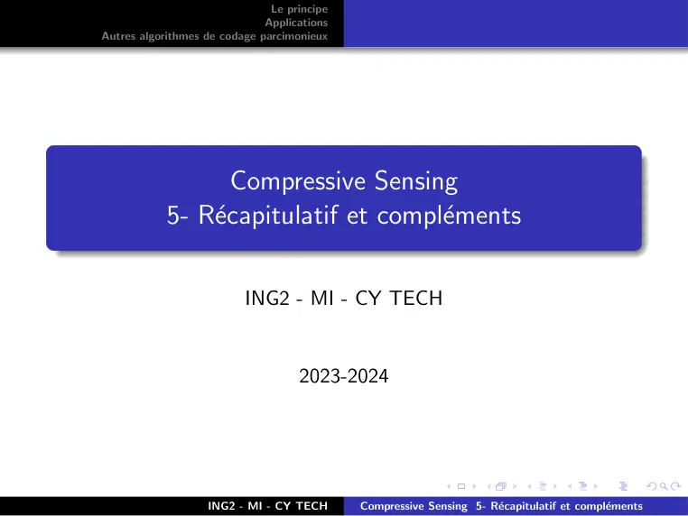

~~~text
                               Le principe
                              Applications
Autres algorithmes de codage parcimonieux

                  Compressive Sensing
            5- Récapitulatif et compléments

                          ING2 - MI - CY TECH

                                    2023-2024

                   ING2 - MI - CY TECH       Compressive Sensing 5- Récapitulatif et compléments
~~~

## Page 2

~~~text
                                     Le principe
                                    Applications
      Autres algorithmes de codage parcimonieux

1   Le principe

2   Applications

3   Autres algorithmes de codage parcimonieux

                         ING2 - MI - CY TECH       Compressive Sensing 5- Récapitulatif et compléments
~~~

## Page 3

~~~text
                               Le principe
                              Applications
Autres algorithmes de codage parcimonieux

                                   Section 1

                                 Le principe

                   ING2 - MI - CY TECH       Compressive Sensing 5- Récapitulatif et compléments
~~~

## Page 4

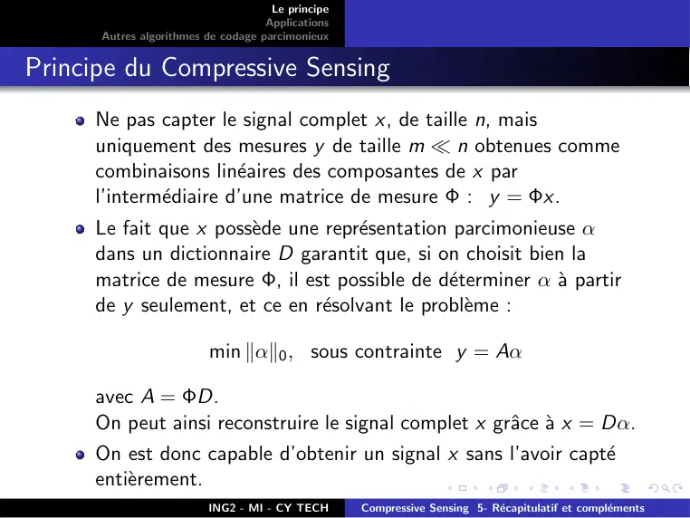

~~~text
                                     Le principe
                                    Applications
      Autres algorithmes de codage parcimonieux

Principe du Compressive Sensing
     Ne pas capter le signal complet x, de taille n, mais
     uniquement des mesures y de taille m  n obtenues comme
     combinaisons linéaires des composantes de x par
     l’intermédiaire d’une matrice de mesure Φ : y = Φx.
     Le fait que x possède une représentation parcimonieuse α
     dans un dictionnaire D garantit que, si on choisit bien la
     matrice de mesure Φ, il est possible de déterminer α à partir
     de y seulement, et ce en résolvant le problème :

                         min kαk0 , sous contrainte y = Aα

     avec A = ΦD.
     On peut ainsi reconstruire le signal complet x grâce à x = Dα.
     On est donc capable d’obtenir un signal x sans l’avoir capté
     entièrement.
                         ING2 - MI - CY TECH       Compressive Sensing 5- Récapitulatif et compléments
~~~

## Page 5

~~~text
                               Le principe
                              Applications
Autres algorithmes de codage parcimonieux

                                   Section 2

                                Applications

                   ING2 - MI - CY TECH       Compressive Sensing 5- Récapitulatif et compléments
~~~

## Page 6

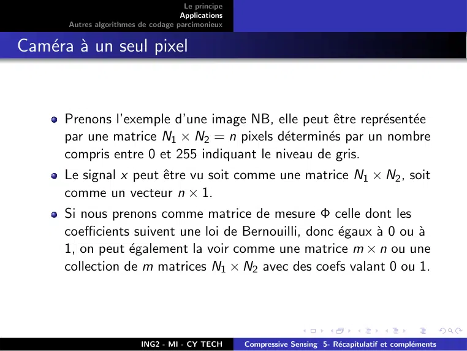

~~~text
                                      Le principe
                                     Applications
       Autres algorithmes de codage parcimonieux

Caméra à un seul pixel

      Prenons l’exemple d’une image NB, elle peut être représentée
      par une matrice N1 × N2 = n pixels déterminés par un nombre
      compris entre 0 et 255 indiquant le niveau de gris.
      Le signal x peut être vu soit comme une matrice N1 × N2 , soit
      comme un vecteur n × 1.
      Si nous prenons comme matrice de mesure Φ celle dont les
      coefficients suivent une loi de Bernouilli, donc égaux à 0 ou à
      1, on peut également la voir comme une matrice m × n ou une
      collection de m matrices N1 × N2 avec des coefs valant 0 ou 1.

                          ING2 - MI - CY TECH       Compressive Sensing 5- Récapitulatif et compléments
~~~

## Page 7

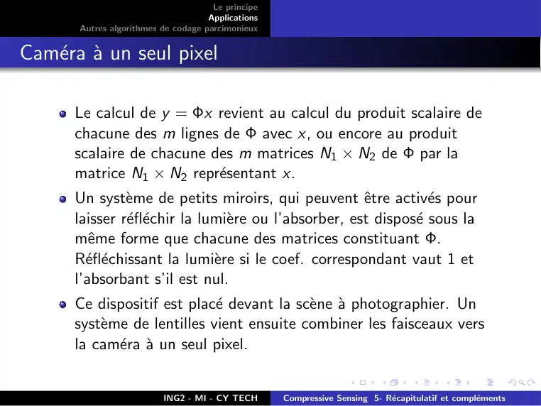

~~~text
                                      Le principe
                                     Applications
       Autres algorithmes de codage parcimonieux

Caméra à un seul pixel

      Le calcul de y = Φx revient au calcul du produit scalaire de
      chacune des m lignes de Φ avec x, ou encore au produit
      scalaire de chacune des m matrices N1 × N2 de Φ par la
      matrice N1 × N2 représentant x.
      Un système de petits miroirs, qui peuvent être activés pour
      laisser réfléchir la lumière ou l’absorber, est disposé sous la
      même forme que chacune des matrices constituant Φ.
      Réfléchissant la lumière si le coef. correspondant vaut 1 et
      l’absorbant s’il est nul.
      Ce dispositif est placé devant la scène à photographier. Un
      système de lentilles vient ensuite combiner les faisceaux vers
      la caméra à un seul pixel.

                          ING2 - MI - CY TECH       Compressive Sensing 5- Récapitulatif et compléments
~~~

## Page 8

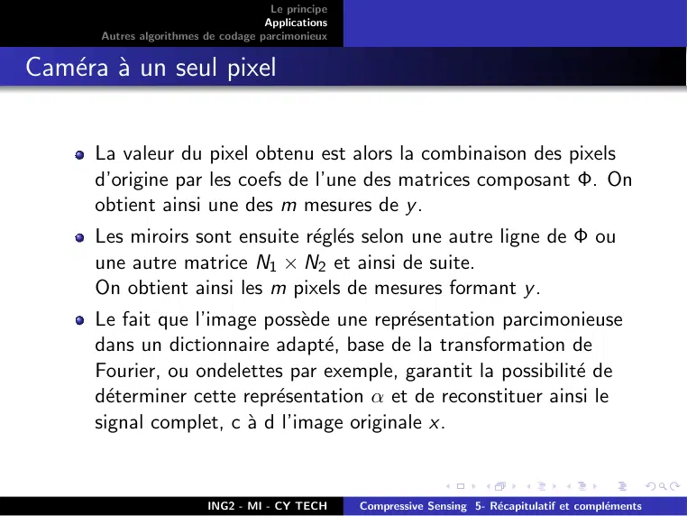

~~~text
                                      Le principe
                                     Applications
       Autres algorithmes de codage parcimonieux

Caméra à un seul pixel

      La valeur du pixel obtenu est alors la combinaison des pixels
      d’origine par les coefs de l’une des matrices composant Φ. On
      obtient ainsi une des m mesures de y .
      Les miroirs sont ensuite réglés selon une autre ligne de Φ ou
      une autre matrice N1 × N2 et ainsi de suite.
      On obtient ainsi les m pixels de mesures formant y .
      Le fait que l’image possède une représentation parcimonieuse
      dans un dictionnaire adapté, base de la transformation de
      Fourier, ou ondelettes par exemple, garantit la possibilité de
      déterminer cette représentation α et de reconstituer ainsi le
      signal complet, c à d l’image originale x.

                          ING2 - MI - CY TECH       Compressive Sensing 5- Récapitulatif et compléments
~~~

## Page 9

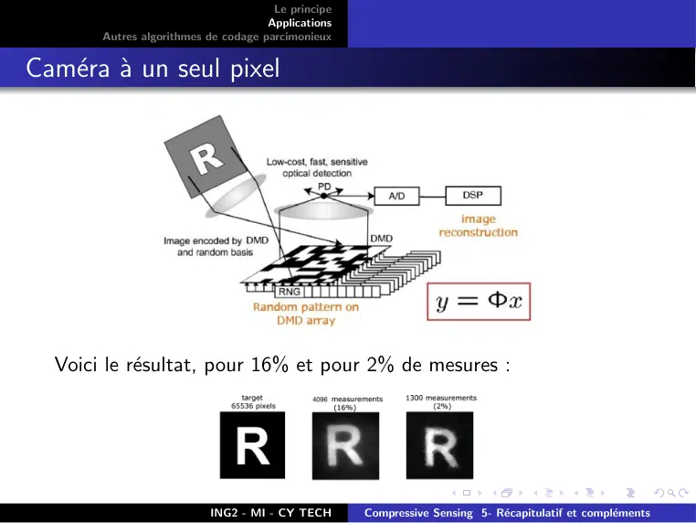

~~~text
                                      Le principe
                                     Applications
       Autres algorithmes de codage parcimonieux

Caméra à un seul pixel

  Voici le résultat, pour 16% et pour 2% de mesures :

                          ING2 - MI - CY TECH       Compressive Sensing 5- Récapitulatif et compléments
~~~

## Page 10

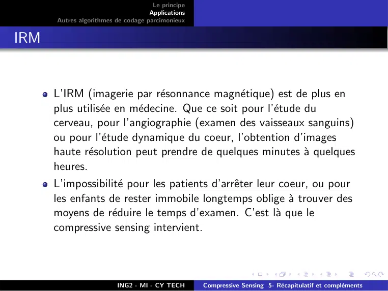

~~~text
                                     Le principe
                                    Applications
      Autres algorithmes de codage parcimonieux

IRM

      L’IRM (imagerie par résonnance magnétique) est de plus en
      plus utilisée en médecine. Que ce soit pour l’étude du
      cerveau, pour l’angiographie (examen des vaisseaux sanguins)
      ou pour l’étude dynamique du coeur, l’obtention d’images
      haute résolution peut prendre de quelques minutes à quelques
      heures.
      L’impossibilité pour les patients d’arrêter leur coeur, ou pour
      les enfants de rester immobile longtemps oblige à trouver des
      moyens de réduire le temps d’examen. C’est là que le
      compressive sensing intervient.

                         ING2 - MI - CY TECH       Compressive Sensing 5- Récapitulatif et compléments
~~~

## Page 11

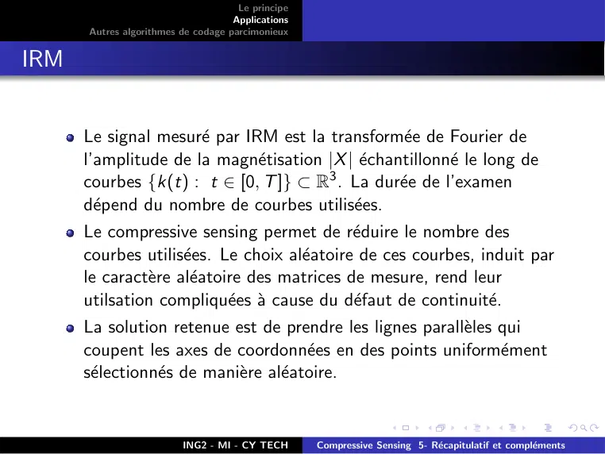

~~~text
                                     Le principe
                                    Applications
      Autres algorithmes de codage parcimonieux

IRM

      Le signal mesuré par IRM est la transformée de Fourier de
      l’amplitude de la magnétisation |X | échantillonné le long de
      courbes {k(t) : t ∈ [0, T ]} ⊂ R3 . La durée de l’examen
      dépend du nombre de courbes utilisées.
      Le compressive sensing permet de réduire le nombre des
      courbes utilisées. Le choix aléatoire de ces courbes, induit par
      le caractère aléatoire des matrices de mesure, rend leur
      utilsation compliquées à cause du défaut de continuité.
      La solution retenue est de prendre les lignes parallèles qui
      coupent les axes de coordonnées en des points uniformément
      sélectionnés de manière aléatoire.

                         ING2 - MI - CY TECH       Compressive Sensing 5- Récapitulatif et compléments
~~~

## Page 12

~~~text
                                     Le principe
                                    Applications
      Autres algorithmes de codage parcimonieux

IRM

                         ING2 - MI - CY TECH       Compressive Sensing 5- Récapitulatif et compléments
~~~

## Page 13

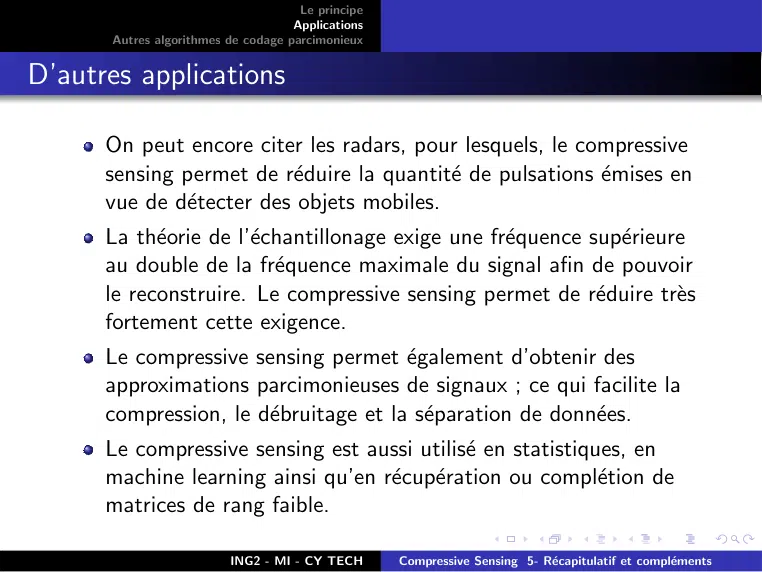

~~~text
                                     Le principe
                                    Applications
      Autres algorithmes de codage parcimonieux

D’autres applications

      On peut encore citer les radars, pour lesquels, le compressive
      sensing permet de réduire la quantité de pulsations émises en
      vue de détecter des objets mobiles.
      La théorie de l’échantillonage exige une fréquence supérieure
      au double de la fréquence maximale du signal afin de pouvoir
      le reconstruire. Le compressive sensing permet de réduire très
      fortement cette exigence.
      Le compressive sensing permet également d’obtenir des
      approximations parcimonieuses de signaux ; ce qui facilite la
      compression, le débruitage et la séparation de données.
      Le compressive sensing est aussi utilisé en statistiques, en
      machine learning ainsi qu’en récupération ou complétion de
      matrices de rang faible.

                         ING2 - MI - CY TECH       Compressive Sensing 5- Récapitulatif et compléments
~~~

## Page 14

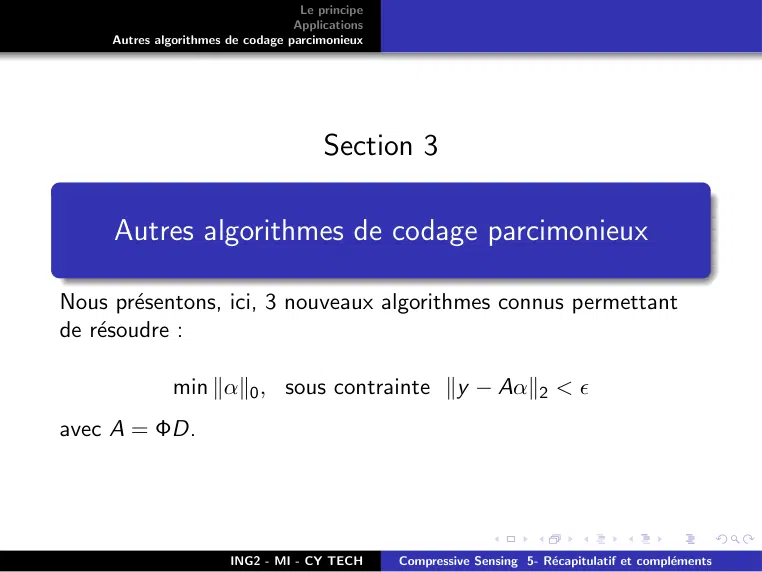

~~~text
                                    Le principe
                                   Applications
     Autres algorithmes de codage parcimonieux

                                        Section 3

     Autres algorithmes de codage parcimonieux

Nous présentons, ici, 3 nouveaux algorithmes connus permettant
de résoudre :

               min kαk0 , sous contrainte ky − Aαk2 < 
avec A = ΦD.

                        ING2 - MI - CY TECH       Compressive Sensing 5- Récapitulatif et compléments
~~~

## Page 15

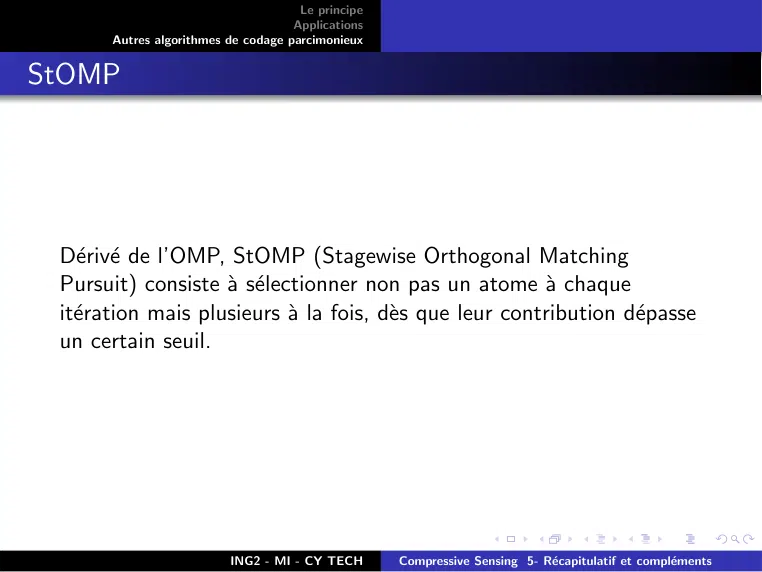

~~~text
                                      Le principe
                                     Applications
       Autres algorithmes de codage parcimonieux

StOMP

 Dérivé de l’OMP, StOMP (Stagewise Orthogonal Matching
 Pursuit) consiste à sélectionner non pas un atome à chaque
 itération mais plusieurs à la fois, dès que leur contribution dépasse
 un certain seuil.

                          ING2 - MI - CY TECH       Compressive Sensing 5- Récapitulatif et compléments
~~~

## Page 16

~~~text
                                   Le principe
                                  Applications
    Autres algorithmes de codage parcimonieux

StOMP

                       ING2 - MI - CY TECH       Compressive Sensing 5- Récapitulatif et compléments
~~~

## Page 17

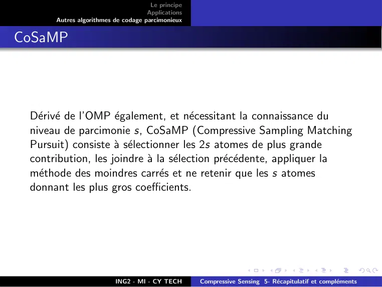

~~~text
                                     Le principe
                                    Applications
      Autres algorithmes de codage parcimonieux

CoSaMP

 Dérivé de l’OMP également, et nécessitant la connaissance du
 niveau de parcimonie s, CoSaMP (Compressive Sampling Matching
 Pursuit) consiste à sélectionner les 2s atomes de plus grande
 contribution, les joindre à la sélection précédente, appliquer la
 méthode des moindres carrés et ne retenir que les s atomes
 donnant les plus gros coefficients.

                         ING2 - MI - CY TECH       Compressive Sensing 5- Récapitulatif et compléments
~~~

## Page 18

~~~text
                                   Le principe
                                  Applications
    Autres algorithmes de codage parcimonieux

CoSaMP

                       ING2 - MI - CY TECH       Compressive Sensing 5- Récapitulatif et compléments
~~~

## Page 19

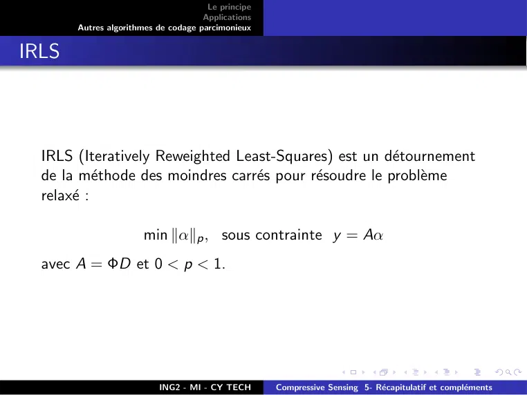

~~~text
                                      Le principe
                                     Applications
       Autres algorithmes de codage parcimonieux

IRLS

  IRLS (Iteratively Reweighted Least-Squares) est un détournement
  de la méthode des moindres carrés pour résoudre le problème
  relaxé :

                      min kαkp , sous contrainte y = Aα
  avec A = ΦD et 0 < p < 1.

                          ING2 - MI - CY TECH       Compressive Sensing 5- Récapitulatif et compléments
~~~

## Page 20

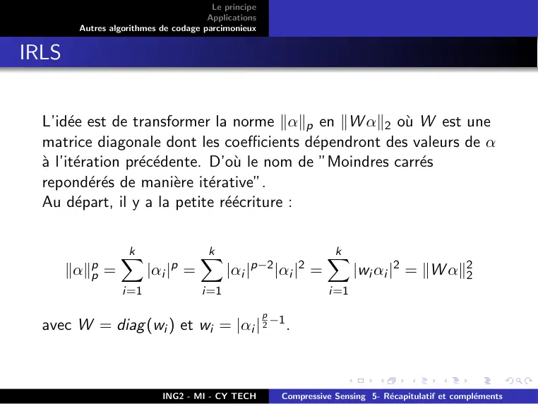

~~~text
                                       Le principe
                                      Applications
        Autres algorithmes de codage parcimonieux

IRLS

  L’idée est de transformer la norme kαkp en kW αk2 où W est une
  matrice diagonale dont les coefficients dépendront des valeurs de α
  à l’itération précédente. D’où le nom de ”Moindres carrés
  repondérés de manière itérative”.
  Au départ, il y a la petite réécriture :

                 k
                 X                  k
                                    X                               k
                                                                    X
       kαkpp =               p
                        |αi | =            |αi |p−2           2
                                                         |αi | =           |wi αi |2 = kW αk22
                  i=1                i=1                             i=1
                                                     p
  avec W = diag (wi ) et wi = |αi | 2 −1 .

                           ING2 - MI - CY TECH            Compressive Sensing 5- Récapitulatif et compléments
~~~

## Page 21

~~~text
                                      Le principe
                                     Applications
       Autres algorithmes de codage parcimonieux

IRLS

                          ING2 - MI - CY TECH       Compressive Sensing 5- Récapitulatif et compléments
~~~
