# Slides1-Compressive-Sensing24.pdf

[Ouvrir l’original](https://drive.google.com/open?id=1X95a5k-RFqynPYiK_OOpHO0g4CFZmWou) · Les deux lectures automatiques du PDF divergent sur les pages indiquées. Leur fac-similé accompagne le texte.

**Pages présentant un écart entre les deux extractions** — 4–9, 11–12, 20–23, 25–26, 28–40, 43–46, 48.

## Page 1

~~~text
                      Introduction
           Organisation du module
Parcimonie et codage parcimonieux

              Compressive Sensing
             Acquisition comprimée

                  ING2 - MI - CY TECH

                            2023-2024

           ING2 - MI - CY TECH       Compressive Sensing Acquisition comprimée
~~~

## Page 2

~~~text
                                 Introduction
                      Organisation du module
           Parcimonie et codage parcimonieux

1   Introduction

2   Organisation du module

3   Parcimonie et codage parcimonieux

                      ING2 - MI - CY TECH       Compressive Sensing Acquisition comprimée
~~~

## Page 3

~~~text
                      Introduction
           Organisation du module
Parcimonie et codage parcimonieux

                           Section 1

                        Introduction

           ING2 - MI - CY TECH       Compressive Sensing Acquisition comprimée
~~~

## Page 4

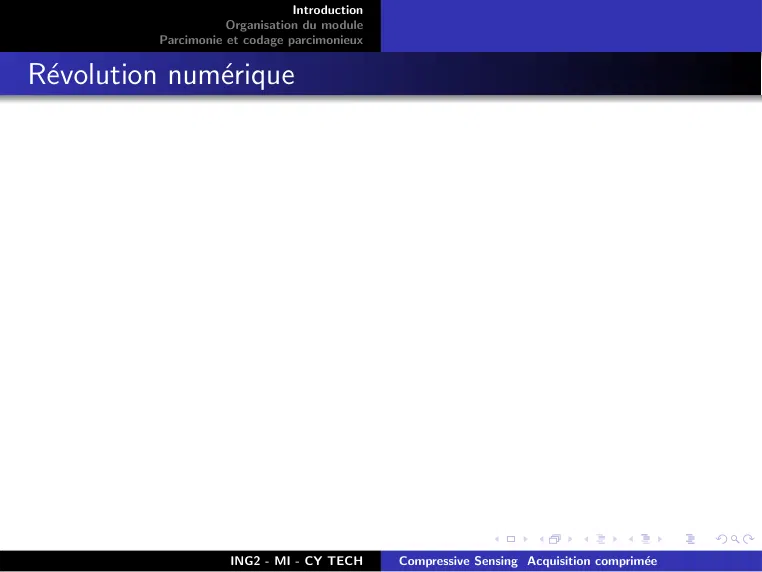

~~~text
                                Introduction
                     Organisation du module
          Parcimonie et codage parcimonieux

Révolution numérique

                     ING2 - MI - CY TECH       Compressive Sensing Acquisition comprimée
~~~

## Page 5

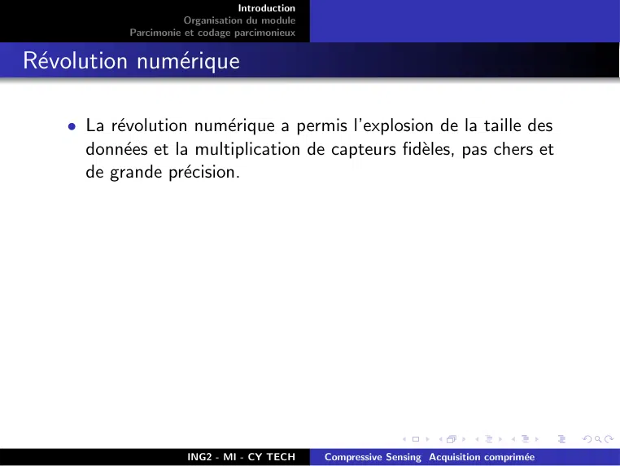

~~~text
                                  Introduction
                       Organisation du module
            Parcimonie et codage parcimonieux

Révolution numérique

    • La révolution numérique a permis l’explosion de la taille des
      données et la multiplication de capteurs fidèles, pas chers et
      de grande précision.

                       ING2 - MI - CY TECH       Compressive Sensing Acquisition comprimée
~~~

## Page 6

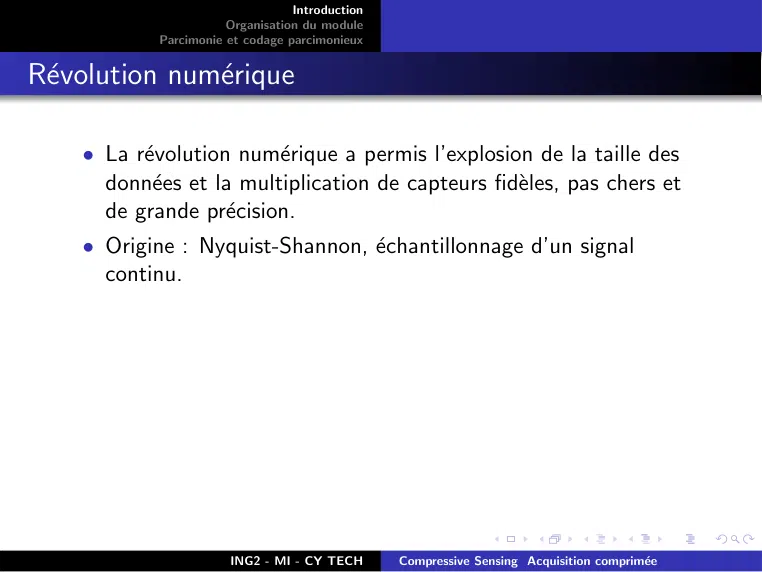

~~~text
                                  Introduction
                       Organisation du module
            Parcimonie et codage parcimonieux

Révolution numérique

    • La révolution numérique a permis l’explosion de la taille des
      données et la multiplication de capteurs fidèles, pas chers et
      de grande précision.
    • Origine : Nyquist-Shannon, échantillonnage d’un signal
      continu.

                       ING2 - MI - CY TECH       Compressive Sensing Acquisition comprimée
~~~

## Page 7

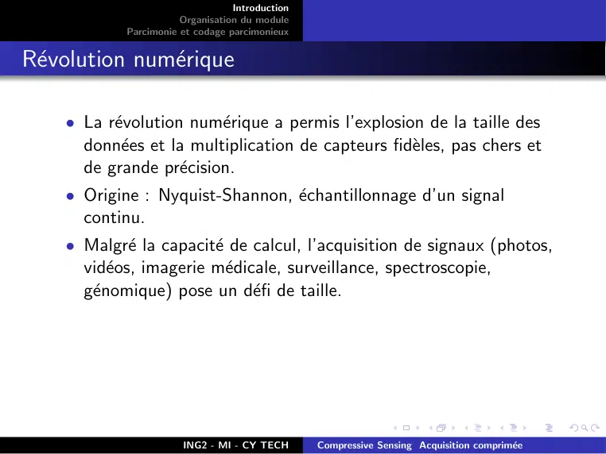

~~~text
                                  Introduction
                       Organisation du module
            Parcimonie et codage parcimonieux

Révolution numérique

    • La révolution numérique a permis l’explosion de la taille des
      données et la multiplication de capteurs fidèles, pas chers et
      de grande précision.
    • Origine : Nyquist-Shannon, échantillonnage d’un signal
      continu.
    • Malgré la capacité de calcul, l’acquisition de signaux (photos,
      vidéos, imagerie médicale, surveillance, spectroscopie,
      génomique) pose un défi de taille.

                       ING2 - MI - CY TECH       Compressive Sensing Acquisition comprimée
~~~

## Page 8

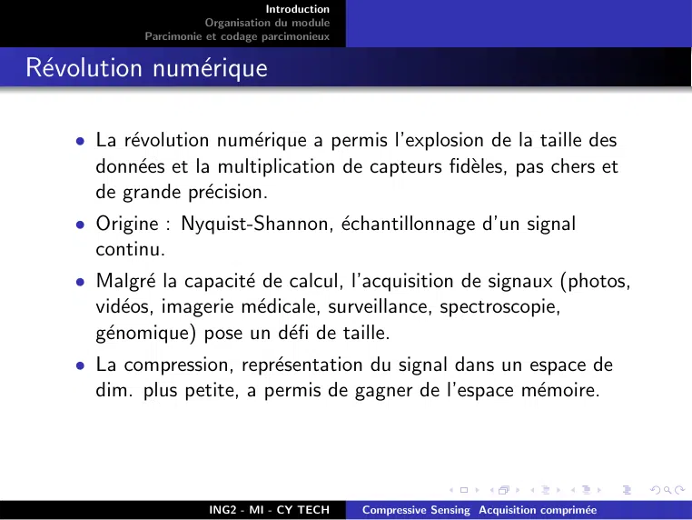

~~~text
                                  Introduction
                       Organisation du module
            Parcimonie et codage parcimonieux

Révolution numérique

    • La révolution numérique a permis l’explosion de la taille des
      données et la multiplication de capteurs fidèles, pas chers et
      de grande précision.
    • Origine : Nyquist-Shannon, échantillonnage d’un signal
      continu.
    • Malgré la capacité de calcul, l’acquisition de signaux (photos,
      vidéos, imagerie médicale, surveillance, spectroscopie,
      génomique) pose un défi de taille.
    • La compression, représentation du signal dans un espace de
      dim. plus petite, a permis de gagner de l’espace mémoire.

                       ING2 - MI - CY TECH       Compressive Sensing Acquisition comprimée
~~~

## Page 9

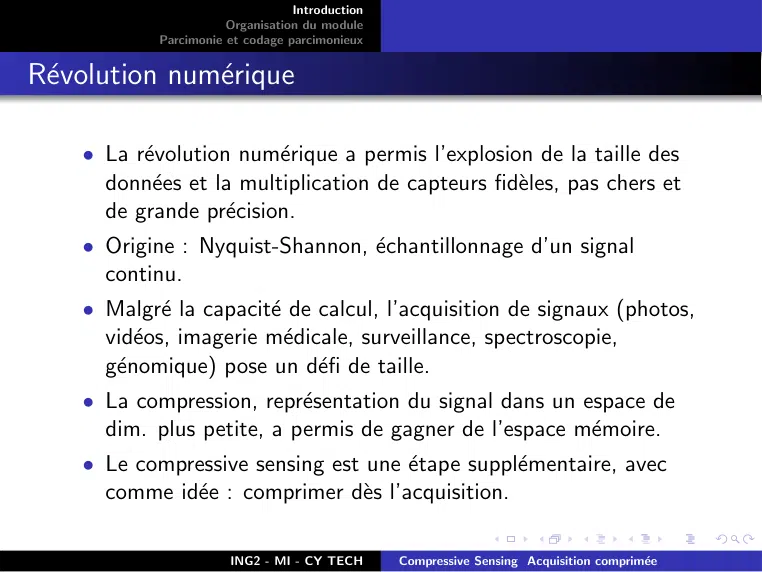

~~~text
                                  Introduction
                       Organisation du module
            Parcimonie et codage parcimonieux

Révolution numérique

    • La révolution numérique a permis l’explosion de la taille des
      données et la multiplication de capteurs fidèles, pas chers et
      de grande précision.
    • Origine : Nyquist-Shannon, échantillonnage d’un signal
      continu.
    • Malgré la capacité de calcul, l’acquisition de signaux (photos,
      vidéos, imagerie médicale, surveillance, spectroscopie,
      génomique) pose un défi de taille.
    • La compression, représentation du signal dans un espace de
      dim. plus petite, a permis de gagner de l’espace mémoire.
    • Le compressive sensing est une étape supplémentaire, avec
      comme idée : comprimer dès l’acquisition.

                       ING2 - MI - CY TECH       Compressive Sensing Acquisition comprimée
~~~

## Page 10

~~~text
                               Introduction
                    Organisation du module
         Parcimonie et codage parcimonieux

Compression

                    ING2 - MI - CY TECH       Compressive Sensing Acquisition comprimée
~~~

## Page 11

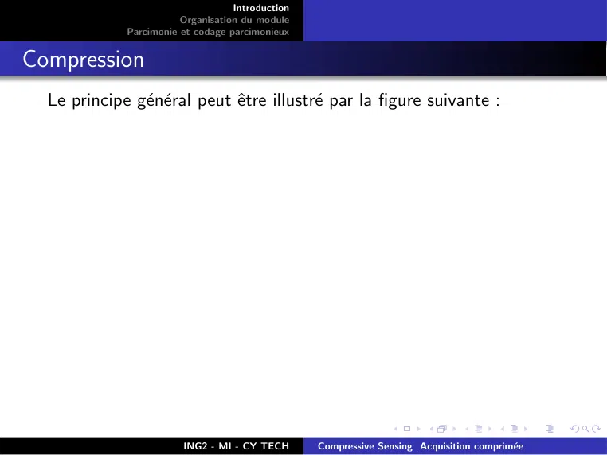

~~~text
                                   Introduction
                        Organisation du module
             Parcimonie et codage parcimonieux

Compression
  Le principe général peut être illustré par la figure suivante :

                        ING2 - MI - CY TECH       Compressive Sensing Acquisition comprimée
~~~

## Page 12

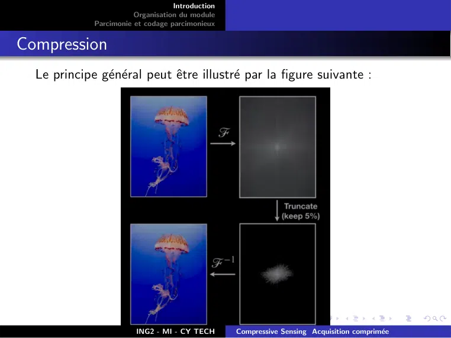

~~~text
                                   Introduction
                        Organisation du module
             Parcimonie et codage parcimonieux

Compression
  Le principe général peut être illustré par la figure suivante :

                        ING2 - MI - CY TECH       Compressive Sensing Acquisition comprimée
~~~

## Page 13

~~~text
                               Introduction
                    Organisation du module
         Parcimonie et codage parcimonieux

Compression

                    ING2 - MI - CY TECH       Compressive Sensing Acquisition comprimée
~~~

## Page 14

~~~text
                                Introduction
                     Organisation du module
          Parcimonie et codage parcimonieux

Compression

   • Une transformation de Fourier F permet de transformer
     l’image en autant de coefs que de pixels.

                     ING2 - MI - CY TECH       Compressive Sensing Acquisition comprimée
~~~

## Page 15

~~~text
                                 Introduction
                      Organisation du module
           Parcimonie et codage parcimonieux

Compression

   • Une transformation de Fourier F permet de transformer
     l’image en autant de coefs que de pixels.
   • Plus le pixel est lumineux, plus le coef est important.

                      ING2 - MI - CY TECH       Compressive Sensing Acquisition comprimée
~~~

## Page 16

~~~text
                                 Introduction
                      Organisation du module
           Parcimonie et codage parcimonieux

Compression

   • Une transformation de Fourier F permet de transformer
     l’image en autant de coefs que de pixels.
   • Plus le pixel est lumineux, plus le coef est important.
   • On annule 95% des coefs les plus bas qui deviennent noirs
     (troncature aux 5% les plus hauts).

                      ING2 - MI - CY TECH       Compressive Sensing Acquisition comprimée
~~~

## Page 17

~~~text
                                 Introduction
                      Organisation du module
           Parcimonie et codage parcimonieux

Compression

   • Une transformation de Fourier F permet de transformer
     l’image en autant de coefs que de pixels.
   • Plus le pixel est lumineux, plus le coef est important.
   • On annule 95% des coefs les plus bas qui deviennent noirs
     (troncature aux 5% les plus hauts).
   • On a ainsi gagné 95% de taille de mémoire pour représenter
     cette image.

                      ING2 - MI - CY TECH       Compressive Sensing Acquisition comprimée
~~~

## Page 18

~~~text
                                 Introduction
                      Organisation du module
           Parcimonie et codage parcimonieux

Compression

   • Une transformation de Fourier F permet de transformer
     l’image en autant de coefs que de pixels.
   • Plus le pixel est lumineux, plus le coef est important.
   • On annule 95% des coefs les plus bas qui deviennent noirs
     (troncature aux 5% les plus hauts).
   • On a ainsi gagné 95% de taille de mémoire pour représenter
     cette image.
   • La reconstruction de l’image, par la transformée de Fourier
     inverse, donne une très bonne copie de l’image d’origine.

                      ING2 - MI - CY TECH       Compressive Sensing Acquisition comprimée
~~~

## Page 19

~~~text
                                Introduction
                     Organisation du module
          Parcimonie et codage parcimonieux

Question posée

                     ING2 - MI - CY TECH       Compressive Sensing Acquisition comprimée
~~~

## Page 20

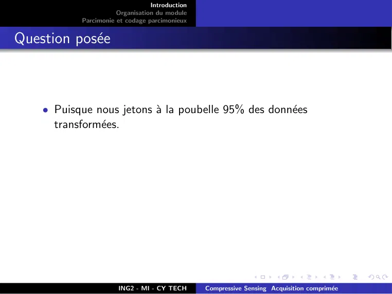

~~~text
                                 Introduction
                      Organisation du module
           Parcimonie et codage parcimonieux

Question posée

    • Puisque nous jetons à la poubelle 95% des données
      transformées.

                      ING2 - MI - CY TECH       Compressive Sensing Acquisition comprimée
~~~

## Page 21

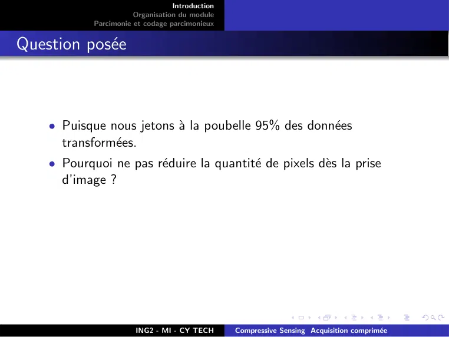

~~~text
                                  Introduction
                       Organisation du module
            Parcimonie et codage parcimonieux

Question posée

    • Puisque nous jetons à la poubelle 95% des données
      transformées.
    • Pourquoi ne pas réduire la quantité de pixels dès la prise
      d’image ?

                       ING2 - MI - CY TECH       Compressive Sensing Acquisition comprimée
~~~

## Page 22

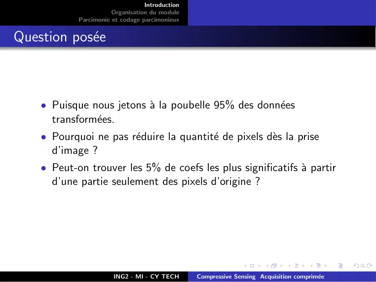

~~~text
                                  Introduction
                       Organisation du module
            Parcimonie et codage parcimonieux

Question posée

    • Puisque nous jetons à la poubelle 95% des données
      transformées.
    • Pourquoi ne pas réduire la quantité de pixels dès la prise
      d’image ?
    • Peut-on trouver les 5% de coefs les plus significatifs à partir
      d’une partie seulement des pixels d’origine ?

                       ING2 - MI - CY TECH       Compressive Sensing Acquisition comprimée
~~~

## Page 23

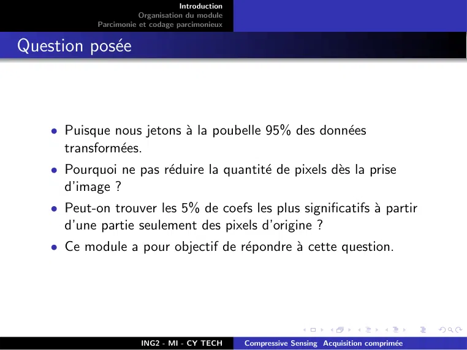

~~~text
                                  Introduction
                       Organisation du module
            Parcimonie et codage parcimonieux

Question posée

    • Puisque nous jetons à la poubelle 95% des données
      transformées.
    • Pourquoi ne pas réduire la quantité de pixels dès la prise
      d’image ?
    • Peut-on trouver les 5% de coefs les plus significatifs à partir
      d’une partie seulement des pixels d’origine ?
    • Ce module a pour objectif de répondre à cette question.

                       ING2 - MI - CY TECH       Compressive Sensing Acquisition comprimée
~~~

## Page 24

~~~text
                                Introduction
                     Organisation du module
          Parcimonie et codage parcimonieux

Question posée

                     ING2 - MI - CY TECH       Compressive Sensing Acquisition comprimée
~~~

## Page 25

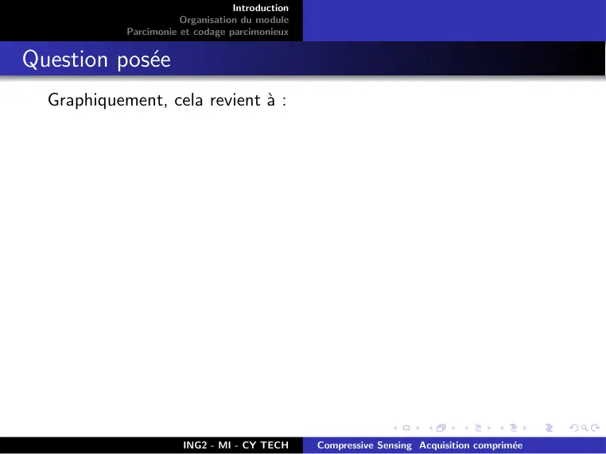

~~~text
                                  Introduction
                       Organisation du module
            Parcimonie et codage parcimonieux

Question posée
  Graphiquement, cela revient à :

                       ING2 - MI - CY TECH       Compressive Sensing Acquisition comprimée
~~~

## Page 26

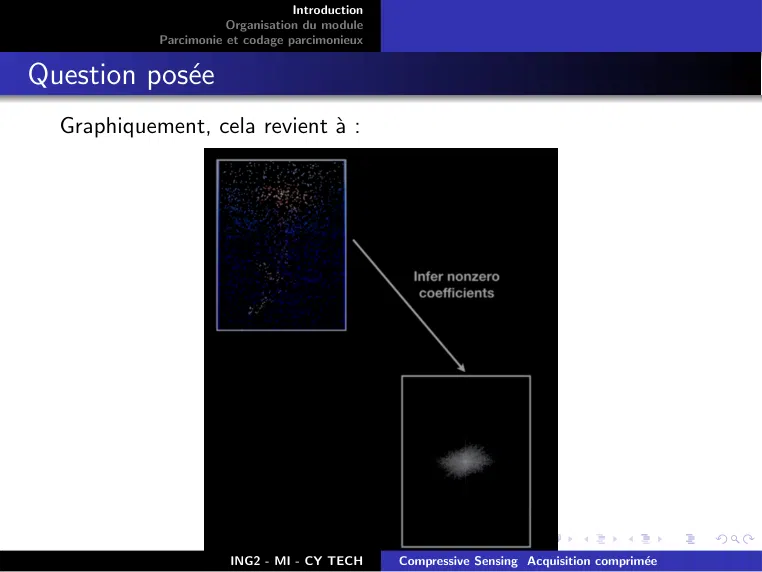

~~~text
                                  Introduction
                       Organisation du module
            Parcimonie et codage parcimonieux

Question posée
  Graphiquement, cela revient à :

                       ING2 - MI - CY TECH       Compressive Sensing Acquisition comprimée
~~~

## Page 27

~~~text
                                Introduction
                     Organisation du module
          Parcimonie et codage parcimonieux

Question posée

                     ING2 - MI - CY TECH       Compressive Sensing Acquisition comprimée
~~~

## Page 28

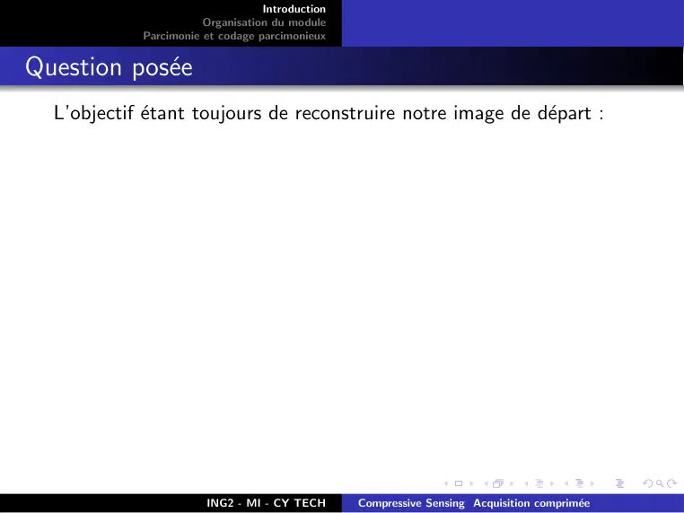

~~~text
                                  Introduction
                       Organisation du module
            Parcimonie et codage parcimonieux

Question posée
  L’objectif étant toujours de reconstruire notre image de départ :

                       ING2 - MI - CY TECH       Compressive Sensing Acquisition comprimée
~~~

## Page 29

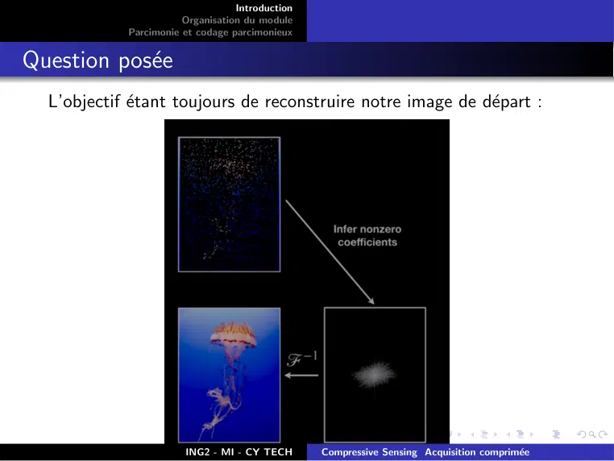

~~~text
                                  Introduction
                       Organisation du module
            Parcimonie et codage parcimonieux

Question posée
  L’objectif étant toujours de reconstruire notre image de départ :

                       ING2 - MI - CY TECH       Compressive Sensing Acquisition comprimée
~~~

## Page 30

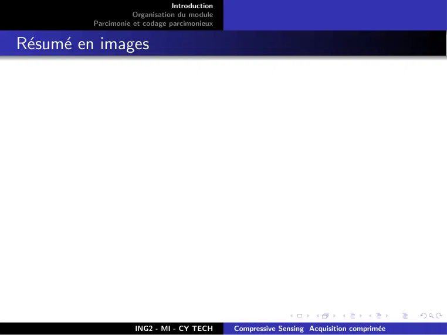

~~~text
                                Introduction
                     Organisation du module
          Parcimonie et codage parcimonieux

Résumé en images

                     ING2 - MI - CY TECH       Compressive Sensing Acquisition comprimée
~~~

## Page 31

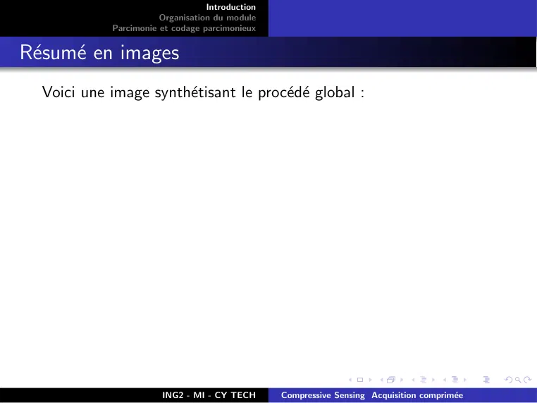

~~~text
                                   Introduction
                        Organisation du module
             Parcimonie et codage parcimonieux

Résumé en images
  Voici une image synthétisant le procédé global :

                        ING2 - MI - CY TECH       Compressive Sensing Acquisition comprimée
~~~

## Page 32

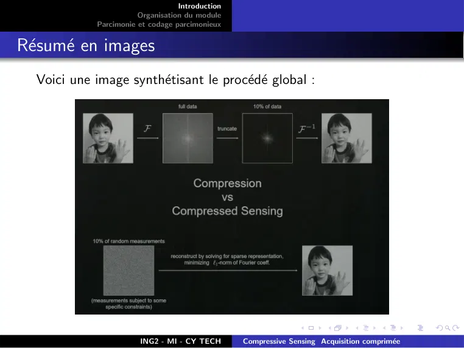

~~~text
                                   Introduction
                        Organisation du module
             Parcimonie et codage parcimonieux

Résumé en images
  Voici une image synthétisant le procédé global :

                        ING2 - MI - CY TECH       Compressive Sensing Acquisition comprimée
~~~

## Page 33

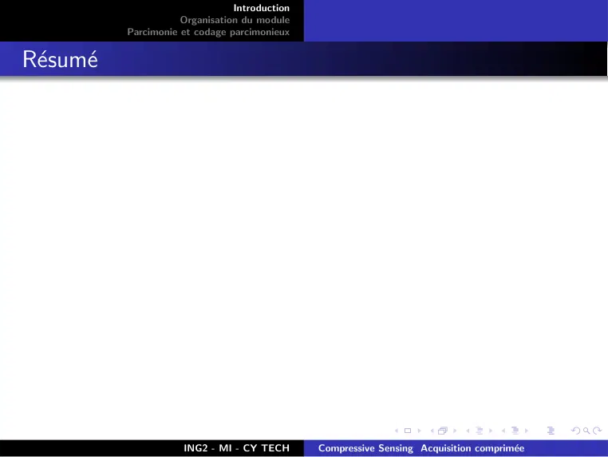

~~~text
                                 Introduction
                      Organisation du module
           Parcimonie et codage parcimonieux

Résumé

                      ING2 - MI - CY TECH       Compressive Sensing Acquisition comprimée
~~~

## Page 34

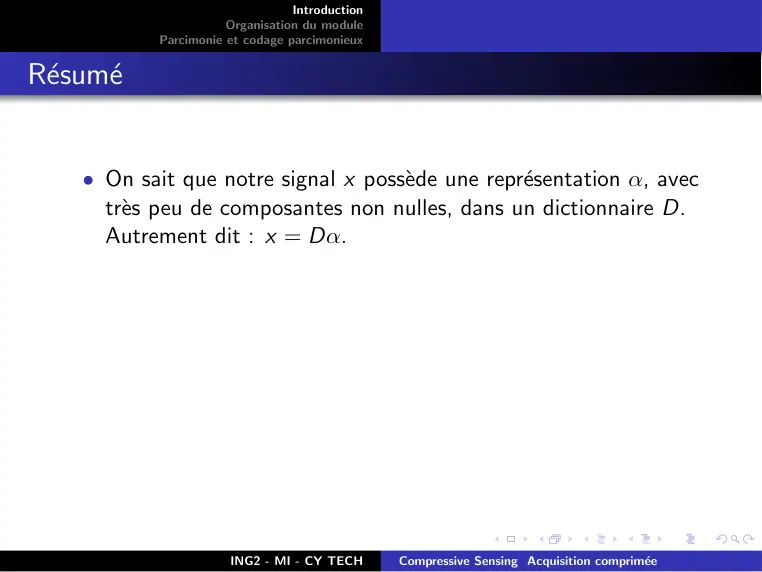

~~~text
                                  Introduction
                       Organisation du module
            Parcimonie et codage parcimonieux

Résumé

    • On sait que notre signal x possède une représentation α, avec
      très peu de composantes non nulles, dans un dictionnaire D.
      Autrement dit : x = Dα.

                       ING2 - MI - CY TECH       Compressive Sensing Acquisition comprimée
~~~

## Page 35

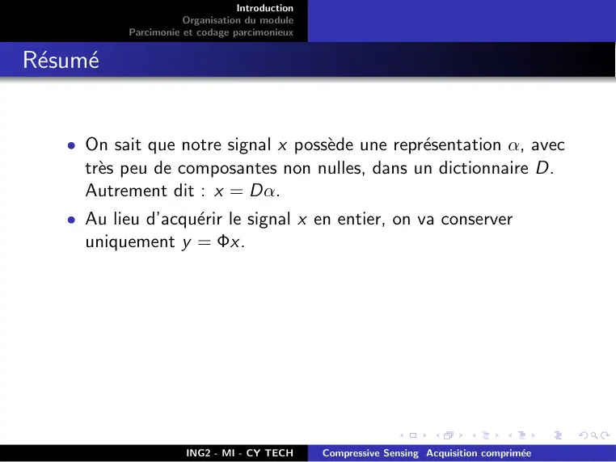

~~~text
                                  Introduction
                       Organisation du module
            Parcimonie et codage parcimonieux

Résumé

    • On sait que notre signal x possède une représentation α, avec
      très peu de composantes non nulles, dans un dictionnaire D.
      Autrement dit : x = Dα.
    • Au lieu d’acquérir le signal x en entier, on va conserver
      uniquement y = Φx.

                       ING2 - MI - CY TECH       Compressive Sensing Acquisition comprimée
~~~

## Page 36

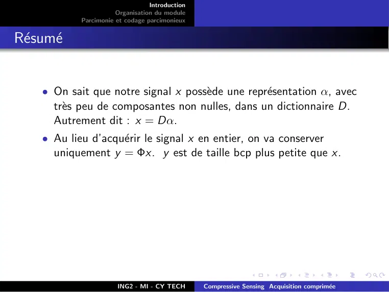

~~~text
                                  Introduction
                       Organisation du module
            Parcimonie et codage parcimonieux

Résumé

    • On sait que notre signal x possède une représentation α, avec
      très peu de composantes non nulles, dans un dictionnaire D.
      Autrement dit : x = Dα.
    • Au lieu d’acquérir le signal x en entier, on va conserver
      uniquement y = Φx. y est de taille bcp plus petite que x.

                       ING2 - MI - CY TECH       Compressive Sensing Acquisition comprimée
~~~

## Page 37

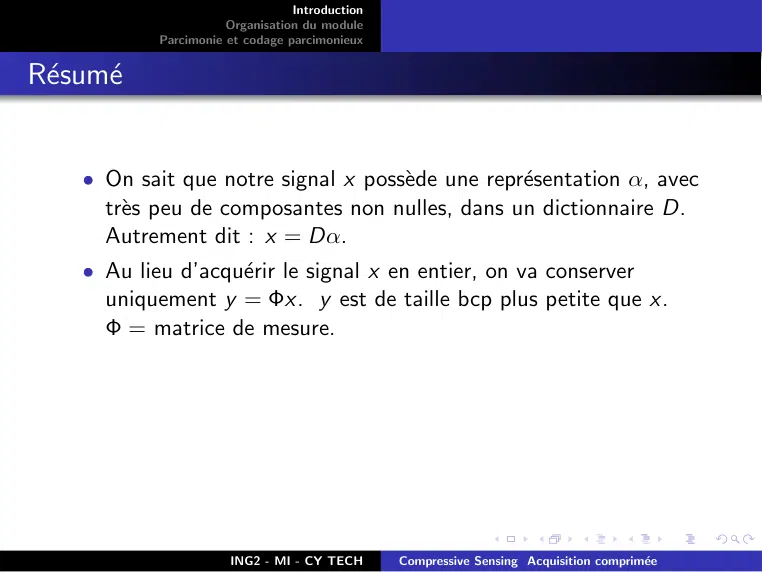

~~~text
                                  Introduction
                       Organisation du module
            Parcimonie et codage parcimonieux

Résumé

    • On sait que notre signal x possède une représentation α, avec
      très peu de composantes non nulles, dans un dictionnaire D.
      Autrement dit : x = Dα.
    • Au lieu d’acquérir le signal x en entier, on va conserver
      uniquement y = Φx. y est de taille bcp plus petite que x.
      Φ = matrice de mesure.

                       ING2 - MI - CY TECH       Compressive Sensing Acquisition comprimée
~~~

## Page 38

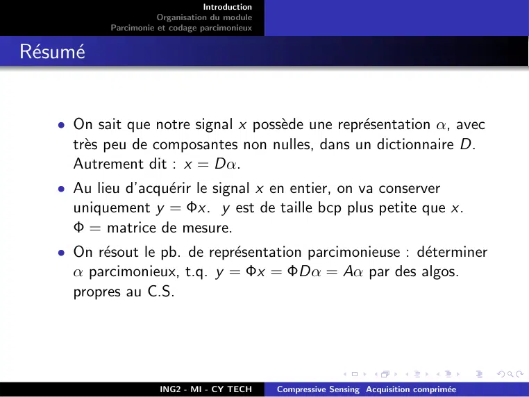

~~~text
                                  Introduction
                       Organisation du module
            Parcimonie et codage parcimonieux

Résumé

    • On sait que notre signal x possède une représentation α, avec
      très peu de composantes non nulles, dans un dictionnaire D.
      Autrement dit : x = Dα.
    • Au lieu d’acquérir le signal x en entier, on va conserver
      uniquement y = Φx. y est de taille bcp plus petite que x.
      Φ = matrice de mesure.
    • On résout le pb. de représentation parcimonieuse : déterminer
      α parcimonieux, t.q. y = Φx = ΦDα = Aα par des algos.
      propres au C.S.

                       ING2 - MI - CY TECH       Compressive Sensing Acquisition comprimée
~~~

## Page 39

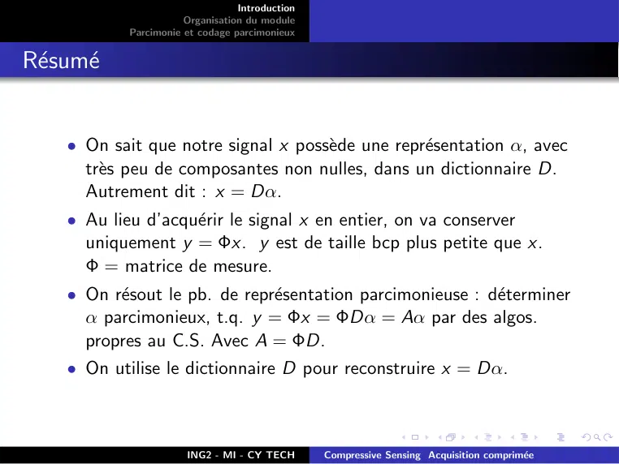

~~~text
                                  Introduction
                       Organisation du module
            Parcimonie et codage parcimonieux

Résumé

    • On sait que notre signal x possède une représentation α, avec
      très peu de composantes non nulles, dans un dictionnaire D.
      Autrement dit : x = Dα.
    • Au lieu d’acquérir le signal x en entier, on va conserver
      uniquement y = Φx. y est de taille bcp plus petite que x.
      Φ = matrice de mesure.
    • On résout le pb. de représentation parcimonieuse : déterminer
      α parcimonieux, t.q. y = Φx = ΦDα = Aα par des algos.
      propres au C.S. Avec A = ΦD.
    • On utilise le dictionnaire D pour reconstruire x = Dα.

                       ING2 - MI - CY TECH       Compressive Sensing Acquisition comprimée
~~~

## Page 40

~~~text
                                  Introduction
                       Organisation du module
            Parcimonie et codage parcimonieux

Résumé

    • On sait que notre signal x possède une représentation α, avec
      très peu de composantes non nulles, dans un dictionnaire D.
      Autrement dit : x = Dα.
    • Au lieu d’acquérir le signal x en entier, on va conserver
      uniquement y = Φx. y est de taille bcp plus petite que x.
      Φ = matrice de mesure.
    • On résout le pb. de représentation parcimonieuse : déterminer
      α parcimonieux, t.q. y = Φx = ΦDα = Aα par des algos.
      propres au C.S. Avec A = ΦD.
    • On utilise le dictionnaire D pour reconstruire x = Dα.

                       ING2 - MI - CY TECH       Compressive Sensing Acquisition comprimée
~~~

## Page 41

~~~text
                      Introduction
           Organisation du module
Parcimonie et codage parcimonieux

                           Section 2

            Organisation du module

           ING2 - MI - CY TECH       Compressive Sensing Acquisition comprimée
~~~

## Page 42

~~~text
                                Introduction
                     Organisation du module
          Parcimonie et codage parcimonieux

Les 4 thèmes

                     ING2 - MI - CY TECH       Compressive Sensing Acquisition comprimée
~~~

## Page 43

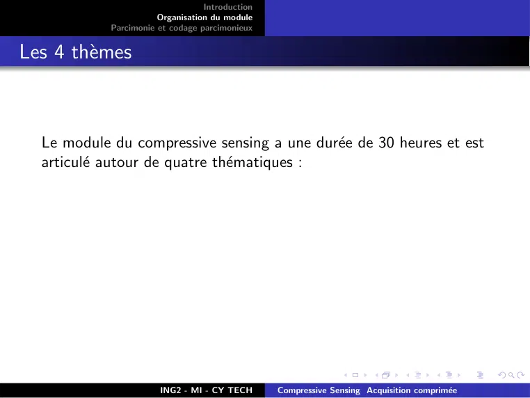

~~~text
                                  Introduction
                       Organisation du module
            Parcimonie et codage parcimonieux

Les 4 thèmes

  Le module du compressive sensing a une durée de 30 heures et est
  articulé autour de quatre thématiques :

                       ING2 - MI - CY TECH       Compressive Sensing Acquisition comprimée
~~~

## Page 44

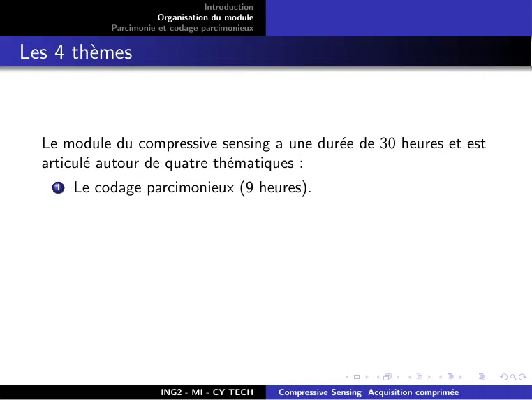

~~~text
                                   Introduction
                        Organisation du module
             Parcimonie et codage parcimonieux

Les 4 thèmes

  Le module du compressive sensing a une durée de 30 heures et est
  articulé autour de quatre thématiques :
    1   Le codage parcimonieux (9 heures).

                        ING2 - MI - CY TECH       Compressive Sensing Acquisition comprimée
~~~

## Page 45

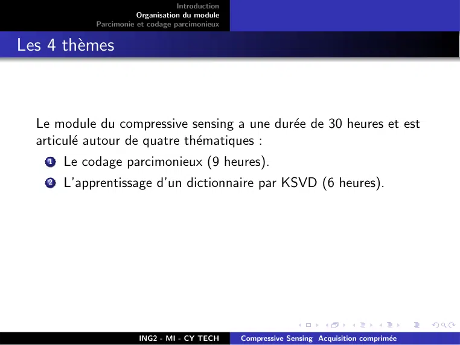

~~~text
                                   Introduction
                        Organisation du module
             Parcimonie et codage parcimonieux

Les 4 thèmes

  Le module du compressive sensing a une durée de 30 heures et est
  articulé autour de quatre thématiques :
    1   Le codage parcimonieux (9 heures).
    2   L’apprentissage d’un dictionnaire par KSVD (6 heures).

                        ING2 - MI - CY TECH       Compressive Sensing Acquisition comprimée
~~~

## Page 46

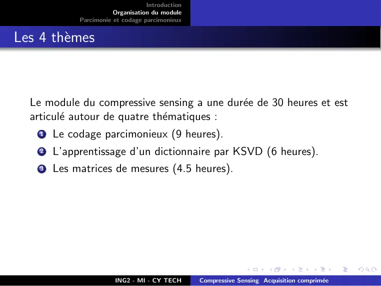

~~~text
                                   Introduction
                        Organisation du module
             Parcimonie et codage parcimonieux

Les 4 thèmes

  Le module du compressive sensing a une durée de 30 heures et est
  articulé autour de quatre thématiques :
    1   Le codage parcimonieux (9 heures).
    2   L’apprentissage d’un dictionnaire par KSVD (6 heures).
    3   Les matrices de mesures (4.5 heures).

                        ING2 - MI - CY TECH       Compressive Sensing Acquisition comprimée
~~~

## Page 47

~~~text
                                   Introduction
                        Organisation du module
             Parcimonie et codage parcimonieux

Les 4 thèmes

  Le module du compressive sensing a une durée de 30 heures et est
  articulé autour de quatre thématiques :
    1   Le codage parcimonieux (9 heures).
    2   L’apprentissage d’un dictionnaire par KSVD (6 heures).
    3   Les matrices de mesures (4.5 heures).
    4   Le compressive sensing (10.5 heures).

                        ING2 - MI - CY TECH       Compressive Sensing Acquisition comprimée
~~~

## Page 48

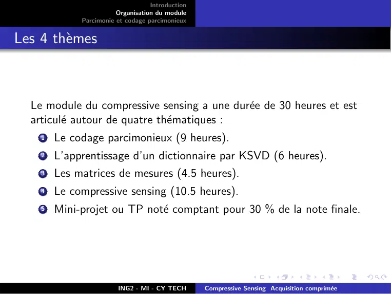

~~~text
                                   Introduction
                        Organisation du module
             Parcimonie et codage parcimonieux

Les 4 thèmes

  Le module du compressive sensing a une durée de 30 heures et est
  articulé autour de quatre thématiques :
    1   Le codage parcimonieux (9 heures).
    2   L’apprentissage d’un dictionnaire par KSVD (6 heures).
    3   Les matrices de mesures (4.5 heures).
    4   Le compressive sensing (10.5 heures).
    5   Mini-projet ou TP noté comptant pour 30 % de la note finale.

                        ING2 - MI - CY TECH       Compressive Sensing Acquisition comprimée
~~~

## Page 49

~~~text
                      Introduction
           Organisation du module
Parcimonie et codage parcimonieux

                           Section 3

Parcimonie et codage parcimonieux

           ING2 - MI - CY TECH       Compressive Sensing Acquisition comprimée
~~~

## Page 50

~~~text
                      Introduction
           Organisation du module
Parcimonie et codage parcimonieux

           ING2 - MI - CY TECH       Compressive Sensing Acquisition comprimée
~~~

## Page 51

~~~text
                      Introduction
           Organisation du module
Parcimonie et codage parcimonieux

           ING2 - MI - CY TECH       Compressive Sensing Acquisition comprimée
~~~

## Page 52

~~~text
                                Introduction
                     Organisation du module
          Parcimonie et codage parcimonieux

Représentation parcimonieuse

                     ING2 - MI - CY TECH       Compressive Sensing Acquisition comprimée
~~~

## Page 53

~~~text
                                Introduction
                     Organisation du module
          Parcimonie et codage parcimonieux

Représentation parcimonieuse

                     ING2 - MI - CY TECH       Compressive Sensing Acquisition comprimée
~~~

## Page 54

~~~text
                      Introduction
           Organisation du module
Parcimonie et codage parcimonieux

           ING2 - MI - CY TECH       Compressive Sensing Acquisition comprimée
~~~

## Page 55

~~~text
                      Introduction
           Organisation du module
Parcimonie et codage parcimonieux

           ING2 - MI - CY TECH       Compressive Sensing Acquisition comprimée
~~~

## Page 56

~~~text
                                Introduction
                     Organisation du module
          Parcimonie et codage parcimonieux

Exemple

                     ING2 - MI - CY TECH       Compressive Sensing Acquisition comprimée
~~~

## Page 57

~~~text
                                Introduction
                     Organisation du module
          Parcimonie et codage parcimonieux

Exemple

                     ING2 - MI - CY TECH       Compressive Sensing Acquisition comprimée
~~~

## Page 58

~~~text
                                Introduction
                     Organisation du module
          Parcimonie et codage parcimonieux

Exemple

                     ING2 - MI - CY TECH       Compressive Sensing Acquisition comprimée
~~~

## Page 59

~~~text
                                Introduction
                     Organisation du module
          Parcimonie et codage parcimonieux

Exemple

                     ING2 - MI - CY TECH       Compressive Sensing Acquisition comprimée
~~~

## Page 60

~~~text
                                Introduction
                     Organisation du module
          Parcimonie et codage parcimonieux

Exemple

                     ING2 - MI - CY TECH       Compressive Sensing Acquisition comprimée
~~~

## Page 61

~~~text
                                Introduction
                     Organisation du module
          Parcimonie et codage parcimonieux

Exemple

                     ING2 - MI - CY TECH       Compressive Sensing Acquisition comprimée
~~~

## Page 62

~~~text
                      Introduction
           Organisation du module
Parcimonie et codage parcimonieux

           ING2 - MI - CY TECH       Compressive Sensing Acquisition comprimée
~~~

## Page 63

~~~text
                      Introduction
           Organisation du module
Parcimonie et codage parcimonieux

           ING2 - MI - CY TECH       Compressive Sensing Acquisition comprimée
~~~

## Page 64

~~~text
                      Introduction
           Organisation du module
Parcimonie et codage parcimonieux

           ING2 - MI - CY TECH       Compressive Sensing Acquisition comprimée
~~~

## Page 65

~~~text
                      Introduction
           Organisation du module
Parcimonie et codage parcimonieux

           ING2 - MI - CY TECH       Compressive Sensing Acquisition comprimée
~~~

## Page 66

~~~text
                                 Introduction
                      Organisation du module
           Parcimonie et codage parcimonieux

Condition d’unicité

                      ING2 - MI - CY TECH       Compressive Sensing Acquisition comprimée
~~~

## Page 67

~~~text
                                 Introduction
                      Organisation du module
           Parcimonie et codage parcimonieux

Condition d’unicité

                      ING2 - MI - CY TECH       Compressive Sensing Acquisition comprimée
~~~

## Page 68

~~~text
                      Introduction
           Organisation du module
Parcimonie et codage parcimonieux

           ING2 - MI - CY TECH       Compressive Sensing Acquisition comprimée
~~~

## Page 69

~~~text
                      Introduction
           Organisation du module
Parcimonie et codage parcimonieux

           ING2 - MI - CY TECH       Compressive Sensing Acquisition comprimée
~~~

## Page 70

~~~text
                                Introduction
                     Organisation du module
          Parcimonie et codage parcimonieux

Exemples de dicos

                     ING2 - MI - CY TECH       Compressive Sensing Acquisition comprimée
~~~

## Page 71

~~~text
                                Introduction
                     Organisation du module
          Parcimonie et codage parcimonieux

Exemples de dicos

                     ING2 - MI - CY TECH       Compressive Sensing Acquisition comprimée
~~~

## Page 72

~~~text
                              Introduction
                   Organisation du module
        Parcimonie et codage parcimonieux

DCT et DFT

                   ING2 - MI - CY TECH       Compressive Sensing Acquisition comprimée
~~~

## Page 73

~~~text
                              Introduction
                   Organisation du module
        Parcimonie et codage parcimonieux

DCT et DFT

                                        -

                   ING2 - MI - CY TECH       Compressive Sensing Acquisition comprimée
~~~
