# Slides2-Compressive-Sensing24.pdf

[Ouvrir l’original](https://drive.google.com/open?id=1pedoDqDl8J6D3hGesIprBt4tIgWGrxZc) · Les deux lectures automatiques du PDF divergent sur les pages indiquées. Leur fac-similé accompagne le texte.

**Pages présentant un écart entre les deux extractions** — 7–9, 13–21, 24–27, 29–36, 38–40, 43–44, 48–52, 56–59, 61, 63–69, 71.

## Page 1

~~~text
                        Introduction
                  Relaxation convexe
   Algorithmes gloutons MP et OMP

          Compressive Sensing
CM2 : Algorithmes de codage parcimonieux

                              CY TECH

                              2022-2023

                          CY TECH      Compressive Sensing CM2 : Algorithmes de codage parcimonie
~~~

## Page 2

~~~text
                                Introduction
                          Relaxation convexe
           Algorithmes gloutons MP et OMP

1   Introduction

2   Relaxation convexe

3   Algorithmes gloutons MP et OMP

                                  CY TECH      Compressive Sensing CM2 : Algorithmes de codage parcimonie
~~~

## Page 3

~~~text
                     Introduction
               Relaxation convexe
Algorithmes gloutons MP et OMP

                          Section 1

                       Introduction

                       CY TECH      Compressive Sensing CM2 : Algorithmes de codage parcimonie
~~~

## Page 4

~~~text
                              Introduction
                        Relaxation convexe
         Algorithmes gloutons MP et OMP

Rappel

                                CY TECH      Compressive Sensing CM2 : Algorithmes de codage parcimonie
~~~

## Page 5

~~~text
                                Introduction
                          Relaxation convexe
           Algorithmes gloutons MP et OMP

Rappel

   • On sait que notre signal x possède une représentation α, avec
     très peu de composantes non nulles, dans un dictionnaire D.
     Autrement dit : x = Dα.

                                  CY TECH      Compressive Sensing CM2 : Algorithmes de codage parcimonie
~~~

## Page 6

~~~text
                                Introduction
                          Relaxation convexe
           Algorithmes gloutons MP et OMP

Rappel

   • On sait que notre signal x possède une représentation α, avec
     très peu de composantes non nulles, dans un dictionnaire D.
     Autrement dit : x = Dα.
   • Mais le dictionnaire D est redondant avec beaucoup de
     colonnes.

                                  CY TECH      Compressive Sensing CM2 : Algorithmes de codage parcimonie
~~~

## Page 7

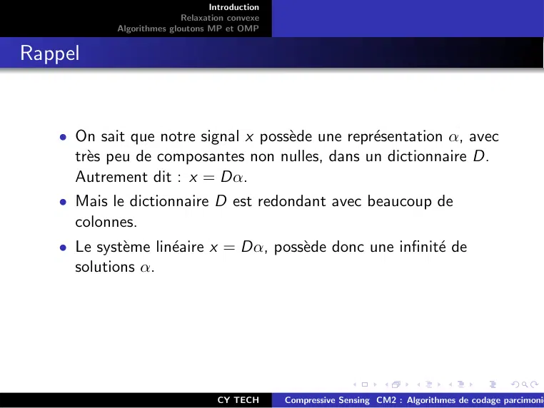

~~~text
                                Introduction
                          Relaxation convexe
           Algorithmes gloutons MP et OMP

Rappel

   • On sait que notre signal x possède une représentation α, avec
     très peu de composantes non nulles, dans un dictionnaire D.
     Autrement dit : x = Dα.
   • Mais le dictionnaire D est redondant avec beaucoup de
     colonnes.
   • Le système linéaire x = Dα, possède donc une infinité de
     solutions α.

                                  CY TECH      Compressive Sensing CM2 : Algorithmes de codage parcimonie
~~~

## Page 8

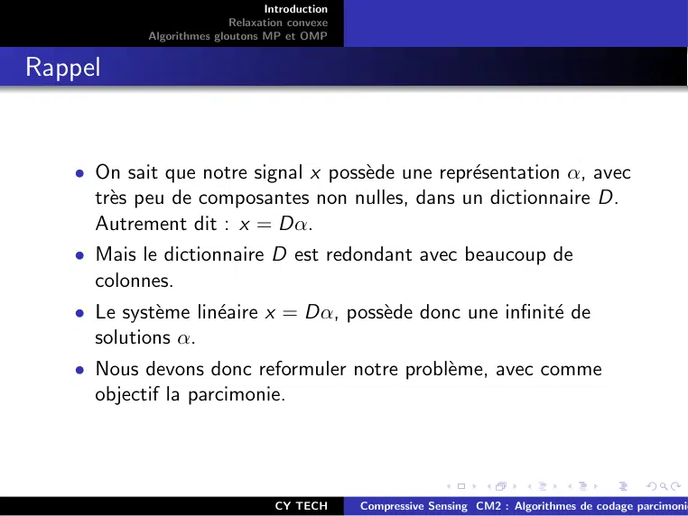

~~~text
                                Introduction
                          Relaxation convexe
           Algorithmes gloutons MP et OMP

Rappel

   • On sait que notre signal x possède une représentation α, avec
     très peu de composantes non nulles, dans un dictionnaire D.
     Autrement dit : x = Dα.
   • Mais le dictionnaire D est redondant avec beaucoup de
     colonnes.
   • Le système linéaire x = Dα, possède donc une infinité de
     solutions α.
   • Nous devons donc reformuler notre problème, avec comme
     objectif la parcimonie.

                                  CY TECH      Compressive Sensing CM2 : Algorithmes de codage parcimonie
~~~

## Page 9

~~~text
                                Introduction
                          Relaxation convexe
           Algorithmes gloutons MP et OMP

Rappel

   • On sait que notre signal x possède une représentation α, avec
     très peu de composantes non nulles, dans un dictionnaire D.
     Autrement dit : x = Dα.
   • Mais le dictionnaire D est redondant avec beaucoup de
     colonnes.
   • Le système linéaire x = Dα, possède donc une infinité de
     solutions α.
   • Nous devons donc reformuler notre problème, avec comme
     objectif la parcimonie.

                                  CY TECH      Compressive Sensing CM2 : Algorithmes de codage parcimonie
~~~

## Page 10

~~~text
                               Introduction
                         Relaxation convexe
          Algorithmes gloutons MP et OMP

Reformulation

                                 CY TECH      Compressive Sensing CM2 : Algorithmes de codage parcimonie
~~~

## Page 11

~~~text
                                 Introduction
                           Relaxation convexe
            Algorithmes gloutons MP et OMP

Reformulation

  Nous introduisons la pseudo-norme kαk0

                                   CY TECH      Compressive Sensing CM2 : Algorithmes de codage parcimonie
~~~

## Page 12

~~~text
                                 Introduction
                           Relaxation convexe
            Algorithmes gloutons MP et OMP

Reformulation

  Nous introduisons la pseudo-norme kαk0 égale au nombre de
  composantes non nulles de α.

                                   CY TECH      Compressive Sensing CM2 : Algorithmes de codage parcimonie
~~~

## Page 13

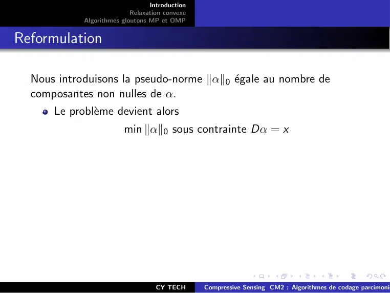

~~~text
                                 Introduction
                           Relaxation convexe
            Algorithmes gloutons MP et OMP

Reformulation

  Nous introduisons la pseudo-norme kαk0 égale au nombre de
  composantes non nulles de α.
      Le problème devient alors
                        min kαk0 sous contrainte Dα = x

                                   CY TECH      Compressive Sensing CM2 : Algorithmes de codage parcimonie
~~~

## Page 14

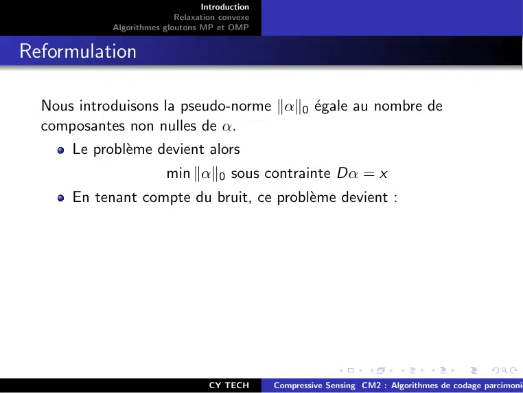

~~~text
                                 Introduction
                           Relaxation convexe
            Algorithmes gloutons MP et OMP

Reformulation

  Nous introduisons la pseudo-norme kαk0 égale au nombre de
  composantes non nulles de α.
      Le problème devient alors
                        min kαk0 sous contrainte Dα = x
      En tenant compte du bruit, ce problème devient :

                                   CY TECH      Compressive Sensing CM2 : Algorithmes de codage parcimonie
~~~

## Page 15

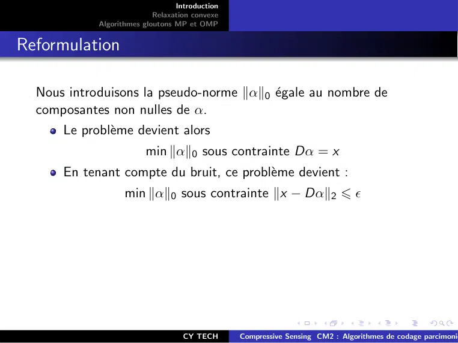

~~~text
                                 Introduction
                           Relaxation convexe
            Algorithmes gloutons MP et OMP

Reformulation

  Nous introduisons la pseudo-norme kαk0 égale au nombre de
  composantes non nulles de α.
      Le problème devient alors
                        min kαk0 sous contrainte Dα = x
      En tenant compte du bruit, ce problème devient :
                   min kαk0 sous contrainte kx − Dαk2 ⩽ 

                                   CY TECH      Compressive Sensing CM2 : Algorithmes de codage parcimonie
~~~

## Page 16

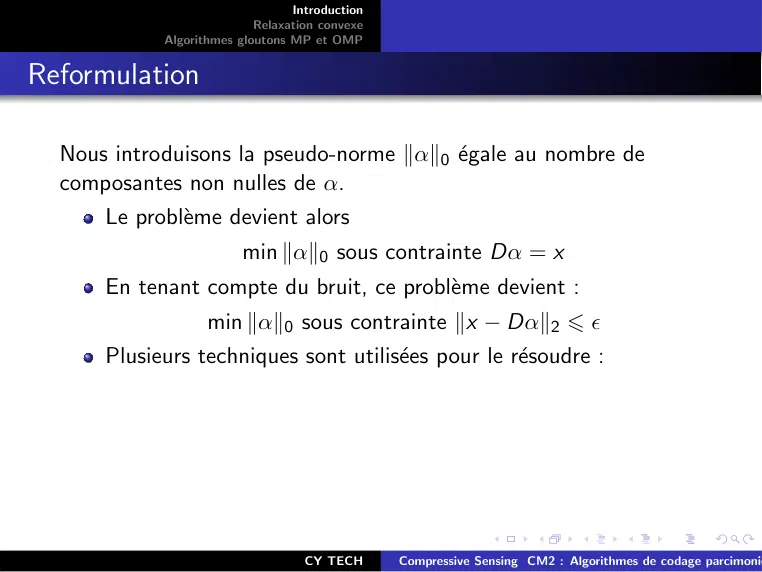

~~~text
                                 Introduction
                           Relaxation convexe
            Algorithmes gloutons MP et OMP

Reformulation

  Nous introduisons la pseudo-norme kαk0 égale au nombre de
  composantes non nulles de α.
      Le problème devient alors
                        min kαk0 sous contrainte Dα = x
      En tenant compte du bruit, ce problème devient :
                   min kαk0 sous contrainte kx − Dαk2 ⩽ 
      Plusieurs techniques sont utilisées pour le résoudre :

                                   CY TECH      Compressive Sensing CM2 : Algorithmes de codage parcimonie
~~~

## Page 17

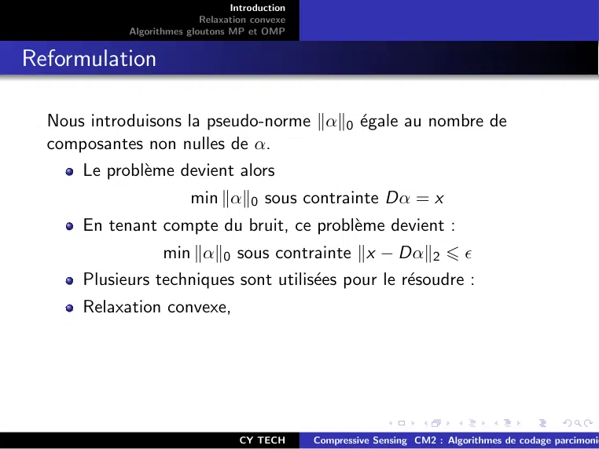

~~~text
                                 Introduction
                           Relaxation convexe
            Algorithmes gloutons MP et OMP

Reformulation

  Nous introduisons la pseudo-norme kαk0 égale au nombre de
  composantes non nulles de α.
      Le problème devient alors
                        min kαk0 sous contrainte Dα = x
      En tenant compte du bruit, ce problème devient :
                   min kαk0 sous contrainte kx − Dαk2 ⩽ 
      Plusieurs techniques sont utilisées pour le résoudre :
      Relaxation convexe,

                                   CY TECH      Compressive Sensing CM2 : Algorithmes de codage parcimonie
~~~

## Page 18

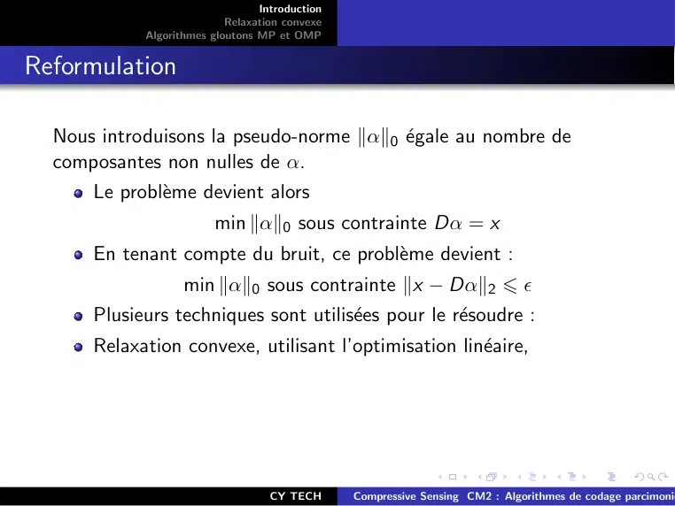

~~~text
                                 Introduction
                           Relaxation convexe
            Algorithmes gloutons MP et OMP

Reformulation

  Nous introduisons la pseudo-norme kαk0 égale au nombre de
  composantes non nulles de α.
      Le problème devient alors
                        min kαk0 sous contrainte Dα = x
      En tenant compte du bruit, ce problème devient :
                   min kαk0 sous contrainte kx − Dαk2 ⩽ 
      Plusieurs techniques sont utilisées pour le résoudre :
      Relaxation convexe, utilisant l’optimisation linéaire,

                                   CY TECH      Compressive Sensing CM2 : Algorithmes de codage parcimonie
~~~

## Page 19

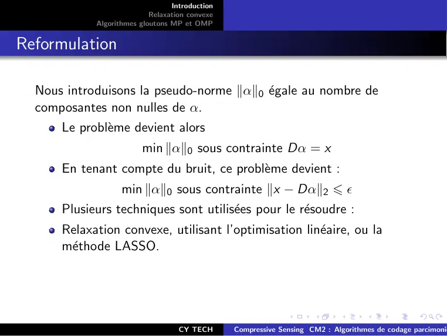

~~~text
                                 Introduction
                           Relaxation convexe
            Algorithmes gloutons MP et OMP

Reformulation

  Nous introduisons la pseudo-norme kαk0 égale au nombre de
  composantes non nulles de α.
      Le problème devient alors
                        min kαk0 sous contrainte Dα = x
      En tenant compte du bruit, ce problème devient :
                   min kαk0 sous contrainte kx − Dαk2 ⩽ 
      Plusieurs techniques sont utilisées pour le résoudre :
      Relaxation convexe, utilisant l’optimisation linéaire, ou la
      méthode LASSO.

                                   CY TECH      Compressive Sensing CM2 : Algorithmes de codage parcimonie
~~~

## Page 20

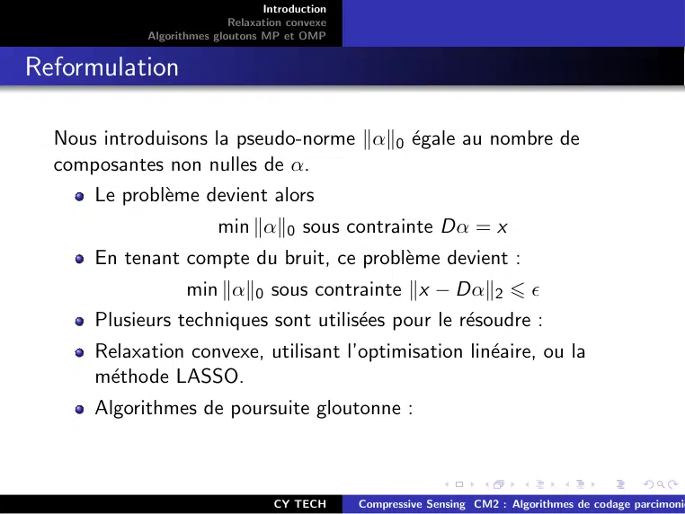

~~~text
                                 Introduction
                           Relaxation convexe
            Algorithmes gloutons MP et OMP

Reformulation

  Nous introduisons la pseudo-norme kαk0 égale au nombre de
  composantes non nulles de α.
      Le problème devient alors
                        min kαk0 sous contrainte Dα = x
      En tenant compte du bruit, ce problème devient :
                   min kαk0 sous contrainte kx − Dαk2 ⩽ 
      Plusieurs techniques sont utilisées pour le résoudre :
      Relaxation convexe, utilisant l’optimisation linéaire, ou la
      méthode LASSO.
      Algorithmes de poursuite gloutonne :

                                   CY TECH      Compressive Sensing CM2 : Algorithmes de codage parcimonie
~~~

## Page 21

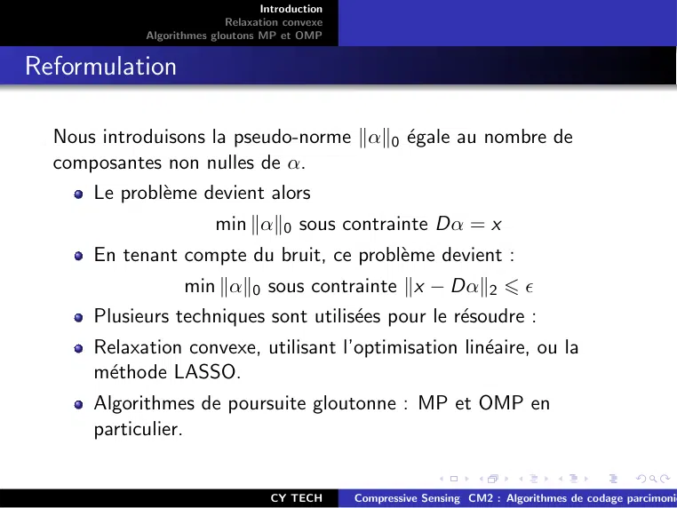

~~~text
                                 Introduction
                           Relaxation convexe
            Algorithmes gloutons MP et OMP

Reformulation

  Nous introduisons la pseudo-norme kαk0 égale au nombre de
  composantes non nulles de α.
      Le problème devient alors
                        min kαk0 sous contrainte Dα = x
      En tenant compte du bruit, ce problème devient :
                   min kαk0 sous contrainte kx − Dαk2 ⩽ 
      Plusieurs techniques sont utilisées pour le résoudre :
      Relaxation convexe, utilisant l’optimisation linéaire, ou la
      méthode LASSO.
      Algorithmes de poursuite gloutonne : MP et OMP en
      particulier.

                                   CY TECH      Compressive Sensing CM2 : Algorithmes de codage parcimonie
~~~

## Page 22

~~~text
                     Introduction
               Relaxation convexe
Algorithmes gloutons MP et OMP

                          Section 2

                Relaxation convexe

                       CY TECH      Compressive Sensing CM2 : Algorithmes de codage parcimonie
~~~

## Page 23

~~~text
                               Introduction
                         Relaxation convexe
          Algorithmes gloutons MP et OMP

Relaxation convexe

                                 CY TECH      Compressive Sensing CM2 : Algorithmes de codage parcimonie
~~~

## Page 24

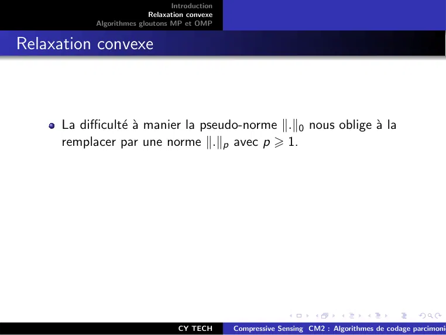

~~~text
                                Introduction
                          Relaxation convexe
           Algorithmes gloutons MP et OMP

Relaxation convexe

     La difficulté à manier la pseudo-norme k.k0 nous oblige à la
     remplacer par une norme k.kp avec p ⩾ 1.

                                  CY TECH      Compressive Sensing CM2 : Algorithmes de codage parcimonie
~~~

## Page 25

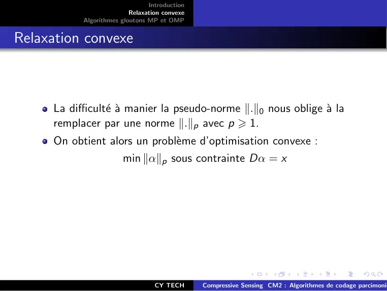

~~~text
                                Introduction
                          Relaxation convexe
           Algorithmes gloutons MP et OMP

Relaxation convexe

     La difficulté à manier la pseudo-norme k.k0 nous oblige à la
     remplacer par une norme k.kp avec p ⩾ 1.
     On obtient alors un problème d’optimisation convexe :
                       min kαkp sous contrainte Dα = x

                                  CY TECH      Compressive Sensing CM2 : Algorithmes de codage parcimonie
~~~

## Page 26

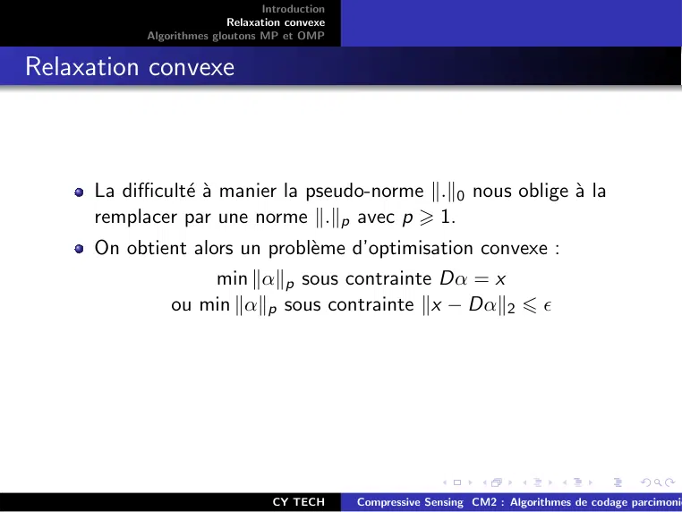

~~~text
                                Introduction
                          Relaxation convexe
           Algorithmes gloutons MP et OMP

Relaxation convexe

     La difficulté à manier la pseudo-norme k.k0 nous oblige à la
     remplacer par une norme k.kp avec p ⩾ 1.
     On obtient alors un problème d’optimisation convexe :
                   min kαkp sous contrainte Dα = x
               ou min kαkp sous contrainte kx − Dαk2 ⩽ 

                                  CY TECH      Compressive Sensing CM2 : Algorithmes de codage parcimonie
~~~

## Page 27

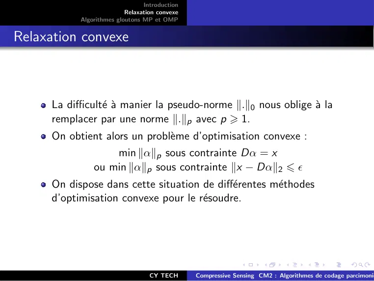

~~~text
                                Introduction
                          Relaxation convexe
           Algorithmes gloutons MP et OMP

Relaxation convexe

     La difficulté à manier la pseudo-norme k.k0 nous oblige à la
     remplacer par une norme k.kp avec p ⩾ 1.
     On obtient alors un problème d’optimisation convexe :
                   min kαkp sous contrainte Dα = x
               ou min kαkp sous contrainte kx − Dαk2 ⩽ 
     On dispose dans cette situation de différentes méthodes
     d’optimisation convexe pour le résoudre.

                                  CY TECH      Compressive Sensing CM2 : Algorithmes de codage parcimonie
~~~

## Page 28

~~~text
                               Introduction
                         Relaxation convexe
          Algorithmes gloutons MP et OMP

Rappel de quelques méthodes

                                 CY TECH      Compressive Sensing CM2 : Algorithmes de codage parcimonie
~~~

## Page 29

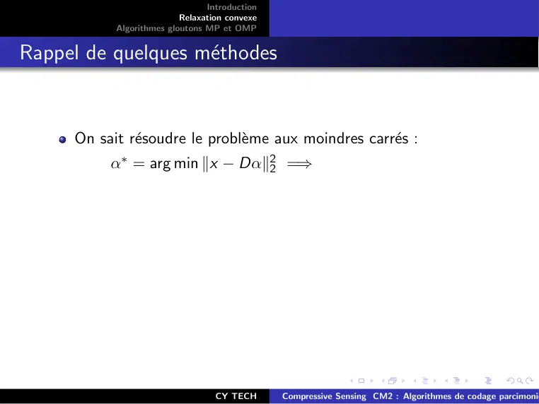

~~~text
                                Introduction
                          Relaxation convexe
           Algorithmes gloutons MP et OMP

Rappel de quelques méthodes

     On sait résoudre le problème aux moindres carrés :
          α∗ = arg min kx − Dαk22 =⇒

                                  CY TECH      Compressive Sensing CM2 : Algorithmes de codage parcimonie
~~~

## Page 30

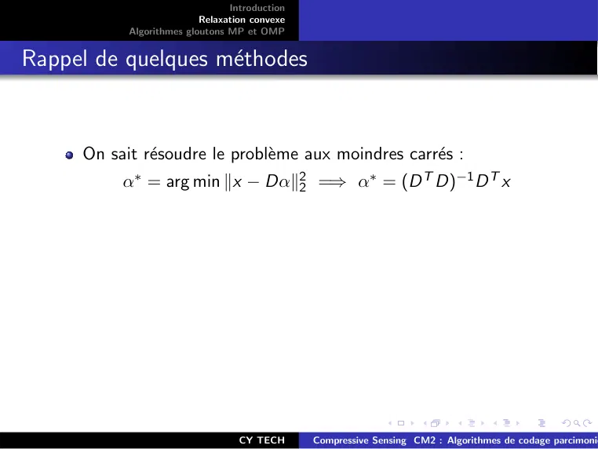

~~~text
                                Introduction
                          Relaxation convexe
           Algorithmes gloutons MP et OMP

Rappel de quelques méthodes

     On sait résoudre le problème aux moindres carrés :
          α∗ = arg min kx − Dαk22 =⇒ α∗ = (D T D)−1 D T x

                                  CY TECH      Compressive Sensing CM2 : Algorithmes de codage parcimonie
~~~

## Page 31

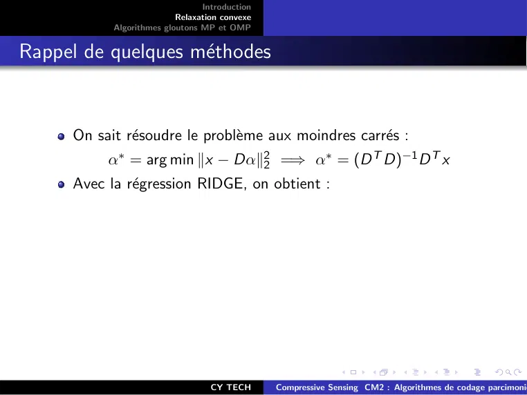

~~~text
                                Introduction
                          Relaxation convexe
           Algorithmes gloutons MP et OMP

Rappel de quelques méthodes

     On sait résoudre le problème aux moindres carrés :
          α∗ = arg min kx − Dαk22 =⇒ α∗ = (D T D)−1 D T x
     Avec la régression RIDGE, on obtient :

                                  CY TECH      Compressive Sensing CM2 : Algorithmes de codage parcimonie
~~~

## Page 32

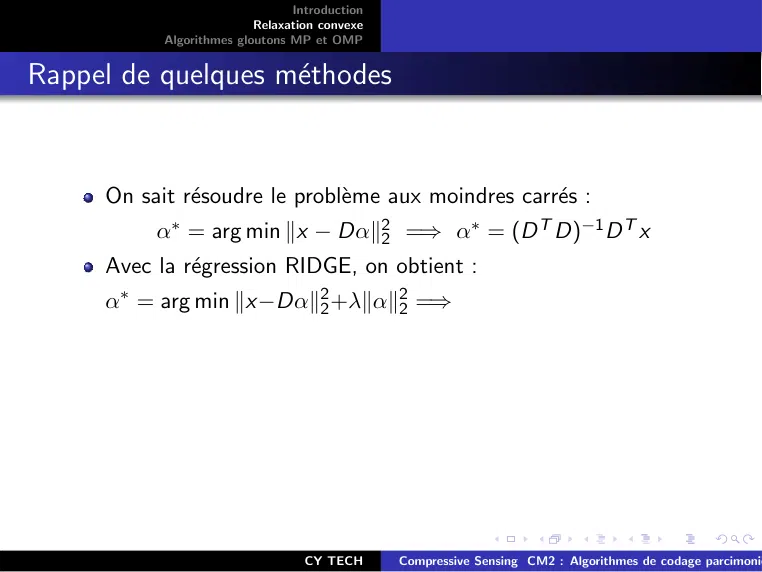

~~~text
                                Introduction
                          Relaxation convexe
           Algorithmes gloutons MP et OMP

Rappel de quelques méthodes

     On sait résoudre le problème aux moindres carrés :
          α∗ = arg min kx − Dαk22 =⇒ α∗ = (D T D)−1 D T x
     Avec la régression RIDGE, on obtient :
     α∗ = arg min kx−Dαk22 +λkαk22 =⇒

                                  CY TECH      Compressive Sensing CM2 : Algorithmes de codage parcimonie
~~~

## Page 33

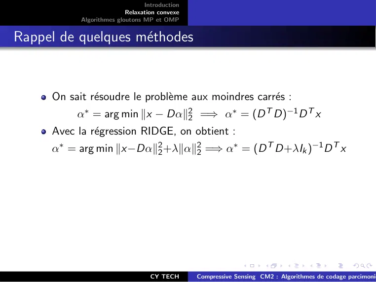

~~~text
                                Introduction
                          Relaxation convexe
           Algorithmes gloutons MP et OMP

Rappel de quelques méthodes

     On sait résoudre le problème aux moindres carrés :
          α∗ = arg min kx − Dαk22 =⇒ α∗ = (D T D)−1 D T x
     Avec la régression RIDGE, on obtient :
     α∗ = arg min kx−Dαk22 +λkαk22 =⇒ α∗ = (D T D+λIk )−1 D T x

                                  CY TECH      Compressive Sensing CM2 : Algorithmes de codage parcimonie
~~~

## Page 34

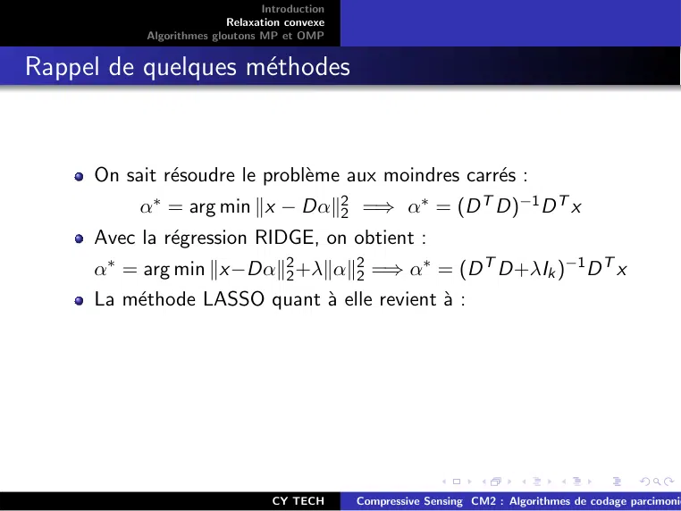

~~~text
                                Introduction
                          Relaxation convexe
           Algorithmes gloutons MP et OMP

Rappel de quelques méthodes

     On sait résoudre le problème aux moindres carrés :
          α∗ = arg min kx − Dαk22 =⇒ α∗ = (D T D)−1 D T x
     Avec la régression RIDGE, on obtient :
     α∗ = arg min kx−Dαk22 +λkαk22 =⇒ α∗ = (D T D+λIk )−1 D T x
     La méthode LASSO quant à elle revient à :

                                  CY TECH      Compressive Sensing CM2 : Algorithmes de codage parcimonie
~~~

## Page 35

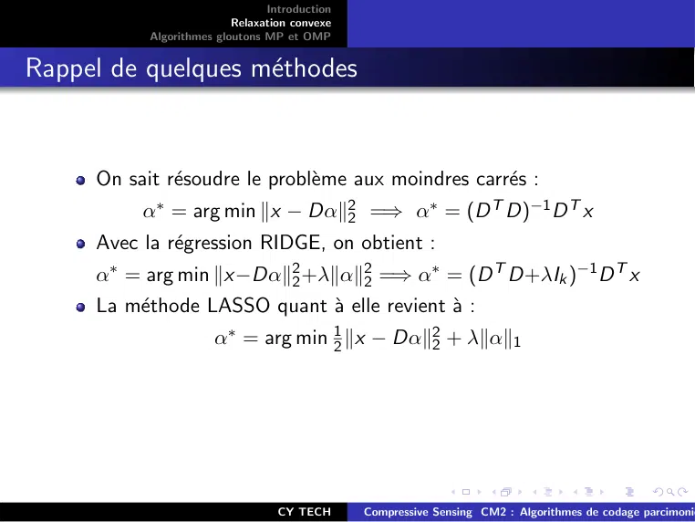

~~~text
                                Introduction
                          Relaxation convexe
           Algorithmes gloutons MP et OMP

Rappel de quelques méthodes

     On sait résoudre le problème aux moindres carrés :
          α∗ = arg min kx − Dαk22 =⇒ α∗ = (D T D)−1 D T x
     Avec la régression RIDGE, on obtient :
     α∗ = arg min kx−Dαk22 +λkαk22 =⇒ α∗ = (D T D+λIk )−1 D T x
     La méthode LASSO quant à elle revient à :
                      α∗ = arg min 21 kx − Dαk22 + λkαk1

                                  CY TECH      Compressive Sensing CM2 : Algorithmes de codage parcimonie
~~~

## Page 36

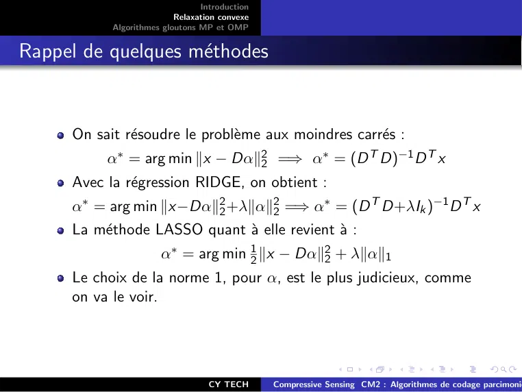

~~~text
                                Introduction
                          Relaxation convexe
           Algorithmes gloutons MP et OMP

Rappel de quelques méthodes

     On sait résoudre le problème aux moindres carrés :
          α∗ = arg min kx − Dαk22 =⇒ α∗ = (D T D)−1 D T x
     Avec la régression RIDGE, on obtient :
     α∗ = arg min kx−Dαk22 +λkαk22 =⇒ α∗ = (D T D+λIk )−1 D T x
     La méthode LASSO quant à elle revient à :
                      α∗ = arg min 21 kx − Dαk22 + λkαk1
     Le choix de la norme 1, pour α, est le plus judicieux, comme
     on va le voir.

                                  CY TECH      Compressive Sensing CM2 : Algorithmes de codage parcimonie
~~~

## Page 37

~~~text
                               Introduction
                         Relaxation convexe
          Algorithmes gloutons MP et OMP

Choix de la norme 1

                                 CY TECH      Compressive Sensing CM2 : Algorithmes de codage parcimonie
~~~

## Page 38

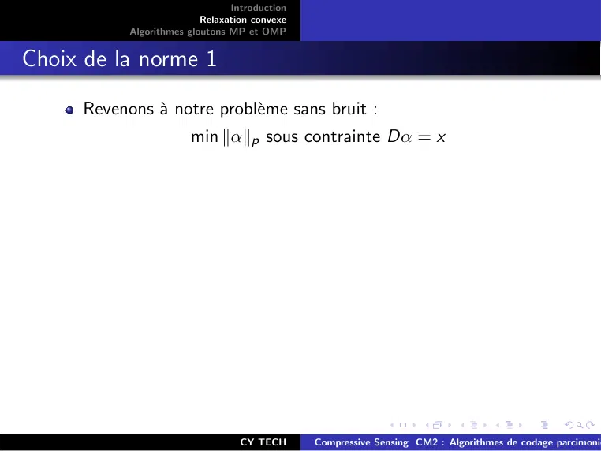

~~~text
                                Introduction
                          Relaxation convexe
           Algorithmes gloutons MP et OMP

Choix de la norme 1

     Revenons à notre problème sans bruit :
                       min kαkp sous contrainte Dα = x

                                  CY TECH      Compressive Sensing CM2 : Algorithmes de codage parcimonie
~~~

## Page 39

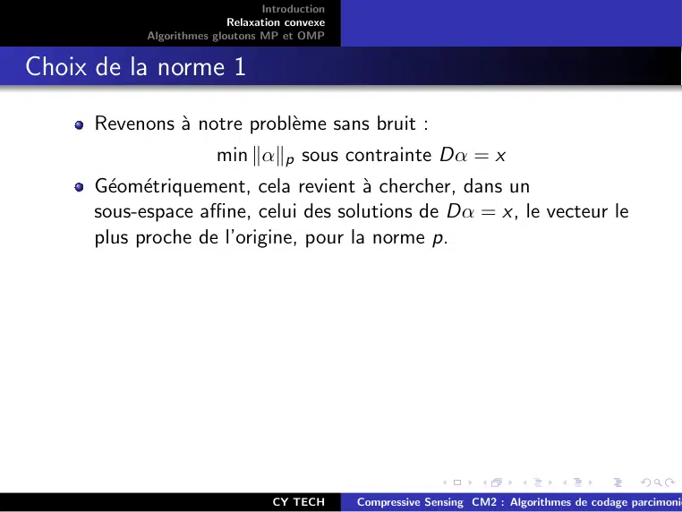

~~~text
                                Introduction
                          Relaxation convexe
           Algorithmes gloutons MP et OMP

Choix de la norme 1

     Revenons à notre problème sans bruit :
                       min kαkp sous contrainte Dα = x
     Géométriquement, cela revient à chercher, dans un
     sous-espace affine, celui des solutions de Dα = x, le vecteur le
     plus proche de l’origine, pour la norme p.

                                  CY TECH      Compressive Sensing CM2 : Algorithmes de codage parcimonie
~~~

## Page 40

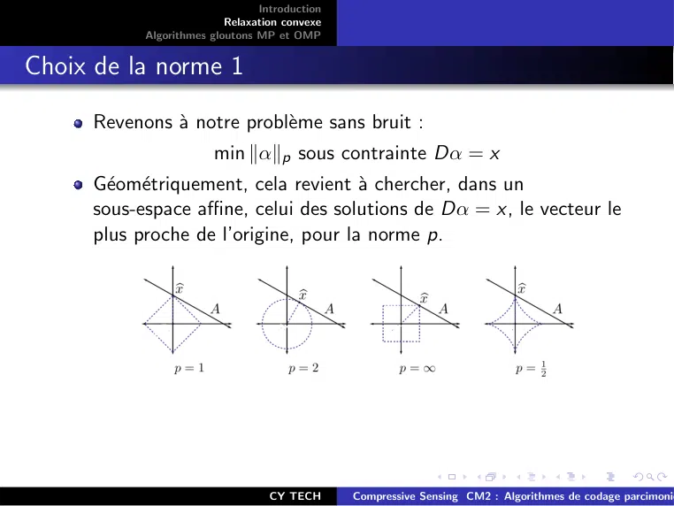

~~~text
                                Introduction
                          Relaxation convexe
           Algorithmes gloutons MP et OMP

Choix de la norme 1

     Revenons à notre problème sans bruit :
                       min kαkp sous contrainte Dα = x
     Géométriquement, cela revient à chercher, dans un
     sous-espace affine, celui des solutions de Dα = x, le vecteur le
     plus proche de l’origine, pour la norme p.

                                  CY TECH      Compressive Sensing CM2 : Algorithmes de codage parcimonie
~~~

## Page 41

~~~text
                                Introduction
                          Relaxation convexe
           Algorithmes gloutons MP et OMP

Choix de la norme 1

     Revenons à notre problème sans bruit :
                       min kαkp sous contrainte Dα = x
     Géométriquement, cela revient à chercher, dans un
     sous-espace affine, celui des solutions de Dα = x, le vecteur le
     plus proche de l’origine, pour la norme p.

     Parmi les normes convexes, c’est bien la 1 qu’il faut retenir.
     C’est celle qui donne des solutions parcimonieuses (avec des
     composantes nulles).
                                  CY TECH      Compressive Sensing CM2 : Algorithmes de codage parcimonie
~~~

## Page 42

~~~text
                                Introduction
                          Relaxation convexe
           Algorithmes gloutons MP et OMP

Optimisation linéaire

                                  CY TECH      Compressive Sensing CM2 : Algorithmes de codage parcimonie
~~~

## Page 43

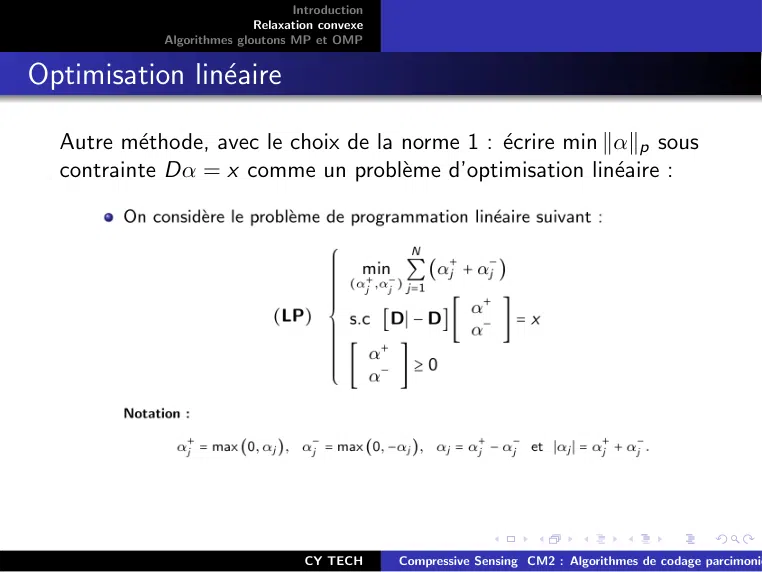

~~~text
                                 Introduction
                           Relaxation convexe
            Algorithmes gloutons MP et OMP

Optimisation linéaire

  Autre méthode, avec le choix de la norme 1 : écrire min kαkp sous
  contrainte Dα = x comme un problème d’optimisation linéaire :

                                   CY TECH      Compressive Sensing CM2 : Algorithmes de codage parcimonie
~~~

## Page 44

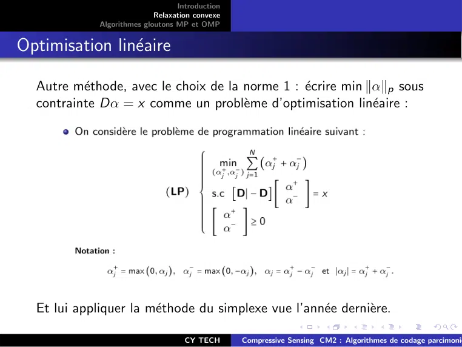

~~~text
                                  Introduction
                            Relaxation convexe
             Algorithmes gloutons MP et OMP

Optimisation linéaire

  Autre méthode, avec le choix de la norme 1 : écrire min kαkp sous
  contrainte Dα = x comme un problème d’optimisation linéaire :

  Et lui appliquer la méthode du simplexe vue l’année dernière.

                                    CY TECH      Compressive Sensing CM2 : Algorithmes de codage parcimonie
~~~

## Page 45

~~~text
                     Introduction
               Relaxation convexe
Algorithmes gloutons MP et OMP

                          Section 3

Algorithmes gloutons MP et OMP

                       CY TECH      Compressive Sensing CM2 : Algorithmes de codage parcimonie
~~~

## Page 46

~~~text
                               Introduction
                         Relaxation convexe
          Algorithmes gloutons MP et OMP

Principe du MP(Matching Pursuit)

                                 CY TECH      Compressive Sensing CM2 : Algorithmes de codage parcimonie
~~~

## Page 47

~~~text
                                  Introduction
                            Relaxation convexe
             Algorithmes gloutons MP et OMP

Principe du MP(Matching Pursuit)

  Puisque le but est d’écrire x comme combinaison linéaire des
  atomes : x = α1 d1 + ... + αk dk , avec le moins de coefs αj 6= 0,

                                    CY TECH      Compressive Sensing CM2 : Algorithmes de codage parcimonie
~~~

## Page 48

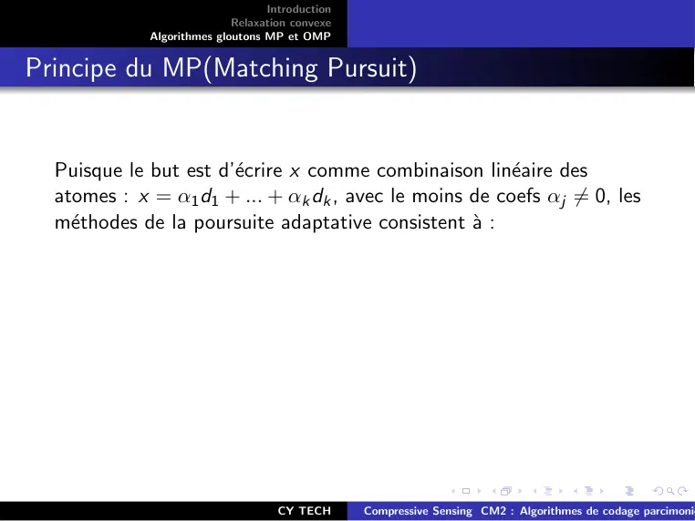

~~~text
                                  Introduction
                            Relaxation convexe
             Algorithmes gloutons MP et OMP

Principe du MP(Matching Pursuit)

  Puisque le but est d’écrire x comme combinaison linéaire des
  atomes : x = α1 d1 + ... + αk dk , avec le moins de coefs αj 6= 0, les
  méthodes de la poursuite adaptative consistent à :

                                    CY TECH      Compressive Sensing CM2 : Algorithmes de codage parcimonie
~~~

## Page 49

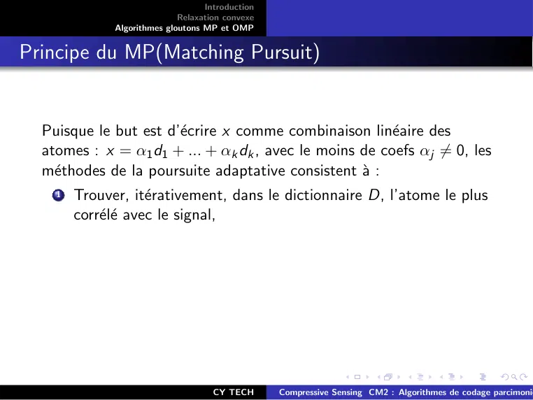

~~~text
                                   Introduction
                             Relaxation convexe
              Algorithmes gloutons MP et OMP

Principe du MP(Matching Pursuit)

  Puisque le but est d’écrire x comme combinaison linéaire des
  atomes : x = α1 d1 + ... + αk dk , avec le moins de coefs αj 6= 0, les
  méthodes de la poursuite adaptative consistent à :
    1   Trouver, itérativement, dans le dictionnaire D, l’atome le plus
        corrélé avec le signal,

                                     CY TECH      Compressive Sensing CM2 : Algorithmes de codage parcimonie
~~~

## Page 50

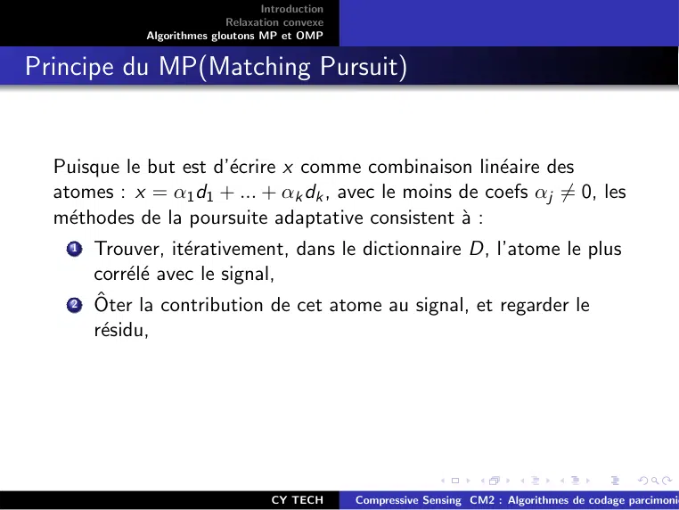

~~~text
                                   Introduction
                             Relaxation convexe
              Algorithmes gloutons MP et OMP

Principe du MP(Matching Pursuit)

  Puisque le but est d’écrire x comme combinaison linéaire des
  atomes : x = α1 d1 + ... + αk dk , avec le moins de coefs αj 6= 0, les
  méthodes de la poursuite adaptative consistent à :
    1   Trouver, itérativement, dans le dictionnaire D, l’atome le plus
        corrélé avec le signal,
    2   Ôter la contribution de cet atome au signal, et regarder le
        résidu,

                                     CY TECH      Compressive Sensing CM2 : Algorithmes de codage parcimonie
~~~

## Page 51

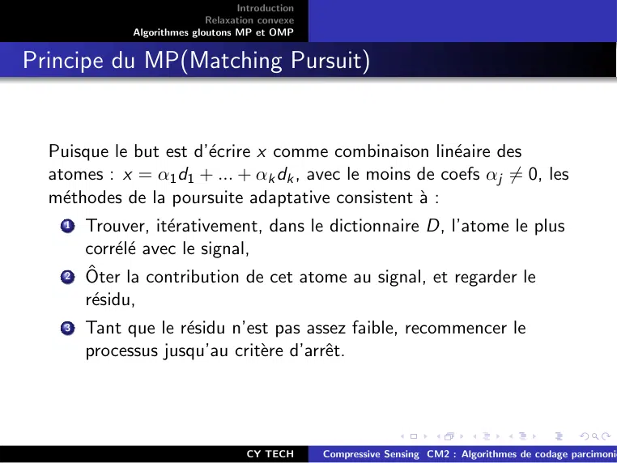

~~~text
                                   Introduction
                             Relaxation convexe
              Algorithmes gloutons MP et OMP

Principe du MP(Matching Pursuit)

  Puisque le but est d’écrire x comme combinaison linéaire des
  atomes : x = α1 d1 + ... + αk dk , avec le moins de coefs αj 6= 0, les
  méthodes de la poursuite adaptative consistent à :
    1   Trouver, itérativement, dans le dictionnaire D, l’atome le plus
        corrélé avec le signal,
    2   Ôter la contribution de cet atome au signal, et regarder le
        résidu,
    3   Tant que le résidu n’est pas assez faible, recommencer le
        processus jusqu’au critère d’arrêt.

                                     CY TECH      Compressive Sensing CM2 : Algorithmes de codage parcimonie
~~~

## Page 52

~~~text
                                   Introduction
                             Relaxation convexe
              Algorithmes gloutons MP et OMP

Principe du MP(Matching Pursuit)

  Puisque le but est d’écrire x comme combinaison linéaire des
  atomes : x = α1 d1 + ... + αk dk , avec le moins de coefs αj 6= 0, les
  méthodes de la poursuite adaptative consistent à :
    1   Trouver, itérativement, dans le dictionnaire D, l’atome le plus
        corrélé avec le signal,
    2   Ôter la contribution de cet atome au signal, et regarder le
        résidu,
    3   Tant que le résidu n’est pas assez faible, recommencer le
        processus jusqu’au critère d’arrêt.

                                     CY TECH      Compressive Sensing CM2 : Algorithmes de codage parcimonie
~~~

## Page 53

~~~text
                              Introduction
                        Relaxation convexe
         Algorithmes gloutons MP et OMP

Etapes du MP(Matching Pursuit)

                                CY TECH      Compressive Sensing CM2 : Algorithmes de codage parcimonie
~~~

## Page 54

~~~text
                                  Introduction
                            Relaxation convexe
             Algorithmes gloutons MP et OMP

Etapes du MP(Matching Pursuit)

   1   On initialise x = 0 + R (0) .

                                    CY TECH      Compressive Sensing CM2 : Algorithmes de codage parcimonie
~~~

## Page 55

~~~text
                                  Introduction
                            Relaxation convexe
             Algorithmes gloutons MP et OMP

Etapes du MP(Matching Pursuit)

   1   On initialise x = 0 + R (0) .
   2   A l’étape k, on a : x = zm1 dm1 + ... + zmk dmk + R (k) .

                                    CY TECH      Compressive Sensing CM2 : Algorithmes de codage parcimonie
~~~

## Page 56

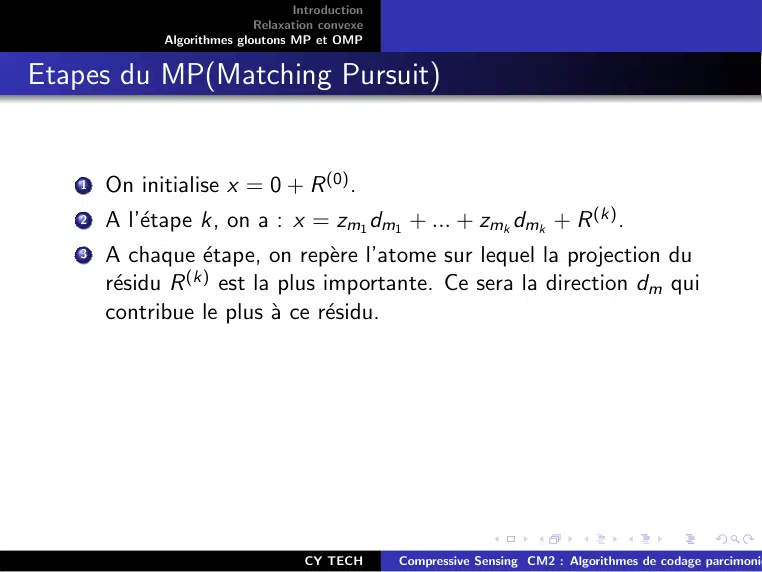

~~~text
                                  Introduction
                            Relaxation convexe
             Algorithmes gloutons MP et OMP

Etapes du MP(Matching Pursuit)

   1   On initialise x = 0 + R (0) .
   2   A l’étape k, on a : x = zm1 dm1 + ... + zmk dmk + R (k) .
   3   A chaque étape, on repère l’atome sur lequel la projection du
       résidu R (k) est la plus importante. Ce sera la direction dm qui
       contribue le plus à ce résidu.

                                    CY TECH      Compressive Sensing CM2 : Algorithmes de codage parcimonie
~~~

## Page 57

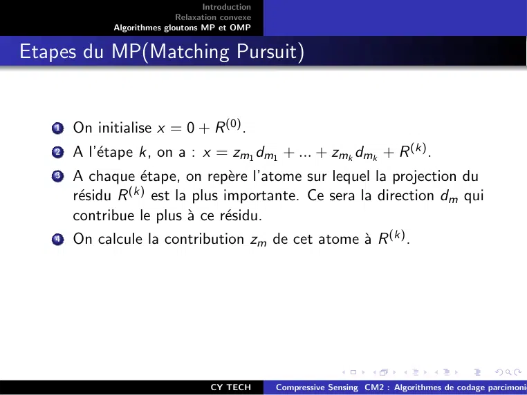

~~~text
                                  Introduction
                            Relaxation convexe
             Algorithmes gloutons MP et OMP

Etapes du MP(Matching Pursuit)

   1   On initialise x = 0 + R (0) .
   2   A l’étape k, on a : x = zm1 dm1 + ... + zmk dmk + R (k) .
   3   A chaque étape, on repère l’atome sur lequel la projection du
       résidu R (k) est la plus importante. Ce sera la direction dm qui
       contribue le plus à ce résidu.
   4   On calcule la contribution zm de cet atome à R (k) .

                                    CY TECH      Compressive Sensing CM2 : Algorithmes de codage parcimonie
~~~

## Page 58

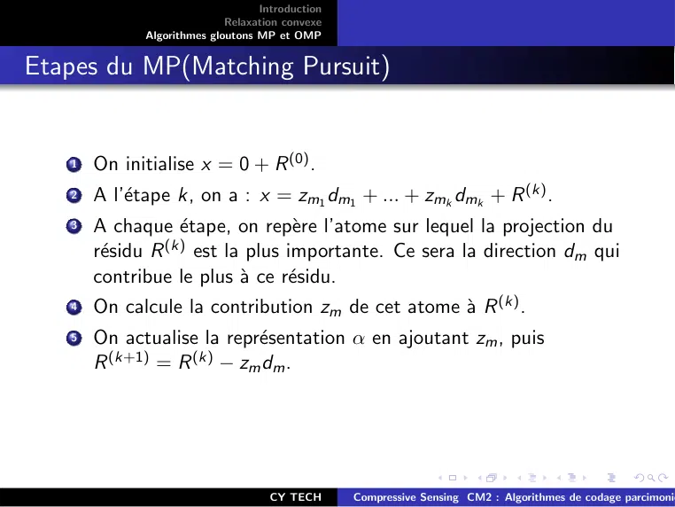

~~~text
                                  Introduction
                            Relaxation convexe
             Algorithmes gloutons MP et OMP

Etapes du MP(Matching Pursuit)

   1   On initialise x = 0 + R (0) .
   2   A l’étape k, on a : x = zm1 dm1 + ... + zmk dmk + R (k) .
   3   A chaque étape, on repère l’atome sur lequel la projection du
       résidu R (k) est la plus importante. Ce sera la direction dm qui
       contribue le plus à ce résidu.
   4   On calcule la contribution zm de cet atome à R (k) .
   5   On actualise la représentation α en ajoutant zm , puis
       R (k+1) = R (k) − zm dm .

                                    CY TECH      Compressive Sensing CM2 : Algorithmes de codage parcimonie
~~~

## Page 59

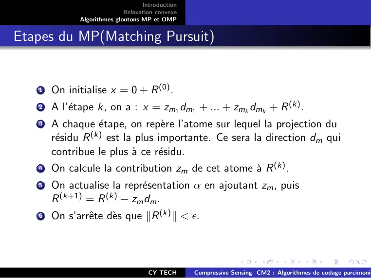

~~~text
                                  Introduction
                            Relaxation convexe
             Algorithmes gloutons MP et OMP

Etapes du MP(Matching Pursuit)

   1   On initialise x = 0 + R (0) .
   2   A l’étape k, on a : x = zm1 dm1 + ... + zmk dmk + R (k) .
   3   A chaque étape, on repère l’atome sur lequel la projection du
       résidu R (k) est la plus importante. Ce sera la direction dm qui
       contribue le plus à ce résidu.
   4   On calcule la contribution zm de cet atome à R (k) .
   5   On actualise la représentation α en ajoutant zm , puis
       R (k+1) = R (k) − zm dm .
   6   On s’arrête dès que kR (k) k < .

                                    CY TECH      Compressive Sensing CM2 : Algorithmes de codage parcimonie
~~~

## Page 60

~~~text
                              Introduction
                        Relaxation convexe
         Algorithmes gloutons MP et OMP

Algorithme MP

                                CY TECH      Compressive Sensing CM2 : Algorithmes de codage parcimonie
~~~

## Page 61

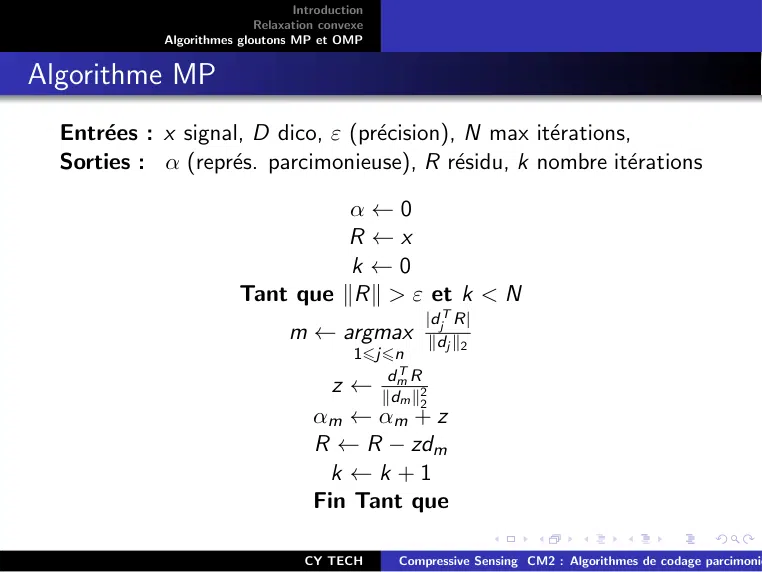

~~~text
                                  Introduction
                            Relaxation convexe
             Algorithmes gloutons MP et OMP

Algorithme MP
  Entrées : x signal, D dico, ε (précision), N max itérations,
  Sorties : α (représ. parcimonieuse), R résidu, k nombre itérations

                                   α←0
                                   R←x
                                   k ←0
                         Tant que kRk > ε et k < N
                                                     |d T R|
                                 m ← argmax kdj j k2
                                        1⩽j⩽n
                                            TR
                                           dm
                                      z ← kd    2
                                             m k2
                                     αm ← αm + z
                                     R ← R − zdm
                                       k ←k +1
                                     Fin Tant que

                                    CY TECH      Compressive Sensing CM2 : Algorithmes de codage parcimonie
~~~

## Page 62

~~~text
                               Introduction
                         Relaxation convexe
          Algorithmes gloutons MP et OMP

Principe de l’OMP(Orthogonal Matching Pursuit)

                                 CY TECH      Compressive Sensing CM2 : Algorithmes de codage parcimonie
~~~

## Page 63

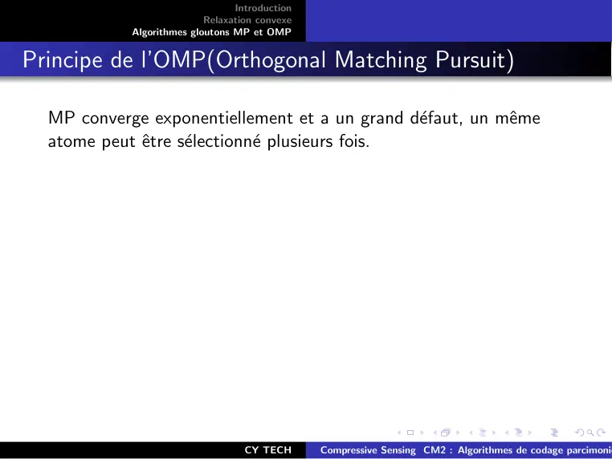

~~~text
                                 Introduction
                           Relaxation convexe
            Algorithmes gloutons MP et OMP

Principe de l’OMP(Orthogonal Matching Pursuit)

  MP converge exponentiellement et a un grand défaut, un même
  atome peut être sélectionné plusieurs fois.

                                   CY TECH      Compressive Sensing CM2 : Algorithmes de codage parcimonie
~~~

## Page 64

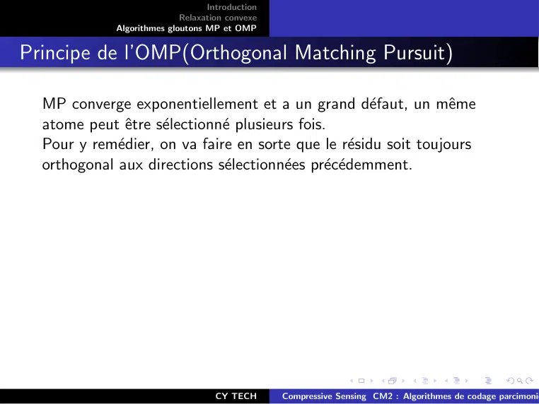

~~~text
                                  Introduction
                            Relaxation convexe
             Algorithmes gloutons MP et OMP

Principe de l’OMP(Orthogonal Matching Pursuit)

  MP converge exponentiellement et a un grand défaut, un même
  atome peut être sélectionné plusieurs fois.
  Pour y remédier, on va faire en sorte que le résidu soit toujours
  orthogonal aux directions sélectionnées précédemment.

                                    CY TECH      Compressive Sensing CM2 : Algorithmes de codage parcimonie
~~~

## Page 65

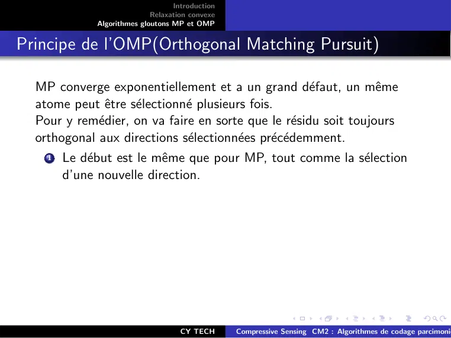

~~~text
                                   Introduction
                             Relaxation convexe
              Algorithmes gloutons MP et OMP

Principe de l’OMP(Orthogonal Matching Pursuit)

  MP converge exponentiellement et a un grand défaut, un même
  atome peut être sélectionné plusieurs fois.
  Pour y remédier, on va faire en sorte que le résidu soit toujours
  orthogonal aux directions sélectionnées précédemment.
    1   Le début est le même que pour MP, tout comme la sélection
        d’une nouvelle direction.

                                     CY TECH      Compressive Sensing CM2 : Algorithmes de codage parcimonie
~~~

## Page 66

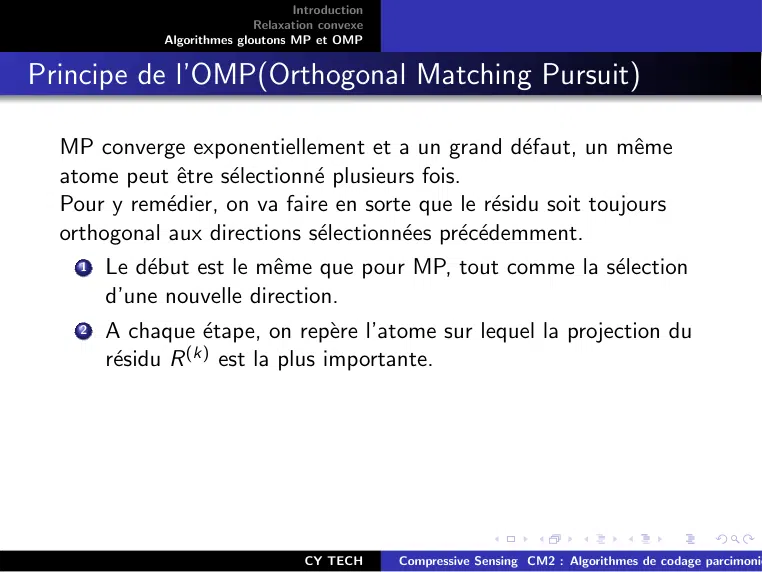

~~~text
                                   Introduction
                             Relaxation convexe
              Algorithmes gloutons MP et OMP

Principe de l’OMP(Orthogonal Matching Pursuit)

  MP converge exponentiellement et a un grand défaut, un même
  atome peut être sélectionné plusieurs fois.
  Pour y remédier, on va faire en sorte que le résidu soit toujours
  orthogonal aux directions sélectionnées précédemment.
    1   Le début est le même que pour MP, tout comme la sélection
        d’une nouvelle direction.
    2   A chaque étape, on repère l’atome sur lequel la projection du
        résidu R (k) est la plus importante.

                                     CY TECH      Compressive Sensing CM2 : Algorithmes de codage parcimonie
~~~

## Page 67

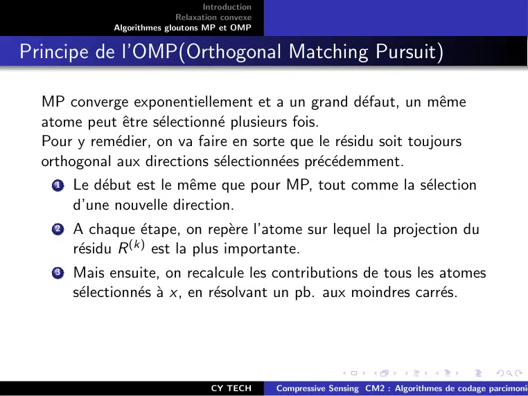

~~~text
                                   Introduction
                             Relaxation convexe
              Algorithmes gloutons MP et OMP

Principe de l’OMP(Orthogonal Matching Pursuit)

  MP converge exponentiellement et a un grand défaut, un même
  atome peut être sélectionné plusieurs fois.
  Pour y remédier, on va faire en sorte que le résidu soit toujours
  orthogonal aux directions sélectionnées précédemment.
    1   Le début est le même que pour MP, tout comme la sélection
        d’une nouvelle direction.
    2   A chaque étape, on repère l’atome sur lequel la projection du
        résidu R (k) est la plus importante.
    3   Mais ensuite, on recalcule les contributions de tous les atomes
        sélectionnés à x, en résolvant un pb. aux moindres carrés.

                                     CY TECH      Compressive Sensing CM2 : Algorithmes de codage parcimonie
~~~

## Page 68

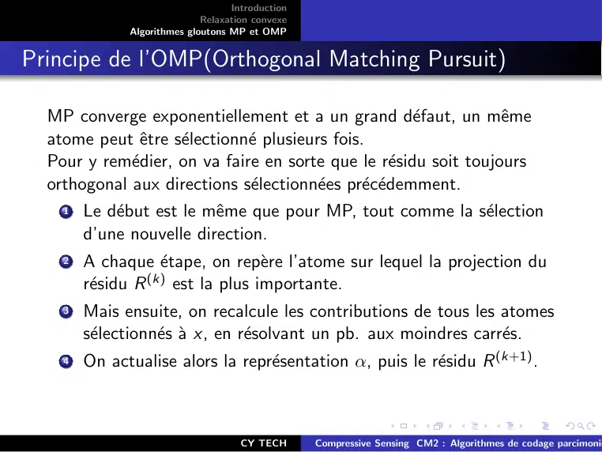

~~~text
                                   Introduction
                             Relaxation convexe
              Algorithmes gloutons MP et OMP

Principe de l’OMP(Orthogonal Matching Pursuit)

  MP converge exponentiellement et a un grand défaut, un même
  atome peut être sélectionné plusieurs fois.
  Pour y remédier, on va faire en sorte que le résidu soit toujours
  orthogonal aux directions sélectionnées précédemment.
    1   Le début est le même que pour MP, tout comme la sélection
        d’une nouvelle direction.
    2   A chaque étape, on repère l’atome sur lequel la projection du
        résidu R (k) est la plus importante.
    3   Mais ensuite, on recalcule les contributions de tous les atomes
        sélectionnés à x, en résolvant un pb. aux moindres carrés.
    4   On actualise alors la représentation α, puis le résidu R (k+1) .

                                     CY TECH      Compressive Sensing CM2 : Algorithmes de codage parcimonie
~~~

## Page 69

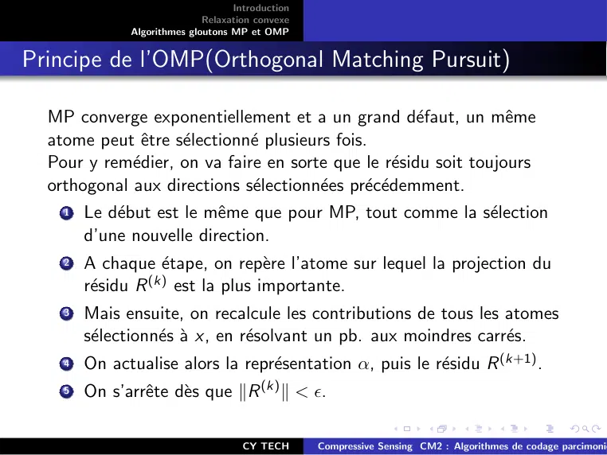

~~~text
                                   Introduction
                             Relaxation convexe
              Algorithmes gloutons MP et OMP

Principe de l’OMP(Orthogonal Matching Pursuit)

  MP converge exponentiellement et a un grand défaut, un même
  atome peut être sélectionné plusieurs fois.
  Pour y remédier, on va faire en sorte que le résidu soit toujours
  orthogonal aux directions sélectionnées précédemment.
    1   Le début est le même que pour MP, tout comme la sélection
        d’une nouvelle direction.
    2   A chaque étape, on repère l’atome sur lequel la projection du
        résidu R (k) est la plus importante.
    3   Mais ensuite, on recalcule les contributions de tous les atomes
        sélectionnés à x, en résolvant un pb. aux moindres carrés.
    4   On actualise alors la représentation α, puis le résidu R (k+1) .
    5   On s’arrête dès que kR (k) k < .

                                     CY TECH      Compressive Sensing CM2 : Algorithmes de codage parcimonie
~~~

## Page 70

~~~text
                              Introduction
                        Relaxation convexe
         Algorithmes gloutons MP et OMP

Algorithme OMP

                                CY TECH      Compressive Sensing CM2 : Algorithmes de codage parcimonie
~~~

## Page 71

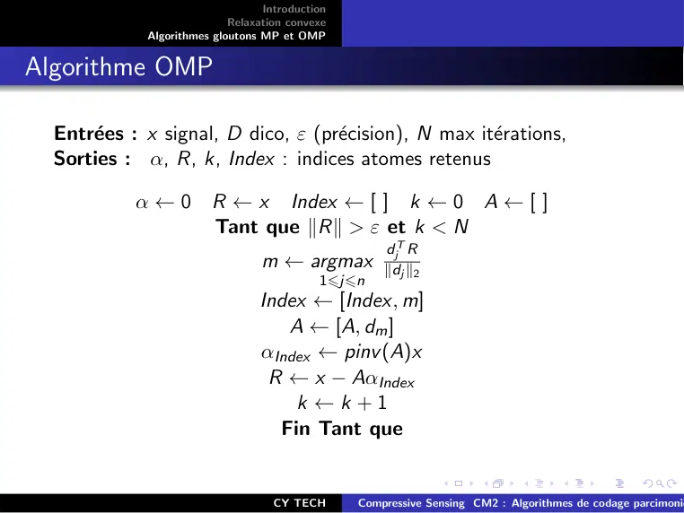

~~~text
                                  Introduction
                            Relaxation convexe
             Algorithmes gloutons MP et OMP

Algorithme OMP

  Entrées : x signal, D dico, ε (précision), N max itérations,
  Sorties : α, R, k, Index : indices atomes retenus

            α←0         R ← x Index ← [ ] k ← 0 A ← [ ]
                        Tant que kRk > ε et k < N
                                                     dT R
                                  m ← argmax kdj j k2
                                            1⩽j⩽n
                                 Index ← [Index, m]
                                    A ← [A, dm ]
                                 αIndex ← pinv (A)x
                                  R ← x − AαIndex
                                     k ←k +1
                                   Fin Tant que

                                    CY TECH      Compressive Sensing CM2 : Algorithmes de codage parcimonie
~~~
