# Slides3-Compressive-Sensing23.pdf

[Ouvrir l’original](https://drive.google.com/open?id=1yUr4Wl8qK4aRQpBhrrmG_hhGuab7KjJU) · Les deux lectures automatiques du PDF divergent sur les pages indiquées. Leur fac-similé accompagne le texte.

**Pages présentant un écart entre les deux extractions** — 4–8, 11–13, 16, 21–26, 28–34, 36–39, 41–54, 59–60.

## Page 1

~~~text
                   Dictionnaire
Apprentissage d’un dictionnaire
            Algorithme k-SVD

      Compressive Sensing
 Apprentissage d’un dictionnaire

                         CY TECH

                         2022-2023

                    CY TECH       Compressive Sensing Apprentissage d’un dictionnaire
~~~

## Page 2

~~~text
                                Dictionnaire
             Apprentissage d’un dictionnaire
                         Algorithme k-SVD

1   Dictionnaire

2   Apprentissage d’un dictionnaire

3   Algorithme k-SVD

                                 CY TECH       Compressive Sensing Apprentissage d’un dictionnaire
~~~

## Page 3

~~~text
                                Dictionnaire
             Apprentissage d’un dictionnaire
                         Algorithme k-SVD

Propriétés de base

                                 CY TECH       Compressive Sensing Apprentissage d’un dictionnaire
~~~

## Page 4

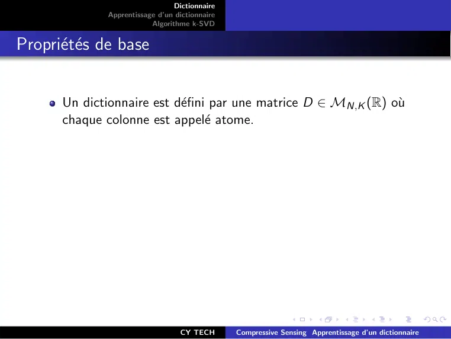

~~~text
                                 Dictionnaire
              Apprentissage d’un dictionnaire
                          Algorithme k-SVD

Propriétés de base

      Un dictionnaire est défini par une matrice D ∈ MN,K (R) où
      chaque colonne est appelé atome.

                                  CY TECH       Compressive Sensing Apprentissage d’un dictionnaire
~~~

## Page 5

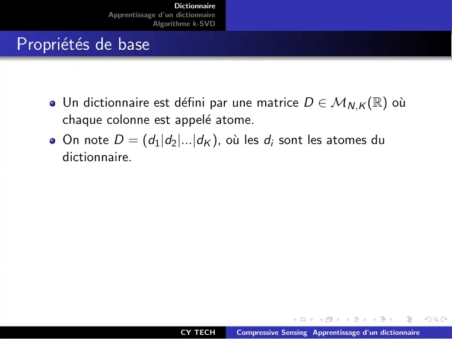

~~~text
                                 Dictionnaire
              Apprentissage d’un dictionnaire
                          Algorithme k-SVD

Propriétés de base

      Un dictionnaire est défini par une matrice D ∈ MN,K (R) où
      chaque colonne est appelé atome.
      On note D = (d1 |d2 |...|dK ), où les di sont les atomes du
      dictionnaire.

                                  CY TECH       Compressive Sensing Apprentissage d’un dictionnaire
~~~

## Page 6

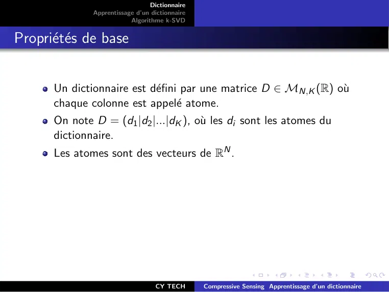

~~~text
                                 Dictionnaire
              Apprentissage d’un dictionnaire
                          Algorithme k-SVD

Propriétés de base

      Un dictionnaire est défini par une matrice D ∈ MN,K (R) où
      chaque colonne est appelé atome.
      On note D = (d1 |d2 |...|dK ), où les di sont les atomes du
      dictionnaire.
      Les atomes sont des vecteurs de RN .

                                  CY TECH       Compressive Sensing Apprentissage d’un dictionnaire
~~~

## Page 7

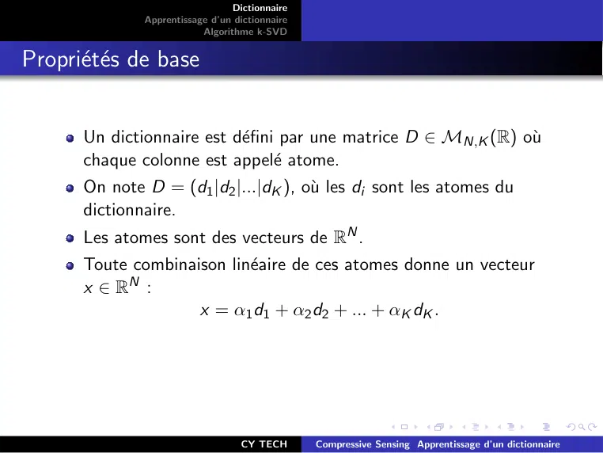

~~~text
                                 Dictionnaire
              Apprentissage d’un dictionnaire
                          Algorithme k-SVD

Propriétés de base

      Un dictionnaire est défini par une matrice D ∈ MN,K (R) où
      chaque colonne est appelé atome.
      On note D = (d1 |d2 |...|dK ), où les di sont les atomes du
      dictionnaire.
      Les atomes sont des vecteurs de RN .
      Toute combinaison linéaire de ces atomes donne un vecteur
      x ∈ RN :
                    x = α1 d1 + α2 d2 + ... + αK dK .

                                  CY TECH       Compressive Sensing Apprentissage d’un dictionnaire
~~~

## Page 8

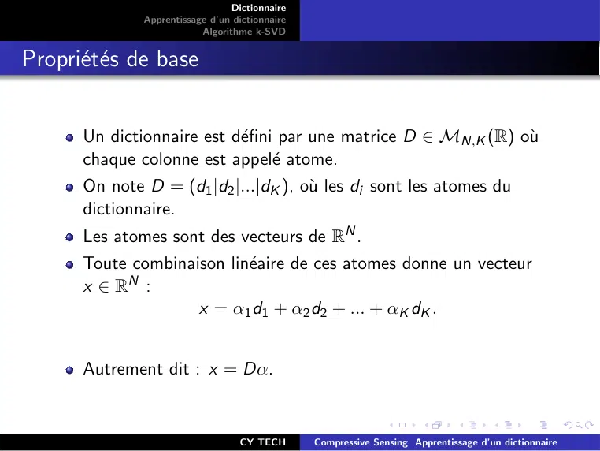

~~~text
                                 Dictionnaire
              Apprentissage d’un dictionnaire
                          Algorithme k-SVD

Propriétés de base

      Un dictionnaire est défini par une matrice D ∈ MN,K (R) où
      chaque colonne est appelé atome.
      On note D = (d1 |d2 |...|dK ), où les di sont les atomes du
      dictionnaire.
      Les atomes sont des vecteurs de RN .
      Toute combinaison linéaire de ces atomes donne un vecteur
      x ∈ RN :
                    x = α1 d1 + α2 d2 + ... + αK dK .

      Autrement dit : x = Dα.

                                  CY TECH       Compressive Sensing Apprentissage d’un dictionnaire
~~~

## Page 9

~~~text
                               Dictionnaire
            Apprentissage d’un dictionnaire
                        Algorithme k-SVD

Choix d’un dictionnaire

                                CY TECH       Compressive Sensing Apprentissage d’un dictionnaire
~~~

## Page 10

~~~text
                                 Dictionnaire
              Apprentissage d’un dictionnaire
                          Algorithme k-SVD

Choix d’un dictionnaire

      Le choix du dictionnaire D a une très grande influence sur la
      représentation α.

                                  CY TECH       Compressive Sensing Apprentissage d’un dictionnaire
~~~

## Page 11

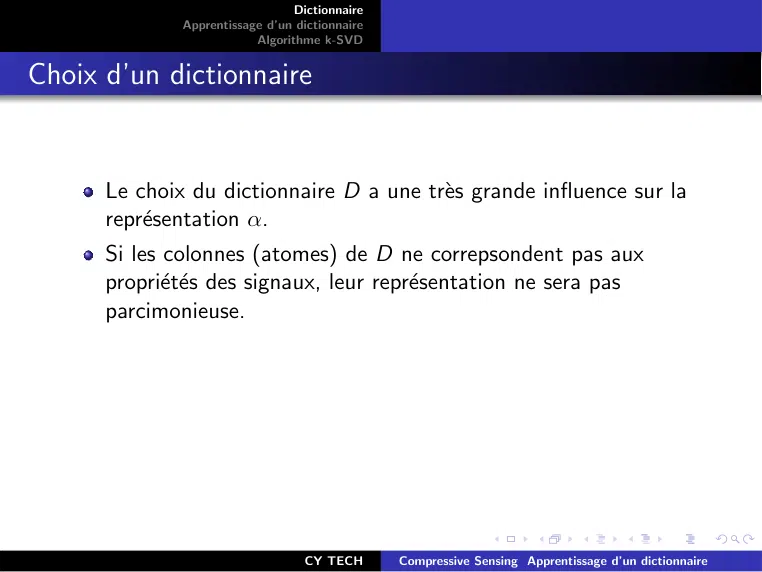

~~~text
                                 Dictionnaire
              Apprentissage d’un dictionnaire
                          Algorithme k-SVD

Choix d’un dictionnaire

      Le choix du dictionnaire D a une très grande influence sur la
      représentation α.
      Si les colonnes (atomes) de D ne correpsondent pas aux
      propriétés des signaux, leur représentation ne sera pas
      parcimonieuse.

                                  CY TECH       Compressive Sensing Apprentissage d’un dictionnaire
~~~

## Page 12

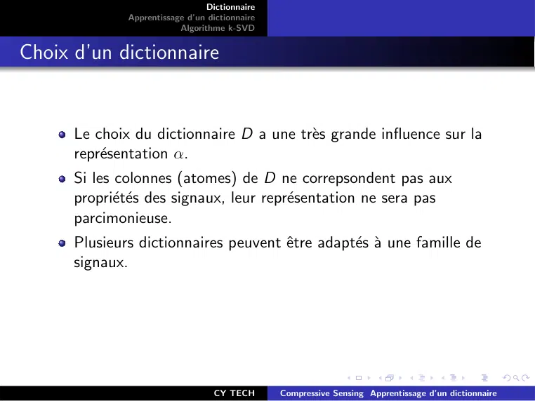

~~~text
                                 Dictionnaire
              Apprentissage d’un dictionnaire
                          Algorithme k-SVD

Choix d’un dictionnaire

      Le choix du dictionnaire D a une très grande influence sur la
      représentation α.
      Si les colonnes (atomes) de D ne correpsondent pas aux
      propriétés des signaux, leur représentation ne sera pas
      parcimonieuse.
      Plusieurs dictionnaires peuvent être adaptés à une famille de
      signaux.

                                  CY TECH       Compressive Sensing Apprentissage d’un dictionnaire
~~~

## Page 13

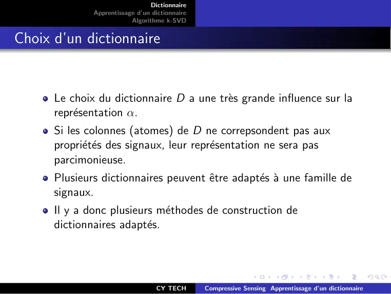

~~~text
                                 Dictionnaire
              Apprentissage d’un dictionnaire
                          Algorithme k-SVD

Choix d’un dictionnaire

      Le choix du dictionnaire D a une très grande influence sur la
      représentation α.
      Si les colonnes (atomes) de D ne correpsondent pas aux
      propriétés des signaux, leur représentation ne sera pas
      parcimonieuse.
      Plusieurs dictionnaires peuvent être adaptés à une famille de
      signaux.
      Il y a donc plusieurs méthodes de construction de
      dictionnaires adaptés.

                                  CY TECH       Compressive Sensing Apprentissage d’un dictionnaire
~~~

## Page 14

~~~text
                               Dictionnaire
            Apprentissage d’un dictionnaire
                        Algorithme k-SVD

Construction d’un dictionnaire

                                CY TECH       Compressive Sensing Apprentissage d’un dictionnaire
~~~

## Page 15

~~~text
                                  Dictionnaire
               Apprentissage d’un dictionnaire
                           Algorithme k-SVD

Construction d’un dictionnaire

  Il y a essentiellement 2 manières de construire un dictionnaire
  adapté à une famille de signaux :

                                   CY TECH       Compressive Sensing Apprentissage d’un dictionnaire
~~~

## Page 16

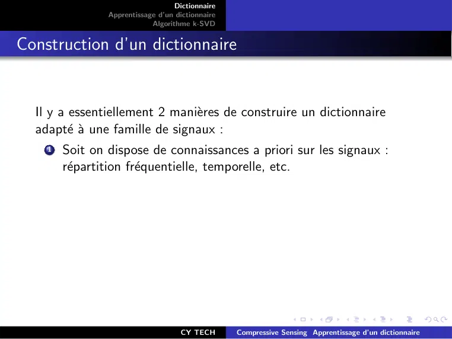

~~~text
                                   Dictionnaire
                Apprentissage d’un dictionnaire
                            Algorithme k-SVD

Construction d’un dictionnaire

  Il y a essentiellement 2 manières de construire un dictionnaire
  adapté à une famille de signaux :
    1   Soit on dispose de connaissances a priori sur les signaux :
        répartition fréquentielle, temporelle, etc.

                                    CY TECH       Compressive Sensing Apprentissage d’un dictionnaire
~~~

## Page 17

~~~text
                                   Dictionnaire
                Apprentissage d’un dictionnaire
                            Algorithme k-SVD

Construction d’un dictionnaire

  Il y a essentiellement 2 manières de construire un dictionnaire
  adapté à une famille de signaux :
    1   Soit on dispose de connaissances a priori sur les signaux :
        répartition fréquentielle, temporelle, etc. Et on peut alors
        construire des dictionnaires de type Fourier ou cosinus ou
        sinus discrets, ou ondelettes qui exploitent cette connaissance.

                                    CY TECH       Compressive Sensing Apprentissage d’un dictionnaire
~~~

## Page 18

~~~text
                                   Dictionnaire
                Apprentissage d’un dictionnaire
                            Algorithme k-SVD

Construction d’un dictionnaire

  Il y a essentiellement 2 manières de construire un dictionnaire
  adapté à une famille de signaux :
    1   Soit on dispose de connaissances a priori sur les signaux :
        répartition fréquentielle, temporelle, etc. Et on peut alors
        construire des dictionnaires de type Fourier ou cosinus ou
        sinus discrets, ou ondelettes qui exploitent cette connaissance.
    2   Soit on dispose d’une famille de signaux que l’on va utuiliser
        pour apprendre (construire) un dictionnaire adapté.

                                    CY TECH       Compressive Sensing Apprentissage d’un dictionnaire
~~~

## Page 19

~~~text
                                   Dictionnaire
                Apprentissage d’un dictionnaire
                            Algorithme k-SVD

Construction d’un dictionnaire

  Il y a essentiellement 2 manières de construire un dictionnaire
  adapté à une famille de signaux :
    1   Soit on dispose de connaissances a priori sur les signaux :
        répartition fréquentielle, temporelle, etc. Et on peut alors
        construire des dictionnaires de type Fourier ou cosinus ou
        sinus discrets, ou ondelettes qui exploitent cette connaissance.
    2   Soit on dispose d’une famille de signaux que l’on va utuiliser
        pour apprendre (construire) un dictionnaire adapté. On
        exploite pour cela le critère de parcimonie.

                                    CY TECH       Compressive Sensing Apprentissage d’un dictionnaire
~~~

## Page 20

~~~text
                                Dictionnaire
             Apprentissage d’un dictionnaire
                         Algorithme k-SVD

Principe général 1

                                 CY TECH       Compressive Sensing Apprentissage d’un dictionnaire
~~~

## Page 21

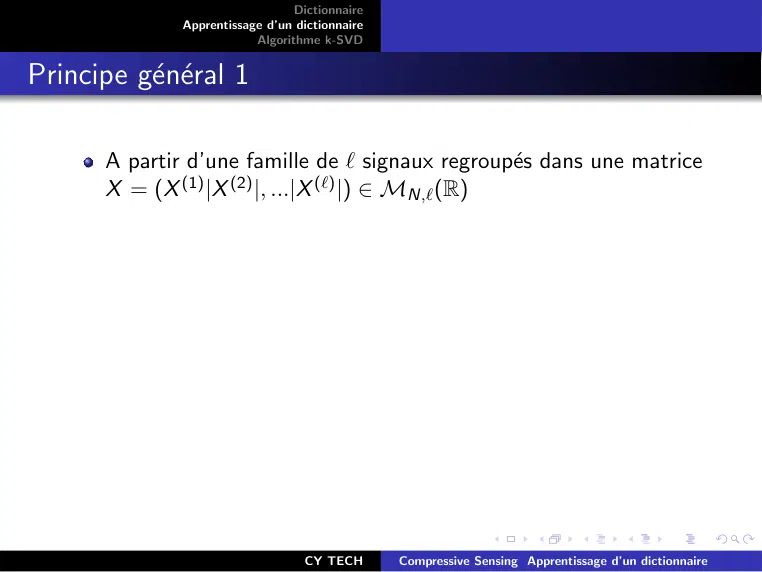

~~~text
                                  Dictionnaire
               Apprentissage d’un dictionnaire
                           Algorithme k-SVD

Principe général 1

       A partir d’une famille de ` signaux regroupés dans une matrice
       X = (X (1) |X (2) |, ...|X (`) |) ∈ MN,` (R)

                                   CY TECH       Compressive Sensing Apprentissage d’un dictionnaire
~~~

## Page 22

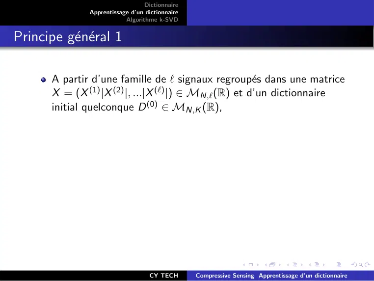

~~~text
                                  Dictionnaire
               Apprentissage d’un dictionnaire
                           Algorithme k-SVD

Principe général 1

       A partir d’une famille de ` signaux regroupés dans une matrice
       X = (X (1) |X (2) |, ...|X (`) |) ∈ MN,` (R) et d’un dictionnaire
       initial quelconque D (0) ∈ MN,K (R),

                                   CY TECH       Compressive Sensing Apprentissage d’un dictionnaire
~~~

## Page 23

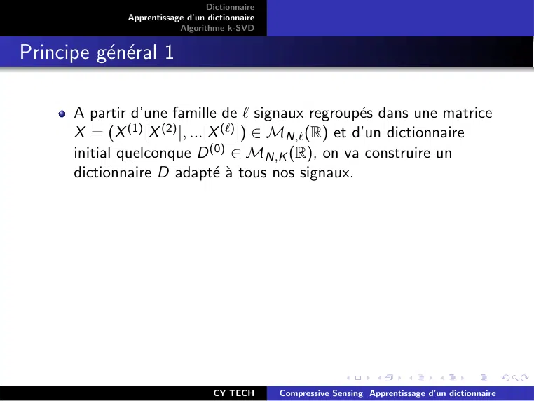

~~~text
                                  Dictionnaire
               Apprentissage d’un dictionnaire
                           Algorithme k-SVD

Principe général 1

       A partir d’une famille de ` signaux regroupés dans une matrice
       X = (X (1) |X (2) |, ...|X (`) |) ∈ MN,` (R) et d’un dictionnaire
       initial quelconque D (0) ∈ MN,K (R), on va construire un
       dictionnaire D adapté à tous nos signaux.

                                   CY TECH       Compressive Sensing Apprentissage d’un dictionnaire
~~~

## Page 24

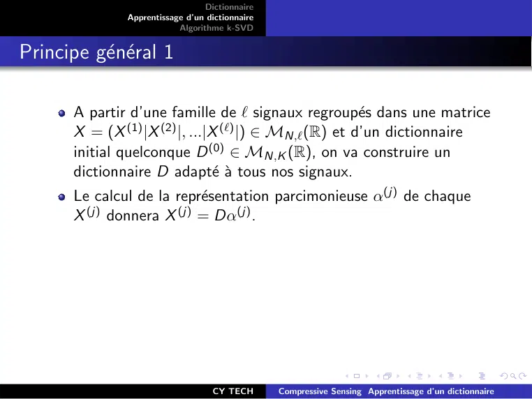

~~~text
                                  Dictionnaire
               Apprentissage d’un dictionnaire
                           Algorithme k-SVD

Principe général 1

       A partir d’une famille de ` signaux regroupés dans une matrice
       X = (X (1) |X (2) |, ...|X (`) |) ∈ MN,` (R) et d’un dictionnaire
       initial quelconque D (0) ∈ MN,K (R), on va construire un
       dictionnaire D adapté à tous nos signaux.
       Le calcul de la représentation parcimonieuse α(j) de chaque
       X (j) donnera X (j) = Dα(j) .

                                   CY TECH       Compressive Sensing Apprentissage d’un dictionnaire
~~~

## Page 25

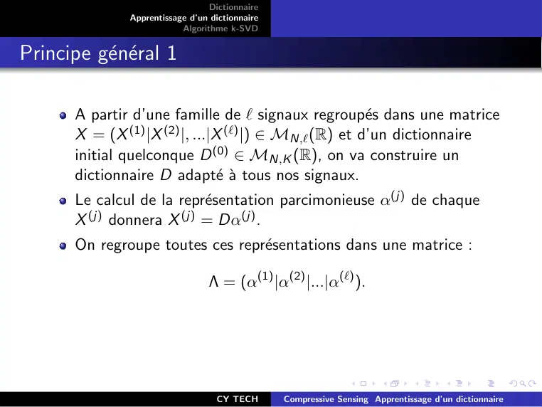

~~~text
                                  Dictionnaire
               Apprentissage d’un dictionnaire
                           Algorithme k-SVD

Principe général 1

       A partir d’une famille de ` signaux regroupés dans une matrice
       X = (X (1) |X (2) |, ...|X (`) |) ∈ MN,` (R) et d’un dictionnaire
       initial quelconque D (0) ∈ MN,K (R), on va construire un
       dictionnaire D adapté à tous nos signaux.
       Le calcul de la représentation parcimonieuse α(j) de chaque
       X (j) donnera X (j) = Dα(j) .
       On regroupe toutes ces représentations dans une matrice :

                                  Λ = (α(1) |α(2) |...|α(`) ).

                                   CY TECH       Compressive Sensing Apprentissage d’un dictionnaire
~~~

## Page 26

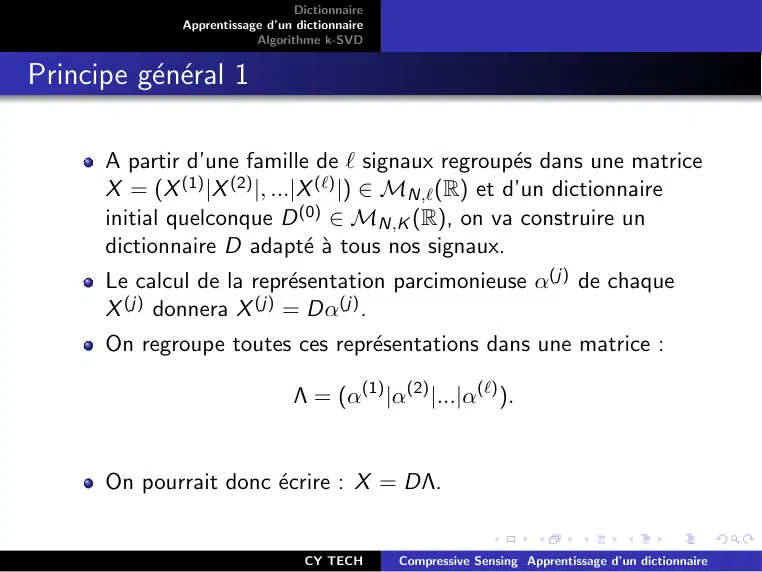

~~~text
                                  Dictionnaire
               Apprentissage d’un dictionnaire
                           Algorithme k-SVD

Principe général 1

       A partir d’une famille de ` signaux regroupés dans une matrice
       X = (X (1) |X (2) |, ...|X (`) |) ∈ MN,` (R) et d’un dictionnaire
       initial quelconque D (0) ∈ MN,K (R), on va construire un
       dictionnaire D adapté à tous nos signaux.
       Le calcul de la représentation parcimonieuse α(j) de chaque
       X (j) donnera X (j) = Dα(j) .
       On regroupe toutes ces représentations dans une matrice :

                                  Λ = (α(1) |α(2) |...|α(`) ).

       On pourrait donc écrire : X = DΛ.

                                   CY TECH       Compressive Sensing Apprentissage d’un dictionnaire
~~~

## Page 27

~~~text
                                Dictionnaire
             Apprentissage d’un dictionnaire
                         Algorithme k-SVD

Principe général 2

                                 CY TECH       Compressive Sensing Apprentissage d’un dictionnaire
~~~

## Page 28

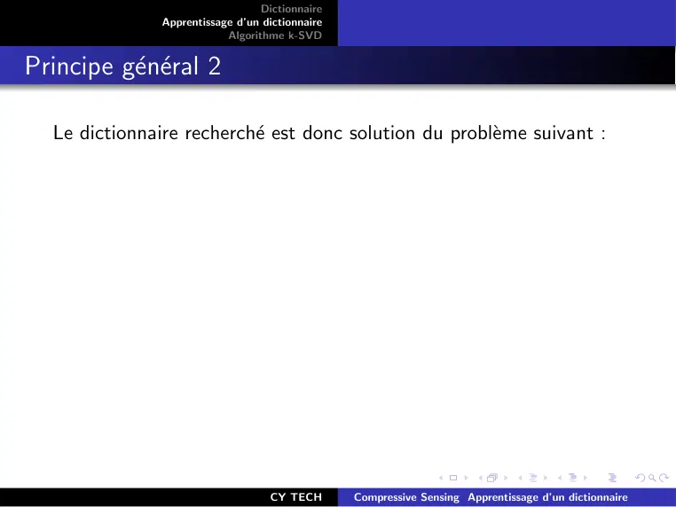

~~~text
                                  Dictionnaire
               Apprentissage d’un dictionnaire
                           Algorithme k-SVD

Principe général 2

  Le dictionnaire recherché est donc solution du problème suivant :

                                   CY TECH       Compressive Sensing Apprentissage d’un dictionnaire
~~~

## Page 29

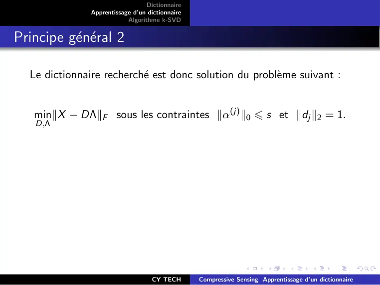

~~~text
                                  Dictionnaire
               Apprentissage d’un dictionnaire
                           Algorithme k-SVD

Principe général 2

  Le dictionnaire recherché est donc solution du problème suivant :

   minkX − DΛkF sous les contraintes kα(j) k0 ⩽ s et kdj k2 = 1.
   D,Λ

                                   CY TECH       Compressive Sensing Apprentissage d’un dictionnaire
~~~

## Page 30

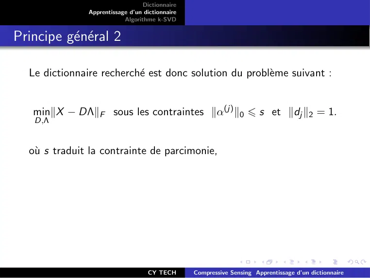

~~~text
                                  Dictionnaire
               Apprentissage d’un dictionnaire
                           Algorithme k-SVD

Principe général 2

  Le dictionnaire recherché est donc solution du problème suivant :

   minkX − DΛkF sous les contraintes kα(j) k0 ⩽ s et kdj k2 = 1.
   D,Λ

  où s traduit la contrainte de parcimonie,

                                   CY TECH       Compressive Sensing Apprentissage d’un dictionnaire
~~~

## Page 31

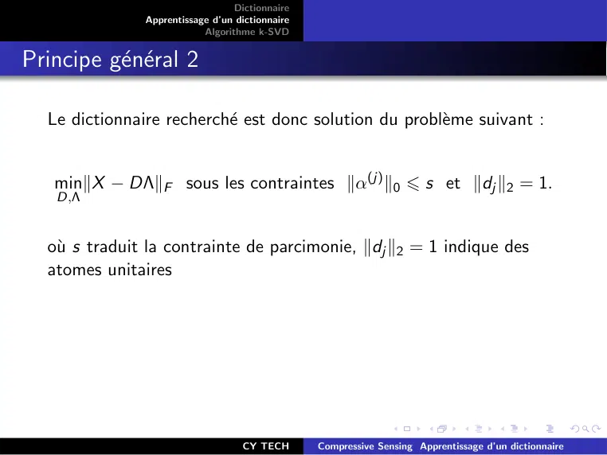

~~~text
                                  Dictionnaire
               Apprentissage d’un dictionnaire
                           Algorithme k-SVD

Principe général 2

  Le dictionnaire recherché est donc solution du problème suivant :

   minkX − DΛkF sous les contraintes kα(j) k0 ⩽ s et kdj k2 = 1.
   D,Λ

  où s traduit la contrainte de parcimonie, kdj k2 = 1 indique des
  atomes unitaires

                                   CY TECH       Compressive Sensing Apprentissage d’un dictionnaire
~~~

## Page 32

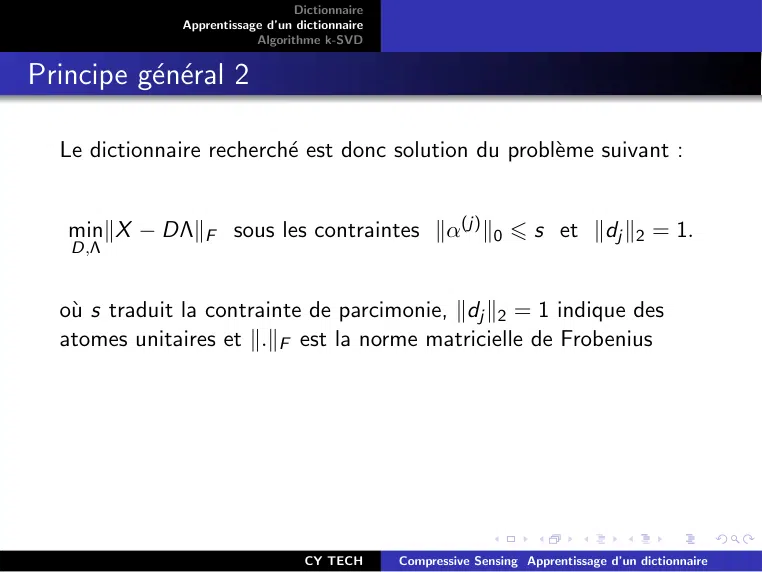

~~~text
                                  Dictionnaire
               Apprentissage d’un dictionnaire
                           Algorithme k-SVD

Principe général 2

  Le dictionnaire recherché est donc solution du problème suivant :

   minkX − DΛkF sous les contraintes kα(j) k0 ⩽ s et kdj k2 = 1.
   D,Λ

  où s traduit la contrainte de parcimonie, kdj k2 = 1 indique des
  atomes unitaires et k.kF est la norme matricielle de Frobenius

                                   CY TECH       Compressive Sensing Apprentissage d’un dictionnaire
~~~

## Page 33

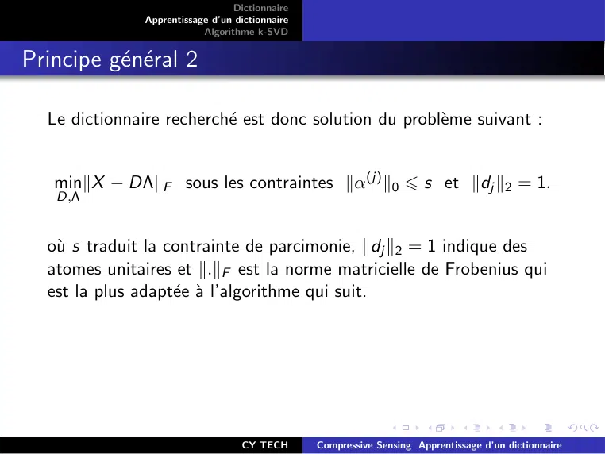

~~~text
                                  Dictionnaire
               Apprentissage d’un dictionnaire
                           Algorithme k-SVD

Principe général 2

  Le dictionnaire recherché est donc solution du problème suivant :

   minkX − DΛkF sous les contraintes kα(j) k0 ⩽ s et kdj k2 = 1.
   D,Λ

  où s traduit la contrainte de parcimonie, kdj k2 = 1 indique des
  atomes unitaires et k.kF est la norme matricielle de Frobenius qui
  est la plus adaptée à l’algorithme qui suit.

                                   CY TECH       Compressive Sensing Apprentissage d’un dictionnaire
~~~

## Page 34

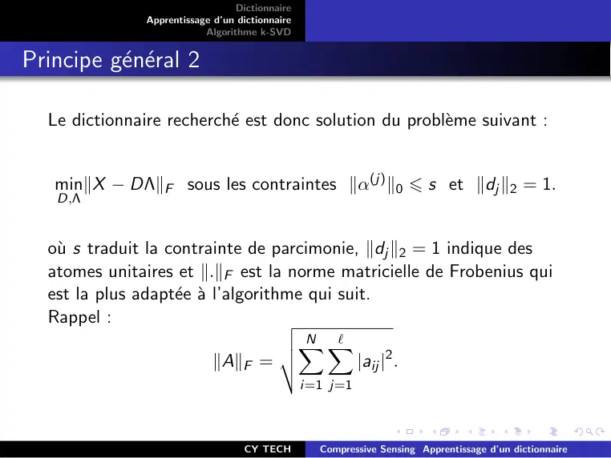

~~~text
                                  Dictionnaire
               Apprentissage d’un dictionnaire
                           Algorithme k-SVD

Principe général 2

  Le dictionnaire recherché est donc solution du problème suivant :

   minkX − DΛkF sous les contraintes kα(j) k0 ⩽ s et kdj k2 = 1.
   D,Λ

  où s traduit la contrainte de parcimonie, kdj k2 = 1 indique des
  atomes unitaires et k.kF est la norme matricielle de Frobenius qui
  est la plus adaptée à l’algorithme qui suit.
  Rappel :                          v
                                    u N `
                                    uX X
                          kAkF = t            |aij |2 .
                                                 i=1 j=1

                                   CY TECH         Compressive Sensing Apprentissage d’un dictionnaire
~~~

## Page 35

~~~text
                               Dictionnaire
            Apprentissage d’un dictionnaire
                        Algorithme k-SVD

Principe général du k-SVD

                                CY TECH       Compressive Sensing Apprentissage d’un dictionnaire
~~~

## Page 36

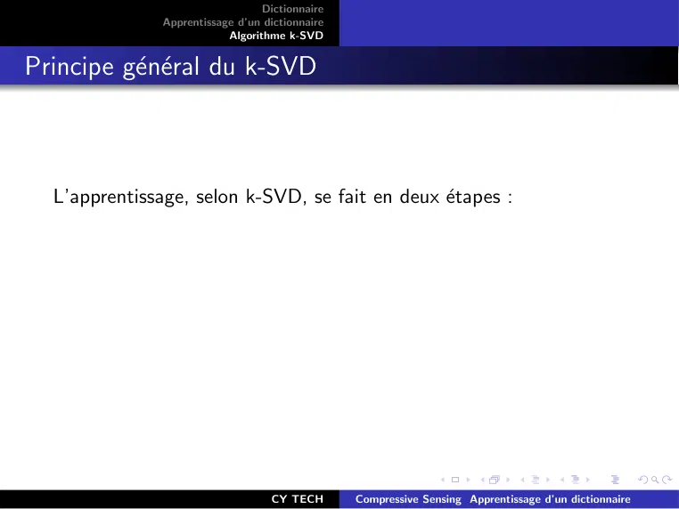

~~~text
                                  Dictionnaire
               Apprentissage d’un dictionnaire
                           Algorithme k-SVD

Principe général du k-SVD

  L’apprentissage, selon k-SVD, se fait en deux étapes :

                                   CY TECH       Compressive Sensing Apprentissage d’un dictionnaire
~~~

## Page 37

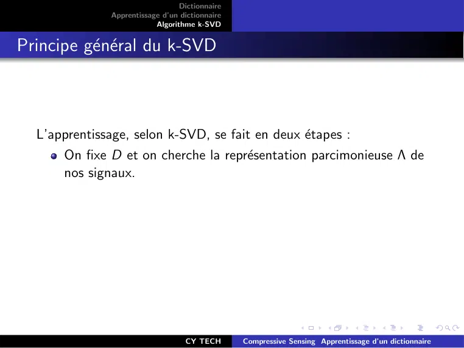

~~~text
                                  Dictionnaire
               Apprentissage d’un dictionnaire
                           Algorithme k-SVD

Principe général du k-SVD

  L’apprentissage, selon k-SVD, se fait en deux étapes :
      On fixe D et on cherche la représentation parcimonieuse Λ de
      nos signaux.

                                   CY TECH       Compressive Sensing Apprentissage d’un dictionnaire
~~~

## Page 38

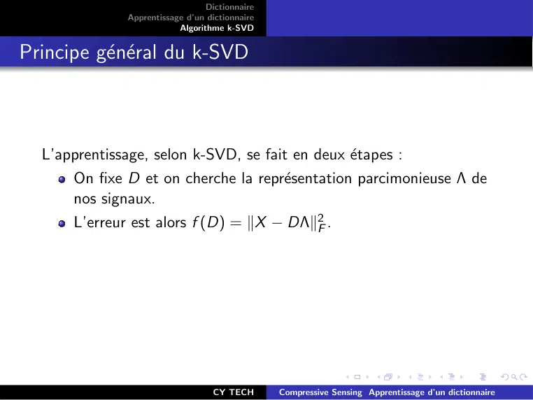

~~~text
                                  Dictionnaire
               Apprentissage d’un dictionnaire
                           Algorithme k-SVD

Principe général du k-SVD

  L’apprentissage, selon k-SVD, se fait en deux étapes :
      On fixe D et on cherche la représentation parcimonieuse Λ de
      nos signaux.
      L’erreur est alors f (D) = kX − DΛk2F .

                                   CY TECH       Compressive Sensing Apprentissage d’un dictionnaire
~~~

## Page 39

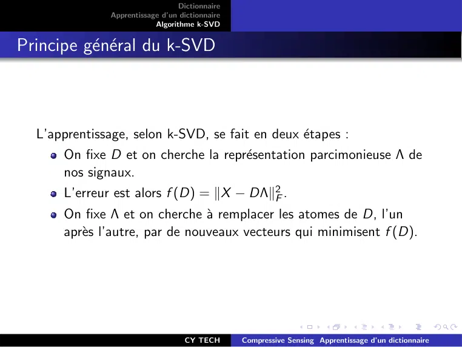

~~~text
                                  Dictionnaire
               Apprentissage d’un dictionnaire
                           Algorithme k-SVD

Principe général du k-SVD

  L’apprentissage, selon k-SVD, se fait en deux étapes :
      On fixe D et on cherche la représentation parcimonieuse Λ de
      nos signaux.
      L’erreur est alors f (D) = kX − DΛk2F .
      On fixe Λ et on cherche à remplacer les atomes de D, l’un
      après l’autre, par de nouveaux vecteurs qui minimisent f (D).

                                   CY TECH       Compressive Sensing Apprentissage d’un dictionnaire
~~~

## Page 40

~~~text
                             Dictionnaire
          Apprentissage d’un dictionnaire
                      Algorithme k-SVD

Algorithme k-SVD

                              CY TECH       Compressive Sensing Apprentissage d’un dictionnaire
~~~

## Page 41

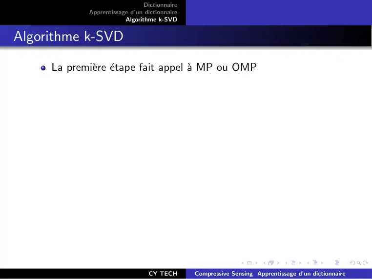

~~~text
                               Dictionnaire
            Apprentissage d’un dictionnaire
                        Algorithme k-SVD

Algorithme k-SVD

     La première étape fait appel à MP ou OMP

                                CY TECH       Compressive Sensing Apprentissage d’un dictionnaire
~~~

## Page 42

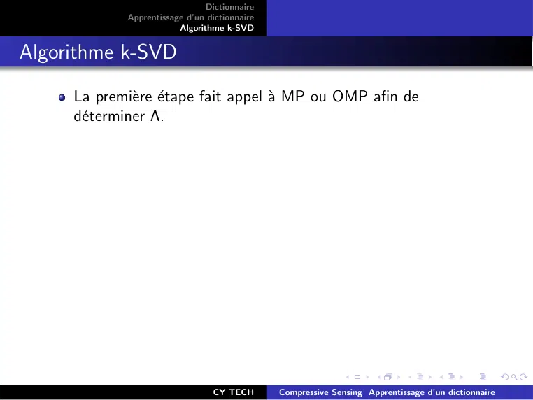

~~~text
                               Dictionnaire
            Apprentissage d’un dictionnaire
                        Algorithme k-SVD

Algorithme k-SVD

     La première étape fait appel à MP ou OMP afin de
     déterminer Λ.

                                CY TECH       Compressive Sensing Apprentissage d’un dictionnaire
~~~

## Page 43

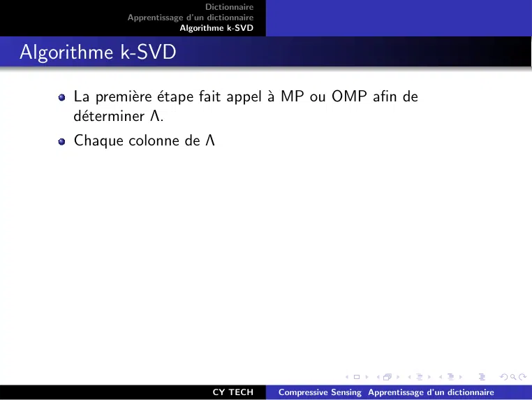

~~~text
                               Dictionnaire
            Apprentissage d’un dictionnaire
                        Algorithme k-SVD

Algorithme k-SVD

     La première étape fait appel à MP ou OMP afin de
     déterminer Λ.
     Chaque colonne de Λ

                                CY TECH       Compressive Sensing Apprentissage d’un dictionnaire
~~~

## Page 44

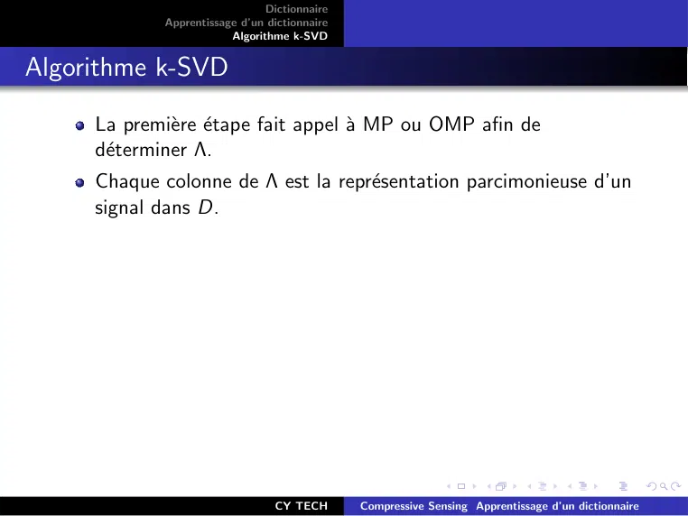

~~~text
                               Dictionnaire
            Apprentissage d’un dictionnaire
                        Algorithme k-SVD

Algorithme k-SVD

     La première étape fait appel à MP ou OMP afin de
     déterminer Λ.
     Chaque colonne de Λ est la représentation parcimonieuse d’un
     signal dans D.

                                CY TECH       Compressive Sensing Apprentissage d’un dictionnaire
~~~

## Page 45

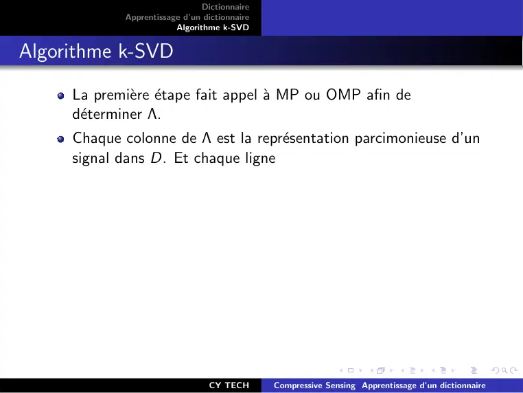

~~~text
                               Dictionnaire
            Apprentissage d’un dictionnaire
                        Algorithme k-SVD

Algorithme k-SVD

     La première étape fait appel à MP ou OMP afin de
     déterminer Λ.
     Chaque colonne de Λ est la représentation parcimonieuse d’un
     signal dans D. Et chaque ligne

                                CY TECH       Compressive Sensing Apprentissage d’un dictionnaire
~~~

## Page 46

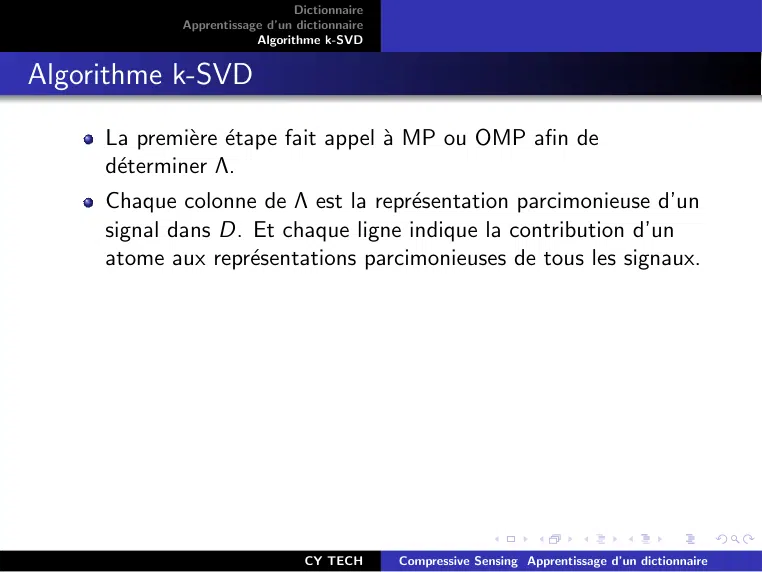

~~~text
                                Dictionnaire
             Apprentissage d’un dictionnaire
                         Algorithme k-SVD

Algorithme k-SVD

     La première étape fait appel à MP ou OMP afin de
     déterminer Λ.
     Chaque colonne de Λ est la représentation parcimonieuse d’un
     signal dans D. Et chaque ligne indique la contribution d’un
     atome aux représentations parcimonieuses de tous les signaux.

                                 CY TECH       Compressive Sensing Apprentissage d’un dictionnaire
~~~

## Page 47

~~~text
                                Dictionnaire
             Apprentissage d’un dictionnaire
                         Algorithme k-SVD

Algorithme k-SVD

     La première étape fait appel à MP ou OMP afin de
     déterminer Λ.
     Chaque colonne de Λ est la représentation parcimonieuse d’un
     signal dans D. Et chaque ligne indique la contribution d’un
     atome aux représentations parcimonieuses de tous les signaux.
                    P
     On écrit DΛ = i D.,i Λi,.

                                 CY TECH       Compressive Sensing Apprentissage d’un dictionnaire
~~~

## Page 48

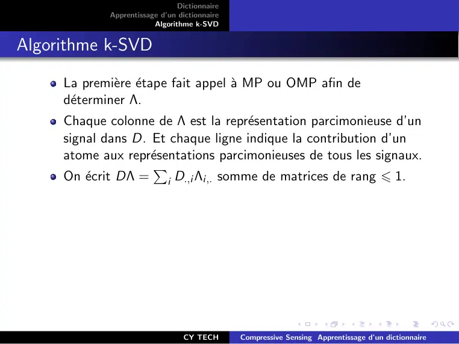

~~~text
                                Dictionnaire
             Apprentissage d’un dictionnaire
                         Algorithme k-SVD

Algorithme k-SVD

     La première étape fait appel à MP ou OMP afin de
     déterminer Λ.
     Chaque colonne de Λ est la représentation parcimonieuse d’un
     signal dans D. Et chaque ligne indique la contribution d’un
     atome aux représentations parcimonieuses de tous les signaux.
                    P
     On écrit DΛ = i D.,i Λi,. somme de matrices de rang ⩽ 1.

                                 CY TECH       Compressive Sensing Apprentissage d’un dictionnaire
~~~

## Page 49

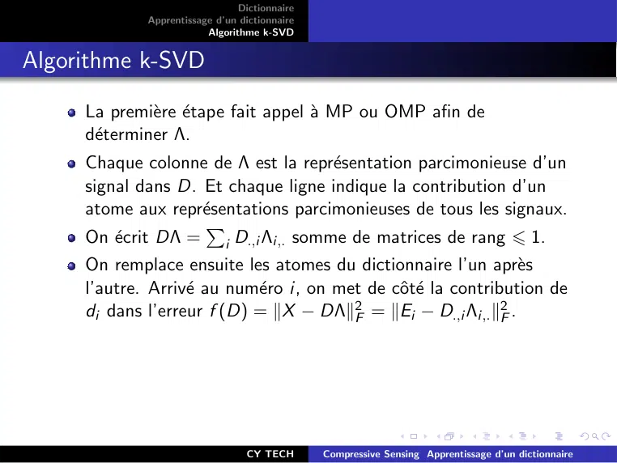

~~~text
                                Dictionnaire
             Apprentissage d’un dictionnaire
                         Algorithme k-SVD

Algorithme k-SVD

     La première étape fait appel à MP ou OMP afin de
     déterminer Λ.
     Chaque colonne de Λ est la représentation parcimonieuse d’un
     signal dans D. Et chaque ligne indique la contribution d’un
     atome aux représentations parcimonieuses de tous les signaux.
                    P
     On écrit DΛ = i D.,i Λi,. somme de matrices de rang ⩽ 1.
     On remplace ensuite les atomes du dictionnaire l’un après
     l’autre. Arrivé au numéro i, on met de côté la contribution de
     di dans l’erreur f (D) = kX − DΛk2F = kEi − D.,i Λi,. k2F .

                                 CY TECH       Compressive Sensing Apprentissage d’un dictionnaire
~~~

## Page 50

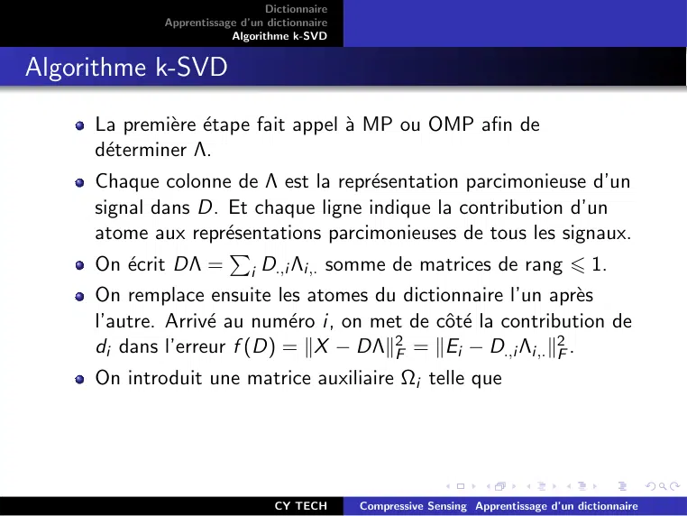

~~~text
                                Dictionnaire
             Apprentissage d’un dictionnaire
                         Algorithme k-SVD

Algorithme k-SVD

     La première étape fait appel à MP ou OMP afin de
     déterminer Λ.
     Chaque colonne de Λ est la représentation parcimonieuse d’un
     signal dans D. Et chaque ligne indique la contribution d’un
     atome aux représentations parcimonieuses de tous les signaux.
                    P
     On écrit DΛ = i D.,i Λi,. somme de matrices de rang ⩽ 1.
     On remplace ensuite les atomes du dictionnaire l’un après
     l’autre. Arrivé au numéro i, on met de côté la contribution de
     di dans l’erreur f (D) = kX − DΛk2F = kEi − D.,i Λi,. k2F .
     On introduit une matrice auxiliaire Ωi telle que

                                 CY TECH       Compressive Sensing Apprentissage d’un dictionnaire
~~~

## Page 51

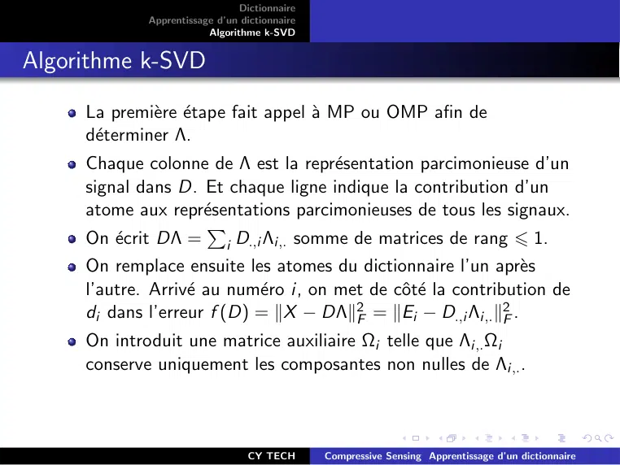

~~~text
                                Dictionnaire
             Apprentissage d’un dictionnaire
                         Algorithme k-SVD

Algorithme k-SVD

     La première étape fait appel à MP ou OMP afin de
     déterminer Λ.
     Chaque colonne de Λ est la représentation parcimonieuse d’un
     signal dans D. Et chaque ligne indique la contribution d’un
     atome aux représentations parcimonieuses de tous les signaux.
                    P
     On écrit DΛ = i D.,i Λi,. somme de matrices de rang ⩽ 1.
     On remplace ensuite les atomes du dictionnaire l’un après
     l’autre. Arrivé au numéro i, on met de côté la contribution de
     di dans l’erreur f (D) = kX − DΛk2F = kEi − D.,i Λi,. k2F .
     On introduit une matrice auxiliaire Ωi telle que Λi,. Ωi
     conserve uniquement les composantes non nulles de Λi,. .

                                 CY TECH       Compressive Sensing Apprentissage d’un dictionnaire
~~~

## Page 52

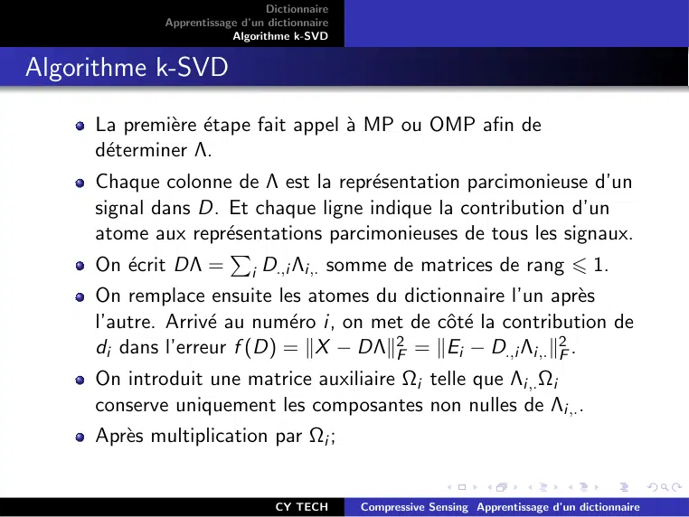

~~~text
                                Dictionnaire
             Apprentissage d’un dictionnaire
                         Algorithme k-SVD

Algorithme k-SVD

     La première étape fait appel à MP ou OMP afin de
     déterminer Λ.
     Chaque colonne de Λ est la représentation parcimonieuse d’un
     signal dans D. Et chaque ligne indique la contribution d’un
     atome aux représentations parcimonieuses de tous les signaux.
                    P
     On écrit DΛ = i D.,i Λi,. somme de matrices de rang ⩽ 1.
     On remplace ensuite les atomes du dictionnaire l’un après
     l’autre. Arrivé au numéro i, on met de côté la contribution de
     di dans l’erreur f (D) = kX − DΛk2F = kEi − D.,i Λi,. k2F .
     On introduit une matrice auxiliaire Ωi telle que Λi,. Ωi
     conserve uniquement les composantes non nulles de Λi,. .
     Après multiplication par Ωi ;

                                 CY TECH       Compressive Sensing Apprentissage d’un dictionnaire
~~~

## Page 53

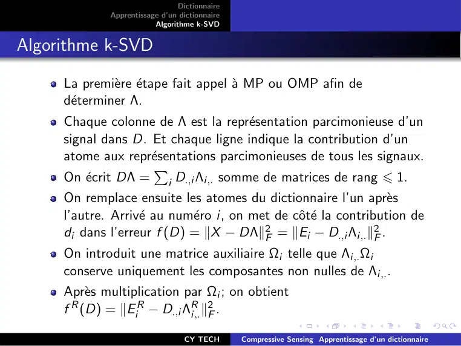

~~~text
                                Dictionnaire
             Apprentissage d’un dictionnaire
                         Algorithme k-SVD

Algorithme k-SVD

     La première étape fait appel à MP ou OMP afin de
     déterminer Λ.
     Chaque colonne de Λ est la représentation parcimonieuse d’un
     signal dans D. Et chaque ligne indique la contribution d’un
     atome aux représentations parcimonieuses de tous les signaux.
                    P
     On écrit DΛ = i D.,i Λi,. somme de matrices de rang ⩽ 1.
     On remplace ensuite les atomes du dictionnaire l’un après
     l’autre. Arrivé au numéro i, on met de côté la contribution de
     di dans l’erreur f (D) = kX − DΛk2F = kEi − D.,i Λi,. k2F .
     On introduit une matrice auxiliaire Ωi telle que Λi,. Ωi
     conserve uniquement les composantes non nulles de Λi,. .
     Après multiplication par Ωi ; on obtient
     f R (D) = kEiR − D.,i ΛR    2
                            i,. kF .

                                 CY TECH       Compressive Sensing Apprentissage d’un dictionnaire
~~~

## Page 54

~~~text
                                Dictionnaire
             Apprentissage d’un dictionnaire
                         Algorithme k-SVD

Algorithme k-SVD

     La première étape fait appel à MP ou OMP afin de
     déterminer Λ.
     Chaque colonne de Λ est la représentation parcimonieuse d’un
     signal dans D. Et chaque ligne indique la contribution d’un
     atome aux représentations parcimonieuses de tous les signaux.
                    P
     On écrit DΛ = i D.,i Λi,. somme de matrices de rang ⩽ 1.
     On remplace ensuite les atomes du dictionnaire l’un après
     l’autre. Arrivé au numéro i, on met de côté la contribution de
     di dans l’erreur f (D) = kX − DΛk2F = kEi − D.,i Λi,. k2F .
     On introduit une matrice auxiliaire Ωi telle que Λi,. Ωi
     conserve uniquement les composantes non nulles de Λi,. .
     Après multiplication par Ωi ; on obtient
     f R (D) = kEiR − D.,i ΛR    2
                            i,. kF .

                                 CY TECH       Compressive Sensing Apprentissage d’un dictionnaire
~~~

## Page 55

~~~text
                                Dictionnaire
             Apprentissage d’un dictionnaire
                         Algorithme k-SVD

Algorithme k-SVD

     Après multiplication par Ωi ; on obtient EiR = Ei Ωi .

                                 CY TECH       Compressive Sensing Apprentissage d’un dictionnaire
~~~

## Page 56

~~~text
                                Dictionnaire
             Apprentissage d’un dictionnaire
                         Algorithme k-SVD

Algorithme k-SVD

     Après multiplication par Ωi ; on obtient EiR = Ei Ωi .
     La recherche d’un remplaçant de D.,i = di et de Λi,. revient à
     la recherche d’une matrice de rang 1 la plus proche possible
     de EiR .

                                 CY TECH       Compressive Sensing Apprentissage d’un dictionnaire
~~~

## Page 57

~~~text
                                Dictionnaire
             Apprentissage d’un dictionnaire
                         Algorithme k-SVD

Algorithme k-SVD

     Après multiplication par Ωi ; on obtient EiR = Ei Ωi .
     La recherche d’un remplaçant de D.,i = di et de Λi,. revient à
     la recherche d’une matrice de rang 1 la plus proche possible
     de EiR .
     C’est la décomposition SVD de EiR qui va permettre de
     remplacer D.,i et Λi,. .

                                 CY TECH       Compressive Sensing Apprentissage d’un dictionnaire
~~~

## Page 58

~~~text
                                Dictionnaire
             Apprentissage d’un dictionnaire
                         Algorithme k-SVD

Algorithme k-SVD

     Après multiplication par Ωi ; on obtient EiR = Ei Ωi .
     La recherche d’un remplaçant de D.,i = di et de Λi,. revient à
     la recherche d’une matrice de rang 1 la plus proche possible
     de EiR .
     C’est la décomposition SVD de EiR qui va permettre de
     remplacer D.,i et Λi,. .
     Si Λi,. = 0,

                                 CY TECH       Compressive Sensing Apprentissage d’un dictionnaire
~~~

## Page 59

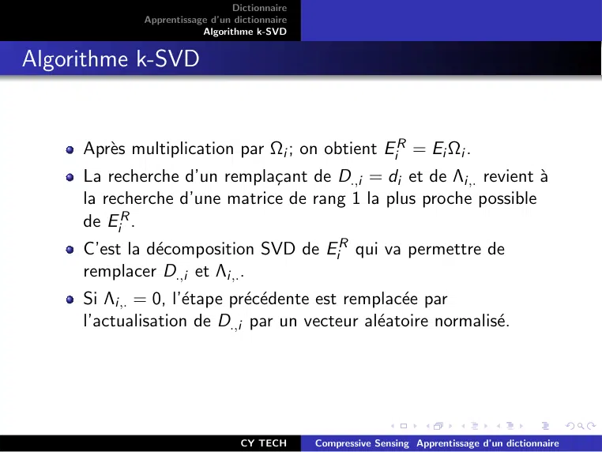

~~~text
                                Dictionnaire
             Apprentissage d’un dictionnaire
                         Algorithme k-SVD

Algorithme k-SVD

     Après multiplication par Ωi ; on obtient EiR = Ei Ωi .
     La recherche d’un remplaçant de D.,i = di et de Λi,. revient à
     la recherche d’une matrice de rang 1 la plus proche possible
     de EiR .
     C’est la décomposition SVD de EiR qui va permettre de
     remplacer D.,i et Λi,. .
     Si Λi,. = 0, l’étape précédente est remplacée par
     l’actualisation de D.,i par un vecteur aléatoire normalisé.

                                 CY TECH       Compressive Sensing Apprentissage d’un dictionnaire
~~~

## Page 60

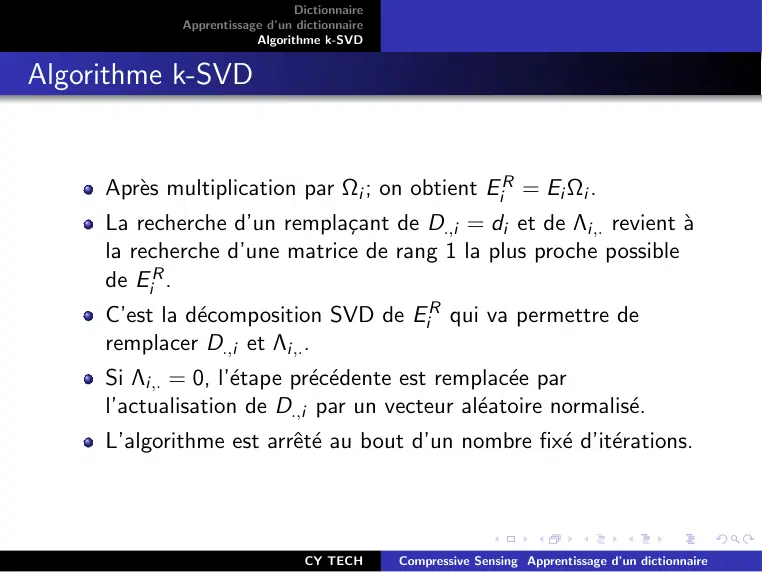

~~~text
                                Dictionnaire
             Apprentissage d’un dictionnaire
                         Algorithme k-SVD

Algorithme k-SVD

     Après multiplication par Ωi ; on obtient EiR = Ei Ωi .
     La recherche d’un remplaçant de D.,i = di et de Λi,. revient à
     la recherche d’une matrice de rang 1 la plus proche possible
     de EiR .
     C’est la décomposition SVD de EiR qui va permettre de
     remplacer D.,i et Λi,. .
     Si Λi,. = 0, l’étape précédente est remplacée par
     l’actualisation de D.,i par un vecteur aléatoire normalisé.
     L’algorithme est arrêté au bout d’un nombre fixé d’itérations.

                                 CY TECH       Compressive Sensing Apprentissage d’un dictionnaire
~~~

## Page 61

~~~text
                             Dictionnaire
          Apprentissage d’un dictionnaire
                      Algorithme k-SVD

Algorithme k-SVD

                              CY TECH       Compressive Sensing Apprentissage d’un dictionnaire
~~~

## Page 62

~~~text
                                  Dictionnaire
               Apprentissage d’un dictionnaire
                           Algorithme k-SVD

Algorithme k-SVD
  Entrées : X taille (N, `), D, taille (N, k) , Nombre itérations : m.
                               Sorties : D, Λ
                     Initialisation du compteur j = 0
                              Tant que j < m
               Etape 1 : Λ = OMP(D, X , iterMax, )
                        Etape 2 : Pour i = 1 à k.
                          Ei ← X − DΛ + D.,i Λi,.
                                 Si Λi,. 6= 0 :
                                ΛRi,. = Λi,. Ωi
                                 EiR = Ei Ωi  
                          [U, ∆, V ] = SVD EiR
                        D.,i ← U.,1  ΛR             T
                                       i,. ← ∆1,1 V.,1
                             Sinon : D.,i ← Alea
                                  j ←j +1
                                   CY TECH       Compressive Sensing Apprentissage d’un dictionnaire
~~~
