# Slides4-Compressive-Sensing24.pdf

[Ouvrir l’original](https://drive.google.com/open?id=17DMykTtZJPN-OgkVGw9aelEmS533eY_-) · Les deux lectures automatiques du PDF divergent sur les pages indiquées. Leur fac-similé accompagne le texte.

**Pages présentant un écart entre les deux extractions** — 1–103.

## Page 1

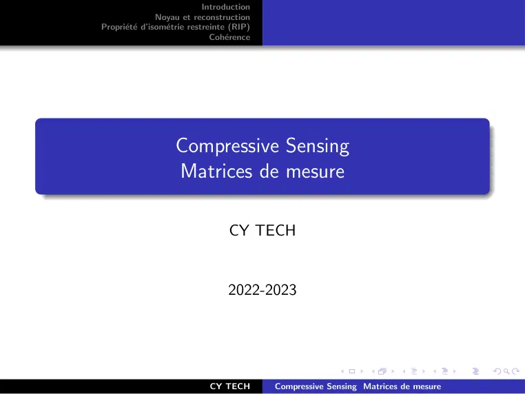

~~~text
                             Introduction
                Noyau et reconstruction
Propriété d’isométrie restreinte (RIP)
                               Cohérence

                    Compressive Sensing
                    Matrices de mesure

                                   CY TECH

                                  2022-2023

                             CY TECH        Compressive Sensing Matrices de mesure
~~~

## Page 2

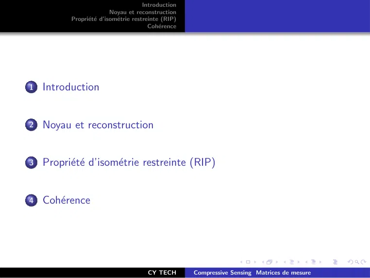

~~~text
                                       Introduction
                          Noyau et reconstruction
          Propriété d’isométrie restreinte (RIP)
                                         Cohérence

1   Introduction

2   Noyau et reconstruction

3   Propriété d’isométrie restreinte (RIP)

4   Cohérence

                                       CY TECH        Compressive Sensing Matrices de mesure
~~~

## Page 3

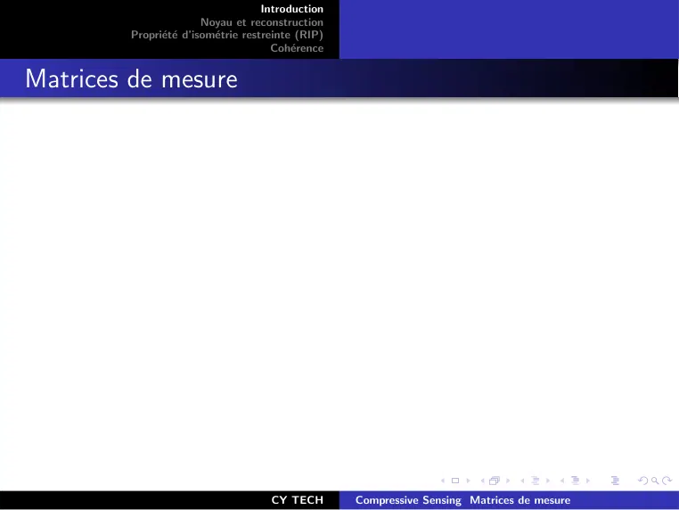

~~~text
                                     Introduction
                        Noyau et reconstruction
        Propriété d’isométrie restreinte (RIP)
                                       Cohérence

Matrices de mesure

                                     CY TECH        Compressive Sensing Matrices de mesure
~~~

## Page 4

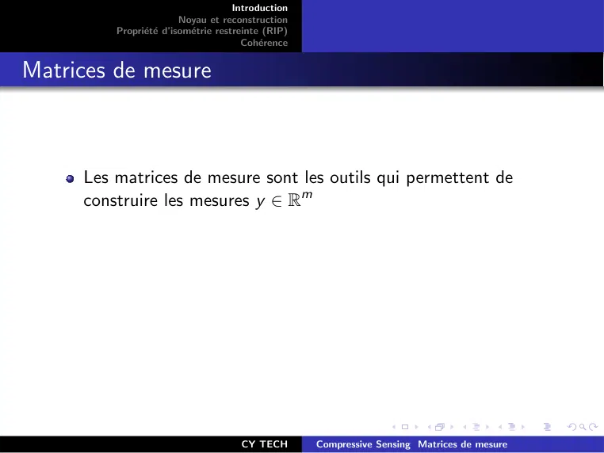

~~~text
                                      Introduction
                         Noyau et reconstruction
         Propriété d’isométrie restreinte (RIP)
                                        Cohérence

Matrices de mesure

     Les matrices de mesure sont les outils qui permettent de
     construire les mesures y ∈ Rm

                                      CY TECH        Compressive Sensing Matrices de mesure
~~~

## Page 5

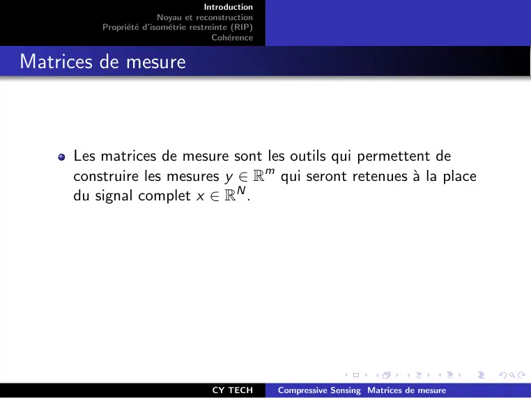

~~~text
                                      Introduction
                         Noyau et reconstruction
         Propriété d’isométrie restreinte (RIP)
                                        Cohérence

Matrices de mesure

     Les matrices de mesure sont les outils qui permettent de
     construire les mesures y ∈ Rm qui seront retenues à la place
     du signal complet x ∈ RN .

                                      CY TECH        Compressive Sensing Matrices de mesure
~~~

## Page 6

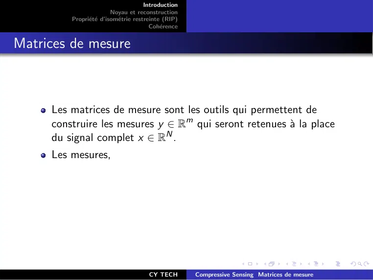

~~~text
                                      Introduction
                         Noyau et reconstruction
         Propriété d’isométrie restreinte (RIP)
                                        Cohérence

Matrices de mesure

     Les matrices de mesure sont les outils qui permettent de
     construire les mesures y ∈ Rm qui seront retenues à la place
     du signal complet x ∈ RN .
     Les mesures,

                                      CY TECH        Compressive Sensing Matrices de mesure
~~~

## Page 7

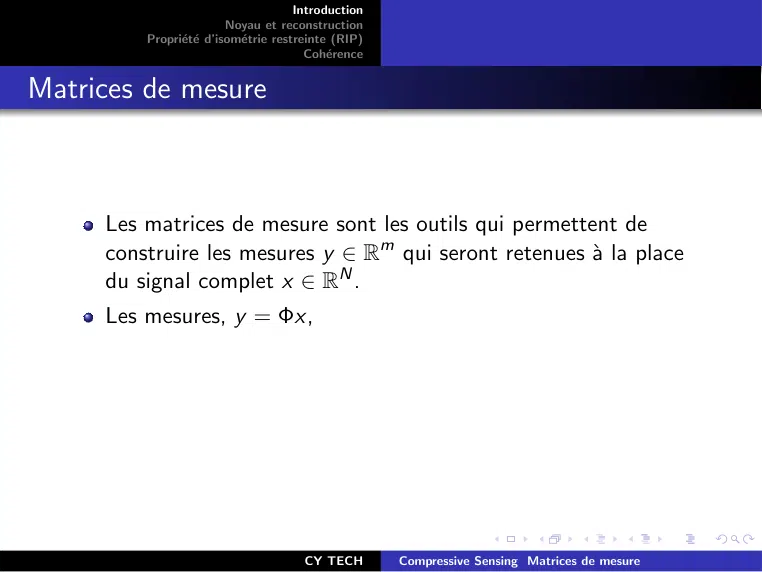

~~~text
                                      Introduction
                         Noyau et reconstruction
         Propriété d’isométrie restreinte (RIP)
                                        Cohérence

Matrices de mesure

     Les matrices de mesure sont les outils qui permettent de
     construire les mesures y ∈ Rm qui seront retenues à la place
     du signal complet x ∈ RN .
     Les mesures, y = Φx,

                                      CY TECH        Compressive Sensing Matrices de mesure
~~~

## Page 8

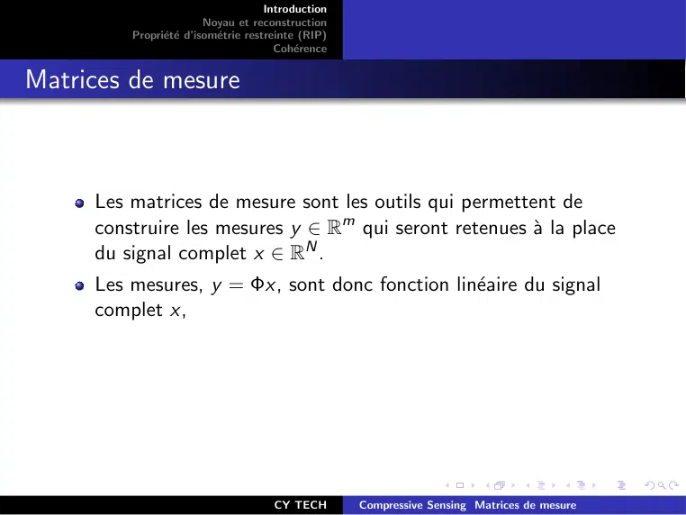

~~~text
                                      Introduction
                         Noyau et reconstruction
         Propriété d’isométrie restreinte (RIP)
                                        Cohérence

Matrices de mesure

     Les matrices de mesure sont les outils qui permettent de
     construire les mesures y ∈ Rm qui seront retenues à la place
     du signal complet x ∈ RN .
     Les mesures, y = Φx, sont donc fonction linéaire du signal
     complet x,

                                      CY TECH        Compressive Sensing Matrices de mesure
~~~

## Page 9

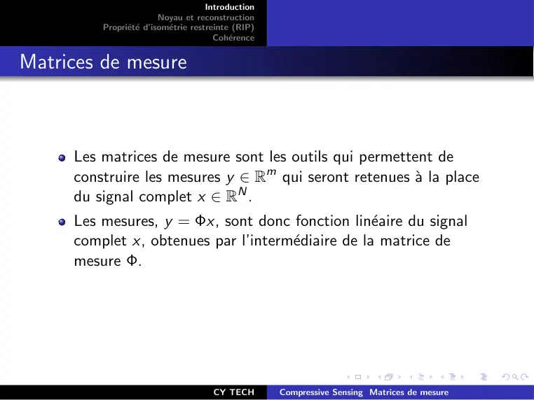

~~~text
                                      Introduction
                         Noyau et reconstruction
         Propriété d’isométrie restreinte (RIP)
                                        Cohérence

Matrices de mesure

     Les matrices de mesure sont les outils qui permettent de
     construire les mesures y ∈ Rm qui seront retenues à la place
     du signal complet x ∈ RN .
     Les mesures, y = Φx, sont donc fonction linéaire du signal
     complet x, obtenues par l’intermédiaire de la matrice de
     mesure Φ.

                                      CY TECH        Compressive Sensing Matrices de mesure
~~~

## Page 10

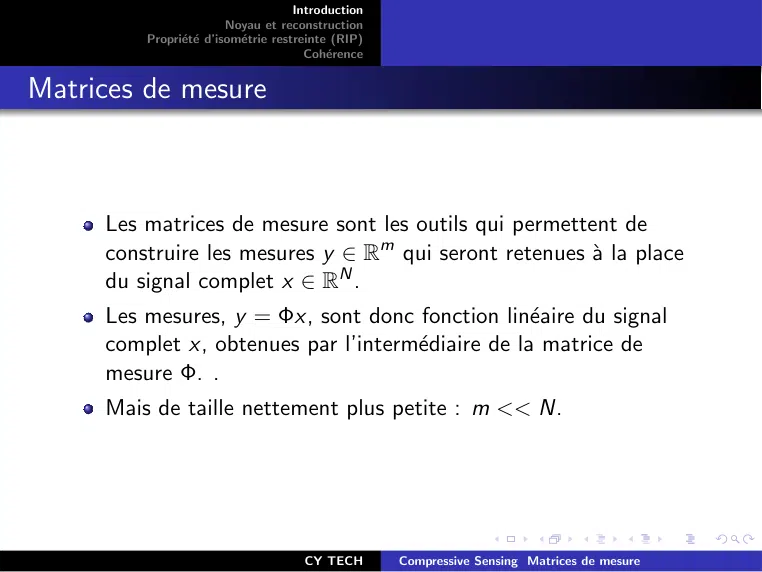

~~~text
                                      Introduction
                         Noyau et reconstruction
         Propriété d’isométrie restreinte (RIP)
                                        Cohérence

Matrices de mesure

     Les matrices de mesure sont les outils qui permettent de
     construire les mesures y ∈ Rm qui seront retenues à la place
     du signal complet x ∈ RN .
     Les mesures, y = Φx, sont donc fonction linéaire du signal
     complet x, obtenues par l’intermédiaire de la matrice de
     mesure Φ. .
     Mais de taille nettement plus petite : m << N.

                                      CY TECH        Compressive Sensing Matrices de mesure
~~~

## Page 11

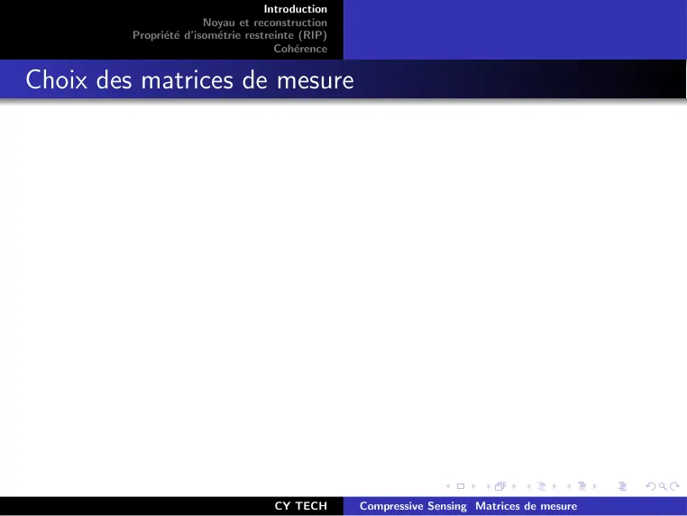

~~~text
                                      Introduction
                         Noyau et reconstruction
         Propriété d’isométrie restreinte (RIP)
                                        Cohérence

Choix des matrices de mesure

                                      CY TECH        Compressive Sensing Matrices de mesure
~~~

## Page 12

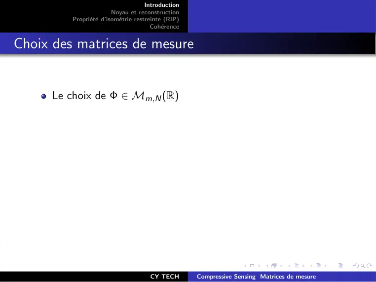

~~~text
                                      Introduction
                         Noyau et reconstruction
         Propriété d’isométrie restreinte (RIP)
                                        Cohérence

Choix des matrices de mesure

     Le choix de Φ ∈ Mm,N (R)

                                      CY TECH        Compressive Sensing Matrices de mesure
~~~

## Page 13

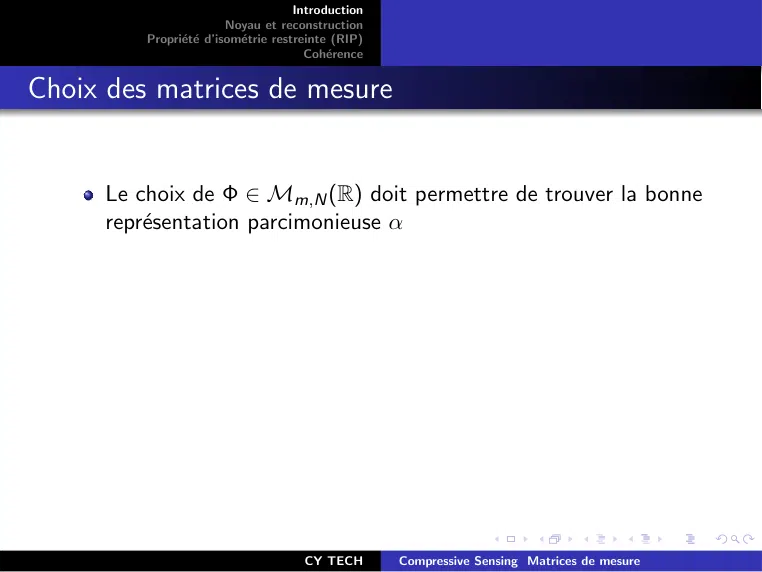

~~~text
                                      Introduction
                         Noyau et reconstruction
         Propriété d’isométrie restreinte (RIP)
                                        Cohérence

Choix des matrices de mesure

     Le choix de Φ ∈ Mm,N (R) doit permettre de trouver la bonne
     représentation parcimonieuse α

                                      CY TECH        Compressive Sensing Matrices de mesure
~~~

## Page 14

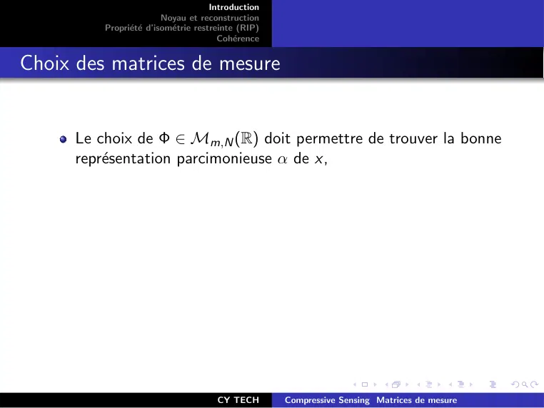

~~~text
                                      Introduction
                         Noyau et reconstruction
         Propriété d’isométrie restreinte (RIP)
                                        Cohérence

Choix des matrices de mesure

     Le choix de Φ ∈ Mm,N (R) doit permettre de trouver la bonne
     représentation parcimonieuse α de x,

                                      CY TECH        Compressive Sensing Matrices de mesure
~~~

## Page 15

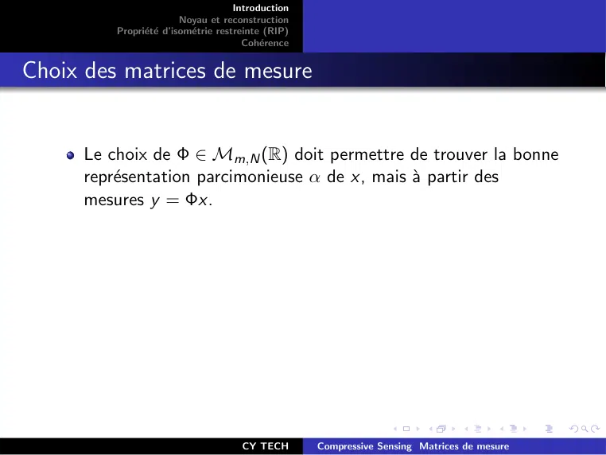

~~~text
                                      Introduction
                         Noyau et reconstruction
         Propriété d’isométrie restreinte (RIP)
                                        Cohérence

Choix des matrices de mesure

     Le choix de Φ ∈ Mm,N (R) doit permettre de trouver la bonne
     représentation parcimonieuse α de x, mais à partir des
     mesures y = Φx.

                                      CY TECH        Compressive Sensing Matrices de mesure
~~~

## Page 16

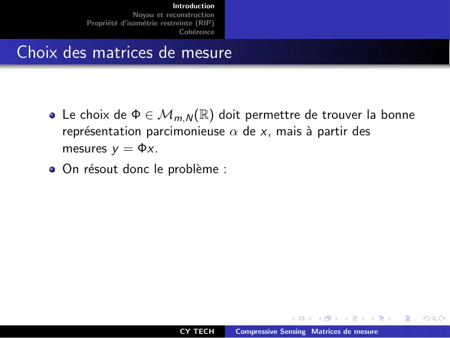

~~~text
                                      Introduction
                         Noyau et reconstruction
         Propriété d’isométrie restreinte (RIP)
                                        Cohérence

Choix des matrices de mesure

     Le choix de Φ ∈ Mm,N (R) doit permettre de trouver la bonne
     représentation parcimonieuse α de x, mais à partir des
     mesures y = Φx.
     On résout donc le problème :

                                      CY TECH        Compressive Sensing Matrices de mesure
~~~

## Page 17

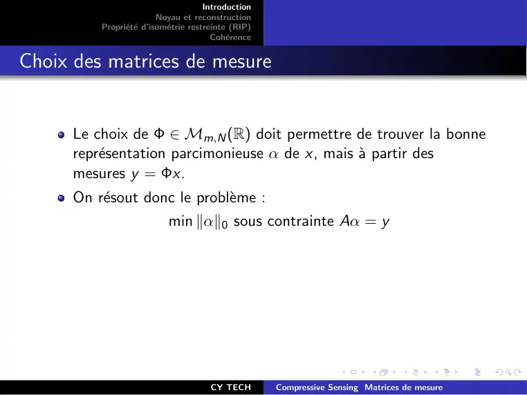

~~~text
                                      Introduction
                         Noyau et reconstruction
         Propriété d’isométrie restreinte (RIP)
                                        Cohérence

Choix des matrices de mesure

     Le choix de Φ ∈ Mm,N (R) doit permettre de trouver la bonne
     représentation parcimonieuse α de x, mais à partir des
     mesures y = Φx.
     On résout donc le problème :
                           min kαk0 sous contrainte Aα = y

                                      CY TECH        Compressive Sensing Matrices de mesure
~~~

## Page 18

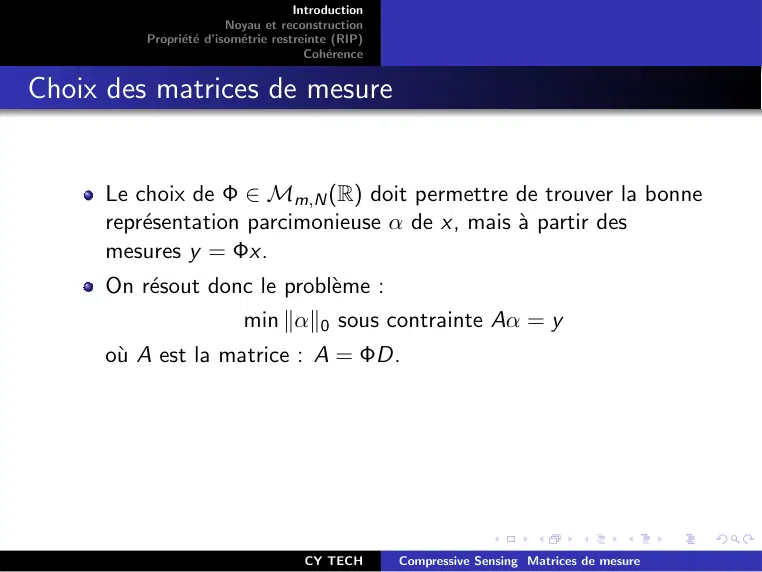

~~~text
                                      Introduction
                         Noyau et reconstruction
         Propriété d’isométrie restreinte (RIP)
                                        Cohérence

Choix des matrices de mesure

     Le choix de Φ ∈ Mm,N (R) doit permettre de trouver la bonne
     représentation parcimonieuse α de x, mais à partir des
     mesures y = Φx.
     On résout donc le problème :
                           min kαk0 sous contrainte Aα = y
     où A est la matrice : A = ΦD.

                                      CY TECH        Compressive Sensing Matrices de mesure
~~~

## Page 19

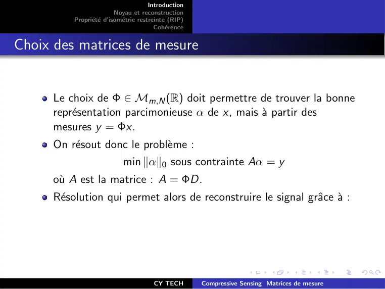

~~~text
                                      Introduction
                         Noyau et reconstruction
         Propriété d’isométrie restreinte (RIP)
                                        Cohérence

Choix des matrices de mesure

     Le choix de Φ ∈ Mm,N (R) doit permettre de trouver la bonne
     représentation parcimonieuse α de x, mais à partir des
     mesures y = Φx.
     On résout donc le problème :
                           min kαk0 sous contrainte Aα = y
     où A est la matrice : A = ΦD.
     Résolution qui permet alors de reconstruire le signal grâce à :

                                      CY TECH        Compressive Sensing Matrices de mesure
~~~

## Page 20

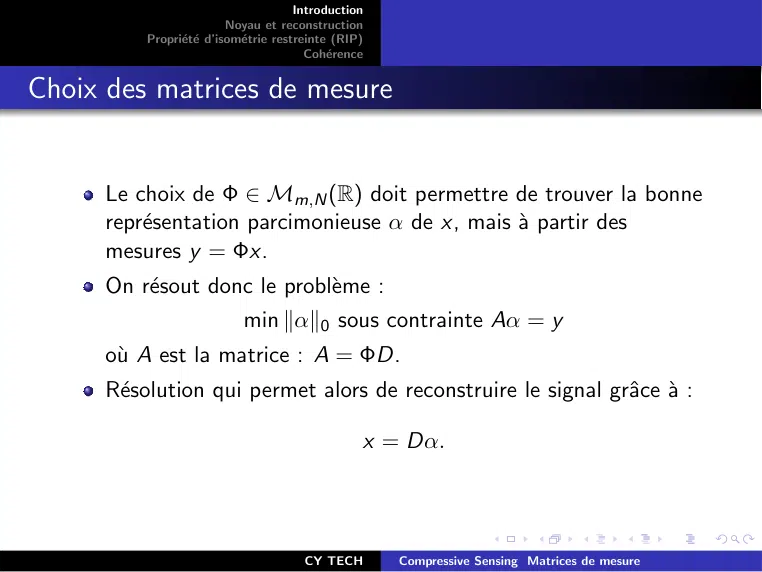

~~~text
                                      Introduction
                         Noyau et reconstruction
         Propriété d’isométrie restreinte (RIP)
                                        Cohérence

Choix des matrices de mesure

     Le choix de Φ ∈ Mm,N (R) doit permettre de trouver la bonne
     représentation parcimonieuse α de x, mais à partir des
     mesures y = Φx.
     On résout donc le problème :
                           min kαk0 sous contrainte Aα = y
     où A est la matrice : A = ΦD.
     Résolution qui permet alors de reconstruire le signal grâce à :

                                                 x = Dα.

                                      CY TECH        Compressive Sensing Matrices de mesure
~~~

## Page 21

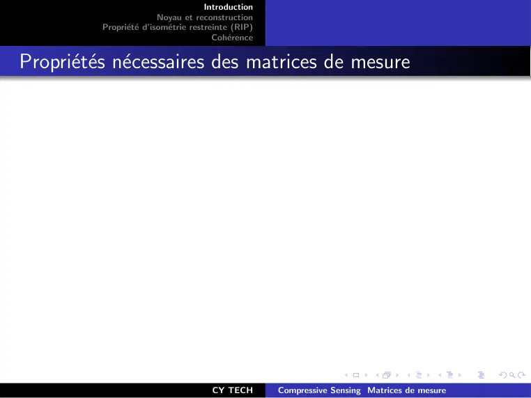

~~~text
                                       Introduction
                          Noyau et reconstruction
          Propriété d’isométrie restreinte (RIP)
                                         Cohérence

Propriétés nécessaires des matrices de mesure

                                       CY TECH        Compressive Sensing Matrices de mesure
~~~

## Page 22

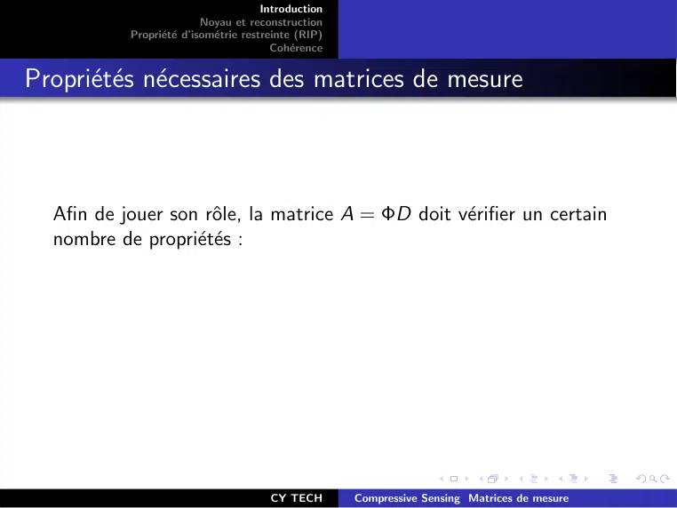

~~~text
                                        Introduction
                           Noyau et reconstruction
           Propriété d’isométrie restreinte (RIP)
                                          Cohérence

Propriétés nécessaires des matrices de mesure

  Afin de jouer son rôle, la matrice A = ΦD doit vérifier un certain
  nombre de propriétés :

                                        CY TECH        Compressive Sensing Matrices de mesure
~~~

## Page 23

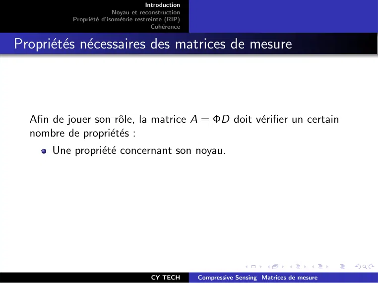

~~~text
                                        Introduction
                           Noyau et reconstruction
           Propriété d’isométrie restreinte (RIP)
                                          Cohérence

Propriétés nécessaires des matrices de mesure

  Afin de jouer son rôle, la matrice A = ΦD doit vérifier un certain
  nombre de propriétés :
      Une propriété concernant son noyau.

                                        CY TECH        Compressive Sensing Matrices de mesure
~~~

## Page 24

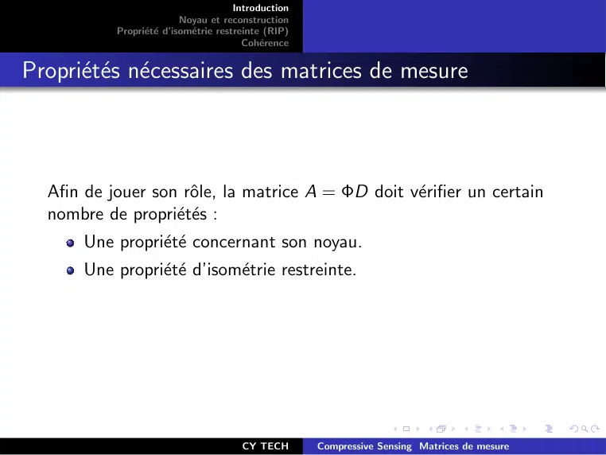

~~~text
                                        Introduction
                           Noyau et reconstruction
           Propriété d’isométrie restreinte (RIP)
                                          Cohérence

Propriétés nécessaires des matrices de mesure

  Afin de jouer son rôle, la matrice A = ΦD doit vérifier un certain
  nombre de propriétés :
      Une propriété concernant son noyau.
      Une propriété d’isométrie restreinte.

                                        CY TECH        Compressive Sensing Matrices de mesure
~~~

## Page 25

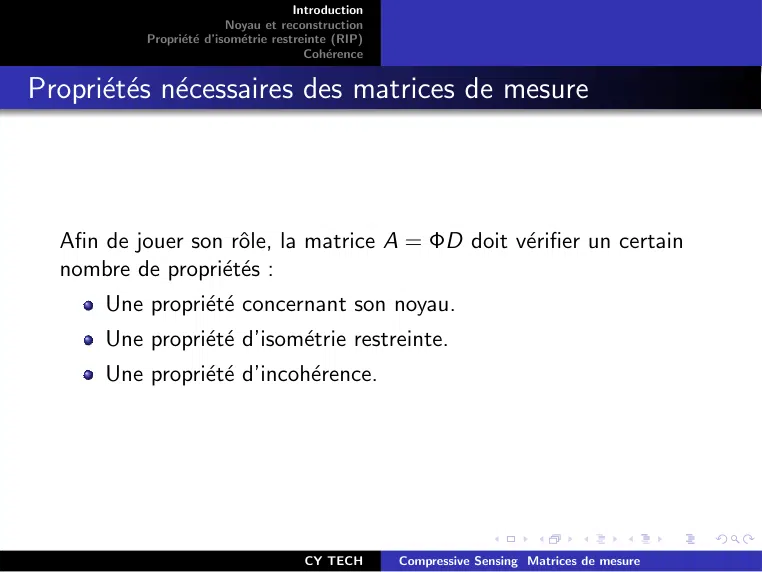

~~~text
                                        Introduction
                           Noyau et reconstruction
           Propriété d’isométrie restreinte (RIP)
                                          Cohérence

Propriétés nécessaires des matrices de mesure

  Afin de jouer son rôle, la matrice A = ΦD doit vérifier un certain
  nombre de propriétés :
      Une propriété concernant son noyau.
      Une propriété d’isométrie restreinte.
      Une propriété d’incohérence.

                                        CY TECH        Compressive Sensing Matrices de mesure
~~~

## Page 26

~~~text
                                       Introduction
                          Noyau et reconstruction
          Propriété d’isométrie restreinte (RIP)
                                         Cohérence

Propriétés du noyau 1

                                       CY TECH        Compressive Sensing Matrices de mesure
~~~

## Page 27

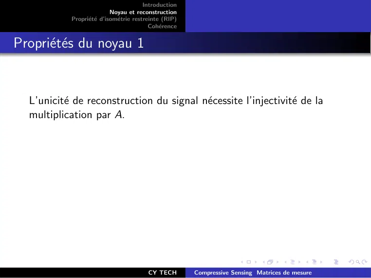

~~~text
                                         Introduction
                            Noyau et reconstruction
            Propriété d’isométrie restreinte (RIP)
                                           Cohérence

Propriétés du noyau 1

  L’unicité de reconstruction du signal nécessite l’injectivité de la
  multiplication par A.

                                         CY TECH        Compressive Sensing Matrices de mesure
~~~

## Page 28

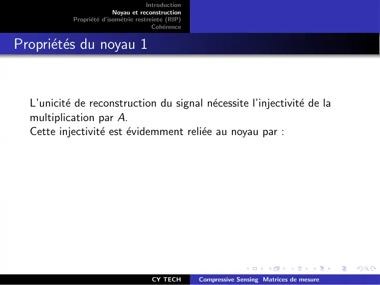

~~~text
                                         Introduction
                            Noyau et reconstruction
            Propriété d’isométrie restreinte (RIP)
                                           Cohérence

Propriétés du noyau 1

  L’unicité de reconstruction du signal nécessite l’injectivité de la
  multiplication par A.
  Cette injectivité est évidemment reliée au noyau par :

                                         CY TECH        Compressive Sensing Matrices de mesure
~~~

## Page 29

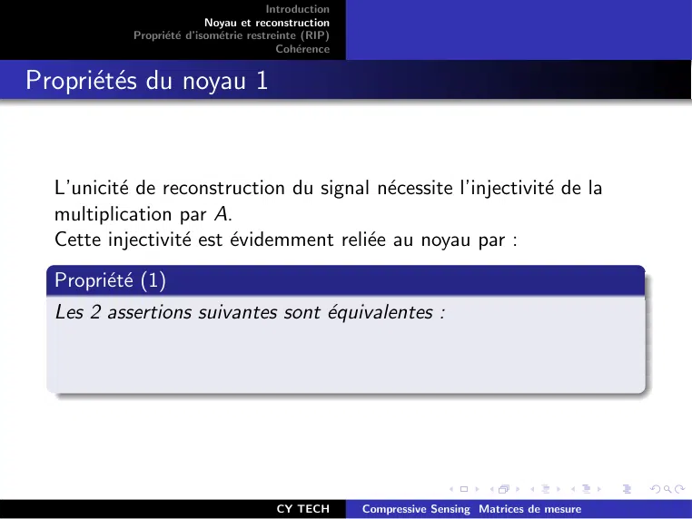

~~~text
                                         Introduction
                            Noyau et reconstruction
            Propriété d’isométrie restreinte (RIP)
                                           Cohérence

Propriétés du noyau 1

  L’unicité de reconstruction du signal nécessite l’injectivité de la
  multiplication par A.
  Cette injectivité est évidemment reliée au noyau par :
  Propriété (1)
  Les 2 assertions suivantes sont équivalentes :

                                         CY TECH        Compressive Sensing Matrices de mesure
~~~

## Page 30

~~~text
                                         Introduction
                            Noyau et reconstruction
            Propriété d’isométrie restreinte (RIP)
                                           Cohérence

Propriétés du noyau 1

  L’unicité de reconstruction du signal nécessite l’injectivité de la
  multiplication par A.
  Cette injectivité est évidemment reliée au noyau par :
  Propriété (1)
  Les 2 assertions suivantes sont équivalentes :
    1   ∀α, β ∈ Σs , α 6= β =⇒ Aα 6= Aβ.

                                         CY TECH        Compressive Sensing Matrices de mesure
~~~

## Page 31

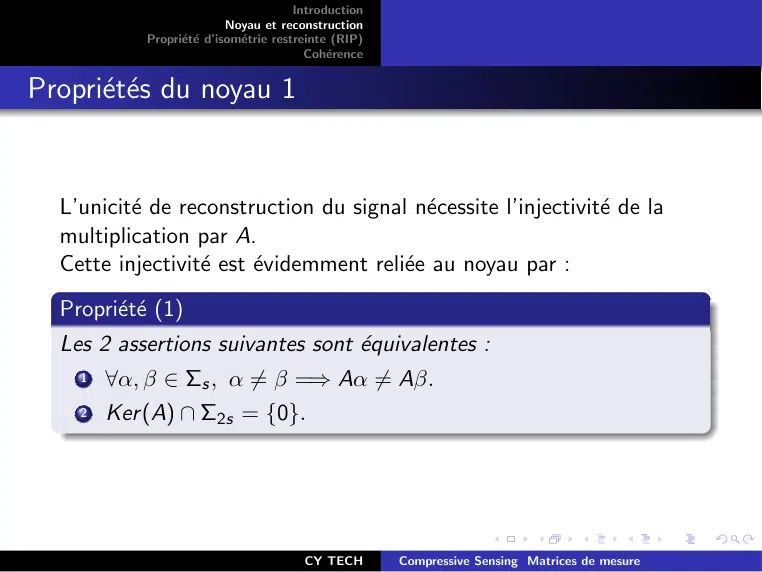

~~~text
                                         Introduction
                            Noyau et reconstruction
            Propriété d’isométrie restreinte (RIP)
                                           Cohérence

Propriétés du noyau 1

  L’unicité de reconstruction du signal nécessite l’injectivité de la
  multiplication par A.
  Cette injectivité est évidemment reliée au noyau par :
  Propriété (1)
  Les 2 assertions suivantes sont équivalentes :
    1   ∀α, β ∈ Σs , α 6= β =⇒ Aα 6= Aβ.
    2   Ker (A) ∩ Σ2s = {0}.

                                         CY TECH        Compressive Sensing Matrices de mesure
~~~

## Page 32

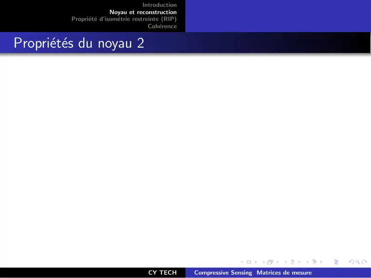

~~~text
                                       Introduction
                          Noyau et reconstruction
          Propriété d’isométrie restreinte (RIP)
                                         Cohérence

Propriétés du noyau 2

                                       CY TECH        Compressive Sensing Matrices de mesure
~~~

## Page 33

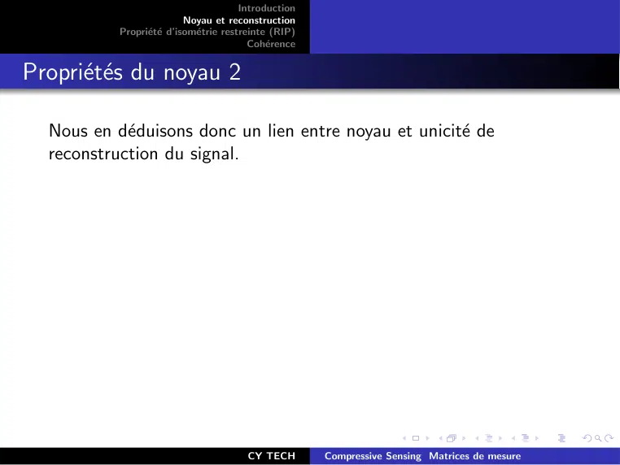

~~~text
                                        Introduction
                           Noyau et reconstruction
           Propriété d’isométrie restreinte (RIP)
                                          Cohérence

Propriétés du noyau 2

  Nous en déduisons donc un lien entre noyau et unicité de
  reconstruction du signal.

                                        CY TECH        Compressive Sensing Matrices de mesure
~~~

## Page 34

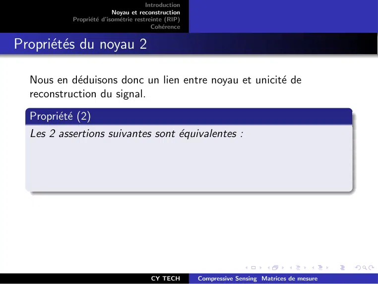

~~~text
                                         Introduction
                            Noyau et reconstruction
            Propriété d’isométrie restreinte (RIP)
                                           Cohérence

Propriétés du noyau 2

  Nous en déduisons donc un lien entre noyau et unicité de
  reconstruction du signal.
  Propriété (2)
  Les 2 assertions suivantes sont équivalentes :

                                         CY TECH        Compressive Sensing Matrices de mesure
~~~

## Page 35

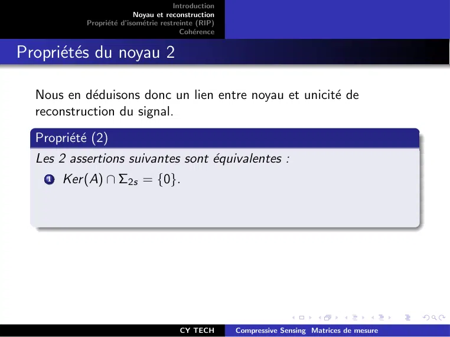

~~~text
                                         Introduction
                            Noyau et reconstruction
            Propriété d’isométrie restreinte (RIP)
                                           Cohérence

Propriétés du noyau 2

  Nous en déduisons donc un lien entre noyau et unicité de
  reconstruction du signal.
  Propriété (2)
  Les 2 assertions suivantes sont équivalentes :
    1   Ker (A) ∩ Σ2s = {0}.

                                         CY TECH        Compressive Sensing Matrices de mesure
~~~

## Page 36

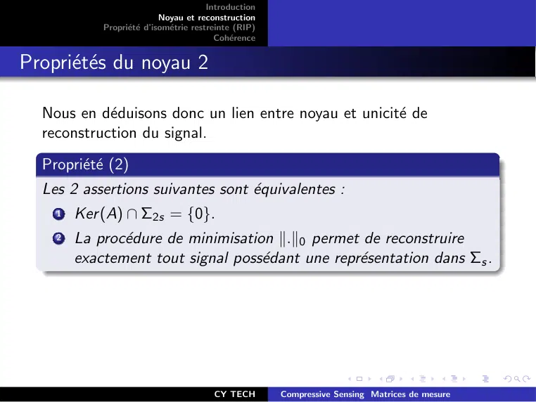

~~~text
                                         Introduction
                            Noyau et reconstruction
            Propriété d’isométrie restreinte (RIP)
                                           Cohérence

Propriétés du noyau 2

  Nous en déduisons donc un lien entre noyau et unicité de
  reconstruction du signal.
  Propriété (2)
  Les 2 assertions suivantes sont équivalentes :
    1   Ker (A) ∩ Σ2s = {0}.
    2   La procédure de minimisation k.k0 permet de reconstruire
        exactement tout signal possédant une représentation dans Σs .

                                         CY TECH        Compressive Sensing Matrices de mesure
~~~

## Page 37

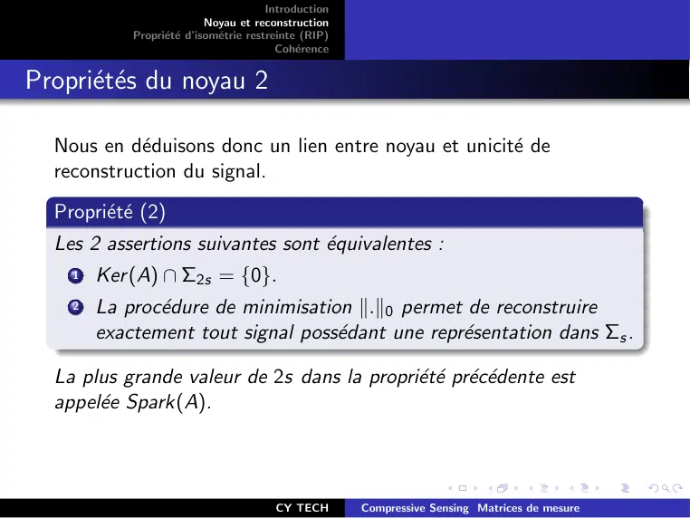

~~~text
                                         Introduction
                            Noyau et reconstruction
            Propriété d’isométrie restreinte (RIP)
                                           Cohérence

Propriétés du noyau 2

  Nous en déduisons donc un lien entre noyau et unicité de
  reconstruction du signal.
  Propriété (2)
  Les 2 assertions suivantes sont équivalentes :
    1   Ker (A) ∩ Σ2s = {0}.
    2   La procédure de minimisation k.k0 permet de reconstruire
        exactement tout signal possédant une représentation dans Σs .

  La plus grande valeur de 2s dans la propriété précédente est
  appelée Spark(A).

                                         CY TECH        Compressive Sensing Matrices de mesure
~~~

## Page 38

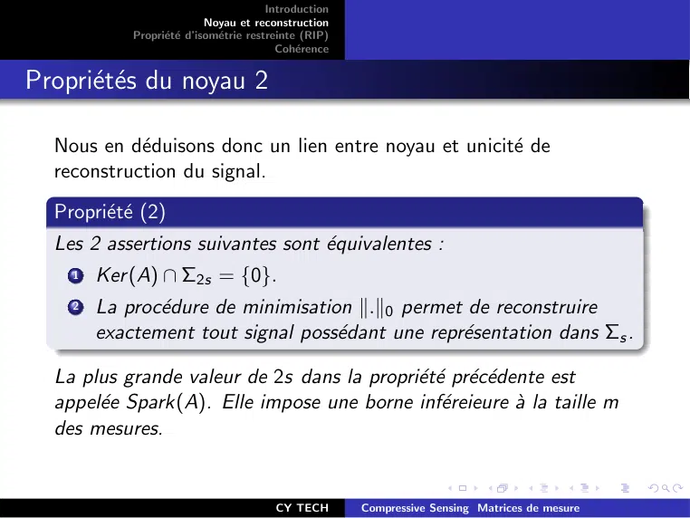

~~~text
                                         Introduction
                            Noyau et reconstruction
            Propriété d’isométrie restreinte (RIP)
                                           Cohérence

Propriétés du noyau 2

  Nous en déduisons donc un lien entre noyau et unicité de
  reconstruction du signal.
  Propriété (2)
  Les 2 assertions suivantes sont équivalentes :
    1   Ker (A) ∩ Σ2s = {0}.
    2   La procédure de minimisation k.k0 permet de reconstruire
        exactement tout signal possédant une représentation dans Σs .

  La plus grande valeur de 2s dans la propriété précédente est
  appelée Spark(A). Elle impose une borne inféreieure à la taille m
  des mesures.

                                         CY TECH        Compressive Sensing Matrices de mesure
~~~

## Page 39

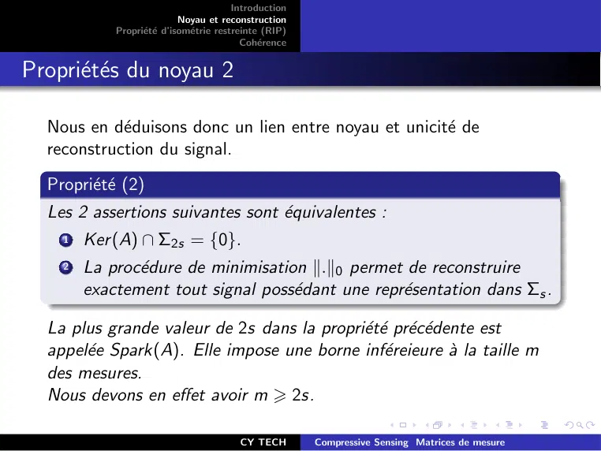

~~~text
                                         Introduction
                            Noyau et reconstruction
            Propriété d’isométrie restreinte (RIP)
                                           Cohérence

Propriétés du noyau 2

  Nous en déduisons donc un lien entre noyau et unicité de
  reconstruction du signal.
  Propriété (2)
  Les 2 assertions suivantes sont équivalentes :
    1   Ker (A) ∩ Σ2s = {0}.
    2   La procédure de minimisation k.k0 permet de reconstruire
        exactement tout signal possédant une représentation dans Σs .

  La plus grande valeur de 2s dans la propriété précédente est
  appelée Spark(A). Elle impose une borne inféreieure à la taille m
  des mesures.
  Nous devons en effet avoir m ⩾ 2s.

                                         CY TECH        Compressive Sensing Matrices de mesure
~~~

## Page 40

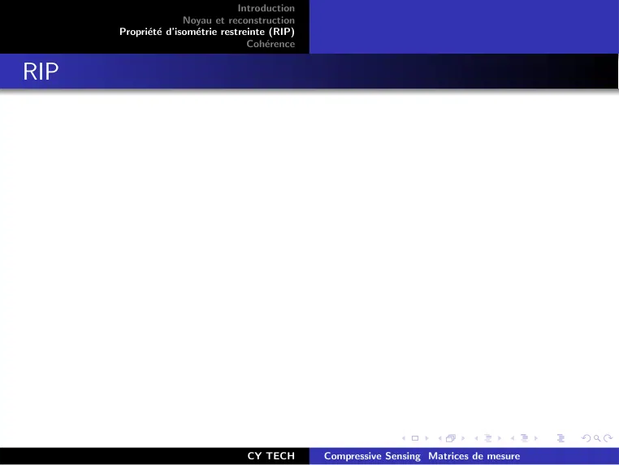

~~~text
                                   Introduction
                      Noyau et reconstruction
      Propriété d’isométrie restreinte (RIP)
                                     Cohérence

RIP

                                   CY TECH        Compressive Sensing Matrices de mesure
~~~

## Page 41

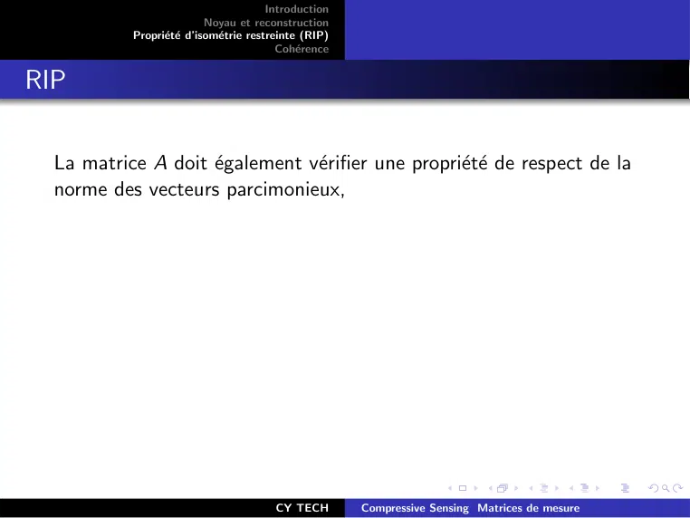

~~~text
                                        Introduction
                           Noyau et reconstruction
           Propriété d’isométrie restreinte (RIP)
                                          Cohérence

RIP

  La matrice A doit également vérifier une propriété de respect de la
  norme des vecteurs parcimonieux,

                                        CY TECH        Compressive Sensing Matrices de mesure
~~~

## Page 42

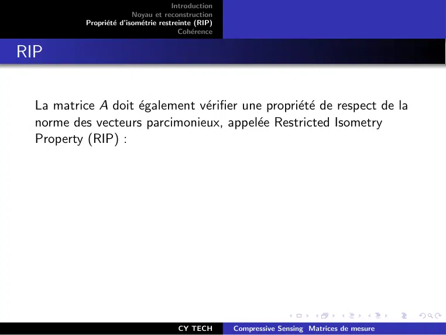

~~~text
                                        Introduction
                           Noyau et reconstruction
           Propriété d’isométrie restreinte (RIP)
                                          Cohérence

RIP

  La matrice A doit également vérifier une propriété de respect de la
  norme des vecteurs parcimonieux, appelée Restricted Isometry
  Property (RIP) :

                                        CY TECH        Compressive Sensing Matrices de mesure
~~~

## Page 43

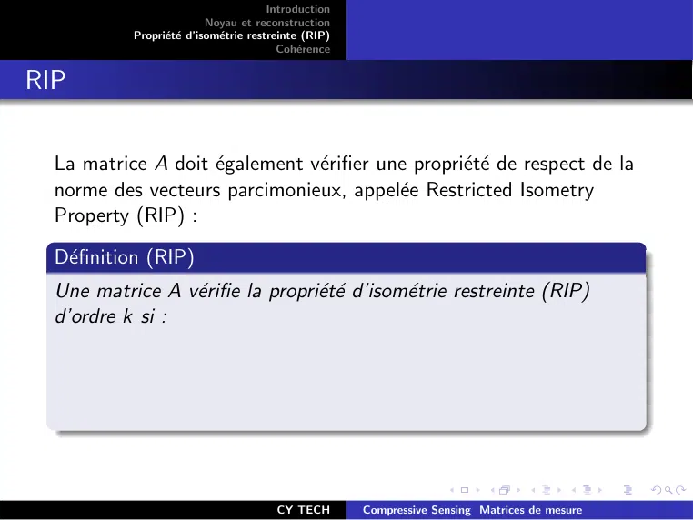

~~~text
                                        Introduction
                           Noyau et reconstruction
           Propriété d’isométrie restreinte (RIP)
                                          Cohérence

RIP

  La matrice A doit également vérifier une propriété de respect de la
  norme des vecteurs parcimonieux, appelée Restricted Isometry
  Property (RIP) :

  Définition (RIP)
  Une matrice A vérifie la propriété d’isométrie restreinte (RIP)
  d’ordre k si :

                                        CY TECH        Compressive Sensing Matrices de mesure
~~~

## Page 44

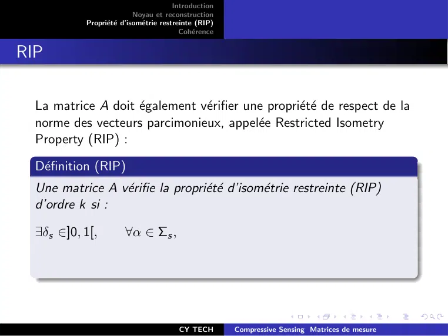

~~~text
                                        Introduction
                           Noyau et reconstruction
           Propriété d’isométrie restreinte (RIP)
                                          Cohérence

RIP

  La matrice A doit également vérifier une propriété de respect de la
  norme des vecteurs parcimonieux, appelée Restricted Isometry
  Property (RIP) :

  Définition (RIP)
  Une matrice A vérifie la propriété d’isométrie restreinte (RIP)
  d’ordre k si :

  ∃δs ∈]0, 1[,         ∀α ∈ Σs ,

                                        CY TECH        Compressive Sensing Matrices de mesure
~~~

## Page 45

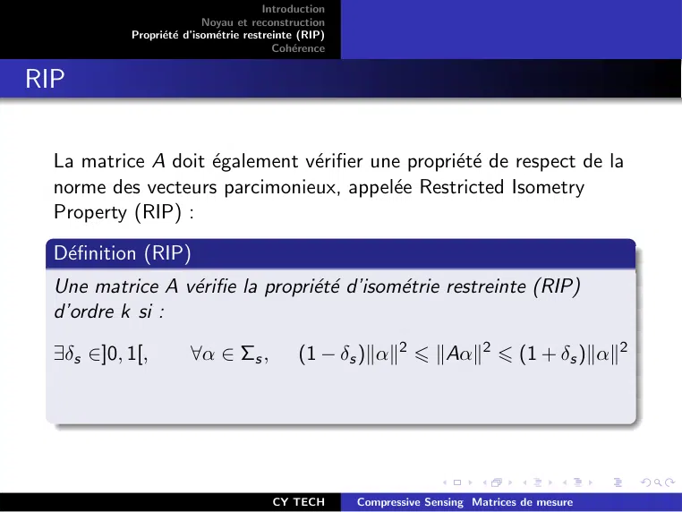

~~~text
                                        Introduction
                           Noyau et reconstruction
           Propriété d’isométrie restreinte (RIP)
                                          Cohérence

RIP

  La matrice A doit également vérifier une propriété de respect de la
  norme des vecteurs parcimonieux, appelée Restricted Isometry
  Property (RIP) :

  Définition (RIP)
  Une matrice A vérifie la propriété d’isométrie restreinte (RIP)
  d’ordre k si :

  ∃δs ∈]0, 1[,         ∀α ∈ Σs ,              (1 − δs )kαk2 ⩽ kAαk2 ⩽ (1 + δs )kαk2

                                        CY TECH        Compressive Sensing Matrices de mesure
~~~

## Page 46

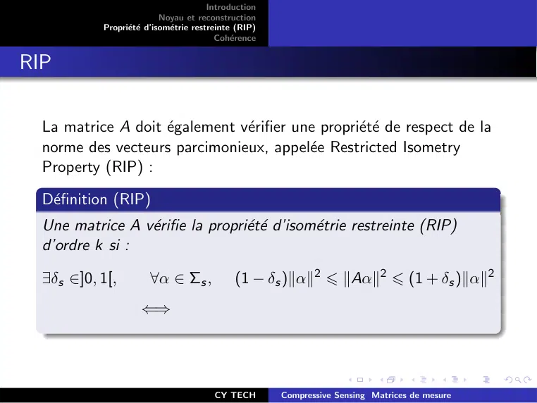

~~~text
                                        Introduction
                           Noyau et reconstruction
           Propriété d’isométrie restreinte (RIP)
                                          Cohérence

RIP

  La matrice A doit également vérifier une propriété de respect de la
  norme des vecteurs parcimonieux, appelée Restricted Isometry
  Property (RIP) :

  Définition (RIP)
  Une matrice A vérifie la propriété d’isométrie restreinte (RIP)
  d’ordre k si :

  ∃δs ∈]0, 1[,         ∀α ∈ Σs ,              (1 − δs )kαk2 ⩽ kAαk2 ⩽ (1 + δs )kαk2
                     ⇐⇒

                                        CY TECH        Compressive Sensing Matrices de mesure
~~~

## Page 47

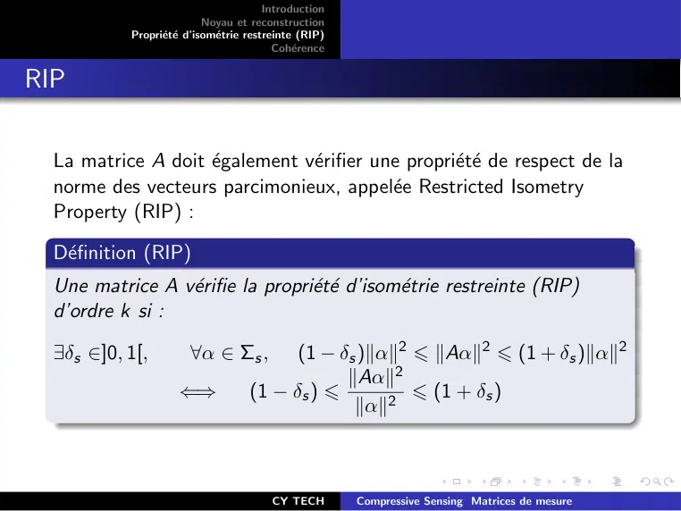

~~~text
                                        Introduction
                           Noyau et reconstruction
           Propriété d’isométrie restreinte (RIP)
                                          Cohérence

RIP

  La matrice A doit également vérifier une propriété de respect de la
  norme des vecteurs parcimonieux, appelée Restricted Isometry
  Property (RIP) :

  Définition (RIP)
  Une matrice A vérifie la propriété d’isométrie restreinte (RIP)
  d’ordre k si :

  ∃δs ∈]0, 1[,         ∀α ∈ Σs ,          (1 − δs )kαk2 ⩽ kAαk2 ⩽ (1 + δs )kαk2
                                                kAαk2
                     ⇐⇒             (1 − δs ) ⩽         ⩽ (1 + δs )
                                                 kαk2

                                        CY TECH        Compressive Sensing Matrices de mesure
~~~

## Page 48

~~~text
                                   Introduction
                      Noyau et reconstruction
      Propriété d’isométrie restreinte (RIP)
                                     Cohérence

RIP

                                   CY TECH        Compressive Sensing Matrices de mesure
~~~

## Page 49

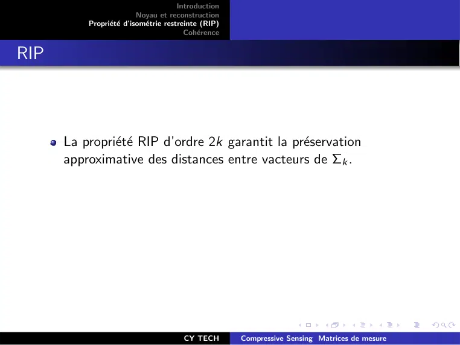

~~~text
                                       Introduction
                          Noyau et reconstruction
          Propriété d’isométrie restreinte (RIP)
                                         Cohérence

RIP

      La propriété RIP d’ordre 2k garantit la préservation
      approximative des distances entre vacteurs de Σk .

                                       CY TECH        Compressive Sensing Matrices de mesure
~~~

## Page 50

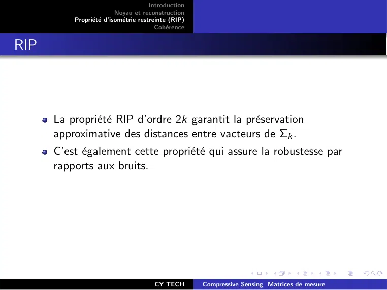

~~~text
                                       Introduction
                          Noyau et reconstruction
          Propriété d’isométrie restreinte (RIP)
                                         Cohérence

RIP

      La propriété RIP d’ordre 2k garantit la préservation
      approximative des distances entre vacteurs de Σk .
      C’est également cette propriété qui assure la robustesse par
      rapports aux bruits.

                                       CY TECH        Compressive Sensing Matrices de mesure
~~~

## Page 51

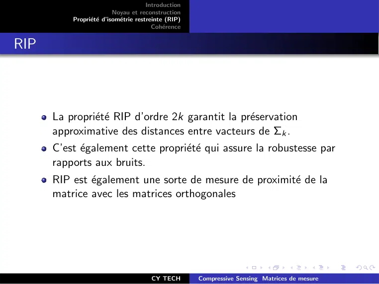

~~~text
                                       Introduction
                          Noyau et reconstruction
          Propriété d’isométrie restreinte (RIP)
                                         Cohérence

RIP

      La propriété RIP d’ordre 2k garantit la préservation
      approximative des distances entre vacteurs de Σk .
      C’est également cette propriété qui assure la robustesse par
      rapports aux bruits.
      RIP est également une sorte de mesure de proximité de la
      matrice avec les matrices orthogonales

                                       CY TECH        Compressive Sensing Matrices de mesure
~~~

## Page 52

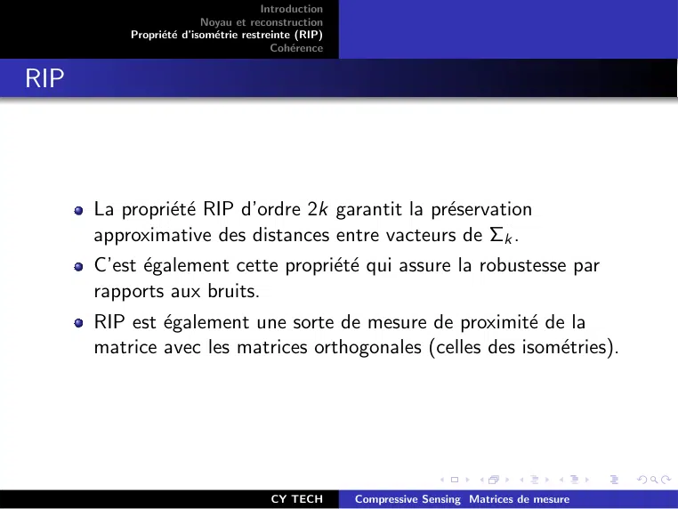

~~~text
                                       Introduction
                          Noyau et reconstruction
          Propriété d’isométrie restreinte (RIP)
                                         Cohérence

RIP

      La propriété RIP d’ordre 2k garantit la préservation
      approximative des distances entre vacteurs de Σk .
      C’est également cette propriété qui assure la robustesse par
      rapports aux bruits.
      RIP est également une sorte de mesure de proximité de la
      matrice avec les matrices orthogonales (celles des isométries).

                                       CY TECH        Compressive Sensing Matrices de mesure
~~~

## Page 53

~~~text
                                      Introduction
                         Noyau et reconstruction
         Propriété d’isométrie restreinte (RIP)
                                        Cohérence

RIP et taille des mesures

                                      CY TECH        Compressive Sensing Matrices de mesure
~~~

## Page 54

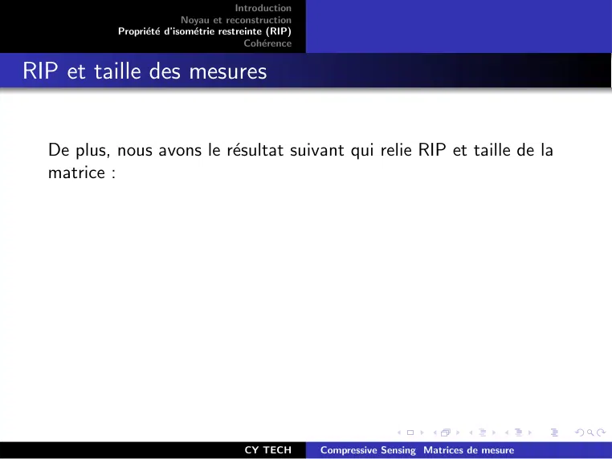

~~~text
                                        Introduction
                           Noyau et reconstruction
           Propriété d’isométrie restreinte (RIP)
                                          Cohérence

RIP et taille des mesures

  De plus, nous avons le résultat suivant qui relie RIP et taille de la
  matrice :

                                        CY TECH        Compressive Sensing Matrices de mesure
~~~

## Page 55

~~~text
                                        Introduction
                           Noyau et reconstruction
           Propriété d’isométrie restreinte (RIP)
                                          Cohérence

RIP et taille des mesures

  De plus, nous avons le résultat suivant qui relie RIP et taille de la
  matrice :
  Théorème
  Soit A ∈ Mm,N (R).

                                        CY TECH        Compressive Sensing Matrices de mesure
~~~

## Page 56

~~~text
                                        Introduction
                           Noyau et reconstruction
           Propriété d’isométrie restreinte (RIP)
                                          Cohérence

RIP et taille des mesures

  De plus, nous avons le résultat suivant qui relie RIP et taille de la
  matrice :
  Théorème
  Soit A ∈ Mm,N (R).
  Si A vérifie RIP d’ordre 2k, avec constante δ ∈]0, 12 ], alors :

                                        CY TECH        Compressive Sensing Matrices de mesure
~~~

## Page 57

~~~text
                                        Introduction
                           Noyau et reconstruction
           Propriété d’isométrie restreinte (RIP)
                                          Cohérence

RIP et taille des mesures

  De plus, nous avons le résultat suivant qui relie RIP et taille de la
  matrice :
  Théorème
  Soit A ∈ Mm,N (R).
  Si A vérifie RIP d’ordre 2k, avec constante δ ∈]0, 12 ], alors :
                                         n
                             m ⩾ C k ln
                                           k

                                        CY TECH        Compressive Sensing Matrices de mesure
~~~

## Page 58

~~~text
                                        Introduction
                           Noyau et reconstruction
           Propriété d’isométrie restreinte (RIP)
                                          Cohérence

RIP et taille des mesures

  De plus, nous avons le résultat suivant qui relie RIP et taille de la
  matrice :
  Théorème
  Soit A ∈ Mm,N (R).
  Si A vérifie RIP d’ordre 2k, avec constante δ ∈]0, 12 ], alors :
                                         n
                             m ⩾ C k ln
                                           k
             √
                 24+1
  avec C =        2   ≃ 0.28.

                                        CY TECH        Compressive Sensing Matrices de mesure
~~~

## Page 59

~~~text
                                       Introduction
                          Noyau et reconstruction
          Propriété d’isométrie restreinte (RIP)
                                         Cohérence

Définition de la cohérence

                                       CY TECH        Compressive Sensing Matrices de mesure
~~~

## Page 60

~~~text
                                        Introduction
                           Noyau et reconstruction
           Propriété d’isométrie restreinte (RIP)
                                          Cohérence

Définition de la cohérence

  Afin de récupérer un maximum d’informations du signal, la matrice
  A doit vérifier une propriété d’incohérence entre ses colonnes.

                                        CY TECH        Compressive Sensing Matrices de mesure
~~~

## Page 61

~~~text
                                        Introduction
                           Noyau et reconstruction
           Propriété d’isométrie restreinte (RIP)
                                          Cohérence

Définition de la cohérence

  Afin de récupérer un maximum d’informations du signal, la matrice
  A doit vérifier une propriété d’incohérence entre ses colonnes. On
  définit, pour cela, sa cohérence par :

                                        CY TECH        Compressive Sensing Matrices de mesure
~~~

## Page 62

~~~text
                                        Introduction
                           Noyau et reconstruction
           Propriété d’isométrie restreinte (RIP)
                                          Cohérence

Définition de la cohérence

  Afin de récupérer un maximum d’informations du signal, la matrice
  A doit vérifier une propriété d’incohérence entre ses colonnes. On
  définit, pour cela, sa cohérence par :
  Définition (Cohérence)
  Soit A ∈ Mm,N (R),

                                        CY TECH        Compressive Sensing Matrices de mesure
~~~

## Page 63

~~~text
                                        Introduction
                           Noyau et reconstruction
           Propriété d’isométrie restreinte (RIP)
                                          Cohérence

Définition de la cohérence

  Afin de récupérer un maximum d’informations du signal, la matrice
  A doit vérifier une propriété d’incohérence entre ses colonnes. On
  définit, pour cela, sa cohérence par :
  Définition (Cohérence)
  Soit A ∈ Mm,N (R), notons A.,j sa j-ème colonne.

                                        CY TECH        Compressive Sensing Matrices de mesure
~~~

## Page 64

~~~text
                                        Introduction
                           Noyau et reconstruction
           Propriété d’isométrie restreinte (RIP)
                                          Cohérence

Définition de la cohérence

  Afin de récupérer un maximum d’informations du signal, la matrice
  A doit vérifier une propriété d’incohérence entre ses colonnes. On
  définit, pour cela, sa cohérence par :
  Définition (Cohérence)
  Soit A ∈ Mm,N (R), notons A.,j sa j-ème colonne.
  On appelle cohérence de A, la quantité :

                                        CY TECH        Compressive Sensing Matrices de mesure
~~~

## Page 65

~~~text
                                        Introduction
                           Noyau et reconstruction
           Propriété d’isométrie restreinte (RIP)
                                          Cohérence

Définition de la cohérence

  Afin de récupérer un maximum d’informations du signal, la matrice
  A doit vérifier une propriété d’incohérence entre ses colonnes. On
  définit, pour cela, sa cohérence par :
  Définition (Cohérence)
  Soit A ∈ Mm,N (R), notons A.,j sa j-ème colonne.
  On appelle cohérence de A, la quantité :

                             µ(A) =

                                        CY TECH        Compressive Sensing Matrices de mesure
~~~

## Page 66

~~~text
                                        Introduction
                           Noyau et reconstruction
           Propriété d’isométrie restreinte (RIP)
                                          Cohérence

Définition de la cohérence

  Afin de récupérer un maximum d’informations du signal, la matrice
  A doit vérifier une propriété d’incohérence entre ses colonnes. On
  définit, pour cela, sa cohérence par :
  Définition (Cohérence)
  Soit A ∈ Mm,N (R), notons A.,j sa j-ème colonne.
  On appelle cohérence de A, la quantité :

                                                  | < A.,i , A.,j > |
                             µ(A) = max                               .
                                             i6=j   kA.,i k kA.,j k

                                        CY TECH        Compressive Sensing Matrices de mesure
~~~

## Page 67

~~~text
                                        Introduction
                           Noyau et reconstruction
           Propriété d’isométrie restreinte (RIP)
                                          Cohérence

Définition de la cohérence

  Afin de récupérer un maximum d’informations du signal, la matrice
  A doit vérifier une propriété d’incohérence entre ses colonnes. On
  définit, pour cela, sa cohérence par :
  Définition (Cohérence)
  Soit A ∈ Mm,N (R), notons A.,j sa j-ème colonne.
  On appelle cohérence de A, la quantité :

                                                  | < A.,i , A.,j > |
                             µ(A) = max                               .
                                             i6=j   kA.,i k kA.,j k

                                        CY TECH        Compressive Sensing Matrices de mesure
~~~

## Page 68

~~~text
                                       Introduction
                          Noyau et reconstruction
          Propriété d’isométrie restreinte (RIP)
                                         Cohérence

Valeurs limites de la cohérence

                                       CY TECH        Compressive Sensing Matrices de mesure
~~~

## Page 69

~~~text
                                       Introduction
                          Noyau et reconstruction
          Propriété d’isométrie restreinte (RIP)
                                         Cohérence

Valeurs limites de la cohérence

      On a toujours :

                                       CY TECH        Compressive Sensing Matrices de mesure
~~~

## Page 70

~~~text
                                       Introduction
                          Noyau et reconstruction
          Propriété d’isométrie restreinte (RIP)
                                         Cohérence

Valeurs limites de la cohérence

                               s
                                     N −M
      On a toujours :                        ⩽ µ(A) ⩽ 1.
                                    M(N − 1)

                                       CY TECH        Compressive Sensing Matrices de mesure
~~~

## Page 71

~~~text
                                       Introduction
                          Noyau et reconstruction
          Propriété d’isométrie restreinte (RIP)
                                         Cohérence

Valeurs limites de la cohérence

                               s
                                     N −M
      On a toujours :                        ⩽ µ(A) ⩽ 1.
                                    M(N − 1)

      Lorsque M  N,

                                       CY TECH        Compressive Sensing Matrices de mesure
~~~

## Page 72

~~~text
                                       Introduction
                          Noyau et reconstruction
          Propriété d’isométrie restreinte (RIP)
                                         Cohérence

Valeurs limites de la cohérence

                               s
                                     N −M
      On a toujours :                        ⩽ µ(A) ⩽ 1.
                                    M(N − 1)
                                                     1
      Lorsque M  N, la borne inférieure tend vers √ .
                                                     M

                                       CY TECH        Compressive Sensing Matrices de mesure
~~~

## Page 73

~~~text
                                       Introduction
                          Noyau et reconstruction
          Propriété d’isométrie restreinte (RIP)
                                         Cohérence

Valeurs limites de la cohérence

                               s
                                     N −M
      On a toujours :                        ⩽ µ(A) ⩽ 1.
                                    M(N − 1)
                                                     1
      Lorsque M  N, la borne inférieure tend vers √ .
                                                     M
      Une cohérence maximale (µ(A) = 1)

                                       CY TECH        Compressive Sensing Matrices de mesure
~~~

## Page 74

~~~text
                                       Introduction
                          Noyau et reconstruction
          Propriété d’isométrie restreinte (RIP)
                                         Cohérence

Valeurs limites de la cohérence

                               s
                                     N −M
      On a toujours :                        ⩽ µ(A) ⩽ 1.
                                    M(N − 1)
                                                     1
      Lorsque M  N, la borne inférieure tend vers √ .
                                                     M
      Une cohérence maximale (µ(A) = 1) indique des colonnes
      colinéaires.

                                       CY TECH        Compressive Sensing Matrices de mesure
~~~

## Page 75

~~~text
                                       Introduction
                          Noyau et reconstruction
          Propriété d’isométrie restreinte (RIP)
                                         Cohérence

Valeurs limites de la cohérence

                               s
                                     N −M
      On a toujours :                        ⩽ µ(A) ⩽ 1.
                                    M(N − 1)
                                                     1
      Lorsque M  N, la borne inférieure tend vers √ .
                                                     M
      Une cohérence maximale (µ(A) = 1) indique des colonnes
      colinéaires.
      Inversement, une matrice A est dite incohérente

                                       CY TECH        Compressive Sensing Matrices de mesure
~~~

## Page 76

~~~text
                                       Introduction
                          Noyau et reconstruction
          Propriété d’isométrie restreinte (RIP)
                                         Cohérence

Valeurs limites de la cohérence

                               s
                                     N −M
      On a toujours :                        ⩽ µ(A) ⩽ 1.
                                    M(N − 1)
                                                     1
      Lorsque M  N, la borne inférieure tend vers √ .
                                                     M
      Une cohérence maximale (µ(A) = 1) indique des colonnes
      colinéaires.
      Inversement, une matrice A est dite incohérente lorsque µ(A)
                                          1
      est proche de la limite de Welch : √ .
                                           M

                                       CY TECH        Compressive Sensing Matrices de mesure
~~~

## Page 77

~~~text
                                       Introduction
                          Noyau et reconstruction
          Propriété d’isométrie restreinte (RIP)
                                         Cohérence

Valeurs limites de la cohérence

                               s
                                     N −M
      On a toujours :                        ⩽ µ(A) ⩽ 1.
                                    M(N − 1)
                                                     1
      Lorsque M  N, la borne inférieure tend vers √ .
                                                     M
      Une cohérence maximale (µ(A) = 1) indique des colonnes
      colinéaires.
      Inversement, une matrice A est dite incohérente lorsque µ(A)
                                          1
      est proche de la limite de Welch : √ .
                                           M
      C’est ce dernier type de matrices que nous recherchons.

                                       CY TECH        Compressive Sensing Matrices de mesure
~~~

## Page 78

~~~text
                                      Introduction
                         Noyau et reconstruction
         Propriété d’isométrie restreinte (RIP)
                                        Cohérence

Cohérence mutuelle

                                      CY TECH        Compressive Sensing Matrices de mesure
~~~

## Page 79

~~~text
                                        Introduction
                           Noyau et reconstruction
           Propriété d’isométrie restreinte (RIP)
                                          Cohérence

Cohérence mutuelle
  N’ayant pas la liberté de choisir le dictionnaire D,

                                        CY TECH        Compressive Sensing Matrices de mesure
~~~

## Page 80

~~~text
                                        Introduction
                           Noyau et reconstruction
           Propriété d’isométrie restreinte (RIP)
                                          Cohérence

Cohérence mutuelle
  N’ayant pas la liberté de choisir le dictionnaire D, on va choisir la
  matrice Φ

                                        CY TECH        Compressive Sensing Matrices de mesure
~~~

## Page 81

~~~text
                                        Introduction
                           Noyau et reconstruction
           Propriété d’isométrie restreinte (RIP)
                                          Cohérence

Cohérence mutuelle
  N’ayant pas la liberté de choisir le dictionnaire D, on va choisir la
  matrice Φ de manière à ce que A = ΦD soit la plus incohérente
  possible.

                                        CY TECH        Compressive Sensing Matrices de mesure
~~~

## Page 82

~~~text
                                        Introduction
                           Noyau et reconstruction
           Propriété d’isométrie restreinte (RIP)
                                          Cohérence

Cohérence mutuelle
  N’ayant pas la liberté de choisir le dictionnaire D, on va choisir la
  matrice Φ de manière à ce que A = ΦD soit la plus incohérente
  possible.
  Il faut pour cela que les lignes de Φ soient les plus incohérentes
  possibles avec les colonnes de D.

                                        CY TECH        Compressive Sensing Matrices de mesure
~~~

## Page 83

~~~text
                                        Introduction
                           Noyau et reconstruction
           Propriété d’isométrie restreinte (RIP)
                                          Cohérence

Cohérence mutuelle
  N’ayant pas la liberté de choisir le dictionnaire D, on va choisir la
  matrice Φ de manière à ce que A = ΦD soit la plus incohérente
  possible.
  Il faut pour cela que les lignes de Φ soient les plus incohérentes
  possibles avec les colonnes de D.
  C’est ainsi que l’on définit la cohérence mutuelle de 2 matrices Φ
  et D par :

                                        CY TECH        Compressive Sensing Matrices de mesure
~~~

## Page 84

~~~text
                                        Introduction
                           Noyau et reconstruction
           Propriété d’isométrie restreinte (RIP)
                                          Cohérence

Cohérence mutuelle
  N’ayant pas la liberté de choisir le dictionnaire D, on va choisir la
  matrice Φ de manière à ce que A = ΦD soit la plus incohérente
  possible.
  Il faut pour cela que les lignes de Φ soient les plus incohérentes
  possibles avec les colonnes de D.
  C’est ainsi que l’on définit la cohérence mutuelle de 2 matrices Φ
  et D par :
  Définition (Cohérence mutuelle)
  Φ ∈ Mm,N (R) et D ∈ MN,p (R).

                                        CY TECH        Compressive Sensing Matrices de mesure
~~~

## Page 85

~~~text
                                        Introduction
                           Noyau et reconstruction
           Propriété d’isométrie restreinte (RIP)
                                          Cohérence

Cohérence mutuelle
  N’ayant pas la liberté de choisir le dictionnaire D, on va choisir la
  matrice Φ de manière à ce que A = ΦD soit la plus incohérente
  possible.
  Il faut pour cela que les lignes de Φ soient les plus incohérentes
  possibles avec les colonnes de D.
  C’est ainsi que l’on définit la cohérence mutuelle de 2 matrices Φ
  et D par :
  Définition (Cohérence mutuelle)
  Φ ∈ Mm,N (R) et D ∈ MN,p (R).
  On appelle cohérence mutuelle entre Φ et D, le nombre :

                                        CY TECH        Compressive Sensing Matrices de mesure
~~~

## Page 86

~~~text
                                        Introduction
                           Noyau et reconstruction
           Propriété d’isométrie restreinte (RIP)
                                          Cohérence

Cohérence mutuelle
  N’ayant pas la liberté de choisir le dictionnaire D, on va choisir la
  matrice Φ de manière à ce que A = ΦD soit la plus incohérente
  possible.
  Il faut pour cela que les lignes de Φ soient les plus incohérentes
  possibles avec les colonnes de D.
  C’est ainsi que l’on définit la cohérence mutuelle de 2 matrices Φ
  et D par :
  Définition (Cohérence mutuelle)
  Φ ∈ Mm,N (R) et D ∈ MN,p (R).
  On appelle cohérence mutuelle entre Φ et D, le nombre :

                     µ(Φ, D) =

                                        CY TECH        Compressive Sensing Matrices de mesure
~~~

## Page 87

~~~text
                                        Introduction
                           Noyau et reconstruction
           Propriété d’isométrie restreinte (RIP)
                                          Cohérence

Cohérence mutuelle
  N’ayant pas la liberté de choisir le dictionnaire D, on va choisir la
  matrice Φ de manière à ce que A = ΦD soit la plus incohérente
  possible.
  Il faut pour cela que les lignes de Φ soient les plus incohérentes
  possibles avec les colonnes de D.
  C’est ainsi que l’on définit la cohérence mutuelle de 2 matrices Φ
  et D par :
  Définition (Cohérence mutuelle)
  Φ ∈ Mm,N (R) et D ∈ MN,p (R).
  On appelle cohérence mutuelle entre Φ et D, le nombre :
                                          √                | < Φi,. , D.,j > |
                     µ(Φ, D) =                N max                            .
                                                       i,j   kΦi,. k kD.,j k

                                        CY TECH            Compressive Sensing Matrices de mesure
~~~

## Page 88

~~~text
                                      Introduction
                         Noyau et reconstruction
         Propriété d’isométrie restreinte (RIP)
                                        Cohérence

Valeurs limites de la cohérence mutuelle

                                      CY TECH        Compressive Sensing Matrices de mesure
~~~

## Page 89

~~~text
                                       Introduction
                          Noyau et reconstruction
          Propriété d’isométrie restreinte (RIP)
                                         Cohérence

Valeurs limites de la cohérence mutuelle

      µ(Φ, D) est obtenue en calculant le max. des cosinus des
      angles entre les lignes de Φ

                                       CY TECH        Compressive Sensing Matrices de mesure
~~~

## Page 90

~~~text
                                       Introduction
                          Noyau et reconstruction
          Propriété d’isométrie restreinte (RIP)
                                         Cohérence

Valeurs limites de la cohérence mutuelle

      µ(Φ, D) est obtenue en calculant le max. des cosinus des
      angles entre les lignes de Φ et les colonnes de D.

                                       CY TECH        Compressive Sensing Matrices de mesure
~~~

## Page 91

~~~text
                                       Introduction
                          Noyau et reconstruction
          Propriété d’isométrie restreinte (RIP)
                                         Cohérence

Valeurs limites de la cohérence mutuelle

      µ(Φ, D) est obtenue en calculant le max. des cosinus des
      angles entre les lignes de Φ et les colonnes de D.
      Cette cohérence mutuelle est toujours encadrée par :

                                       CY TECH        Compressive Sensing Matrices de mesure
~~~

## Page 92

~~~text
                                       Introduction
                          Noyau et reconstruction
          Propriété d’isométrie restreinte (RIP)
                                         Cohérence

Valeurs limites de la cohérence mutuelle

      µ(Φ, D) est obtenue en calculant le max. des cosinus des
      angles entre les lignes de Φ et les colonnes de D.
      Cette cohérence mutuelle est toujours encadrée par :
                                           √
                          1 ⩽ µ(Φ, D) ⩽ N.

                                       CY TECH        Compressive Sensing Matrices de mesure
~~~

## Page 93

~~~text
                                       Introduction
                          Noyau et reconstruction
          Propriété d’isométrie restreinte (RIP)
                                         Cohérence

Valeurs limites de la cohérence mutuelle

      µ(Φ, D) est obtenue en calculant le max. des cosinus des
      angles entre les lignes de Φ et les colonnes de D.
      Cette cohérence mutuelle est toujours encadrée par :
                                           √
                          1 ⩽ µ(Φ, D) ⩽ N.

      Il s’avère que l’un des moyens les plus efficaces,

                                       CY TECH        Compressive Sensing Matrices de mesure
~~~

## Page 94

~~~text
                                       Introduction
                          Noyau et reconstruction
          Propriété d’isométrie restreinte (RIP)
                                         Cohérence

Valeurs limites de la cohérence mutuelle

      µ(Φ, D) est obtenue en calculant le max. des cosinus des
      angles entre les lignes de Φ et les colonnes de D.
      Cette cohérence mutuelle est toujours encadrée par :
                                           √
                          1 ⩽ µ(Φ, D) ⩽ N.

      Il s’avère que l’un des moyens les plus efficaces, et les moins
      coûteux

                                       CY TECH        Compressive Sensing Matrices de mesure
~~~

## Page 95

~~~text
                                       Introduction
                          Noyau et reconstruction
          Propriété d’isométrie restreinte (RIP)
                                         Cohérence

Valeurs limites de la cohérence mutuelle

      µ(Φ, D) est obtenue en calculant le max. des cosinus des
      angles entre les lignes de Φ et les colonnes de D.
      Cette cohérence mutuelle est toujours encadrée par :
                                           √
                          1 ⩽ µ(Φ, D) ⩽ N.

      Il s’avère que l’un des moyens les plus efficaces, et les moins
      coûteux d’obtenir de petites cohrénces mutuelles soit de
      choisir des matrices de mesure aléatoires.

                                       CY TECH        Compressive Sensing Matrices de mesure
~~~

## Page 96

~~~text
                                       Introduction
                          Noyau et reconstruction
          Propriété d’isométrie restreinte (RIP)
                                         Cohérence

Valeurs limites de la cohérence mutuelle

      µ(Φ, D) est obtenue en calculant le max. des cosinus des
      angles entre les lignes de Φ et les colonnes de D.
      Cette cohérence mutuelle est toujours encadrée par :
                                           √
                          1 ⩽ µ(Φ, D) ⩽ N.

      Il s’avère que l’un des moyens les plus efficaces, et les moins
      coûteux d’obtenir de petites cohrénces mutuelles soit de
      choisir des matrices de mesure aléatoires.

                                       CY TECH        Compressive Sensing Matrices de mesure
~~~

## Page 97

~~~text
                                      Introduction
                         Noyau et reconstruction
         Propriété d’isométrie restreinte (RIP)
                                        Cohérence

Exemples de matrices de mesure aléatoires

                                      CY TECH        Compressive Sensing Matrices de mesure
~~~

## Page 98

~~~text
                                        Introduction
                           Noyau et reconstruction
           Propriété d’isométrie restreinte (RIP)
                                          Cohérence

Exemples de matrices de mesure aléatoires

  Nous verrons en particulier, en TD - TP, les choix suivants :

                                        CY TECH        Compressive Sensing Matrices de mesure
~~~

## Page 99

~~~text
                                        Introduction
                           Noyau et reconstruction
           Propriété d’isométrie restreinte (RIP)
                                          Cohérence

Exemples de matrices de mesure aléatoires

  Nous verrons en particulier, en TD - TP, les choix suivants :
      Φ1 : matrice aléatoire obtenue par une loi uniforme U(0, 1)

                                        CY TECH        Compressive Sensing Matrices de mesure
~~~

## Page 100

~~~text
                                        Introduction
                           Noyau et reconstruction
           Propriété d’isométrie restreinte (RIP)
                                          Cohérence

Exemples de matrices de mesure aléatoires

  Nous verrons en particulier, en TD - TP, les choix suivants :
      Φ1 : matrice aléatoire obtenue par une loi uniforme U(0, 1)
      Φ2 : matrice aléatoire obtenue par une loi de Bernouilli avec
      valeurs −1 ou 1.

                                        CY TECH        Compressive Sensing Matrices de mesure
~~~

## Page 101

~~~text
                                        Introduction
                           Noyau et reconstruction
           Propriété d’isométrie restreinte (RIP)
                                          Cohérence

Exemples de matrices de mesure aléatoires

  Nous verrons en particulier, en TD - TP, les choix suivants :
      Φ1 : matrice aléatoire obtenue par une loi uniforme U(0, 1)
      Φ2 : matrice aléatoire obtenue par une loi de Bernouilli avec
      valeurs −1 ou 1.
      Φ3 : matrice aléatoire obtenue par une loi de Bernouilli avec
      valeurs 0 ou 1.

                                        CY TECH        Compressive Sensing Matrices de mesure
~~~

## Page 102

~~~text
                                        Introduction
                           Noyau et reconstruction
           Propriété d’isométrie restreinte (RIP)
                                          Cohérence

Exemples de matrices de mesure aléatoires

  Nous verrons en particulier, en TD - TP, les choix suivants :
      Φ1 : matrice aléatoire obtenue par une loi uniforme U(0, 1)
      Φ2 : matrice aléatoire obtenue par une loi de Bernouilli avec
      valeurs −1 ou 1.
      Φ3 : matrice aléatoire obtenue par une loi de Bernouilli avec
      valeurs 0 ou 1.                                               
                                                                  1
      Φ4 : matrice aléatoire obtenue par une loi normale N 0,
                                                                  M

                                        CY TECH        Compressive Sensing Matrices de mesure
~~~

## Page 103

~~~text
                                        Introduction
                           Noyau et reconstruction
           Propriété d’isométrie restreinte (RIP)
                                          Cohérence

Exemples de matrices de mesure aléatoires

  Nous verrons en particulier, en TD - TP, les choix suivants :
      Φ1 : matrice aléatoire obtenue par une loi uniforme U(0, 1)
      Φ2 : matrice aléatoire obtenue par une loi de Bernouilli avec
      valeurs −1 ou 1.
      Φ3 : matrice aléatoire obtenue par une loi de Bernouilli avec
      valeurs 0 ou 1.                                               
                                                                  1
      Φ4 : matrice aléatoire obtenue par une loi normale N 0,
                                                                  M
      Φ5 : matrice aléatoire et creuse générée par Scilab ou
      certaines librairies de Python.

                                        CY TECH        Compressive Sensing Matrices de mesure
~~~
