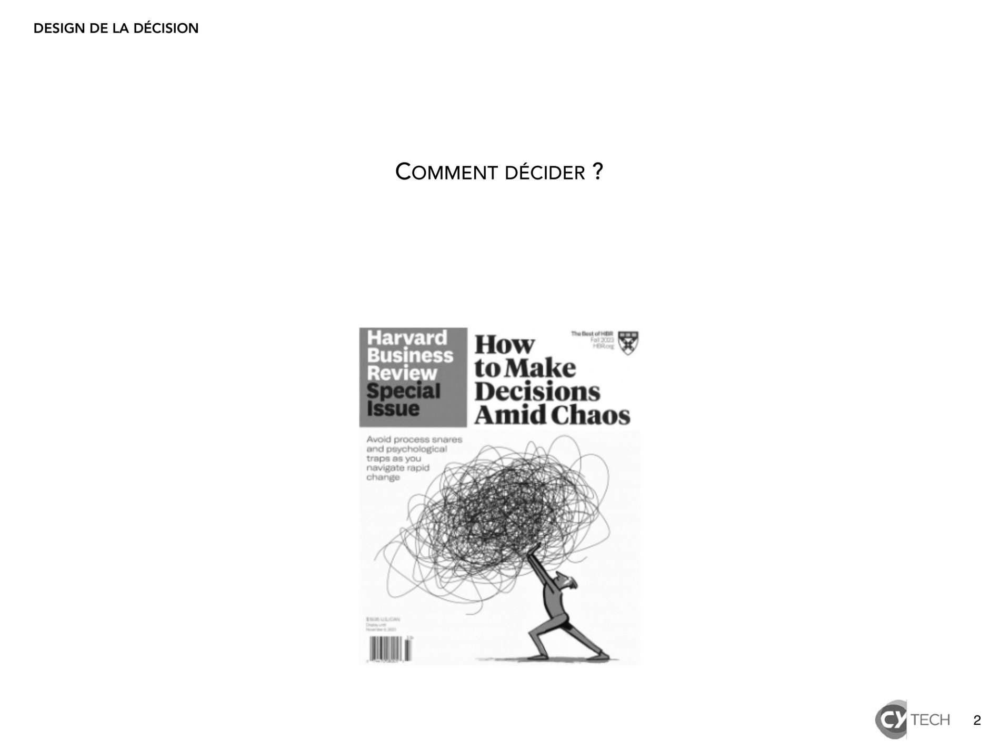

# 2024-2025_design decision_1.pdf

[Ouvrir l’original](https://drive.google.com/open?id=1HEjOSABI2NXaAC13ZRC4_Q3QYzRA1zLV) · Les pages signalées comprennent du texte reconnu automatiquement ou des éléments graphiques. Le fac-similé permet de vérifier chaque lecture.

**Pages avec fac-similé ou lecture OCR** — 2.

## Page 1

~~~text
DESIGN DE LA DÉCISION

   Design de la décision

   Comprendre
   pour prendre des décisions

                                1
~~~

## Page 2

~~~text
DESIGN DE LA DÉCISION

                        COMMENT DÉCIDER ?

                                            2
~~~

**Lecture OCR à contrôler**

~~~text
DESIGN DE LA DÉCISION

COMMENT DÉCIDER ?

Harvard au
Business How ¥

EYES to Make
Decisions
Amid Chaos

(CH TECH
~~~

## Page 3

~~~text
DESIGN DE LA DÉCISION

              Pour décider, il faut savoir
           Pour savoir, il faut comprendre
        Pour comprendre, il faut communiquer

                                               3
~~~

## Page 4

~~~text
DESIGN DE LA DÉCISION

                  LA BASE DE L’INTELLIGENCE : LES DONNÉES ET LES INFORMATIONS

                                                    Intelligence

                                                  Connaissance

                                                    Information

                                                      Données

                                  Modèle DIKI (data, information, knowledge, intelligence)

                                                                                             4
~~~

## Page 5

~~~text
   1       TRANSMISSION DES DONNÉES : LA THÉORIE DE LA COMMUNICATION

                                        bruit

émetteur     encodeur                   canal                 décodeur   récepteur

                                    FEEDBACK
                   Théorie de la communication de Shannon-Weaver, 1948

                                            5
~~~

## Page 6

~~~text
DESIGN DE LA DÉCISION

                    2           TRAITEMENT DE L’INFORMATIONS : LA THÉORIE CYBERNÉTIQUE

           Toutes les décisions sont prises en fonction des coûts d’opportunité
           et les décisions entraînent des actions cohérentes.

       Grandeur d’entrée                                         Système réglé                                         Grandeur réglée
            input                                                                                                          output

                                                                Système réglant

                                             Emetteur                 Trans-                Récepteur
                                             Capteur                  metteur                effecteur

                           Wiener, N., “Cybernetics, or Control and Communication”, The Animal and the Machine, 1948

                                                                                                                                         6
~~~

## Page 7

~~~text
DESIGN DE LA DÉCISION

                       2              TYPOLOGIE DES MÉDIA

            « nous façonnons nos outils, et ensuite nos outils nous façonnent. »
            Marshall McLuhan, Understanding Media, 1964

                                                             -          « Média froids »    +
                                                                          mobilisation de

                                                                                                Participation
                                                                          plusieurs sens
                                                                       peu d’informations
                                                                           peu précises.
                                               Information

                                                           un seul sens
                                                           beaucoup
                                                           d'informations
                                                           hautement définies
                                                         + « Médias chauds »                -

                                                                                                                7
~~~

## Page 8

~~~text
DESIGN DE LA DÉCISION

                           2                  LES RÉSEAUX SOCIAUX FAVORISENT 3 COMPORTEMENTS

    Le grégarisme est un « comportement [social collectif
    naturel qui] pousse les individus à se regrouper […] à
    la transmission d’un signal […] pour ensuite fluctuer
    dans le sens du troupeau “pensant” ».

    Le mimétisme est un « mécanisme d’adaptation
    individuel qui désigne la capacité de répliquer les
    attributs d'individus mieux adaptés » / « convergence
    numérique […] téléguidé par des algorithmes »

    Le sacrifice d’« une victime expiatoire […] pour ramener
    la paix collective ».

    Sylvie Genest, « Les réseaux sociaux vous incitent à adopter ces trois comportements primitifs et violents », The Conversation, 2024

                                                                                                                                           8
~~~

## Page 9

~~~text
DESIGN DE LA DÉCISION

                     3           LA CONNAISSANCE CRÉE DE LA VALEUR

      La science de la gestion             La gestion des connaissances   Comment la connaissance
         est une étude inter-                                                 est-elle produite et
     disciplinaire qui implique et         (knowledge management) est     communiquée à la bonne
     aide à la prise de décision             née dans les années 1970     personne afin de répondre
         et à la résolution de                                                  à un besoin ?
         problèmes dans les
      organisations humaines.

                                            Valeur        Intel-
                                                        ligence

                                       Décision      Connaissance

                              Analyse
                              Résumé                  Information

                        Organisation
                          Collecte                     Données

                                                                                                      9
~~~

## Page 10

~~~text
DESIGN DE LA DÉCISION

                        4      L’INTELLIGENCE HUMAINE EST PROTÉIFORME

                                                        Corpo-
                                          Musique       kinesth-
                                                        étique

                                  Visuo-                        Inter-
                                  spacial                       personnel

                                 Réflexif                         Textuel

                                         Environ- Logique
                                         nemental

                            Gardner’s Multiple Intelligences Theory

                                                                            10
~~~

## Page 11

~~~text
DESIGN DE LA DÉCISION

                                    4      PRENDRE LES GENS COMME ILS SONT…
                                           ET PAS COMME ILS « DEVRAIENT » ÊTRE

                    Comprendre les personnes pour leur proposer des artefacts et des
                    systèmes qui diminuent leurs tensions internes (contradictions)
                                            Ce qu’elle pense

                                                 - Peurs
              Ce qu’elle entend                  - Frustrations
                                                                    Ce qu’elle voit
              - Ce que disent les autres         - Obstacles        - Son environnement immédiat
              - Ce que disent ses amis                              - Ce que font les autres
              - Ce que disent ses                - Souhaits         - Ses lectures, ses sites, ses réseaux…
                collègues                        - Rêves
              - Les on-dits

              Ce qu’elle fait                                       Ce qu’elle dit
              - Au quotidien                                        - Ce que nous avons entendu
              - Ce que nous avons observé                           - Son langage non verbal
                                                                    - Ce qu’elle publie
                                                 Carte d’empathie

                                                                                                              11
~~~

## Page 12

~~~text
DESIGN DE LA DÉCISION

                                                    4   APPRENDRE POUR DÉCIDER : INTELLIGENCE HUMAINE VS IA

                                Corpo-
                  Musique       kinesth-
                                étique

          Visuo-                        Inter-
          spacial                       personnel                                       Intelligence artificielle (IA)

         Réflexif                         Textuel

                                                                   Apprentissage      Réseaux de        Traitement        Robotique
                 Environ- Logique
                                                                   machine            neurones          naturel du        La capacité de
                 nemental
                                                                   L’utilisation de   La conception     langage           machines à
                                                                   sets de            de systèmes       La capacité à     assister des
                                                                   données pour       informatiques     comprendre        gens sans
                                                                   entrainer les      pour imiter les   des discours et   participation
                                                                   algorithmes à      neurones          à analyser des    humaine
                                                                   reconnaitre des    cérébraux         documents
                                                                   patterns.

    Gardner’s Multiple Intelligences Theory

                                                                                                                                           12
~~~

## Page 13

~~~text
DESIGN DE LA DÉCISION

                                                4       RISQUES PSYCHOLOGIQUES DE L’UTILISATION DE L’IA

                                                                      Bulle
                                                               informationnelle,
                                                                chambre d’écho
                                                                  et isolement
                                                                                    “Extended reality”
                                                                                      mélant fiction
                                                                                        et réalité

                                                      « Sortilèges »
                                                     “dark patterns”
                                                     et hyper-nudges

                                                                             Addiction et
                                                                             manipulation

              “Study to Support an Impact Assessment of Regulatory Requirements for Artificial Intelligence in Europe”, 2021, European Commission

                                                                                                                                                    13
~~~

## Page 14

~~~text
DESIGN DE LA DÉCISION

                                                     4       RISQUES SOCIAUX DE L’UTILISATION DE L’IA

                                                                      Typologies des IA
                                                 Problème            Problème           Problème               Problème
                                                 technique           politique          technique              politique
                                 autonomie de

                                                • Apprentissage     • Chômage de       • Systèmes            • Déploiement
                                   décision

                                                  itératif risqué     masse              d’armes bon           militaire
                                                                    • Inégalités         marché à IA         • Risques
                                                                      extrêmes           autonome              génocidaires

                                                • Algorithmes       • Législation    • Média                 • Dés-
                                 contrôle
                                 humain

                                                  biaisés             floue            générés par IA          information
                                                • Robustesse        • Responsabilité • Piratage par            politique
                                                • Explicabilité       des              IA                    • Surveillance
                                                • Vie privée          algorithmes                              de masse

                                                             agnostique                              malveillant

              “Study to Support an Impact Assessment of Regulatory Requirements for Artificial Intelligence in Europe”, 2021, European Commission

                                                                                                                                                    14
~~~
