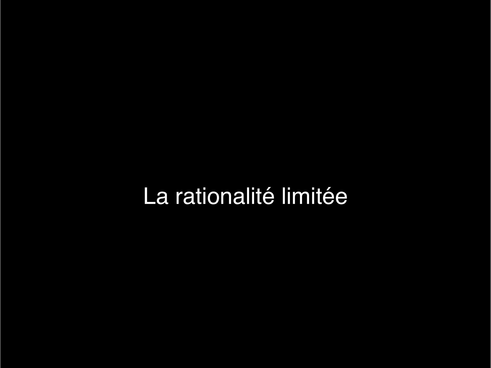

# 2024-2025_design decision_2.pdf

[Ouvrir l’original](https://drive.google.com/open?id=1t69lbuG--jA3gnVWN31O45dUg_0hBkau) · Les pages signalées comprennent du texte reconnu automatiquement ou des éléments graphiques. Le fac-similé permet de vérifier chaque lecture.

**Pages avec fac-similé ou lecture OCR** — 2.

## Page 1

~~~text
DESIGN DE LA DÉCISION

   Design de la décision

   Les mécanismes de la décision

                                   1
~~~

## Page 2

~~~text
DESIGN DE LA DÉCISION

                        La rationalité limitée

                                                 2
~~~

**Lecture OCR à contrôler**

~~~text
La rationalité limitée
~~~

## Page 3

~~~text
DESIGN DE LA DÉCISION

                        L’HOMO OECONOMICUS EST-IL UN « HOMME RATIONNEL » ?

 Adam Smith, en 1776, considère que « la recherche des intérêts particuliers aboutit à
 l’intérêt général » par le « mécanisme de la main invisible ».

                                                               La théorie d'efficience des
                                                               marchés financiers (1970),
                                                               qui a valu le prix Nobel
                                                               d'économie 2013 à
                                                               Eugene Fama (Université
                                                               de Chicago), va dans le
                                                               même sens. Son
                                                               hypothèse est que tout
                                                               bien tend à se vendre à sa
                                                               « valeur intrinsèque ».

                                                                                             3
~~~

## Page 4

~~~text
DESIGN DE LA DÉCISION

                                    PARIONS ENSEMBLE

                        Jouons à pile ou face.

                        Si vous perdez, vous me donnez 100 €

                        Quel doit être le montant du gain pour
                        que vous acceptiez de jouer avec moi ?

                                                                 4
~~~

## Page 5

~~~text
DESIGN DE LA DÉCISION

         LA THÉORIE DE LA VALEUR

                                                                                     L’appât du gain

                                                                                     est deux fois moins puissant que

                                                                                     la peur de perdre

         Thaler, Richard H. Misbehaving. The Making of Behavioral Economics, 2015.

                                                                                                                        5
~~~

## Page 6

~~~text
DESIGN DE LA DÉCISION

                                    LA THÉORIE DES JEUX

                 Dans les années 1940, Von Neumann et Morgenstern postulent
                 le comportement optimal de joueurs rationnels pour atteindre
                 certains objectifs.
                 Leur théorie n'établit ni comment les gens se comportent
                 effectivement, ni comment ils devraient se comporter.

                                                                                6
~~~

## Page 7

~~~text
DESIGN DE LA DÉCISION

                                                      LA RATIONALITÉ DES HUMAINS EST LIMITÉE

                                                      ni omniscient
                                                      ni omnipotent

             Étant « incapables de gérer le monde dans toute sa complexité, nous
             formons une image simplifiée du monde et l’envisageons de notre
             point de vue particulier et de celui des intérêts et des objectifs de
             l’organisation à laquelle nous appartenons »
           Herbert Simon a reçu, en plus du prix Turing, le prix Nobel d’économie en 1978 pour ses travaux sur la « rationalité limitée »

                                                                                                                                            7
~~~

## Page 8

~~~text
DESIGN DE LA DÉCISION

                        COMME LA RATIONALITÉ EST LIMITÉE,
                        LES MÉCANISMES DE PRISE DE DÉCISION
                        SONT OPTIMAUX SATISFAISANTS

                                                              8
~~~

## Page 9

~~~text
DESIGN DE LA DÉCISION

                                   IL EST PRÉFÉRABLE DE DISCUTER POUR DÉCIDER

              Les agents humains sont des décisionnaires limités, mais ce
              sont intuitivement de bons designers qui sont doués pour les
              interactions sociales.

              Leurs capacités à inventer des histoires, des formes et des
              concepts sont surprenantes et sans limite.

              Quand les gens sont confrontés à un problème, ils discutent les
              alternatives, les objectifs, les contraintes et les procédures afin
              de trouver des solutions satisfaisantes.

               Simon, Herbert Alexander. The Sciences of the Artificial, 1969.

                                                                                    9
~~~

## Page 10

~~~text
DESIGN DE LA DÉCISION

                                       LES MODALITÉS DE DÉCISION

                                                                      Hiérarchie

          Décisions
          autoritaires individuelles

                        Consensus                              Vote                           Processus consultatif

          Décisions
          collectives

                         Illustration Etienne Appert, in Laloux, Frederic. Reinventing Organizations, 2016.
                                                                                                                      10
~~~

## Page 11

~~~text
DESIGN DE LA DÉCISION

                   LES COMPÉTENCES DES ÉQUIPES DE SCIENCES COMPORTEMENTALES

                           Analyse                     Conception                            Gestion de projet

                                                                                                         Equipes de moins de 5 ans
                                                                                                         Equipes de 5 à 9 ans
                                                                                                         Equipes de plus de 10 ans
                                                                                     Total

                        LOGIC: Good Practice Principles for Mainstreaming Behavioural Public Policy, OECD, 2024
                                                                                                                                     11
~~~

## Page 12

~~~text
DESIGN DE LA DÉCISION

                        QUELS SONT LES RÔLES DANS VOTRE ÉQUIPE PROJET ?

                                Positif        Créatif            Émotif

                               Rationel        Négatif           Contrôlant

                                          Les chapeaux de Bono
                                                                              12
~~~
