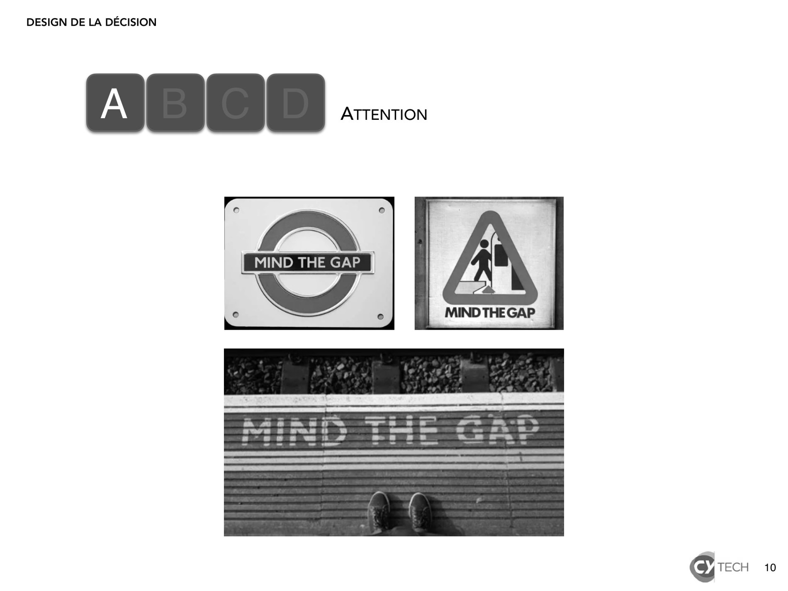
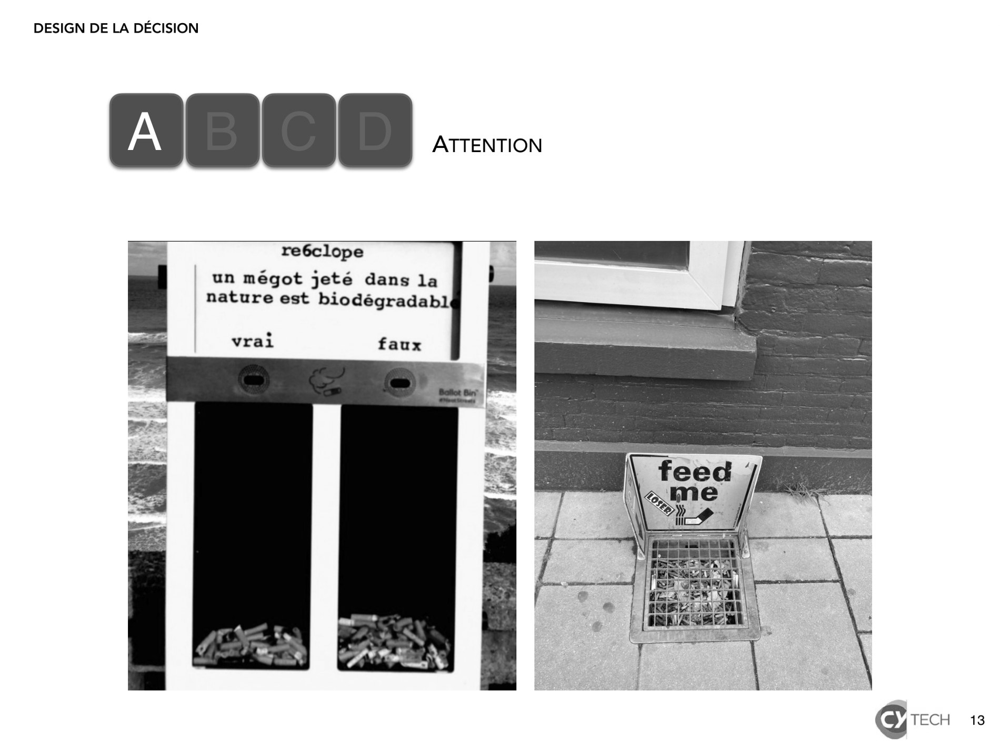
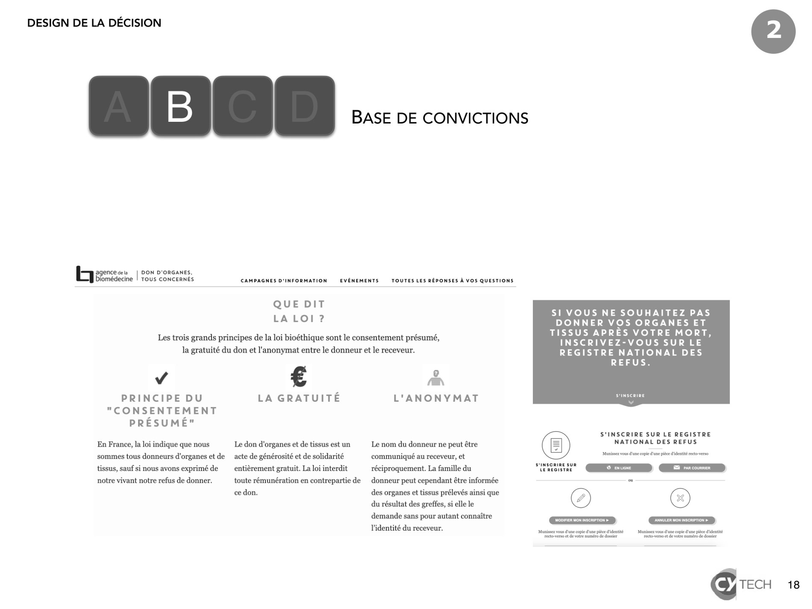
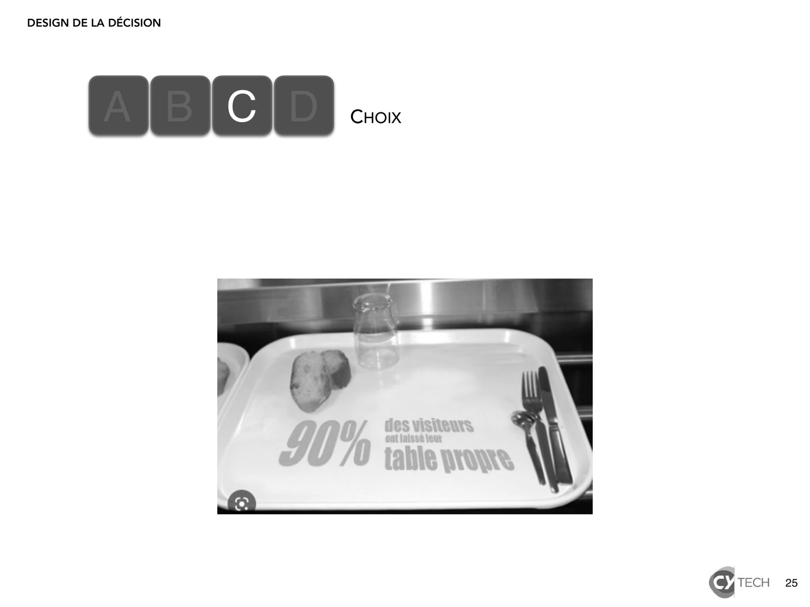
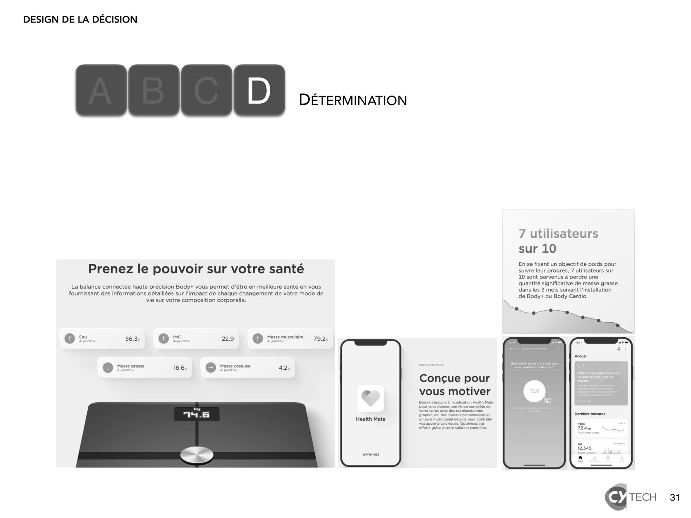

# 2024-2025_design decision_3.pdf

[Ouvrir l’original](https://drive.google.com/open?id=1qbY0la1xbGoka9GixzSiJc3wRfTqnye4) · Les pages signalées comprennent du texte reconnu automatiquement ou des éléments graphiques. Le fac-similé permet de vérifier chaque lecture.

**Pages avec fac-similé ou lecture OCR** — 10, 13, 18, 25, 31.

## Page 1

~~~text
DESIGN DE LA DÉCISION

   Design de la décision

   Modèles comportementaux :
   LOGIC et ABCD

                               1
~~~

## Page 2

~~~text
DESIGN DE LA DÉCISION

                                               LE PATERNALISME LIBERTAIRE

          « Dans notre monde de plus en plus compliqué, [les gens] sont forcés
          de faire un choix. Ils apprécient de pouvoir décider pour eux-mêmes,
          même si ils font parfois des erreurs.

          Nous définissons notre objectif [le paternalisme libertaire] comme la
          tentative d’influer sur les choix afin que les décisionnaires améliorent
          leur situation selon leurs propres critères. »

          Thaler, Richard H. Misbehaving. The Making of Behavioral Economics, 2015.
          Richard Thaler a reçu le prix Nobel d’économie en 2017 pour ses travaux fondateurs de l’économie comportementale.
                                                                                                                              2
~~~

## Page 3

~~~text
DESIGN DE LA DÉCISION

                  COMMENT L’ORGANISATION INFLUE SUR LES COMPORTEMENTS ?

                                                                   i qu    e
                                                tout est p o l i t

                        Illustration Etienne Appert, in Laloux, Frederic. Reinventing Organizations, 2016.
                                                                                                             3
~~~

## Page 4

~~~text
DESIGN DE LA DÉCISION

                LE MODÈLE DE CONCEPTION ET DE GESTION LOGIC

                Leadership : les actions et les discours des dirigeants sont fondamentaux et le rôle des
       L        managers essentiel.

                Objectifs : les sciences comportementales contribuent à atteindre des objectifs stratégiques.
      O         Elles s’appliquent en externe (parties prenantes) et en interne (management des organisations).

                Gouvernance : les responsabilités d’allocation des ressources et de management des activités
      G         doivent être clairement établies.

                Intégration : l’évaluation des résultats doit prendre en compte les utilisateurs et les parties
        I       prenantes dans un climat de confiance.

                Capacités : l’efficacité des solutions dépend de la confiance qu’elles inspirent aux utilisateurs.
      C         Des experts comportementaux peuvent être sollicités pour proposer des bonnes pratiques.

                LOGIC: Good Practice Principles for Mainstreaming Behavioural Public Policy, OECD, 2024
                                                                                                                     4
~~~

## Page 5

~~~text
DESIGN DE LA DÉCISION

                        concepteurs et décideurs : LOGIC                                                  utilisateurs : ABCD

 L eadership               Expliciter
                           Interagir avec les dirigeants
                                                                                 Motivations
                           Définir la stratégie

O bjectifs                 Documenter les impacts
                           Agir en interne

G ouvernance               Assumer ses responsabilités
                           Attribuer des ressources adéquates
                                                                                 Opportunités                        Comportement
                           Intégrer dans les processus

  I ntégration             Agir de manière responsable et ouverte
                           Créer des infrastructures de données

                           Vulgariser et apprendre

C apacités                 Donner accès à l’expertise
                           Partager la connaissance
                                                                                 Capacités

                           LOGIC: Good Practice Principles for Mainstreaming Behavioural Public Policy, OECD, 2024
~~~

## Page 6

~~~text
DESIGN DE LA DÉCISION

                                  UN EXEMPLE : LA CAMPAGNE « C’EST LA BASE »

Concepteurs et décideurs :                                                 Utilisateurs :
Santé publique France                                                      jeunes de 17 à 25 ans

Motivations                                                                                          Ton adapté au
Sensibilisation des jeunes aux risques de
consommation d’alcool et de drogues
                                                                                                 A   contexte festif

                                                                           Comportement
Opportunités                                                               Le pré-test a             C’est déjà arrivé,
La rentrée est synonyme de fêtes
étudiantes […] occasions de consommations
                                                                           montré un bon
                                                                           accueil de la part
                                                                                                 B   à moi ou un pote

excessives de substances psychoactives                                     des jeunes,
                                                                           sur le fond et            Ni moralisateur,
Capacités
Campagne du 25/09 au 8/11 2023.
                                                                           sur le ton            C   ni culpabilisant

Dispositif multicanal, avec un important                                                             Ne pas
volet digital : partenariat avec Konbini et                                                          abandonner un
des influenceurs pour accentuer le discours
de pairs à pairs, différents formats vidéos…
                                                                                                 D   pote :
                                                                                                     « c’est la base »

                                            Santé publique France, publié le 25 septembre 2023
~~~

## Page 7

~~~text
DESIGN DE LA DÉCISION

             APPRÉHENDER LES UTILISATEURS AVEC LE CADRE MÉTHODOLOGIQUE ABCD

       Aspect           Les hypothèses de l’approche       Ce que montre l’approche            Exemples
                        rationnelle                        comportementale

       Attention     Les gens devraient se concentrer Notre attention est limitée et nous Oublier un rendez-vous
A                    sur ce qui est le plus important vis- sommes facilement distraits
                     à-vis de leurs connaissances et de
                     leurs préférences
       Base des      Les gens devraient baser leurs        Nous nous fions à des raccourcis Sous-estimer la durée

B      convictions   convictions sur des bases
                     logiques et probabilistes
                                                           mentaux et à des intuitions dont
                                                           nous évaluons souvent mal la
                                                           probabilité et les conséquences
                                                                                                d’une tâche

       Choix         Les choix des gens devraient          Nous sommes influencés par les Etre influencé par la

C                    maximiser leur utilité anticipée      circonstances et le contexte social pression sociale plutôt que
                                                                                                de s’en tenir à un
                                                                                                raisonnement rationnel
       Détermination Les gens devraient s’en tenir au      Notre volonté est limitée et sujette Ne pas réussir à arrêter de

D                    plan qui découle de leurs
                     décisions à long terme
                                                           à des biais psychologiques           fumer

                                                                                                                          7
~~~

## Page 8

~~~text
DESIGN DE LA DÉCISION

                                                      Notre attention est limitée
           A B C D                                    et nous sommes facilement distraits.

          En suis-je physiquement capable ?

                                                    Capacités
          Est-ce que je comprend ?
          Sais-je le faire ?
          Est-ce qu’il va retenir mon attention ?
          Vais-je me souvenir de le faire ?

                                                    Opportunités

          Est-ce que mon objectif est clair ?
                                                    Motivations

          Cet objectif est-il une priorité ?
          Comment est-ce que je me sens
          quand je le fais ?
          Quelle est mon opinion sur cette
          action ?

                                                                                             8
~~~

## Page 9

~~~text
DESIGN DE LA DÉCISION

           A B C D                      ATTENTION

          L’état d’esprit, les capacités et les motivations ne sont pas constants. Le
          timing et le planning d’une intervention jouent un rôle important dans la
          captation de l’attention.

          Soyez pertinent :
          - Attirez, dirigez ou maintenez l’attention

          - Envoyez des rappels et déclenchez une association d’idée dans la
            mémoire des gens

          - Faites faire quelque chose à quelqu’un en interrompant son action en
            cours et en l’obligeant à prendre une décision. A minima et s’il n’est
            pas possible de provoquer une action, proposez des choix par défaut

                                                                                        9
~~~

## Page 10

~~~text
DESIGN DE LA DÉCISION

           A B C D      ATTENTION

                                    10
~~~

**Lecture OCR à contrôler**

~~~text
DESIGN DE LA DÉCISION

Sr 10
~~~

## Page 11

~~~text
DESIGN DE LA DÉCISION

           A B C D                         ATTENTION

          L’obstacle
                     d    e la langue
                  est-il surm
                               onté ?

          Les coûts de friction : les gens peuvent être découragés de faire
          quelque chose pas des obstacles qui paraissent infimes.

                         Enlever les obstacles afin de diriger ou d’aider à effectuer
                         une tâche. Inversement, ériger de petites barrières pour
                         décourager les comportements indésirables.

                                                                                        11
~~~

## Page 12

~~~text
DESIGN DE LA DÉCISION

           A B C D      ATTENTION

                        CAS PRATIQUE #1

                        Concevez une intervention pour
                        que les fumeurs ne jettent plus
                        leurs mégots par terre

                                                          12
~~~

## Page 13

~~~text
DESIGN DE LA DÉCISION

           A B C D      ATTENTION

                                    13
~~~

**Lecture OCR à contrôler**

~~~text
DESIGN DE LA DÉCISION

re6clope

un mégot jeté dans la }
nature est biodégradabl

.
vral

g TECH
~~~

## Page 14

~~~text
DESIGN DE LA DÉCISION

                                                             Nous nous fions à des raccourcis mentaux et à des
           A B C D                                           intuitions dont nous sur/sous-évaluons souvent la
                                                             probabilité d’occurence et les conséquences.
          Suis-je conscient des options

                                              Capacités
          disponibles ?
          Est-ce que je peux évaluer les
          différentes options et prendre la
          bonne décision ?

          L’environnement est-il propice ou

                                              Opportunités
          hostile ?
          Ai-je assez de temps et de
          ressources ?

          Est-ce une habitude ?
                                              Motivations

                                                                                                                 14
~~~

## Page 15

~~~text
DESIGN DE LA DÉCISION

           A B C D                       BASE DE CONVICTIONS

          Quand les gens disposent de trop d’informations et de trop peu de
          temps, ils sont perdus.

          Soyez intuitifs afin d’aider les gens à donner du sens au monde, guidez
          leur recherche (filtres, remplissage par défaut) pour les diriger vers les
          informations dont ils ont besoin

          - adaptez-vous à leur heuristique (les gens alimentent leurs croyances à
            partir de croyances pré-existantes) et conformez-vous à leur « modèle
            mental » (imaginaires et vision du monde)

          - appuyez-vous sur la conformité sociale (quand les gens ne sont pas
            sûrs, ils observent généralement ce que font les autres)

                                                                                       15
~~~

## Page 16

~~~text
DESIGN DE LA DÉCISION

           A B C D                        BASE DE CONVICTIONS

             Le biais par défaut : les gens privilégient l’option la plus facile pour
             éviter les décisions complexes. Les choix par défaut offrent un
             raccourci cognitif et indiquent ce que les gens sont supposés faire.

                         Configurez le résultat désiré par défaut afin
                         d’inciter une adoption maximale.

                                                                                        16
~~~

## Page 17

~~~text
DESIGN DE LA DÉCISION

           A B C D      BASE DE CONVICTIONS

                        CAS PRATIQUE #2

                        Concevez une intervention pour
                        obtenir plus d’organes à greffer
                        afin de sauver des vies

                                                           17
~~~

## Page 18

~~~text
DESIGN DE LA DÉCISION
                                              2

           A B C D      BASE DE CONVICTIONS

                                                  18
~~~

**Lecture OCR à contrôler**

~~~text
DESIGN DE LA DÉCISION

Leese: DON D'ORGANES,

biomédecine | Tous CONCERNÉS CAMPAGNES D'INFORMATION EVÉNEMENTS TOUTES LES RÉPONSES À VOS QUESTIONS
QUE DIT
LA LOI?

Les trois grands principes de la loi bioéthique sont le consentement présumé,
la gratuité du don et l'anonymat entre le donneur et le receveur.

V4 € A

PRINCIPE DU LA GRATUITE L'ANONYMAT
"CONSENTEMENT
PRESUME"
En France, la loi indique que nous Le don d'organes et de tissus est un Le nom du donneur ne peut étre
sommes tous donneurs d'organes et de _acte de générosité et de solidarité communiqué au receveur, et
tissus, sauf si nous avons exprimé de entièrement gratuit. La loi interdit réciproquement. La famille du
notre vivant notre refus de donner. toute rémunération en contrepartie de donneur peut cependant être informée
ce don. des organes et tissus prélevés ainsi que

du résultat des greffes, si elle le
demande sans pour autant connaître
l'identité du receveur.

SI VOUS NE SOUHAITEZ PAS
DONNER VOS ORGANES ET
TISSUS APRÈS VOTRE MORT,
INSCRIVEZ-VOUS SUR LE

REGISTRE NATIONAL DES
REFUS.

s'inscrire

S'INSCRIRE SUR LE REGISTRE
NATIONAL DES REFUS

Munissez vous dune copie dune pide d'identité recto verso

sunscmine sun "
iaeorsrae ED

copie d'une pide d'identité
votre numer de dossier

S TECH 18
~~~

## Page 19

~~~text
DESIGN DE LA DÉCISION

           A B C D                           BASE DE CONVICTIONS

                        Thaler, Richard H., & Cass R. Sunstein. Nudge. The Final Edition, 2021.
                                                                                                  19
~~~

## Page 20

~~~text
DESIGN DE LA DÉCISION

                                                 Nous sommes influencés par
           A B C D                               les circonstances et le contexte social

                                                 Capacités
          Mes compétences interpersonnelles
          me permettent-elles d’y arriver ?

          Est-ce la norme dans mon groupe

                                                 Opportunités
          social ?
          Vais-je être bien ou mal vu ?
          Qui m’inspire pour agir comme cela ?

          Est-ce comment je me vois ?
                                                 Motivations

                                                                                           20
~~~

## Page 21

~~~text
DESIGN DE LA DÉCISION

           A B C D                       CHOIX

             Les humains sont avant tout des animaux sociaux.

             Soyez social : rendez possible les comparaisons et favorisez l’esprit
             communautaire
             - Les gens choisissent généralement l’option la plus gratifiante
               parmi celles qui leur sont proposées : déclenchez des émotions
             - Dimensionnez les attentes en terme d’utilité relative par rapport
               à un point de référence plutôt qu’en valeur absolue.

                                                                                     21
~~~

## Page 22

~~~text
DESIGN DE LA DÉCISION

           A B C D                     CHOIX

          Conformité sociale : chacun veut être
          comme tout le monde et est influencé par
          ce que les autres font.

                        Mettez en valeur le résultat
                        que vous essayez d’atteindre
                        en le présentant comme une
                        norme sociale et invitez
                        l’utilisateur se joindre à la
                        majorité.

                                                        22
~~~

## Page 23

~~~text
DESIGN DE LA DÉCISION

           A B C D                        CHOIX

          Ancrage : Le premier fait,
          nombre ou élément qu’on
          entend biaise le jugement et
          influence donc les décisions.

                        Soyez très attentif au premier fait, nombre ou
                        élément que vous présentez aux utilisateurs.
                        Évaluez à quel point cet élément est susceptible
                        d’ancrer leurs futures décisions.

                                                                           23
~~~

## Page 24

~~~text
DESIGN DE LA DÉCISION

           A B C D      CHOIX

                        CAS PRATIQUE #3

                        Concevez une intervention pour
                        que les consommateurs
                        rapportent leur plateau de cantine

                                                             24
~~~

## Page 25

~~~text
DESIGN DE LA DÉCISION

           A B C D      CHOIX

                                25
~~~

**Lecture OCR à contrôler**

~~~text
DESIGN DE LA DÉCISION

|__| _c) -..

g TECH 25
~~~

## Page 26

~~~text
DESIGN DE LA DÉCISION

                                                            Notre volonté est limitée
           A B C D                                          et sujette à des biais psychologiques

                                             Capacités
                                             Opportunités

          Le fais-je sans y penser ?
          Suis-je convaincu de pouvoir y
                                             Motivations

          arriver ?
          Les conséquences vont-elles être
          positives ou négatives ?
          Quel va être l’impact ?
          Qui va me tenir responsable des
          conséquences ?
                                                                                                    26
~~~

## Page 27

~~~text
DESIGN DE LA DÉCISION

           A B C D                        DÉTERMINATION

              Comment combler le fossé entre les résolutions et les actions ?

              Facilitez
              - Fournissez les éléments concrets d’un plan d’action spécifique
                afin d’aider les gens à se mobiliser et à atteindre leurs objectifs

              - Donnez des retours

              - Encouragez les gens à s’engager publiquement, plutôt que
                personnellement, afin de leur donner la motivation
                supplémentaire d’améliorer leur réputation.

                                                                                      27
~~~

## Page 28

~~~text
DESIGN DE LA DÉCISION

           A B C D                      DÉTERMINATION

         Prendre des décisions provoque une fatigue mentale (l’asthénie
         décisionnelle) qui génère du stress. Ce stress fait prendre de mauvaises
         décisions. Ainsi commence un cercle vicieux.

         L’UX est une manière efficace de limiter le stress de la prise de décision.

   Limiter la quantité d’options       Simplifier les tâches          Recommander un choix

                                                                                             28
~~~

## Page 29

~~~text
DESIGN DE LA DÉCISION

           A B C D                       DÉTERMINATION

              La politique de l’autruche : quand on craint d’être en train
              d’échouer, on ne veut pas savoir ce qu’il en est

                            Construisez des glissières solides pour inciter les
                            utilisateurs à restez sur la voie. Proposez des
                            corrections d’itinéraire aussi faciles que possible, en
                            sachant que les utilisateurs peuvent être dans le déni.

                                                                                      29
~~~

## Page 30

~~~text
DESIGN DE LA DÉCISION

           A B C D      DÉTERMINATION

                        CAS PRATIQUE #4

                        Concevez une intervention pour
                        ceux qui veulent atteindre leur
                        poids idéal

                                                          30
~~~

## Page 31

~~~text
DESIGN DE LA DÉCISION

           A B C D      DÉTERMINATION

                                        31
~~~

**Lecture OCR à contrôler**

~~~text
DESIGN DE LA DÉCISION

7 utilisateurs
sur 10

. 2 En se fixant un objectif de poids pour
Prenez le pouvoir sur votre santé suivre leur progrès, 7 utilisateurs sur
10 sont parvenus à perdre une
quantité significative de masse grasse

A à + i A
La balance connectée haute précision Body+ vous permet d’étre en meilleure santé en vous dans les 3 mols citant Inctalation

fournissant des informations détaillées sur l'impact de chaque changement de votre mode de
vie sur votre composition corporelle. ~

de Body+ ou Body Cardio.

@ =... 56,3 Q ::. 229 Q er 702.

Conçue pour
vous motiver

Body s'associe à application Heaith Mate
pour vous donner une vision complète de
Votre corps avec des roprésentations
graphiques, des consels personnalisés et
Health Mate Un suivi nutritionnel détail pour contrôler
vos apports caloriques. Optimisez vos
efforts grâce à cette solution complète.

Oe 66 © see 7e
~~~
