# COUSR_EDP_DIFFERENCES_FINIES.pdf

[Ouvrir l’original](https://drive.google.com/open?id=1Qvi2K4HjuvtYJyPpIwUic_0U3NeT1Qup) · Les deux lectures automatiques du PDF divergent sur les pages indiquées. Leur fac-similé accompagne le texte.

**Pages présentant un écart entre les deux extractions** — 1–16, 18–21, 23–27, 30, 32–33, 35–36, 38, 41, 44, 48, 50, 52–60, 62–71, 74, 78–83, 85, 87–93.

## Page 1

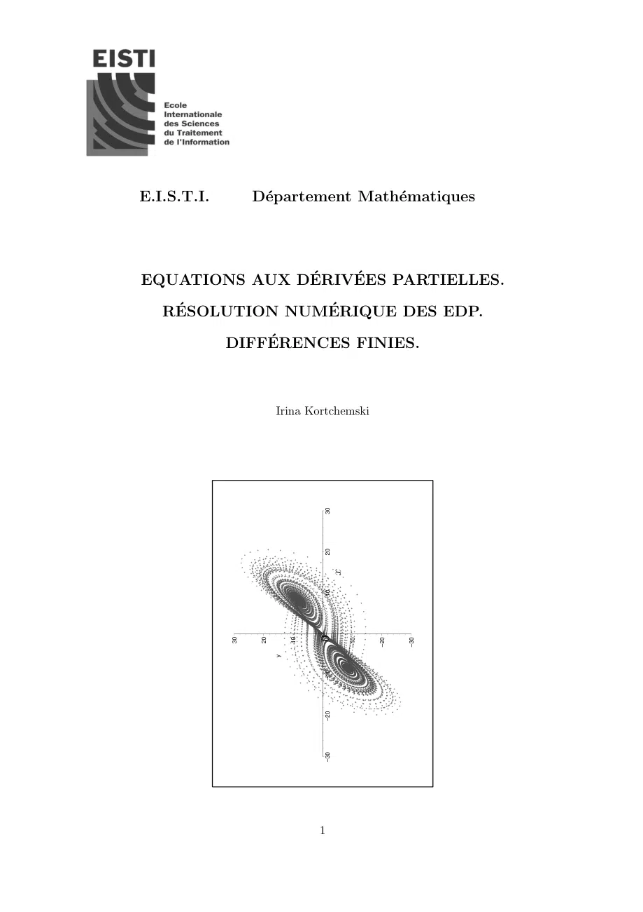

~~~text
.

    E.I.S.T.I.        Département Mathématiques

    EQUATIONS AUX DÉRIVÉES PARTIELLES.

       RÉSOLUTION NUMÉRIQUE DES EDP.

                 DIFFÉRENCES FINIES.

                            Irina Kortchemski
                                     30
                                     20

                                           x
                                     10
                                     0
                 30

                       20

                                10

                                               –10

                                                     –20

                                                           –30
                            y

                                     –10
                                     –20
                                     –30

                                     1
~~~

## Page 2

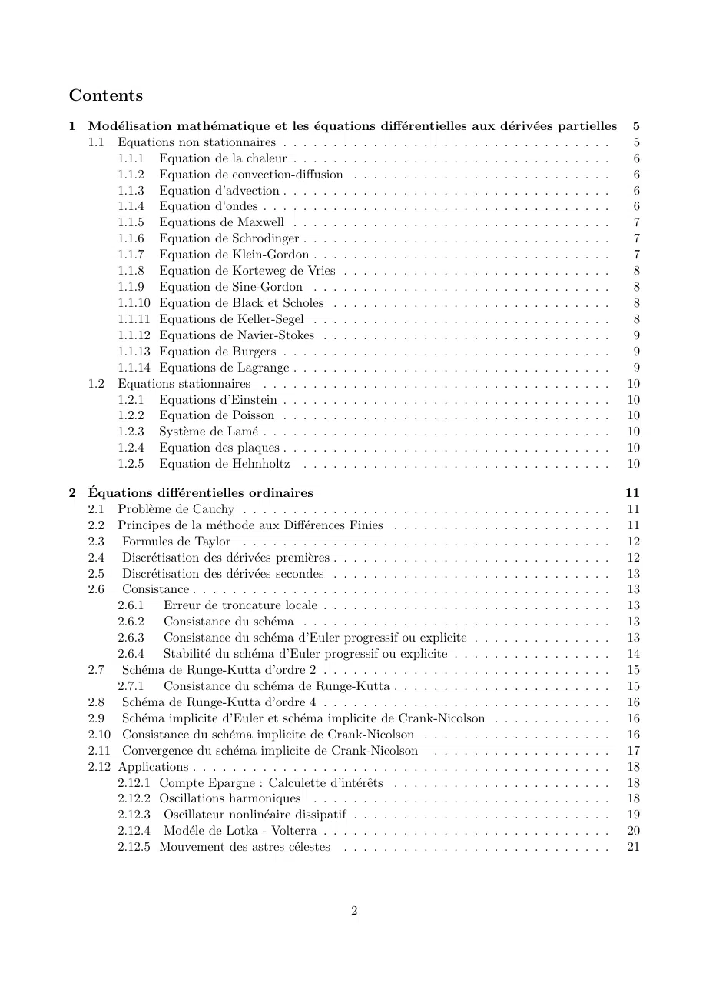

~~~text
Contents
1 Modélisation mathématique et les équations différentielles aux dérivées partielles                 5
  1.1 Equations non stationnaires . . . . . . . . . . . . . . . . . . . . . . . . . . . . . . . . .        5
      1.1.1 Equation de la chaleur . . . . . . . . . . . . . . . . . . . . . . . . . . . . . . . .         6
      1.1.2 Equation de convection-diffusion . . . . . . . . . . . . . . . . . . . . . . . . . .           6
      1.1.3 Equation d’advection . . . . . . . . . . . . . . . . . . . . . . . . . . . . . . . . .         6
      1.1.4 Equation d’ondes . . . . . . . . . . . . . . . . . . . . . . . . . . . . . . . . . . .         6
      1.1.5 Equations de Maxwell . . . . . . . . . . . . . . . . . . . . . . . . . . . . . . . .           7
      1.1.6 Equation de Schrodinger . . . . . . . . . . . . . . . . . . . . . . . . . . . . . . .          7
      1.1.7 Equation de Klein-Gordon . . . . . . . . . . . . . . . . . . . . . . . . . . . . . .           7
      1.1.8 Equation de Korteweg de Vries . . . . . . . . . . . . . . . . . . . . . . . . . . .            8
      1.1.9 Equation de Sine-Gordon . . . . . . . . . . . . . . . . . . . . . . . . . . . . . .            8
      1.1.10 Equation de Black et Scholes . . . . . . . . . . . . . . . . . . . . . . . . . . . .          8
      1.1.11 Equations de Keller-Segel . . . . . . . . . . . . . . . . . . . . . . . . . . . . . .         8
      1.1.12 Equations de Navier-Stokes . . . . . . . . . . . . . . . . . . . . . . . . . . . . .          9
      1.1.13 Equation de Burgers . . . . . . . . . . . . . . . . . . . . . . . . . . . . . . . . .         9
      1.1.14 Equations de Lagrange . . . . . . . . . . . . . . . . . . . . . . . . . . . . . . . .         9
  1.2 Equations stationnaires . . . . . . . . . . . . . . . . . . . . . . . . . . . . . . . . . . .       10
      1.2.1 Equations d’Einstein . . . . . . . . . . . . . . . . . . . . . . . . . . . . . . . . .        10
      1.2.2 Equation de Poisson . . . . . . . . . . . . . . . . . . . . . . . . . . . . . . . . .         10
      1.2.3 Système de Lamé . . . . . . . . . . . . . . . . . . . . . . . . . . . . . . . . . . .       10
      1.2.4 Equation des plaques . . . . . . . . . . . . . . . . . . . . . . . . . . . . . . . . .        10
      1.2.5 Equation de Helmholtz . . . . . . . . . . . . . . . . . . . . . . . . . . . . . . .           10

2 Équations différentielles ordinaires                                                                  11
  2.1 Problème de Cauchy . . . . . . . . . . . . . . . . . . . . . . . . . . . . . . . . . . . . .       11
  2.2 Principes de la méthode aux Différences Finies . . . . . . . . . . . . . . . . . . . . . .        11
  2.3 Formules de Taylor . . . . . . . . . . . . . . . . . . . . . . . . . . . . . . . . . . . . .        12
  2.4 Discrétisation des dérivées premières . . . . . . . . . . . . . . . . . . . . . . . . . . . .   12
  2.5 Discrétisation des dérivées secondes . . . . . . . . . . . . . . . . . . . . . . . . . . . .     13
  2.6 Consistance . . . . . . . . . . . . . . . . . . . . . . . . . . . . . . . . . . . . . . . . . .     13
       2.6.1  Erreur de troncature locale . . . . . . . . . . . . . . . . . . . . . . . . . . . . .       13
       2.6.2  Consistance du schéma . . . . . . . . . . . . . . . . . . . . . . . . . . . . . . .        13
       2.6.3  Consistance du schéma d’Euler progressif ou explicite . . . . . . . . . . . . . .          13
       2.6.4  Stabilité du schéma d’Euler progressif ou explicite . . . . . . . . . . . . . . . .       14
  2.7 Schéma de Runge-Kutta d’ordre 2 . . . . . . . . . . . . . . . . . . . . . . . . . . . . .          15
       2.7.1  Consistance du schéma de Runge-Kutta . . . . . . . . . . . . . . . . . . . . . .           15
  2.8 Schéma de Runge-Kutta d’ordre 4 . . . . . . . . . . . . . . . . . . . . . . . . . . . . .          16
  2.9 Schéma implicite d’Euler et schéma implicite de Crank-Nicolson . . . . . . . . . . . .            16
  2.10 Consistance du schéma implicite de Crank-Nicolson . . . . . . . . . . . . . . . . . . .           16
  2.11 Convergence du schéma implicite de Crank-Nicolson . . . . . . . . . . . . . . . . . .             17
  2.12 Applications . . . . . . . . . . . . . . . . . . . . . . . . . . . . . . . . . . . . . . . . . .   18
       2.12.1 Compte Epargne : Calculette d’intérêts . . . . . . . . . . . . . . . . . . . . . .        18
       2.12.2 Oscillations harmoniques . . . . . . . . . . . . . . . . . . . . . . . . . . . . . .        18
       2.12.3 Oscillateur nonlinéaire dissipatif . . . . . . . . . . . . . . . . . . . . . . . . . .     19
       2.12.4 Modéle de Lotka - Volterra . . . . . . . . . . . . . . . . . . . . . . . . . . . . .       20
       2.12.5 Mouvement des astres célestes . . . . . . . . . . . . . . . . . . . . . . . . . . .        21

                                                     2
~~~

## Page 3

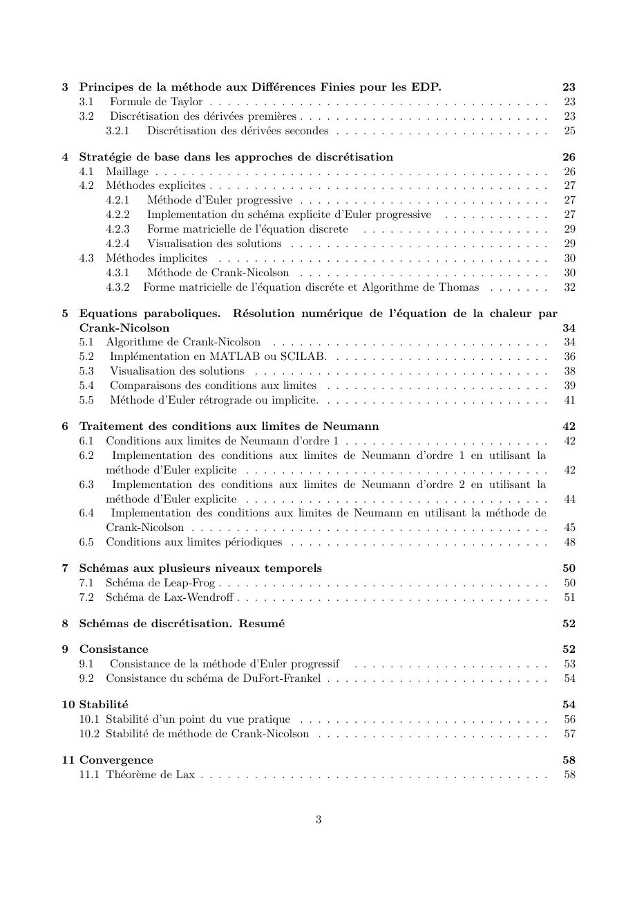

~~~text
3 Principes de la méthode aux Différences Finies pour les EDP.                                          23
  3.1 Formule de Taylor . . . . . . . . . . . . . . . . . . . . . . . . . . . . . . . . . . . . . .       23
  3.2 Discrétisation des dérivées premières . . . . . . . . . . . . . . . . . . . . . . . . . . . .   23
      3.2.1   Discrétisation des dérivées secondes . . . . . . . . . . . . . . . . . . . . . . . .     25

4 Stratégie de base dans les approches de discrétisation                                                26
  4.1 Maillage . . . . . . . . . . . . . . . . . . . . . . . . . . . . . . . . . . . . . . . . . . . .    26
  4.2 Méthodes explicites . . . . . . . . . . . . . . . . . . . . . . . . . . . . . . . . . . . . . .    27
      4.2.1    Méthode d’Euler progressive . . . . . . . . . . . . . . . . . . . . . . . . . . . .       27
      4.2.2    Implementation du schéma explicite d’Euler progressive . . . . . . . . . . . .            27
      4.2.3    Forme matricielle de l’équation discrete . . . . . . . . . . . . . . . . . . . . .        29
      4.2.4    Visualisation des solutions . . . . . . . . . . . . . . . . . . . . . . . . . . . . .      29
  4.3 Méthodes implicites . . . . . . . . . . . . . . . . . . . . . . . . . . . . . . . . . . . . .      30
      4.3.1    Méthode de Crank-Nicolson . . . . . . . . . . . . . . . . . . . . . . . . . . . .         30
      4.3.2 Forme matricielle de l’équation discréte et Algorithme de Thomas . . . . . . .              32

5 Equations paraboliques. Résolution numérique de l’équation de la chaleur par
  Crank-Nicolson                                                                                    34
  5.1 Algorithme de Crank-Nicolson . . . . . . . . . . . . . . . . . . . . . . . . . . . . . . . 34
  5.2 Implémentation en MATLAB ou SCILAB. . . . . . . . . . . . . . . . . . . . . . . . . 36
  5.3 Visualisation des solutions . . . . . . . . . . . . . . . . . . . . . . . . . . . . . . . . . 38
  5.4 Comparaisons des conditions aux limites . . . . . . . . . . . . . . . . . . . . . . . . . 39
  5.5 Méthode d’Euler rétrograde ou implicite. . . . . . . . . . . . . . . . . . . . . . . . . . 41

6 Traitement des conditions aux limites de Neumann                                                        42
  6.1 Conditions aux limites de Neumann d’ordre 1 . . . . . . . . . . . . . . . . . . . . . . .           42
  6.2   Implementation des conditions aux limites de Neumann d’ordre 1 en utilisant la
       méthode d’Euler explicite . . . . . . . . . . . . . . . . . . . . . . . . . . . . . . . . . .     42
  6.3   Implementation des conditions aux limites de Neumann d’ordre 2 en utilisant la
       méthode d’Euler explicite . . . . . . . . . . . . . . . . . . . . . . . . . . . . . . . . . .     44
  6.4 Implementation des conditions aux limites de Neumann en utilisant la méthode de
       Crank-Nicolson . . . . . . . . . . . . . . . . . . . . . . . . . . . . . . . . . . . . . . . .     45
  6.5 Conditions aux limites périodiques . . . . . . . . . . . . . . . . . . . . . . . . . . . . .       48

7 Schémas aux plusieurs niveaux temporels                                                                50
  7.1 Schéma de Leap-Frog . . . . . . . . . . . . . . . . . . . . . . . . . . . . . . . . . . . . .      50
  7.2 Schéma de Lax-Wendroff . . . . . . . . . . . . . . . . . . . . . . . . . . . . . . . . . . .       51

8 Schémas de discrétisation. Resumé                                                                    52

9 Consistance                                                                                             52
  9.1 Consistance de la méthode d’Euler progressif . . . . . . . . . . . . . . . . . . . . . .           53
  9.2 Consistance du schéma de DuFort-Frankel . . . . . . . . . . . . . . . . . . . . . . . . .          54

10 Stabilité                                                                                             54
   10.1 Stabilité d’un point du vue pratique . . . . . . . . . . . . . . . . . . . . . . . . . . . .     56
   10.2 Stabilité de méthode de Crank-Nicolson . . . . . . . . . . . . . . . . . . . . . . . . . .      57

11 Convergence                                                                                            58
   11.1 Théorème de Lax . . . . . . . . . . . . . . . . . . . . . . . . . . . . . . . . . . . . . . .   58

                                                     3
~~~

## Page 4

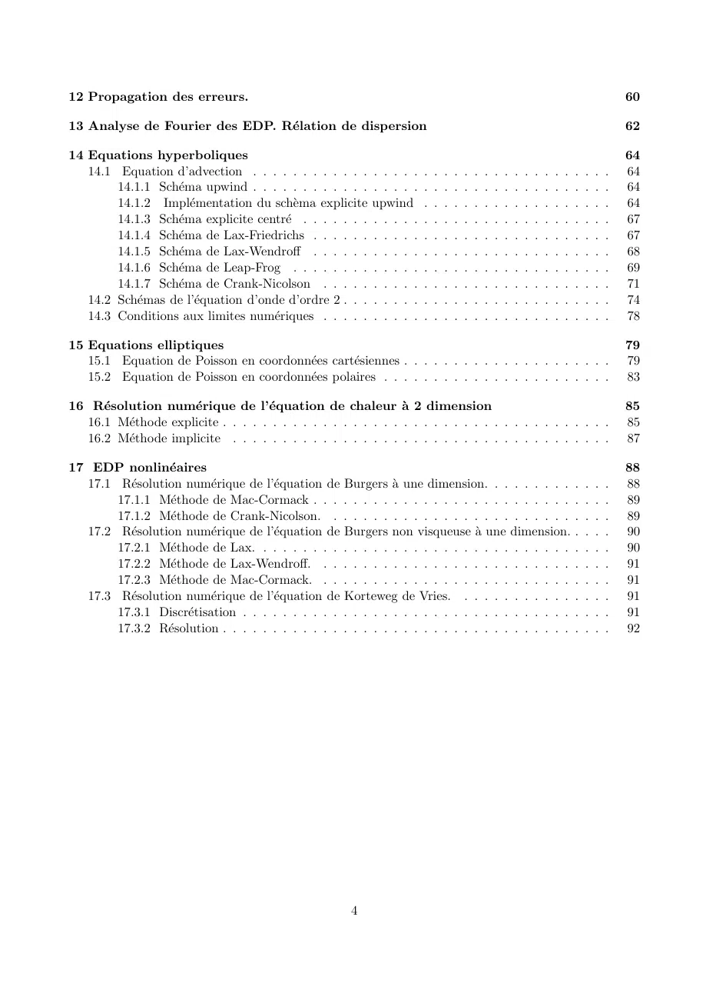

~~~text
12 Propagation des erreurs.                                                                               60

13 Analyse de Fourier des EDP. Rélation de dispersion                                                    62

14 Equations hyperboliques                                                                                64
   14.1 Equation d’advection . . . . . . . . . . . . . . . . . . . . . . . . . . . . . . . . . . . .      64
        14.1.1 Schéma upwind . . . . . . . . . . . . . . . . . . . . . . . . . . . . . . . . . . . .     64
        14.1.2 Implémentation du schèma explicite upwind . . . . . . . . . . . . . . . . . . .          64
        14.1.3 Schéma explicite centré . . . . . . . . . . . . . . . . . . . . . . . . . . . . . . .    67
        14.1.4 Schéma de Lax-Friedrichs . . . . . . . . . . . . . . . . . . . . . . . . . . . . . .      67
        14.1.5 Schéma de Lax-Wendroff . . . . . . . . . . . . . . . . . . . . . . . . . . . . . .        68
        14.1.6 Schéma de Leap-Frog . . . . . . . . . . . . . . . . . . . . . . . . . . . . . . . .       69
        14.1.7 Schéma de Crank-Nicolson . . . . . . . . . . . . . . . . . . . . . . . . . . . . .        71
   14.2 Schémas de l’équation d’onde d’ordre 2 . . . . . . . . . . . . . . . . . . . . . . . . . . .    74
   14.3 Conditions aux limites numériques . . . . . . . . . . . . . . . . . . . . . . . . . . . . .      78

15 Equations elliptiques                                                                                  79
   15.1 Equation de Poisson en coordonnées cartésiennes . . . . . . . . . . . . . . . . . . . . .       79
   15.2 Equation de Poisson en coordonnées polaires . . . . . . . . . . . . . . . . . . . . . . .        83

16 Résolution numérique de l’équation de chaleur à 2 dimension                                        85
  16.1 Méthode explicite . . . . . . . . . . . . . . . . . . . . . . . . . . . . . . . . . . . . . . .   85
  16.2 Méthode implicite . . . . . . . . . . . . . . . . . . . . . . . . . . . . . . . . . . . . . .     87

17 EDP nonlinéaires                                                                                      88
  17.1 Résolution numérique de l’équation de Burgers à une dimension. . . . . . . . . . . . .         88
       17.1.1 Méthode de Mac-Cormack . . . . . . . . . . . . . . . . . . . . . . . . . . . . . .         89
       17.1.2 Méthode de Crank-Nicolson. . . . . . . . . . . . . . . . . . . . . . . . . . . . .         89
  17.2 Résolution numérique de l’équation de Burgers non visqueuse à une dimension. . . . .           90
       17.2.1 Méthode de Lax. . . . . . . . . . . . . . . . . . . . . . . . . . . . . . . . . . . .      90
       17.2.2 Méthode de Lax-Wendroff. . . . . . . . . . . . . . . . . . . . . . . . . . . . . .         91
       17.2.3 Méthode de Mac-Cormack. . . . . . . . . . . . . . . . . . . . . . . . . . . . . .          91
  17.3 Résolution numérique de l’équation de Korteweg de Vries. . . . . . . . . . . . . . . .          91
       17.3.1 Discrétisation . . . . . . . . . . . . . . . . . . . . . . . . . . . . . . . . . . . . .   91
       17.3.2 Résolution . . . . . . . . . . . . . . . . . . . . . . . . . . . . . . . . . . . . . . .   92

                                                     4
~~~

## Page 5

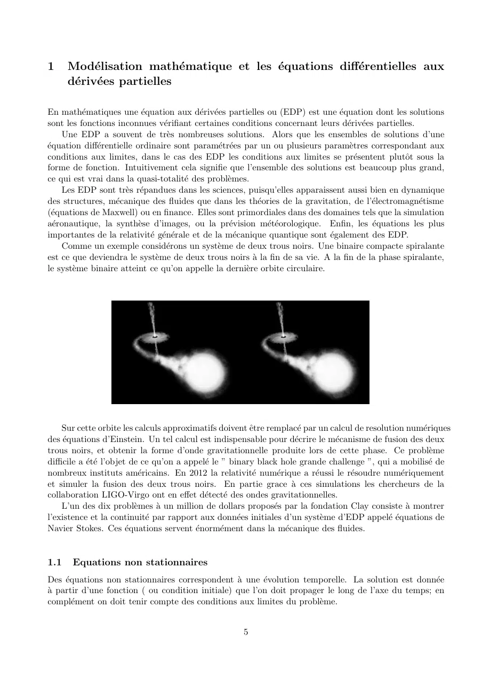

~~~text
1     Modélisation mathématique et les équations différentielles aux
      dérivées partielles

En mathématiques une équation aux dérivées partielles ou (EDP) est une équation dont les solutions
sont les fonctions inconnues vérifiant certaines conditions concernant leurs dérivées partielles.
    Une EDP a souvent de très nombreuses solutions. Alors que les ensembles de solutions d’une
équation différentielle ordinaire sont paramétrées par un ou plusieurs paramètres correspondant aux
conditions aux limites, dans le cas des EDP les conditions aux limites se présentent plutôt sous la
forme de fonction. Intuitivement cela signifie que l’ensemble des solutions est beaucoup plus grand,
ce qui est vrai dans la quasi-totalité des problèmes.
    Les EDP sont très répandues dans les sciences, puisqu’elles apparaissent aussi bien en dynamique
des structures, mécanique des fluides que dans les théories de la gravitation, de l’électromagnétisme
(équations de Maxwell) ou en finance. Elles sont primordiales dans des domaines tels que la simulation
aéronautique, la synthèse d’images, ou la prévision météorologique. Enfin, les équations les plus
importantes de la relativité générale et de la mécanique quantique sont également des EDP.
    Comme un exemple considérons un système de deux trous noirs. Une binaire compacte spiralante
est ce que deviendra le système de deux trous noirs à la fin de sa vie. A la fin de la phase spiralante,
le système binaire atteint ce qu’on appelle la dernière orbite circulaire.

     Sur cette orbite les calculs approximatifs doivent être remplacé par un calcul de resolution numériques
des équations d’Einstein. Un tel calcul est indispensable pour décrire le mécanisme de fusion des deux
trous noirs, et obtenir la forme d’onde gravitationnelle produite lors de cette phase. Ce problème
difficile a été l’objet de ce qu’on a appelé le ” binary black hole grande challenge ”, qui a mobilisé de
nombreux instituts américains. En 2012 la relativité numérique a réussi le résoudre numériquement
et simuler la fusion des deux trous noirs. En partie grace à ces simulations les chercheurs de la
collaboration LIGO-Virgo ont en effet détecté des ondes gravitationnelles.
     L’un des dix problèmes à un million de dollars proposés par la fondation Clay consiste à montrer
l’existence et la continuité par rapport aux données initiales d’un système d’EDP appelé équations de
Navier Stokes. Ces équations servent énormément dans la mécanique des fluides.

1.1   Equations non stationnaires
Des équations non stationnaires correspondent à une évolution temporelle. La solution est donnée
à partir d’une fonction ( ou condition initiale) que l’on doit propager le long de l’axe du temps; en
complément on doit tenir compte des conditions aux limites du problème.

                                                      5
~~~

## Page 6

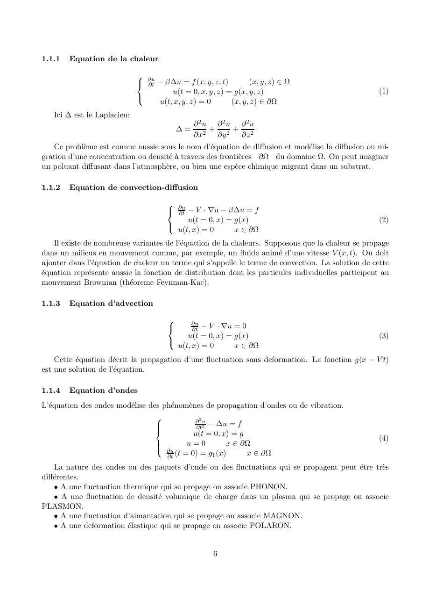

~~~text
1.1.1   Equation de la chaleur

                              ∂u
                              ∂t − β∆u = f (x, y, z, t)       (x, y, z) ∈ Ω
                                      u(t = 0, x, y, z) = g(x, y, z)                                 (1)
                                  u(t, x, y, z) = 0      (x, y, z) ∈ ∂Ω
                             

   Ici ∆ est le Laplacien:
                                               ∂2u ∂2u ∂2u
                                          ∆=       + 2 + 2
                                               ∂x2  ∂y  ∂z
   Ce problème est connue aussie sous le nom d’équation de diffusion et modélise la diffusion ou mi-
gration d’une concentration ou densité à travers des frontières ∂Ω du domaine Ω. On peut imaginer
un poluant diffusant dans l’atmosphère, ou bien une espèce chimique migrant dans un substrat.

1.1.2   Equation de convection-diffusion

                                       ∂u
                                       ∂t − V · ∇u − β∆u = f
                                           u(t = 0, x) = g(x)                                        (2)
                                        u(t, x) = 0      x ∈ ∂Ω
                                      

    Il existe de nombreuse variantes de l’équation de la chaleurs. Supposons que la chaleur se propage
dans un milieus en mouvement comme, par exemple, un fluide animé d’une vitesse V (x, t). On doit
ajouter dans l’équation de chaleur un terme qui s’appelle le terme de convection. La solution de cette
équation représente aussie la fonction de distribution dont les particules individuelles participent au
mouvement Brownian (théoreme Feynman-Kac).

1.1.3   Equation d’advection

                                               ∂u
                                      
                                              ∂t − V · ∇u = 0
                                             u(t = 0, x) = g(x)                                      (3)
                                          u(t, x) = 0      x ∈ ∂Ω
                                      

    Cette équation décrit la propagation d’une fluctuation sans deformation. La fonction g(x − V t)
est une solution de l’équation.

1.1.4   Equation d’ondes
L’équation des ondes modélise des phénomènes de propagation d’ondes ou de vibration.
                                              ∂2u
                                  
                                  
                                              ∂t2
                                                   − ∆u = f
                                              u(t = 0, x) = g
                                  
                                                                                                     (4)
                                  
                                           u=0          x ∈ ∂Ω
                                   ∂u
                                     ∂t (t = 0) =  g1 (x)     x ∈ ∂Ω
     La nature des ondes ou des paquets d’onde ou des fluctuations qui se propagent peut étre très
différentes.
     • A une fluctuation thermique qui se propage on associe PHONON.
     • A une fluctuation de densité volumique de charge dans un plasma qui se propage on associe
PLASMON.
     • A une fluctuation d’aimantation qui se propage on associe MAGNON.
     • A une deformation élastique qui se propage on associe POLARON.

                                                     6
~~~

## Page 7

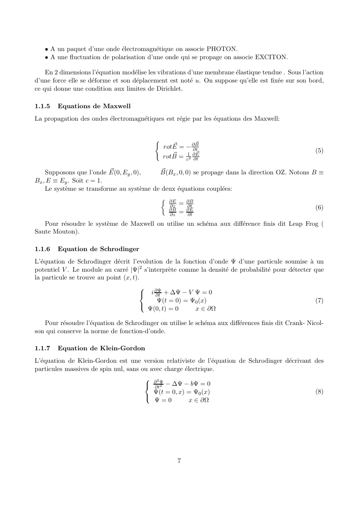

~~~text
   • A un paquet d’une onde électromagnétique on associe PHOTON.
   • A une fluctuation de polarisation d’une onde qui se propage on associe EXCITON.

    En 2 dimensions l’équation modélise les vibrations d’une membrane élastique tendue . Sous l’action
d’une force elle se déforme et son déplacement est noté u. On suppose qu’elle est fixée sur son bord,
ce qui donne une condition aux limites de Dirichlet.

1.1.5   Equations de Maxwell
La propagation des ondes électromagnétiques est régie par les équations des Maxwell:

                                            (
                                                   ~ = − ∂B  ~
                                                rotE      ∂t                                           (5)
                                                   ~ = 12 ∂ E~
                                                rotB     c   ∂t

                           ~ Ey , 0),
    Supposons que l’onde E(0,                ~ x , 0, 0) se propage dans la direction OZ. Notons B ≡
                                            B(B
Bx , E ≡ Ey . Soit c = 1.
    Le système se transforme au système de deux équations couplées:
                                              ∂E     ∂B
                                               ∂z = ∂t                                            (6)
                                               ∂B     ∂E
                                               ∂z = ∂t

   Pour résoudre le système de Maxwell on utilise un schéma aux différence finis dit Leap Frog (
Saute Mouton).

1.1.6   Equation de Schrodinger
L’équation de Schrodinger décrit l’evolution de la fonction d’onde Ψ d’une particule soumise à un
potentiel V . Le module au carré |Ψ|2 s’interprète comme la densité de probabilité pour détecter que
la particule se trouve au point (x, t).
                                        ∂Ψ
                                        i ∂t + ∆Ψ − V Ψ = 0
                                            Ψ(t = 0) = Ψ0 (x)                                         (7)
                                         Ψ(0, t) = 0     x ∈ ∂Ω
                                       

   Pour résoudre l’équation de Schrodinger on utilise le schéma aux différences finis dit Crank- Nicol-
son qui conserve la norme de fonction-d’onde.

1.1.7   Equation de Klein-Gordon
L’équation de Klein-Gordon est une version relativiste de l’équation de Schrodinger décrivant des
particules massives de spin nul, sans ou avec charge électrique.
                                        ∂2Ψ
                                        ∂t2 − ∆Ψ − bΨ = 0
                                          Ψ(t = 0, x) = Ψ0 (x)                                   (8)
                                          Ψ=0          x ∈ ∂Ω
                                       

                                                     7
~~~

## Page 8

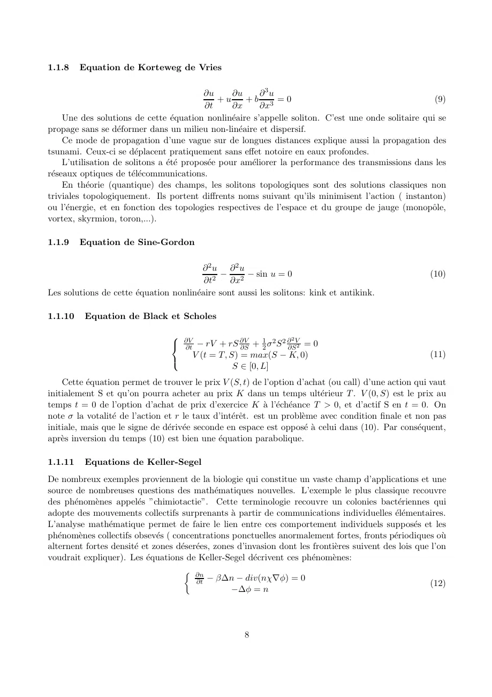

~~~text
1.1.8    Equation de Korteweg de Vries

                                            ∂u      ∂u     ∂3u
                                                 +u    +b 3 =0                                         (9)
                                            ∂t      ∂x     ∂x
     Une des solutions de cette équation nonlinéaire s’appelle soliton. C’est une onde solitaire qui se
propage sans se déformer dans un milieu non-linéaire et dispersif.
     Ce mode de propagation d’une vague sur de longues distances explique aussi la propagation des
tsunami. Ceux-ci se déplacent pratiquement sans effet notoire en eaux profondes.
     L’utilisation de solitons a été proposée pour améliorer la performance des transmissions dans les
réseaux optiques de télécommunications.
     En théorie (quantique) des champs, les solitons topologiques sont des solutions classiques non
triviales topologiquement. Ils portent diffrents noms suivant qu’ils minimisent l’action ( instanton)
ou l’énergie, et en fonction des topologies respectives de l’espace et du groupe de jauge (monopôle,
vortex, skyrmion, toron,...).

1.1.9    Equation de Sine-Gordon

                                         ∂2u ∂2u
                                              − 2 − sin u = 0                                            (10)
                                          ∂t2    ∂x
Les solutions de cette équation nonlinéaire sont aussi les solitons: kink et antikink.

1.1.10    Equation de Black et Scholes

                                                         1 2 2 ∂2V
                                  ∂V
                                  ∂t − rV + rS ∂V ∂S + 2 σ S ∂S 2 = 0
                                      V (t = T, S) = max(S − K, 0)                                       (11)
                                                 S ∈ [0, L]
                                 

    Cette équation permet de trouver le prix V (S, t) de l’option d’achat (ou call) d’une action qui vaut
initialement S et qu’on pourra acheter au prix K dans un temps ultérieur T . V (0, S) est le prix au
temps t = 0 de l’option d’achat de prix d’exercice K à l’échéance T > 0, et d’actif S en t = 0. On
note σ la votalité de l’action et r le taux d’intérêt. est un problème avec condition finale et non pas
initiale, mais que le signe de dérivée seconde en espace est opposé à celui dans (10). Par conséquent,
après inversion du temps (10) est bien une équation parabolique.

1.1.11    Equations de Keller-Segel
De nombreux exemples proviennent de la biologie qui constitue un vaste champ d’applications et une
source de nombreuses questions des mathématiques nouvelles. L’exemple le plus classique recouvre
des phénomènes appelés ”chimiotactie”. Cette terminologie recouvre un colonies bactériennes qui
adopte des mouvements collectifs surprenants à partir de communications individuelles élémentaires.
L’analyse mathématique permet de faire le lien entre ces comportement individuels supposés et les
phénomènes collectifs obsevés ( concentrations ponctuelles anormalement fortes, fronts périodiques où
alternent fortes densité et zones déserées, zones d’invasion dont les frontières suivent des lois que l’on
voudrait expliquer). Les équations de Keller-Segel décrivent ces phénomènes:
                                       ∂n
                                         ∂t − β∆n − div(nχ∇φ) = 0                                        (12)
                                                   −∆φ = n

                                                      8
~~~

## Page 9

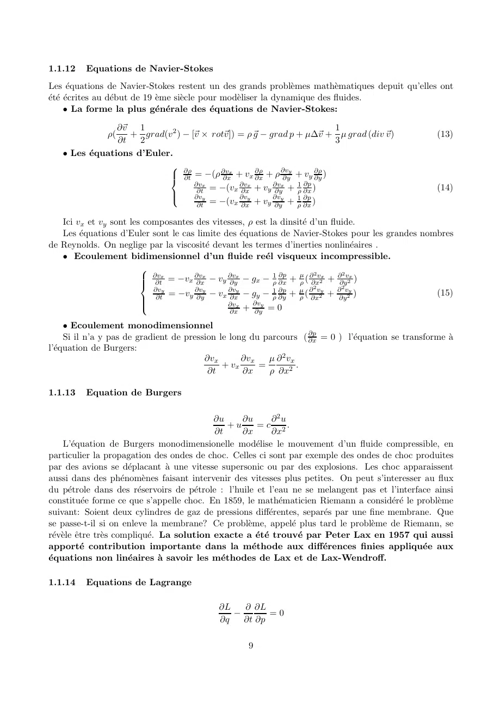

~~~text
1.1.12   Equations de Navier-Stokes
Les équations de Navier-Stokes restent un des grands problèmes mathèmatiques depuit qu’elles ont
été écrites au début de 19 ème siècle pour modèliser la dynamique des fluides.
      • La forme la plus générale des équations de Navier-Stokes:

                ∂~v 1                                                    1
               ρ(  + grad(v 2 ) − [~v × rot~v ]) = ρ ~g − grad p + µ∆~v + µ grad (div ~v )          (13)
                ∂t   2                                                   3
   • Les équations d’Euler.
                                                             ∂vy
                            ∂ρ           ∂vx         ∂ρ              ∂ρ
                            ∂t = −(ρ ∂x + vx ∂x + ρ ∂y + vy ∂y )
                           
                                    ∂vx          ∂vx       ∂vx   1 ∂p
                                     ∂t = −(vx ∂x + vy ∂y + ρ ∂x )                                  (14)
                                   ∂vy          ∂vy       ∂vy   1 ∂p
                                     ∂t = −(vx ∂x + vy ∂y + ρ ∂x )
                           

   Ici vx et vy sont les composantes des vitesses, ρ est la dinsité d’un fluide.
   Les équations d’Euler sont le cas limite des équations de Navier-Stokes pour les grandes nombres
de Reynolds. On neglige par la viscosité devant les termes d’inerties nonlinéaires .
   • Ecoulement bidimensionnel d’un fluide reél visqueux incompressible.
                        
                           ∂vx       ∂vx      ∂vx         1 ∂p   µ ∂ 2 vx   ∂ 2 vx
                         ∂t = −vx ∂x − vy ∂y − gx − ρ ∂x + ρ ( ∂x2 + ∂y2 )
                        
                        
                           ∂vy      ∂vy     ∂vy        1 ∂p   µ ∂ 2 vy  ∂ 2 vy
                            ∂t = −vy ∂y − vx ∂x − gy − ρ ∂y + ρ ( ∂x2 + ∂y 2 )
                                                                                                    (15)
                                                  ∂vy
                       
                                            ∂vx
                                             ∂x + ∂y = 0
                       
                       

     • Ecoulement monodimensionnel
                                                                    ∂p
     Si il n’a y pas de gradient de pression le long du parcours ( ∂x  = 0 ) l’équation se transforme à
l’équation de Burgers:
                                         ∂vx       ∂vx   µ ∂ 2 vx
                                              + vx     =          .
                                          ∂t       ∂x    ρ ∂x2

1.1.13   Equation de Burgers

                                             ∂u    ∂u       ∂2u
                                                +u     = c 2.
                                             ∂t    ∂x       ∂x
     L’équation de Burgers monodimensionelle modélise le mouvement d’un fluide compressible, en
particulier la propagation des ondes de choc. Celles ci sont par exemple des ondes de choc produites
par des avions se déplacant à une vitesse supersonic ou par des explosions. Les choc apparaissent
aussi dans des phénomènes faisant intervenir des vitesses plus petites. On peut s’interesser au flux
du pétrole dans des réservoirs de pétrole : l’huile et l’eau ne se melangent pas et l’interface ainsi
constituée forme ce que s’appelle choc. En 1859, le mathématicien Riemann a considéré le problème
suivant: Soient deux cylindres de gaz de pressions différentes, separés par une fine membrane. Que
se passe-t-il si on enleve la membrane? Ce problème, appelé plus tard le problème de Riemann, se
révèle être très compliqué. La solution exacte a été trouvé par Peter Lax en 1957 qui aussi
apporté contribution importante dans la méthode aux différences finies appliquée aux
équations non linéaires à savoir les méthodes de Lax et de Lax-Wendroff.

1.1.14   Equations de Lagrange

                                            ∂L   ∂ ∂L
                                               −       =0
                                            ∂q   ∂t ∂p

                                                   9
~~~

## Page 10

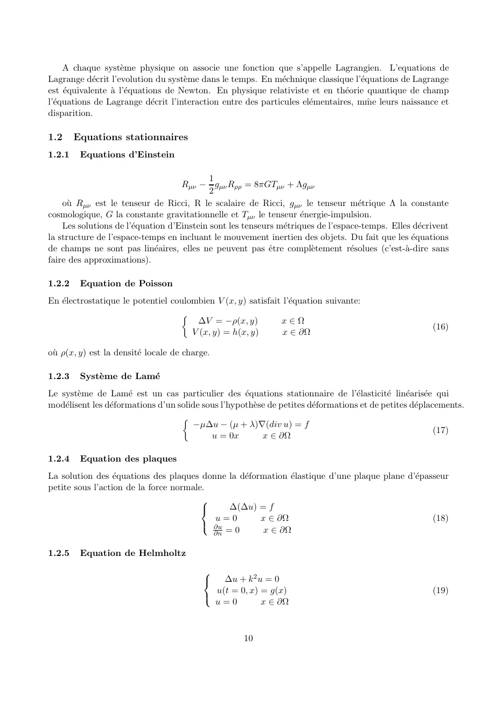

~~~text
     A chaque système physique on associe une fonction que s’appelle Lagrangien. L’equations de
Lagrange décrit l’evolution du système dans le temps. En méchnique classique l’équations de Lagrange
est équivalente à l’équations de Newton. En physique relativiste et en théorie quantique de champ
l’équations de Lagrange décrit l’interaction entre des particules elémentaires, mm̂e leurs naissance et
disparition.

1.2     Equations stationnaires
1.2.1    Equations d’Einstein

                                            1
                                    Rµν − gµν Rρρ = 8πGTµν + Λgµν
                                            2
    où Rµν est le tenseur de Ricci, R le scalaire de Ricci, gµν le tenseur métrique Λ la constante
cosmologique, G la constante gravitationnelle et Tµν le tenseur énergie-impulsion.
    Les solutions de l’équation d’Einstein sont les tenseurs métriques de l’espace-temps. Elles décrivent
la structure de l’espace-temps en incluant le mouvement inertien des objets. Du fait que les équations
de champs ne sont pas linéaires, elles ne peuvent pas être complètement résolues (c’est-à-dire sans
faire des approximations).

1.2.2    Equation de Poisson
En électrostatique le potentiel coulombien V (x, y) satisfait l’équation suivante:
                                   
                                       ∆V = −ρ(x, y)          x∈Ω
                                                                                                        (16)
                                      V (x, y) = h(x, y)       x ∈ ∂Ω

où ρ(x, y) est la densité locale de charge.

1.2.3    Système de Lamé
Le système de Lamé est un cas particulier des équations stationnaire de l’élasticité linéarisée qui
modélisent les déformations d’un solide sous l’hypothèse de petites déformations et de petites déplacements.
                                    
                                       −µ∆u − (µ + λ)∇(div u) = f
                                                                                                          (17)
                                            u = 0x        x ∈ ∂Ω

1.2.4    Equation des plaques
La solution des équations des plaques donne la déformation élastique d’une plaque plane d’épasseur
petite sous l’action de la force normale.
                                        
                                             ∆(∆u) = f
                                          u=0         x ∈ ∂Ω                                      (18)
                                         ∂u
                                          ∂n = 0       x ∈ ∂Ω

1.2.5    Equation de Helmholtz

                                               ∆u + k2 u = 0
                                           
                                           
                                             u(t = 0, x) = g(x)                                         (19)
                                             u=0         x ∈ ∂Ω
                                           

                                                     10
~~~

## Page 11

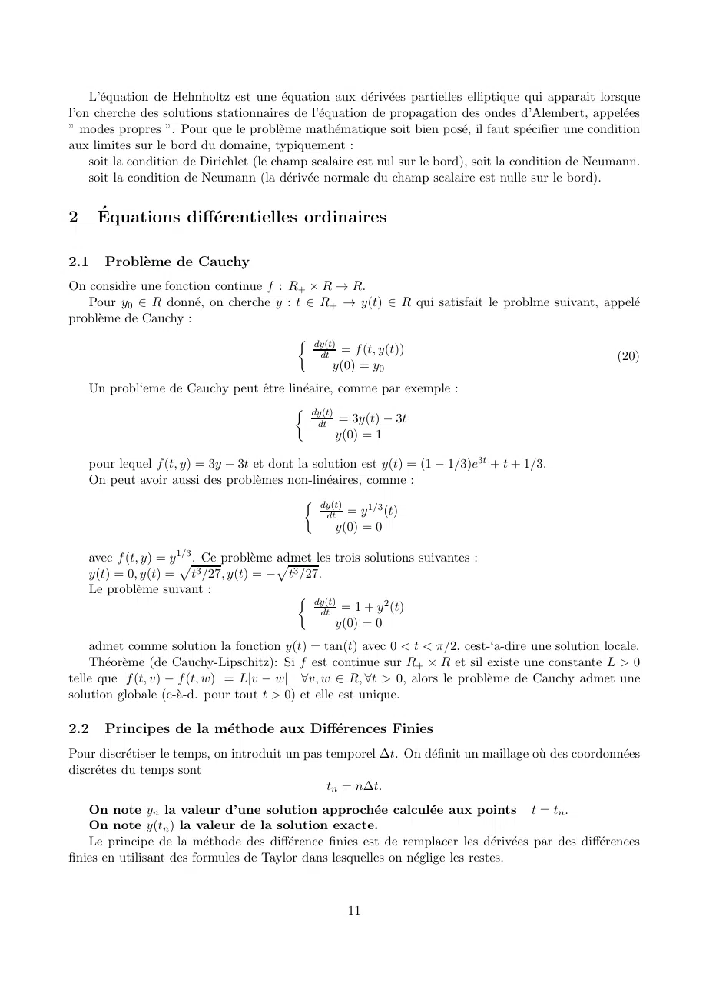

~~~text
    L’équation de Helmholtz est une équation aux dérivées partielles elliptique qui apparait lorsque
l’on cherche des solutions stationnaires de l’équation de propagation des ondes d’Alembert, appelées
” modes propres ”. Pour que le problème mathématique soit bien posé, il faut spécifier une condition
aux limites sur le bord du domaine, typiquement :
    soit la condition de Dirichlet (le champ scalaire est nul sur le bord), soit la condition de Neumann.
    soit la condition de Neumann (la dérivée normale du champ scalaire est nulle sur le bord).

2     Équations différentielles ordinaires

2.1    Problème de Cauchy
On considr̀e une fonction continue f : R+ × R → R.
   Pour y0 ∈ R donné, on cherche y : t ∈ R+ → y(t) ∈ R qui satisfait le problme suivant, appelé
problème de Cauchy :
                                           dy(t)
                                                     = f (t, y(t))
                                               dt                                                    (20)
                                                    y(0) = y0
    Un probl‘eme de Cauchy peut être linéaire, comme par exemple :
                                         dy(t)
                                             dt = 3y(t) − 3t
                                                y(0) = 1

    pour lequel f (t, y) = 3y − 3t et dont la solution est y(t) = (1 − 1/3)e3t + t + 1/3.
    On peut avoir aussi des problèmes non-linéaires, comme :
                                             dy(t)
                                                         1/3 (t)
                                                 dt = y
                                                   y(0) = 0

    avec f (t, y) = y 1/3
                      p . Ce problème p
                                       admet les trois solutions suivantes :
    y(t) = 0, y(t) = t3 /27, y(t) = − t3 /27.
    Le problème suivant :                 dy(t)
                                                           2
                                              dt = 1 + y (t)
                                                 y(0) = 0
    admet comme solution la fonction y(t) = tan(t) avec 0 < t < π/2, cest-‘a-dire une solution locale.
    Théorème (de Cauchy-Lipschitz): Si f est continue sur R+ × R et sil existe une constante L > 0
telle que |f (t, v) − f (t, w)| = L|v − w| ∀v, w ∈ R, ∀t > 0, alors le problème de Cauchy admet une
solution globale (c-à-d. pour tout t > 0) et elle est unique.

2.2    Principes de la méthode aux Différences Finies
Pour discrétiser le temps, on introduit un pas temporel ∆t. On définit un maillage où des coordonnées
discrétes du temps sont
                                                tn = n∆t.
    On note yn la valeur d’une solution approchée calculée aux points t = tn .
    On note y(tn ) la valeur de la solution exacte.
    Le principe de la méthode des différence finies est de remplacer les dérivées par des différences
finies en utilisant des formules de Taylor dans lesquelles on néglige les restes.

                                                       11
~~~

## Page 12

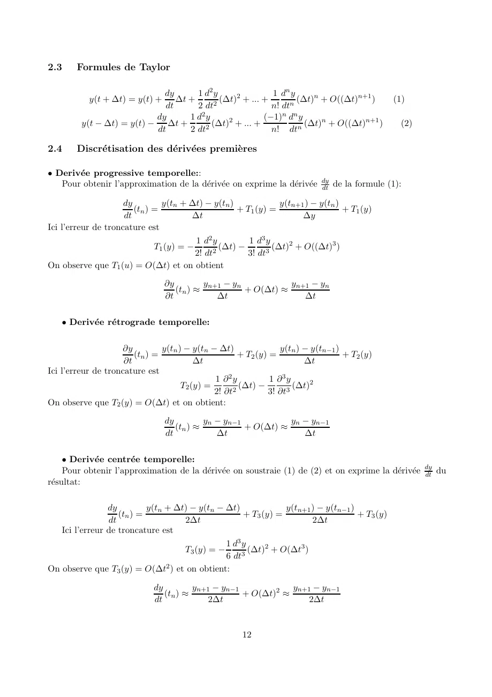

~~~text
2.3     Formules de Taylor

                             dy      1 d2 y     2           1 dn y
           y(t + ∆t) = y(t) +   ∆t +        (∆t)  +   ... +        (∆t)n + O((∆t)n+1 )         (1)
                             dt      2 dt2                  n! dtn
                           dy      1 d2 y     2           (−1)n dn y
         y(t − ∆t) = y(t) − ∆t +          (∆t)  + ...  +             (∆t)n + O((∆t)n+1 )         (2)
                           dt      2 dt2                    n! dtn

2.4     Discrétisation des dérivées premières

• Derivée progressive temporelle::
   Pour obtenir l’approximation de la dérivée on exprime la dérivée dy
                                                                        dt de la formule (1):

                     dy         y(tn + ∆t) − y(tn )              y(tn+1 ) − y(tn )
                        (tn ) =                      + T1 (y) =                    + T1 (y)
                     dt                 ∆t                             ∆y
Ici l’erreur de troncature est
                                         1 d2 y         1 d3 y
                              T1 (y) = −        (∆t) −         (∆t)2 + O((∆t)3 )
                                         2! dt2        3! dt3
On observe que T1 (u) = O(∆t) et on obtient

                                 ∂y         yn+1 − yn           yn+1 − yn
                                    (tn ) ≈           + O(∆t) ≈
                                 ∂t            ∆t                  ∆t

   • Derivée rétrograde temporelle:

                    ∂y          y(tn ) − y(tn − ∆t)               y(tn ) − y(tn−1 )
                        (tn ) =                       + T2 (y) =                    + T2 (y)
                     ∂t                   ∆t                             ∆t
Ici l’erreur de troncature est
                                               1 ∂2y           1 ∂3y
                                      T2 (y) =        (∆t)  −        (∆t)2
                                               2! ∂t2         3! ∂t3
On observe que T2 (y) = O(∆t) et on obtient:

                                 dy         yn − yn−1           yn − yn−1
                                    (tn ) ≈           + O(∆t) ≈
                                 dt            ∆t                  ∆t

     • Derivée centrée temporelle:
     Pour obtenir l’approximation de la dérivée on soustraie (1) de (2) et on exprime la dérivée dy
                                                                                                     dt du
résultat:

                dy         y(tn + ∆t) − y(tn − ∆t)             y(tn+1 ) − y(tn−1 )
                   (tn ) =                          + T3 (y) =                     + T3 (y)
                dt                  2∆t                               2∆t
   Ici l’erreur de troncature est
                                               1 d3 y
                                    T3 (y) = −        (∆t)2 + O(∆t3 )
                                               6 dt3
On observe que T3 (y) = O(∆t2 ) et on obtient:

                              dy         yn+1 − yn−1            yn+1 − yn−1
                                 (tn ) ≈             + O(∆t)2 ≈
                              dt            2∆t                    2∆t

                                                       12
~~~

## Page 13

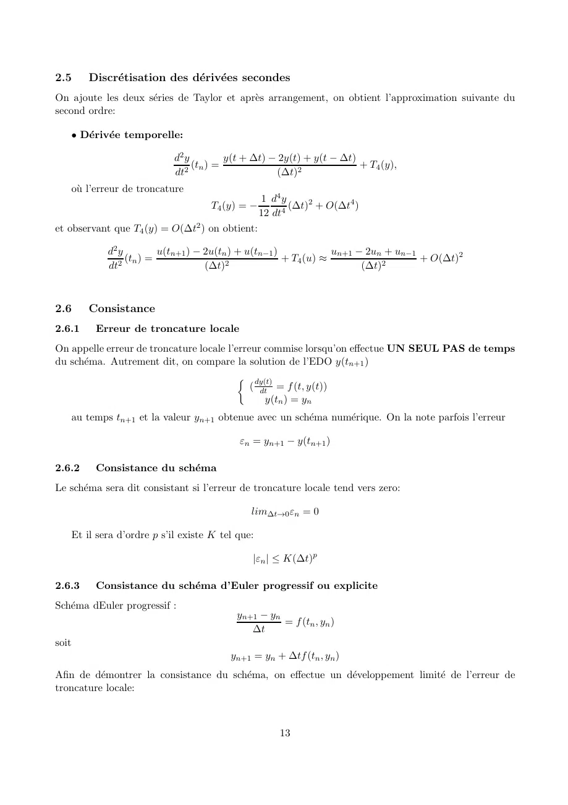

~~~text
2.5     Discrétisation des dérivées secondes
On ajoute les deux séries de Taylor et après arrangement, on obtient l’approximation suivante du
second ordre:

   • Dérivée temporelle:

                           d2 y         y(t + ∆t) − 2y(t) + y(t − ∆t)
                                (tn ) =                               + T4 (y),
                           dt2                     (∆t)2
   où l’erreur de troncature
                                                 1 d4 y
                                    T4 (y) = −          (∆t)2 + O(∆t4 )
                                                 12 dt4
et observant que T4 (y) = O(∆t2 ) on obtient:

            d2 y         u(tn+1 ) − 2u(tn ) + u(tn−1 )            un+1 − 2un + un−1
               2
                 (tn ) =                 2
                                                       + T4 (u) ≈                   + O(∆t)2
            dt                      (∆t)                                (∆t)2

2.6     Consistance
2.6.1    Erreur de troncature locale
On appelle erreur de troncature locale l’erreur commise lorsqu’on effectue UN SEUL PAS de temps
du schéma. Autrement dit, on compare la solution de l’EDO y(tn+1 )
                                           dy(t)
                                             ( dt = f (t, y(t))
                                                y(tn ) = yn
   au temps tn+1 et la valeur yn+1 obtenue avec un schéma numérique. On la note parfois l’erreur

                                          εn = yn+1 − y(tn+1 )

2.6.2    Consistance du schéma
Le schéma sera dit consistant si l’erreur de troncature locale tend vers zero:

                                             lim∆t→0 εn = 0

   Et il sera d’ordre p s’il existe K tel que:

                                             |εn | ≤ K(∆t)p

2.6.3    Consistance du schéma d’Euler progressif ou explicite
Schéma dEuler progressif :
                                          yn+1 − yn
                                                    = f (tn , yn )
                                             ∆t
soit
                                        yn+1 = yn + ∆tf (tn , yn )
Afin de démontrer la consistance du schéma, on effectue un développement limité de l’erreur de
troncature locale:

                                                     13
~~~

## Page 14

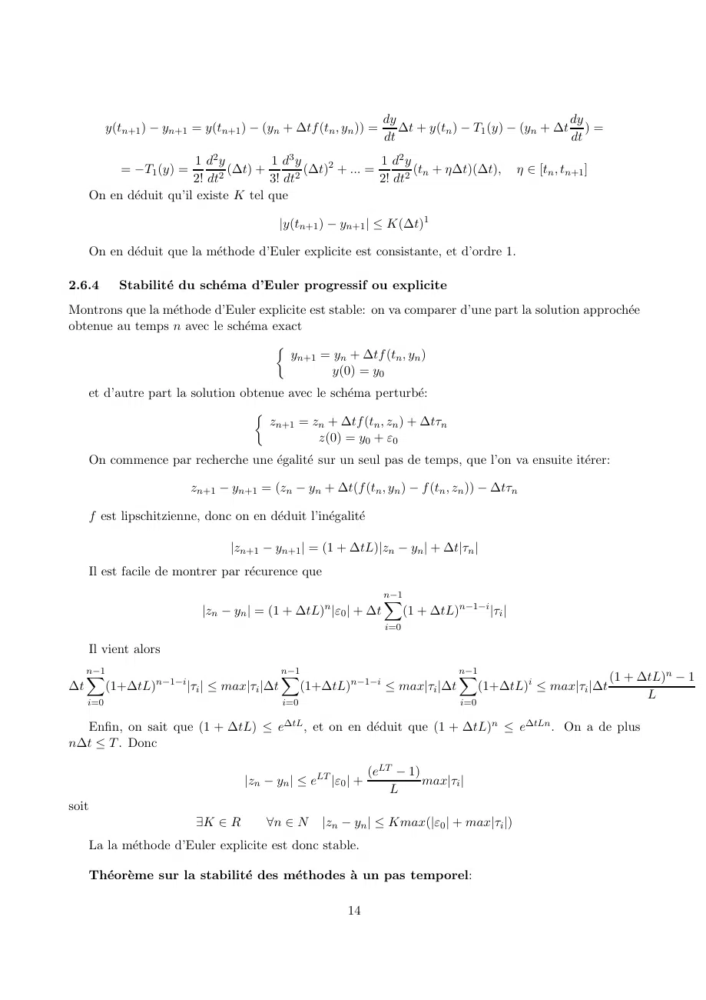

~~~text
                                                                dy                                dy
         y(tn+1 ) − yn+1 = y(tn+1 ) − (yn + ∆tf (tn , yn )) =      ∆t + y(tn ) − T1 (y) − (yn + ∆t ) =
                                                                dt                                dt
                       1 d2 y        1 d3 y     2         1 d2 y
           = −T1 (y) =        (∆t) +        (∆t)  + ... =        (tn + η∆t)(∆t),              η ∈ [tn , tn+1 ]
                      2! dt2         3! dt2               2! dt2
   On en déduit qu’il existe K tel que

                                          |y(tn+1 ) − yn+1 | ≤ K(∆t)1

   On en déduit que la méthode d’Euler explicite est consistante, et d’ordre 1.

2.6.4      Stabilité du schéma d’Euler progressif ou explicite
Montrons que la méthode d’Euler explicite est stable: on va comparer d’une part la solution approchée
obtenue au temps n avec le schéma exact
                                   
                                       yn+1 = yn + ∆tf (tn , yn )
                                                y(0) = y0
   et d’autre part la solution obtenue avec le schéma perturbé:
                                 
                                    zn+1 = zn + ∆tf (tn , zn ) + ∆tτn
                                             z(0) = y0 + ε0
   On commence par recherche une égalité sur un seul pas de temps, que l’on va ensuite itérer:

                         zn+1 − yn+1 = (zn − yn + ∆t(f (tn , yn ) − f (tn , zn )) − ∆tτn

   f est lipschitzienne, donc on en déduit l’inégalité

                                |zn+1 − yn+1 | = (1 + ∆tL)|zn − yn | + ∆t|τn |
   Il est facile de montrer par récurence que
                                                                 n−1
                                                                 X
                                                   n
                           |zn − yn | = (1 + ∆tL) |ε0 | + ∆t           (1 + ∆tL)n−1−i |τi |
                                                                 i=0

   Il vient alors
   n−1                                n−1                          n−1
   X
             n−1−i
                                      X
                                                n−1−i
                                                                   X                        (1 + ∆tL)n − 1
∆t    (1+∆tL)      |τi | ≤ max|τi |∆t    (1+∆tL)      ≤ max|τi |∆t    (1+∆tL)i ≤ max|τi |∆t
                                                                                                  L
   i=0                                    i=0                                     i=0

  Enfin, on sait que (1 + ∆tL) ≤ e∆tL , et on en déduit que (1 + ∆tL)n ≤ e∆tLn . On a de plus
n∆t ≤ T . Donc

                                                              (eLT − 1)
                                   |zn − yn | ≤ eLT |ε0 | +             max|τi |
                                                                  L
soit
                          ∃K ∈ R       ∀n ∈ N     |zn − yn | ≤ Kmax(|ε0 | + max|τi |)
   La la méthode d’Euler explicite est donc stable.

   Théorème sur la stabilité des méthodes à un pas temporel:

                                                       14
~~~

## Page 15

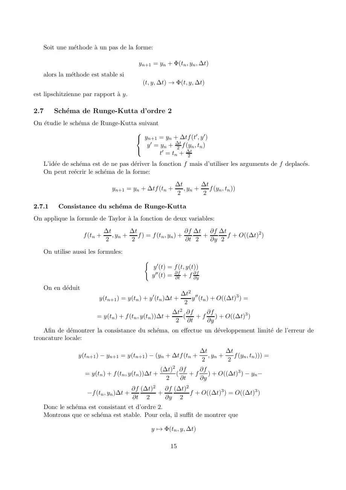

~~~text
   Soit une méthode à un pas de la forme:

                                          yn+1 = yn + Φ(tn , yn , ∆t)
   alors la méthode est stable si
                                           (t, y, ∆t) → Φ(t, y, ∆t)
est lipschitzienne par rapport à y.

2.7     Schéma de Runge-Kutta d’ordre 2
On étudie le schéma de Runge-Kutta suivant

                                     yn+1 = yn + ∆tf (t′ , y ′ )
                                    

                                        y ′ = yn + ∆t2 f (yn , tn )
                                              t′ = tn + ∆t
                                    
                                                          2
   L’idée de schéma est de ne pas dériver la fonction f mais d’utiliser les arguments de f deplacés.
   On peut reécrir le schéma de la forme:
                                                          ∆t        ∆t
                                yn+1 = yn + ∆tf (tn +        , yn +    f (yn , tn ))
                                                          2         2

2.7.1    Consistance du schéma de Runge-Kutta
On applique la formule de Taylor à la fonction de deux variables:
                             ∆t        ∆t                      ∂f ∆t ∂f ∆t
                   f (tn +      , yn +    f ) = f (tn , yn ) +      +      f + O((∆t)2 )
                             2         2                       ∂t 2   ∂y 2
   On utilise aussi les formules:
                                            (
                                                y ′ (t) = f (t, y(t))
                                                y ′′ (t) = ∂f      ∂f
                                                           ∂t + f ∂y

   On en déduit
                                                         ∆t2 ′′
                         y(tn+1 ) = y(tn ) + y ′ (tn )∆t +   y (tn ) + O((∆t)3 ) =
                                                           2
                                                       ∆t2 ∂f      ∂f
                        = y(tn ) + f (tn , y(tn ))∆t +    (   +f      ) + O((∆t)3 )
                                                        2 ∂t       ∂y
   Afin de démontrer la consistance du schéma, on effectue un développement limité de l’erreur de
troncature locale:

                                                               ∆t        ∆t
                 y(tn+1 ) − yn+1 = y(tn+1 ) − (yn + ∆tf (tn +     , yn +    f (yn , tn ))) =
                                                                2        2
                                                  (∆t)2 ∂f     ∂f
                   = y(tn ) + f (tn , y(tn ))∆t +      (    +f    ) + O((∆t)3 ) − yn −
                                                    2    ∂t    ∂y
                                        ∂f (∆t)2 ∂f (∆t)2
                    −f (tn , yn )∆t +           +         f + O((∆t)3 ) = O((∆t)3 )
                                        ∂t 2      ∂y 2
   Donc le schéma est consistant et d’ordre 2.
   Montrons que ce schéma est stable. Pour cela, il suffit de montrer que

                                                y 7→ Φ(tn , y, ∆t)

                                                        15
~~~

## Page 16

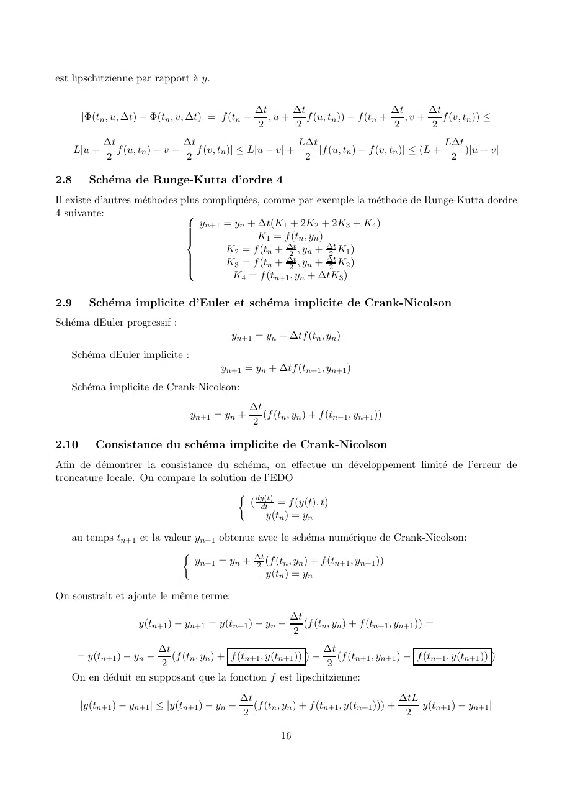

~~~text
est lipschitzienne par rapport à y.

                                                    ∆t      ∆t                       ∆t      ∆t
       |Φ(tn , u, ∆t) − Φ(tn , v, ∆t)| = |f (tn +      ,u +    f (u, tn )) − f (tn +    ,v +    f (v, tn )) ≤
                                                    2       2                        2       2
              ∆t                  ∆t                          L∆t                                  L∆t
      L|u +      f (u, tn ) − v −    f (v, tn )| ≤ L|u − v| +     |f (u, tn ) − f (v, tn )| ≤ (L +     )|u − v|
              2                   2                            2                                    2

2.8      Schéma de Runge-Kutta d’ordre 4
Il existe d’autres méthodes plus compliquées, comme par exemple la méthode de Runge-Kutta dordre
4 suivante:                   
                               yn+1 = yn + ∆t(K1 + 2K2 + 2K3 + K4 )
                              
                              
                              
                                             K1 = f (tn , yn )
                                      K2 = f (tn + ∆t           ∆t
                                                    2 , yn + 2 K1 )
                                      K3 = f (tn + ∆t           ∆t
                                                    2 , yn + 2 K2 )
                              
                              
                              
                              
                                        K4 = f (tn+1 , yn + ∆tK3 )
                              

2.9      Schéma implicite d’Euler et schéma implicite de Crank-Nicolson
Schéma dEuler progressif :
                                             yn+1 = yn + ∆tf (tn , yn )
   Schéma dEuler implicite :
                                          yn+1 = yn + ∆tf (tn+1 , yn+1 )
   Schéma implicite de Crank-Nicolson:
                                                 ∆t
                                   yn+1 = yn +      (f (tn , yn ) + f (tn+1 , yn+1 ))
                                                 2

2.10      Consistance du schéma implicite de Crank-Nicolson
Afin de démontrer la consistance du schéma, on effectue un développement limité de l’erreur de
troncature locale. On compare la solution de l’EDO
                                        dy(t)
                                          ( dt = f (y(t), t)
                                              y(tn ) = yn

   au temps tn+1 et la valeur yn+1 obtenue avec le schéma numérique de Crank-Nicolson:

                              yn+1 = yn + ∆t
                           
                                           2 (f (tn , yn ) + f (tn+1 , yn+1 ))
                                             y(tn ) = yn

On soustrait et ajoute le même terme:
                                                            ∆t
                      y(tn+1 ) − yn+1 = y(tn+1 ) − yn −        (f (tn , yn ) + f (tn+1 , yn+1 )) =
                                                            2
                      ∆t                                         ∆t
      = y(tn+1 ) − yn −  (f (tn , yn ) + f (tn+1 , y(tn+1 )) ) −    (f (tn+1 , yn+1 ) − f (tn+1 , y(tn+1 )) )
                      2                                          2
   On en déduit en supposant que la fonction f est lipschitzienne:
                                               ∆t                                        ∆tL
       |y(tn+1 ) − yn+1 | ≤ |y(tn+1 ) − yn −      (f (tn , yn ) + f (tn+1 , y(tn+1 ))) +     |y(tn+1 ) − yn+1 |
                                               2                                          2

                                                          16
~~~

## Page 17

~~~text
soit
                  ∆tL                                         ∆t
           (1 −       )|y(tn+1 ) − yn+1 | ≤ |y(tn+1 ) − yn −      (f (tn , yn ) + f (tn+1 , y(tn+1 )))| =
                   2                                           2
                                                     ∆t ′
                                 = |y(tn+1 ) − yn −     (y (tn ) + y ′ (tn+1 ))| =
                                                      2
                        (∆t)2 ′′      (∆t)3 (3)        ∆t                                  (∆t)2 (3)
= y(tn )+∆ty ′ (tn )+        y (tn )+      y (tn )−yn − (y ′ (tn )+y ′ (tn )+∆ty ′′ (tn )+      y (tn )) =
                          2             6              2                                     2
                                                  (∆t)3 (3)
                                                   =     y (tn )
                                                    12
On a utilisé y(tn ) = yn car on ne s’interesse que de l’ordre du schéma. (On appelle erreur de troncature
locale l’erreur commise lorsqu’on effectue UN SEUL PAS de temps du schéma.)
    Il existe K tel que
                                           ∆t
                        |y(tn+1 ) − yn −      (f (tn , yn ) + f (tn+1 , y(tn+1 )))| ≤ K(∆t)3
                                           2
Donc
                                                                  K(∆t)3
                                         |y(tn+1 ) − yn+1 | ≤
                                                                 (1 − ∆tL
                                                                       2 )
   Le schéma implicite de Crank-Nicolson est consistant et d’ordre 2.

2.11     Convergence du schéma implicite de Crank-Nicolson
On étudie la convergence du schéma de Crank-Nicolson

                                                   ( dy(t)
                                               
                                                      dt = f (y(t), t)
                                                        y(t0 ) = y0
   On estime l’erreur aprés avoir effectuer n pas au total:

                                                      ∆t
                     y(tn+1 ) − yn+1 = y(tn+1 ) − yn −    (f (tn , yn ) + f (tn+1 , yn+1 )) =
                                                       2
               ∆t                                                       ∆t
= y(tn+1 )−yn − (f (tn , yn )+ f (tn+1 , y(tn+1 )) )+y(tn )−y(tn )− (f (tn+1 , yn+1 )− f (tn+1 , y(tn+1 )) )
               2                                                        2

                                               |y(tn+1 ) − yn+1 | =
                  ∆t                                                  ∆t
= |y(tn+1 )−y(tn )|−  (f (tn , yn )+f (tn+1 , y(tn+1 )))+|y(tn )−yn |− (f (tn+1 , yn+1 )−f (tn+1 , y(tn+1 )))
                   2                                                  2
   De la même manière on peut montrer que:

                                                         L∆t                        K(∆t)3
                         |y(tn+1 ) − yn+1 | ≤ (1 +             )|y(t n ) − y n | +
                                                       1 − ∆tL
                                                            2                      (1 − ∆tL
                                                                                         2 )
                                                              K(∆t)     3 K(∆t)     3
   n=0        |y(t1 ) − y1 | ≤ (1 + 1−L∆t
                                       ∆tL )|y(t0 ) − y0 | +
                                                             (1− ∆tL )
                                                                       = (1− ∆tL
                                                                                 )
                                           2                        2           2
                                                              K(∆t)     3   K(∆t)       3
   n=1        |y(t2 ) − y2 | ≤ (1 + 1−L∆t
                                       ∆tL )|y(t1 ) − y1 | +
                                                             (1− ∆tL )
                                                                       = 2 (1− ∆tL
                                                                                   )
                                           2                        2               2
   ...
                                       Kn(∆t)3       (∆t)2
   P our n        |y(tn+1 ) − yn+1 | ≤ (1− ∆tL ≤ T
                                              )    (1− ∆tL
                                                           )
                                            2           2
    Donc si ∆t tend vers zero la solution numerique (approchée) tend vers solution exacte, ce que
signifie la convergence.

                                                          17
~~~

## Page 18

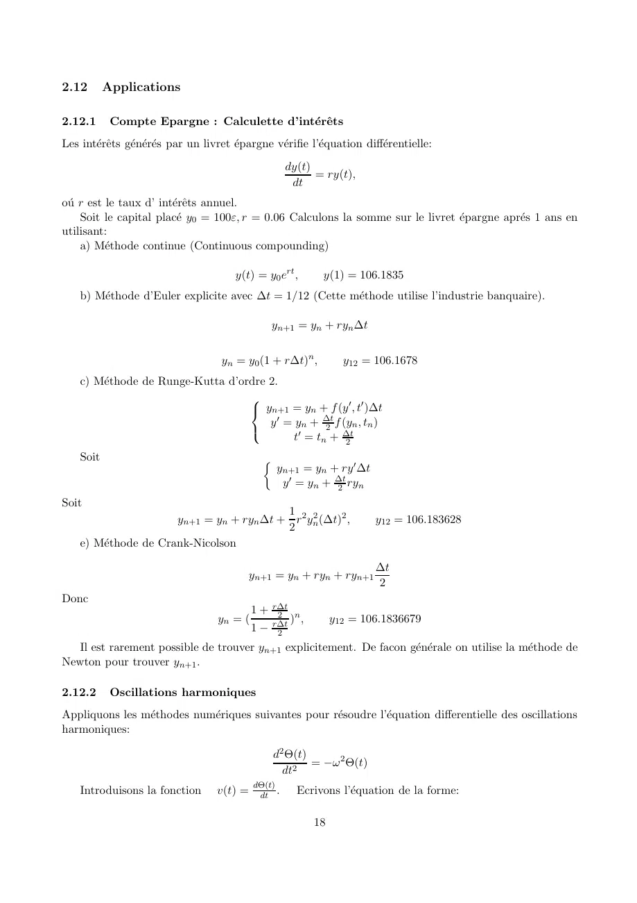

~~~text
2.12       Applications

2.12.1      Compte Epargne : Calculette d’intérêts
Les intérêts générés par un livret épargne vérifie l’équation différentielle:
                                                    dy(t)
                                                          = ry(t),
                                                     dt
oú r est le taux d’ intérêts annuel.
    Soit le capital placé y0 = 100ε, r = 0.06 Calculons la somme sur le livret épargne aprés 1 ans en
utilisant:
    a) Méthode continue (Continuous compounding)

                                        y(t) = y0 ert ,     y(1) = 106.1835
    b) Méthode d’Euler explicite avec ∆t = 1/12 (Cette méthode utilise l’industrie banquaire).

                                                  yn+1 = yn + ryn ∆t

                                     yn = y0 (1 + r∆t)n ,        y12 = 106.1678
    c) Méthode de Runge-Kutta d’ordre 2.

                                    yn+1 = yn + f (y ′ , t′ )∆t
                                   

                                       y ′ = yn + ∆t2 f (yn , tn )
                                             t′ = tn + ∆t
                                   
                                                         2
    Soit
                                                  yn+1 = yn + ry ′ ∆t
                                              

                                                   y ′ = yn + ∆t
                                                              2 ryn
Soit
                                          1
                      yn+1 = yn + ryn ∆t + r 2 yn2 (∆t)2 ,              y12 = 106.183628
                                          2
    e) Méthode de Crank-Nicolson

                                                                        ∆t
                                           yn+1 = yn + ryn + ryn+1
                                                                        2
Donc
                                           1 + r∆t
                                                2 n
                                    yn = (     r∆t
                                                   ) ,         y12 = 106.1836679
                                           1− 2
   Il est rarement possible de trouver yn+1 explicitement. De facon générale on utilise la méthode de
Newton pour trouver yn+1 .

2.12.2      Oscillations harmoniques
Appliquons les méthodes numériques suivantes pour résoudre l’équation differentielle des oscillations
harmoniques:

                                                  d2 Θ(t)
                                                          = −ω 2 Θ(t)
                                                    dt2
    Introduisons la fonction        v(t) = dΘ(t)
                                            dt .      Ecrivons l’équation de la forme:

                                                          18
~~~

## Page 19

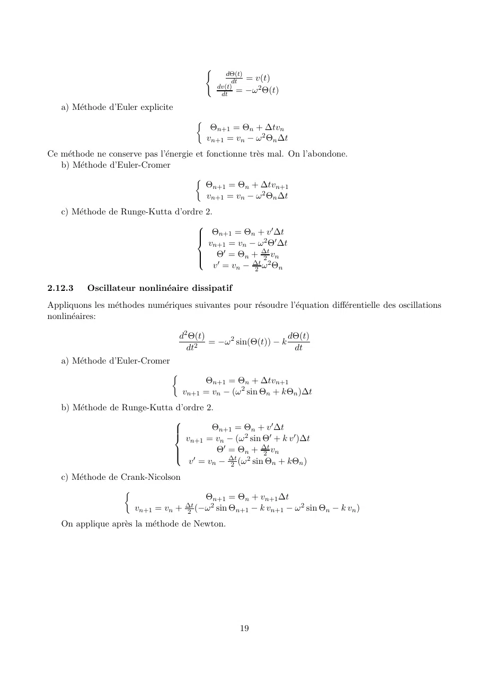

~~~text
                                             (
                                                    dΘ(t)
                                                      dt = v(t)
                                                 dv(t)      2
                                                  dt = −ω Θ(t)

   a) Méthode d’Euler explicite
                                         
                                              Θn+1 = Θn + ∆tvn
                                             vn+1 = vn − ω 2 Θn ∆t
Ce méthode ne conserve pas l’énergie et fonctionne très mal. On l’abondone.
   b) Méthode d’Euler-Cromer
                                       
                                          Θn+1 = Θn + ∆tvn+1
                                          vn+1 = vn − ω 2 Θn ∆t
   c) Méthode de Runge-Kutta d’ordre 2.

                                        Θn+1 = Θn + v ′ ∆t
                                   
                                   
                                       vn+1 = vn − ω 2 Θ′ ∆t
                                   
                                   
                                   
                                         Θ′ = Θn + ∆t
                                                     2 vn
                                         v = vn − ∆t   2Θ
                                    ′
                                                   2 ω    n

2.12.3    Oscillateur nonlinéaire dissipatif
Appliquons les méthodes numériques suivantes pour résoudre l’équation différentielle des oscillations
nonlinéaires:

                                     d2 Θ(t)                      dΘ(t)
                                             = −ω 2 sin(Θ(t)) − k
                                       dt2                         dt
   a) Méthode d’Euler-Cromer
                                 
                                          Θn+1 = Θn + ∆tvn+1
                                     vn+1 = vn − (ω 2 sin Θn + kΘn )∆t
   b) Méthode de Runge-Kutta d’ordre 2.

                                       Θn+1 = Θn + v ′ ∆t
                             
                             
                                 vn+1 = vn − (ω 2 sin Θ′ + k v ′ )∆t
                             
                             
                             
                                        Θ′ = Θn + ∆t 2 vn
                                  v = vn − ∆t    2 sin Θ + kΘ )
                              ′
                                            2 (ω        n         n

   c) Méthode de Crank-Nicolson
                  
                                        Θn+1 = Θn + vn+1 ∆t
                       vn+1 = vn + ∆t
                                   2  (−ω 2 sin Θ                 2
                                                  n+1 − k vn+1 − ω sin Θn − k vn )

   On applique après la méthode de Newton.

                                                      19
~~~

## Page 20

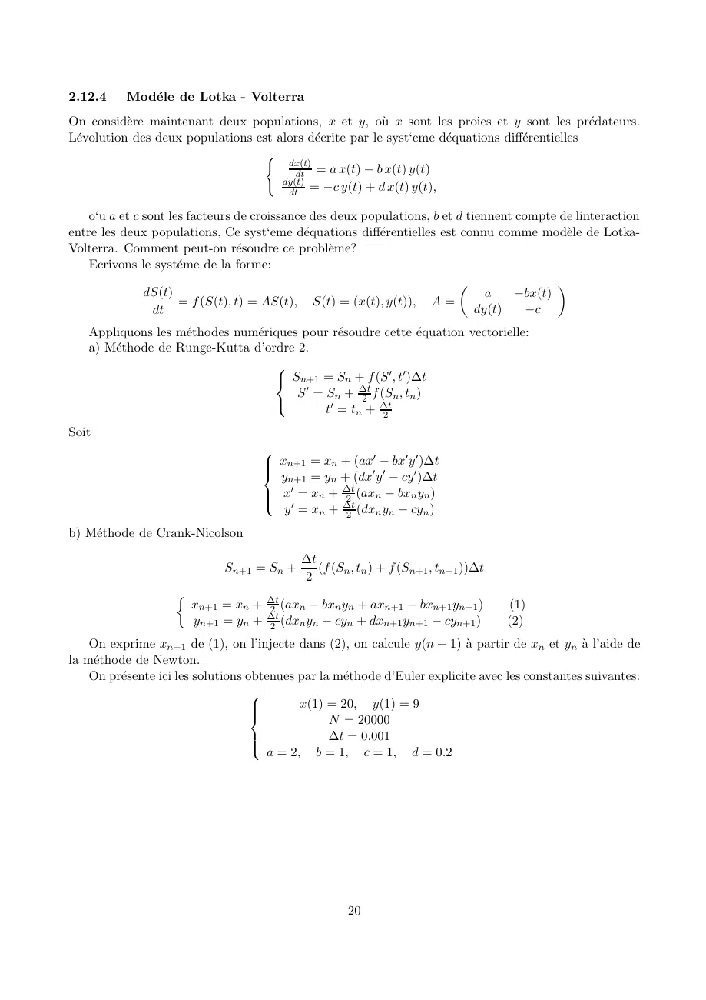

~~~text
2.12.4    Modéle de Lotka - Volterra
On considère maintenant deux populations, x et y, où x sont les proies et y sont les prédateurs.
Lévolution des deux populations est alors décrite par le syst‘eme déquations différentielles
                                  (
                                       dx(t)
                                         dt = a x(t) − b x(t) y(t)
                                      dy(t)
                                       dt = −c y(t) + d x(t) y(t),

   o‘u a et c sont les facteurs de croissance des deux populations, b et d tiennent compte de linteraction
entre les deux populations, Ce syst‘eme déquations différentielles est connu comme modèle de Lotka-
Volterra. Comment peut-on résoudre ce problème?
    Ecrivons le systéme de la forme:
                                                                                          
              dS(t)                                                            a    −bx(t)
                     = f (S(t), t) = AS(t), S(t) = (x(t), y(t)), A =
                dt                                                           dy(t)    −c
   Appliquons les méthodes numériques pour résoudre cette équation vectorielle:
   a) Méthode de Runge-Kutta d’ordre 2.

                                    Sn+1 = Sn + f (S ′ , t′ )∆t
                                   

                                       S ′ = Sn + ∆t
                                                   2 f (Sn , tn )
                                             t = tn + ∆t
                                              ′
                                   
                                                        2
Soit

                                      xn+1 = xn + (ax′ − bx′ y ′ )∆t
                                    
                                    
                                    
                                      yn+1 = yn + (dx′ y ′ − cy ′ )∆t
                                    
                                    
                                     x′ = xn + ∆t
                                                 2 (axn − bxn yn )
                                     ′         ∆t
                                       y = xn + 2 (dxn yn − cyn )
b) Méthode de Crank-Nicolson

                                           ∆t
                             Sn+1 = Sn +      (f (Sn , tn ) + f (Sn+1 , tn+1 ))∆t
                                           2

                        xn+1 = xn + ∆t
                    
                                    2 (axn − bxn yn + axn+1 − bxn+1 yn+1 )          (1)
                        yn+1 = yn + ∆t
                                    2 (dxn yn − cyn + dxn+1 yn+1 − cyn+1 )          (2)
    On exprime xn+1 de (1), on l’injecte dans (2), on calcule y(n + 1) à partir de xn et yn à l’aide de
la méthode de Newton.
    On présente ici les solutions obtenues par la méthode d’Euler explicite avec les constantes suivantes:
                                    
                                    
                                           x(1) = 20, y(1) = 9
                                                  N = 20000
                                    
                                    
                                                 ∆t = 0.001
                                      a = 2, b = 1, c = 1, d = 0.2
                                    

                                                    20
~~~

## Page 21

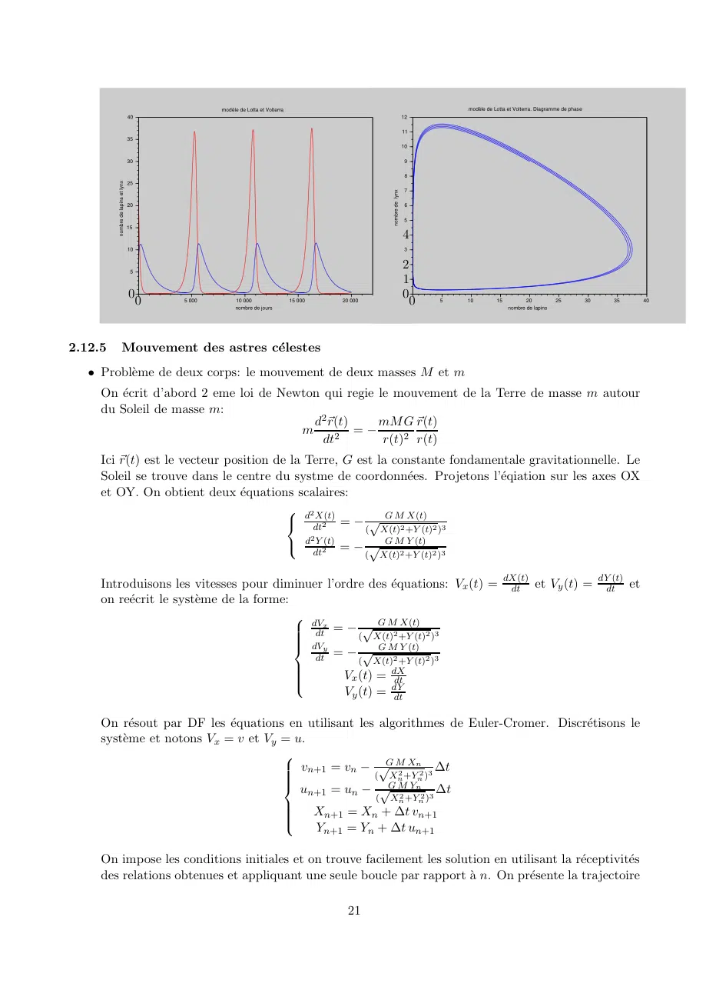

~~~text
                                                 modèle de Lotta et Volterra                                                           modèle de Lotta et Volterra. Diagramme de phase
                                    40                                                                                        12

                                                                                                                              11
                                    35
                                                                                                                              10

                                    30                                                                                         9

                                                                                                                               8
         nombre de lapins et lynx

                                    25
                                                                                                                               7

                                                                                                             nombre de lynx
                                    20                                                                                         6

                                                                                                                               5
                                    15
                                                                                                                              4
                                    10                                                                                         3

                                     5
                                                                                                                              2
                                                                                                                              1
                                    0                                                                                         0
                                     0   5 000        10 000
                                                      nombre de jours
                                                                               15 000        20 000                            0   5   10         15          20
                                                                                                                                                       nombre de lapins
                                                                                                                                                                           25            30   35   40

2.12.5              Mouvement des astres célestes
   • Problème de deux corps: le mouvement de deux masses M et m
     On écrit d’abord 2 eme loi de Newton qui regie le mouvement de la Terre de masse m autour
     du Soleil de masse m:
                                         d2~r(t)     mM G ~r(t)
                                       m      2
                                                 =−
                                           dt         r(t)2 r(t)
     Ici ~r(t) est le vecteur position de la Terre, G est la constante fondamentale gravitationnelle. Le
     Soleil se trouve dans le centre du systme de coordonnées. Projetons l’éqiation sur les axes OX
     et OY. On obtient deux équations scalaires:
                                          d2 X(t)
                                          dt2 = − √ G M2 X(t) 2 3
                                                                                                      (   X(t) +Y (t) )
                                                                                        2
                                                                                d Y 2(t) = − √ G M Y (t)
                                                                                        dt            (   X(t)2 +Y (t)2 )3

     Introduisons les vitesses pour diminuer l’ordre des équations: Vx (t) = dX(t)
                                                                               dt   et Vy (t) = dYdt(t) et
     on reécrit le système de la forme:

                                                     √ G M X(t)
                                           dV
                                             dt = − ( X(t)2 +Y (t)2 )3
                                               x
                                          
                                          
                                          
                                           dVy
                                                     √ G M Y (t)
                                          
                                             dt = − ( X(t)2 +Y (t)2 )3
                                                 Vx (t) = dX
                                          
                                          
                                          
                                                          dt
                                                 Vy (t) = dY
                                          
                                                           dt

     On résout par DF les équations en utilisant les algorithmes de Euler-Cromer. Discrétisons le
     système et notons Vx = v et Vy = u.
                                     
                                                        G M Xn
                                      vn+1 = vn − (√Xn2 +Yn2 )3 ∆t
                                     
                                     
                                        un+1 = un − √G M      Yn
                                     
                                                                     ∆t
                                     
                                                      ( Xn 2 +Y 2 )3
                                                               n
                                     
                                     
                                     
                                         Xn+1 = Xn + ∆t vn+1
                                          Yn+1 = Yn + ∆t un+1
                                     

     On impose les conditions initiales et on trouve facilement les solution en utilisant la réceptivités
     des relations obtenues et appliquant une seule boucle par rapport à n. On présente la trajectoire

                                                                                               21
~~~

## Page 22

~~~text
de la Terre. Il n’est pas difficile d’ajouter la Lune. Dans ce cas on obtient le système de 8
equations que peut être aussi facilement résolu.

                                                 Terre autour du Soleil                                 Lune autour de la Terre, Terre autour du Soleil
                                  5                                                           5

                                 4                                                           4
                                  3                                                           3

                           2                                                                  2
      y coordonnee de la Terre

                           1                                                                  1
                           0                                                                  0
                          −1                                                                 −1
                          −2                                                                 −2
                                 −3                                                          −3

                                 −4                                                          −4

                                 −5                                                          −5
                                  −4   −2   0        2         4           6        8   10    −4   −2         0         2          4          6           8   10
                                                x coordonnee de la Terre

                                                                               22
~~~

## Page 23

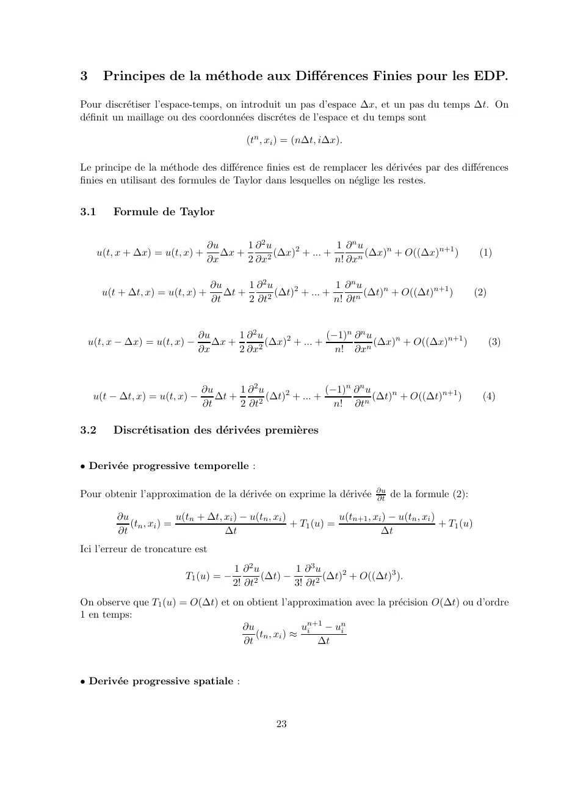

~~~text
3      Principes de la méthode aux Différences Finies pour les EDP.

Pour discrétiser l’espace-temps, on introduit un pas d’espace ∆x, et un pas du temps ∆t. On
définit un maillage ou des coordonnées discrétes de l’espace et du temps sont

                                           (tn , xi ) = (n∆t, i∆x).

Le principe de la méthode des différence finies est de remplacer les dérivées par des différences
finies en utilisant des formules de Taylor dans lesquelles on néglige les restes.

3.1      Formule de Taylor

                                  ∂u      1 ∂2u     2         1 ∂nu
      u(t, x + ∆x) = u(t, x) +       ∆x +       (∆x)  + ... +        (∆x)n + O((∆x)n+1 )                   (1)
                                  ∂x      2 ∂x2               n! ∂xn

                                  ∂u      1 ∂2u     2         1 ∂nu
       u(t + ∆t, x) = u(t, x) +      ∆t +       (∆t)  + ... +        (∆t)n + O((∆t)n+1 )                  (2)
                                  ∂t      2 ∂t2               n! ∂tn

                               ∂u      1 ∂2u     2         (−1)n ∂ n u
 u(t, x − ∆x) = u(t, x) −         ∆x +       (∆x)  + ... +             (∆x)n + O((∆x)n+1 )                      (3)
                               ∂x      2 ∂x2                 n! ∂xn

                                ∂u      1 ∂2u     2         (−1)n ∂ n u
    u(t − ∆t, x) = u(t, x) −       ∆t +       (∆t)  + ... +             (∆t)n + O((∆t)n+1 )                 (4)
                                ∂t      2 ∂t2                 n! ∂tn

3.2      Discrétisation des dérivées premières

• Derivée progressive temporelle :

Pour obtenir l’approximation de la dérivée on exprime la dérivée ∂u
                                                                     ∂t de la formule (2):

          ∂u              u(tn + ∆t, xi ) − u(tn , xi )            u(tn+1 , xi ) − u(tn , xi )
             (tn , xi ) =                               + T1 (u) =                             + T1 (u)
          ∂t                         ∆t                                       ∆t
Ici l’erreur de troncature est
                                        1 ∂2u         1 ∂3u
                           T1 (u) = −          (∆t) −        (∆t)2 + O((∆t)3 ).
                                        2! ∂t2        3! ∂t2
On observe que T1 (u) = O(∆t) et on obtient l’approximation avec la précision O(∆t) ou d’ordre
1 en temps:
                                   ∂u             un+1 − uni
                                      (tn , xi ) ≈ i
                                   ∂t                ∆t

• Derivée progressive spatiale :

                                                   23
~~~

## Page 24

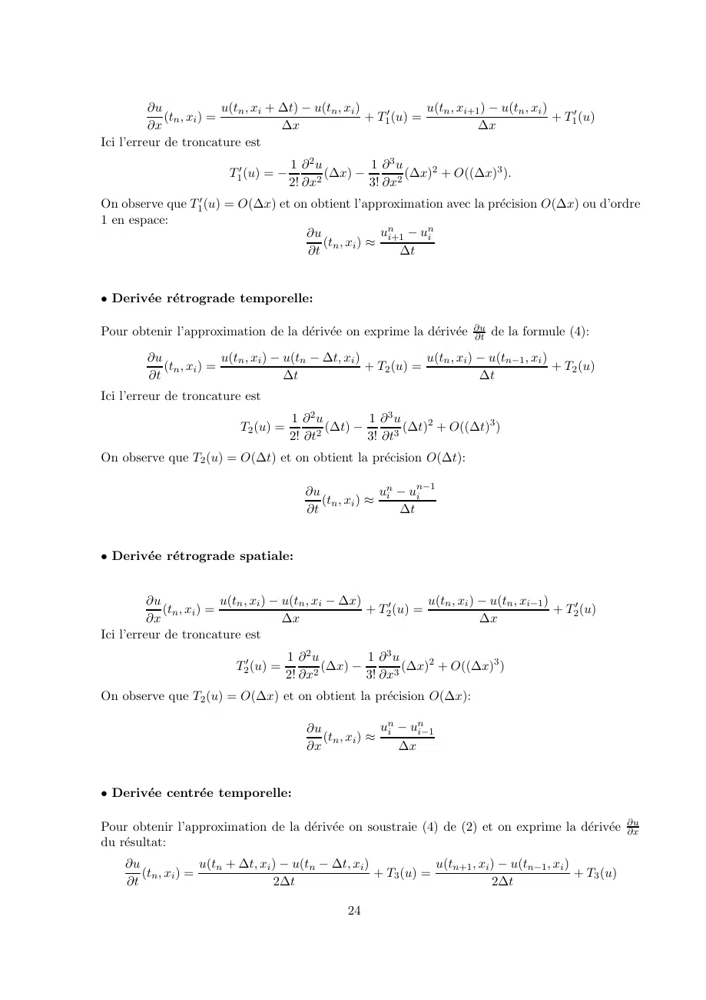

~~~text
          ∂u              u(tn , xi + ∆t) − u(tn , xi )             u(tn , xi+1 ) − u(tn , xi )
             (tn , xi ) =                               + T1′ (u) =                             + T1′ (u)
          ∂x                          ∆x                                       ∆x
Ici l’erreur de troncature est
                                         1 ∂2u         1 ∂3u
                           T1′ (u) = −          (∆x) −        (∆x)2 + O((∆x)3 ).
                                         2! ∂x2        3! ∂x2
On observe que T1′ (u) = O(∆x) et on obtient l’approximation avec la précision O(∆x) ou d’ordre
1 en espace:
                                    ∂u             un − uni
                                       (tn , xi ) ≈ i+1
                                    ∂t                ∆t

• Derivée rétrograde temporelle:

Pour obtenir l’approximation de la dérivée on exprime la dérivée ∂u
                                                                     ∂t de la formule (4):

         ∂u              u(tn , xi ) − u(tn − ∆t, xi )            u(tn , xi ) − u(tn−1 , xi )
            (tn , xi ) =                               + T2 (u) =                             + T2 (u)
         ∂t                            ∆t                                     ∆t
Ici l’erreur de troncature est
                                         1 ∂2u         1 ∂3u
                             T2 (u) =           (∆t) −        (∆t)2 + O((∆t)3 )
                                         2! ∂t2        3! ∂t3
On observe que T2 (u) = O(∆t) et on obtient la précision O(∆t):

                                           ∂u             un − uin−1
                                              (tn , xi ) ≈ i
                                           ∂t                ∆t

• Derivée rétrograde spatiale:

          ∂u              u(tn , xi ) − u(tn , xi − ∆x)             u(tn , xi ) − u(tn , xi−1 )
             (tn , xi ) =                               + T2′ (u) =                             + T2′ (u)
          ∂x                            ∆x                                      ∆x
Ici l’erreur de troncature est
                                        1 ∂2u         1 ∂3u
                            T2′ (u) =          (∆x) −        (∆x)2 + O((∆x)3 )
                                        2! ∂x2        3! ∂x3
On observe que T2 (u) = O(∆x) et on obtient la précision O(∆x):

                                            ∂u             un − uni−1
                                               (tn , xi ) ≈ i
                                            ∂x                ∆x

• Derivée centrée temporelle:

Pour obtenir l’approximation de la dérivée on soustraie (4) de (2) et on exprime la dérivée ∂u
                                                                                                ∂x
du résultat:
     ∂u              u(tn + ∆t, xi ) − u(tn − ∆t, xi )            u(tn+1 , xi ) − u(tn−1 , xi )
        (tn , xi ) =                                   + T3 (u) =                               + T3 (u)
     ∂t                            2∆t                                        2∆t

                                                    24
~~~

## Page 25

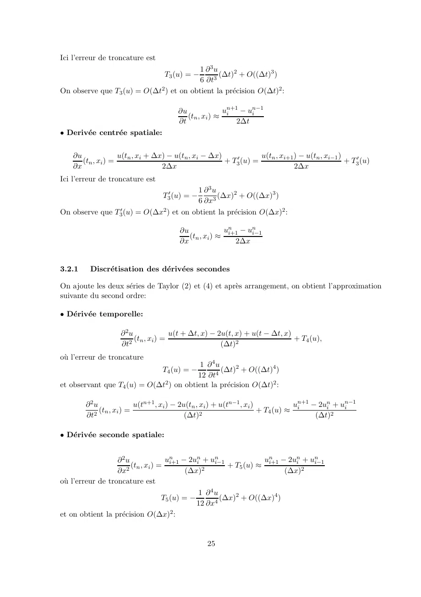

~~~text
Ici l’erreur de troncature est
                                        1 ∂3u
                                   T3 (u) = −  (∆t)2 + O((∆t)3 )
                                        6 ∂t3
On observe que T3 (u) = O(∆t2 ) et on obtient la précision O(∆t)2 :

                                        ∂u             un+1 − uin−1
                                           (tn , xi ) ≈ i
                                        ∂t                 2∆t
• Derivée centrée spatiale:

    ∂u              u(tn , xi + ∆x) − u(tn , xi − ∆x)             u(tn , xi+1 ) − u(tn , xi−1 )
       (tn , xi ) =                                   + T3′ (u) =                               + T3′ (u)
    ∂x                            2∆x                                         2∆x
Ici l’erreur de troncature est
                                         1 ∂3u
                                  T3′ (u) = −  (∆x)2 + O((∆x)3 )
                                         6 ∂x3
On observe que T3′ (u) = O(∆x2 ) et on obtient la précision O(∆x)2 :

                                        ∂u              uni+1 − uni−1
                                           (tn , xi ) ≈
                                        ∂x                  2∆x

3.2.1    Discrétisation des dérivées secondes

On ajoute les deux séries de Taylor (2) et (4) et après arrangement, on obtient l’approximation
suivante du second ordre:

• Dérivée temporelle:

                    ∂2u               u(t + ∆t, x) − 2u(t, x) + u(t − ∆t, x)
                       2
                         (tn , xi ) =                                        + T4 (u),
                    ∂t                                (∆t)2
où l’erreur de troncature
                                          1 ∂4u
                                  T4 (u) = −    (∆t)2 + O((∆t)4 )
                                         12 ∂t4
et observant que T4 (u) = O(∆t2 ) on obtient la précision O(∆t)2 :

        ∂2u                u(tn+1 , xi ) − 2u(tn , xi ) + u(tn−1 , xi )            un+1
                                                                                    i   − 2uni + uin−1
            (t n , x i ) =                                              + T4 (u) ≈
        ∂t2                                  (∆t)2                                       (∆t)2

• Dérivée seconde spatiale:

                   ∂2u             uni+1 − 2uni + uni−1            uni+1 − 2uni + uni−1
                       (t  ,
                          n ix ) =                      + T5 (u) ≈
                   ∂x2                    (∆x)2                           (∆x)2
où l’erreur de troncature est
                                               1 ∂4u
                                  T5 (u) = −         (∆x)2 + O((∆x)4 )
                                             12 ∂x4
et on obtient la précision O(∆x)2 :

                                                  25
~~~

## Page 26

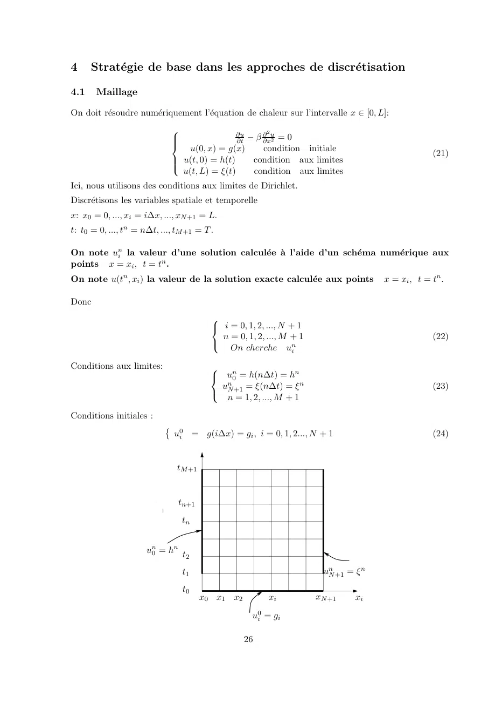

~~~text
4     Stratégie de base dans les approches de discrétisation

4.1    Maillage

On doit résoudre numériquement l’équation de chaleur sur l’intervalle x ∈ [0, L]:

                                                ∂u     ∂2u
                               
                               
                                               ∂t − β ∂x2 = 0
                                   u(0, x) = g(x)   condition initiale
                               
                                                                                                    (21)
                               
                                u(t, 0) = h(t)   condition  aux limites
                                 u(t, L) = ξ(t)   condition aux limites
                               

Ici, nous utilisons des conditions aux limites de Dirichlet.
Discrétisons les variables spatiale et temporelle
x: x0 = 0, ..., xi = i∆x, ..., xN +1 = L.
t: t0 = 0, ..., tn = n∆t, ..., tM +1 = T .

On note uni la valeur d’une solution calculée à l’aide d’un schéma numérique aux
points x = xi , t = tn .
On note u(tn , xi ) la valeur de la solution exacte calculée aux points              x = xi , t = t n .

Donc
                                          
                                           i = 0, 1, 2, ..., N + 1
                                            n = 0, 1, 2, ..., M + 1                                 (22)
                                              On cherche uni
                                          

Conditions aux limites:
                                           un0 = h(n∆t) = hn
                                          

                                            un   = ξ(n∆t) = ξ n                                     (23)
                                           N +1
                                             n = 1, 2, ..., M + 1
Conditions initiales :
                               u0i = g(i∆x) = gi , i = 0, 1, 2..., N + 1
                           
                                                                                                    (24)

                                tM +1

                                 tn+1
                                   tn

                      un0 = hn
                                   t2
                                   t1                                  unN +1 = ξ n
                                   t0
                                        x0 x1 x2         xi           xN +1     xi

                                                     u0i = gi

                                                   26
~~~

## Page 27

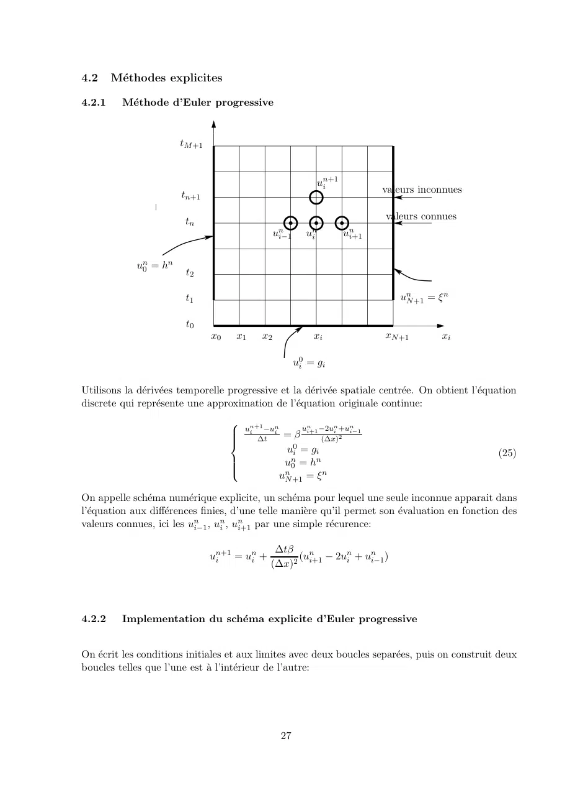

~~~text
4.2     Méthodes explicites

4.2.1     Méthode d’Euler progressive

                        tM +1

                                                             un+1
                                                              i
                        tn+1                                                valeurs inconnues

                         tn                                                 valeurs connues
                                                uni−1      uni      uni+1

             un0 = hn
                         t2

                         t1                                                    unN +1 = ξ n

                         t0
                                x0    x1   x2                xi             xN +1        xi

                                                        u0i = gi

Utilisons la dérivées temporelle progressive et la dérivée spatiale centrée. On obtient l’équation
discrete qui représente une approximation de l’équation originale continue:
                                      n+1 n
                                       u  −u       un −2un +un
                                      i ∆t i = β i+1 (∆x)i 2 i−1
                                     
                                     
                                               u0i = gi
                                     
                                                                                                   (25)
                                     
                                     
                                             un0 = hn
                                             unN +1 = ξ n
                                     

On appelle schéma numérique explicite, un schéma pour lequel une seule inconnue apparait dans
l’équation aux différences finies, d’une telle manière qu’il permet son évaluation en fonction des
valeurs connues, ici les uni−1 , uni , uni+1 par une simple récurence:

                                                ∆tβ
                                un+1 = uni +        (un − 2uni + uni−1 )
                                 i
                                               (∆x)2 i+1

4.2.2     Implementation du schéma explicite d’Euler progressive

On écrit les conditions initiales et aux limites avec deux boucles separées, puis on construit deux
boucles telles que l’une est à l’intérieur de l’autre:

                                                  27
~~~

## Page 28

~~~text
Algorithme d’Euler explicite

Pour     i = 0, ...N + 1
  u0i = gi
  Fin Pour
  Pour       n = 1, ...M + 1
  un0 = hn
  unN +1 = ξ n
  Fin Pour
Pour     n = 0, ...M
  Pour       i = 1, ...N
              ∆tβ
un+1
 i   = uni + (∆x)    n       n    n
                 2 (ui+1 − 2ui + ui−1 )

  Fin Pour
Fin Pour

                                                               ∆tβ
En effet, on tourne l’algorithme à la main pour un+1
                                                  i   = uni + (∆x)    n       n    n
                                                                  2 (ui+1 − 2ui + ui−1 ):

n=0                               toutes les valeurs u0i sont connues de la condition initiale: u0i = gi
                 
                                                       ∆tβ
                 
                 
                          i=1            u11 = u01 + (∆x)     0      0    0
                                                          2 ( u2 − 2 u1 + u0 )
                 
                                                        ∆tβ
                                          u12 = u02 + (∆x)      0      0    0
                 
                         i=2                               2 ( u3 − 2 u2 + u1 )
                 
                 
                 
                                                   ...
                                                   ∆tβ
                                      u1N = u0N + (∆x)     0         0    0
                 
                  i=N
                 
                                                      2 ( uN +1 − 2 uN + uN −1 )

n=1                            les valeurs u1i (i=1,...N ) sont calculées à l’iteration n = 0 , u10 et
u1N +1 sont connues de conditions aux limites: u10 = h1 , u1N +1 = ξ 1 .
                     
                                                         ∆tβ
                     
                           i=1             u21 = u11 + (∆x)    1     1    1
                                                            2 (u2 − 2u1 + u0 )
                     
                                                          ∆tβ
                                             u22 = u12 + (∆x)    1     1    1
                     
                           i=2                              2 (u3 − 2u2 + u1 )

                     
                                                   ...
                     
                                                      ∆tβ
                      i=N               u2N = u1N + (∆x)     1        1    1
                                                         2 ( uN +1 − 2uN + uN −1 )
                     

n=M
                 
                                           M −1    ∆tβ    M −1
                 
                 
                  i=1               uM
                                      1 = u1    + (∆x)2 (u2    − 2uM
                                                                   1
                                                                     −1
                                                                        + uM
                                                                           0
                                                                             −1
                                                                                )
                 
                                            M −1     ∆tβ    M −1
                                      uM                         − 2uM −1
                                                                          + uM −1
                 
                  i=2
                                       2 = u2    + (∆x) 2 (u3        2       1    )
                 
                                                ...
                 
                                           M −1    ∆tβ     M −1     M −1    M −1
                                     uM
                 
                  i=N
                 
                                      N = uN    + (∆x)2 ( uN +1 − 2uN    + uN −1 )

On peut visualiser cette explication par un dessin suivant:

                                                28
~~~

## Page 29

~~~text
                                              u21

                      u10                     u11              u12

                            u00         u01              u02

On voit qu’on commence par calculer u11 , u12 , ..., u1i , ... à l’aide de la condition initiale     u0i = gi .
Puis on passe à n = 2. On calcule u21 en utilisant u10 (condition aux limites),u11 , u12 . Ensuit on
calcule u22 ... etc.

4.2.3      Forme matricielle de l’équation discrete

On présente ici deux formes matricielles linéaire de l’équation discrete avec les condition aux
                             ∆tβ
limites de Dirichlet et C = (∆x)2:

  un+1
                                                  n  
                                                            C · un0
                                                                   
   1                                             u1
 un+1     1 − 2C   C    0 0 0                    n  
 2n+1                                         u2n       0
                                                                    
              C   1 − 2C C 0 0                   u3  
                                                                     
 u
   3
                                                             0     
 . =
                                               .
                                                 . −
                                                                
                                                               .     
                            C 1 − 2C   C          
                                                  .  
                                                                    
 .                                                           0     
   n+1                         0    C   1 − 2C      n            n
  uN                                               uN      C · uN +1

où

        un+1                                                                                    un0
                                                                                                  
         0       1    0      0   0 0
       un+1                                                                                    un1
       1n+1   0 1 − 2C   C    0 0
                                                                                         
                                                                                                un2
                                                                                           
       u      0   C    1 − 2C C 0                                                       
       2
       . =
                                                                                 .       
                                                              C 1 − 2C   C    0  
                                                                                    
                                                                                             
                                                                                                .
       .                                                      0   C    1 − 2C 0            .
          un+1
           N +1                                                  0    0      0   1      n
                                                                                       uN +1

4.2.4      Visualisation des solutions

On trace en 2 et 3 dimensions les solutions de l’équation suivante avec les conditions aux limites
de Dirichlet:

                                                    29
~~~

## Page 30

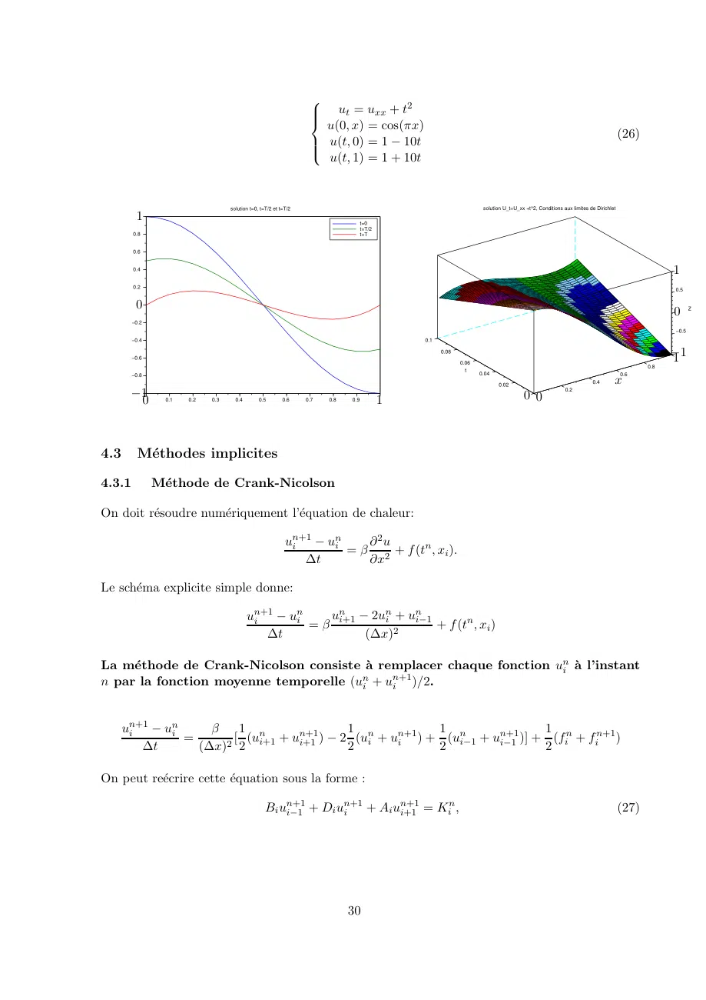

~~~text
                                                                       ut = uxx + t2
                                                                   
                                                                   
                                                                   
                                                                     u(0, x) = cos(πx)
                                                                   
                                                                                                                                                                                   (26)
                                                                   
                                                                    u(t, 0) = 1 − 10t
                                                                     u(t, 1) = 1 + 10t
                                                                   

                                   solution t=0, t=T/2 et t=T/2                                                      solution U_t=U_xx +t^2, Conditions aux limites de Dirichlet

         1                                                                          t=0
                                                                                    t=T/2
        0.8                                                                         t=T

        0.6

        0.4
                                                                                                                                                                                                1
        0.2
                                                                                                                                                                                                0.5

         0
                                                                                                                                                                                                0      Z

        −0.2
                                                                                                                                                                                                −0.5
        −0.4                                                                                    0.1

        −0.6
                                                                                                      0.08
                                                                                                                                                                                                −1
                                                                                                                                                                                                1
                                                                                                             0.06
                                                                                                                                                                                          0.8
                                                                                                               t
        −0.8                                                                                                        0.04                                                           0.6

                                                                                                                           0.02
                                                                                                                                                                     0.4       x
       −1                                                                                                                              0 0
                                                                                                                                                         0.2

        0        0.1   0.2   0.3     0.4        0.5        0.6    0.7   0.8   0.9           1

4.3       Méthodes implicites

4.3.1          Méthode de Crank-Nicolson

On doit résoudre numériquement l’équation de chaleur:

                                                            un+1 − uni    ∂2u
                                                             i
                                                                       = β 2 + f (tn , xi ).
                                                               ∆t         ∂x

Le schéma explicite simple donne:

                                           un+1 − uni    un − 2uni + uni−1
                                            i
                                                      = β i+1              + f (tn , xi )
                                              ∆t              (∆x)2

La méthode de Crank-Nicolson consiste à remplacer chaque fonction uni à l’instant
n par la fonction moyenne temporelle (uni + un+1
                                             i   )/2.

      un+1 − uni     β   1                1 n            1                  1 n
       i
                 =      [ (un + un+1              n+1
                                 i+1 ) − 2 (ui + ui   ) + (uni−1 + un+1             n+1
                                                                    i−1 )] + (fi + fi   )
         ∆t        (∆x)2 2 i+1            2              2                  2

On peut reécrire cette équation sous la forme :

                                                   Bi un+1       n+1
                                                       i−1 + Di ui   + Ai un+1    n
                                                                           i+1 = Ki ,                                                                                              (27)

                                                                              30
~~~

## Page 31

~~~text
où
                              ∆tβ
                 Ai = −            ,                                                                                      (28)
                            2(∆x)2
                              ∆tβ
                 Bi     = −        ,                                                                                      (29)
                            2(∆x)2
                               ∆tβ
                 Di     = 1+         ,                                                                                    (30)
                              (∆x)2
                                ∆tβ            ∆tβ                      ∆t n
                Kin     = (1 −         )uni +        (uni+1 + uni−1 ) +   (f + fin+1 )                                    (31)
                               (∆x)  2        2(∆x)2                    2 i

                         tM +1

                                                            un+1
                                                             i−1
                                                                         un+1
                                                                          i   un+1
                                                                               i+1
                         tn+1                                                                   valeurs inconnues

                          tn                                                                     valeurs connues

                                                       uni−1      uni         uni+1

             un0 = hn
                          t2

                          t1                                                                       unN +1 = ξ n

                          t0
                                 x0      x1       x2                xi                          xN +1         xi

                                                               u0i = gi

On reécrit l’équation sous la forme de système linéaire :

                                i = 1, B1 un+1
                                           0   + D1 un+1
                                                     1   + A1 un+1
                                                               2   = K1n
                                i = 2, B2 un+1
                                           1   + D2 un+1
                                                     2   + A2 un+1
                                                               3   = K2n

                                  ...........................................................

                            i = N, BN un+1        n+1
                                       N −1 + DN uN   + AN un+1     n
                                                            N +1 = KN

On utilise les conditions aux limites              un+1
                                                    0   = hn+1 , un+1
                                                                  N +1 = ξ
                                                                           n+1                          et on obtient la forme
matricielle suivante:

                                                         31
~~~

## Page 32

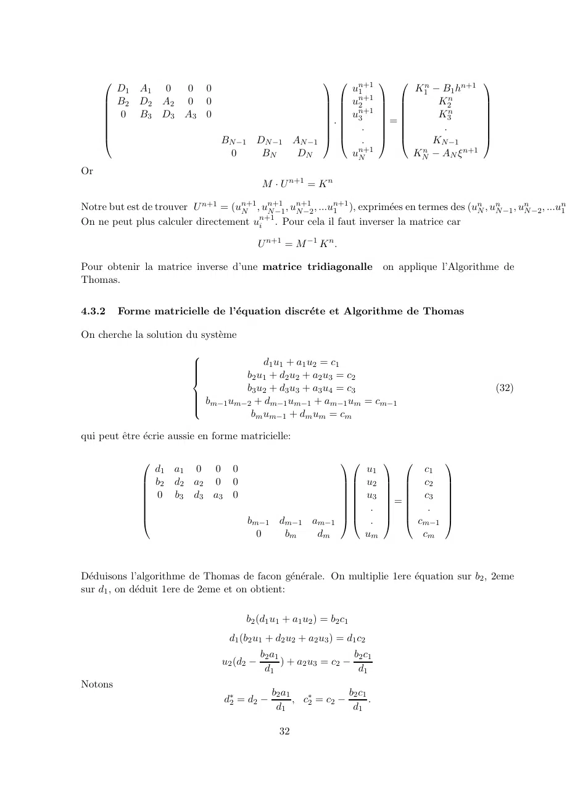

~~~text
                                        n+1  
                                          u1        K1n − B1 hn+1
                                                                 
       D1 A1 0  0 0
      B2 D2 A2 0 0                     un+1           K2n
                                        2n+1  
                                                                
                                                            n
                                                                 
      0 B3 D3 A3 0                     u            K3       
                                     . 3     =               
     
     
                                        .  
                                                      .       
                                                                  
                   BN −1 DN −1 AN −1      .        KN −1     
                                            n+1      n        n+1
                     0     BN    DN       uN        KN − AN ξ
Or
                                              M · U n+1 = K n

Notre but est de trouver U n+1 = (un+1   n+1    n+1        n+1
                                   N , uN −1 , uN −2 , ...u1   ), exprimées en termes des (unN , unN −1 , unN −2 , ...un1 )
                                       n+1
On ne peut plus calculer directement ui . Pour cela il faut inverser la matrice car

                                              U n+1 = M −1 K n .

Pour obtenir la matrice inverse d’une matrice tridiagonalle                    on applique l’Algorithme de
Thomas.

4.3.2    Forme matricielle de l’équation discréte et Algorithme de Thomas

On cherche la solution du système
                           
                           
                                      d1 u1 + a1 u2 = c1
                                   b2 u1 + d2 u2 + a2 u3 = c2
                           
                           
                           
                                   b3 u2 + d3 u3 + a3 u4 = c3                                            (32)
                             b  u    + dm−1 um−1 + am−1 um = cm−1
                           
                            m−1 m−2
                           
                           
                           
                                    bm um−1 + dm um = cm

qui peut être écrie aussie en forme matricielle:

                                                       
                 d1 a1 0 0 0                     u1     c1
                b2 d2 a2 0 0                  u2   c2 
                                                       
                0 b3 d3 a3 0                  u3   c3 
                                                 =     
                                             .   . 
                                                       
                             bm−1 dm−1 am−1   .   cm−1 
                                0   bm   dm      um     cm

Déduisons l’algorithme de Thomas de facon générale. On multiplie 1ere équation sur b2 , 2eme
sur d1 , on déduit 1ere de 2eme et on obtient:

                                         b2 (d1 u1 + a1 u2 ) = b2 c1
                                     d1 (b2 u1 + d2 u2 + a2 u3 ) = d1 c2
                                              b2 a1                  b2 c1
                                   u2 (d2 −         ) + a2 u3 = c2 −
                                               d1                     d1
Notons
                                                 b2 a 1              b2 c1
                                    d∗2 = d2 −          , c∗2 = c2 −       .
                                                  d1                  d1

                                                   32
~~~

## Page 33

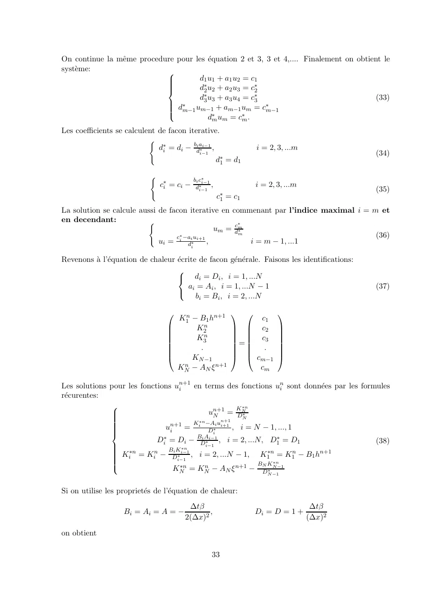

~~~text
On continue la même procedure pour les équation 2 et 3, 3 et 4,.... Finalement on obtient le
système:                   
                            
                                    d1 u1 + a1 u2 = c1
                                     d∗2 u2 + a2 u3 = c∗2
                            
                            
                            
                                     d∗3 u3 + a3 u4 = c∗3                                 (33)
                            
                               d∗   u      + a      u  =  c∗
                             m−1 m−1∗         m−1 m
                            
                            
                                                          m−1
                                         dm um = c∗m .
Les coefficients se calculent de facon iterative.
                           (
                              d∗i = di − bdi a∗i−1 ,               i = 2, 3, ...m
                                                 i−1                                           (34)
                                                       d∗1 = d1

                                               bi c∗
                             (
                                 c∗i = ci − d∗i−1 ,                i = 2, 3, ...m
                                                 i−1                                           (35)
                                                        c∗1 = c1
La solution se calcule aussi de facon iterative en commenant par l’indice maximal i = m et
en decendant:
                                                 um = dcm
                         (                              ∗
                                                        ∗
                                  c∗i −ai ui+1
                                                        m
                                                                                       (36)
                             ui =      d∗      ,          i = m − 1, ...1
                                           i

Revenons à l’équation de chaleur écrite de facon générale. Faisons les identifications:
                                   
                                    di = Di , i = 1, ...N
                                       a = Ai , i = 1, ...N − 1                                (37)
                                    i
                                          bi = Bi , i = 2, ...N

                                     K1n − B1 hn+1
                                                         
                                                        c1
                                         K2n        c2 
                                             n
                                                         
                                   
                                         K3         c3 
                                                   =      
                                   
                                          .         . 
                                                          
                                        KN −1       cm−1 
                                        n − A ξ n+1
                                       KN                           cm
                                             N

Les solutions pour les fonctions un+1
                                    i    en terms des fonctions uni sont données par les formules
récurentes:
                                                        K ∗n
                                               un+1
              
                                                N   = DN∗
                                                         N
                                         Ki∗n −Ai un+1
              
              
                                n+1                i+1
                               ui      =               , i = N − 1, ..., 1
              
              
                                               Di∗
              
              
              
                                          Bi Ai−1
                              ∗
                            Di = Di − D∗ , i = 2, ...N, D1∗ = D1                              (38)
                                              i−1
                                Bi Ki−1
                                      ∗n
              
                   ∗n      n                                    ∗n         n n+1
              
              
              
                Ki = Ki − D∗ , i = 2, ...N − 1, K1 = K1 − B1 h
                                  i−1
                                    ∗n = K n − A ξ n+1 − BN KN−1
              
                                                                 ∗n
                                 KN         N       N         D∗      N−1

Si on utilise les proprietés de l’équation de chaleur:
                                          ∆tβ                                        ∆tβ
                    Bi = Ai = A = −             ,                  Di = D = 1 +
                                         2(∆x)2                                     (∆x)2

on obtient

                                                       33
~~~

## Page 34

~~~text
                    
                                                           AK ∗n
                    
                     K1∗n = K1n − B1 hn+1 Ki∗n = Kin − D∗i−1 , i = 2, ...N − 1
                                                              i−1
                    
                    
                                       ∗n = K n − Aξ n+1 − AKN−1
                                                                ∗n
                                     K
                    
                    
                    
                    
                                      N       N              D ∗
                                                                N−1
                                                            2
                            D1∗ = D1 = D, Di∗ = D − DA∗ ,           i = 2, ...N                   (39)
                                                           i−1
                                                       KN
                                                       ∗n
                                               n+1
                    
                    
                                              uN = D∗
                                                       N
                    
                                         K ∗n −Aun+1
                                  n+1
                                          i     i+1
                                 ui    =             ,  i = N − 1, ..., 1
                    
                    
                                              D∗      i

5 Equations paraboliques. Résolution numérique de l’équation
de la chaleur par Crank-Nicolson

5.1    Algorithme de Crank-Nicolson

On fait une boucle temporelle et l’algorithme de Thomas à l’intérieur. Pour corriger les valeurs
K1n et KN   n    on utilise les symboles de Kroneker δij : δij = 1 si i = j et δij = 0 si
i 6= j.
On suppose que les coefficients             Ai , Bi       et Di de la matrice M sont precisés.

 Algorithme de Crank-Nicolson. Conditions aux limites de Dirichlet.

          ∆tβ                      ∆tβ                  ∆tβ
  Ai = − 2(∆x)2;           Bi = − 2(∆x)2;     Di = 1 + (∆x)2

  Pour        i = 0, N + 1
  u0i = gi
  Fin Pour

  Pour       n = 1, M + 1
  un0 = hn
  unN +1 = ξ n
  Fin Pour

Pour     n = 0, M
  Pour        i = 1, N
              ∆tβ         ∆tβ                    ∆t       n+1
  Kin = (1 − (∆x)    n            n      n           n
                 2 )ui + 2(∆x)2 (ui+1 + ui−1 ) + 2 (fi + fi   ) − δ1i · B1 · hn+1 − δN i · AN · ξ n+1
  Fin Pour

  D1∗ = D1 , K ∗n1 = K1n

  Pour        i = 2, N
                                                Bi ·K ∗n
  Di∗ = Di − BD
              i ·Ai−1
                 ∗    ,        K ∗ni = Kin −      Di−1
                                                     ∗
                                                       i−1
                     i−1

  Fin Pour

             K ∗n
  un+1
   N   = D∗N
               N

                                                       34
~~~

## Page 35

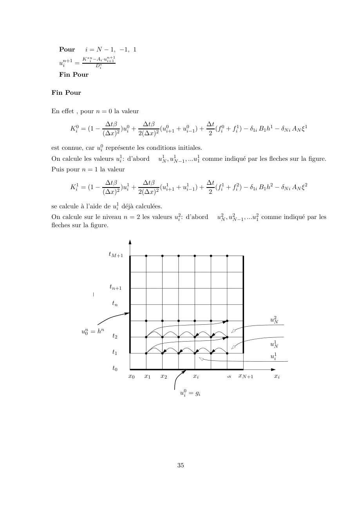

~~~text
   Pour       i = N − 1, −1, 1
         K ∗n −Ai ·un+1
   un+1
    i   = i D∗ i+1
                i

   Fin Pour

Fin Pour

En effet , pour n = 0 la valeur
                      ∆tβ           ∆tβ                      ∆t 0
       Ki0 = (1 −           )u0i +        (u0i+1 + u0i−1 ) +   (f + fi1 ) − δ1i B1 h1 − δN i AN ξ 1
                     (∆x) 2        2(∆x)2                    2 i

est connue, car u0i représente les conditions initiales.
On calcule les valeurs u1i : d’abord        u1N , u1N −1 , ...u11 comme indiqué par les fleches sur la figure.
Puis pour n = 1 la valeur
                      ∆tβ       ∆tβ                 ∆t 1
       Ki1 = (1 −         )u1 +     (u1 + u1i−1 ) +   (f + fi2 ) − δ1i B1 h2 − δN i AN ξ 2
                     (∆x)2 i 2(∆x)2 i+1             2 i

se calcule à l’aide de u1i déjà calculées.
On calcule sur le niveau n = 2 les valeurs u2i : d’abord           u2N , u2N −1 , ...u21 comme indiqué par les
fleches sur la figure.

                       tM +1

                        tn+1

                         tn

                                                                                        u2N
            un0 = hn
                         t2
                                                                                        u1N
                         t1
                                                                                        u1i
                         t0
                               x0     x1     x2          xi            xN   xN +1         xi

                                                    u0i = gi

                                                   35
~~~

## Page 36

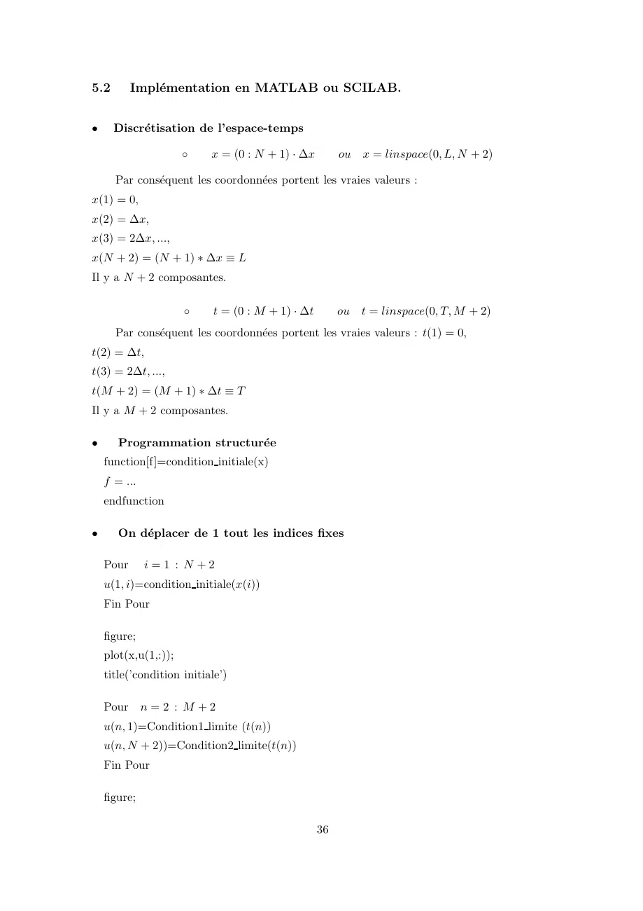

~~~text
5.2        Implémentation en MATLAB ou SCILAB.

•     Discrétisation de l’espace-temps

                      ◦    x = (0 : N + 1) · ∆x        ou   x = linspace(0, L, N + 2)

      Par conséquent les coordonnées portent les vraies valeurs :
x(1) = 0,
x(2) = ∆x,
x(3) = 2∆x, ...,
x(N + 2) = (N + 1) ∗ ∆x ≡ L
Il y a N + 2 composantes.

                      ◦    t = (0 : M + 1) · ∆t        ou   t = linspace(0, T, M + 2)
      Par conséquent les coordonnées portent les vraies valeurs : t(1) = 0,
t(2) = ∆t,
t(3) = 2∆t, ...,
t(M + 2) = (M + 1) ∗ ∆t ≡ T
Il y a M + 2 composantes.

•      Programmation structurée
    function[f]=condition initiale(x)
    f = ...
    endfunction

•      On déplacer de 1 tout les indices fixes

    Pour      i=1 : N +2
    u(1, i)=condition initiale(x(i))
    Fin Pour

    figure;
    plot(x,u(1,:));
    title(’condition initiale’)

    Pour      n=2 : M +2
    u(n, 1)=Condition1 limite (t(n))
    u(n, N + 2))=Condition2 limite(t(n))
    Fin Pour

    figure;

                                                  36
~~~

## Page 37

~~~text
    plot(t,u(:, N+2),t,u(:,1));
    title(’condition aux limites’)

Le schéma est toujours stable.

•     Programme principal
    Algorithme de Crank-Nicolson pour MATLAB. Condition aux limites de Dirichlet.

              ∆tβ                  ∆tβ                       ∆tβ
    A(i) = − 2(∆x)2;     B(i) = − 2(∆x)2;        D(i) = 1 + (∆x)2

    Pour      i=1 : N +2
    u(1, i) = g(x(i))
    Fin Pour

    Pour     n=2 : M +2
    u(n, 1) = h(t(n))
    u(n, N + 2) = ξ(t(n))
    Fin Pour

Pour       n=1 : M +1
    Pour      i = 2, N + 1
                      ∆tβ                ∆tβ                                 ∆t
   K(n, i) = (1 − (∆x)     2 )u(n, i) + 2(∆x)2 (u(n, i + 1) + u(n, i − 1)) + 2 (f (t(n), x(i)) + f (t(n +

1), x(i))) − δ2,i · B(2) · h(t(n + 1)) − δN +1,i · A(N + 1) · ξ(t(n + 1))
    Fin Pour

    Detoile(2) = D(2), Ketoile(2, n) = K(2, n)

    Pour      i=3 : N +1
                        B(i)·A(i−1)
    Detoile(i) = D(i) − Detoile(i−1) ,     Ketoile(n, i) = K(n, i) − B(i)·Ketoile(n,i−1)
                                                                        Detoile(i−1)
    Fin Pour

    u(n + 1, N + 1) = Ketoile(n,N +1)
                       Detoile(N +1)

    Pour      i = N : −1, 2
    u(n + 1, i) = Ketoile(n,i)−A(i)·u(n+1,i+1)
                            Detoile(i)
    Fin Pour

Fin Pour

                                                    37
~~~

## Page 38

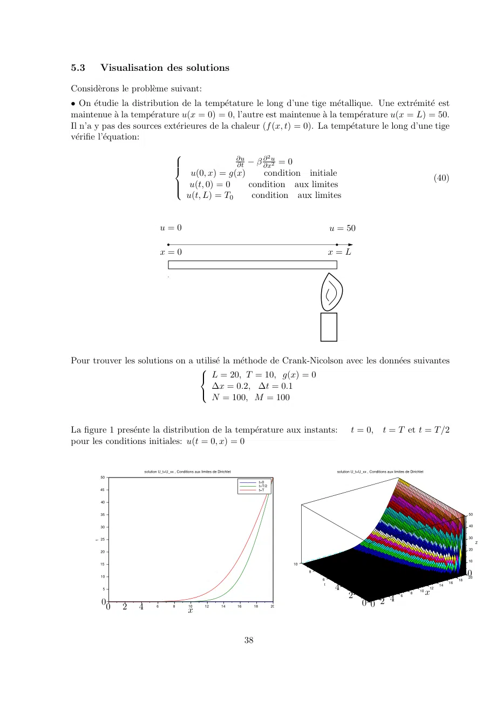

~~~text
5.3       Visualisation des solutions

Considèrons le problème suivant:
• On étudie la distribution de la tempétature le long d’une tige métallique. Une extrémité est
maintenue à la température u(x = 0) = 0, l’autre est maintenue à la température u(x = L) = 50.
Il n’a y pas des sources extérieures de la chaleur (f (x, t) = 0). La tempétature le long d’une tige
vérifie l’équation:

                                                                                 ∂u     ∂2u
                                         
                                         
                                                                                ∂t − β ∂x2 = 0
                                            u(0, x) = g(x)     condition initiale
                                         
                                                                                                                                                                                           (40)
                                         
                                           u(t, 0) = 0    condition   aux limites
                                           u(t, L) = T0     condition aux limites
                                         

                                  u=0                                                                                      u = 50

                                  x=0                                                                                      x=L

Pour trouver les solutions on a utilisé la méthode de Crank-Nicolson avec les données suivantes
                                 
                                  L = 20, T = 10, g(x) = 0
                                     ∆x = 0.2, ∆t = 0.1
                                     N = 100, M = 100
                                 

La figure 1 presénte la distribution de la température aux instants:                                                              t = 0,               t = T et t = T /2
pour les conditions initiales: u(t = 0, x) = 0

                       solution U_t=U_xx , Conditions aux limites de Dirichlet                                              solution U_t=U_xx , Conditions aux limites de Dirichlet
          50
                                                                                                t=0
                                                                                                t=T/2
          45                                                                                    t=T

          40

          35                                                                                                                                                                                               50

          30                                                                                                                                                                                               40

          25                                                                                                                                                                                               30
      t

                                                                                                                                                                                                                Z
                                                                                                                                                                                                           20
          20

                                                                                                                                                                                                           10
          15                                                                                                 10

          10
                                                                                                                  8
                                                                                                                                                                                                           0
                                                                                                                                                                                                           20
                                                                                                                      6                                                                               18
                                                                                                                       t                                                                         16
           5                                                                                                                4                                                   10
                                                                                                                                                                                      12
                                                                                                                                                                                      x
                                                                                                                                                                                            14

                                                                                                                                   2                                6
                                                                                                                                                                          8

          0
           0   2   4          6          8         10        12         14       16        18           20
                                                                                                                                           0 0 2 4
                                                  x

                                                                                      38
~~~

## Page 39

~~~text
                                                                   Fig. 1

La figure 2 presénte la distribution de la température aux instants:                                         t = 0,               t = T et t = T /2
pour les conditions initiales:
                                                   50 −(x−10)2
                                     u(t = 0, x) = √ e 2
                                                     π
La température extrémité x = L varie en fonction du temps u(x = L) = 5t.

                          solution t=0, t=T/2 et t=T/2                                                  solution U_t=U_xx , Conditions aux limites de Dirichlet
       50
                                                                             t=0
                                                                             t=T/2
       45                                                                    t=T

       40

       35                                                                                                                                                                              50

       30                                                                                                                                                                              40

       25                                                                                                                                                                              30
                                                                                                                                                                                            Z
                                                                                                                                                                                       20
       20

                                                                                                                                                                                       10
       15                                                                                 10

       10
                                                                                               8
                                                                                                                                                                                       0
                                                                                                                                                                                       20
                                                                                                   6                                                                              18
                                                                                                    t                                                                        16
        5                                                                                               4                                                   10
                                                                                                                                                                  12
                                                                                                                                                                  x
                                                                                                                                                                        14

                                                                                                               2                                6
                                                                                                                                                      8

       0                                                                                                               0 0         2 4
        0    2   4    6      8         10         12     14   16        18           20

                                                                   Fig. 1

5.4    Comparaisons des conditions aux limites

• On trace en 2 et 3 dimensions la solution de l’équation suivante avec les conditions aux limites
de Dirichlet pour T = 0.1:

                                                             ut = uxx + t2
                                                         
                                                         
                                                         
                                                         
                                                         
                                                         
                                                          u(0, x) = cos(πx)
                                                           u(t, 0) = 1 − 10t
                                                         
                                                                                                                                                                       (41)
                                                         
                                                          u(t, 1) = 1 + 10t
                                                                x ∈ [0, 1]
                                                         
                                                         
                                                         
                                                         
                                                                T = 0.1
                                                         

                                                                   39
~~~

## Page 40

~~~text
                                       solution t=0, t=T/2 et t=T/2                                                                 solution U_t=U_xx +t^2, Conditions aux limites de Dirichlet

          1                                                                                        t=0
                                                                                                   t=T/2
         0.8                                                                                       t=T

         0.6

         0.4
                                                                                                                                                                                                              1
         0.2
                                                                                                                                                                                                              0.5

          0
                                                                                                                                                                                                              0      Z

         −0.2
                                                                                                                                                                                                              −0.5
         −0.4                                                                                                  0.1

         −0.6
                                                                                                                     0.08                                                                                     −1
                                                                                                                                                                                                              1
                                                                                                                            0.06
                                                                                                                                                                                                        0.8
                                                                                                                              t
         −0.8                                                                                                                      0.04                                                           0.6

                                                                                                                                          0.02
                                                                                                                                                                                    0.4       x
         −1                                                                                                                                           0 0
                                                                                                                                                                        0.2

          0     0.1   0.2      0.3       0.4        0.5        0.6    0.7         0.8        0.9           1

• On trace en 2 et 3 dimensions la solution de l’équation suivante avec les conditions aux limites
de Neumann pour T = 0.1:

                                                                          ut = uxx + t2
                                                                      
                                                                      
                                                                      
                                                                      
                                                                      
                                                                      
                                                                       u(0, x) = cos(πx)
                                                                        ux (t, 0) = 1 − 10t
                                                                      
                                                                                                                                                                                                    (42)
                                                                       ux (t, 1) = 1 + 10t
                                                                      
                                                                             x ∈ [0, 1]
                                                                      
                                                                      
                                                                      
                                                                      
                                                                              T = 0.1
                                                                      

                       solution U_t=U_xx +t^2, Conditions aux limites de Neuman                                                     solution U_t=U_xx +t^2, Conditions aux limites de Neuman

          1                                                                                        t=0
                                                                                                   t=T/2
         0.8                                                                                       t=T

         0.6

         0.4
                                                                                                                                                                                                              1
         0.2                                                                                                                                                                                                  0.5

          0                                                                                                                                                                                                   0
     t

                                                                                                                                                                                                                     Z

         −0.2
                                                                                                                                                                                                              −0.5

         −0.4                                                                                                  0.1

                                                                                                                     0.08
                                                                                                                                                                                                              −1
         −0.6
                                                                                                                            0.06
                                                                                                                                                                                                              1
                                                                                                                                                                                                        0.8
                                                                                                                              t
         −0.8                                                                                                                      0.04                                                           0.6

                                                                                                                                          0.02
                                                                                                                                                                                    0.4       x
         −1                                                                                                                                           0 0
                                                                                                                                                                        0.2

          0     0.1   0.2      0.3       0.4        0.5
                                                    x
                                                               0.6    0.7         0.8        0.9           1

• On trace en 2 et 3 dimensions la solution de la même équation avec les conditions aux limites
de Dirichlet pour T = 1:

                                                                                        40
~~~

## Page 41

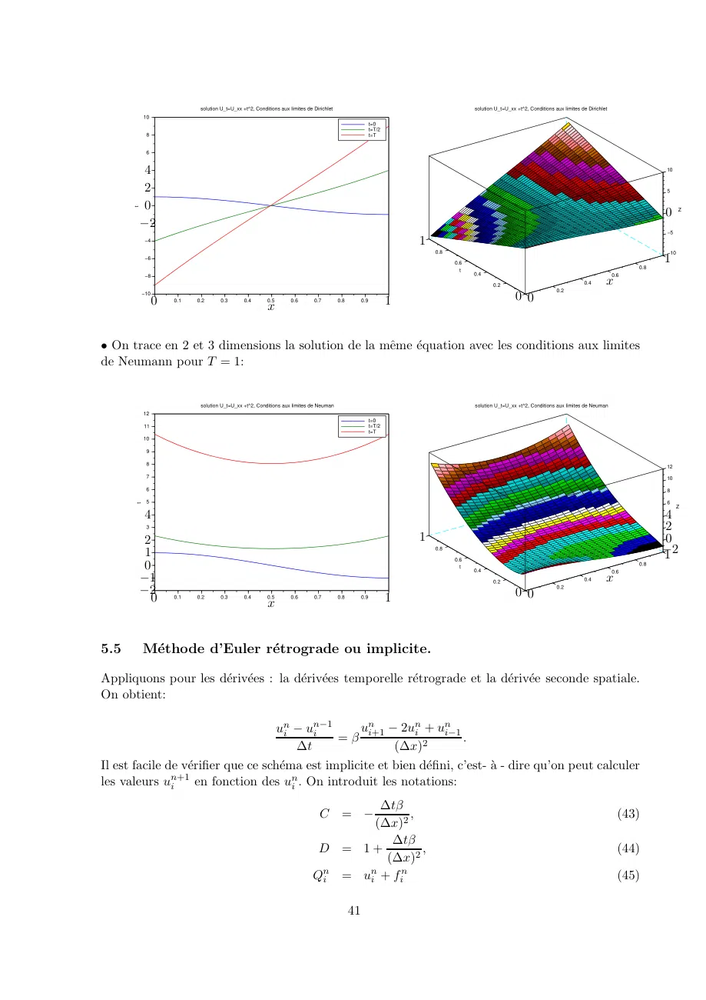

~~~text
                            solution U_t=U_xx +t^2, Conditions aux limites de Dirichlet                                                solution U_t=U_xx +t^2, Conditions aux limites de Dirichlet
           10
                                                                                                           t=0
                                                                                                           t=T/2
            8                                                                                              t=T

            6

           4                                                                                                                                                                                                     10

          2                                                                                                                                                                                                      5

          0
      t

                                                                                                                                                                                                                 0     Z

          −2
                                                                                                                                                                                                                 −5
            −4                                                                                                         1
                                                                                                                           0.8                                                                                   −10
            −6
                                                                                                                                 0.6                                                                             1
                                                                                                                                                                                                           0.8
                                                                                                                                   t
            −8                                                                                                                         0.4                                                           0.6
                                                                                                                                               0.2                                     0.4       x
                                                                                                                                                                           0.2
           −10
                 0   0.1   0.2      0.3        0.4       0.5        0.6       0.7         0.8        0.9           1                                     0 0
                                                         x

• On trace en 2 et 3 dimensions la solution de la même équation avec les conditions aux limites
de Neumann pour T = 1:

                            solution U_t=U_xx +t^2, Conditions aux limites de Neuman                                                   solution U_t=U_xx +t^2, Conditions aux limites de Neuman
           12
                                                                                                           t=0
           11                                                                                              t=T/2
                                                                                                           t=T
           10

            9

            8                                                                                                                                                                                                    12
            7                                                                                                                                                                                                    10

            6                                                                                                                                                                                                    8

            5                                                                                                                                                                                                    6
       t

                                                                                                                                                                                                                       Z
           4                                                                                                                                                                                                     4
            3                                                                                                                                                                                                    2
          2                                                                                                            1                                                                                         0
           1                                                                                                               0.8
                                                                                                                                                                                                                 −2
                                                                                                                                                                                                                 1
                                                                                                                                 0.6
          0                                                                                                                        t
                                                                                                                                       0.4                                                           0.6
                                                                                                                                                                                                           0.8

          −1                                                                                                                                   0.2                                     0.4       x
          −2                                                                                                                                             0 0
                                                                                                                                                                           0.2

            0        0.1   0.2      0.3        0.4       0.5
                                                         x
                                                                    0.6       0.7         0.8        0.9           1

5.5        Méthode d’Euler rétrograde ou implicite.

Appliquons pour les dérivées : la dérivées temporelle rétrograde et la dérivée seconde spatiale.
On obtient:

                                    uni − uin−1     un − 2uni + uni−1
                                                = β i+1                   .
                                        ∆t                 (∆x)2
Il est facile de vérifier que ce schéma est implicite et bien défini, c’est- à - dire qu’on peut calculer
les valeurs un+1
               i    en fonction des uni . On introduit les notations:
                                                                                        ∆tβ
                                                                                 C = −        ,                                                                                                        (43)
                                                                                       (∆x)2
                                                                                          ∆tβ
                                                                               D = 1+           ,                                                                                                      (44)
                                                                                         (∆x)2
                                                                              Qni = uni + fin                                                                                                          (45)

                                                                                                41
~~~

## Page 42

~~~text
On reécrie l’équation sous la forme :

                               Cun+1     n+1
                                 i−1 + Dui   + Cun+1    n
                                                 i+1 = Qi , soit                             (46)

                                  n+1   n
                                    u1       Q1 − Chn+1
                                                         
                D C 0 0 0
               C D C 0 0         un+1         Qn2
                                  2n+1  
                                                        
                                                   n
                                                         
               0 C D C 0        u           Q3       
                                3     =              
              
              
                                 .  
                                              .       
                                                          
                         C D C     .       QN −1     
                                     n+1      n       n+1
                          0 C D     uN       QN − Cξ

Pour calculer les valeurs un+1
                           i   en fonction des uni il faut inverser la matrice. On applique
l’algorithme de Thomas.

6      Traitement des conditions aux limites de Neumann

6.1    Conditions aux limites de Neumann d’ordre 1

On peut remplacer les conditions aux limites de Dirichlet par des conditions aux limites de Neu-
mann. Il existe deux manières différentes de discrétiser les conditions aux limites de Neumann:
                                  ∂u                  ∂u
                                     (t, 0) = h(t)       (t, L) = ξ(t)
                                  ∂x                  ∂x

On peux les discrétiser de facon suivante:

                                un1 − un0            unN +1 − unN
                                          = hn                    = ξn
                                   ∆x                     ∆x
soit
                             un0 = un1 − ∆xhn        unN +1 = unN + ∆xξ n

6.2    Implementation des conditions aux limites de Neumann d’ordre 1 en
utilisant la méthode d’Euler explicite

On peut visualiser le maillage:

                                                42
~~~

## Page 43

~~~text
                           tM +1

                           tn+1

                            tn

         valeurs se calculent
                         t2

                            t1                                           valeurs se calculent

                            t0
                                       x0   x1     x2           xi    xN +1     xi

                                                          u0i = gi

Algorithme d’Euler explicite avec les conditions aux limites de Neumann

  Pour       i = 0, ...N + 1
  u0i = gi
  Fin Pour
Pour     n = 0, ...M
  Pour       i = 1, ...N
                ∆tβ
  un+1
   i   = uni + (∆x)    n       n    n
                   2 (ui+1 − 2ui + ui−1 )

  Fin Pour
  un+1
   0   = un+1
          1   − ∆xhn+1
  un+1     n+1
   N +1 = uN   + ∆xξ n+1
Fin Pour

On visualise cette explication par un dessin suivant:

                                                   u21

                           u10                     u11          u12

                                 u00             u01          u02

                                                         43
~~~

## Page 44

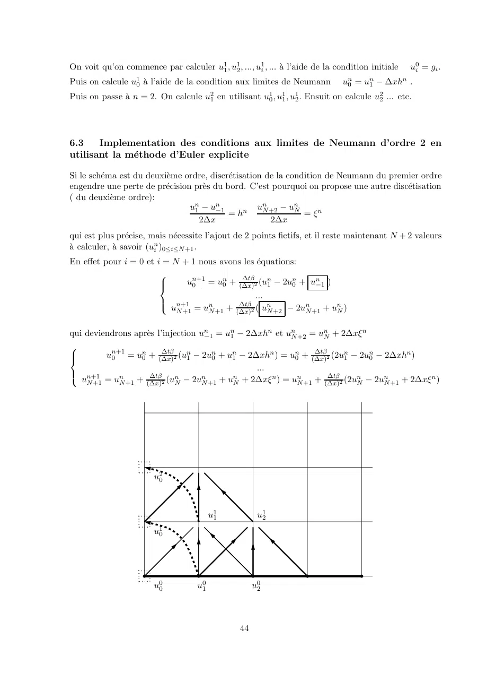

~~~text
On voit qu’on commence par calculer u11 , u12 , ..., u1i , ... à l’aide de la condition initiale   u0i = gi .
Puis on calcule u10 à l’aide de la condition aux limites de Neumann            un0 = un1 − ∆xhn .
Puis on passe à n = 2. On calcule u21 en utilisant u10 , u11 , u12 . Ensuit on calcule u22 ... etc.

6.3    Implementation des conditions aux limites de Neumann d’ordre 2 en
utilisant la méthode d’Euler explicite

Si le schéma est du deuxième ordre, discrétisation de la condition de Neumann du premier ordre
engendre une perte de précision près du bord. C’est pourquoi on propose une autre discétisation
( du deuxième ordre):
                                un1 − un−1          unN +2 − unN
                                           = hn                  = ξn
                                   2∆x                  2∆x
qui est plus précise, mais nécessite l’ajout de 2 points fictifs, et il reste maintenant N + 2 valeurs
à calculer, à savoir (uni )0≤i≤N +1 .
En effet pour i = 0 et i = N + 1 nous avons les équations:
                                             ∆tβ
                               un+1 = un0 + (∆x)     n     n     n
                        
                        
                                0               2 (u1 − 2u0 + u−1 )

                                                 ...
                         un+1 = un + ∆tβ ( un                n       n
                                                     N +2 − 2uN +1 + uN )
                        
                            N +1    N +1   (∆x)2

qui deviendrons après l’injection un−1 = un1 − 2∆xhn et unN +2 = unN + 2∆xξ n
                         ∆tβ                                      ∆tβ
         un+1


         0   = un0 + (∆x)      n      n     n        n     n             n    n
                            2 (u1 − 2u0 + u1 − 2∆xh ) = u0 + (∆x)2 (2u1 − 2u0 − 2∆xh )
                                                                                      n

                                                  ...
 un+1 = un + ∆tβ (un − 2un + un + 2∆xξ n ) = un + ∆tβ (2un − 2un + 2∆xξ n )

    N +1    N +1   (∆x)2     N      N +1     N               N +1   (∆x)2   N    N +1

                        u20

                                           u11          u12
                        u10

                        u00          u01               u02

                                                  44
~~~

## Page 45

~~~text
 Algorithme d’Euler explicite avec les conditions aux limites de Neumann d’ordre 2

    Pour       i = 0, ...N + 1
    u0i = gi
    Fin Pour
Pour       n = 0, ...M
    Pour       i = 1, ...N
                  ∆tβ
    un+1
     i   = uni + (∆x)    n       n    n
                     2 (ui+1 − 2ui + ui−1 )

    Fin Pour
                  ∆tβ
    un+1
     0   = un0 + (∆x)     n     n       n
                     2 (2u1 − 2u0 − 2∆xh )

                     ∆tβ
    un+1     n               n     n          n
     N +1 = uN +1 + (∆x)2 (2uN − 2uN +1 + 2∆xξ )
Fin Pour

6.4   Implementation des conditions aux limites de Neumann en utilisant la
méthode de Crank-Nicolson

La méthode de Crank-Nicolson conduit à l’équation de la forme :

                                   Bi un+1       n+1
                                       i−1 + Di ui   + Ai un+1    n
                                                           i+1 = Ki ,                             (47)

On reécrit l’équation sous la forme de système linéaire :

                                 i = 1, B1 un+1
                                            0   + D1 un+1
                                                      1   + A1 un+1
                                                                2   = K1n
                                 i = 2, B2 un+1
                                            1   + D2 un+1
                                                      2   + A2 un+1
                                                                3   = K2n

                                   ...........................................................

                             i = N, BN un+1        n+1
                                        N −1 + DN uN   + AN un+1     n
                                                             N +1 = KN

On utilise les conditions aux limites un+1
                                       0   = un+1
                                              1   − ∆xhn+1 , un+1     n+1
                                                              N +1 = uN   + ∆xξ n+1              et on
obtient la forme matricielle suivante:

                                            n+1  
                                              u1       K1n + ∆xB1 hn+1
                                                                      
  B1 + D1 A1 0   0 0
    B2    D2 A2 0 0                         un+1           K2n
                                            2n+1  
                                                                    
                                                                n
                                                                      
    0    B 3 D3 A3 0                      
                                          . u3
                                                           K 3
                                                                       
                                            . =
                                                                    

                                                         .        
                                                                       
                     BN −1 DN −1  AN −1   .            KN −1      
                                               n+1      n          n+1
                       0     BN   DN + AN     uN       KN − ∆xAN ξ

                                                          45
~~~

## Page 46

~~~text
Or
                                             M · U n+1 = K n

Notre but est de trouver U n+1 = (un+1  n+1     n+1        n+1
                                   N , uN −1 , uN −2 , ...u1   ), exprimées en termes des
(unN , unN −1 , unN −2 , ...un1 ). On ne peut plus calculer directement un+1
                                                                         i   . Pour cela il faut inverser la
matrice M car
                                                 U n+1 = M −1 K n .
Pour obtenir la matrice inverse d’une matrice tridiagonalle                on applique l’Algorithme de
Thomas.

Algorithme de Crank-Nicolson. Condition aux limites de Neumann.

  Pour        i=0 : N +1
  u0i = gi
  Fin Pour

          ∆tβ
  Ai = − 2(∆x)2

          ∆tβ
  Bi = − 2(∆x)2

            ∆tβ
  Di = 1 + (∆x)2

  D1 = D1 + B1 , DN = DN + AN

Pour      n=0 : M
  Pour        i=1 : N
             ∆tβ         ∆tβ                  ∆t n     n+1
  Kin = (1− (∆x)    n            n     n
                2 )ui + 2(∆x)2 (ui+1 +ui−1 )++ 2 (fi +fi   )−δ1i B1 ·hn+1 ·∆x−δN i AN ·ξ n+1 ·∆x
  Fin Pour

  Detoile1 = D1 , Ketoilen1 = K1n

  Pour        i=2 : N
                   Bi ·Ai−1
  Detoilei = Di − Detoile i−1
                         Bi ·Ketoilen
  Ketoileni = Kin −       Detoilei−1
                                    i−1

  Fin Pour

             Ketoilen
  un+1
   N   = DetoileNN

  Pour        i = N − 1 : −1 : 1
                            n+1
             Ketoilen
                    i −Ai ·ui+1
  un+1
   i   =         Detoilei
  Fin Pour

  un+1
   0   = un+1
          1   − ∆x · hn+1

                                                 46
~~~

## Page 47

~~~text
  un+1     n+1
   N +1 = uN   + ∆x · ξ n+1

Fin Pour

Algorithme de Crank-Nicolson pour MATLAB. Condition aux limites de Neumann.

  Pour       i=1 : N +2
  u(1, i) = g(x(i))
  Fin Pour

            ∆tβ
  A(i) = − 2(∆x)2

            ∆tβ
  B(i) = − 2(∆x)2

              ∆tβ
  D(i) = 1 + (∆x)2

  D(2) = D(2) + B(2), D(N + 1) = D(N + 1) + A(N + 1)

Pour      n=1 : M +1
  Pour       i=2 : N +1
                      ∆tβ               ∆tβ                                  ∆t
   K(n, i) = (1 − (∆x)    2 )u(n, i) + 2(∆x)2 (u(n, i + 1) + u(n, i − 1)) + + 2 (f (t(n), x(i)) + f (t(n +

1), x(i))) − δ2,i · B(2) · h(t(n + 1)) · ∆x − δN +1,i · A(N + 1) · ξ(t(n + 1)) · ∆x
  Fin Pour

  Detoile(2) = D(2), Ketoile(n, 2) = K(n, 2)

  Pour       i=3 : N +1
                      B(i)·A(i−1)
  Detoile(i) = D(i) − Detoile(i−1)

  Ketoile(n, i) = K(n, i) − B(i)·Ketoile(n,i−1)
                               Detoile(i−1)
  Fin Pour

  u(n + 1, N + 1) = Ketoile(n,N +1)
                     Detoile(N +1)

  Pour       i = N : −1 : 2
  u(n + 1, i) = Ketoile(n,i)−A(i)·u(n+1,i+1)
                          Detoile(i)
  Fin Pour

  u(n + 1, 1) = u(n + 1, 2) − ∆x · h(t(n + 1))
  u(n + 1, N + 2) = u(n + 1, N + 1) + ∆x · ξ(t(n + 1))

Fin Pour

                                                47
~~~

## Page 48

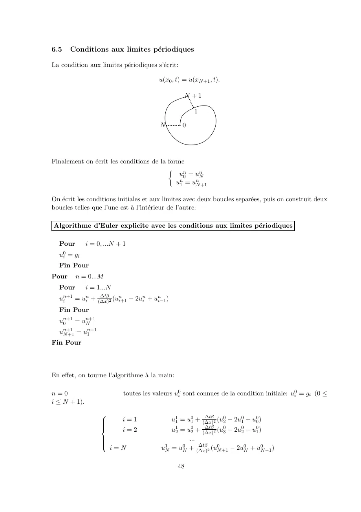

~~~text
6.5    Conditions aux limites périodiques

La condition aux limites périodiques s’écrit:

                                         u(x0 , t) = u(xN +1 , t).

                                                   N +1

                                                       1

                                         N        0

Finalement on écrit les conditions de la forme
                                              un0 = unN
                                          

                                             un1 = unN +1

On écrit les conditions initiales et aux limites avec deux boucles separées, puis on construit deux
boucles telles que l’une est à l’intérieur de l’autre:

Algorithme d’Euler explicite avec les conditions aux limites périodiques

  Pour        i = 0, ...N + 1
  u0i = gi
  Fin Pour
Pour     n = 0...M
  Pour        i = 1...N
                ∆tβ
  un+1
   i   = uni + (∆x)    n       n    n
                   2 (ui+1 − 2ui + ui−1 )

  Fin Pour
  un+1
   0   = un+1
          N
  un+1     n+1
   N +1 = u1
Fin Pour

En effet, on tourne l’algorithme à la main:

n=0                         toutes les valeurs u0i sont connues de la condition initiale: u0i = gi (0 ≤
i ≤ N + 1).

                                                           ∆tβ
                                              u11 = u01 + (∆x)    0     0    0
                   
                   
                          i=1                                2 (u2 − 2u1 + u0 )
                                                          ∆tβ
                                             u12 = u02 + (∆x)     0     0    0
                   
                          i=2                                2 (u3 − 2u2 + u1 )

                   
                                                   ...
                                                        ∆tβ
                                         u1N = u0N + (∆x)       0        0      0
                   
                       i=N                                 2 (uN +1 − 2uN + uN −1 )
                   

                                                48
~~~

## Page 49

~~~text
u10 = u1N
u1N +1 = u11

n=1                     les valeurs u1i (i=0,...N ) sont calculées à l’iteration n = 0 , u10 et u1N +1
sont connues de conditions aux limites périodiques: u10 = u1N , u1N +1 = u11 .

                                                          ∆tβ
                 
                 
                         i=1                u21 = u11 + (∆x)    1     1    1
                                                             2 (u2 − 2u1 + u0 )
                                                          ∆tβ
                 
                          i=2                u22 = u12 + (∆x)    1     1    1
                                                             2 (u3 − 2u2 + u1 )
                 
                 
                 
                                                   ...
                                                     ∆tβ
                 
                  i=N                  u2N = u1N + (∆x)     1        1    1
                                                        2 ( uN +1 − 2uN + uN −1 )
                 

u20 = u2N
u2N +1 = u21
n=M

                                           M −1    ∆tβ    M −1
                                     uM                        − 2uM    + uM
                                                                    −1      −1
               
                i=1                  1 = u1    + (∆x)2 (u2        1       0    )
                                           M −1     ∆tβ    M −1
                                                                − 2uM    + uM
               
                i=2                 uM
                                      2 = u2    + (∆x) 2 (u3
                                                                      −1      −1
                                                                                 )
               
                                                                    2       1
               
                                               ...
                                           M −1    ∆tβ     M −1     M −1    M −1
               
                i=N                 uM
                                      N = uN    + (∆x)2 ( uN +1 − 2uN    + uN −1 )
               

uM    M
 0 = uN
uM       M
 N +1 = u1

                                               49
~~~

## Page 50

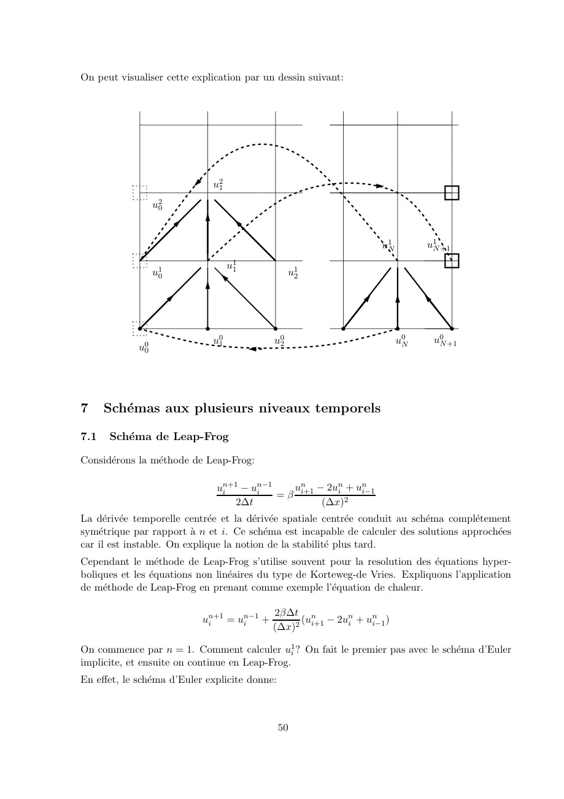

~~~text
On peut visualiser cette explication par un dessin suivant:

                              u21
                   u20

                                                                     u1N         u1N +1

                                    u11
                   u10                            u12

                              u01           u02                            u0N    u0N +1
             u00

7     Schémas aux plusieurs niveaux temporels

7.1   Schéma de Leap-Frog

Considérons la méthode de Leap-Frog:

                               un+1 − uin−1    un − 2uni + uni−1
                                i
                                            = β i+1
                                   2∆t              (∆x)2
La dérivée temporelle centrée et la dérivée spatiale centrée conduit au schéma complétement
symétrique par rapport à n et i. Ce schéma est incapable de calculer des solutions approchées
car il est instable. On explique la notion de la stabilité plus tard.
Cependant le méthode de Leap-Frog s’utilise souvent pour la resolution des équations hyper-
boliques et les équations non linéaires du type de Korteweg-de Vries. Expliquons l’application
de méthode de Leap-Frog en prenant comme exemple l’équation de chaleur.

                                            2β∆t n
                           un+1 = uin−1 +        (u   − 2uni + uni−1 )
                            i
                                            (∆x)2 i+1

On commence par n = 1. Comment calculer u1i ? On fait le premier pas avec le schéma d’Euler
implicite, et ensuite on continue en Leap-Frog.
En effet, le schéma d’Euler explicite donne:

                                                50
~~~

## Page 51

~~~text
                                     un+1 − uni    un − 2uni + uni−1
                                      i
                                                = β i+1
                                        ∆t              (∆x)2

                                           u1i − u0i    u0 − 2u0i + u0i−1
                               n=0                   = β i+1              ,
                                              ∆t             (∆x)2

                                                ∆tβ
                                 u1i = u0i −        (u0 − 2u0i + u0i−1 ).
                                               (∆x)2 i+1
On continue en Leap-Frog:

n=1                           les valeurs u1i (i=1,...N ) sont calculées par la méthode d’Euler ,
u0 et uN +1 sont connues de conditions aux limites: u10 = h1 , u1N +1 = ξ 1 .
 1     1

                                                            2∆tβ
                                                u21 = u01 + (∆x)    1     1    1
                  
                  
                             i=1                               2 (u2 − 2u1 + u0 )
                                                            2∆tβ
                                               u22 = u02 + (∆x)      1     1    1
                  
                             i=2                                2 (u3 − 2u2 + u1 )

                  
                                                     ...
                                             2     0      2∆tβ     1        1      1
                  
                      i=N                   uN = uN + (∆x)    2 (uN +1 − 2uN + uN −1 )
                  

n=M

                                              M −2   2∆tβ    M −1
                                        uM                        − 2uM −1
                                                                           + uM −1
               
               
                i=1                     1 = u1    + (∆x)2 (u2        1       0    )
                                               M −2      2∆tβ    M −1
                                        uM                             − 2uM −1
                                                                                 + uM −1
               
                i=2                     2 = u2      + (∆x)  2 (u3         2        1    )
               
                                                    ...
                                                M −2      2∆tβ    M −1      M −1
                                        uM                                       + uM  −1
               
                 i=N                        = u      +   (∆x)2 (uN +1 − 2uN          N −1 )
               
                                          N     N

7.2    Schéma de Lax-Wendroff

On commence par la decomposition de la fonction cherchée en series de Taylor d’ordre 2:
                                                 ∂u      1 ∂2u
                                 un+1
                                  i   = uni +       ∆t +       (∆t)2 + ...
                                                 ∂t      2 ∂t2
                          2         ∂2u
On rémplace ∂u       ∂ u                    2 ∂4u
             ∂t par β ∂x2 ,         ∂t2 par β ∂x4 .
On discrétise les derivées spatiales:
                                          ∂2u   uni+1 − 2uni + uni−1
                                              =
                                          ∂x2          (∆x)2

                               ∂4u   uni+2 − 4un+1
                                               i   + 6uni − 4uni−1 + uni−2
                                   =
                               ∂x4                 (∆x)4
On obtient le schèma explicite:
                       uni+1 − 2uni + uni−1 β 2 (∆t)2 uni+2 − 4uni+1 + 6uni − 4uni−1 + uni−2
       un+1
        i   = un
               i + β∆t                     +
                              (∆x)2              2                    (∆x)4

                                                  51
~~~

## Page 52

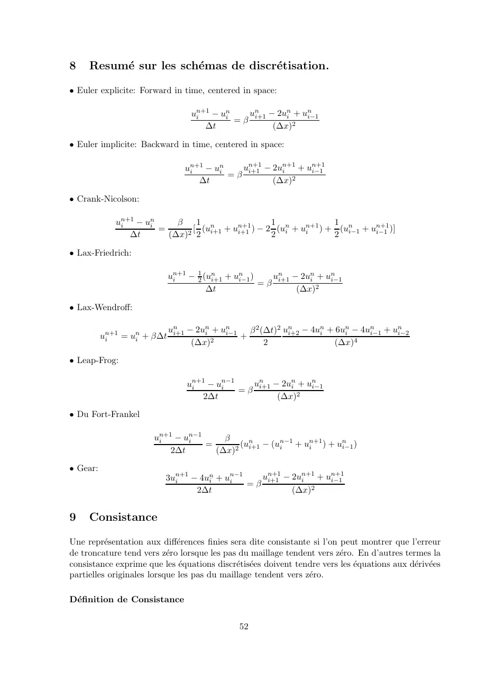

~~~text
8    Resumé sur les schémas de discrétisation.

• Euler explicite: Forward in time, centered in space:

                                  un+1 − uni    un − 2uni + uni−1
                                   i
                                             = β i+1
                                     ∆t              (∆x)2

• Euler implicite: Backward in time, centered in space:

                                un+1
                                 i   − uni    un+1     n+1
                                               i+1 − 2ui   + un+1
                                                              i−1
                                           =β            2
                                   ∆t                (∆x)

• Crank-Nicolson:

              un+1 − uni     β    1                   1 n            1
               i
                         =     2
                                 [ (uni+1 + un+1              n+1
                                             i+1 ) − 2 (ui + ui   ) + (uni−1 + un+1
                                                                                i−1 )]
                 ∆t        (∆x) 2                     2              2

• Lax-Friedrich:

                            un+1 − 12 (uni+1 + uni−1 )    un − 2uni + uni−1
                             i
                                                       = β i+1
                                       ∆t                      (∆x)2

• Lax-Wendroff:

                          uni+1 − 2uni + uni−1 β 2 (∆t)2 uni+2 − 4uni + 6uni − 4uni−1 + uni−2
          un+1
           i   = un
                  i + β∆t                     +
                                 (∆x)2              2                  (∆x)4

• Leap-Frog:

                                 un+1 − uin−1    un − 2uni + uni−1
                                  i
                                              = β i+1
                                     2∆t              (∆x)2

• Du Fort-Frankel

                        un+1 − uin−1     β
                         i
                                     =      (un − (uin−1 + un+1 ) + uni−1 )
                            2∆t        (∆x)2 i+1            i

• Gear:
                                                       n+1      n+1     n+1
                           3un+1 − 4uni + uin−1    u    − 2ui + ui−1
                             i
                                                = β i+1
                                  2∆t                     (∆x)2

9    Consistance

Une représentation aux différences finies sera dite consistante si l’on peut montrer que l’erreur
de troncature tend vers zéro lorsque les pas du maillage tendent vers zéro. En d’autres termes la
consistance exprime que les équations discrétisées doivent tendre vers les équations aux dérivées
partielles originales lorsque les pas du maillage tendent vers zéro.

Définition de Consistance

                                               52
~~~

## Page 53

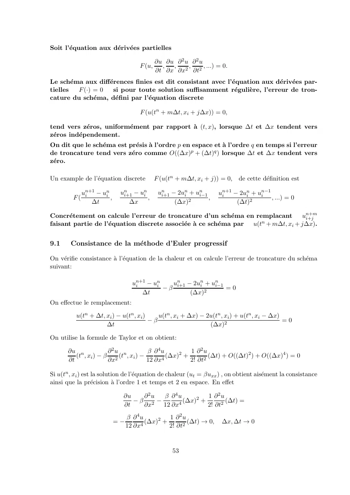

~~~text
Soit l’équation aux dérivées partielles

                                            ∂u ∂u ∂ 2 u ∂ 2 u
                                    F (u,     ,  ,     ,      , ...) = 0.
                                            ∂t ∂x ∂x2 ∂t2
Le schéma aux différences finies est dit consistant avec l’équation aux dérivées par-
tielles  F (·) = 0   si pour toute solution suffisamment régulière, l’erreur de tron-
cature du schéma, défini par l’équation discrete

                                    F (u(tn + m∆t, xi + j∆x)) = 0,

tend vers zéros, uniformément par rapport à (t, x), lorsque ∆t et ∆x tendent vers
zéros indépendement.
On dit que le schéma est présis à l’ordre p en espace et à l’ordre q en temps si l’erreur
de troncature tend vers zéro comme O((∆x)p + (∆t)q ) lorsque ∆t et ∆x tendent vers
zéro.

Un example de l’équation discrete          F (u(tn + m∆t, xi + j)) = 0, de cette définition est

           un+1 − uni       uni+1 − uni      uni+1 − 2uni + uni−1     un+1 − 2uni + uin−1
         F( i         ,                 ,                         ,    i
                                                                                          , ...) = 0
              ∆t                ∆x                  (∆x)2                   (∆t)2
                                                                                     n+m
Concrétement on calcule l’erreur de troncature d’un schéma en remplacant          ui+j
faisant partie de l’équation discrete associée à ce schéma par u(tn + m∆t, xi + j∆x).

9.1     Consistance de la méthode d’Euler progressif

On vérifie consistance à l’équation de la chaleur et on calcule l’erreur de troncature du schéma
suivant:

                                 un+1 − uni    un − 2uni + uni−1
                                  i
                                            − β i+1              =0
                                    ∆t              (∆x)2
On effectue le remplacement:

          u(tn + ∆t, xi ) − u(tn , xi )    u(tn , xi + ∆x) − 2u(tn , xi ) + u(tn , xi − ∆x)
                                        −β                                                  =0
                     ∆t                                       (∆x)2

On utilise la formule de Taylor et on obtient:

       ∂u n            ∂2u             β ∂4u          1 ∂2u
          (t , xi ) − β 2 (tn , xi ) −        (∆x)2
                                                    +        (∆t) + O((∆t)2 ) + O((∆x)4 ) = 0
       ∂t              ∂x              12 ∂x4         2! ∂t2

Si u(tn , xi ) est la solution de l’équation de chaleur (ut = βuxx ) , on obtient aisément la consistance
ainsi que la précision à l’ordre 1 et temps et 2 en espace. En effet

                             ∂u   ∂2u  β ∂4u      2   1 ∂2u
                                −β 2 −        (∆x)  +        (∆t) =
                             ∂t   ∂x   12 ∂x4         2! ∂t2
                               β ∂4u      2   1 ∂2u
                          =−          (∆x)  +        (∆t) → 0,         ∆x, ∆t → 0
                               12 ∂x4         2! ∂t2

                                                   53
~~~

## Page 54

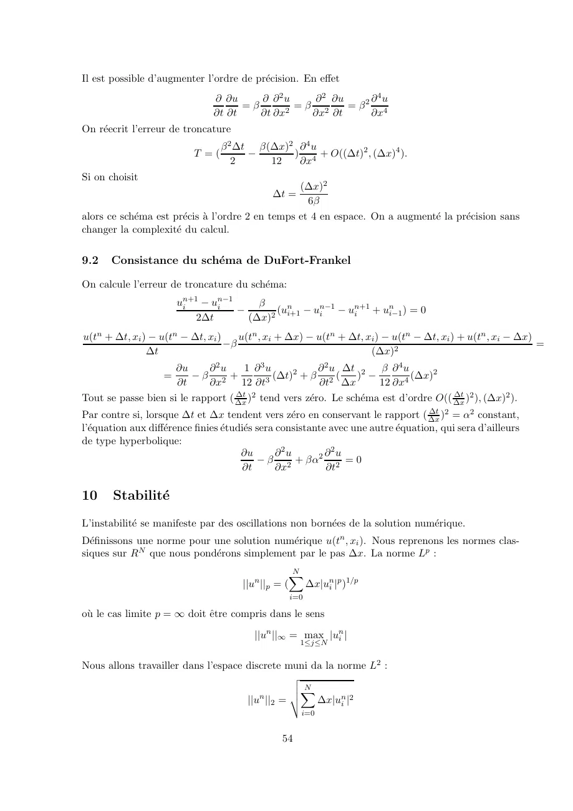

~~~text
Il est possible d’augmenter l’ordre de précision. En effet
                                ∂ ∂u     ∂ ∂2u      ∂ 2 ∂u       4
                                                               2∂ u
                                      =β        = β        = β
                                ∂t ∂t    ∂t ∂x2     ∂x2 ∂t      ∂x4
On réecrit l’erreur de troncature
                                  β 2 ∆t β(∆x)2 ∂ 4 u
                           T =(         −      ) 4 + O((∆t)2 , (∆x)4 ).
                                     2     12   ∂x
Si on choisit
                                                   (∆x)2
                                              ∆t =
                                                     6β
alors ce schéma est précis à l’ordre 2 en temps et 4 en espace. On a augmenté la précision sans
changer la complexité du calcul.

9.2    Consistance du schéma de DuFort-Frankel

On calcule l’erreur de troncature du schéma:
                       un+1 − uin−1     β
                        i
                                    −      (un − uin−1 − un+1 + uni−1 ) = 0
                           2∆t        (∆x)2 i+1           i

u(tn + ∆t, xi ) − u(tn − ∆t, xi )    u(tn , xi + ∆x) − u(tn + ∆t, xi ) − u(tn − ∆t, xi ) + u(tn , xi − ∆x)
                                  −β                                                                       =
               ∆t                                                  (∆x)2
                     ∂u     ∂2u      1 ∂3u     2      ∂ 2 u ∆t 2    β ∂4u
                   =     −β 2 +            (∆t)  + β       (  )  −        (∆x)2
                     ∂t     ∂x      12 ∂t3            ∂t2 ∆x       12 ∂x4
                                   ∆t 2                                             ∆t 2
Tout se passe bien si le rapport ( ∆x ) tend vers zéro. Le schéma est d’ordre O(( ∆x ) ), (∆x)2 ).
                                                                                     ∆t 2
Par contre si, lorsque ∆t et ∆x tendent vers zéro en conservant le rapport ( ∆x        ) = α2 constant,
l’équation aux différence finies étudiés sera consistante avec une autre équation, qui sera d’ailleurs
de type hyperbolique:
                                        ∂u        ∂2u        ∂2u
                                             − β 2 + βα2 2 = 0
                                         ∂t       ∂x         ∂t

10     Stabilité
L’instabilité se manifeste par des oscillations non bornées de la solution numérique.
Définissons une norme pour une solution numérique u(tn , xi ). Nous reprenons les normes clas-
siques sur RN que nous pondérons simplement par le pas ∆x. La norme Lp :
                                                  XN
                                          n
                                       ||u ||p = (   ∆x|uni |p )1/p
                                                  i=0

où le cas limite p = ∞ doit être compris dans le sens
                                          ||un ||∞ = max |uni |
                                                      1≤j≤N

Nous allons travailler dans l’espace discrete muni da la norme L2 :
                                               v
                                               uN
                                               uX
                                        n
                                     ||u ||2 = t    ∆x|uni |2
                                                      i=0

                                                 54
~~~

## Page 55

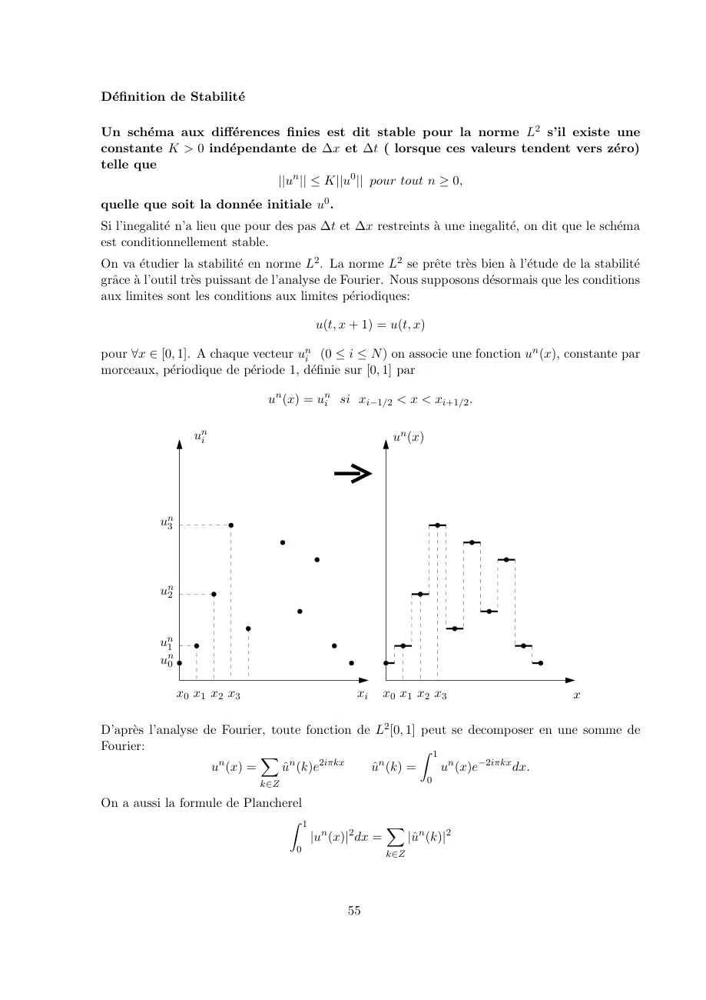

~~~text
Définition de Stabilité

Un schéma aux différences finies est dit stable pour la norme L2 s’il existe une
constante K > 0 indépendante de ∆x et ∆t ( lorsque ces valeurs tendent vers zéro)
telle que
                           ||un || ≤ K||u0 || pour tout n ≥ 0,
quelle que soit la donnée initiale u0 .
Si l’inegalité n’a lieu que pour des pas ∆t et ∆x restreints à une inegalité, on dit que le schéma
est conditionnellement stable.
On va étudier la stabilité en norme L2 . La norme L2 se prête très bien à l’étude de la stabilité
grâce à l’outil très puissant de l’analyse de Fourier. Nous supposons désormais que les conditions
aux limites sont les conditions aux limites périodiques:

                                          u(t, x + 1) = u(t, x)

pour ∀x ∈ [0, 1]. A chaque vecteur uni (0 ≤ i ≤ N ) on associe une fonction un (x), constante par
morceaux, périodique de période 1, définie sur [0, 1] par

                                un (x) = uni si xi−1/2 < x < xi+1/2 .

                    uni                                    un (x)

           un3

           un2

           un1
           un0

                 x0 x1 x2 x3                      xi      x0 x1 x2 x3                      x

D’après l’analyse de Fourier, toute fonction de L2 [0, 1] peut se decomposer en une somme de
Fourier:                                                   Z 1
                             X
                     n             n    2iπkx     n
                    u (x) =      û (k)e        û (k) =       un (x)e−2iπkx dx.
                               k∈Z                                  0

On a aussi la formule de Plancherel
                                Z 1                       X
                                         |un (x)|2 dx =         |ûn (k)|2
                                     0                    k∈Z

                                                55
~~~

## Page 56

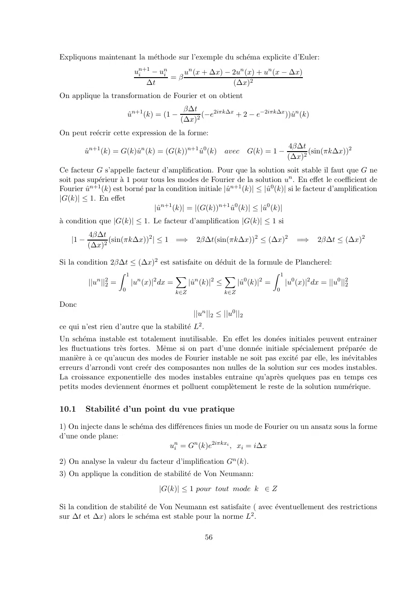

~~~text
Expliquons maintenant la méthode sur l’exemple du schéma explicite d’Euler:
                           un+1
                            i   − uni    un (x + ∆x) − 2un (x) + un (x − ∆x)
                                      =β
                              ∆t                       (∆x)2
On applique la transformation de Fourier et on obtient
                                             β∆t
                         ûn+1 (k) = (1 −         (−e2iπk∆x + 2 − e−2iπk∆x ))ûn (k)
                                            (∆x)2
On peut reécrir cette expression de la forme:
                                                                                   4β∆t
        ûn+1 (k) = G(k)ûn (k) = (G(k))n+1 û0 (k)        avec       G(k) = 1 −         (sin(πk∆x))2
                                                                                   (∆x)2
Ce facteur G s’appelle facteur d’amplification. Pour que la solution soit stable il faut que G ne
soit pas supérieur à 1 pour tous les modes de Fourier de la solution un . En effet le coefficient de
Fourier ûn+1 (k) est borné par la condition initiale |ûn+1 (k)| ≤ |û0 (k)| si le facteur d’amplification
|G(k)| ≤ 1. En effet
                               |ûn+1 (k)| = |(G(k))n+1 û0 (k)| ≤ |û0 (k)|
à condition que |G(k)| ≤ 1. Le facteur d’amplification |G(k)| ≤ 1 si
           4β∆t
    |1 −         (sin(πk∆x))2 | ≤ 1 =⇒           2β∆t(sin(πk∆x))2 ≤ (∆x)2            =⇒    2β∆t ≤ (∆x)2
           (∆x)2

Si la condition 2β∆t ≤ (∆x)2 est satisfaite on déduit de la formule de Plancherel:
                   Z 1              X             X              Z 1
            n 2          n    2          n    2          0    2
         ||u ||2 =     |u (x)| dx =   |û (k)| ≤      |û (k)| =     |u0 (x)|2 dx = ||u0 ||22
                     0                  k∈Z                k∈Z               0

Donc
                                                ||un ||2 ≤ ||u0 ||2
ce qui n’est rien d’autre que la stabilité L2 .
Un schéma instable est totalement inutilisable. En effet les donées initiales peuvent entrainer
les fluctuations très fortes. Même si on part d’une donnée initiale spécialement préparée de
manière à ce qu’aucun des modes de Fourier instable ne soit pas excité par elle, les inévitables
erreurs d’arrondi vont creér des composantes non nulles de la solution sur ces modes instables.
La croissance exponentielle des modes instables entraine qu’après quelques pas en temps ces
petits modes deviennent énormes et polluent complètement le reste de la solution numérique.

10.1       Stabilité d’un point du vue pratique

1) On injecte dans le schéma des différences finies un mode de Fourier ou un ansatz sous la forme
d’une onde plane:
                                  uni = Gn (k)e2iπkxi , xi = i∆x

2) On analyse la valeur du facteur d’implification Gn (k).
3) On applique la condition de stabilité de Von Neumann:
                                   |G(k)| ≤ 1 pour tout mode k ∈ Z

Si la condition de stabilité de Von Neumann est satisfaite ( avec éventuellement des restrictions
sur ∆t et ∆x) alors le schéma est stable pour la norme L2 .

                                                    56
~~~

## Page 57

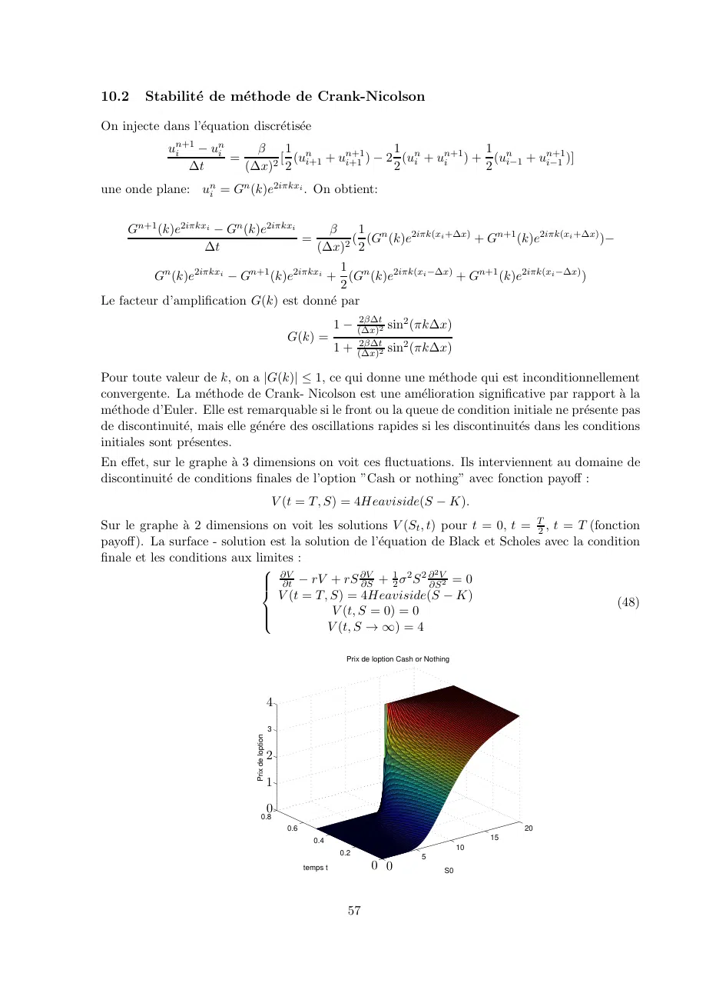

~~~text
10.2    Stabilité de méthode de Crank-Nicolson

On injecte dans l’équation discrétisée
             un+1 − uni     β   1                1 n            1
              i
                        =      [ (un + un+1              n+1
                                        i+1 ) − 2 (ui + ui   ) + (uni−1 + un+1
                                                                           i−1 )]
                ∆t        (∆x)2 2 i+1            2              2
une onde plane: uni = Gn (k)e2iπkxi . On obtient:

     Gn+1 (k)e2iπkxi − Gn (k)e2iπkxi     β   1
                                     =      ( (Gn (k)e2iπk(xi +∆x) + Gn+1 (k)e2iπk(xi +∆x) )−
                   ∆t                  (∆x)2 2
                                           1
         Gn (k)e2iπkxi − Gn+1 (k)e2iπkxi + (Gn (k)e2iπk(xi −∆x) + Gn+1 (k)e2iπk(xi −∆x) )
                                           2
Le facteur d’amplification G(k) est donné par
                                                                        2β∆t     2
                                                                    1 − (∆x)2 sin (πk∆x)
                                                    G(k) =              2β∆t     2
                                                                    1 + (∆x)2 sin (πk∆x)

Pour toute valeur de k, on a |G(k)| ≤ 1, ce qui donne une méthode qui est inconditionnellement
convergente. La méthode de Crank- Nicolson est une amélioration significative par rapport à la
méthode d’Euler. Elle est remarquable si le front ou la queue de condition initiale ne présente pas
de discontinuité, mais elle génére des oscillations rapides si les discontinuités dans les conditions
initiales sont présentes.
En effet, sur le graphe à 3 dimensions on voit ces fluctuations. Ils interviennent au domaine de
discontinuité de conditions finales de l’option ”Cash or nothing” avec fonction payoff :
                                                V (t = T, S) = 4Heaviside(S − K).
Sur le graphe à 2 dimensions on voit les solutions V (St , t) pour t = 0, t = T2 , t = T (fonction
payoff). La surface - solution est la solution de l’équation de Black et Scholes avec la condition
finale et les conditions aux limites :
                               ∂V                                 2
                              
                                 ∂t − rV + rS ∂V∂S + 21 σ 2 S 2 ∂∂SV2 = 0
                                 V (t = T, S) = 4Heaviside(S − K)
                              
                                                                                               (48)
                              
                                          V (t, S = 0) = 0
                                          V (t, S → ∞) = 4
                              

                                                                      Prix de loption Cash or Nothing

                                                4
                                                3
                              Prix de loption

                                                2

                                                1

                                      0.8
                                                0
                                                    0.6                                                           20
                                                            0.4                                              15
                                                                                                        10
                                                                     0.2
                                                                                            5
                                                          temps t            0 0                   S0

                                                                       57
~~~

## Page 58

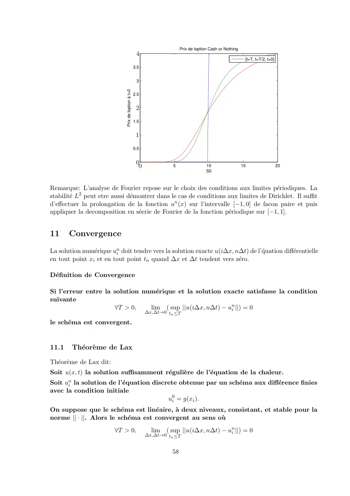

~~~text
                                                                          Prix de loption Cash or Nothing
                                                      4
                                                                                                             [t=T, t=T/2, t=0]
                                                     3.5

                                                      3

                             Prix de loption à t=0
                                                     2.5

                                                      2

                                                     1.5

                                                      1

                                                     0.5

                                                      0
                                                       0             5                  10                  15                   20
                                                                                        S0

Remarque: L’analyse de Fourier repose sur le choix des conditions aux limites périodiques. La
stabilité L2 peut etre aussi démontrer dans le cas de conditions aux limites de Dirichlet. Il suffit
d’effectuer la prolongation de la fonction un (x) sur l’intervalle [−1, 0] de facon paire et puis
appliquer la decomposition en séerie de Fourier de la fonction périodique sur [−1, 1].

11     Convergence
La solution numérique uni doit tendre vers la solution exacte u(i∆x, n∆t) de l’q́uation différentielle
en tout point xi et en tout point tn quand ∆x et ∆t tendent vers zéro.

Définition de Convergence

Si l’erreur entre la solution numérique et la solution exacte satisfasse la condition
suivante
                     ∀T > 0,    lim ( sup ||u(i∆x, n∆t) − uni ||) = 0
                                                           ∆x,∆t→0 tn ≤T

le schéma est convergent.

11.1    Théorème de Lax

Théorème de Lax dit:
Soit u(x, t) la solution suffisamment régulière de l’équation de la chaleur.
Soit uni la solution de l’équation discrete obtenue par un schéma aux différence finies
avec la condition initiale
                                         u0i = g(xi ).
On suppose que le schéma est linéaire, à deux niveaux, consistant, et stable pour la
norme || · ||. Alors le schéma est convergent au sens où
                         ∀T > 0,                             lim   ( sup ||u(i∆x, n∆t) − uni ||) = 0
                                                           ∆x,∆t→0 tn ≤T

                                                                     58
~~~

## Page 59

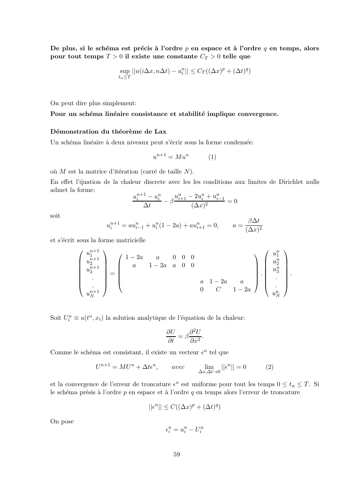

~~~text
De plus, si le schéma est précis à l’ordre p en espace et à l’ordre q en temps, alors
pour tout temps T > 0 il existe une constante CT > 0 telle que

                           sup ||u(i∆x, n∆t) − uni || ≤ CT ((∆x)p + (∆t)q )
                          tn ≤T

On peut dire plus simplement:
Pour un schéma linéaire consistance et stabilité implique convergence.

Démonstration du théorème de Lax
Un schéma linéaire à deux niveaux peut s’écrir sous la forme condensée:

                                       un+1 = M un             (1)

où M est la matrice d’itération (carré de taille N ).
En effet l’q́uation de la chaleur discrete avec les les conditions aux limites de Dirichlet nulls
admet la forme:
                              un+1 − uni     un − 2uni + uni−1
                               i
                                         − β i+1                =0
                                  ∆t               (∆x)2
soit
                                                                                β∆t
                     un+1
                      i   = auni−1 + uni (1 − 2a) + auni+1 = 0,           a=
                                                                               (∆x)2
et s’écrit sous la forme matricielle
             n+1                                                    n 
               u1                                                    u1
             un+1          1 − 2a       a   0 0 0                       n 
             2n+1                                                 u2n 
                                                                    
             u              a      1 − 2a a 0 0                   u3 
             3
             . =
                                                                   .
                                                                     . .
                                                                         
            
             . 
                                                 a 1 − 2a   a     
                                                                      . 
                                                                           
                                                   0   C    1 − 2a
               un+1
                N                                                      unN

Soit Uin ≡ u(tn , xi ) la solution analytique de l’équation de la chaleur:

                                             ∂U   ∂2U
                                                =β 2.
                                             ∂t   ∂x
Comme le schéma est consistant, il existe un vecteur ǫn tel que

                 U n+1 = M U n + ∆tǫn ,        avec           lim    ||ǫn || = 0       (2)
                                                           ∆x,∆t→0

et la convergence de l’erreur de troncature ǫn est uniforme pour tout les temps 0 ≤ tn ≤ T . Si
le schéma présis à l’ordre p en espace et à l’ordre q en temps alors l’erreur de troncature

                                      ||ǫn || ≤ C((∆x)p + (∆t)q )

On pose
                                            ǫni = uni − Uin

                                               59
~~~

## Page 60

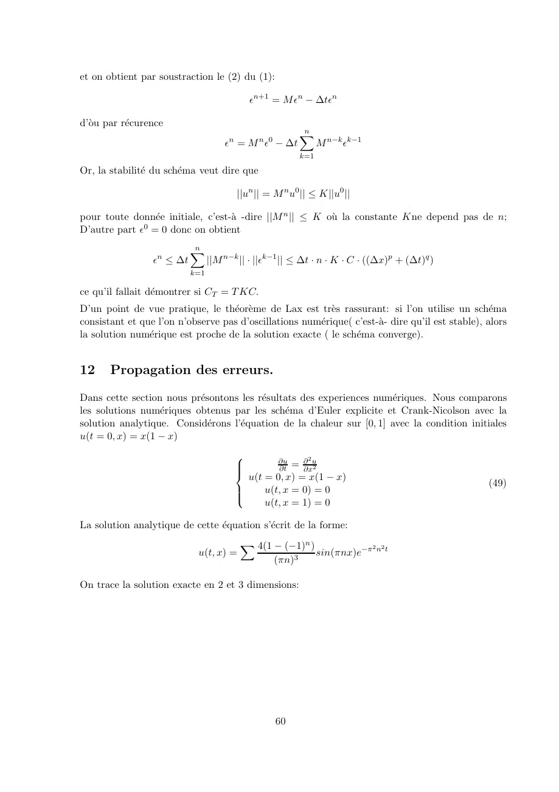

~~~text
et on obtient par soustraction le (2) du (1):

                                            ǫn+1 = M ǫn − ∆tǫn

d’òu par récurence
                                                          n
                                                          X
                                     ǫn = M n ǫ0 − ∆t           M n−k ǫk−1
                                                          k=1

Or, la stabilité du schéma veut dire que

                                        ||un || = M n u0 || ≤ K||u0 ||

pour toute donnée initiale, c’est-à -dire ||M n || ≤ K où la constante Kne depend pas de n;
D’autre part ǫ0 = 0 donc on obtient
                           n
                           X
                 ǫn ≤ ∆t         ||M n−k || · ||ǫk−1 || ≤ ∆t · n · K · C · ((∆x)p + (∆t)q )
                           k=1

ce qu’il fallait démontrer si CT = T KC.
D’un point de vue pratique, le théorème de Lax est très rassurant: si l’on utilise un schéma
consistant et que l’on n’observe pas d’oscillations numérique( c’est-à- dire qu’il est stable), alors
la solution numérique est proche de la solution exacte ( le schéma converge).

12     Propagation des erreurs.

Dans cette section nous présontons les résultats des experiences numériques. Nous comparons
les solutions numériques obtenus par les schéma d’Euler explicite et Crank-Nicolson avec la
solution analytique. Considérons l’équation de la chaleur sur [0, 1] avec la condition initiales
u(t = 0, x) = x(1 − x)

                                                   ∂u   ∂2u
                                        
                                        
                                                  ∂t = ∂x2
                                            u(t = 0, x) = x(1 − x)
                                        
                                                                                                  (49)
                                        
                                               u(t, x = 0) = 0
                                                u(t, x = 1) = 0
                                        

La solution analytique de cette équation s’écrit de la forme:
                                         X 4(1 − (−1)n )                     2 2
                            u(t, x) =                           sin(πnx)e−π n t
                                                  (πn)3

On trace la solution exacte en 2 et 3 dimensions:

                                                  60
~~~

## Page 61

~~~text
                                                                                           Solution analytique: condition initiale et solution à t=T

                                                            0.24

                                                            0.22

                                                             0.2

                                                            0.18

                                                            0.16

                                                            0.14

                                                        u
                                                            0.12

                                                             0.1

                                                            0.08

                                                            0.06

                                                            0.04

                                                            0.02

                                                              0
                                                               0           0.1       0.2          0.3          0.4        0.5
                                                                                                                          x
                                                                                                                                     0.6         0.7         0.8          0.9          1

                                                                                                                         solution numerique

                                                                                                                                                                                                  0.25

                                                                                                                                                                                                  0.2

                                                                                                                                                                                                  0.15
                                                                                                                                                                                                         u_analytique

                                                                                                                                                                                                  0.1

                                                                                                                                                                                                  0.05
                                                                     0.2

                                                                             0.15
                                                                                                                                                                                                  10
                                                                                            0.1                                                                                    0.8
                                                                                      t
                                                                                                                                                                     0.6
                                                                                                        0.05                                           0.4         x
                                                                                                                                           0.2
                                                                                                                     0 0

Choisissons la discrétisation suivantes de l’espace temps:
                                
                                       T = 0.2                        M + 1 = 1000                                       ∆t = T /(M + 1) = 0.0002
                                                                                                                                                                                                                                     (50)
                                          L=1                          N + 1 = 50                                        ∆t = L/(N + 1) = 0.02

                     erreur V−U entre la solution numerique Euler et la solution analytique                                                                                erreur V−U entre la solution numerique Crank−Nicolson et la solution analytique

                                                                                                                     0e00                                                                                                                                          3e−

                                                                                                                                                                                                                                                                   2e−
                                                                                                                     −2e−05
                                                                                                                                u−U_theorique
                                                                                                                                                                                                                                                                   1e−
                                                                                                                     −4e−05

                                                                                                                                                                                                                                                                   0e0
    0.2                                                                                                              −6e−05                            0.2

                                                                                                                                                                                                                                                                   −1e
          0.15
                                                                                                                     1                                             0.15
                                                                                                                                                                                                                                                                   1
                      0.1                                                                               0.8                                                                      0.1                                                                         0.8
                 t                                                                                                                                           coordonnee t
                                                                                          0.6                                                                                                                                                   0.6
                               0.05                                        0.4       x                                                                                                     0.05                                      0.4       coordonnee x
                                                               0.2                                                                                                                                                       0.2
                                            0 0                                                                                                                                                           0 0

                                                                                                     61
~~~

## Page 62

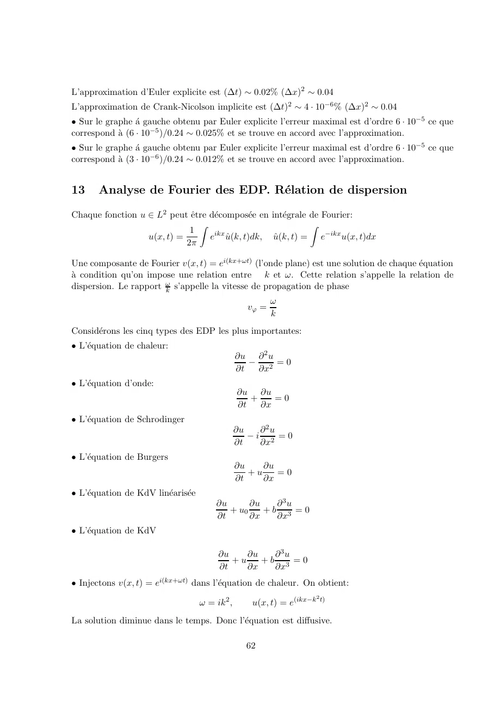

~~~text
L’approximation d’Euler explicite est (∆t) ∼ 0.02% (∆x)2 ∼ 0.04
L’approximation de Crank-Nicolson implicite est (∆t)2 ∼ 4 · 10−6 % (∆x)2 ∼ 0.04
• Sur le graphe á gauche obtenu par Euler explicite l’erreur maximal est d’ordre 6 · 10−5 ce que
correspond à (6 · 10−5 )/0.24 ∼ 0.025% et se trouve en accord avec l’approximation.
• Sur le graphe á gauche obtenu par Euler explicite l’erreur maximal est d’ordre 6 · 10−5 ce que
correspond à (3 · 10−6 )/0.24 ∼ 0.012% et se trouve en accord avec l’approximation.

13     Analyse de Fourier des EDP. Rélation de dispersion
Chaque fonction u ∈ L2 peut être décomposée en intégrale de Fourier:
                             1
                               Z                             Z
                                   ikx
                  u(x, t) =       e û(k, t)dk, û(k, t) = e−ikx u(x, t)dx
                            2π

Une composante de Fourier v(x, t) = ei(kx+ωt) (l’onde plane) est une solution de chaque équation
à condition qu’on impose une relation entre k et ω. Cette relation s’appelle la relation de
dispersion. Le rapport ωk s’appelle la vitesse de propagation de phase
                                                         ω
                                                  vϕ =
                                                         k
Considérons les cinq types des EDP les plus importantes:
• L’équation de chaleur:
                                                ∂u ∂ 2 u
                                                   − 2 =0
                                                ∂t  ∂x
• L’équation d’onde:
                                                ∂u ∂u
                                                   +    =0
                                                ∂t   ∂x
• L’équation de Schrodinger
                                                ∂u   ∂2u
                                                   −i 2 =0
                                                ∂t   ∂x
• L’équation de Burgers
                                                ∂u    ∂u
                                                   +u    =0
                                                ∂t    ∂x
• L’équation de KdV linéarisée
                                        ∂u      ∂u   ∂3u
                                           + u0    +b 3 =0
                                        ∂t      ∂x   ∂x
• L’équation de KdV

                                         ∂u    ∂u   ∂3u
                                            +u    +b 3 =0
                                         ∂t    ∂x   ∂x
• Injectons v(x, t) = ei(kx+ωt) dans l’équation de chaleur. On obtient:
                                                                    2
                                    ω = ik2 ,      u(x, t) = e(ikx−k t)
La solution diminue dans le temps. Donc l’équation est diffusive.

                                                  62
~~~

## Page 63

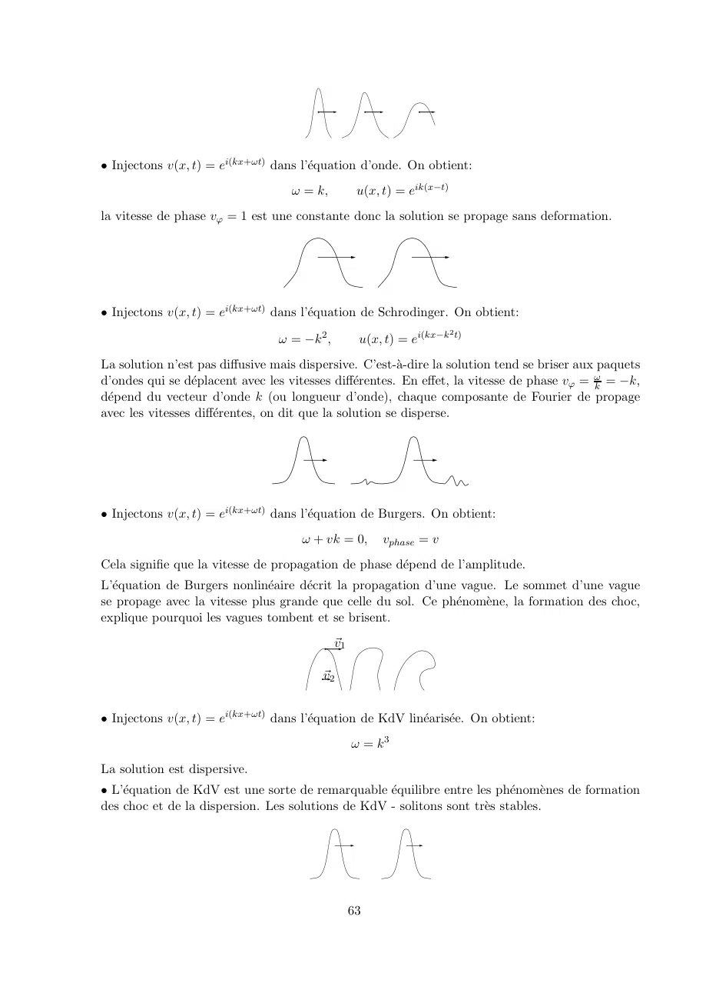

~~~text
• Injectons v(x, t) = ei(kx+ωt) dans l’équation d’onde. On obtient:
                                   ω = k,           u(x, t) = eik(x−t)
la vitesse de phase vϕ = 1 est une constante donc la solution se propage sans deformation.

• Injectons v(x, t) = ei(kx+ωt) dans l’équation de Schrodinger. On obtient:
                                                                         2
                                 ω = −k2 ,          u(x, t) = ei(kx−k t)
La solution n’est pas diffusive mais dispersive. C’est-à-dire la solution tend se briser aux paquets
d’ondes qui se déplacent avec les vitesses différentes. En effet, la vitesse de phase vϕ = ωk = −k,
dépend du vecteur d’onde k (ou longueur d’onde), chaque composante de Fourier de propage
avec les vitesses différentes, on dit que la solution se disperse.

• Injectons v(x, t) = ei(kx+ωt) dans l’équation de Burgers. On obtient:
                                     ω + vk = 0,         vphase = v
Cela signifie que la vitesse de propagation de phase dépend de l’amplitude.
L’équation de Burgers nonlinéaire décrit la propagation d’une vague. Le sommet d’une vague
se propage avec la vitesse plus grande que celle du sol. Ce phénomène, la formation des choc,
explique pourquoi les vagues tombent et se brisent.
                                             ~v1

                                         ~v2

• Injectons v(x, t) = ei(kx+ωt) dans l’équation de KdV linéarisée. On obtient:
                                                   ω = k3
La solution est dispersive.
• L’équation de KdV est une sorte de remarquable équilibre entre les phénomènes de formation
des choc et de la dispersion. Les solutions de KdV - solitons sont très stables.

                                                   63
~~~

## Page 64

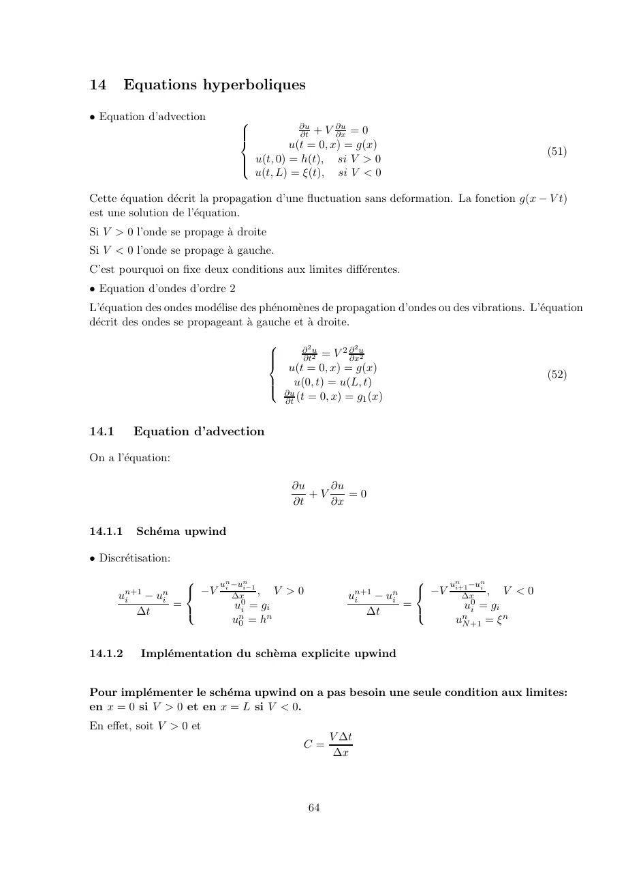

~~~text
14       Equations hyperboliques

• Equation d’advection
                                             ∂u     ∂u
                                
                                
                                            ∂t + V ∂x = 0
                                          u(t = 0, x) = g(x)
                                
                                                                                              (51)
                                
                                 u(t, 0) = h(t), si V > 0
                                  u(t, L) = ξ(t), si V < 0
                                

Cette équation décrit la propagation d’une fluctuation sans deformation. La fonction g(x − V t)
est une solution de l’équation.
Si V > 0 l’onde se propage à droite
Si V < 0 l’onde se propage à gauche.
C’est pourquoi on fixe deux conditions aux limites différentes.
• Equation d’ondes d’ordre 2
L’équation des ondes modélise des phénomènes de propagation d’ondes ou des vibrations. L’équation
décrit des ondes se propageant à gauche et à droite.

                                              ∂2u    2 ∂2u
                                       
                                       
                                             ∂t2 = V ∂x2
                                          u(t = 0, x) = g(x)
                                       
                                                                                              (52)
                                       
                                          u(0, t) = u(L, t)
                                        ∂u
                                         ∂t (t = 0, x) = g1 (x)

14.1      Equation d’advection

On a l’équation:

                                            ∂u    ∂u
                                               +V    =0
                                            ∂t    ∂x

14.1.1    Schéma upwind

• Discrétisation:
                          un −un                                        un −un
       un+1 − uni       −V i ∆xi−1 , V > 0            un+1 − uni      −V i+1
                                                                             ∆x
                                                                                 i
                                                                                   , V <0
        i                                               i
                     =         u0i = gi                             =        u0i = gi
          ∆t                                                 ∆t
                              un0 = hn                                     unN +1 = ξ n
                                                                     

14.1.2     Implémentation du schèma explicite upwind

Pour implémenter le schéma upwind on a pas besoin une seule condition aux limites:
en x = 0 si V > 0 et en x = L si V < 0.
En effet, soit V > 0 et
                                                    V ∆t
                                              C=
                                                     ∆x

                                               64
~~~

## Page 65

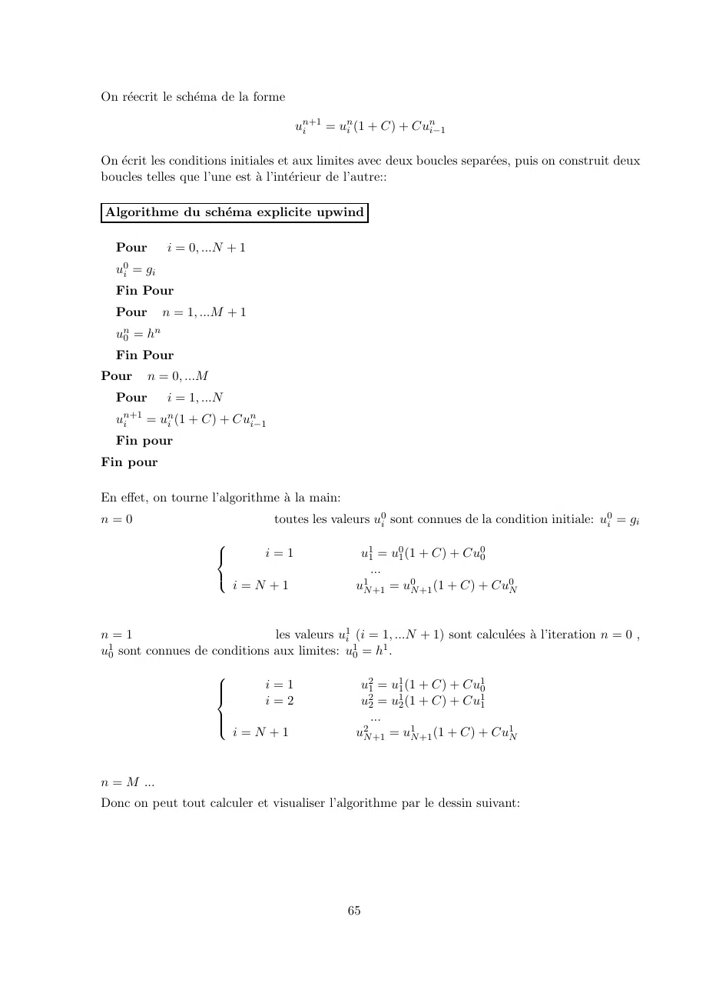

~~~text
On réecrit le schéma de la forme

                                     un+1
                                      i   = uni (1 + C) + Cuni−1

On écrit les conditions initiales et aux limites avec deux boucles separées, puis on construit deux
boucles telles que l’une est à l’intérieur de l’autre::

Algorithme du schéma explicite upwind

  Pour       i = 0, ...N + 1
  u0i = gi
  Fin Pour
  Pour       n = 1, ...M + 1
  un0 = hn
  Fin Pour
Pour     n = 0, ...M
  Pour       i = 1, ...N
  un+1
   i   = uni (1 + C) + Cuni−1
  Fin pour
Fin pour

En effet, on tourne l’algorithme à la main:
n=0                             toutes les valeurs u0i sont connues de la condition initiale: u0i = gi

                                                 u11 = u01 (1 + C) + Cu00
                       
                              i=1
                                                   ...
                           i=N +1               u1N +1 = u0N +1 (1 + C) + Cu0N
                       

n=1                           les valeurs u1i (i = 1, ...N + 1) sont calculées à l’iteration n = 0 ,
u0 sont connues de conditions aux limites: u10 = h1 .
 1

                                                 u21 = u11 (1 + C) + Cu10
                       
                              i=1
                                                 u22 = u12 (1 + C) + Cu11
                       
                               i=2
                       
                       
                                                  ...
                           i=N +1               uN +1 = u1N +1 (1 + C) + Cu1N
                                                 2
                       

n = M ...
Donc on peut tout calculer et visualiser l’algorithme par le dessin suivant:

                                               65
~~~

## Page 66

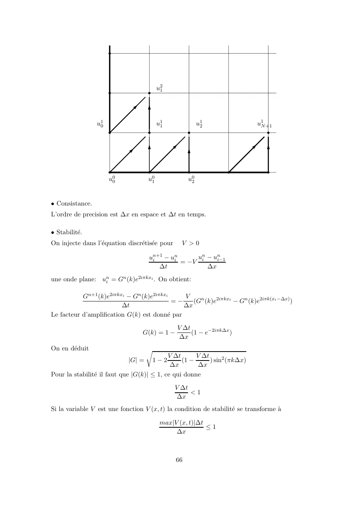

~~~text
                                           u21

                 u10                       u11                u12               u1N +1

                       u00           u01                u02

• Consistance.
L’ordre de precision est ∆x en espace et ∆t en temps.

• Stabilité.
On injecte dans l’équation discrétisée pour        V >0

                                     un+1
                                      i   − uni      uni − uni−1
                                                = −V
                                        ∆t               ∆x
une onde plane: uni = Gn (k)e2iπkxi . On obtient:

           Gn+1 (k)e2iπkxi − Gn (k)e2iπkxi     V
                                           =−     (Gn (k)e2iπkxi − Gn (k)e2iπk(xi −∆x) )
                         ∆t                    ∆x
Le facteur d’amplification G(k) est donné par

                                                    V ∆t
                                  G(k) = 1 −             (1 − e−2iπk∆x )
                                                     ∆x
On en déduit                        r
                                                 V ∆t      V ∆t
                             |G| =       1−2          (1 −      ) sin2 (πk∆x)
                                                  ∆x        ∆x
Pour la stabilité il faut que |G(k)| ≤ 1, ce qui donne

                                                   V ∆t
                                                        <1
                                                    ∆x
Si la variable V est une fonction V (x, t) la condition de stabilité se transforme à

                                            max|V (x, t)|∆t
                                                            ≤1
                                                 ∆x

                                                   66
~~~

## Page 67

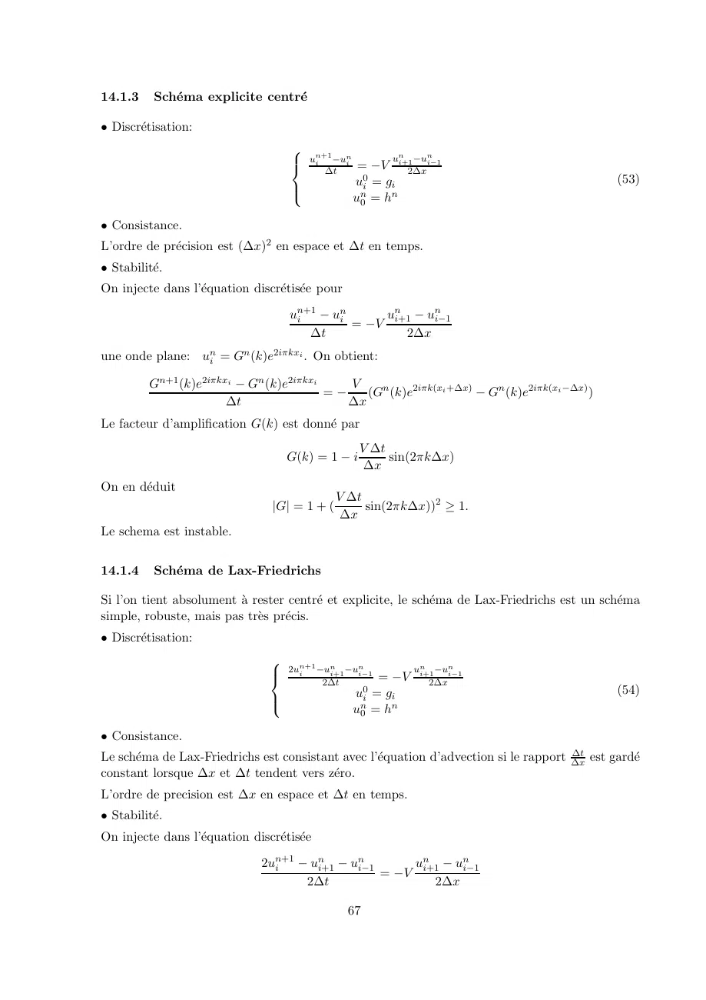

~~~text
14.1.3     Schéma explicite centré

• Discrétisation:
                                     n+1 n
                                                      un −un
                                     ui ∆t−ui = −V i+12∆xi−1
                                    
                                               u0i = gi                                        (53)
                                              un0 = hn
                                    
                                    

• Consistance.
L’ordre de précision est (∆x)2 en espace et ∆t en temps.
• Stabilité.
On injecte dans l’équation discrétisée pour

                                    un+1
                                     i   − uni      uni+1 − uni−1
                                               = −V
                                       ∆t               2∆x
une onde plane: uni = Gn (k)e2iπkxi . On obtient:

          Gn+1 (k)e2iπkxi − Gn (k)e2iπkxi    V
                                          =−    (Gn (k)e2iπk(xi +∆x) − Gn (k)e2iπk(xi −∆x) )
                        ∆t                   ∆x
Le facteur d’amplification G(k) est donné par
                                                   V ∆t
                                    G(k) = 1 − i        sin(2πk∆x)
                                                    ∆x
On en déduit
                                               V ∆t
                                 |G| = 1 + (        sin(2πk∆x))2 ≥ 1.
                                                ∆x
Le schema est instable.

14.1.4     Schéma de Lax-Friedrichs

Si l’on tient absolument à rester centré et explicite, le schéma de Lax-Friedrichs est un schéma
simple, robuste, mais pas très précis.
• Discrétisation:
                                 n+1 n
                                  2u −ui+1 −un         un     n
                                                        i+1 −ui−1
                                 i
                                
                                      2∆t
                                             i−1
                                                  = −V    2∆x
                                             u0i = gi                                          (54)
                                            un0 = hn
                                
                                

• Consistance.
                                                                                       ∆t
Le schéma de Lax-Friedrichs est consistant avec l’équation d’advection si le rapport ∆x est gardé
constant lorsque ∆x et ∆t tendent vers zéro.
L’ordre de precision est ∆x en espace et ∆t en temps.
• Stabilité.
On injecte dans l’équation discrétisée

                               2un+1 − uni+1 − uni−1     un − uni−1
                                 i
                                                     = −V i+1
                                      2∆t                   2∆x

                                                 67
~~~

## Page 68

~~~text
une onde plane: uni = Gn (k)e2iπkxi . On obtient:

2Gn+1 (k)e2iπkxi − Gn (k)e2iπk(xi +∆x) − Gn (k)e2iπk(xi −∆x)     V
                                                             =−     (Gn (k)e2iπk(xi +∆x) −Gn (k)e2iπk(xi −∆x) )
                           2∆t                                  2∆x
Le facteur d’amplification G(k) est donné par
                                                         V ∆t
                                G(k) = cos(2πk∆x) − i         sin(2πk∆x)
                                                          ∆x
On en déduit
                                                        V ∆t 2 2
                              |G|2 = cos2 (2πk∆x) + (       ) sin (2πk∆x)
                                                         ∆x
Le schema est stable à condition que
                                                 |V |∆t
                                                        ≤1
                                                   ∆x
• Conditions aux limites numérique.
Il faut fixer u(t, L).

14.1.5     Schéma de Lax-Wendroff

Un schéma centré, explicite, plus précis est le schéma de Lax-Wendroff.
• Discrétisation:
                            n+1 n
                             u  −u      un −un         2  un −2un +un
                            i ∆t i = −V i+12∆xi−1 + V 2∆t i+1 (∆x)i 2 i−1
                           
                                             u0i = gi                                          (55)
                           
                                             un0 = hn
                           

• Consistance.
L’ordre de precision est (∆x)2 en espace et ∆t en temps.
• Stabilité.
On injecte dans l’équation discrétisée

                         un+1 − uni     un − uni−1 V 2 ∆t uni+1 − 2uni + uni−1
                          i
                                    = −V i+1      +
                            ∆t             2∆x       2           (∆x)2

une onde plane: uni = Gn (k)e2iπkxi . Le facteur d’amplification G(k) est donné par

                                          V ∆t 2 2             V ∆t
                          G(k) = 1 − 2(       ) sin (πk∆x) − i      sin(2πk∆x)
                                           ∆x                   ∆x
On en déduit
                                             V ∆t 2 4               V ∆t 2
                             |G|2 = 1 − 4(       ) sin (πk∆x)(1 − (     ) )
                                              ∆x                     ∆x
Ainsi, le schéma est stable dès que
                                                 |V |∆t
                                                        ≤1
                                                   ∆x
• Condition aux limites numérique.
Il faut fixer u(t, L).

                                                  68
~~~

## Page 69

~~~text
14.1.6     Schéma de Leap-Frog

• Discrétisation:
                                    n+1 n−1
                                                      un −un
                                    ui 2∆t
                                        −ui
                                               = −V i+12∆xi−1
                                             u0i = gi                                      (56)
                                             un0 = hn
                                   
                                   

Le schéma a besoin u1i pour se lancer:

                                              u1i − u0i
                                                        = vi
                                                 ∆t
On peut aussi calculer u1i en utilisant le schéma upwind ou un autre de deux niveaux temporels.
• Consistance.
L’ordre de précision est (∆x)2 en espace et (∆t)2 en temps.
• Stabilité.
C’est un schéma aux 3 niveaux temporels.
On decompose un (x) en une somme de Fourier:
                                         X
                                un (x) =     ûn (k)e2iπkx
                                                 k∈Z

On applique la transformation de Fourier à

                                   un+1 − uin−1     un − uni−1
                                    i
                                                = −V i+1
                                       2∆t             2∆x
et on obtient :
                                                                               V ∆t
                     ûn+1 (k) − ûn−1 (k) = −2iC sin(2iπk∆x)ûn (k),     C=
                                                                                ∆x

On cherche la solution ûn (k) de la forme

                                              ûn (k) = Gn

On en déduit que G vŕifie l’équation caractéristique:

                              G2 + bG − 1 = 0,       b = 2iC sin(2πk∆x)

La solution générale s’écrit de la forme

                                        ûn (k) = A1 λn1 + A2 λn2 ,

                                ûn (k) = (A1 + nA2 )λn ,      si ∆ = 0

où λ1 et λ2 sont les racines de l’équation caractéristique.
                                             √
                 λ1,2 = −iC sin(2πk∆x) ± ∆/2, ∆ = 4(1 − C 2 (sin2 (2πk∆x))

On note aussi ∆ le discriminant.

                                                69
~~~

## Page 70

~~~text
Si n = 0    û0 = A1 + A2
Si n = 1    û1 = A1 λ1 + A2 λ2
On en déduit
                                        û0 λ1 − û1                   û1 − û0 λ2
                                 A2 =                ,       A1 =
                                          λ1 − λ2                        λ1 − λ2

On peut exprimer les solutions explicitement en fonction de û0 , û1 :

                                       λ1 λn      n      λn   n
                                   (
                                           2 −λ2 λ1 0     1 −λ2 1
                             n            λ1 −λ2    û + λ1 −λ2 û ,       si ∆ 6= 0
                            û =
                                       (1 − n)λn1 û0 + nλ1n−1 û1 ,       si ∆ = 0

Si C > 1, le module de la somme des deux racines est égale à 2C sin(2πk∆x). Il existe donc
k, ∆x t.q. sin(2πk∆x) = 1 et le module de la somme des deux racines est égale à 2C > 2. Le
module de l’une des deux racine est plus grand que 1 et le schéma est instable.
Si C = 1, on peut avoir ∆ = 0 pour certaines valeurs de k et ∆x. Dans ce cas, λ1 = λ2 = i et

                                       ûn = (nû1 + i(n − 1)û0 )in−1

dépand de n et n’est pas bornée. Le schéma est instable.
Considérons le cas où C est majoré par une constante M < 1. Dans ce cas, les racines sont de
même module
                                          |λ1 | = |λ2 | = 1
                      √       √
De plus, |λ1 − λ2 | = ∆ > 2 1 − M 2 > 0. On en déduit de l’expression explicite de ûn

                                                          û0 + û1
                                             |ûn | ≤
                                                         2(1 − M 2 )

Ainsi, sous la condition
                                              |V |∆t
                                                     < M < 1,
                                                ∆x
le shcéma saute - mouton est stable.
• Condition aux limites numérique.
Il faut s’occuper de u(t, L).
• Méthode 1 consiste à établir une condition aux limites fixe en i = 0 et une interpolation pour
i = N + 1:
                                               un0 = hn
                                     
                                                                                               (57)
                                        uN +1 = −unN −1 + 2unN
                                         n

• Méthode 2 consiste à établir les conditions aux limites périodiques:

                                                   unN +1 = un1
                                               
                                                                                              (58)
                                                    un0 = unN

                                                   70
~~~

## Page 71

~~~text
14.1.7     Schéma de Crank-Nicolson

• Discrétisation:
                            n+1
                                    n           n −un         un+1 −un+1
                            ui ∆t−ui = 12 (−V ui+12∆x
                                                      i−1
                                                           − V i+12∆xi−1 )
                                               u0i = gi                                   (59)
                                              un0 = hn
                           
                           

• Consistance.
L’ordre de precision est (∆x)2 en espace et (∆t)2 en temps.
• Stabilité.
Le schéma est inconditionnellement stable en norme L2 .
• Condition aux limites numérique.
Il faut fixer u(t, L).
On va résoudre numériquement l’équation d’onde avec second membre:
                                        ∂u    ∂u
                                           +V    = f (t, x).
                                        ∂t    ∂x

Le schéma explicite avec la dérivée centrée donne:

                                un+1 − uni    un − uni−1
                                 i
                                           + V i+1       = f (tn , xi )
                                   ∆t            2∆x

Ce schéma n’est pas stable. On doit utiliser la méthode de Crank-Nicolson. La méthode de
Crank-Nicolson consiste à remplacer chaque fonction uni à l’instant n par la fonction moyenne
(uni + un+1
        i   )/2.

                un+1 − uni    V 1 n              1 n               1 n
                 i
                           +    [ (u   + un+1              n+1             n+1
                                          i+1 ) − (ui−1 + ui−1 )] = (fi + fi   )
                   ∆t        2∆x 2 i+1           2                 2
On peut reécrire cette équation sous la forme :

                                Bi un+1       n+1
                                    i−1 + Di ui   + Ai un+1    n
                                                        i+1 = Ki ,                        (60)

où
                                 V ∆t
                         Ai =         ,                                                   (61)
                                 4∆x
                                   V ∆t
                         Bi    = −                                                        (62)
                                   4∆x
                         Di    = 1                                                        (63)
                                 V ∆t n                       ∆t n
                         Kin   =      (ui+1 − uni−1 ) + uni +   (f + fin+1 )              (64)
                                 4∆x                          2 i
        c∆t
On note 4∆x =a
On reécrit l’équation sous la forme de système linéaire:

                               i = 1, −aun+1
                                         0   + un+1
                                                1   + aun+1
                                                        2   = K1n

                                               71
~~~

## Page 72

~~~text
                              i = 2, −aun+1
                                        1   + un+1
                                               2   + aun+1
                                                       3   = K2n

                               ...........................................................
                          i = N − 1,       −aun+1     n+1      n+1
                                              N −2 + uN −1 + auN
                                                                      n
                                                                   = KN −1

                             i = N, −aun+1     n+1
                                       N −1 + uN   + aun+1     n
                                                       N +1 = KN

1) Conditions aux limites fixes.
On utilise une condition aux limites fixe:

                                                  un+1
                                                   0   = hn+1

et une condition aux limites artificielles:

                                                  un+1     n+1
                                                   N +1 = uN

On obtient la forme matricielle suivante:

                                         n+1  
                                           u1        K0n
                                                         
                 1 a 0 0 0         0
               −a 1 a 0 0               un+1         n 
                                         2n+1   K1n 
                                                 
              
               0 −a 1 a 0               u      K2 
                                       . 3
                                         . =
                                                       
              
                                                 .   
                                                          
                          −a 1    a       .    KN −1 
                 0          0 −a a + 1     un+1
                                            N        KNn

Or
                            M1 · U n+1 = K n            ⇒        U n+1 = (M1 )−1 K n

2) Conditions aux limites périodiques
On utilise les conditions aux limites périodiques

                                       un+1   n+1  n+1     n+1
                                        −1 = uN , uN +1 = u0

  C’est pour cette raison on a introduit un point fictif                   un−1 .
On reécrit l’équation sous la forme de système linéaire                 (avec un point fictif   un+1
                                                                                                     −1 ):

                              i = 0, −aun+1   n+1
                                        −1 + u0   + aun+1
                                                      1   = K0n

                              i = 1, −aun+1
                                        0   + un+1
                                               1   + aun+1
                                                       2   = K1n
                              i = 2, −aun+1
                                        1   + un+1
                                               2   + aun+1
                                                       3   = K2n

                               ...........................................................
                          i = N − 1,       −aun+1     n+1      n+1
                                              N −2 + uN −1 + auN
                                                                      n
                                                                   = KN −1

                                                      72
~~~

## Page 73

~~~text
                               i = N, −aun+1     n+1
                                         N −1 + uN   + aun+1     n
                                                         N +1 = KN

On obtient la forme matricielle suivante:

                                        n+1  
                                          u0        K0n
                                                        
                   1 a 0 0 0       −a
                 −a 1 a 0 0            un+1         n 
                                        1n+1   K1n 
                                                
                
                 0 −a 1 a 0            u      K2 
                                      . 2
                                        . =
                                                      
                
                                                .   
                                                         
                            −a 1  a       .   KN −1 
                  a           0 −a 1      un+1
                                            N       KNn

Or
                                                 M2 · U n+1 = K n

Notre but est de trouver U n+1 = (un+1   n+1    n+1        n+1
                                   N , uN −1 , uN −2 , ...u1   ), exprimées en termes des (unN , unN −1 , unN −2 , ...un1 )
                                       n+1
On ne peut plus calculer directement ui . Pour cela il faut inverser la matrice car

                                              U n+1 = (M2 )−1 K n .

Pour obtenir la matrice inverse d’une matrice quasi-tridiagonalle on applique l’Algorithme
de Thomas généralisé.
On doit remarquer que si on n’introduit pas le point fictif alors une seule condition périodique
un+1     n+1
 N +1 = u0   n’est pas suffisante pour résoudre le systéme de N équations avec N + 1 inconnues:
(u0 , u1 , u2 , ...un+1
  n+1 n+1 n+1
                     N ).

                                i = 1, −aun+1
                                          0   + un+1
                                                 1   + aun+1
                                                         2   = K1n
                                i = 2, −aun+1
                                          1   + un+1
                                                 2   + aun+1
                                                         3   = K2n

                                 ...........................................................
                           i = N − 1,        −aun+1     n+1
                                                N −1 + uN   + aun+1     n
                                                                N +1 = KN −1

                               i = N, −aun+1     n+1
                                         N −1 + uN   + aun+1     n
                                                         N +1 = KN

                                                        73
~~~

## Page 74

~~~text
14.2    Schémas de l’équation d’onde d’ordre 2

L’équation d’onde:

                                             ∂2u         2
                                                 = V 2 ∂∂xu2
                                      
                                            ∂t2
                                        u(t = 0, x) = g(x)                  (65)
                                       ∂u
                                        ∂t (t = 0, x) = v(x)

• Discrétisation 1 - conditions aux limites périodiques:
                              un+1 +un−1 −2un             n     n      n
                                i      i     i
                                                 =   −V 2 ui+1 +ui−1 −2ui
                                     (∆t)2                     (∆x)2
                             
                             
                             
                                                u0i = gi
                             
                             
                             
                                            unN +1 = un1                    (66)
                                              un0 = unN
                             
                             
                             
                             
                                             u1i −u0i
                             
                             
                                                ∆t = vi

                                               74
~~~

## Page 75

~~~text
Algorithme 1 du schéma explicite de l’q́uation d’onde d’ordre 2.

 Conditions aux limites périodiques.

  Pour      i = 0, ...N + 1
  u0i = gi
  u1i = u0i + ∆tvi
  Fin Pour
Pour     n = 0, ...M
  Pour      i = 1, ...N
  un+1
   i   = 2uni (1 − C) + C(uni−1 + uni+1 ) + uin−1
  Fin pour
  un+1     n+1
   N +1 = u1

  un+1
   0   = un+1
          N
Fin pour

                   n
                 M +1

                                  u21
                  u20                                                    u2N +1
                                                        u2N

                                                                           i
                          0   1                               N   N +1

Les graphes suivants illustrent la propagation d’un paquet d’onde et d’une onde harmonique.
On voit que la fluctuation initiale se sépare en deux. Ils se déplace dans les sens inverses:

                                             75
~~~

## Page 76

~~~text
                                                                                                  Propagation dun paquet donde
             6                                                        5
                                                                                                                                                         t=0
                                                                                                                                                         t=T/5
             5
                                                                      4                                                                                  t=2T/5

             4                                                        3
             3

         2                                                           2
          1                                                           1
         0                                                           0
         −1                                                          −1
         −2                                                          −2
             −3
                                                                      −3
             −4

                                                                      −4
             −5

             −6                                                       −5
                 0   1   2     3
                                    4    5    6    7        8
                                                                          0   1         2            3
                                                                                                                 4            5           6          7            8

                                                                              Propagation dune onde harmonique. Conditions aux limites periodiques
             5                                                        6
                                                                                                                                                         t=0
                                                                                                                                                         t=T/5
             4                                                        5
                                                                                                                                                         t=2T/5

             3
                                                                      4
                                                                      3

         2                                                           2
          1                                                           1
         0                                                           0
         −1                                                          −1
         −2                                                          −2
                                                                      −3
             −3
                                                                      −4

             −4
                                                                      −5

             −5                                                       −6
                 0   1   2     3
                                    4    5    6    7        8
                                                                          0   1         2            3
                                                                                                                 4            5           6          7            8

• Discrétisation 2 - conditions aux limites fixes:
                                    un+1 +un−1 −2un             n     n      n
                                      i      i     i
                                                       =  −V  2 ui+1 +ui−1 −2ui
                                           (∆t)2                     (∆x)2
                                   
                                   
                                   
                                                      u0i = gi
                                   
                                   
                                   
                                                   unN +1 = 0                                                                                            (67)
                                                      un0 = 0
                                   
                                   
                                   
                                   
                                                   ui −u0i
                                                     1
                                   
                                   
                                                      ∆t = vi

Algorithme 2 du schéma explicite de l’équation d’onde d’ordre 2.

Conditions aux limites fixes.

  Pour       i = 0, ...N + 1
  u0i = gi
  u1i = u0i + ∆tvi
  Fin Pour
  Pour       n = 1, ...M + 1

                                                       76
~~~

## Page 77

~~~text
  un0 = 0
  un+1
   N +1 = 0
  Fin Pour
Pour     n = 0, ...M
  Pour      i = 1, ...N
  un+1
   i   = 2uni (1 − C) + C(uni−1 + uni+1 ) + uin−1
  Fin pour
Fin pour

Prśentons ici les solutions de l’équation d’ordre 1 qui représentent la vibration d’une corde
(simulation de la guitare)

                                                                                              Solution de léquation donde

                                                                 1                                                                       t=0
                                                                0.9                                                                      t=T/5
                                                                                                                                         t=2T/5
                                                                0.8

                                                                0.7

                                                                0.6

                                                                0.5
                               Fonction u − forme de la corde

                                                                0.4

                                                                0.3

                                                                0.2

                                                                0.1

                                                                 0
                                                                −0.1

                                                                −0.2

                                                                −0.3

                                                                −0.4

                                                                −0.5

                                                                −0.6
                                                                       0   0.1   0.2    0.3      0.4        0.5
                                                                                                       Coordonnée X
                                                                                                                    0.6     0.7   0.8   0.9       1

• Discrétisation 3 - condition aux limites fixe en i = 0 et l’interpolation pour i = N + 1:
                              un+1 +un−1 −2un             n     n      n
                                i      i     i
                                                 =   −V 2 ui+1 +ui−1 −2ui
                                     (∆t) 2                    (∆x)2
                             
                             
                             
                                                u0i = gi
                             
                             
                             
                                               un0 = hn                                                                                               (68)
                                       uN +1 = −unN −1 + 2unN
                                         n
                             
                             
                             
                             
                                             u1i −u0i
                             
                             
                                                ∆t = vi

                                                                                       77
~~~

## Page 78

~~~text
Algorithme 3 du schéma explicite de l’q́uation d’onde d’ordre 2
Interpolation à droite

  Pour       i = 0, ...N + 1
  u0i = gi
  u1i = u0i + ∆tvi
  Fin Pour
  Pour       n = 1, ...M + 1
  un0 = hn
  Fin Pour
Pour     n = 0, ...M
  Pour       i = 1, ...N
  un+1
   i   = 2uni (1 − C) + C(uni−1 + uni+1 ) + uin−1
  Fin pour
  un+1      n+1
   N +1 = 2uN   − un+1
                   N −1
Fin pour

                          n

                     M +1

                     hn

                                  u21                 u2N −1
                          2                                                 u2N +1
                                                           u2N
                          1

                          0                                                 i
                              0                                     N +1
                                            gi

14.3    Conditions aux limites numériques

Pour la résolution numérique on a besoin d’une condition aux limites supplémentaire: il faut fixer
u(t, L). c’est une condition aux limites artificielle, car on n’a pas d’en besoin pour la résolution
analytique. Il a y plusieurs approches.

                                                 78
~~~

## Page 79

~~~text
• Extrapolation.
On utilise la formule d’interpolation de Lagrange
                                                 x − x2            x − x1
                               f (x) = f (x1 )           + f (x2 )
                                                 x1 − x2           x2 − x1
On peut faire l’interpolation en même niveau temporel:
L’interpolation d’ordre 0 :
                                               unN = unN −1

L’interpolation d’ordre 1 (l’interpolation linéaire):
                                          xN − xN −1             xN − xN −2
                          unN = unN −2                 + unN −1
                                         xN −2 − xN −1          xN −1 − xN −2

Si le maillage est uniforme le formule devient:

                                          unN = −unN −2 + 2unN −1

• Méthode des caractéristiques
L’interpolation d’ordre 0 :
                                              un+1
                                               N   = unN −1

L’interpolation d’ordre 1 :
                                         un+1
                                          N   = −unN −2 + 2unN −1

15     Equations elliptiques

15.1     Equation de Poisson en coordonnées cartésiennes

On cherche une fonction u que vérifie l’équation de Poisson

                                           ∂2u ∂2u
                                               + 2 = f (x, y)
                                           ∂x2  ∂y
Trés souvent cette fonction répresente le potentiel d’un champ électromagnétique ou gravitation-
nel.

1) Discrétisons les variables: spatiales :
   x: x0 = 0, ...xi , ...xNx +1 = Lx .
   y: y0 = 0, ...yj , ...yNy +1 = Ly .
   Donc les points (xi , yj ) forment une grille uniforme du rectangle [0, Lx ] × [0, Ly ]
                                         
                                         
                                          i = 0, 1, 2, ..., Nx + 1
                                           j = 0, 1, 2, ..., Ny + 1
                                         
                                         
                                                                    Ly                         (69)
                                         
                                          ∆x = NLx +1x
                                                          , ∆y = Ny +1
                                         
                                          V (x , y ) ≡ V
                                               i j           ij

                                                  79
~~~

## Page 80

~~~text
2) Discrétisons les conditions aux limites:
                                             
                                             
                                                 u0,j = gj
                                                  ui,0 = hi
                                             
                                                                        (70)
                                             
                                              u N x +1,j = µj
                                               ui,Ny +1 = νi
                                             

3) Pour discrétiser l’équation de Poisson on utilise:
             2
    • pour ∂∂xu2 la seconde dérivée, centré,

                                       ∂2u    ui+1,j − 2ui,j + ui−1,j
                                          2
                                            =
                                       ∂x             (∆x)2
             2
    • pour ∂∂yu2 la seconde dérivée, centré,

                                       ∂2u    ui,j+1 − 2ui,j + ui,j−1
                                            =
                                       ∂y 2           (∆y)2

                                                  80
~~~

## Page 81

~~~text
        Méthode 1 de la résolution : Méthode itérative de Gauss-Seidel ou Jacobi.
                        j                                νi
               Ny + 1

                gj
                                                                                  µj

                                                                                         i
                                                                                Nx + 1
                                                    hi

On écrit l’équation de la forme ( on prend ∆x = ∆y = ∆, et Nx = Ny = N )

                          1
                     uij = (ui+1,j + ui−1,j + ui,j+1 + ui,j−1 − fi,j (∆)2 )
                          4
A chaque itération on calcule toutes les valeurs uij á l’aide de la formule établie. On répète
le même calcul un grand nombre de fois et on met en place le critère d’arrêt:
                                     N                    N
                                               (k+1)                (k)
                                     X                    X
                                 |           |uij | −             |uij || < ε
                                     i,j=1                i,j=1

Ici on compare les valeurs de u de deux itérations succéssives: (k) et (k + 1).

                                               81
~~~

## Page 82

~~~text
Algorithme de Gauss-Seidel pour l’équation de Poisson

  Pour      j = 0, ...N + 1
  u0,j = gj
  uN +1,j = µj
  Fin Pour

  Pour      i = 0, ...N + 1
  ui,0 = hi
  ui,N +1 = νi
  Fin Pour

Initialisation:
  Pour      i = 1...N
  Pour      j = 1...N
     ui,j = 0
  Fin Pour
  Fin Pour
  Pour      k = 1...10000
                                              uold
                                               i,j = ui,j
Pour       i = 1...N
Pour       j = 1...N
                            1
                       uij = (ui+1,j + ui−1,j + ui,j+1 + ui,j−1 − fi,j (∆)2 )
                            4
  Fin Pour
  Fin Pour
       | N
        P                PN       old
  Si      i,j=1 |uij | −  i,j=1 |uij || < ε       et    k > 50    arrêt
  Fin Pour

        Méthode 2 de la résolution : Méthode de Gauss ou de decomposition LU.

On introduit la variable x      selon la règle
                                 xk = uij ,       k = j + N (i − 1)
Soit N=3.
On peut reécrire le système le la forme:

        −4 1  0 1  0 0  0  0  0      x1       f11 − u01∆+u     10
                                                             
                                                             2
       1 −4 1                                            u02
                0  1 0  0  0      x2   f12 −
                              0                        ∆2
                                                                  
      
       0                                              u 03 +u14 
                                                                  
           1 −4 0  0 1  0  0  0    x 3    f 13 −       ∆ 2
                                    x4   f12 − u202
                                                             
       1  0  0 −4 1 0  1  0  0                                  
   1                                                 ∆      
    2
        0  1  0 1 −4 1  0  1  0  · x5   =         f22         
   ∆                                                u24
                                                                  
       0  0  1 0  1 −4 0  0  1 
                                 
                                    x 6
                                         
                                          
                                                f 23 −    ∆ 2
                                                                  
                                                                  
       0                                              u30 +u41 
          0  0 1  0 0 −4 1   0   x7   f31 − ∆2
                                         
                                                                  
       0  0  0 0  1 0  1 −4 1   x8   f23 − u∆242             
                                                       u34 +u43
        0  0  0 0  0 1  0  1 −4      x9       f33 − ∆2

                                           82
~~~

## Page 83

~~~text
    On a obtenu une matrice diagonale par blocks.
                                                                     
                               B I 0                            −4 1 0
                           1
                       A = 2  I B I ,                   B =  1 −4 1 
                          ∆
                               0 I B                             0 1 −4

    La matrice A est une matrice creuse et il existe des méthodes spatiales pour la résolution
    des systèmes linéaires avec les matrices creuses.

    15.2     Equation de Poisson en coordonnées polaires
    L’équation s’écrit de la facon suivantes:

                                      1 ∂u ∂ 2 u 1 ∂2u
                                           + 2 + 2 2 = f (r, θ)
                                      r ∂r  ∂r   r ∂θ

                                                                      h(θ)

                                                            θ
                                                                             r

1) Pour surmonter le problème de singularité en r=0 on utilise le maillage special ( staggered
   grid)
                                       ri = (i − 1/2)∆r

2) Discrétisons les variables: spatiales :
   r: r1 = ∆r2 , ...ri , ...rNr +1 = R.
   θ: θ0 = 0, ...θj , ...θNθ +1 = 2π.
3) On impose une condition aux limites (evec une fonction périodique h(θ)).
                                  
                                      uNr +1,j = hj ,   j = 0...Nθ + 1

4) On impose les conditions périodiques (on introduit un point fictif):
                                            
                                                ui,0 = ui,Nθ +1
                                                ui,−1 = ui,Nθ

    Discrétisons l’équation. On peut écrre l’équaton de la forme:

                        2i                        4              2(i − 1)
                             ui+1,j − 2(1 +               )uij +          ui−1,j +
                      2i − 1                (2i − 1)(∆θ)2         2i − 1

                                                83
~~~

## Page 84

~~~text
                      4       1                4       1
                                  ui,j+1 +                 ui,j−1 = fij (∆r)2
                  (2i − 1)2 (∆θ)2          (2i − 1)2 (∆θ)2
Prenons i=1. On voit que le coefficient devant u0,j s’annule. On n’a pas donc besoin une
condition aux limites à i = 0.
L’algorithme itératif (Gauss-Seidel) permet de calculer les valeurs uij .

Algorithme de Gauss-Seidel pour l’équation de Poisson en cooordonées polaires

  Pour      j = 0, ...Nθ + 1
  uNr +1,j = hj
  Fin Pour

Initialisation:
  Pour      i = 1...Nr
  Pour      j = 1...Nθ + 1
     ui,j = 0
  Fin Pour
  Fin Pour
  Pour      k = 1...10000
                                           uold
                                            i,j = ui,j
  Pour      i = Nr ...1
  Pour      j = 1...Nθ
           2i           2(i−1)           4      1               4      1                    2
          2i−1 ui+1,j + 2i−1 ui−1,j + (2i−1)2 (∆θ)2 ui,j+1 + (2i−1)2 (∆θ)2 ui,j−1 − fij (∆r)
    uij =                                            4
                                         (1 + (2i−1)(∆θ)  2)

  Fin Pour
  Fin Pour
       | N
        P θ ,Nr         PNθ ,Nr old
  Si     i,j=1 |uij | −  i,j=1 |uij || < ε         et    k > 50     arrêt
  Fin Pour

                    i
               Nr + 1
                                              hj
                 Nr

                             u10                                  u1Nθ
               u1−1                                                           u1Nθ +1

                                                                                     j
                     −1     0      1                                     Nθ Nθ + 1
                   fictif

                                         84
~~~

## Page 85

~~~text
       Remarque:
       1) La valeur uNr ,0 se calcule.
       2) Les valeurs u0,j , j = 1...Nθ + 1 en realité n’existent pas. Nous aussi ne les calculons
       pas. Unique valeur qu’il existe est u0,0 . Cette valeur peut être calculée par l’interpolation:

                                                   u0,0 = 2u1,0 − u2,0

16       Résolution numérique de l’équation de chaleur à 2 dimension

16.1      Méthode explicite

Discrétisons l’espace-temps: discrétisons les variables spatiales et temporelle
x: x0 = 0, ..., xi = i · ∆x, ..., xNx +1 = L.
y: y0 = 0, ..., yj = j · ∆y, ..., yNy +1 = L.
t: t0 = 0, ..., tn = n∆t, ..., tM +1 = T .

On note uni,j la valeur d’une solution calculée à l’aide d’un schéma numérique aux
points x = xi , yj , t = tn . Discutons les idées principales de la résolution numérique de
l’équation de la chaleur:
                                                       2
                                                       ∂ u ∂2u
                                                               
                                         ∂u
                                            =D             + 2 ,                                   (71)
                                         ∂t            ∂x2  ∂y
où D est le coefficient de diffusion.
Les conditions aux limites :
                                         
                                         
                                          u(0, y, t) = f1 (y, t)
                                           u(L1 , y, t) = f2 (y, t)
                                         
                                                                                                   (72)
                                          u(x, 0, t) = f3 (x, t)
                                         
                                           u(x, L2 , t) = f4 (x, t)
                                         

et la condition initiale

                                             
                                                 u(x, y, 0) = φ(x, y)                              (73)
                          M +1
On calcule la solution Ui,j    à t = T et on ne cherche pas à calculer les valeurs aux instants
temporels intermédiaires. Pour cela on introduit les matrices ”old” et ”new” : U oldi,j , U newi,j
on les update dans la boucle temporelle.

Algorithme d’Euler pour l’équation de la chaleur à 3 dimensions

Initialisation: Conditions initiales
   Pour       j = 0, ...Ny + 1
   Pour       i = 0, ...Nx + 1

                                                      85
~~~

## Page 86

~~~text
  U initiali,j = φ(x(i), y(j))
  Fin Pour
  Fin Pour

  Uold=Uinitial;
  Pour        n=1:M +1
  Pour        i = 1 : Nx
  Pour        j = 1 : Ny
  Uold=Uinitial;
  Pour        n=1:1+M
  Pour      i = 1 : Nx
  Pour      j = 1 : Ny

                  U newi,j = U oldi,j + (−2 · U oldi,j + U oldi−1,j + U oldi+1,j ) · ∆t /(∆x )2 +
                                     (−2 ∗ U oldi,j + U oldi,j−1 + U oldi,j+1 ) · ∆t /(∆y )2

  end
  U new1,j = 0;
  U newNx +1,j = 0;
  end
  U newi,1 = 0;
  U newi,Ny +1 = 0;
  uold = unew;
     Fin Pour
Présentons ici la solution numérique pour la condition initiales gaussienne
                                                                                     2                             2
                                                   φ(x, y) = e−180·(x−1/2) −180·(y−1/2)

                                        condition initiale                                                                           solution à t=T

                                                                                    1                                                                                    0.15

                                                                                    0.8

                                                                                    0.6                                                                                  0.1
                                                                                          u(t=0,x,y)                                                                            u(t=T,x,y)

                                                                                    0.4
                                                                                                                                                                         0.05
                                                                                    0.2
        1                                                                                        1
                                                                                    10                                                                                   10
            0.8                                                                                        0.8

                   0.6                                                                                       0.6
                   Y     0.4                                       0.6
                                                                              0.8
                                                                                                             Y         0.4                                   0.6
                                                                                                                                                                   0.8

                               0.2
                                                       0.2
                                                             0.4   X                                                         0.2
                                                                                                                                                 0.2
                                                                                                                                                       0.4   X
                                      0 0                                                                                          0 0

                                                                         86
~~~

## Page 87

~~~text
De la même facon on peut résoudre l’équation d’advection-diffusion et démonstrer la propagation
d’une fluctuation initiale.
                                                                       2
                                                                       ∂ u ∂2u
                                                                                        
                                                   ∂u                             ∂u ∂u
                                                      =D                   + 2) +   +                                                                                   (74)
                                                   ∂t                  ∂x2  ∂y    ∂x ∂y

                                          condition initiale

                                                                                                      5e−08

                                                                                             1        4e−08
                                                                                              0.8

                                                                                                      3e−08
                                                                                              0.6
                                                                                          u(t=T,x,y)
                                                                                                   u(t=0,x,y)

                                                                                              0.4     2e−08

                                                                                              0.2
        1                                                                                            1e−08

                                                                                            10                                                                                       1
             0.8

                    0.6                                                                               0e00                                                                     0.8
                    Y     0.4                                            0.6
                                                                                    0.8
                                                                                                                1      0.8
                                                                                                                                                                         0.6
                                                                                                                                                                         X
                                 0.2                            0.4     X                                                    0.6
                                                                                                                                       0.4                  0.2
                                                                                                                                                                  0.4

                                                         0.2
                                                                                                                                   Y
                                       0 0                                                                                                            00
                                                                                                                                              0.2

16.2    Méthode implicite

L’idée est la résolution alternativement des deux équations unidimensionnelles:

                                                       ∂u     ∂2u                           ∂u     ∂2u
                                                          = 2D 2                    et         = 2D 2
                                                       ∂t     ∂x                            ∂t     ∂y

La résolution peut être faite en deux étapes par une technique de directions alternées (ADI):
                    n+1/2                               n+1/2             n+1/2              n+1/2
                   ui,j         − uni,j             ui+1,j − 2ui,j                    + ui−1,j                        uni+1,j − 2uni,j + uni−1,j
                                          =β                                                                    +β
                          ∆t                                           2(∆x)2                                                      2(∆x)2

Ce schéma est explicite par rapport à la variable j et implicite par rapport à la variable i.
                                n+1/2                                                                               n+1/2          n+1/2            n+1/2
               un+1
                i,j − ui,j                           un+1       n+1
                                                      i,j+1 − 2uij  + un+1
                                                                       ij−1                                     ui,j+1 − 2ui,j               + ui,j−1
                                          =β                                                        +β
                          ∆t                                       2(∆y)2                                                    2(∆y)2

Ce schéma est explicite par rapport à la variable i et implicite par rapport à la variable j.
La discrétisation des équations se fait en deux étapes et donne les équations suivantes:

                     n+1/2                                 n+1/2               n+1/2
            −d1 ui+1,j + (1 + 2d1 )ui,j                               − d1 ui−1,j = d2 uni,j+1 + (1 − 2d2 )uni,j + d2 uni,j−1                                           (75)

                                                                                              n+1/2                                 n+1/2             n+1/2
         −d2 un+1                n+1       n+1
              i,j+1 + (1 + 2d2 )ui,j − d2 ui,j−1 = d1 ui+1,j + (1 − 2d1 )ui,j                                                                + d1 ui−1,j                (76)

                                                                               87
~~~

## Page 88

~~~text
Ici
                                              D∆t                     D∆t
                                     d1 =               et   d2 =          .
                                             (∆x)2                   (∆y)2
Pour chaque j on applique l’algorithme de Thomas à

                                    n+1/2          n+1/2             n+1/2       n
                               A ui+1,j     + D ui,j         + B ui−1,j       = Kij

                 n+1/2
pour trouver ui,j        .
Pour chaque i on applique l’algorithme de Thomas à

                                                                             n+1/2
                                Ãun+1        n+1      n+1
                                   i,j+1 + D̃ui,j + B̃ui,j−1 = Kij

pour trouver uni,j .
Le schéma de ADI est stable si
                                                          1
                                                 d1 + d2 ≤ .
                                                          2

17       EDP nonlinéaires

17.1      Résolution numérique de l’équation de Burgers à une dimension.

L’équation de Burgers nonlinéaire qui régie par exemple le mouvement d’un fluide visceux a la
forme:

                                             ∂u    ∂u   µ ∂2u
                                                +u    =       ,                                    (77)
                                             ∂t    ∂x   ρ ∂x2
où u, ρ et µ sont respectivement la vitesse, la densité et le coefficient de viscosité d’un fluide.
Cette équation reécrite en terme des variables sans dimensions admet la forme:

                                            ∂u′     ′ ∂u
                                                        ′   1 ∂ 2 u′
                                                + u       =                                        (78)
                                            ∂t′       ∂x′   Re ∂x′2
Ici on a introduit les variables sans dimensions:
                                    u          t         y  1     µ
                             u′ =      , t′ =      , y′ = ,   =       .
                                    u0        L/u0       L Re   ρu0 L

Par la suite on va écrire toujours u , x, t au lieu de u′ , x′ , t′ .

                                     ∂u       ∂u    1 ∂2u
                                        +u       =
                                     ∂t       ∂x   Re ∂x2
Pour une collision de deux ondes de choc l’équation admet la solution exacte:

                                                               shx
                                          u(x, t) = −2                t                            (79)
                                                         chx + e− Re
En effet sur le graphe de distribution des vitesses u(x, t) vous voyez deux ondes de vitesse
u(−∞, −∞) = 2 et u(∞, −∞) = −2 qui se rapprochent dans le temps.

                                                   88
~~~

## Page 89

~~~text
17.1.1      Méthode de Mac-Cormack

La méthode de Mac-Cormack est explicite et n’exige que les derivées d’ordre 1 par rapport au
temps. La méthode consiste à calculer la vitesse en utilisant la schéma aux différences finies
”progressives” en temps et en espace et l’introduction de la valeur moyenne de variation de la
vitesse entre les moments t et t + ∆t.
                                        ∂u                1 ∂u       ∂ ũ
                      un+1
                       i   = uni + (       )moy ∆t = uni + (( )ni + ( )n+1 )∆t                     (80)
                                        ∂t                2 ∂t       ∂t i

Pour calculer ( ∂u  n
                ∂t )i on discrétise l’équation en forme conservative:

                                  ∂u ∂F      1 ∂2u           u2
                                     +    =−        , ou F =    =⇒                                 (81)
                                  ∂t   ∂x    Re ∂x2          2
                                      n − Fn
                              ∂u n Fi+1    i   1    1
                          (      )i =        +         (un − 2uni + uni+1 )                        (82)
                              ∂t       ∆x      Re (∆x)2 i−1

Pour calculer ( ∂∂tũ )ni on utilise le schéma à deux étapes: Prédiction et Correction:
Prédiction d’une vitesse intermédiaire :
                                                             ∂u n
                                           ũn+1 = uni + (     ) ∆t
                                             i
                                                             ∂t i

Correction: Dans l’étape de correction on utilise la schèma aux différences finies ”rétrogradées”
et centrées en espace
                       n+1          n+1
          ∂ ũ n+1   F̃        − F̃i−1    1    1                                       1 n+1 2
      (       )i   =− i                 +          (ũn+1      n+1
                                                      i−1 − 2ũi   + ũn+1
                                                                       i+1 ), F̃i
                                                                                 n+1
                                                                                     =   ũ
          ∂t                   ∆x         Re (∆x)2                                     2 i

On applique les conditions initiales et aux limites:
                                                      shxi
                                            u0i = −2 chx
                                      
                                                         i +1                                      (83)
                                         un0 = 2, unN = −2.

17.1.2      Méthode de Crank-Nicolson.

L’idée de la méthode est la discrétisation de l’équation afin d’obtenir après la linéairisation le
système des équations linéaires avec une matrice tridiagonale. L’application de l’algorithme de
Thomas permet d’achever la solution.
On applique Crank-Nicolson à (82):

un+1 − uni    1 F n − Fi−1
                        n             n+1
                            F n+1 − Fi−1                                  n+1     n+1  n+1
                                              1 (uni−1 − 2uni + uni+1 ) (ui−1 − 2ui + ui+1 )
 i
           = − ( i+1       + i+1          )+     (                     +                     )
   ∆t         2    2∆x           2∆x         2Re        (∆x)2                   (∆x)2

                                                                                                n+1
Pour pouvoir réduire cette équation au système tridiagonal il faut linéairiser les termes Fi+1  et
  n+1
Fi−1 . On utilise les formules:

                                                  89
~~~

## Page 90

~~~text
                                       ∂F n ∂u n
                       Fin+1 = Fin + (     ) ( ) ∆t = Fin + uni (un+1 − uni )               (84)
                                        ∂u i ∂t i                 i

L’équation se réduit au système tridiagonal:

                                    bni un+1    n n+1
                                         i−1 + di ui  + ani un+1    n
                                                             i+1 = Ki ,

où                         
                                                   ∆t n
                            
                                        bni = − 4∆x  ui−1 − 21 s
                                               dni = 1 + s
                            
                            
                            
                            
                                                  ∆t n
                                            n
                                          ai = 4∆x   ui+1 − 12 s                            (85)
                              Kin = 12 suni−1 + (1 − s)uni + 12 suni+1 , ou
                            
                            
                            
                                                      ∆t
                            
                                              s = Re(∆x)
                            
                                                         2

A ce système on applique l’algorithme de Thomas avec les conditions initiales et aux limites:

                                                     un0 = 2,
                                                
                                                     n
                                                    uN +1 = −2
                              (
                                                   shxi
                                         u0i = 2 chx  i +1
                                                           , i = 0...N/2
                                     0       shx                                            (86)
                                    ui = −2 chxi +1 , i = N/2 + 1, ...N + 1
                                                 i

17.2   Résolution numérique de l’équation de Burgers non visqueuse à une
dimension.

L’équation de Burgers non visqueuse a la forme:

                                                ∂u    ∂u
                                                   +u    =0                                 (87)
                                                ∂t    ∂x
où u est la vitesse d’un fluide.
Imposons les conditions initiales:
                                                
                                                    ul = 1 si 0 < x < 2
                                    u(x, 0) =                                               (88)
                                                    ur = 0 si 2 < x < 4

Pour la propagation d’une onde de choc l’équation admet la solution exacte. C’est un choc qui
se propage sans changer la forme avec la célérité vs = 12 (ul + ur ) = 12 .

17.2.1    Méthode de Lax.

                               1                    ∆t
                         un+1 = (uni+1 + uni−1 ) −     ((un )2 − (uni−1 )2 )
                          i
                               2                   4∆x i+1

                                                    90
~~~

## Page 91

~~~text
17.2.2     Méthode de Lax-Wendroff.

                  ∆t                  (∆t)2
un+1
 i   = uni −            n
                     (Fi+1     n
                           − Fi−1 )+        ((uni+1 + uni )(Fi+1
                                                              n
                                                                 − Fin ) − (uni + uni−1 )(Fin − Fi−1
                                                                                                  n
                                                                                                     )),
                 2∆x                 4(∆x)2
où Fin = (uni )2 /2.

17.2.3     Méthode de Mac-Cormack.

La méthode de Mac-Cormack est explicite et n’exige que les derivées d’ordre 1 par rapport au
temps. La méthode consiste à calculer la vitesse en utilisant la schèma aux différence finies ”
progressives” en temps et en espace et l’introduction de la valeur moyenne de variation de la
vitesse entre les moments t et t + ∆t.
                                         ∂u                1 ∂u       ∂ ũ
                        un+1
                         i   = uni + (      )moy ∆t = uni + (( )ni + ( )n+1 )∆t                     (89)
                                         ∂t                2 ∂t       ∂t i
                    n+1
Pour calculer ( ∂u
                ∂t )i   on discrétise l’équation () en forme conservative:

                                   ∂u ∂F                            u2
                                      +    = 0,          où F =       =⇒                           (90)
                                   ∂t   ∂x                          2

                                               ∂u n     F n − Fin
                                           (      )i = − i+1                                        (91)
                                               ∂t          ∆x
Pour calculer ( ∂∂tũ )ni on utilise le schèma à deux étapes: Prediction et Correction:
Prediction d’une vitesse intermédiaire :
                                                             ∂u n
                                           ũn+1 = uni + (     ) ∆t
                                             i
                                                             ∂t i

Correction: Dans l’étape de correction on utilise la schèma aux différences finies ” rétrogradées”
et centrés en espace:
                                    ∂ ũ          F̃in+1 − F̃i−1
                                                              n+1
                                   ( )n+1   =  −
                                     ∂t i               ∆x

On impose soit les conditions aux limites :

                                                un0 = 1, unN = 0,

soit les conditions aux limites périodiques.

17.3      Résolution numérique de l’équation de Korteweg de Vries.

17.3.1     Discrétisation

On applique la méthode aux différences finies de Zabusky pour résoudre l’équation de Korteweg
de Vries nonlinéaire qui décrie la propagation des solitons.
                                           ∂u      ∂u ∂ 3 u
                                              + 6u   +      =0
                                           ∂t      ∂x ∂x3

                                                    91
~~~

## Page 92

~~~text
1) On utilise Leap-Frog( Saute mouton) pour approximer la dérivée temporelle, la difference
                                                                                   3
centrale pour approximer la dérivée spatiale et l’approximation d’ordre 2 pour ∂∂xu3

                                      ∂u             un+1 − uin−1
                                         (tn , xi ) ≈ i
                                      ∂t                 2∆t

                                         ∂u             un − uni−1
                                            (tn , xi ) ≈ i+1
                                         ∂x                2∆x

                                 ∂3u   uni+2 − 2uni+1 + 2uni−1 − uni−2
                                     ≈
                                 ∂x3               2(∆x)3

2) Au lieu de u dans 6u ∂u
                        ∂x on écrit la moyenne temporelle

                                              1 n
                                      uni →    (u   + uni + uni−1 )
                                              3 i+1

3) On obtient l’équation discretisée

         un+1 − uin−1                          un − uni−1 uni+2 − 2uni+1 + 2uni−1 − uni−2
          i
                      + 2(uni+1 + uni + uni−1 ) i+1      +                                =0
             2∆t                                  2∆x                 2(∆x)3

17.3.2     Résolution

•   On a obtenu le schéma explicite:

    un+1 = uin−1 − 2∆t
(
                        n      n       n     n      n         ∆t    n       n       n      n
     i             ∆x (ui−1 + ui+1 + ui−1 )(ui+1 − ui−1 ) − (∆x)3 (ui+2 − 2ui+1 + 2ui−1 − ui−2 )
                                   u0i = g(x) = 2ch2 (√vv/2∆xi)

•   Introduisons une notation pour simplifier l’écriture:

                              un+1
                               i   = uin−1 + F (uni+2 , uni+1 , uni−1 , uni−2 )

               2∆t n                                         ∆t
      F =−        (ui−1 + uni+1 − uni−1 )(uni+1 − uni−1 ) −      (un − 2ni+1 + 2uni−1 − uni−2 )
               ∆x                                           (∆x)3 i+2

•   On commence par une boucle temporelle:

For (n = 1;     n <= M ;    n + +){ un+1
                                     i   = uin−1 + F (uni+2 , uni+1 , uni−1 , uni−2 ) }

Il y a un problème: on ne connait par u1i
Pour calculer la valeur de u dans ce point fictif on peut approximer une seule fois (pour n=0)
∂u
∂t la derivée avancée temporelle:

                                         ∂u             un+1 − uni
                                            (tn , xi ) ≈ i
                                         ∂t                ∆t

                                                 92
~~~

## Page 93

~~~text
Pour l’équation de KdV on a
                    2∆t n                                         ∆t
    un+1 = uni −       (ui−1 + uni+1 − uni−1 )(uni+1 − uni−1 ) −      (un − 2uni+1 + 2uni−1 − uni−2 )
     i
                    ∆x                                           (∆x)3 i+2

Prenons n = 0
                   2∆t 0                                         ∆t
     u1i = u0i +      (ui−1 + u0i+1 − u0i−1 )(uni+1 − u0i−1 ) +      (u0 − 2u0i+1 + 2u0i−1 − u0i−2 )
                   ∆x                                           (∆x)3 i+2

• L’équation KdV est une équation nonlinéaire hyperbolique qui décrit la propagation des
solitons. Donc pour obtenir les solution analytiques sur ] − ∞, +∞[ on n’a pas besoin des
conditions aux limites. Pour une résolution numérique on doit les imposer. Ces conditions aux
limites artificielles s’appellent conditions aux limites numériques.
•   On peut imposer

                                                   un0 = 0
                                              
                                                   n
                                                  uN +1 = 0

•    L’autre possibilité est d’imposer les conditions aux limites periodiques avec deux point fictifs:
                                              n
                                               u = unN −2
                                              n0
                                             
                                               u1 = unN −1
                                             
                                                  n     n
                                              uN = u2
                                             
                                               uN +1 = un3
                                                n
                                             

On peut utiliser les données numériques pour simuler deux solitons avec les amplitudes différentes
et par conséquent propagants avec les vitesses différentes:
                                     
                                      v1 = 200, v2 = 200, L = 2
                                     
                                          N = 100, M = 10000
                                     
                                     
                                         ∆x = 2/100 = 1/50
                                              ∆t = 10−6
                                     

Le schéma est stable si
                                                  1
                                              ∆t ≤ (∆x)3
                                                  4

                                                  93
~~~

## Page 94

~~~text
         200                                                                                             200

         150                                                                                             150

         100                                                                                             100

          50                                                                                             50

                   0                                                                                      0
                    0                  0.2    0.4   0.6    0.8    1   1.2        1.4    1.6   1.8        2 0          0.2   0.4    0.6        0.8   1   1.2   1.4         1.6       1.8         2

                                                                                                    Propagation de deux soltions

                                 250

                                 200

                                 150
          Dimension spaciale y

                                 100

                                 50

                                                                                                                                                                                                        2.5
                                  0                                                                                                                                                                 2
                                                                                                                                                                                          1.5

                                 -50
                                 100
                                                                                                                                                                                1
                                             90       80                                                                                                            0.5
                                                                 70         60          50          40           30          20          10
                                                                                                                                                    0     0                 Dimension spaciale x
                                                                                                               Temps

Sur les figures on voit bien que le soliton avec l’amplitude plus elevée se propage avec la vitesse
plus grande et double le premère.

                                                                                       94
~~~

## Page 95

~~~text
Bibliographie :

1. H. M. Antia. Numerical Methodes for Scietists and Engineers. Birkhauser.
2. M. Rappaz, M. Bellet, M. Deville. Numerical Modeling in Material Science and Engineering.
Springer
3. J.W. Thomas. Numerical Partial Differential Equations: Finite Difference Methods. Springer,
1995
4. W.F. Ames. Numerical Methods for Partial Differential Equations, Nelson and Sons LTD.
London, 1969
5. G.D. Smith, Numerical solution of PDE : Fintite difference methods,Clarendon Press, Oxford,
1978
6. J. Anderson. Computational Fluid dynamics. McGraw-Hill, Inc.
7. Tveito and Winther. Introduction to Partial Differential Equations: A Computational Ap-
proach. Springer
8. Taylor. Partial Differential Equations: Basic Theory. Springer
9. Gustafson and Wilcox. Analytical and Computational Methods of Advanced Engineering
Mathematics. Springer
10. Grégoire Allaire. Cours sur EDP de l’Ecole Polytechnique.
11. Grégoire Allaire. Analyse numérique et optimisation. Les Editions Ellipses.

                                            95
~~~
