# Classification-EDP-Slides.pdf

[Ouvrir l’original](https://drive.google.com/open?id=1MkMmd0O22VN9hAdx1EBWaF998fBRVlsV) · Les deux lectures automatiques du PDF divergent sur les pages indiquées. Leur fac-similé accompagne le texte.

**Pages présentant un écart entre les deux extractions** — 1–11.

## Page 1

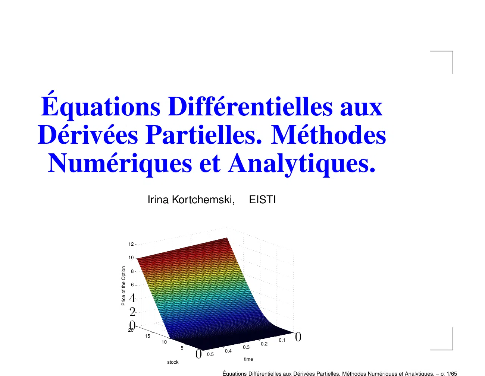

~~~text
                                                                                                  t2
                                                                                                  tn
                                                                                            tn+1
                                                                                           tM +1
                                                                                               uni
                                                                                            uni−1
Équations Différentielles aux                                                               uni+1
Dérivées Partielles. Méthodes                                                              un+1
                                                                                             i
                                                                                           un+1
 Numériques et Analytiques.                                                                  i−1
                                                                                           un+1
                                                                                             i+1

                                                Cond.
                                 Irina Kortchemski,   initiales
                                                    EISTI
                                                           Cond. aux limites
                                                           Cond. aux limites
                            12

                            10
                                                                        valeurs connues
                                                                  valeurs inconnues
      Price of the Option

                             8

                             6
                                                                                               glace
                            4
                            2                                                           u=0
                            0
                            20                                                         u = 50
                                 15
                                                                                          0
                                                                                         0.1
                                      10
                                                   5
                                                                  0.4
                                                                         0.3
                                                                                 0.2
                                                                                        x=0
                                                       0   0.5
                                                                          time
                                           stock
                                                                                        x=L
                                                                 Équations Différentielles aux Dérivées Partielles. Méthodes Numériques et Analytiques. – p. 1/65
~~~

## Page 2

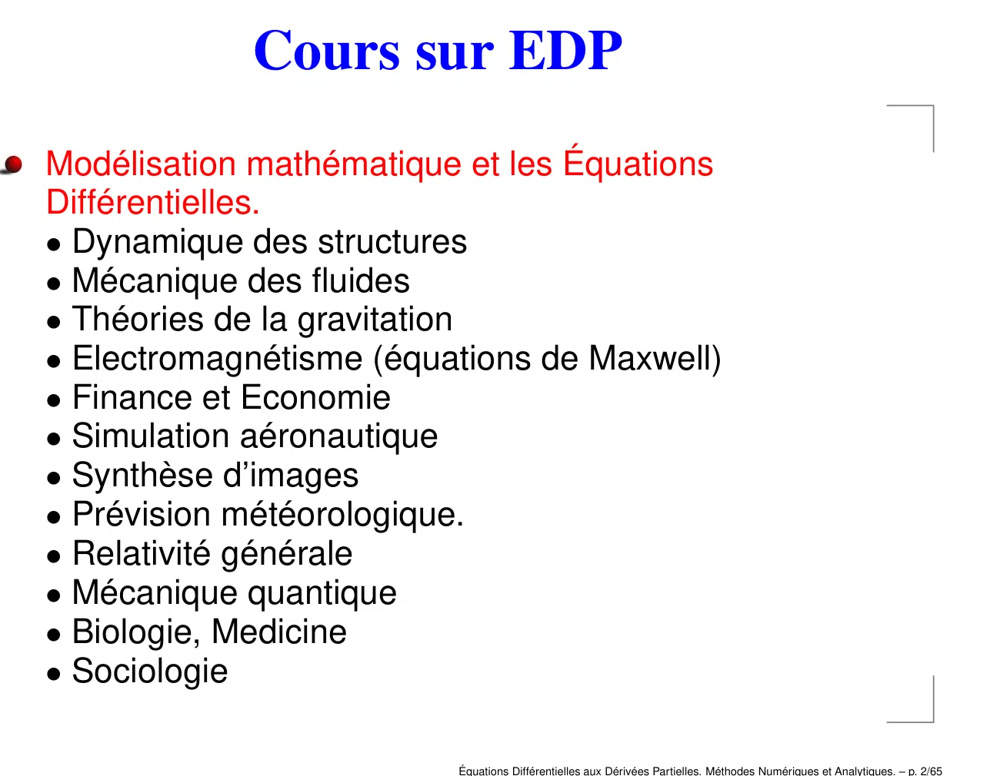

~~~text
ace
 =0                Cours sur EDP
= 50
 =0
=L     Modélisation mathématique et les Équations
       Différentielles.
       • Dynamique des structures
       • Mécanique des fluides
       • Théories de la gravitation
       • Electromagnétisme (équations de Maxwell)
       • Finance et Economie
       • Simulation aéronautique
       • Synthèse d’images
       • Prévision météorologique.
       • Relativité générale
       • Mécanique quantique
       • Biologie, Medicine
       • Sociologie

                                Équations Différentielles aux Dérivées Partielles. Méthodes Numériques et Analytiques. – p. 2/65
~~~

## Page 3

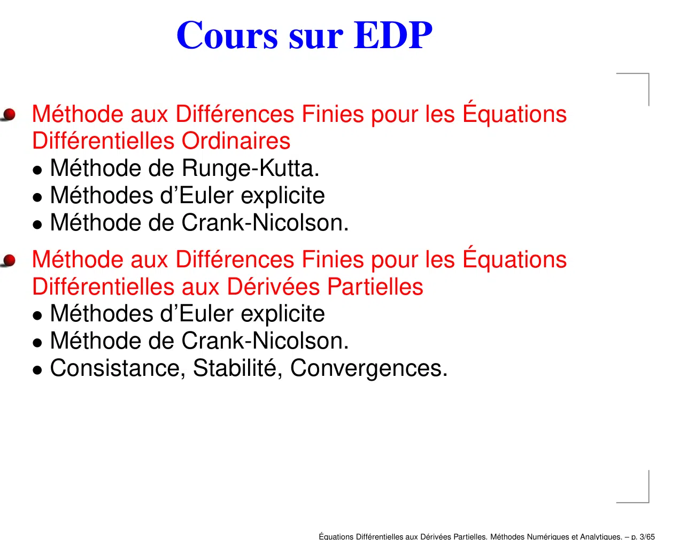

~~~text
 i+1
 ace
 ales
 =0
 ites                Cours sur EDP
=ites
   50
 =0
 ues
 =
 uesL   Méthode aux Différences Finies pour les Équations
 ace    Différentielles Ordinaires
 =0     • Méthode de Runge-Kutta.
= 50    • Méthodes d’Euler explicite
 =0     • Méthode de Crank-Nicolson.
 =L     Méthode aux Différences Finies pour les Équations
        Différentielles aux Dérivées Partielles
        • Méthodes d’Euler explicite
        • Méthode de Crank-Nicolson.
        • Consistance, Stabilité, Convergences.

                                  Équations Différentielles aux Dérivées Partielles. Méthodes Numériques et Analytiques. – p. 3/65
~~~

## Page 4

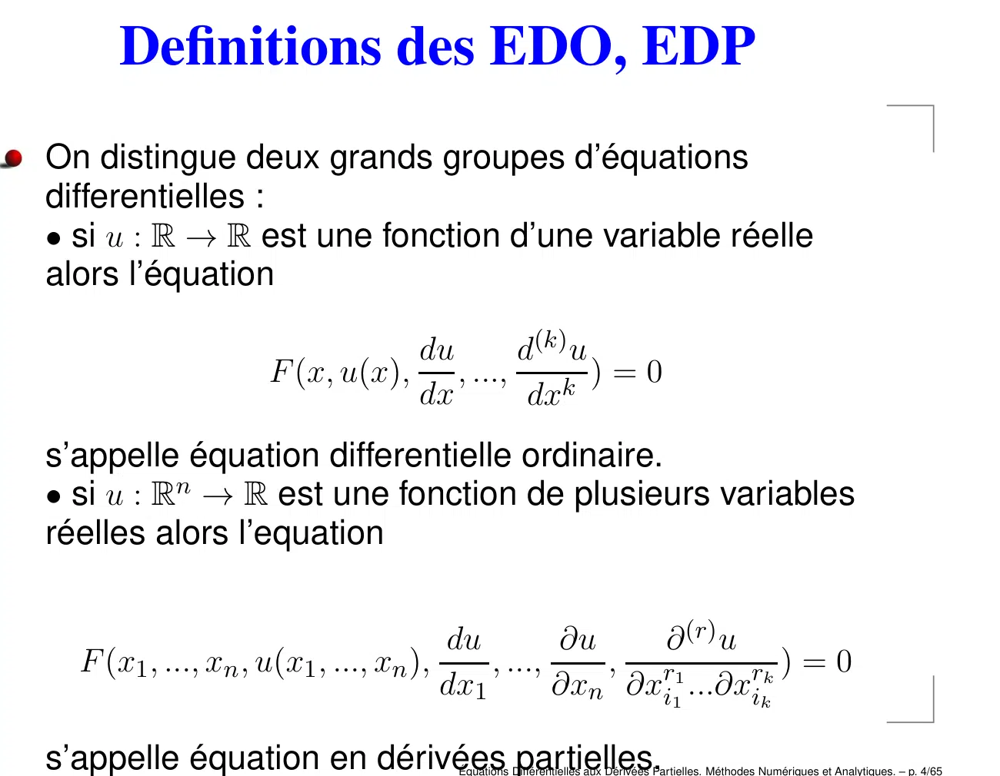

~~~text
ace
 =0
= 50
            Definitions des EDO, EDP
 =0
=L     On distingue deux grands groupes d’équations
       differentielles :
       • si u : R → R est une fonction d’une variable réelle
       alors l’équation

                                    du      d(k) u
                         F (x, u(x), , ...,     k
                                                   )=0
                                    dx       dx
       s’appelle équation differentielle ordinaire.
       • si u : Rn → R est une fonction de plusieurs variables
       réelles alors l’equation

                                             du         ∂u    ∂ (r) u
         F (x1 , ..., xn , u(x1 , ..., xn ),     , ...,    , r1       rk ) = 0
                                             dx1        ∂xn ∂xi1 ...∂xik

       s’appelle équation en dérivées partielles.
                                          Équations Différentielles aux Dérivées Partielles. Méthodes Numériques et Analytiques. – p. 4/65
~~~

## Page 5

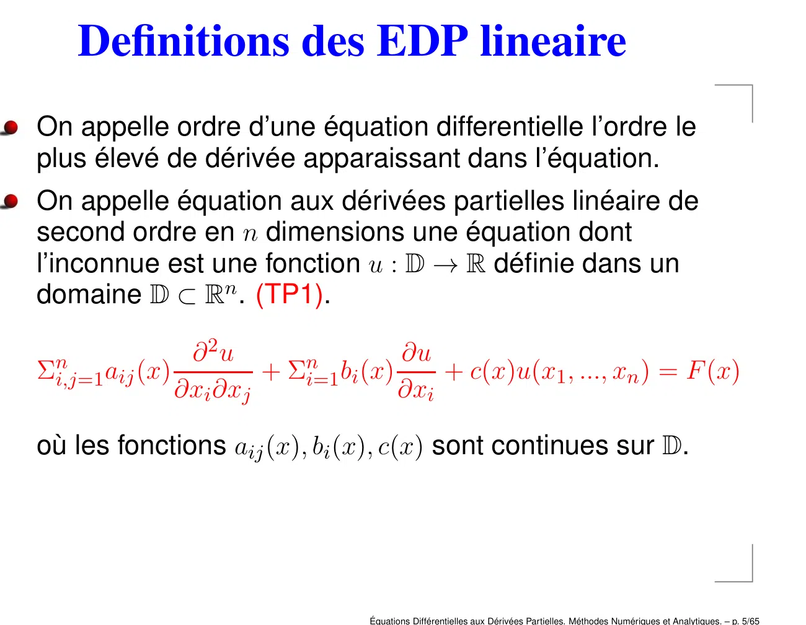

~~~text
 ites
 ace
 ues
 =0
 ues
=ace
   50
            Definitions des EDP lineaire
 = 00
 =
==50L   On appelle ordre d’une équation differentielle l’ordre le
 =0     plus élevé de dérivée apparaissant dans l’équation.
 =L     On appelle équation aux dérivées partielles linéaire de
        second ordre en n dimensions une équation dont
        l’inconnue est une fonction u : D → R définie dans un
        domaine D ⊂ Rn . (TP1).

                        ∂ 2u                 ∂u
         n                        n
        Σi,j=1 aij (x)         + Σi=1 bi (x)     + c(x)u(x1 , ..., xn ) = F (x)
                       ∂xi ∂xj               ∂xi

        où les fonctions aij (x), bi (x), c(x) sont continues sur D.

                                         Équations Différentielles aux Dérivées Partielles. Méthodes Numériques et Analytiques. – p. 5/65
~~~

## Page 6

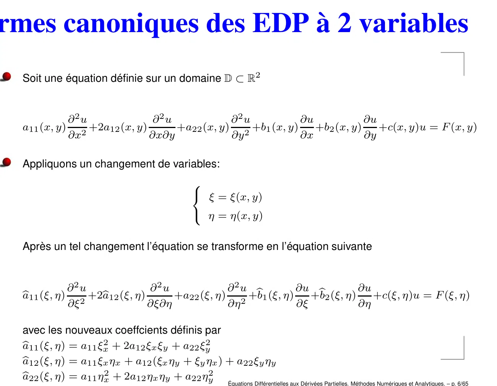

~~~text
  i−1
nnues
 un+1

Formes canoniques des EDP à 2 variables
  i+1
 glace
tiales
u=0
mites
 = 50
mites
x=0
nnues
x=L      Soit une équation définie sur un domaine D ⊂ R2
nnues
 glace
u=0                ∂2u              ∂2u            ∂2u           ∂u            ∂u
         a11 (x, y) 2 +2a12 (x, y)      +a22 (x, y) 2 +b1 (x, y)    +b2 (x, y)    +c(x, y)u = F (x, y)
 = 50              ∂x              ∂x∂y            ∂y            ∂x            ∂y
x=0
x=L      Appliquons un changement de variables:
                                              
                                               ξ = ξ(x, y)
                                               η = η(x, y)

         Après un tel changement l’équation se transforme en l’équation suivante

                   ∂2u             ∂2u             ∂2u b         ∂u b          ∂u
         a11 (ξ, η) 2 +2b
         b              a12 (ξ, η)      +a22 (ξ, η) 2 +b1 (ξ, η)    +b2 (ξ, η)    +c(ξ, η)u = F (ξ, η)
                   ∂ξ              ∂ξ∂η            ∂η            ∂ξ            ∂η

         avec les nouveaux coeffcients définis par
         a11 (ξ, η) = a11 ξx2 + 2a12 ξx ξy + a22 ξy2
         b
         a12 (ξ, η) = a11 ξx ηx + a12 (ξx ηy + ξy ηx ) + a22 ξy ηy
         b
         a22 (ξ, η) = a11 ηx2 + 2a12 ηx ηy + a22 ηy2
         b
                                                       Équations Différentielles aux Dérivées Partielles. Méthodes Numériques et Analytiques. – p. 6/65
~~~

## Page 7

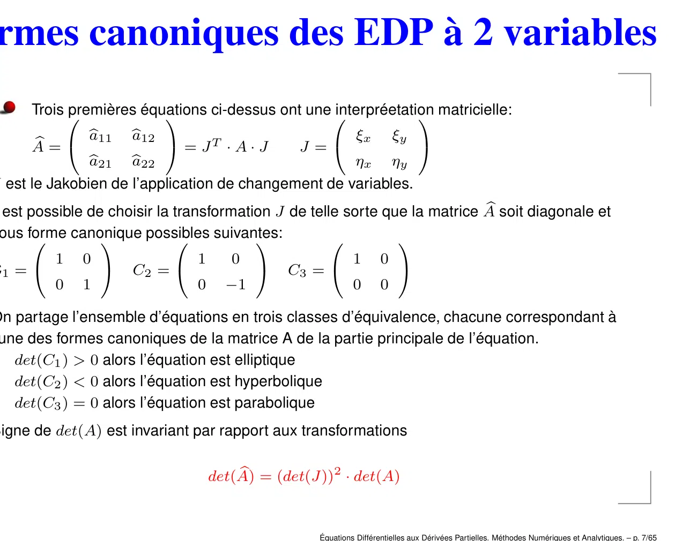

~~~text
nnues

Formes canoniques des EDP à 2 variables
 glace
u=0
 = 50
x=0
x=L       Trois 
                premières équations
                                   ci-dessus ont une
                                                     interpréetation
                                                                   matricielle:
                   a11
                   b      a12
                          b                                      ξx          ξy
          b=
          A                      = JT · A · J      J =                            
                   a21 b
                   b     a22                             ηx ηy
    J est le Jakobien de l’application de changement de variables.
    il est possible de choisir la transformation J de telle sorte que la matrice A
                                                                                 b soit diagonale et
    sous forme
                canonique
                            possibles
                                       suivantes:
                                                                  
             1    0                 1      0                     1       0
    C1 =                C2 =                   C3 =                      
             0    1                 0     −1                     0       0

    On partage l’ensemble d’équations en trois classes d’équivalence, chacune correspondant à
    l’une des formes canoniques de la matrice A de la partie principale de l’équation.
    • det(C1 ) > 0 alors l’équation est elliptique
    • det(C2 ) < 0 alors l’équation est hyperbolique
    • det(C3 ) = 0 alors l’équation est parabolique
    Signe de det(A) est invariant par rapport aux transformations

                                            b = (det(J))2 · det(A)
                                        det(A)

                                                       Équations Différentielles aux Dérivées Partielles. Méthodes Numériques et Analytiques. – p. 7/65
~~~

## Page 8

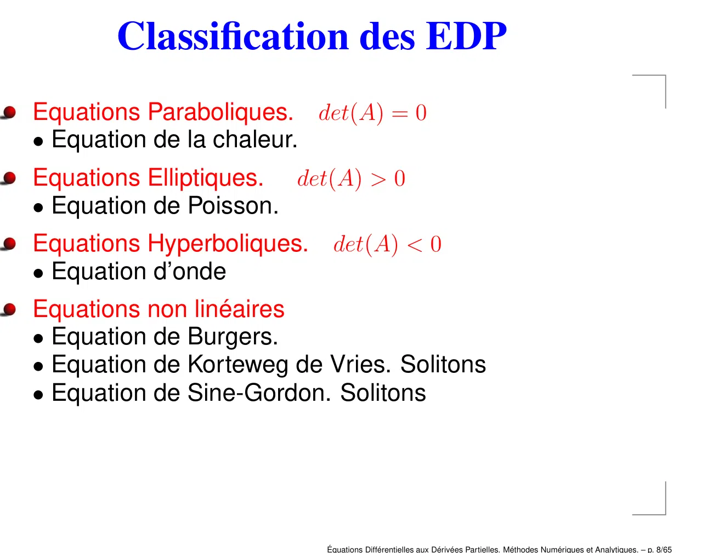

~~~text
 ites
uales
 ace
 i−1
 ues
 n+1
uites
 =
 i+10
 ues
 ites
 ace
=ales
   50
               Classification des EDP
 ues
 = 00
 ites
 =
 ues
 =  L
 ites
=ace
   50   Equations Paraboliques. det(A) = 0
 ues
 = 00   • Equation de la chaleur.
 =
 ues
 =
=aceL
   50   Equations Elliptiques. det(A) > 0
 = 00   • Equation de Poisson.
 =
==50L   Equations Hyperboliques. det(A) < 0
 =0     • Equation d’onde
 =L     Equations non linéaires
        • Equation de Burgers.
        • Equation de Korteweg de Vries. Solitons
        • Equation de Sine-Gordon. Solitons

                                  Équations Différentielles aux Dérivées Partielles. Méthodes Numériques et Analytiques. – p. 8/65
~~~

## Page 9

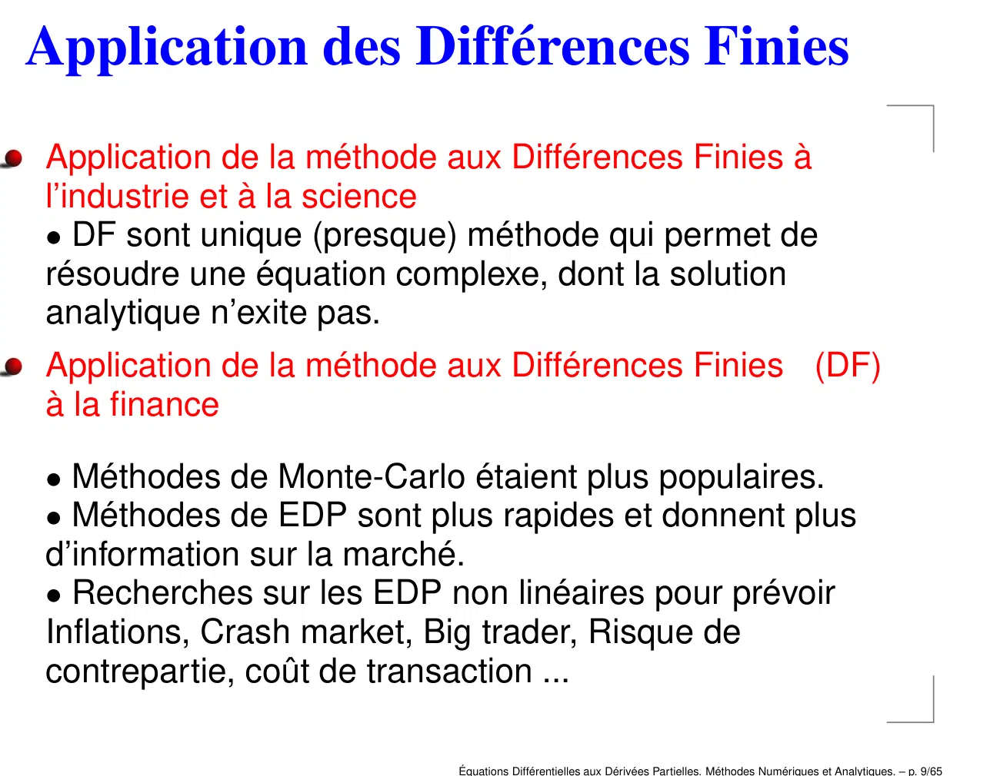

~~~text
 ace
 ales
 =0
 ites
=ites
   50
        Application des Différences Finies
 =0
 ues
 =
 uesL   Application de la méthode aux Différences Finies à
 ace    l’industrie et à la science
 =0     • DF sont unique (presque) méthode qui permet de
= 50    résoudre une équation complexe, dont la solution
 =0     analytique n’exite pas.
 =L     Application de la méthode aux Différences Finies (DF)
        à la finance

        • Méthodes de Monte-Carlo étaient plus populaires.
        • Méthodes de EDP sont plus rapides et donnent plus
        d’information sur la marché.
        • Recherches sur les EDP non linéaires pour prévoir
        Inflations, Crash market, Big trader, Risque de
        contrepartie, coût de transaction ...

                                  Équations Différentielles aux Dérivées Partielles. Méthodes Numériques et Analytiques. – p. 9/65
~~~

## Page 10

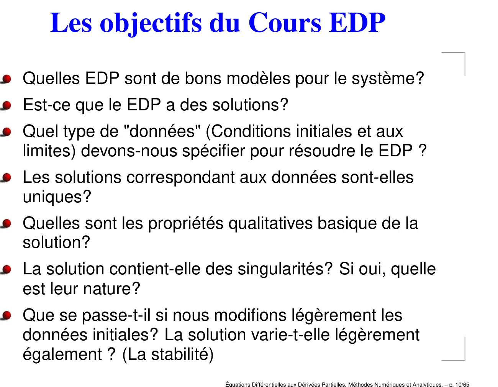

~~~text
  ues
 uace
  n+1n n
  ites
uales ui
  ues
  i−1
  ues
     i+1

=
  n+1
uuace
  =  n 0
  ites
  ii+1
  uesi−1
     n50
   n+1
               Les objectifs du Cours EDP
u ites
 uales
  ace
  =  i+1
   i−1  0
=ues
u
  =n+1
  ites
  =   500
        0
  =
   ii+1
  ues
  = n+1L0   Quelles EDP sont de bons modèles pour le système?
u ites
  ace
=ales 50
    i−1
  ues
  =
  = n+1L0   Est-ce que le EDP a des solutions?
uites
  = i+10
  ues
  =
  ites L    Quel type de "données" (Conditions initiales et aux
  ace
=ales 50
  ues
  = 00      limites) devons-nous spécifier pour résoudre le EDP ?
  ites
  =
  ues
  =
  ites L    Les solutions correspondant aux données sont-elles
=ace  50
  ues
  = 00      uniques?
  =
  ues
  =
=ace   L
      50    Quelles sont les propriétés qualitatives basique de la
  = 00      solution?
  =
==50   L    La solution contient-elle des singularités? Si oui, quelle
  =0        est leur nature?
  =L        Que se passe-t-il si nous modifions légèrement les
            données initiales? La solution varie-t-elle légèrement
            également ? (La stabilité)
                                        Équations Différentielles aux Dérivées Partielles. Méthodes Numériques et Analytiques. – p. 10/65
~~~

## Page 11

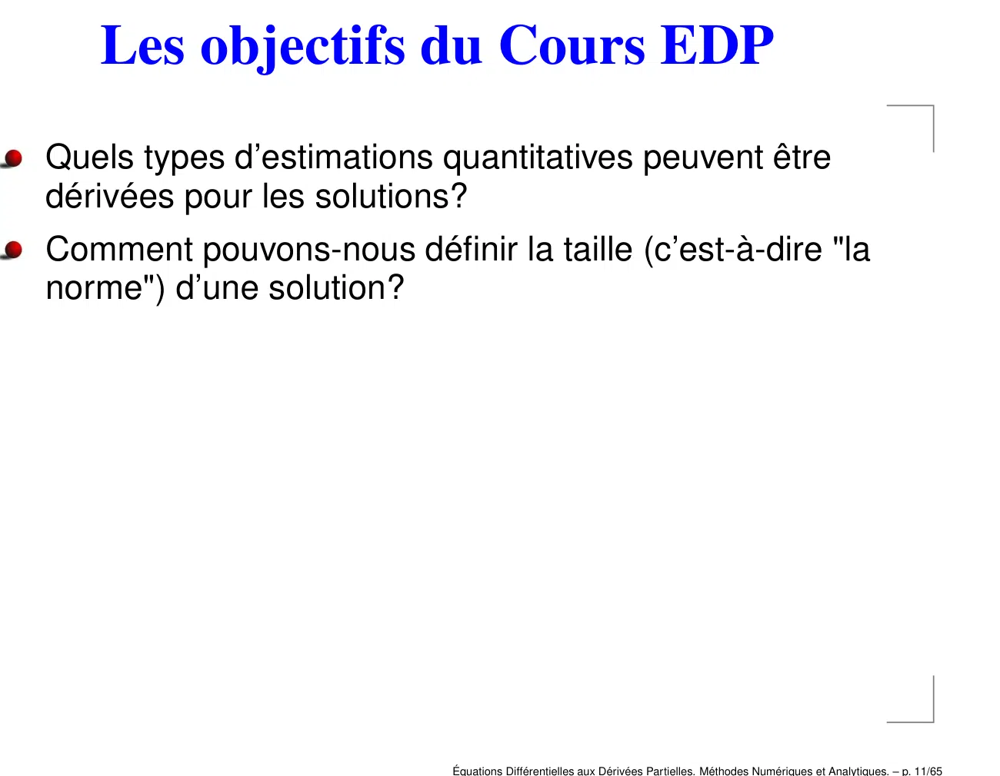

~~~text
 ites
 ace
 ues
 =0
 ues
=ace
   50
           Les objectifs du Cours EDP
 = 00
 =
==50L   Quels types d’estimations quantitatives peuvent être
 =0     dérivées pour les solutions?
 =L     Comment pouvons-nous définir la taille (c’est-à-dire "la
        norme") d’une solution?

                                   Équations Différentielles aux Dérivées Partielles. Méthodes Numériques et Analytiques. – p. 11/65
~~~
