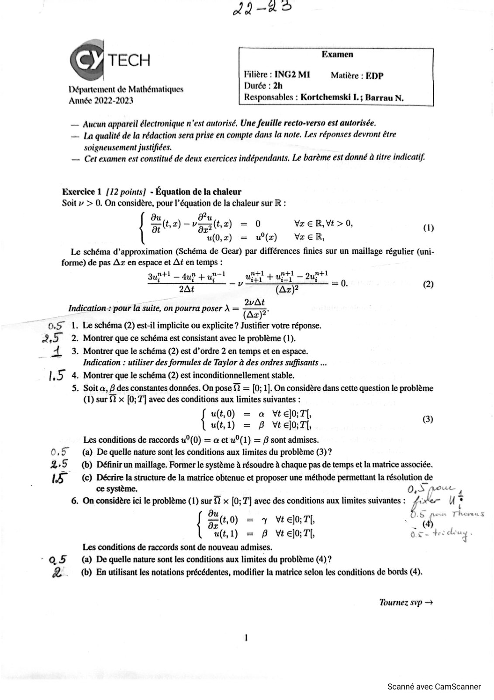
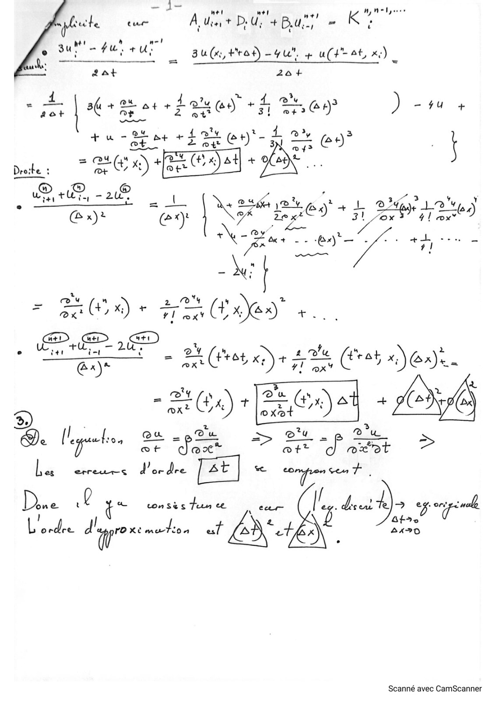
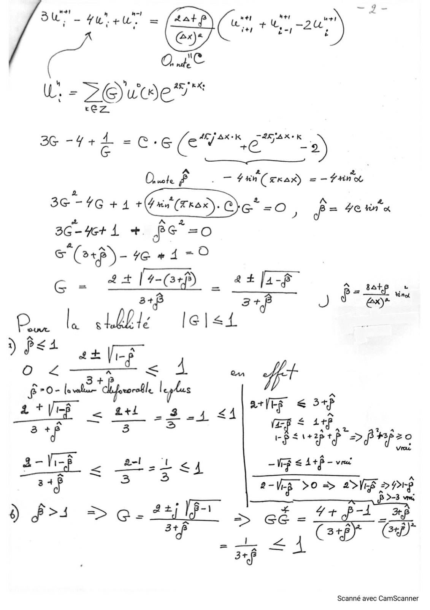
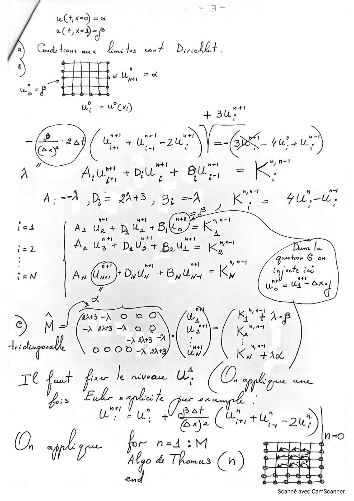
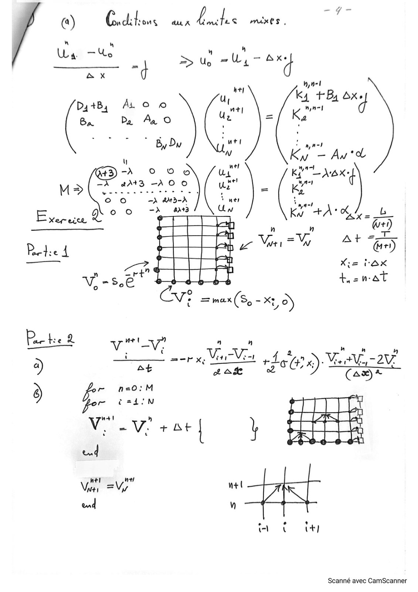
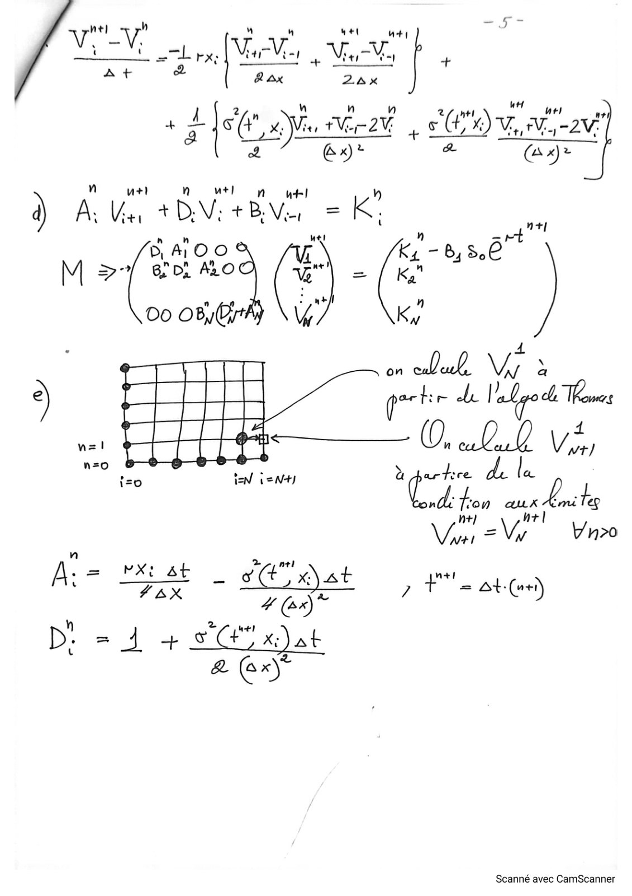

# Corrigé_Examen-22-23.pdf

[Ouvrir l’original](https://drive.google.com/open?id=16dj6gRsMvI15gytw1gBu5Ggv61Qg3HBt) · Les pages signalées comprennent du texte reconnu automatiquement ou des éléments graphiques. Le fac-similé permet de vérifier chaque lecture.

**Pages avec fac-similé ou lecture OCR** — 1–6.

## Page 1

**Lecture OCR à contrôler**

~~~text
Ad—-4 ©

T E C H Examen

Filière : ING2 MI Matière : EDP

Département de Mathématiques Durée : 2h
Année 2022-2023 Responsables : Kortchemski L.; Barrau N.

— Aucun appareil électronique n'est autorisé, Une feuille recto-verso est autorisée.
— La qualité de la rédaction sera prise en compte dans la note. Les réponses devront être

soigneusement justifiées.
— Cet examen est constitué de deux exercices indépendants. Le barème est donné à titre indicatif.

Exercice 1 {12 points] - Equation de la chaleur
Soit v > 0. On considère, pour I’équation de la chaleur sur R :

à u(0,x) u(z) WreR,
Le schéma d’approximation (Schéma de Gear) par différences finies sur un maillage régulier (uni-
forme) de pas Az en espace et At en temps :
Supt! — dup tai L ub + untt — 2uptt
2At (Az)?

"

a &
{ tx) — vata) =0 Vr € R,Vt > 0, w

=0. (2)

Indication: pour la suite, on pourra poser À = (zy
0.5 1. Le schéma (2) est-il implicite ou explicite ? Justifier votre réponse.
25 2. Montrer que ce schéma est consistant avec le problème (1).
4 3. Montrer que le schéma (2) est d’ordre 2 en temps et en espace.
Indication : utiliser des formules de Taylor à des ordres suffisants ...
LS 4. Montrer que le schéma (2) est inconditionnellement stable.
5. Soit a, B des constantes données. On pose % = [0; 1]. On considère dans cette question le problème
(1) sur & x [0; T] avec des conditions aux limites suivantes :
{ u(t,0) = a Vtel0;T{,
u(t,1) = B Vte]l0;7{,
Les conditions de raccords u°(0) = a et u°(1) = B sont admises.
0.5 (a) De quelle nature sont les conditions aux limites du probléme (3)?
4,5 — (b) Définirun maillage. Former le système à résoudre à chaque pas de temps et la matrice associée.
LS (©) Décrire la structure de la matrice obtenue et proposer une méthode permettant la résolution de
ce système. 0,S poe,
6. On considère ici le problème (1) sur % x [0; T] avec des conditions aux limites suivantes : 4 de- U :

G@)

OS pos Themes

{ (4,0) = y Wa, Se
u(t,1) = B Vtel0;T, 0.c- loa
Les conditions de raccords sont de nouveau admises.
a 5 (a) De quelle nature sont les conditions aux limites du problème (4)?
£ (b) En utilisant les notations précédentes, modifier la matrice selon les conditions de bords (4).

Tournez svp >

Scanné avec CamScanner
~~~

## Page 2

**Lecture OCR à contrôler**

~~~text
t

1—
mel wel * Wp Welyoree
pete cur A. Use, t D. U; + Bu; “ Ke

ael
‘ au (x, Heat) -4u", + u(t ty x)
aat 20+

nr \ suit Se at +Leu y + +f ar ) - 4u +
ts

ea
Leu Lots H CE 3
+u RE St F2 Gt) mn C9 f
pale, “CD EC DA + OE”.

Pr, 28 l 4 24h DY , L May 12, 5
: CPE “es es ed +31 Baie a)

4! ox"

+ fia = 8 En +7: éées cat

2 (x, x) + ea DO Vus
nes aD

we, tu.

ZX, 4
ar CEE = 2% (Hot x) + + ve (( trat OO,

Le

EXD ON
= CA) e DE] A

| à 2e2% > = >
De [equation 2 et = poe ne Pres
Lae erreurs d'ordre Le hr. te

e t 2 “ conSes Teen n Ore gS Mi
D. ¢ t | Ce If. Ÿ sede BO le
L oadie: d wv” Xe “ais at 7e 2420

Scanné avec CamScanner
~~~

## Page 3

**Lecture OCR à contrôler**

~~~text
Ce

WU’ = OO = RX:
rez

=
3 un - A “+ uot :
“ we “OCs " deu)
(ex |

3G - Le . AEP 2 SXk
+E @ 6(€ Ye > )

Quote À . — fun (xrar) = Fane
a
3G -7 2 A 5 @
| G+141+ si G =O, ft 7eme
36-4641 +. fe =O
SP) - 4e 1-0
PE
Gi 24 | 4-@rp) _ a#tfa-$

S _ 8atp ok

arp 3+P J @x)* oe
Cu Dei lel<i
) pea

Ip 4
Oo Lz DA
fro- bal hé, ha ft

2 apr arr < 5+f
IT si bod <A) ape a
f SAT “ofinfee
a-Vi-g al lie VF < A+B - veut
Se et ee ee
Ÿ 2- LE ES OVP > PS8
a
à fs + De ae > cë- {14 “4
Lei CF Co

ER

Scanné avec CamScanner
~~~

## Page 4

**Lecture OCR à contrôler**

~~~text
MODE
uC+t,x= =

a Cond Hone aux bid das wat DerceX lH .

a HEE

i = wWCx;)

(Bed C Lg ces E ui)
a É itt #1 |

c + DL" Hors =
it

LEA

À: <A ,D,= 243, Bi =A pi oe 7U.-U :

12a As Ug + DU +B,
nt a+! hel Past
ape A, Us + DU + Bo Uy = Ko
: nt ht) hel Py),
t=N Aw (ny DyUy a By by; = Ky
72
Ca

A frs ee m1 © 0
À M = -r ats à © © pan
el) = arg À |

do ©COODO -X art

TT Rag le niveau Oe. [Ta Uh ie.
i É Pk pl whe tO +
Bay A ER ( Ge tO au?)

ef r h=141: M 3
O phim Sea Oy Be
= sas

D ax

Scanné avec CamScanner
~~~

## Page 5

**Lecture OCR à contrôler**

~~~text
La — 4 , .
sit = > Up -U, 4
Ax
i im 8
TB, Ox.
DytB, AL © 0 Wa Kn 4 d
Ba Pa Aa O Ue =
By Dy wet Lonel d
W _ ‘
3 o © à we” ke pane
~ id
M> =X 4æA+3 -A0 0 “us En ‘t
bao eee cb eee ews ce A = 2
oo —) 4M3-À ru ee A
o O° =) ax+3 N +): 1,
Exercice Q Kw aan
ot
KO at
Xiz OX
4, 20ST

Scanné avec CamScanner
~~~

## Page 6

**Lecture OCR à contrôler**

~~~text
ht] h 4 “+1
VV. pes
: ee are VV, 4 VV A=] +
At & & ax 24 %x

ai “Hone as
rau CVn erat, Ct") v, nav
2 7 @»: . Cor

) AU + BV. LUS =
n = rt

D 4 OO Kz — Bi So

M >" are (© = x sad

00 OBO a

7

on ca Vir à ,

we! iS 0, «li Vie)

n=0 . ‘ te
{=o FN ieN+) a partice

nd: fron us Lots
Van = Vi Uno
VX: St a” ) msi
A: = wae hae at 5 +
D: = 4 + SC x)at
a2 (ex)

= Ot-(osi)

Scanné avec CamScanner
~~~
