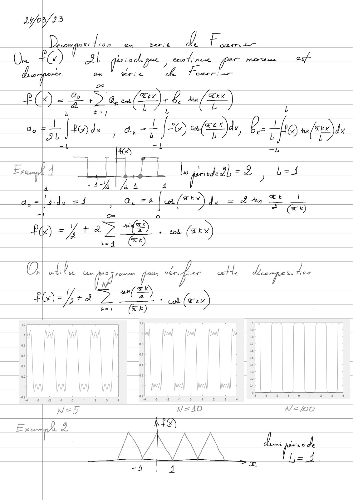
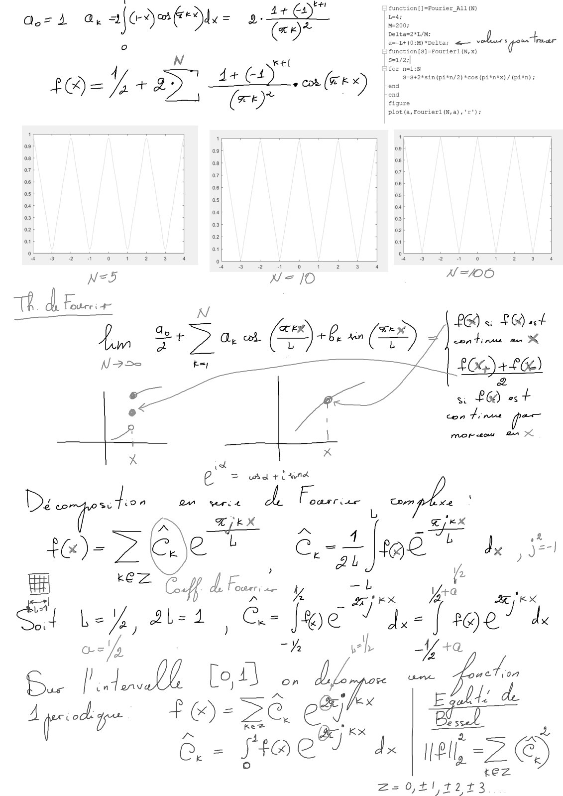
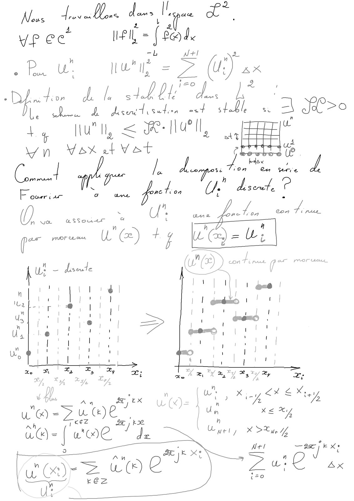
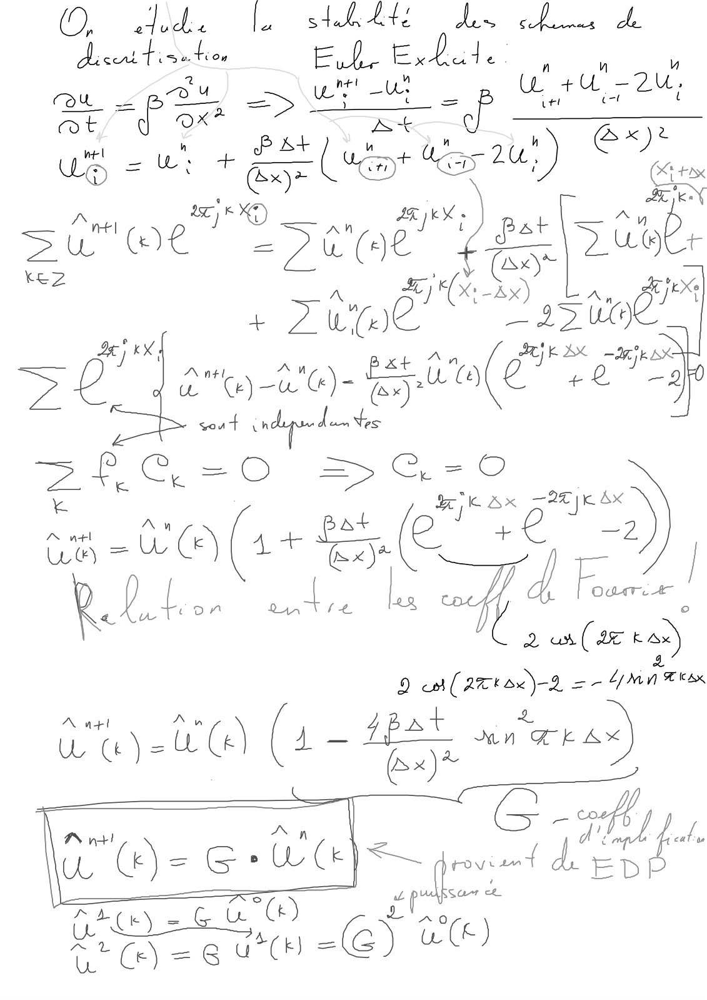
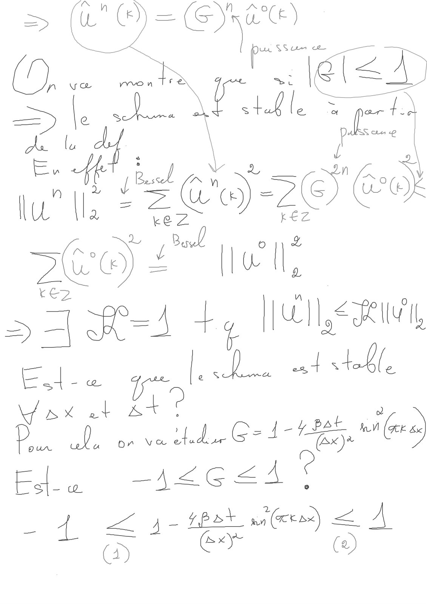
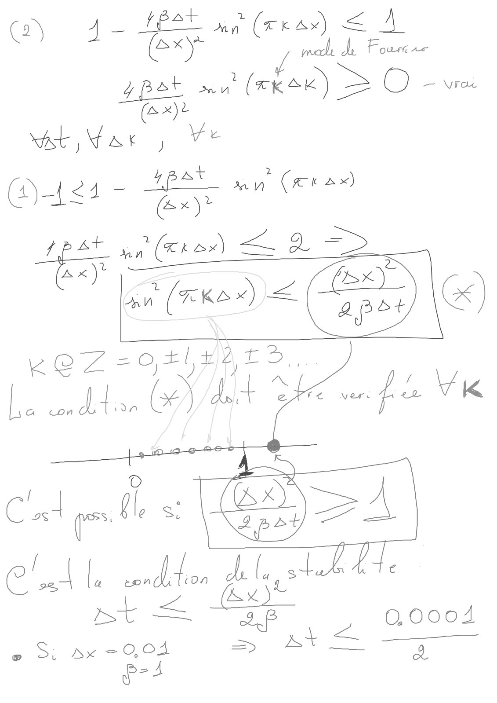
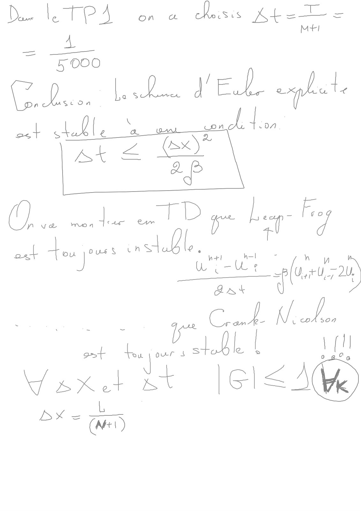

# Cours-4-Stabilité_Note_avec_Tablette.pdf

[Ouvrir l’original](https://drive.google.com/open?id=1LmAUaNCEt67vVCXEg8cL_JCgLlzcFmwe) · Les pages signalées comprennent du texte reconnu automatiquement ou des éléments graphiques. Le fac-similé permet de vérifier chaque lecture.

**Pages avec fac-similé ou lecture OCR** — 1–7.

## Page 1

**Lecture OCR à contrôler**

~~~text
1/03 23

1, on en Sere L QUATE te

De st
a HO To put | cot nee pre morsese
a an sere £ A. Foarr. ae

asf

2e

p $2 den(F)+ £ nS)
_

| l

Oo ie ; "fr da p- the 1 (0 de
vt 404) “+ —E

ME [TL Liuus-e Led
' a -4-4 VA 4 4 / 7
a,=|ladx =4 , are far} = ta ET

K) 4228 cou. (74%)

ul Ve Len foo 7 ranm pou vie pec wad te de

a SK
(x) ra oe ae, cot (ex)

ke, (Ek)
~~~

## Page 2

**Lecture OCR à contrôler**

~~~text
Qoz4 @ alone = At oO"

=
:
N
1Q= +82" Je veo (FX)
I
|
ol
all
al
‘ :
N°5 CNET W100

ré (2)

HE
An aa D met

‘
= wr tnd

e
Décgerte. gun rie d. Fousriee ” ‘

Ep RK u ex
PAS =f h
f&)- = 7 Get é Ce 6.2 [06 ë dye j jel

V2

Hil eZ Co de L =, : Yea un
sa NA al-=1 Ge lobe Ta [se L

of
o Lo
all Loi Lx TA 7
ive pa a Ze, el a |
- fae” Je | rnt-z €

£Z= o,+1,12+3
~~~

## Page 3

**Lecture OCR à contrôler**

~~~text
Nous deve Lone dans I 2$pace ee
Vp ec ell, = ( dove

mb N+! 2
"

Ru wtih = > (U) ax

our.

Due Ll ALT 1°

Me À. 4 diseutisutes oot stabl, sw = oe >O
UT Nue = i all, a EEE
Wn bX at VS 2 7
Corn /. doper Aas ot. d
—_ i 7" es VA dscut. °
U". ane _* Con A nus
por meme WG) +4 Webi

a

MAD continue par moraux
pui — diseute ut ES (
d | ! | Ill | oa@ |
l
|

i |
1
1

|
\

1
|

1 7X %, XY 237 oy ey Te
Lx Ss x.

A th
2:

x £ 2

x DT /L

Nel —ax ik x!

Zui ae
~~~

## Page 4

**Lecture OCR à contrôler**

~~~text
(9, ed. a sth Lt: bien a ae
di cu tisrhos EL. EE. ade ; n à
ru. LES) eset op tr au
BE oe à Ed

pe
We = . LEUR ada 2U; @ ‘Ge
Su (I) J => e(e - set 5] Rate

A Xr Ax
+ 2.) gi De woe!
> Co ) Oa) 2 aa "@)- EU a (Pee k AX ores

(ax

gout ih PME

Tao

% Ang ant HK Ex 2h) K 8x

say WO (1+ #4. (27 +e 2).
| 4, |

2 (ATEN A a Yn ras
A n+l are : y at È ;
Laye (4 Le
(= GW grd’

Ate Ga) pele

ENT eut =G) #0)

D v4!

Td fal.

ED!
~~~

## Page 5

**Lecture OCR à contrôler**

~~~text
see) 4° “acl?
> RHA +, Mee,
= Lu |p. at telle
ax at ae

ih ott sled
Est ww 426 <A

- 1 <1-tehs Je) <A
a oF @)
~~~

## Page 6

**Lecture OCR à contrôler**

~~~text
(+ d= HSE yp (rras) € A

Gon L mod de Four se
ppet nu (ka) > O - we
(Ax)
ast Eat ) Ye
()-1<4 ~ <0 man (ærax)

HU (rkex) € F4 ape

LE ne (xa) a d =>
"pe < Cape) le

LOZ =F) YAS,

La dt (56) At tb
~~~

## Page 7

**Lecture OCR à contrôler**

~~~text
st hy Fi nm
Pere + J+ ‘teats

SX =
CD
~~~
