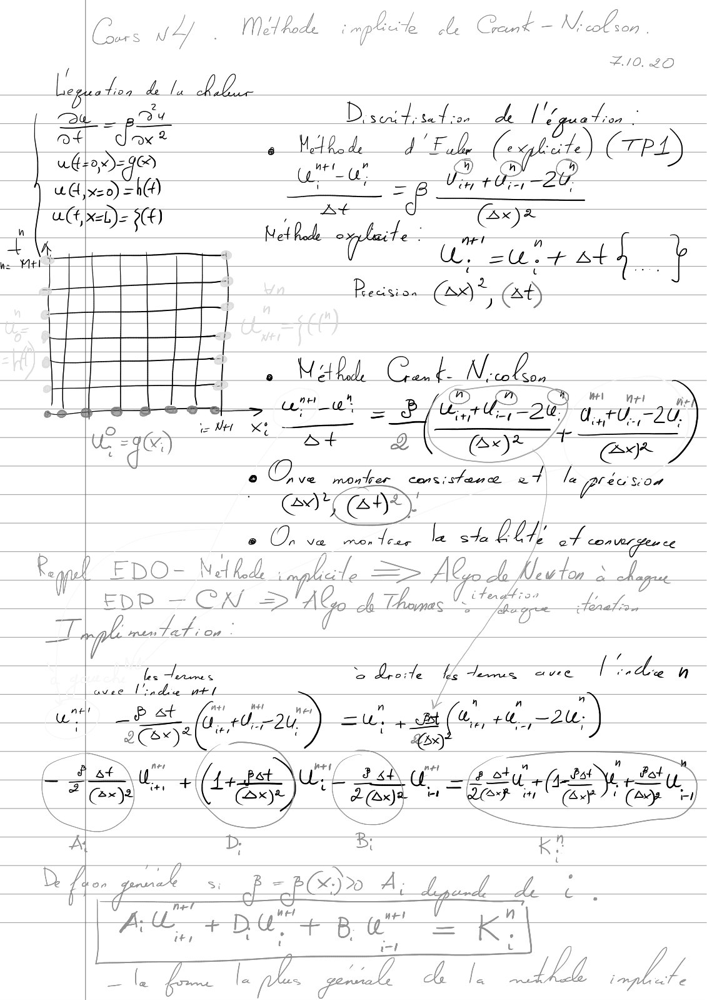
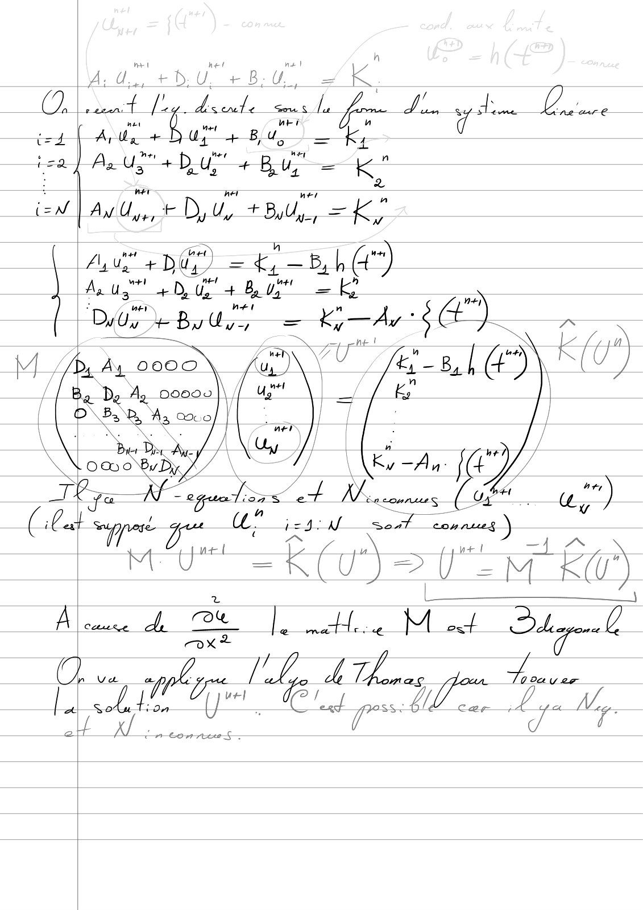
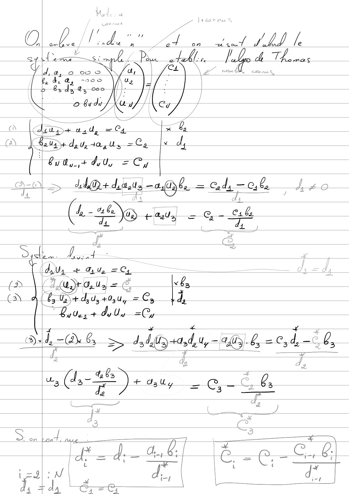
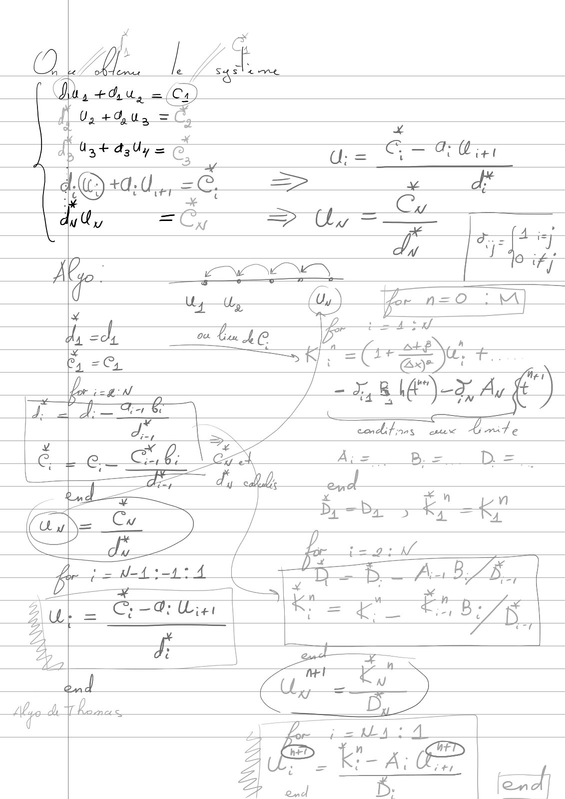
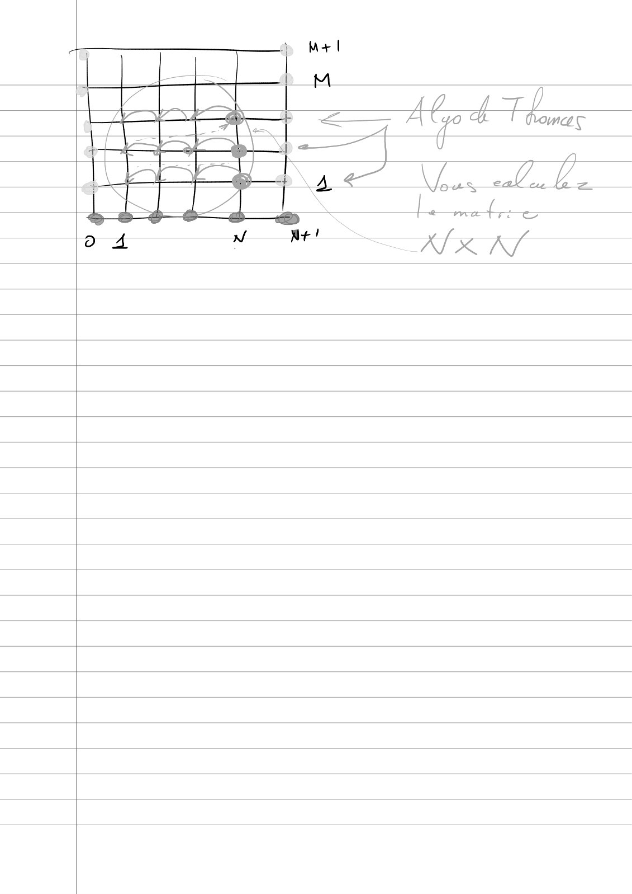

# Cours3_TAB_CN_20_21.pdf

[Ouvrir l’original](https://drive.google.com/open?id=1CGpEwTmhfj1Ag7NdahpCsKXQRjz4qaNk) · Les pages signalées comprennent du texte reconnu automatiquement ou des éléments graphiques. Le fac-similé permet de vérifier chaque lecture.

**Pages avec fac-similé ou lecture OCR** — 1–5.

## Page 1

**Lecture OCR à contrôler**

~~~text
= 27 ” Nel bode c mpl le Gant ces MV olson 8

j Z/0. 20

Legation Ala LA.

Sh pst Di sed: set con a UC ©

at mx ?

whaedageo ee FACE a (res)

ud x20) Ti) dr
a(t xeL)= nGe) g (4x)%

Met Rode pe erat at} +
us. (AE, (ad

ns
| |)
|

= . Mall Cut N ile
|

= (aes

Monel fir)
L NE = FRE 1-28) di, +0. -2U,
ca HÉSE te OF

© nV! montrer cons (steve ce. 27 le Précs On

Or nate ke OLE of conmrgence
Ne vton
Rd EDO- Ned hd ; lle => AG. A Mot à dy

EDP — CA Algo À Thomas“. Sie Hp.
Fgh ne A 7
| = ae 5 Lede i> aim, vec / Az a
| A Ven dece vt1
une at fa at) - - =u" ah a, "+, —2u,)
IEC Fell oe ee

sy" ANUS Got A Pay, Bat

Feu. + Ps = eu (A ee

A D: Bo Kr
D op JD A; Led Li
[* im + BE Bt = K.

TE pach AT. A US
~~~

## Page 2

**Lecture OCR à contrôler**

~~~text
a lesnt [ey decent nr
b

h
Ad. + D.U + BU a KK

JL. de D na
AUX + Du + Bu DA
Aa U3" + DU + Buy =

Ky

wer her ner à
Aw Uy, + Dy Uy + Byty, =K,

a obi) = né)

Aus” LE à AU =

Dy Us + By ran = KA 4 sa") ia i
M L Ay 0000 ky — By [é Ko")
Ag 00000 Ky |

| OP a, A3 co

\

/ a

>

Le

ptt 5 =f 2S
yoy =M_KO)
mu 4 Be | He M och 3 Dr

7
“ phar dhe a Thomas rw,

So tion = gs car À Nay.
dx

Cn Comrie S—-
~~~

## Page 3

**Lecture OCR à contrôler**

~~~text
ba de a,
> 6sd3 0;

Vertes dd, =e;

> Mordau-agl = Cody = cal

Ee

4-20 al
CE 46a \G + as <a
~~~

## Page 4

**Lecture OCR à contrôler**

~~~text
rap)

mile
~~~

## Page 5

**Lecture OCR à contrôler**

~~~text
KES
~~~
