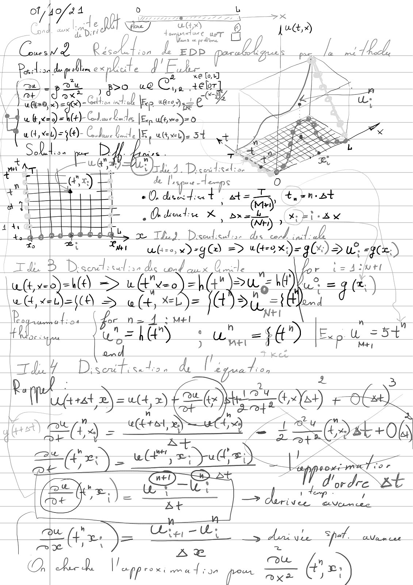
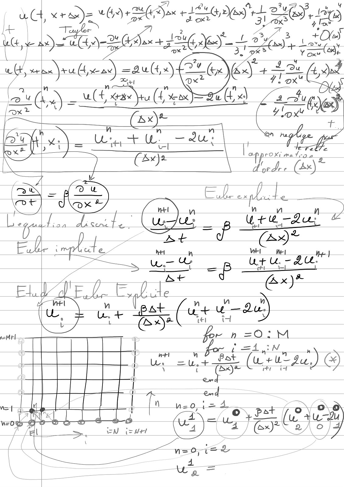
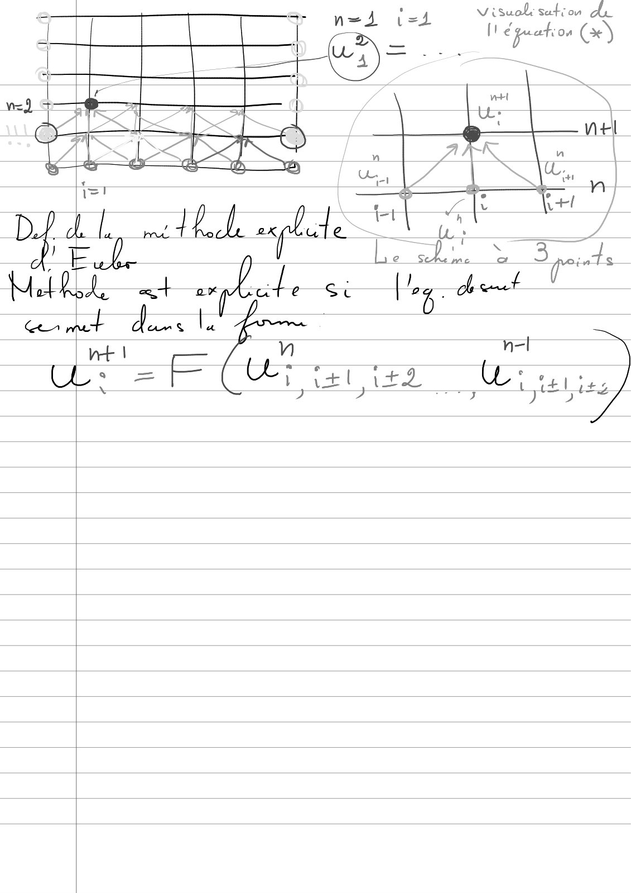

# Cours_2_Euler_explicite_notes_Tablette.pdf

[Ouvrir l’original](https://drive.google.com/open?id=1olFnu2iMb_zvWurTyX4pGhTY6Mo51e-L) · Les pages signalées comprennent du texte reconnu automatiquement ou des éléments graphiques. Le fac-similé permet de vérifier chaque lecture.

**Pages avec fac-similé ou lecture OCR** — 1–3.

## Page 1

**Lecture OCR à contrôler**

~~~text
(Caled Cased,
Peleldipdlnceplate JE et

xe Lo,

ALES 87? we Cr ER |

\ / do lS Ze Celts» sie uése re
wk, xde)= h(+)- Caf CH de [En uv = 0 =
wl xt) =34)- Colle Laide IE, ane st vt | eo
SL oon Pe a MZ
+ à f Nt ax) | tr Tepes
6 + TL: 0, one 1 ate Te ty emt
att i Deda X (M)
4 4 ep | ° MES A a Ax
sdb dt, x TY Deco ds “cod incl.
To ei Lu

wie ee = ulre x)= PTE > LE
ZI de 3 D senc eu : aa das cond i.

lu (tvep)=hl@) => wA"veo)= pu ot ie)
Le (ee a = w(t Mele Hi ee i

LY need dos de li a

ae DE u(+ >) 2 by) ee = @ 26) ole),
nee à - ee nee i= EDst+0û

CR ———
\ OY dordre st
; =o i a — dre Eva.

ur =5+

Es M+)
~~~

## Page 2

**Lecture OCR à contrôler**

~~~text
| uC, ag) (+2 Se BOS

Cr Hi

+ ‘3
ue, LD 6 BUG an + IME ES OH 120 :
& ne = i 7i fae t, dd
ESTONIE: 7
eS ( You”

aN v FRE We — au? che

2 ) i) = Ht ae
f, 4
EE “AS = EX. Lt

iaA disenite bb Le:

ss

Urea!

wz

9"

Ekle t de . D
7 ur & =P cree ae
At AX
EL. Ele € ¢ »
ue + + fu+ru-
; R AE er 4 y
| ‘ ° Rr nh=O:mM
Ain
d _ à n 7 h
| ur Ha) à
|
[Ti Ta uso a
H AT Ps y
EN s uw “I ur} JE Be à

= EL
4
~~~

## Page 3

**Lecture OCR à contrôler**

~~~text
+ a

vt | n n=l
CL: = F CL; ttt it2  Ü: tie J
2 À DU jit
~~~
