# EDP_Differences_Finies_Slides.pdf

[Ouvrir l’original](https://drive.google.com/open?id=1Mnc7qhQk49-aSSOzqv6oSQWfk308tZPS) · Les deux lectures automatiques du PDF divergent sur les pages indiquées. Leur fac-similé accompagne le texte.

**Pages présentant un écart entre les deux extractions** — 1–2, 4, 7–15, 17, 20–22, 24–25, 27–31, 33–37, 39–40, 42–43, 45–49, 52–54, 56–61.

## Page 1

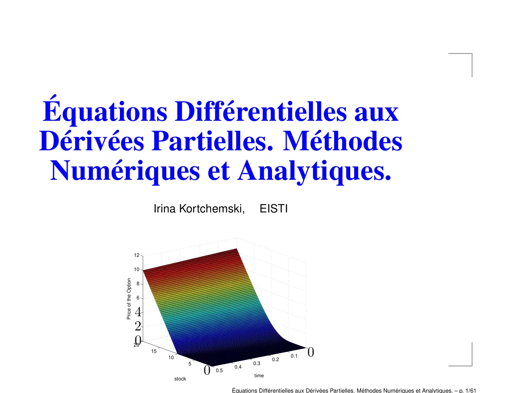

~~~text
Équations Différentielles aux
Dérivées Partielles. Méthodes
 Numériques et Analytiques.
                                  Irina Kortchemski,                         EISTI

                             12

                             10
       Price of the Option

                              8

                              6

                             4
                             2
                             0
                             20
                                  15
                                       10                                         0.2
                                                                                          0.1    0
                                                    5                     0.3
                                                                   0.4

                                            stock
                                                        0   0.5
                                                                           time

                                                                  Équations Différentielles aux Dérivées Partielles. Méthodes Numériques et Analytiques. – p. 1/61
~~~

## Page 2

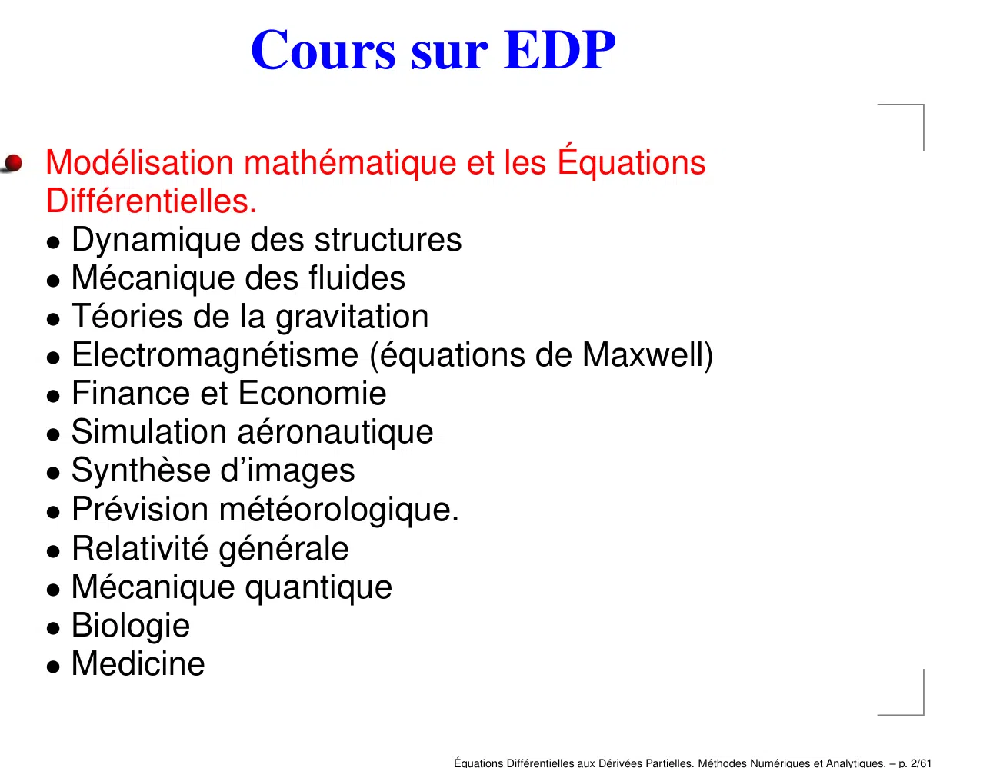

~~~text
            Cours sur EDP
Modélisation mathématique et les Équations
Différentielles.
• Dynamique des structures
• Mécanique des fluides
• Téories de la gravitation
• Electromagnétisme (équations de Maxwell)
• Finance et Economie
• Simulation aéronautique
• Synthèse d’images
• Prévision météorologique.
• Relativité générale
• Mécanique quantique
• Biologie
• Medicine

                         Équations Différentielles aux Dérivées Partielles. Méthodes Numériques et Analytiques. – p. 2/61
~~~

## Page 3

~~~text
             Cours sur EDP
Méthode aux Différences Finies pour les Équations
Différentielles Ordinaires
Méthode aux Différences Finies pour les Équations
Différentielles aux Dérivées Partielles
• Méthode de Runge-Kutta.
• Méthodes d’Euler.
• Méthode de Crank-Nicolson.
Méthode Analytique pour les EDP
• Equations paraboliques.
• Equations hyperboliques.
• Equations elliptiques.
• Equations non linéaire.

                          Équations Différentielles aux Dérivées Partielles. Méthodes Numériques et Analytiques. – p. 3/61
~~~

## Page 4

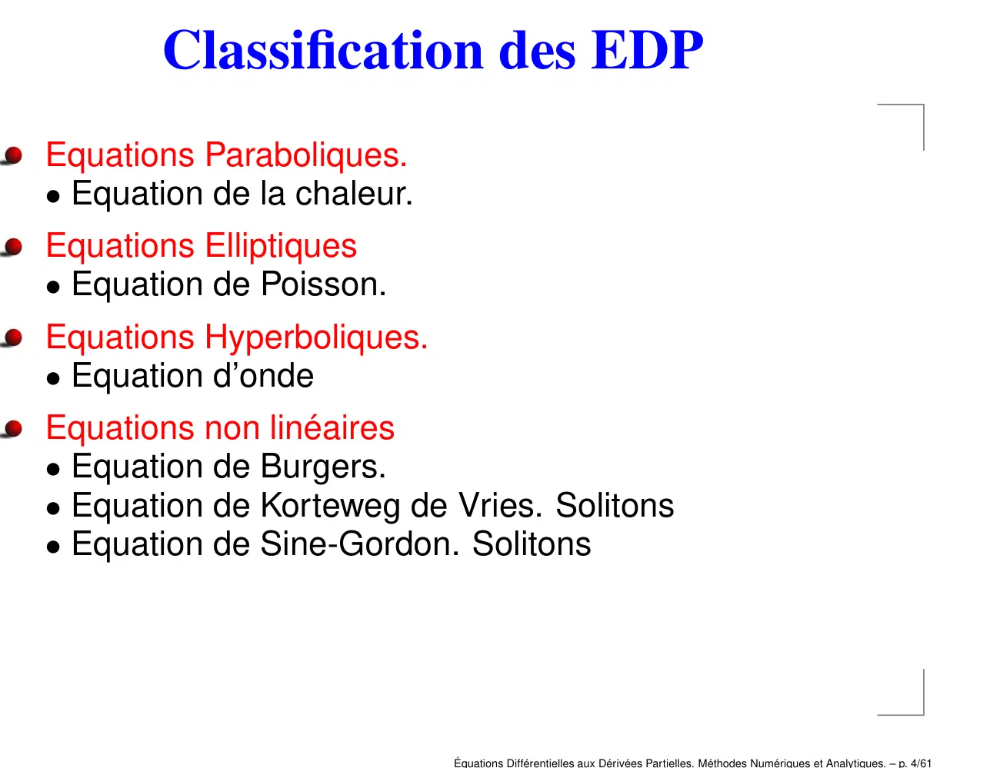

~~~text
       Classification des EDP
Equations Paraboliques.
• Equation de la chaleur.
Equations Elliptiques
• Equation de Poisson.
Equations Hyperboliques.
• Equation d’onde
Equations non linéaires
• Equation de Burgers.
• Equation de Korteweg de Vries. Solitons
• Equation de Sine-Gordon. Solitons

                            Équations Différentielles aux Dérivées Partielles. Méthodes Numériques et Analytiques. – p. 4/61
~~~

## Page 5

~~~text
Application des Différences Finies
Application de la méthode aux Différences Finies (DF)
à la finance

• Méthodes de Monte-Carlo étaient plus populaires.
• Méthodes de EDP sont plus rapides et donnent plus
d’information sur la marché.
• Recherches sur les EDP non linéaires pour prévoir
Inflations, Crash market, Big trader, Risque de
contrepartie, coût de transaction ...
Application de la méthode aux Différences Finies à
l’industrie et à la science
• DF sont unique (presque) méthode qui permet de
résoudre une équation complexe, dont la solution
Analytique n’exite pas.

                          Équations Différentielles aux Dérivées Partielles. Méthodes Numériques et Analytiques. – p. 5/61
~~~

## Page 6

~~~text
   Les objectifs du Cours EDP
Quelles EDP sont de bons modèles pour le système?
Est-ce que le EDP a des solutions?
Quel type de "données" (Conditions initiales et aux
limites) devons-nous spécifier pour résoudre le EDP ?
Les solutions correspondant aux données sont-elles
uniques?
Quelles sont les propriétés qualitatives basique de la
solution?
La solution contient-elle des singularités? Si oui, quelle
est leur nature?
Que se passe-t-il si nous modifions légèrement les
données initiales? La solution varie-t-elle légèrement
également ? (La stabilité)
                            Équations Différentielles aux Dérivées Partielles. Méthodes Numériques et Analytiques. – p. 6/61
~~~

## Page 7

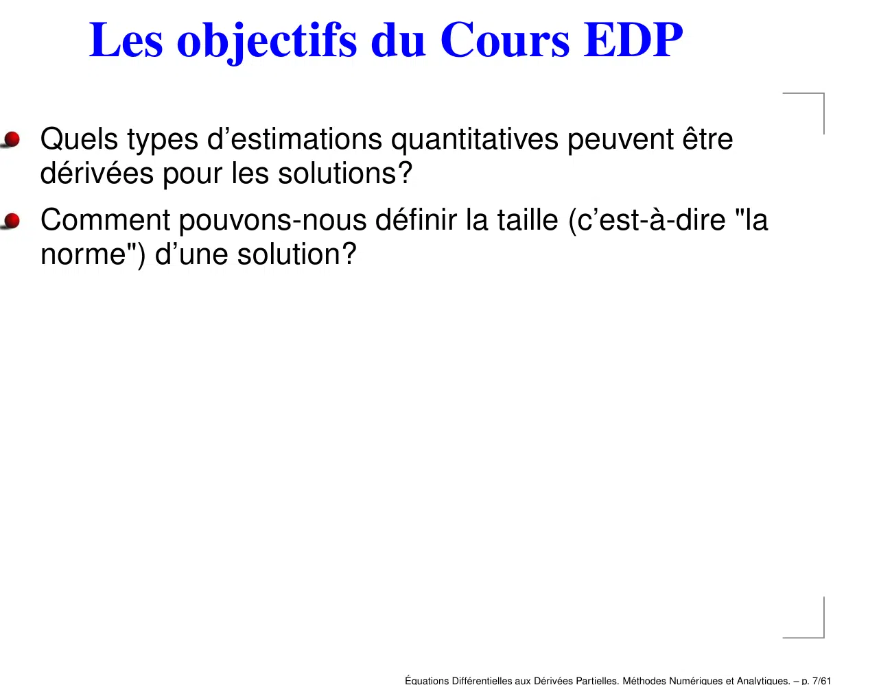

~~~text
   Les objectifs du Cours EDP
Quels types d’estimations quantitatives peuvent être
dérivées pour les solutions?
Comment pouvons-nous définir la taille (c’est-à-dire "la
norme") d’une solution?

                            Équations Différentielles aux Dérivées Partielles. Méthodes Numériques et Analytiques. – p. 7/61
~~~

## Page 8

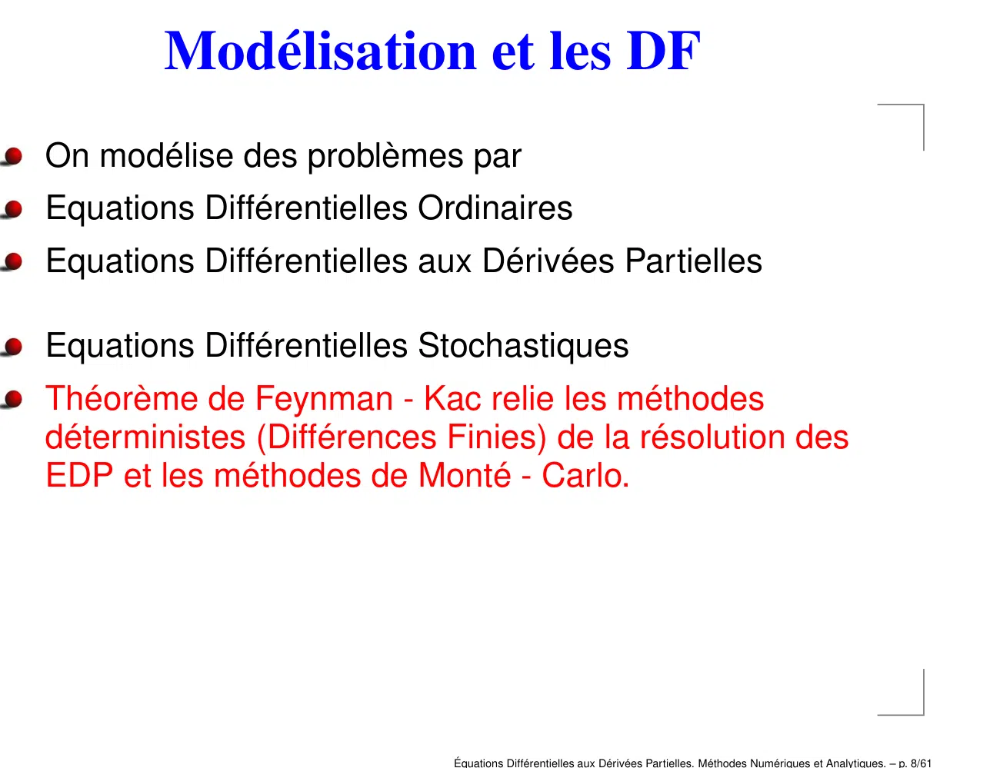

~~~text
        Modélisation et les DF
On modélise des problèmes par
Equations Différentielles Ordinaires
Equations Différentielles aux Dérivées Partielles

Equations Différentielles Stochastiques
Théorème de Feynman - Kac relie les méthodes
déterministes (Différences Finies) de la résolution des
EDP et les méthodes de Monté - Carlo.

                           Équations Différentielles aux Dérivées Partielles. Méthodes Numériques et Analytiques. – p. 8/61
~~~

## Page 9

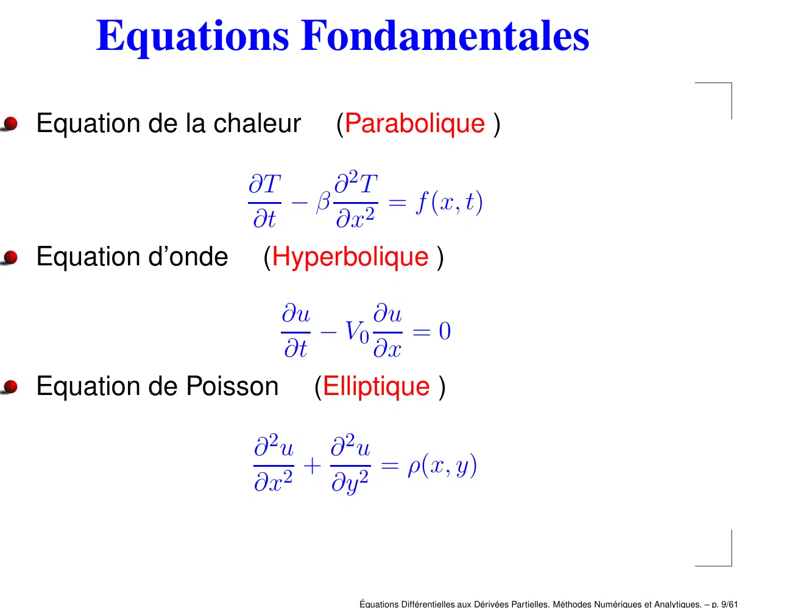

~~~text
    Equations Fondamentales
Equation de la chaleur   (Parabolique )

                ∂T    ∂2T
                   − β 2 = f (x, t)
                ∂t    ∂x
Equation d’onde (Hyperbolique )

                   ∂u      ∂u
                      − V0    =0
                   ∂t      ∂x
Equation de Poisson (Elliptique )

                  ∂ 2u ∂ 2u
                     2
                       + 2 = ρ(x, y)
                  ∂x    ∂y

                           Équations Différentielles aux Dérivées Partielles. Méthodes Numériques et Analytiques. – p. 9/61
~~~

## Page 10

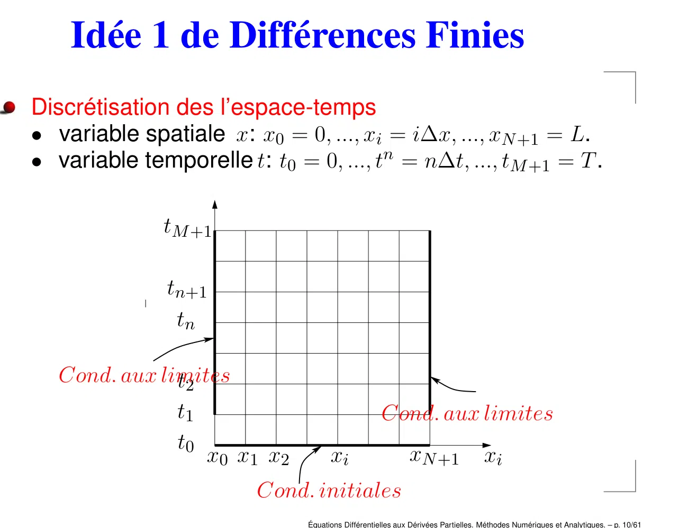

~~~text
    Idée 1 de Différences Finies
Discrétisation des l’espace-temps
• variable spatiale x: x0 = 0, ..., xi = i∆x, ..., xN +1 = L.
• variable temporelle t: t0 = 0, ..., tn = n∆t, ..., tM +1 = T .

              tM +1

               tn+1
                tn

   Cond. aux limites
               t2
                t1                                    Cond. aux limites
                t0
                     x0 x1 x2         xi                       xN +1                  xi
                         Cond. initiales
                                Équations Différentielles aux Dérivées Partielles. Méthodes Numériques et Analytiques. – p. 10/61
~~~

## Page 11

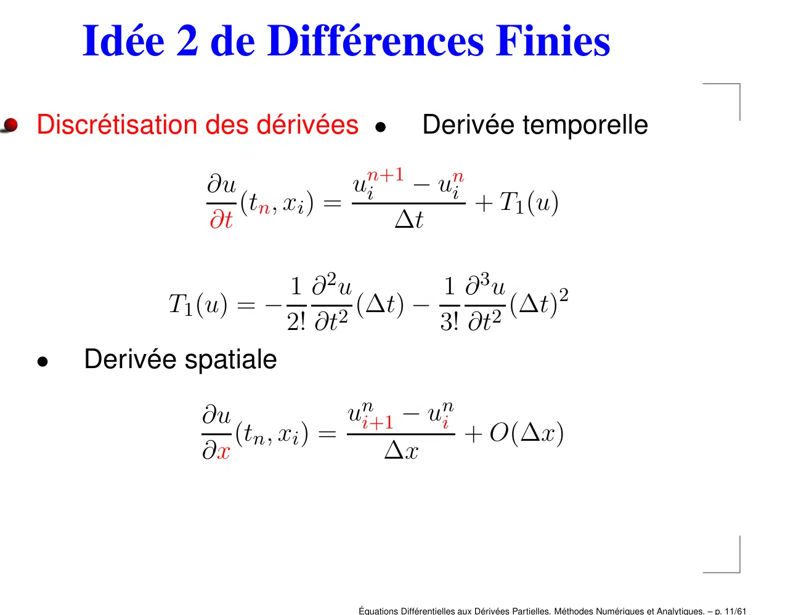

~~~text
    Idée 2 de Différences Finies
Discrétisation des dérivées •                Derivée temporelle

               ∂u             un+1 − un
                                      i
                  (tn , xi ) = i        + T1 (u)
               ∂t                ∆t

                     1 ∂ 2u        1 ∂ 3u      2
          T1 (u) = −        (∆t) −        (∆t)
                     2! ∂t2        3! ∂t2
•   Derivée spatiale

              ∂u              uni+1 − uin
                 (tn , xi ) =             + O(∆x)
              ∂x                  ∆x

                             Équations Différentielles aux Dérivées Partielles. Méthodes Numériques et Analytiques. – p. 11/61
~~~

## Page 12

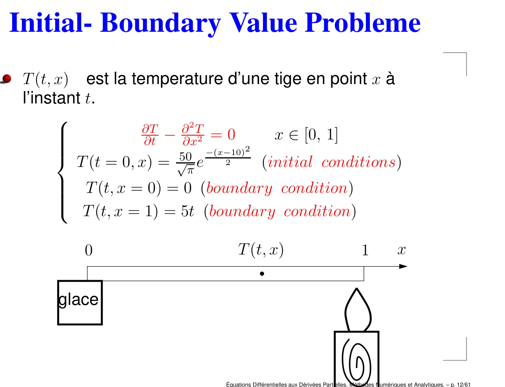

~~~text
Initial- Boundary Value Probleme
 T (t, x) est la temperature d’une tige en point x à
 l’instant t.
                           2
                    ∂T    ∂   T
       
                   ∂t −  ∂x2 = 0          x ∈ [0, 1]
                                −(x−10)2
       
         T (t = 0, x) = √50π e 2
       
                                         (initial conditions)
       
       
       
          T (t, x = 0) = 0 (boundary condition)
       
        T (t, x = 1) = 5t (boundary condition)

          0                           T (t, x)                                           1              x

      glace

                                 Équations Différentielles aux Dérivées Partielles. Méthodes Numériques et Analytiques. – p. 12/61
~~~

## Page 13

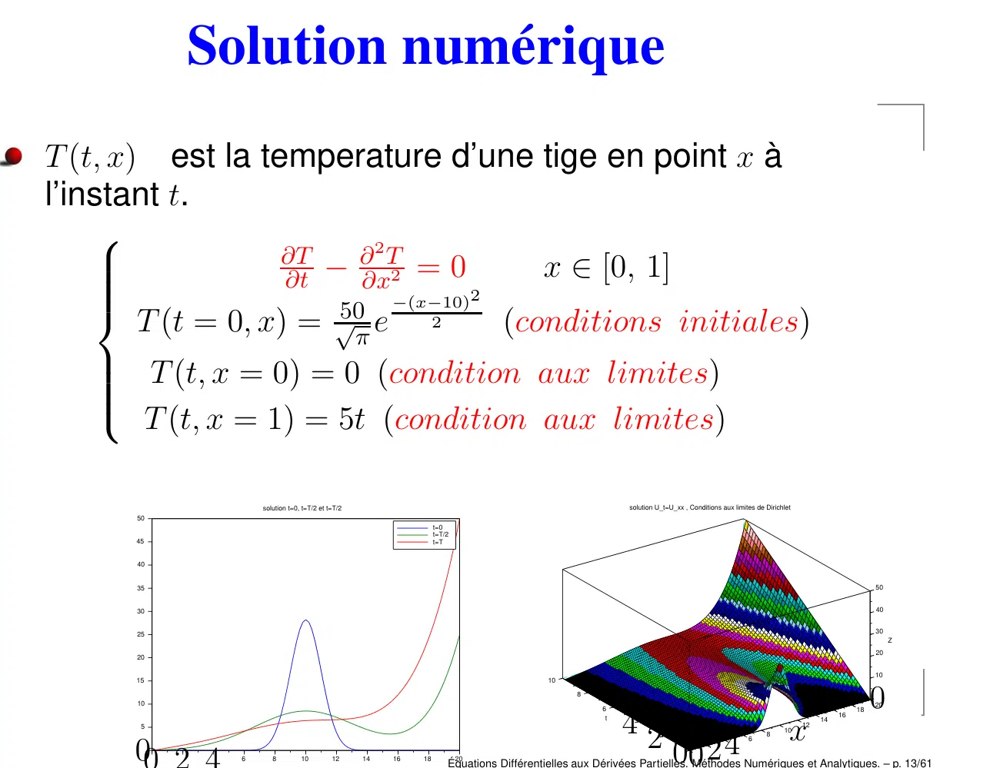

~~~text
            Solution numérique
T (t, x) est la temperature d’une tige en point x à
l’instant t.
                           2
                   ∂T     ∂   T
    
                   ∂t −  ∂x2 = 0         x ∈ [0, 1]
                              −(x−10)2
    
        T (t = 0, x) = √50π e 2
    
                                       (conditions initiales)
    
    
    
        T (t, x = 0) = 0 (condition aux limites)
    
     T (t, x = 1) = 5t (condition aux limites)

                   solution t=0, t=T/2 et t=T/2                                                            solution U_t=U_xx , Conditions aux limites de Dirichlet
       50
                                                                 t=0
                                                                 t=T/2
       45                                                        t=T

       40

       35                                                                                                                                                                                50

       30                                                                                                                                                                                40

       25                                                                                                                                                                                30
                                                                                                                                                                                              Z
                                                                                                                                                                                         20
       20

                                                                                                                                                                                         10
       15                                                                                 10

       10
                                                                                                8

                                                                                                     6                                                                              18
                                                                                                                                                                                         0
                                                                                                                                                                                         20

                                                                                                          42
                                                                                                      t                                                                        16

                                                                                                                                                                 x
                                                                                                                                                                          14
        5                                                                                                                                                            12
                                                                                                                                                               10

                                                                                                                         00 2 4
                                                                                                                                                         8

       0
                                                                                                                                                   6

               6      8         10         12     14   16   18           20
                                                                     Équations Différentielles aux Dérivées Partielles. Méthodes Numériques et Analytiques. – p. 13/61
~~~

## Page 14

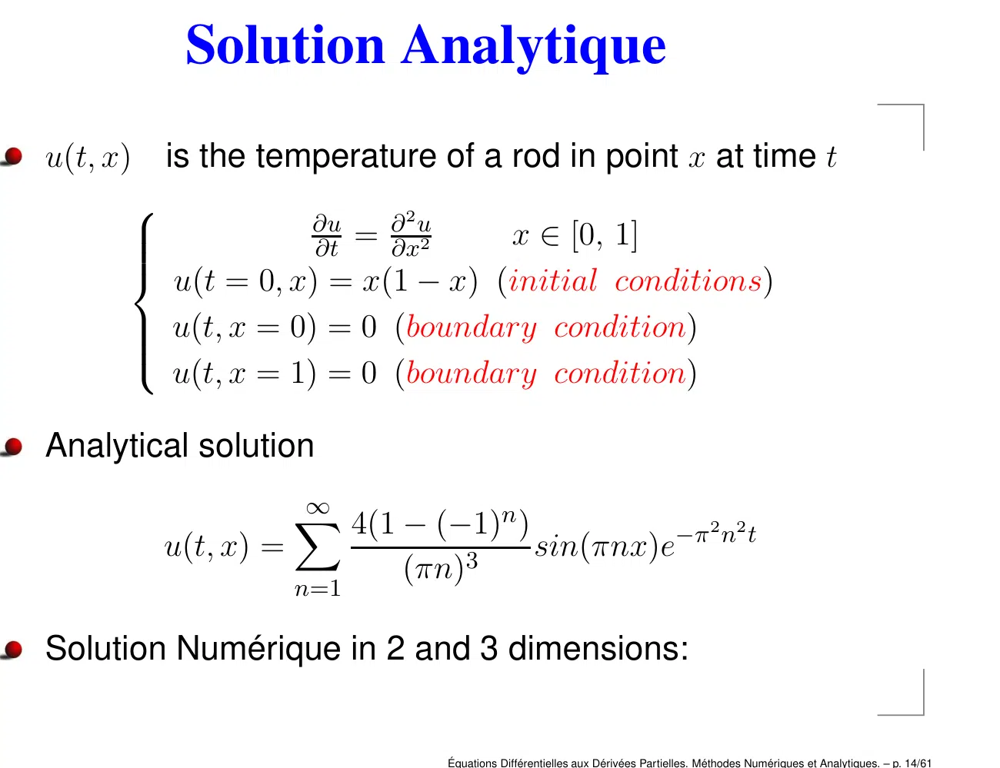

~~~text
         Solution Analytique
u(t, x) is the temperature of a rod in point x at time t
                           2
       
                    ∂u   ∂   u
       
                   ∂t = ∂x  2   x ∈ [0, 1]
       
         u(t = 0, x) = x(1 − x) (initial conditions)
       
       
        u(t, x = 0) = 0 (boundary condition)
       
         u(t, x = 1) = 0 (boundary condition)
       

Analytical solution
                    ∞
                    X 4(1 − (−1)n )                                          −π 2 n2 t
        u(t, x) =                              sin(πnx)e
                          (πn)3
                    n=1

Solution Numérique in 2 and 3 dimensions:

                             Équations Différentielles aux Dérivées Partielles. Méthodes Numériques et Analytiques. – p. 14/61
~~~

## Page 15

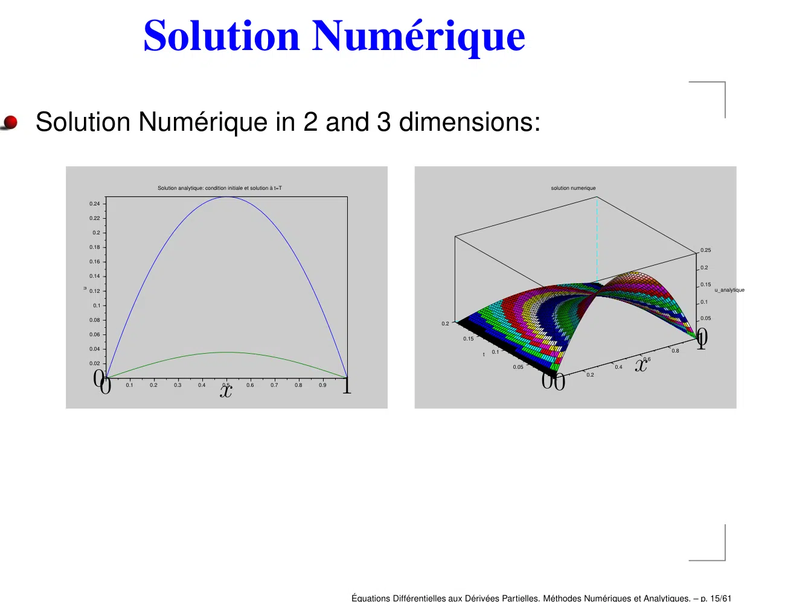

~~~text
                    Solution Numérique
Solution Numérique in 2 and 3 dimensions:

                          Solution analytique: condition initiale et solution à t=T                                                                     solution numerique

       0.24

       0.22

        0.2

       0.18
                                                                                                                                                                                                0.25

       0.16
                                                                                                                                                                                                0.2
       0.14
                                                                                                                                                                                                0.15
   u

       0.12                                                                                                                                                                                            u_analytique

                                                                                                                                                                                                0.1
        0.1

       0.08                                                                                                                                                                                     0.05
                                                                                                                          0.2

                                                                                                                                                                                               10
       0.06
                                                                                                                                0.15
       0.04                                                                                                                                                                              0.8
                                                                                                                                       t   0.1

       0.02
                                                                                                                                                 0.05                        0.4
                                                                                                                                                                                   x
                                                                                                                                                                                   0.6

        00    0.1   0.2          0.3        0.4
                                                      x0.5        0.6        0.7      0.8   0.9
                                                                                                  1                                                     00            0.2

                                                                                                  Équations Différentielles aux Dérivées Partielles. Méthodes Numériques et Analytiques. – p. 15/61
~~~

## Page 16

~~~text
   Equations Diff. Stochastiques

On simule par DF les Marches aléatoires, le Mouvement Brownien et diffusion, les
"Cluster Growth models", les Amas DLA, la Percolation, la Courbe SLE.
La courbe SLE est objet de recherche du mathématicien français Wendelin Werner (et
de ses collaborateurs) qui a été récompensé en 2006 par la Médaille Fields.

L’equation stochastique de Boltzman est objet de recherche du mathématicien français
Cedric Villani qui a été récompensé en 2010    parDiffla
                                         Équations        Médaille
                                                      érentielles             Fields.
                                                                   aux Dérivées Partielles. Méthodes Numériques et Analytiques. – p. 16/61
~~~

## Page 17

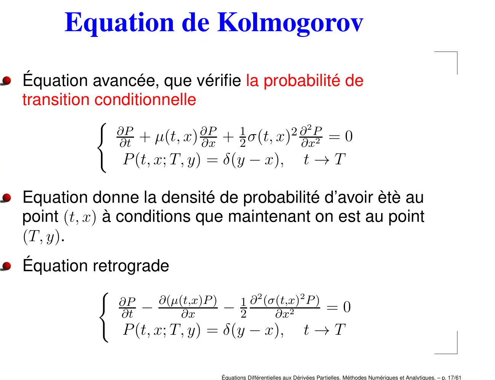

~~~text
      Equation de Kolmogorov
Équation avancée, que vérifie la probabilité de
transition conditionnelle
           (
              ∂P             ∂P   1      2 ∂2P
              ∂t + µ(t, x) ∂x + 2 σ(t, x) ∂x2 = 0
               P (t, x; T, y) = δ(y − x), t → T

Equation donne la densité de probabilité d’avoir ètè au
point (t, x) à conditions que maintenant on est au point
(T, y).
Équation retrograde
          (                         2       2
             ∂P     ∂(µ(t,x)P )  1 ∂ (σ(t,x) P )
             ∂t −       ∂x      −2     ∂x2       =0
             P (t, x; T, y) = δ(y − x), t → T

                              Équations Différentielles aux Dérivées Partielles. Méthodes Numériques et Analytiques. – p. 17/61
~~~

## Page 18

~~~text
  Equation de Black et Scholes
Equation de Black et Scholes
         (
            ∂V              ∂V  1 2 2 ∂2V
            ∂t − rV + rS ∂S + 2 σ S ∂S 2 = 0
               V (t = T, S) = max(S − K, 0)

• V (S, t) est le prix d’un contrat avec une banque
pour pouvoir acheter au prix K une action à la date T .
• S est le prix d’une action • r est le taux d’intêret
• σ est une volatilité • K est le prix d’exércice
• T est le temps d’exércice
Vous achetez au prix K une action qui vaut S à la date
t=T
Si S > K vous gagnez S − K
Si S < K vous n’exercez pas le contrat.

                          Équations Différentielles aux Dérivées Partielles. Méthodes Numériques et Analytiques. – p. 18/61
~~~

## Page 19

~~~text
Black et Scholes multidimensionnelle
  Options à deux actifs: Basket option
                                                       2                             2                                         2
     ∂V
      ∂t
                      ∂V
           − rV + rS1 ∂S       ∂V
                         + rS2 ∂S + 12 σ12 S12 ∂∂SV2 + 12 σ22 S22 ∂∂SV2 + ρσ1 σ2 S1 S2 ∂S∂ ∂S
                                                                                           V
                                                                                              =0
                          1          2                      1                             2                                     1      2
                             V (S1 , S2 , t = T, ) = max(S1 + S2 − K, 0)

  Options à deux actifs: Exchange option
                                                       2                             2                                         2
     ∂V
      ∂t
                      ∂V
           − rV + rS1 ∂S       ∂V
                         + rS2 ∂S + 12 σ12 S12 ∂∂SV2 + 12 σ22 S22 ∂∂SV2 + ρσ1 σ2 S1 S2 ∂S∂ ∂S
                                                                                           V
                                                                                              =0
                          1          2                      1                             2                                     1      2
                               V (S1 , S2 , t = T, ) = max(S2 − S1 , 0)

  Options à deux actifs: Quotient option
                                                       2                             2                                         2
     ∂V
      ∂t
                      ∂V
           − rV + rS1 ∂S       ∂V
                         + rS2 ∂S + 12 σ12 S12 ∂∂SV2 + 12 σ22 S22 ∂∂SV2 + ρσ1 σ2 S1 S2 ∂S∂ ∂S
                                                                                           V
                                                                                              =0
                          1          2                      1                             2                                     1      2
                             V (S1 , S2 , t = T, ) = max(S2 /S1 − K, 0)

                                              Équations Différentielles aux Dérivées Partielles. Méthodes Numériques et Analytiques. – p. 19/61
~~~

## Page 20

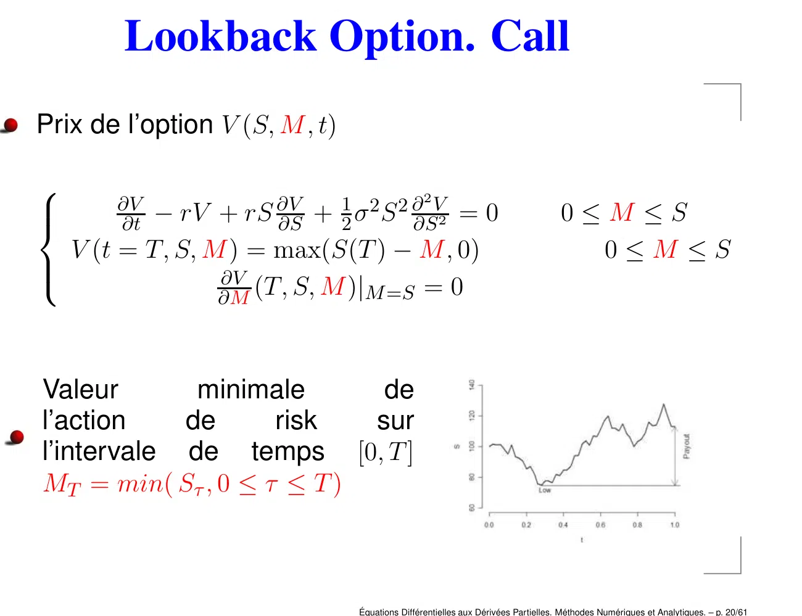

~~~text
        Lookback Option. Call
Prix de l’option V (S, M , t)


       ∂V           ∂V   1 2 2 ∂2V
       ∂t − rV + rS ∂S + 2 σ S ∂S 2 = 0                                              0≤M ≤S


  V (t = T, S, M ) = max(S(T ) − M , 0)                                                0≤M ≤S
                ∂V

                ∂M (T, S, M )|M =S = 0


Valeur       minimale       de
l’action    de      risk   sur
l’intervale de temps [0, T ]
MT = min( Sτ , 0 ≤ τ ≤ T )

                                Équations Différentielles aux Dérivées Partielles. Méthodes Numériques et Analytiques. – p. 20/61
~~~

## Page 21

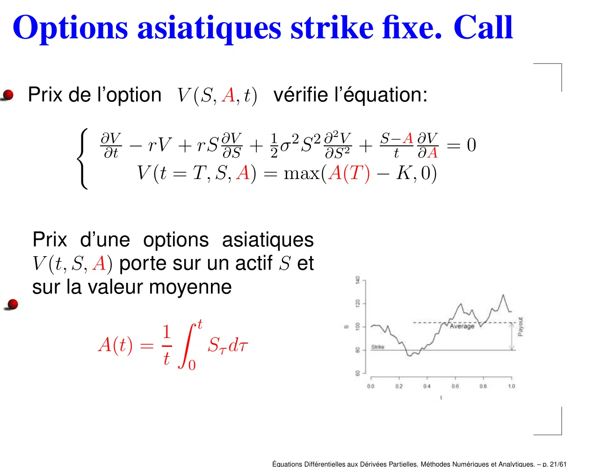

~~~text
Options asiatiques strike fixe. Call
 Prix de l’option V (S, A, t) vérifie l’équation:
      (
          ∂V              ∂V   1 2 2 ∂2V    S−A ∂V
           ∂t − rV  + rS  ∂S + 2 σ S ∂S 2 +  t ∂A = 0
               V (t = T, S, A) = max(A(T ) − K, 0)

 Prix d’une options asiatiques
 V (t, S, A) porte sur un actif S et
 sur la valeur moyenne
                    Z t
                  1
          A(t) =        Sτ dτ
                  t 0

                              Équations Différentielles aux Dérivées Partielles. Méthodes Numériques et Analytiques. – p. 21/61
~~~

## Page 22

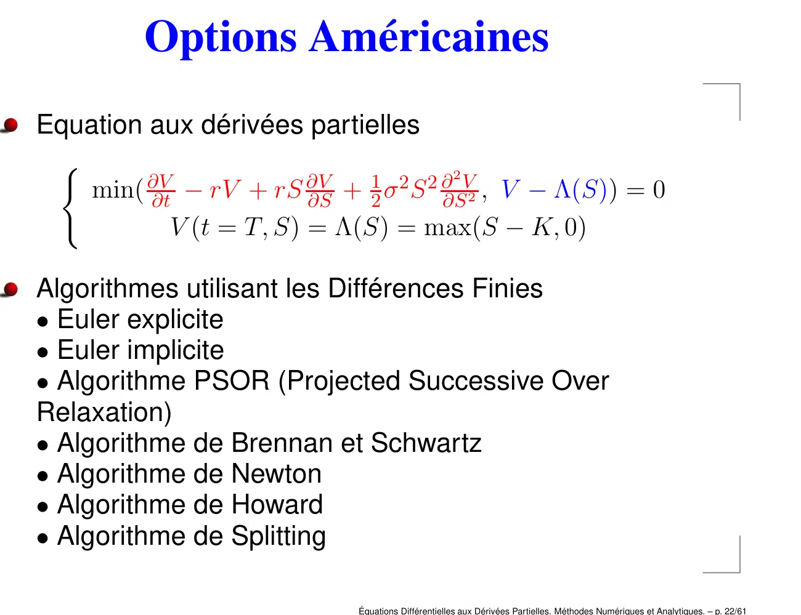

~~~text
         Options Américaines
Equation aux dérivées partielles
 (
         ∂V             ∂V  1 2 2 ∂2V
    min( ∂t − rV + rS ∂S + 2 σ S ∂S 2 , V − Λ(S)) = 0
           V (t = T, S) = Λ(S) = max(S − K, 0)

Algorithmes utilisant les Différences Finies
• Euler explicite
• Euler implicite
• Algorithme PSOR (Projected Successive Over
Relaxation)
• Algorithme de Brennan et Schwartz
• Algorithme de Newton
• Algorithme de Howard
• Algorithme de Splitting

                           Équations Différentielles aux Dérivées Partielles. Méthodes Numériques et Analytiques. – p. 22/61
~~~

## Page 23

~~~text
 Optimisation d’un portefeuille
           Equation d’Hamilton-Jacobi-Bellmann
Un portefeuille est constitué d’un actif risqué et d’un actif non risqué.
• αt correspond à la part investie dans un actif risqué
• 1 − αt      correspond à la part investie dans des actifs sans risque
• St est la valeur de l’actif qui vérifie une équation différentielle stochastique

On cherche αt de sorte qu’on optimise l’ésperance de l’utilité E[h(ST )]                                     ( h est une
fonction utilité). On doit estimer la valeur du portefeuille
                         n
                             U (t, x) =Supαt E[h(ST )|St = x]

La valeur U (t, x) est la solution de l’équation d’Hamilton-Jacobi-Bellmann
           
               ∂U                                 ∂U   1 2 2 2 ∂2U
           
               ∂t
                  +Sup αt [(α t µ + (1 − α t )r)x ∂x
                                                     +  α σ x ∂x2 ] = 0
                                                       2 t
                              U (t = T, x) = h(x),              x>0

On résout l’équation à l’aide des Différences finies et on effectue l’optimisation pour
chaque itération avec l’Algorithme de Howard.
                                           Équations Différentielles aux Dérivées Partielles. Méthodes Numériques et Analytiques. – p. 23/61
~~~

## Page 24

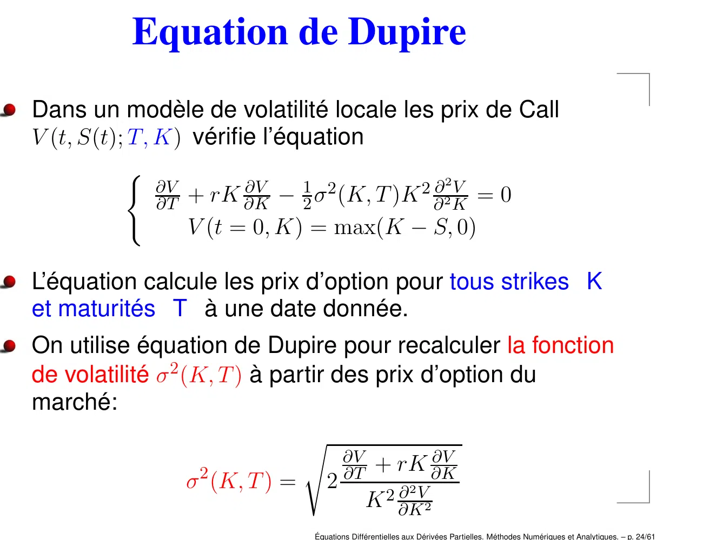

~~~text
         Equation de Dupire
Dans un modèle de volatilité locale les prix de Call
V (t, S(t); T, K) vérifie l’équation
           (
               ∂V       ∂V    1 2       2 ∂2V
               ∂T + rK ∂K − 2 σ (K, T )K ∂ 2 K = 0
                  V (t = 0, K) = max(K − S, 0)

L’équation calcule les prix d’option pour tous strikes K
et maturités T à une date donnée.
On utilise équation de Dupire pour recalculer la fonction
de volatilité σ 2 (K, T ) à partir des prix d’option du
marché:
                               s
                                    ∂V          ∂V
                                       +   rK
               σ 2 (K, T ) =      2 ∂T      2
                                           ∂ V
                                               ∂K
                                       K 2 ∂K 2

                               Équations Différentielles aux Dérivées Partielles. Méthodes Numériques et Analytiques. – p. 24/61
~~~

## Page 25

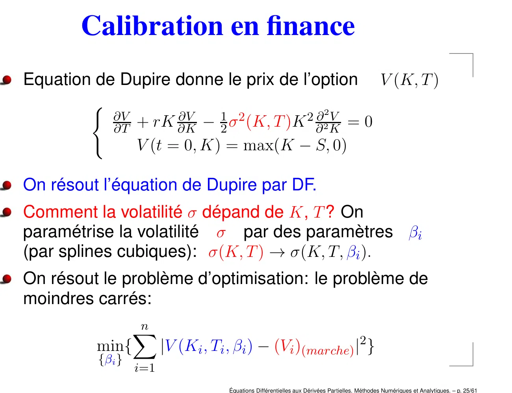

~~~text
       Calibration en finance
Equation de Dupire donne le prix de l’option V (K, T )
        (
           ∂V       ∂V    1 2        2 ∂2V
           ∂T + rK ∂K − 2 σ (K, T )K ∂ 2 K = 0
              V (t = 0, K) = max(K − S, 0)

On résout l’équation de Dupire par DF.
Comment la volatilité σ dépand de K , T ? On
paramétrise la volatilité σ par des paramètres βi
(par splines cubiques): σ(K, T ) → σ(K, T, βi ).
On résout le problème d’optimisation: le problème de
moindres carrés:
             Xn
         min{   |V (Ki , Ti , βi ) − (Vi )(marche) |2 }
         {βi }
                 i=1
                              Équations Différentielles aux Dérivées Partielles. Méthodes Numériques et Analytiques. – p. 25/61
~~~

## Page 26

~~~text
                Equation de Heston
Modéle de Heston est une généralisation de l’équation de Black et Scoles pour une
volatilité stochastique.
                               
                                 dSt
                               
                               
                                 St
                                     = r dt + σt dWt
                               
                                dσ = a dt + b dW ′
                               
                                      t     t             t        t
                               
                               
                                d < W, W ′ >= ρdt
                               
                                    dBt
                               
                                     B
                                         = rdt
                                           t

Méthode 1: On applique les DF pour discrétiser les équations et les simuler par
Monte-Carlo.

Méthode 2: On résout l’EDP de Heston en trois dimensions: V (t, S, σ)

                    2           2                 2
   ∂V
    ∂t
         + 21 S 2 σ 2 ∂∂SV2 + 21 b2t ∂∂σV2 + Sσbt ρ ∂S∂σ
                                                    ∂ V
                                                         − rV + rS ∂V
                                                                   ∂S
                                                                      + λ(t, σ, S) ∂V
                                                                                   ∂σ
                                                                                      =0
                       V (t = T, S, σ) = Λ(S) = max(S − K, 0)

Problème: comment imposer les conditions aux limites?

                                            Équations Différentielles aux Dérivées Partielles. Méthodes Numériques et Analytiques. – p. 26/61
~~~

## Page 27

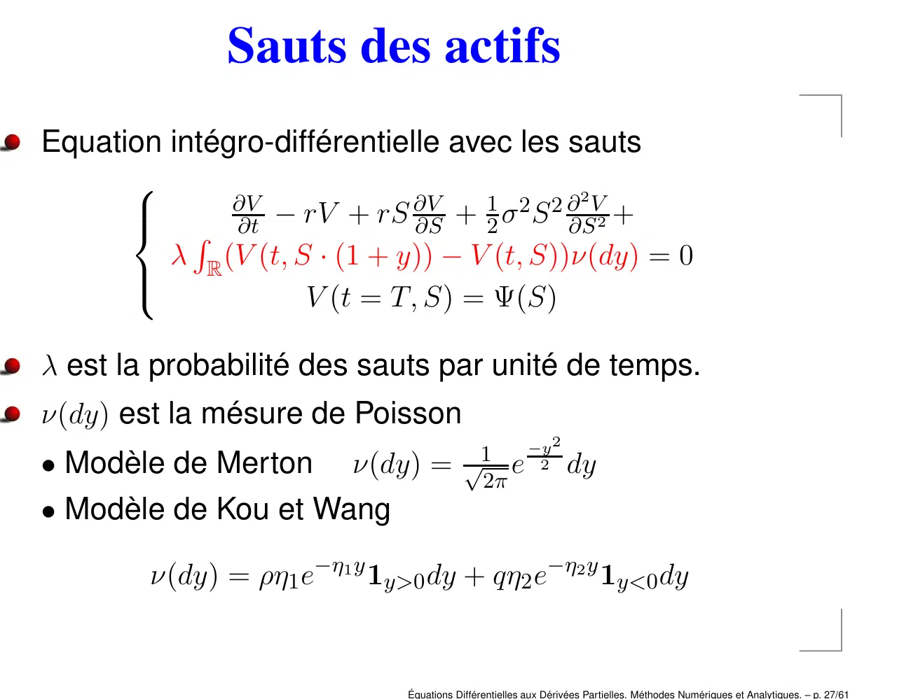

~~~text
               Sauts des actifs
Equation intégro-différentielle avec les sauts
                                               2
              ∂V              ∂V    1   2   2 ∂   V
       R ∂t
                −   rV  + rS ∂S  + 2 σ   S   ∂S 2 +
         λ R (V (t, S · (1 + y)) − V (t, S))ν(dy) = 0
      
                    V (t = T, S) = Ψ(S)

λ est la probabilité des sauts par unité de temps.
ν(dy) est la mésure de Poisson
                                      −y                       2
                                  1
• Modèle de Merton       ν(dy) = √2π e 2 dy
• Modèle de Kou et Wang

        ν(dy) = ρη1 e−η1 y 1y>0 dy + qη2 e−η2 y 1y<0 dy

                              Équations Différentielles aux Dérivées Partielles. Méthodes Numériques et Analytiques. – p. 27/61
~~~

## Page 28

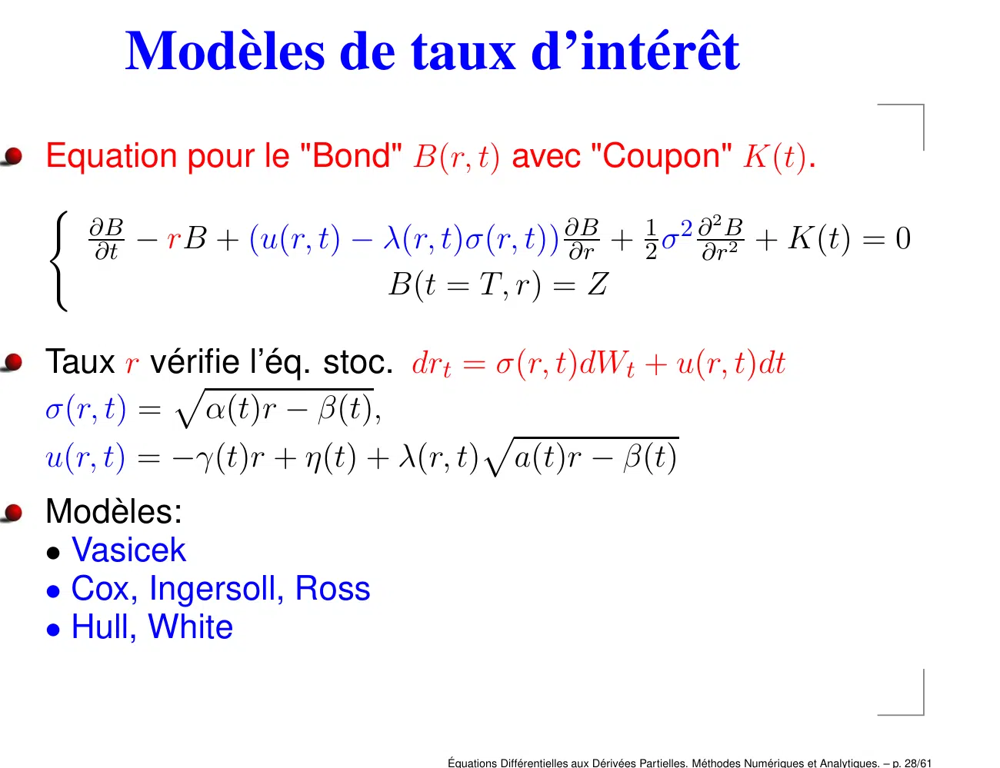

~~~text
     Modèles de taux d’intérêt
Equation pour le "Bond" B(r, t) avec "Coupon" K(t).
(
  ∂B                                  ∂B    1 2 ∂2B
  ∂t − rB + (u(r, t) − λ(r, t)σ(r, t)) ∂r + 2 σ ∂r2 + K(t) = 0
                       B(t = T, r) = Z

Taux r vérifie l’éq. stoc. drt = σ(r, t)dWt + u(r, t)dt
          p
σ(r, t) = α(t)r − β(t),
                                 p
u(r, t) = −γ(t)r + η(t) + λ(r, t) a(t)r − β(t)
Modèles:
• Vasicek
• Cox, Ingersoll, Ross
• Hull, White

                             Équations Différentielles aux Dérivées Partielles. Méthodes Numériques et Analytiques. – p. 28/61
~~~

## Page 29

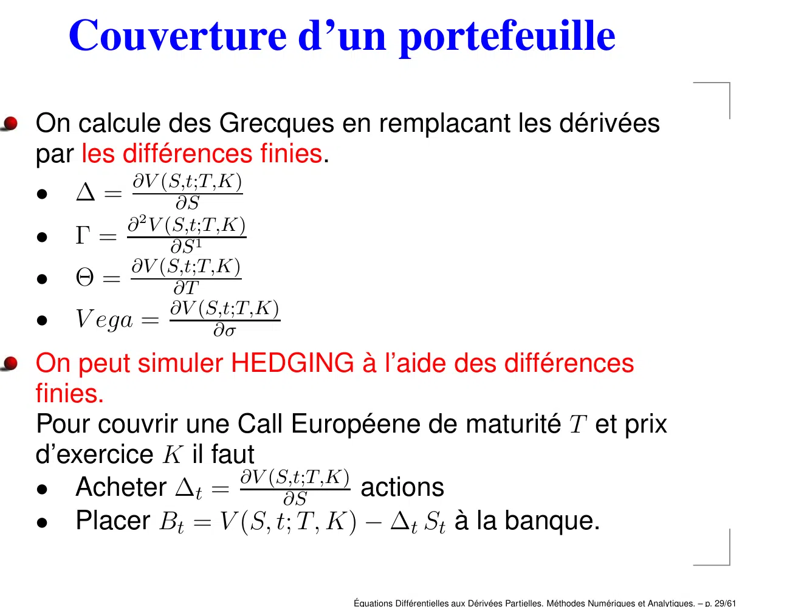

~~~text
    Couverture d’un portefeuille
On calcule des Grecques en remplacant les dérivées
par les différences finies.
• ∆ = ∂V (S,t;T,K)
             ∂S
         ∂ 2 V (S,t;T,K)
•   Γ=          ∂S 1
•   Θ = ∂V (S,t;T,K)
                ∂T
•   V ega = ∂V (S,t;T,K)
                     ∂σ
On peut simuler HEDGING à l’aide des différences
finies.
Pour couvrir une Call Européene de maturité T et prix
d’exercice K il faut
                   ∂V (S,t;T,K)
• Acheter ∆t =          ∂S      actions
• Placer Bt = V (S, t; T, K) − ∆t St à la banque.

                           Équations Différentielles aux Dérivées Partielles. Méthodes Numériques et Analytiques. – p. 29/61
~~~

## Page 30

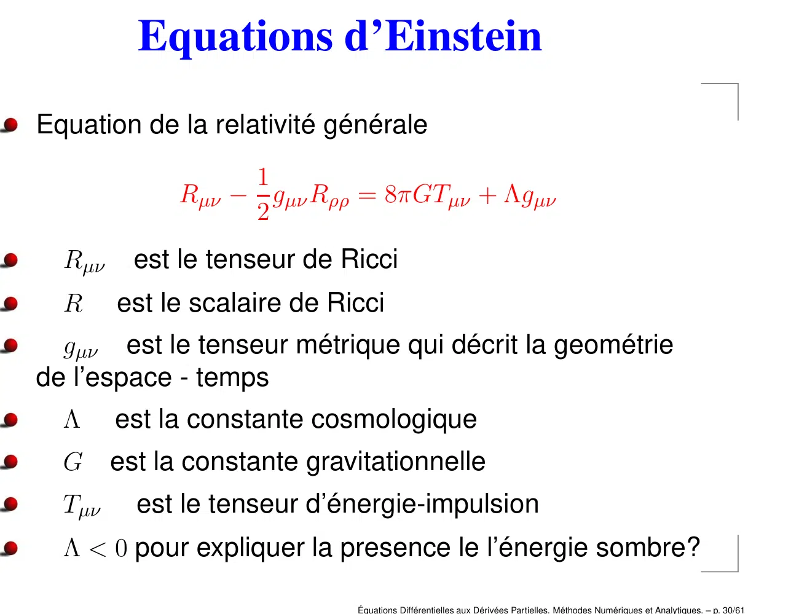

~~~text
          Equations d’Einstein
Equation de la relativité générale
                   1
              Rµν − gµν Rρρ = 8πGTµν + Λgµν
                   2
  Rµν     est le tenseur de Ricci
  R     est le scalaire de Ricci
  gµν est le tenseur métrique qui décrit la geométrie
de l’espace - temps
  Λ     est la constante cosmologique
  G     est la constante gravitationnelle
  Tµν     est le tenseur d’énergie-impulsion
  Λ < 0 pour expliquer la presence le l’énergie sombre?

                             Équations Différentielles aux Dérivées Partielles. Méthodes Numériques et Analytiques. – p. 30/61
~~~

## Page 31

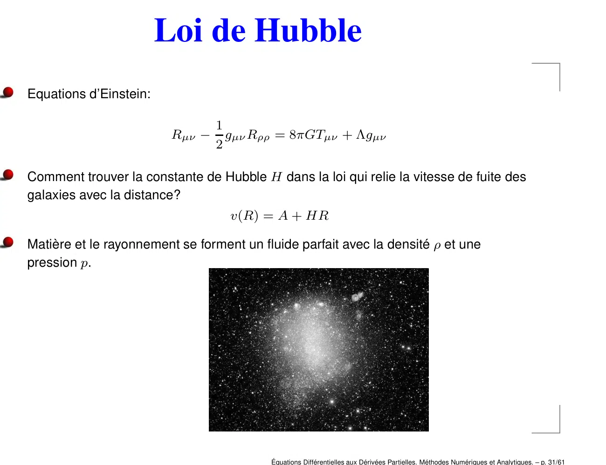

~~~text
                        Loi de Hubble
Equations d’Einstein:

                                 1
                         Rµν −     gµν Rρρ = 8πGTµν + Λgµν
                                 2

Comment trouver la constante de Hubble H dans la loi qui relie la vitesse de fuite des
galaxies avec la distance?
                                   v(R) = A + HR

Matière et le rayonnement se forment un fluide parfait avec la densité ρ et une
pression p.

                                          Équations Différentielles aux Dérivées Partielles. Méthodes Numériques et Analytiques. – p. 31/61
~~~

## Page 32

~~~text
                     Loi de Hubble
Fluide cosmologique vérifie les équations de Friedmann-Lamaitre

    2  1 dR 2   8πGρ  kc2  Λc2                           1 d2 R    4πGρ            Λc2
  H =(      ) =      − 2 +     ,                                =−      (ρ + 3p) +
       R dt       3   R     3                            R dt2       3              3

Méthode 1- théorique: Résolution des équations par DF avec 4 paramètres.

Méthode 2- expérimentale: Résolution du problème d’optimisation linaiére (moindres
carrés linéaire ) pour trouver la constante de Hubble

                                  v(R) = A + HR

Explosion de Supernova du Type Ia.
Pour trouver la constante de Hubble:
• On construit une courbe de l’intensité
de Supernova en fonction du temps.
• De cette courbe on calcule la vitesse
v(R) et la distance R.

H=72 km/s/Mps
                                           Équations Différentielles aux Dérivées Partielles. Méthodes Numériques et Analytiques. – p. 32/61
~~~

## Page 33

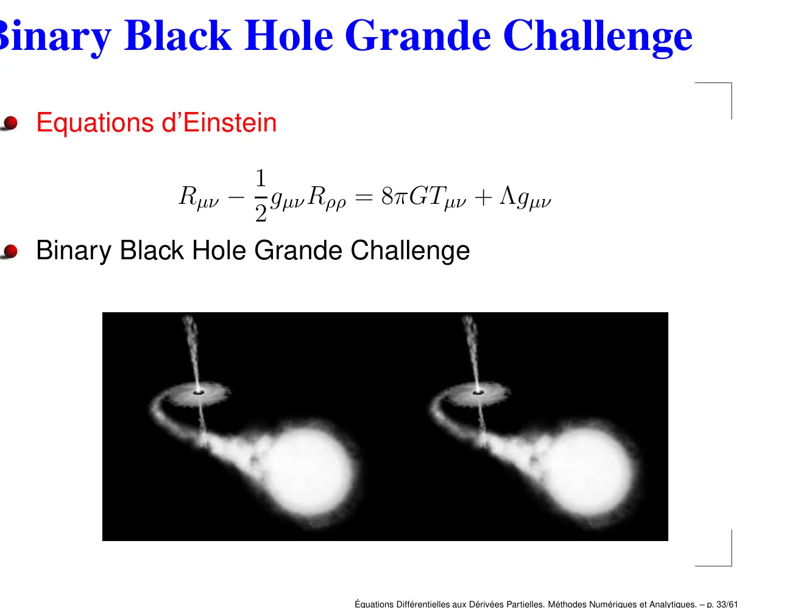

~~~text
Binary Black Hole Grande Challenge
  Equations d’Einstein

                    1
             Rµν − gµν Rρρ = 8πGTµν + Λgµν
                    2
  Binary Black Hole Grande Challenge

                          Équations Différentielles aux Dérivées Partielles. Méthodes Numériques et Analytiques. – p. 33/61
~~~

## Page 34

~~~text
Binary Black Hole Grande Challenge
  Pouquoi simuler?

  • Pour comprendre la nature des ondes gravitationnelles émises pendant la période
  de fusion. Trés important pour la detection.
  • Tester la relativité générale d’Einstein dans le regime de champs forts et
  nonlinéaires.

                                          Équations Différentielles aux Dérivées Partielles. Méthodes Numériques et Analytiques. – p. 34/61
~~~

## Page 35

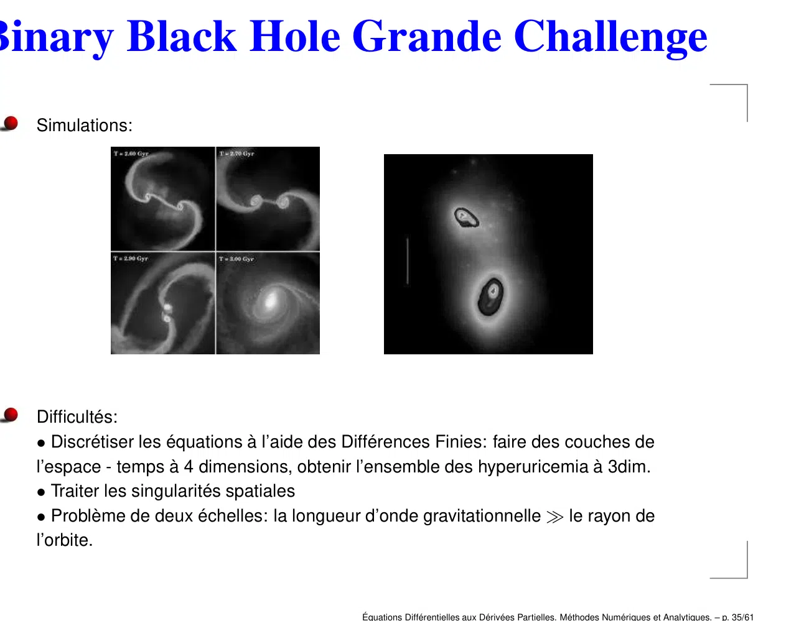

~~~text
Binary Black Hole Grande Challenge
  Simulations:

  Difficultés:
  • Discrétiser les équations à l’aide des Différences Finies: faire des couches de
  l’espace - temps à 4 dimensions, obtenir l’ensemble des hyperuricemia à 3dim.
  • Traiter les singularités spatiales
  • Problème de deux échelles: la longueur d’onde gravitationnelle ≫ le rayon de
  l’orbite.

                                            Équations Différentielles aux Dérivées Partielles. Méthodes Numériques et Analytiques. – p. 35/61
~~~

## Page 36

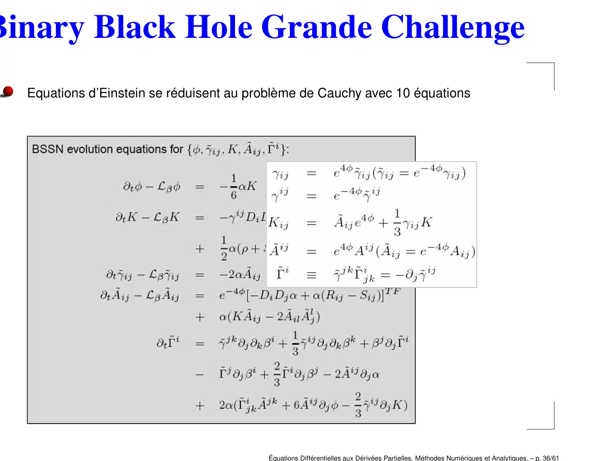

~~~text
Binary Black Hole Grande Challenge
  Equations d’Einstein se réduisent au problème de Cauchy avec 10 équations

                                         Équations Différentielles aux Dérivées Partielles. Méthodes Numériques et Analytiques. – p. 36/61
~~~

## Page 37

~~~text
Binary Black Hole Grande Challenge
  Résultats:
  • Découverte des relations entre la fusion et des paramètres initiales.
  • Simulation de la fusion de deux trous noirs de masse équavalentes, de l’emission
  des ondes gravitationnelles.
  • Découverte des ONDES GRAVITATIONNELLES!

                                           Équations Différentielles aux Dérivées Partielles. Méthodes Numériques et Analytiques. – p. 37/61
~~~

## Page 38

~~~text
 Mouvement des astres célestes
Problème de deux corps: le mouvement d’une masse
M             
                 dVx         G M X(t)
              
                  dt =   √
                        ( X(t)2 +Y (t)2 )3
              
              
              
               dVy           G M Y (t)
              
                  dt =   √
                        ( X(t)2 +Y (t)2 )3
                                 dX
                      V   (t) =
              
                        x
              
              
                                 dt
                      V (t) = dY
              
              
                         y                  dt

0n résout par DF les équations en utilisant les
algorithmes de Euler-Cromer et Runge-Kutta.
A l’aide des simulations on pourra observer:
• Phénomènes de résonances parmi des asteroides -
fentes de Kirkwood
• Mouvement d’Hyperion, la plus petite des lunes de
Saturne.
                             Équations Différentielles aux Dérivées Partielles. Méthodes Numériques et Analytiques. – p. 38/61
~~~

## Page 39

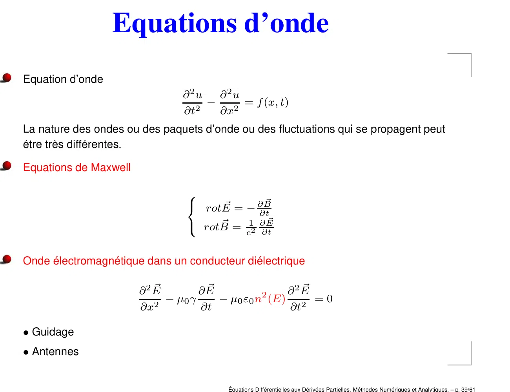

~~~text
                  Equations d’onde
Equation d’onde
                               ∂2u   ∂2u
                                   −     = f (x, t)
                               ∂t2   ∂x2
La nature des ondes ou des paquets d’onde ou des fluctuations qui se propagent peut
étre très différentes.

Equations de Maxwell

                                
                                     ~ = − ∂B
                                 rotE       ~
                                            ∂t
                                              ~
                                     ~ = 12 ∂ E
                                 rotB
                                               c     ∂t

Onde électromagnétique dans un conducteur diélectrique

                         ~
                       ∂2E         ~
                                  ∂E              ∂2E~
                                              2
                           − µ0 γ    − µ0 ε0 n (E) 2 = 0
                       ∂x2        ∂t              ∂t

• Guidage
• Antennes

                                        Équations Différentielles aux Dérivées Partielles. Méthodes Numériques et Analytiques. – p. 39/61
~~~

## Page 40

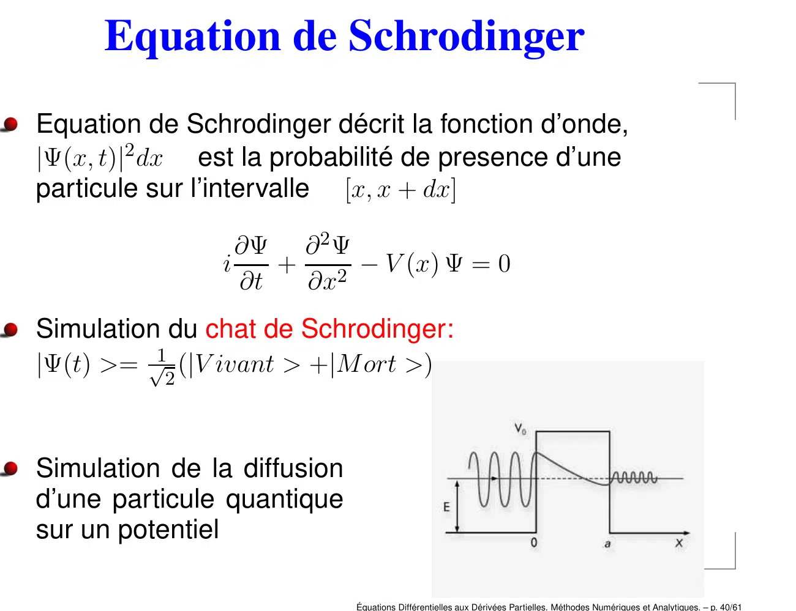

~~~text
     Equation de Schrodinger
Equation de Schrodinger décrit la fonction d’onde,
|Ψ(x, t)|2 dx est la probabilité de presence d’une
particule sur l’intervalle [x, x + dx]

                 ∂Ψ ∂ 2 Ψ
               i    +    2
                           − V (x) Ψ = 0
                 ∂t   ∂x
Simulation du chat de Schrodinger:
|Ψ(t) >= √12 (|V ivant > +|M ort >)

Simulation de la diffusion
d’une particule quantique
sur un potentiel

                             Équations Différentielles aux Dérivées Partielles. Méthodes Numériques et Analytiques. – p. 40/61
~~~

## Page 41

~~~text
     Equation de Schrodinger
Applications dans les téchnologie des
supraconducteurs, lasers, des désintégrations (fission,
radioactivité alpha), des transistors, certaines diodes,
différents types de microscopes,l’effet Josephson.
MRG: Magnétorésistance géante, Minituarisation des
disques dures...
Equation de Klein-Gordon

                 ∂ 2Ψ ∂ 2Ψ       2
                    2
                      −    2
                             − m   Ψ=0
                 ∂t     ∂x
L’équation de Klein-Gordon est une version relativiste
de l’équation de Schrodinger décrivant des particules
massives.

                           Équations Différentielles aux Dérivées Partielles. Méthodes Numériques et Analytiques. – p. 41/61
~~~

## Page 42

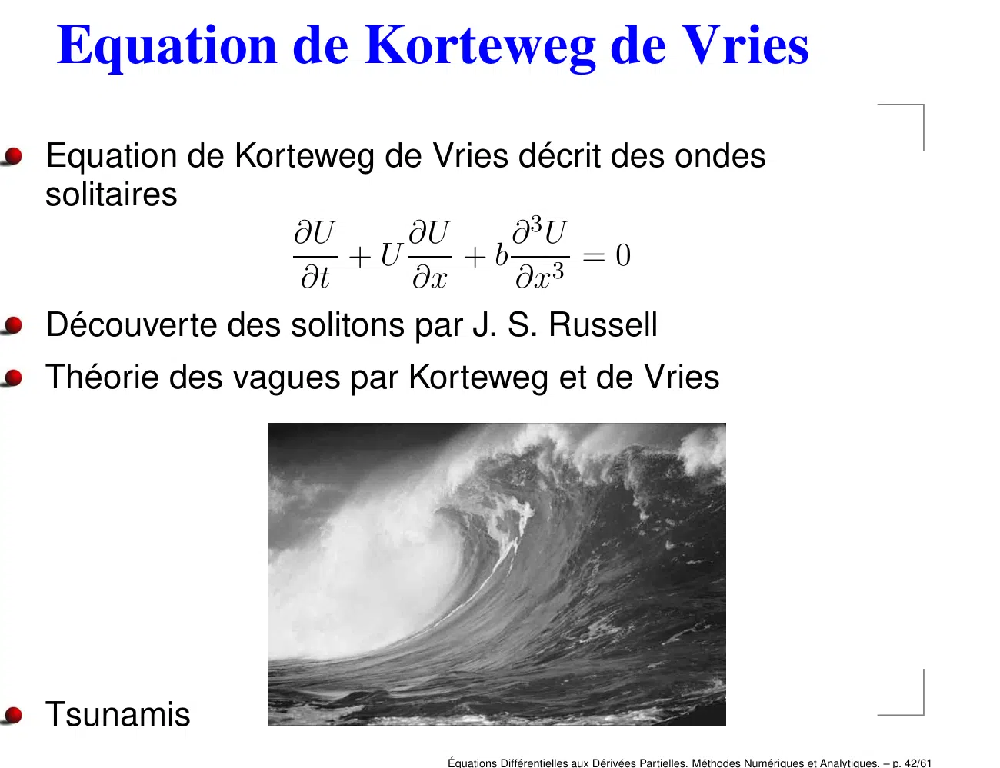

~~~text
Equation de Korteweg de Vries
Equation de Korteweg de Vries décrit des ondes
solitaires
                ∂U     ∂U      ∂ 3U
                    +U     +b 3 =0
                ∂t      ∂x     ∂x
Découverte des solitons par J. S. Russell
Théorie des vagues par Korteweg et de Vries

Tsunamis
                         Équations Différentielles aux Dérivées Partielles. Méthodes Numériques et Analytiques. – p. 42/61
~~~

## Page 43

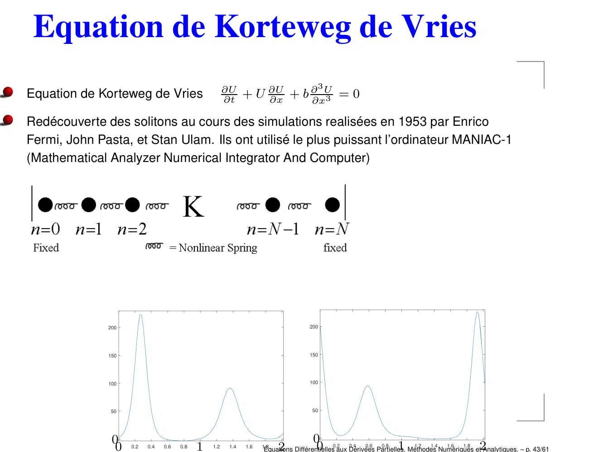

~~~text
 Equation de Korteweg de Vries
                                                      ∂U     ∂U     ∂3U
Equation de Korteweg de Vries                         ∂t
                                                         + U ∂x
                                                                + b ∂x3
                                                                                              =0

Redécouverte des solitons au cours des simulations realisées en 1953 par Enrico
Fermi, John Pasta, et Stan Ulam. Ils ont utilisé le plus puissant l’ordinateur MANIAC-1
(Mathematical Analyzer Numerical Integrator And Computer)

              200                                                                  200

              150                                                                  150

              100                                                                  100

               50                                                                   50

               0                                                                    0
                0   0.2   0.4   0.6   0.8   1   1.2    1.4   1.6   1.8   2           0     0.2   0.4   0.6   0.8   1     1.2   1.4   1.6   1.8   2
                                                                   Équations Différentielles aux Dérivées Partielles. Méthodes Numériques et Analytiques. – p. 43/61
~~~

## Page 44

~~~text
                   Solitons
Solutions analytiques de KdV sont possible:
• Un soliton: U (x, t) =       √ b
                         2ch2 ( b/2(x−bt))

Découverte en Mathématiques fondamentales: la
méthode de la diffusion inverse de résolution analytique
des EDP nonlinéaires.
Equation de Sine-Gordon

                  ∂ 2U   ∂ 2U
                     2
                       −    2
                              = sin U
                  ∂t     ∂x
L’équation de Sine-Gordon décrit les solitons dans un
cristal.
Applications: Fibres optiques, Reactions
termonucléaires, Superconducteurs (Effet tunnel de
Josephson)                 Équations Différentielles aux Dérivées Partielles. Méthodes Numériques et Analytiques. – p. 44/61
~~~

## Page 45

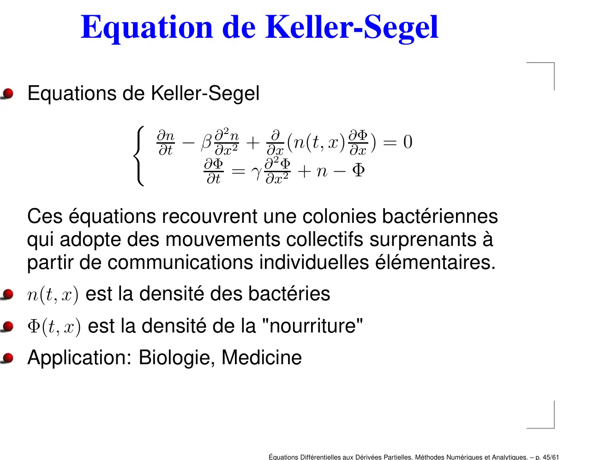

~~~text
      Equation de Keller-Segel
Equations de Keller-Segel
           (
             ∂n      ∂2n    ∂          ∂Φ
              ∂t − β ∂x2 + ∂x (n(t, x) ∂x ) = 0
                   ∂Φ      ∂2Φ
                    ∂t = γ ∂x2 + n − Φ

Ces équations recouvrent une colonies bactériennes
qui adopte des mouvements collectifs surprenants à
partir de communications individuelles élémentaires.
n(t, x) est la densité des bactéries
Φ(t, x) est la densité de la "nourriture"
Application: Biologie, Medicine

                             Équations Différentielles aux Dérivées Partielles. Méthodes Numériques et Analytiques. – p. 45/61
~~~

## Page 46

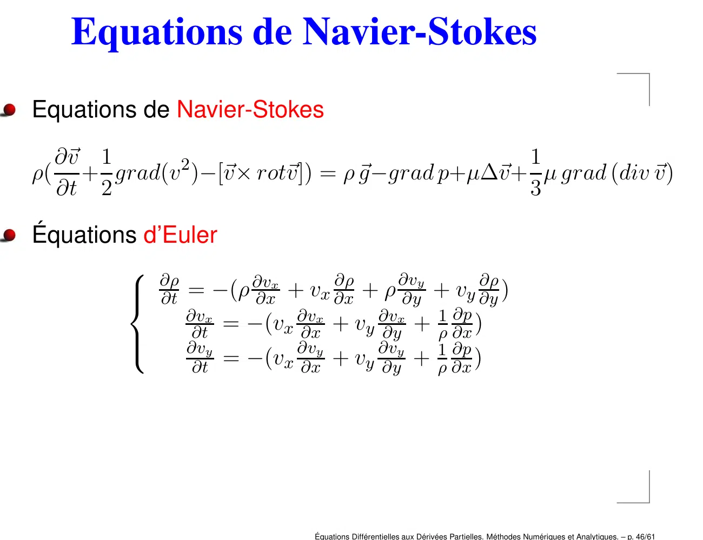

~~~text
    Equations de Navier-Stokes
Equations de Navier-Stokes
  ∂~v 1    2                                      1
ρ( + grad(v )−[~v × rot~v ]) = ρ ~g −grad p+µ∆~v + µ grad (div ~v )
  ∂t 2                                            3

Équations d’Euler
                                           ∂vy
         ∂ρ                     ∂ρ                  ∂ρ
                      ∂vx
         ∂t
             =   −(ρ ∂x  +  v x ∂x  +   ρ ∂y  + v y ∂y )
              ∂vx           ∂vx         ∂vx    1 ∂p
               ∂t  = −(v  x ∂x  +   v y ∂y   + ρ ∂x )
             ∂vy           ∂vy         ∂vy    1 ∂p
                   = −(v        +   v        + ρ ∂x )
        
               ∂t         x ∂x        y ∂y

                                 Équations Différentielles aux Dérivées Partielles. Méthodes Numériques et Analytiques. – p. 46/61
~~~

## Page 47

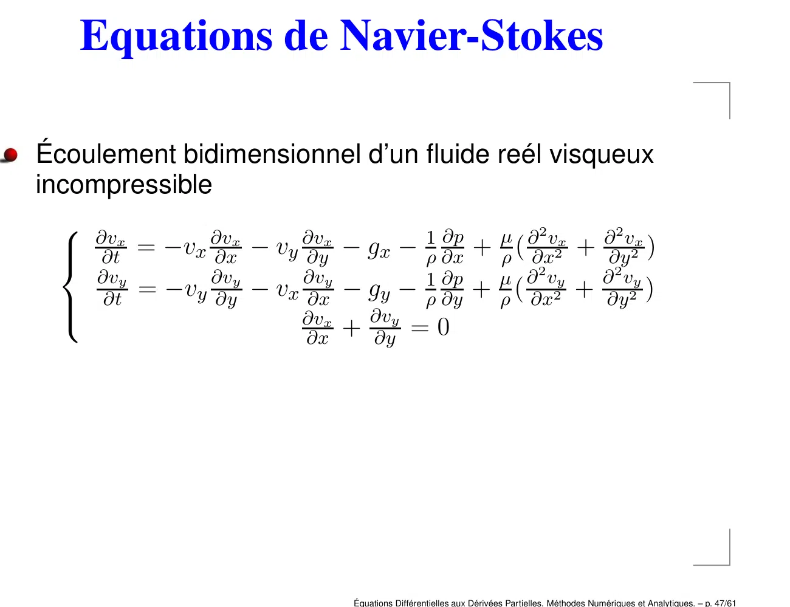

~~~text
    Equations de Navier-Stokes

Écoulement bidimensionnel d’un fluide reél visqueux
incompressible
                                 1 ∂p   µ ∂ 2 vx   ∂ 2 vx
   ∂v        ∂vx     ∂vx
   ∂t = −vx ∂x − vy ∂y − gx − ρ ∂x + ρ ( ∂x   2 + ∂y 2 )
       x
  
     ∂vy      ∂vy     ∂vy        1 ∂p   µ ∂ 2 vy   ∂ 2 vy
      ∂t = −vy ∂y − vx ∂x − gy − ρ ∂y + ρ ( ∂x2 + ∂y2 )
                      ∂vx   ∂vy
  
                       ∂x + ∂y = 0
  

                             Équations Différentielles aux Dérivées Partielles. Méthodes Numériques et Analytiques. – p. 47/61
~~~

## Page 48

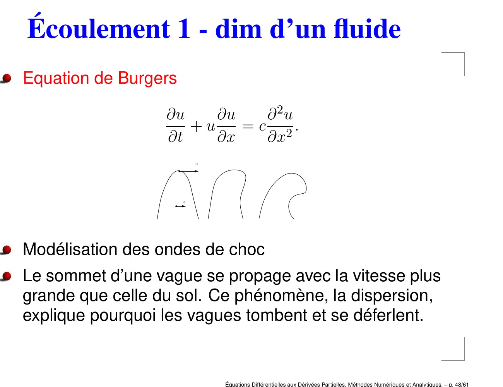

~~~text
Écoulement 1 - dim d’un fluide
Equation de Burgers

                  ∂u    ∂u    ∂ 2u
                     +u    = c 2.
                  ∂t    ∂x    ∂x
                           v1

                      v2

Modélisation des ondes de choc
Le sommet d’une vague se propage avec la vitesse plus
grande que celle du sol. Ce phénomène, la dispersion,
explique pourquoi les vagues tombent et se déferlent.

                                Équations Différentielles aux Dérivées Partielles. Méthodes Numériques et Analytiques. – p. 48/61
~~~

## Page 49

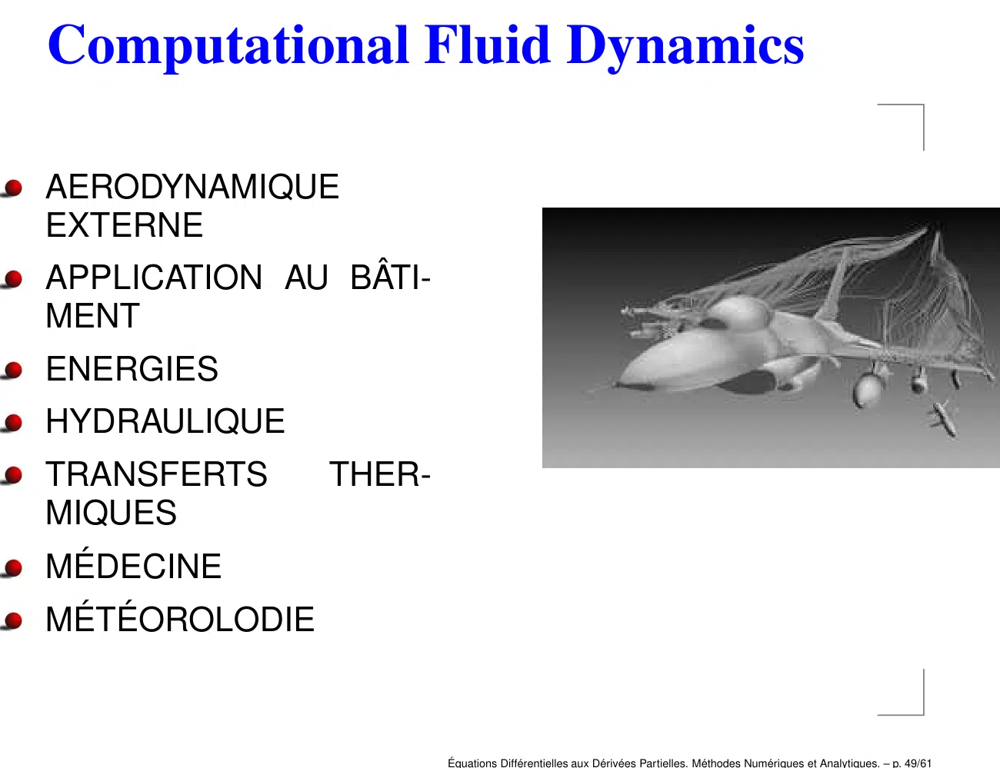

~~~text
Computational Fluid Dynamics

AERODYNAMIQUE
EXTERNE
APPLICATION AU BÂTI-
MENT
ENERGIES
HYDRAULIQUE
TRANSFERTS     THER-
MIQUES
MÉDECINE
MÉTÉOROLODIE

                       Équations Différentielles aux Dérivées Partielles. Méthodes Numériques et Analytiques. – p. 49/61
~~~

## Page 50

~~~text
Computational Fluid Dynamics

permet de simuler l’écoulement autour
ou à l’intérieur d’un corps ; d’évaluer les
forces subies par un corps soumis au
vent ou se déplaçant dans l’air ou dans
l’eau

de déterminer les puissances de
chauffage ou de climatisation néces-
saires dans un bâtiment ainsi que
les meilleurs emplacements pour les
ventilations

de déterminer les concentrations chim-
iques en différents endroits d’un réac-
teur, la corrosion, la séparation de deux
phases (sable et eau par exemple)...

permet à partir de la géométrie in-
térieure du circuit hydraulique de con-
naitre avec précision: la répartition du
débit dans les différents composants du
                                              Équations Différentielles aux Dérivées Partielles. Méthodes Numériques et Analytiques. – p. 50/61
~~~

## Page 51

~~~text
         Bouchon automobile
On décrit la circulation automobile par le nombre
d’automobiles n(x, t) par unité de longueur.
Si la vitesse des automobiles est une constante v0 alors
n(x, t) est la solution de l’équation d’advection:

                     ∂n      ∂n
                        + v0    = 0.
                     ∂t      ∂x
Donc si la circulation à t = 0 est fluide le bouchon ne se
forme pas.
On affine le modèle en supposant que la vitesse est
une fonction de la concentration n:
            n
v = v0 (1−      ) pour 0 ≤ n ≤ nmax , v = 0 pour n ≥ nmax
           nmax

                            Équations Différentielles aux Dérivées Partielles. Méthodes Numériques et Analytiques. – p. 51/61
~~~

## Page 52

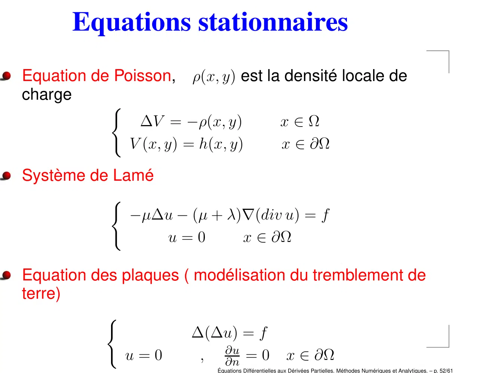

~~~text
      Equations stationnaires
Equation de Poisson, ρ(x, y) est la densité locale de
charge
           (
               ∆V = −ρ(x, y)       x∈Ω
              V (x, y) = h(x, y)   x ∈ ∂Ω

Système de Lamé
          (
             −µ∆u − (µ + λ)∇(div u) = f
                u=0        x ∈ ∂Ω

Equation des plaques ( modélisation du tremblement de
terre)
           (
                      ∆(∆u) = f
                          ∂u
             u=0       , ∂n  = 0 x ∈ ∂Ω
                          Équations Différentielles aux Dérivées Partielles. Méthodes Numériques et Analytiques. – p. 52/61
~~~

## Page 53

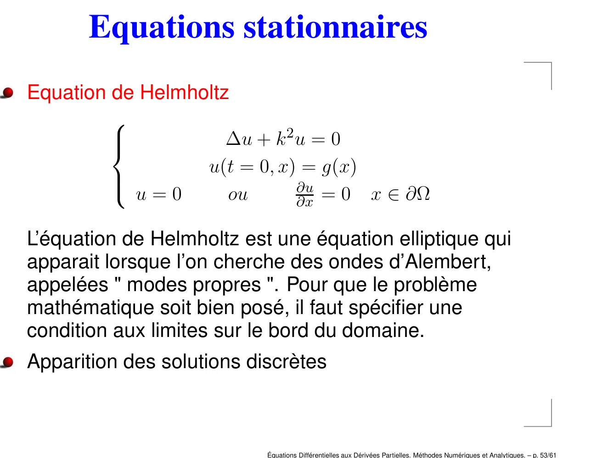

~~~text
       Equations stationnaires
Equation de Helmholtz
         
         
                    ∆u + k 2 u = 0
                  u(t = 0, x) = g(x)
         
          u=0                ∂u
                     ou       ∂x = 0 x ∈ ∂Ω

L’équation de Helmholtz est une équation elliptique qui
apparait lorsque l’on cherche des ondes d’Alembert,
appelées " modes propres ". Pour que le problème
mathématique soit bien posé, il faut spécifier une
condition aux limites sur le bord du domaine.
Apparition des solutions discrètes

                           Équations Différentielles aux Dérivées Partielles. Méthodes Numériques et Analytiques. – p. 53/61
~~~

## Page 54

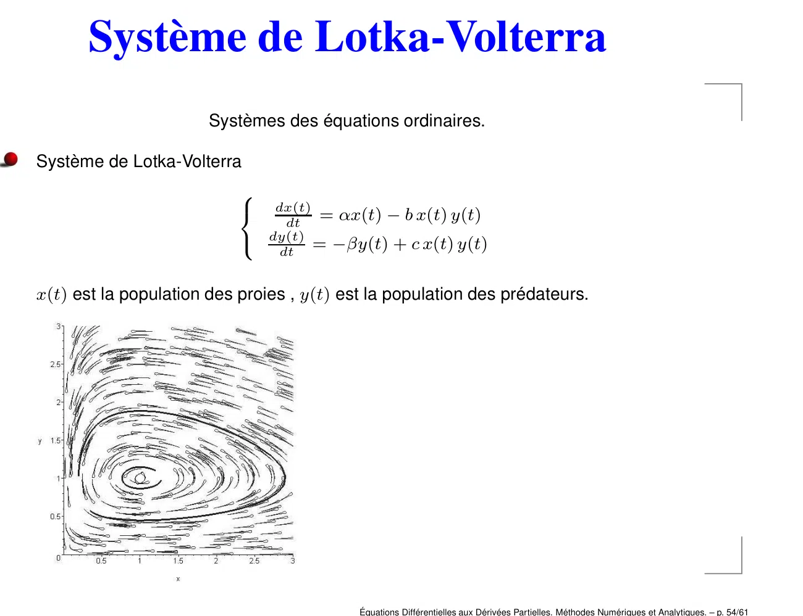

~~~text
      Système de Lotka-Volterra
                       Systèmes des équations ordinaires.

Système de Lotka-Volterra
                           
                                dx(t)
                           
                                  dt
                                      = αx(t) − b x(t) y(t)
                               dy(t)
                           
                                 dt
                                      = −βy(t) + c x(t) y(t)

x(t) est la population des proies , y(t) est la population des prédateurs.

                                           Équations Différentielles aux Dérivées Partielles. Méthodes Numériques et Analytiques. – p. 54/61
~~~

## Page 55

~~~text
            Attracteur de Lorentz
Attracteur est une courbe vers laquelle un système dynamique évolue de façon
irréversible.

Attracteur est un constituant de base de la théorie du CHAOS,
                        
                                 dx(t)
                        
                        
                                 dt
                                       = σ(y(t) − x(t))
                            dy(t)
                             dt
                                  = rx(t) − x(t)z(t) − y(t))
                        
                               dz(t)
                                      = x(t)y(t) − bz(t)
                        
                                  dt

Attracteurs expliquent aussi des cas de
passage d’un état chaotique à un état or-
donné.

Connaissance des attracteurs permet de
savoir ce qui va émerger du chaos.

Applications: Plasmas, dans les calculs
de confinement des tokamaks.

                                            Équations Différentielles aux Dérivées Partielles. Méthodes Numériques et Analytiques. – p. 55/61
~~~

## Page 56

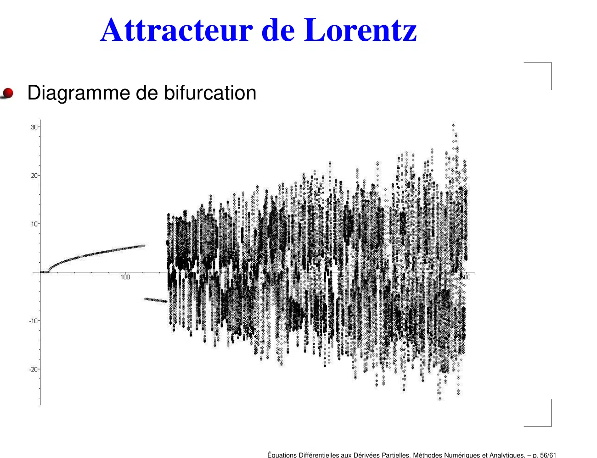

~~~text
       Attracteur de Lorentz
Diagramme de bifurcation

                           Équations Différentielles aux Dérivées Partielles. Méthodes Numériques et Analytiques. – p. 56/61
~~~

## Page 57

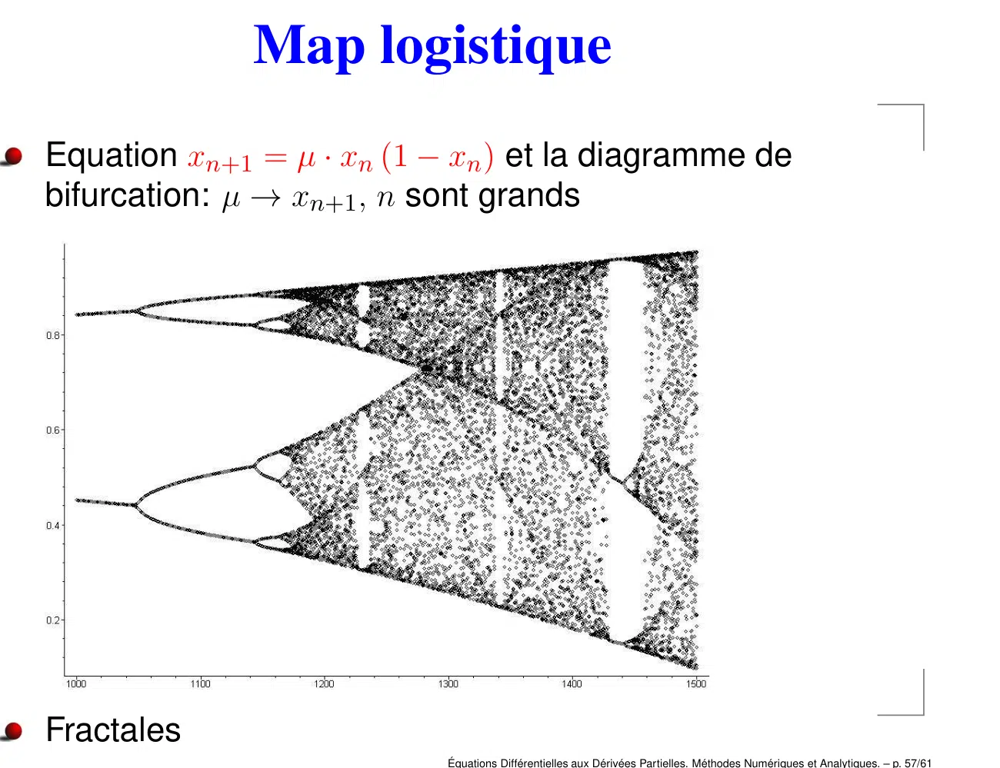

~~~text
              Map logistique
Equation xn+1 = µ · xn (1 − xn ) et la diagramme de
bifurcation: µ → xn+1 , n sont grands

Fractales
                           Équations Différentielles aux Dérivées Partielles. Méthodes Numériques et Analytiques. – p. 57/61
~~~

## Page 58

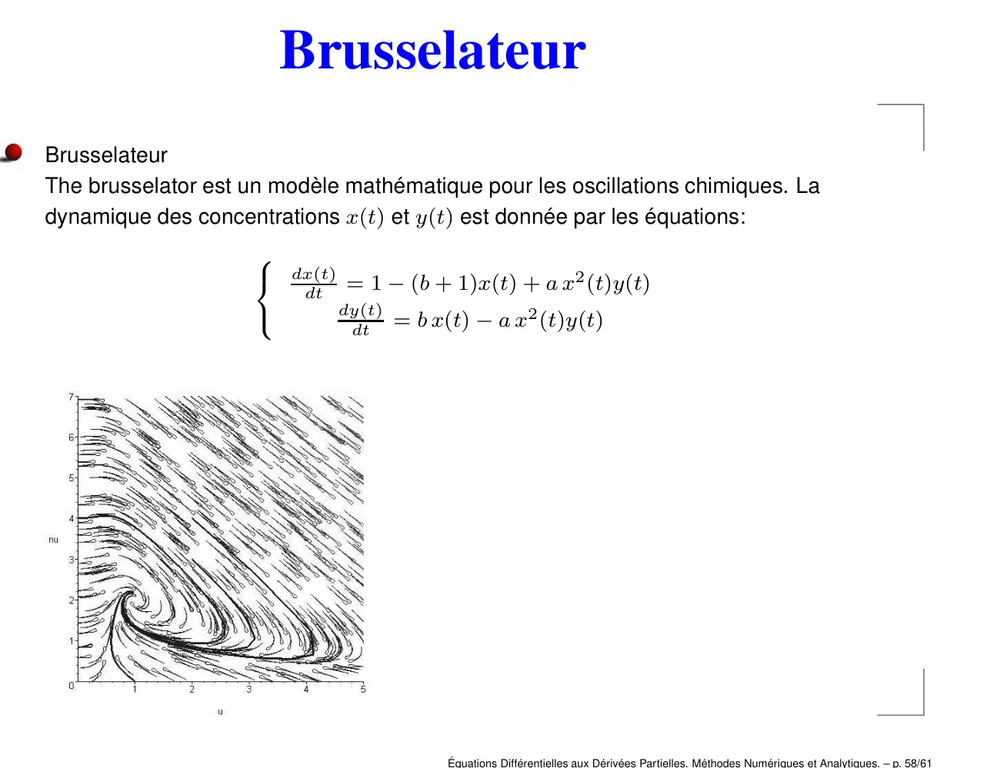

~~~text
                         Brusselateur
Brusselateur
The brusselator est un modèle mathématique pour les oscillations chimiques. La
dynamique des concentrations x(t) et y(t) est donnée par les équations:
                     
                         dx(t)
                     
                          dt
                                = 1 − (b + 1)x(t) + a x2 (t)y(t)
                               dy(t)
                     
                                dt
                                     = b x(t) − a x2 (t)y(t)

                                         Équations Différentielles aux Dérivées Partielles. Méthodes Numériques et Analytiques. – p. 58/61
~~~

## Page 59

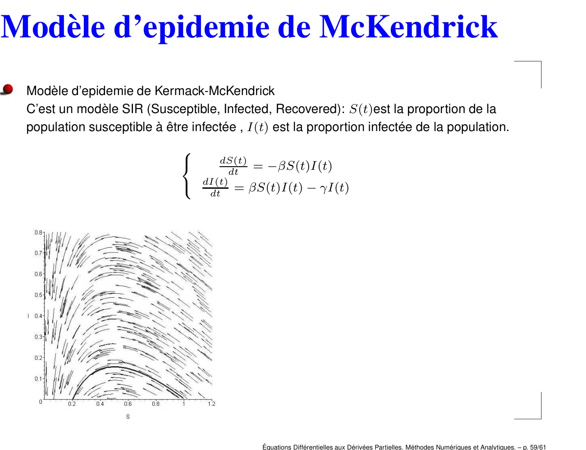

~~~text
Modèle d’epidemie de McKendrick
 Modèle d’epidemie de Kermack-McKendrick
 C’est un modèle SIR (Susceptible, Infected, Recovered): S(t)est la proportion de la
 population susceptible à être infectée , I(t) est la proportion infectée de la population.
                             
                                    dS(t)
                             
                                      dt
                                          = −βS(t)I(t)
                                 dI(t)
                             
                                  dt
                                       = βS(t)I(t) − γI(t)

                                            Équations Différentielles aux Dérivées Partielles. Méthodes Numériques et Analytiques. – p. 59/61
~~~

## Page 60

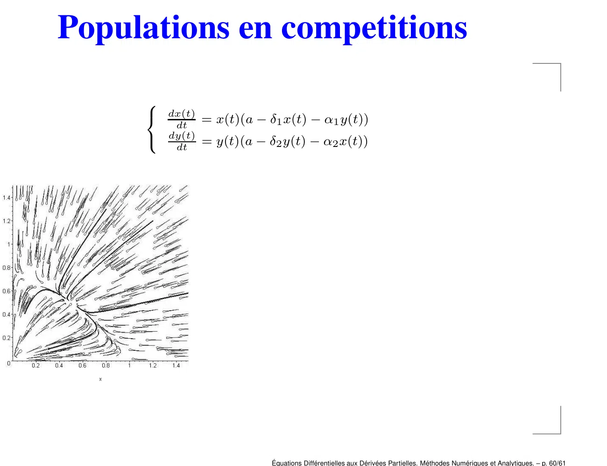

~~~text
Populations en competitions
     
         dx(t)
     
          dt
               = x(t)(a − δ1 x(t) − α1 y(t))
         dy(t)
     
          dt
               = y(t)(a − δ2 y(t) − α2 x(t))

                           Équations Différentielles aux Dérivées Partielles. Méthodes Numériques et Analytiques. – p. 60/61
~~~

## Page 61

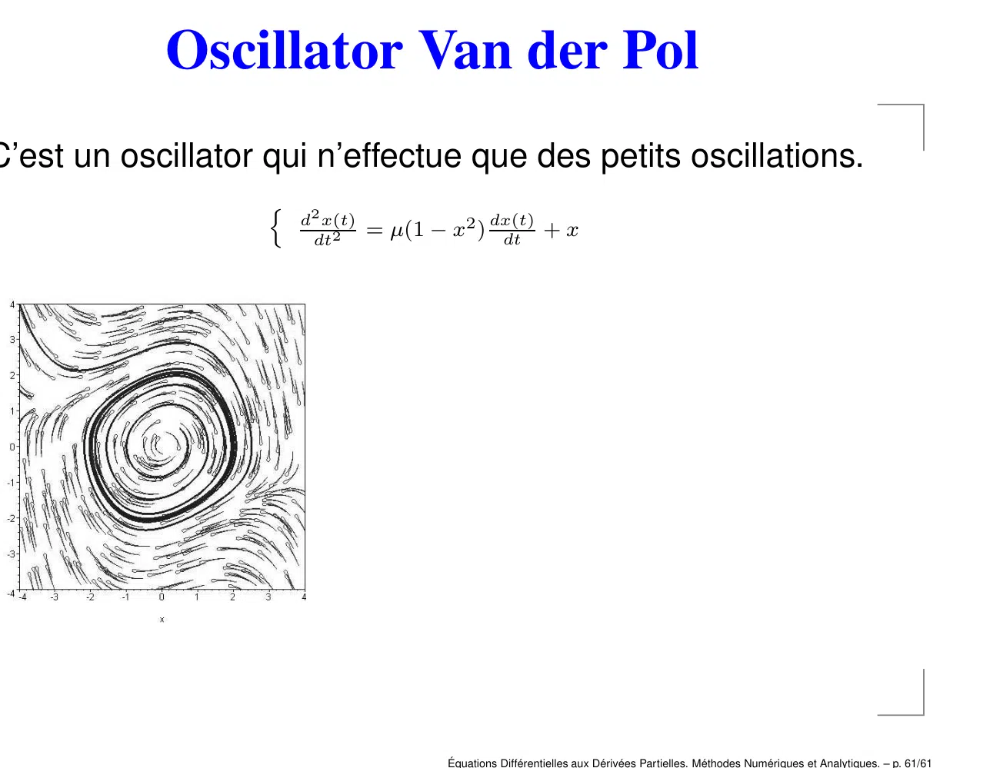

~~~text
            Oscillator Van der Pol
C’est un oscillator qui n’effectue que des petits oscillations.
                    n
                        d2 x(t)          2 ) dx(t) + x
                         dt 2   = µ(1 − x     dt

                                       Équations Différentielles aux Dérivées Partielles. Méthodes Numériques et Analytiques. – p. 61/61
~~~
